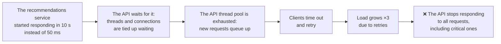
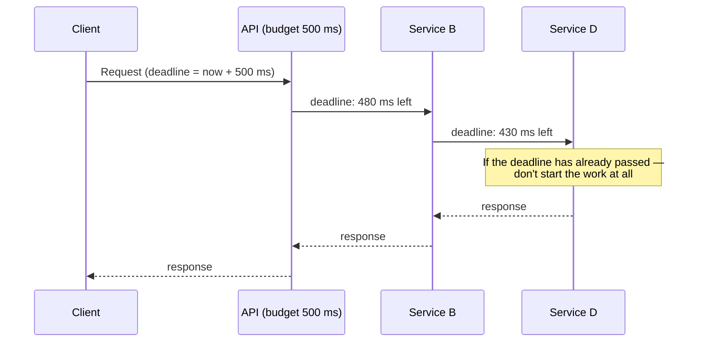
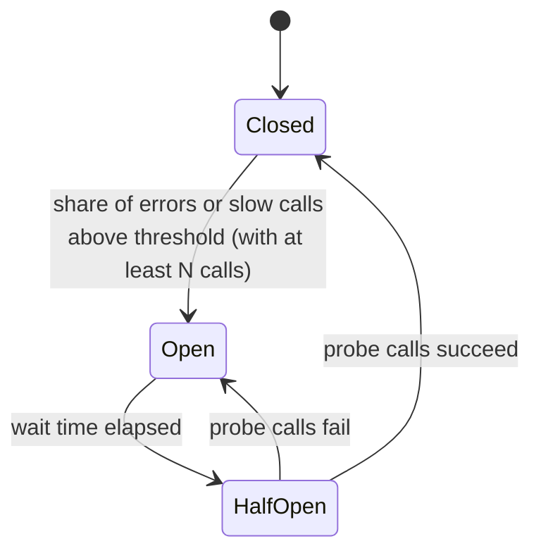
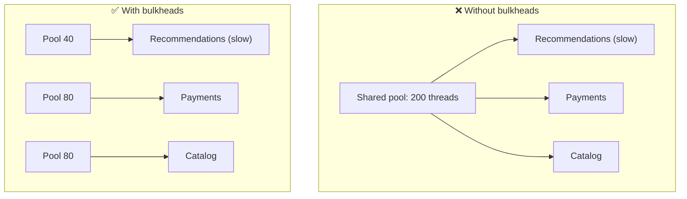
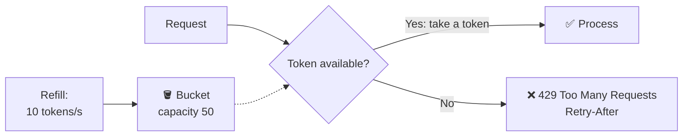
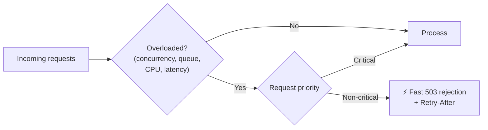
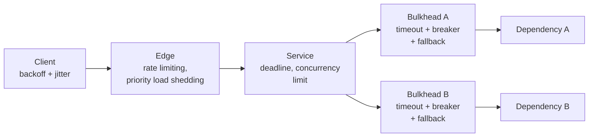

**English** | [Русский](README_RU.md)

# 13. Reliability Patterns

> **Covers:** cascading and metastable failures, availability math, timeouts and deadlines, circuit breakers, bulkheads and isolation (cells, shuffle sharding), rate limiting, load shedding and prioritization, adaptive concurrency limits, graceful degradation and fallbacks, static stability, chaos engineering, safe deployments
> **Study time:** ~5 h · **Needed for:** any system with dependencies; a must at Senior+
> **Practice:** interview-style walkthrough — [INTERVIEW.md](./INTERVIEW.md)
> **Related topics:** [10-idempotency](../10-idempotency/README.md#9-timeouts-retry-budgets-and-circuit-breakers) (retries, backoff, retry budgets), [09-messaging](../09-messaging/README.md#10-backpressure-and-flow-control) (backpressure), [01-scaling-basics](../01-scaling-basics/README.md#9-health-checks-and-server-lifecycle) (health checks)

---

## 📑 Contents

1. [Failures Are Normal: Cascades and Metastability](#1-failures-are-normal-cascades-and-metastability)
2. [Availability Math](#2-availability-math)
3. [Timeouts and Deadlines](#3-timeouts-and-deadlines)
4. [Circuit Breaker](#4-circuit-breaker)
5. [Bulkheads and Isolation](#5-bulkheads-and-isolation)
6. [Rate Limiting](#6-rate-limiting)
7. [Load Shedding and Prioritization](#7-load-shedding-and-prioritization)
8. [Graceful Degradation and Fallbacks](#8-graceful-degradation-and-fallbacks)
9. [Redundancy and Static Stability](#9-redundancy-and-static-stability)
10. [Safe Changes](#10-safe-changes)
11. [Verifying Reliability: Chaos Engineering and Game Days](#11-verifying-reliability-chaos-engineering-and-game-days)
12. [How It All Fits Together](#12-how-it-all-fits-together)
13. [How to Talk About This in an Interview](#13-how-to-talk-about-this-in-an-interview)
14. [Self-Check Questions](#14-self-check-questions)
15. [Glossary and Resources](#15-glossary-and-resources)

---

## 1. Failures Are Normal: Cascades and Metastability

In a distributed system something is **always** broken: a disk, a node, the network, a dependency, a deploy. The goal isn't to eliminate failures but to stop a **partial** failure from becoming a **total** one.

### A cascading failure



The typical chain: a slow (not a dead!) dependency → exhaustion of shared resources (threads, connections, memory) → retries increase load → the whole service and its consumers fail.

> [!IMPORTANT]
> **A slow dependency is more dangerous than a dead one.** A dead one returns an error instantly, freeing resources. A slow one holds threads and connections until the timeout — and that's exactly how a cascade spreads.

### Metastable failures

A **metastable failure** (Bronson et al., 2021) is a state in which a system **stays** failed even after the original cause is gone. A positive feedback loop keeps it there:

| Trigger | The loop that sustains the failure |
|:--------|:-----------------------------------|
| A brief load spike | Timeouts → retries → more load → more timeouts |
| A cache restart | Misses → database load → a slow database → the cache doesn't refill |
| A one-minute network outage | Millions of clients reconnect at once → servers can't keep up → clients reconnect again |

Escaping a metastable state usually requires **reducing load** below normal (dropping some traffic, stopping retries) — the system won't recover by itself.

---

## 2. Availability Math

### The nines

| Availability | Downtime per year | Per month | Per week |
|:------------:|:-----------------:|:---------:|:--------:|
| 99% | 3.65 days | 7.3 h | 1.7 h |
| 99.9% | 8.76 h | 43.8 min | 10.1 min |
| 99.95% | 4.38 h | 21.9 min | 5 min |
| 99.99% | 52.6 min | 4.4 min | 1 min |
| 99.999% | 5.3 min | 26 s | 6 s |

### Serial and parallel dependencies

```
Serial (ALL are needed):   A = a₁ × a₂ × … × aₙ
  5 dependencies at 99.9%  →  0.999⁵ ≈ 99.5%

Parallel (ANY of N replicas will do):   A = 1 − (1 − a)ⁿ
  2 replicas at 99%  →  1 − 0.01² = 99.99%
```

| Takeaway | Practice |
|:---------|:---------|
| Every synchronous dependency on the critical path **lowers** availability | Minimize synchronous dependencies on the critical path; make the rest async or give them fallbacks |
| Redundancy **raises** availability | But only if failures are independent (different AZs, different racks) |
| Correlated failures break the math | One deploy, one config, one shared dependency for all replicas → they fail together |

> [!TIP]
> SLOs, SLIs and error budgets are covered in the observability topic. Here it's enough to remember: the availability target determines how many synchronous dependencies you can afford on the critical path.

---

## 3. Timeouts and Deadlines

**Without a timeout, any call can wait forever.** It's the first and most important defense against cascades.

### Kinds of timeouts

| Timeout | What it bounds |
|:--------|:---------------|
| **Connect** | Establishing a connection (usually short: hundreds of ms) |
| **Request / read** | Waiting for the response |
| **Idle** | A connection sitting idle in the pool |
| **Overall deadline** | The whole operation, including retries |

### How to choose

- From the dependency's latency distribution: slightly above its **p99.9** in normal operation, not "5 seconds just in case".
- Within the request's **budget**: if the user request must finish in 300 ms, a dependency call can't take 2 s.
- **The outer timeout > the inner one:** otherwise the outer call is cancelled while the inner one keeps burning resources.

### Deadline propagation



- An absolute deadline is passed down the chain (gRPC does this).
- A service that receives a request with an expired deadline **doesn't execute** it: the client is no longer waiting.
- A request that **waited in a queue** longer than its deadline is dropped without processing.

---

## 4. Circuit Breaker

A **circuit breaker** (popularized by Michael Nygard's book "Release It!") stops calling a dependency that's clearly failing, giving it time to recover and saving your own resources.



| Parameter | Typical value | Why |
|:----------|:--------------|:----|
| Measurement window | The last 100 calls or 10 s | What the error rate is computed over |
| Minimum calls | 20 | Don't open on 2 errors out of 3 |
| Error threshold | 50% | When to open |
| Slow-call threshold | 50% of calls slower than X ms | React to a slow dependency, not just errors |
| Time in open | 10–60 s | Let the dependency recover |
| Probe calls in half-open | 5–10 | Check recovery carefully |

### Practices

| Practice | Why |
|:---------|:----|
| **A breaker per dependency** (sometimes per endpoint) | A problem with one method doesn't disable the others |
| **A fallback when open** | Return a cache, a default, a partial response — not just an error |
| **Count timeouts as errors** | A slow dependency is the main source of cascades |
| **Don't count client errors** (`4xx`) | A bad request isn't a sign of a failing dependency |
| **Metrics and alerts on state** | An open breaker is an important signal |

**Libraries:** Resilience4j (Java), Polly (.NET), built-in service mesh mechanisms (outlier detection in Envoy). Netflix's Hystrix is in maintenance mode, but its ideas became the standard.

---

## 5. Bulkheads and Isolation

A **bulkhead** (as in a ship) separates resources so that a problem in one compartment doesn't sink the whole ship.

### At the process level: pools per dependency



Without bulkheads, slow recommendations take all 200 threads and payments stall. With bulkheads they can only take their 40 — everything else keeps working.

| Mechanism | How |
|:----------|:----|
| **Separate thread pools** per dependency | Isolation, at the cost of thread overhead |
| **Semaphores / concurrency limits** | Cap concurrent calls to a dependency — cheaper than pools |
| **Separate connection pools** | To different databases and services |

### At the system level: separating fleets

| Approach | How |
|:---------|:----|
| **Separate clusters by criticality** | The critical path (payments, playback) doesn't share servers with non-critical work (recommendations, analytics) |
| **Tenant isolation** | A large or "noisy" customer gets dedicated resources |
| **Cell-based architecture** | The system is split into independent copies (cells), each serving a share of users. A failure or a bad deploy affects one cell |
| **Shuffle sharding** | Each customer is assigned a random combination of several nodes; different customers rarely overlap completely |

### Shuffle sharding

```
8 nodes, each customer gets 2 random nodes
Possible pairs: C(8,2) = 28

If a "poisonous" customer takes down its 2 nodes, another customer
is fully affected only if it has the same pair — a ~1/28 chance.
With 100 nodes and 5 per customer — about 75 million combinations.
```

AWS describes this in the Builders' Library ("Workload isolation using shuffle-sharding"): it greatly limits the blast radius of a single problem customer without giving each one dedicated servers.

> [!IMPORTANT]
> **Senior+ signal:** talk about **blast radius**. "If this component breaks, or a bad deploy lands, what share of users is affected?" Cells, shuffle sharding, staged deploys and bulkheads are all ways to shrink it.

---

## 6. Rate Limiting

**Rate limiting** caps the number of requests from a client per period: it protects against abuse, ensures fairness between clients and protects against overload.

### Algorithms

| Algorithm | How it works | Pros | Cons |
|:----------|:-------------|:-----|:-----|
| **Fixed window** | A counter per window (a minute); reset at the window start | Simple, little memory | A burst at window boundaries: 2× the limit in a short time |
| **Sliding log** | Store each request's time, count over the last N seconds | Exact | Lots of memory |
| **Sliding window counter** | A weighted sum of the current and previous windows | Nearly exact, little memory | Approximate |
| **Token bucket** | A bucket of N tokens refilled at rate R; a request spends a token | Allows short bursts up to N, average rate R | Must store level and time |
| **Leaky bucket** | A queue drained at a constant rate | Smooths the flow | Adds latency, allows no bursts |



### Where and by what to limit

| Level | By what |
|:------|:--------|
| Edge / API Gateway | IP, API key, user, tenant |
| Service | Calling service, operation type |
| Calls to external APIs | The limit set by the provider |

### Distributed rate limiting

- **A central counter** in Redis (atomic operations or a Lua script) — exact, but an extra network call per request.
- **Local limits** on each instance (total limit / instance count) — fast, but inaccurate with uneven load balancing.
- **Hybrid:** local tokens periodically synced with a central store.

### The response to the client

`429 Too Many Requests` + `Retry-After` + informational headers about remaining quota (the IETF is standardizing `RateLimit` headers). Designing a rate limiter in depth is a separate Tier 1 problem.

---

## 7. Load Shedding and Prioritization

**Rate limiting** protects against a specific client. **Load shedding** protects a service against **overall** overload: when there aren't enough resources for everyone, it's better to quickly reject some requests than to serve all of them slowly and fall over.



### Principles

| Principle | Why |
|:----------|:----|
| **Reject early and cheaply** | A rejection at the entry costs almost nothing; a rejection halfway through the work wastes resources |
| **Non-critical first** | Criticality classes: critical (payment, login, playback), degradable (feed, recommendations), background (prefetching, telemetry) |
| **Don't process stale requests** | A request that waited in a queue longer than the client's deadline is useless — the client has already left |
| **Bounded queues** | An unbounded queue turns overload into unbounded latency |
| **Limit by concurrency, not just RPS** | The number of in-flight requests reflects real load better when request costs vary |

### Adaptive concurrency limits

A static limit is hard to guess. **Adaptive** algorithms (analogous to TCP congestion control) find the limit themselves: while latency doesn't rise, the limit grows; when latency rises, it shrinks. An example is Netflix's concurrency-limits library.

### Queue order under overload

Facebook's "Fail at Scale" paper (2015) describes two techniques:
- **Controlled delay (CoDel)** for queues: if a queue doesn't drain within a certain time, requests that have waited long are dropped with a short timeout;
- **Adaptive LIFO:** under overload, process **newer** requests first — their clients are still waiting, while the old ones have most likely already timed out.

---

## 8. Graceful Degradation and Fallbacks

**Graceful degradation** means keeping working in a reduced mode instead of failing completely.

### A degradation ladder

| Level | What we do | Example (an online store) |
|:-----:|:-----------|:--------------------------|
| 0 | Everything works | Personal recommendations, reviews, real-time stock |
| 1 | Turn off expensive optional features | Popular products instead of personal recommendations |
| 2 | Serve stale data from cache | Prices and descriptions from cache, stock "to be confirmed" |
| 3 | Simplified pages | No reviews, filters or comparison |
| 4 | Only the critical path | The catalog from cache and checkout |
| 5 | Read-only mode or a placeholder page | "We'll be right back", with the cart preserved |

### Fallbacks: kinds and traps

| Fallback | When it fits |
|:---------|:-------------|
| Cache / stale data | Data changes rarely or staleness is acceptable |
| A default value | Settings, popular items, an empty block |
| A partial response | A page without one block |
| Deferred processing | Accept the request into a queue and execute later |
| An alternative provider | A second payment or SMS provider |

> [!WARNING]
> **Fallback traps:**
> - A fallback that calls **another** dependency can overload it during the outage.
> - A fallback that has never run in production most likely **doesn't work**. It must be exercised regularly.
> - An expensive fallback (a heavy database query instead of a cache) turns one dependency's failure into another's overload.
>
> A good fallback is **cheap, local and tested**: data prepared in advance, in memory or in a cache.

### Kill switches and brownouts

- **Kill switch / feature flag:** turn a feature off instantly without a deploy.
- **Brownout:** temporarily disable optional features for a share of requests to reduce load without shutting the service down.

### Constant work

AWS describes the "constant work" pattern: the system does **the same amount of work** in normal operation and during a failure (e.g. always shipping the full configuration rather than just changes). Then a failure doesn't create a sudden load spike — a "recovery" mode that was never tested.

---

## 9. Redundancy and Static Stability

| Practice | Essence |
|:---------|:--------|
| **N+1, N+2** | Enough capacity after losing one or two nodes (or zones) |
| **Multiple AZs** | Survives a data center failure |
| **Independent failures** | Different racks, zones, versions; don't update everything at once |
| **Health checks** | Quickly remove failing instances from rotation (see [01-scaling-basics](../01-scaling-basics/README.md#9-health-checks-and-server-lifecycle)) |

### Static stability

A **statically stable** system keeps working in its current state when its **control-plane** components are unavailable: the config service, discovery, autoscaling, the database of access rights.

| Example | Statically stable |
|:--------|:------------------|
| A service caches its configuration and continues with the last known one if the config service is down | ✅ |
| Capacity is pre-provisioned across zones with headroom, rather than added by autoscaling when a zone fails | ✅ |
| Tokens are verified locally by signature, without calling the auth service | ✅ |
| Every instance must fetch its config from an external service at startup, or it won't start | ❌ |

AWS covers this in "Static stability using Availability Zones": don't count on the control plane having time to add resources during an outage — keep headroom in advance.

---

## 10. Safe Changes

Most major incidents are caused by **changes**: deploying code, changing configuration, migrations.

| Practice | How it reduces risk |
|:---------|:--------------------|
| **Canary** | A new version first serves 1% of traffic, with automated metric comparison |
| **Staged rollout** | By cells, zones, regions — never everywhere at once |
| **Automatic rollback** | On worsening errors or latency |
| **Feature flags** | Enable a new feature for some users, disable it without a deploy |
| **Config as code** | Config changes go through review and roll out in stages too |
| **Backward-compatible migrations** | Expand → migrate → contract |
| **Change freezes** | Before peak events (sales, holidays) |

---

## 11. Verifying Reliability: Chaos Engineering and Game Days

Reliability mechanisms that have never fired most likely don't work.

| Practice | Essence |
|:---------|:--------|
| **Chaos engineering** | Controlled production experiments: a hypothesis ("losing one instance causes no errors") → inject the failure → verify. Netflix's Chaos Monkey randomly terminates instances |
| **Fault injection** | Injecting latency and errors into dependency calls (via a service mesh) — to verify timeouts, breakers and fallbacks |
| **Game days** | Planned exercises: the team rehearses a failure scenario (a zone outage, a database crash) and checks the runbook |
| **Load testing** | Find the limit before users do; verify load shedding |
| **DR drills** | An actual failover to the backup region |

**Principles:** start with a small blast radius, have a stop button for the experiment, run during working hours when the team is around.

---

## 12. How It All Fits Together



| Layer | Mechanisms |
|:------|:-----------|
| Client | Retries with backoff and jitter, a deadline, a cache |
| Edge | Rate limiting, load shedding, prioritization, WAF |
| Service | Bounded queues, adaptive concurrency limits, dropping stale requests |
| Each dependency | Timeout, bulkhead, circuit breaker, fallback, retry budget |
| Architecture | Redundancy, cells, shuffle sharding, static stability |
| Processes | Canary, staged deploys, feature flags, chaos experiments |

---

## 13. How to Talk About This in an Interview

### 30-second answer

> "The main threat isn't a crash but a slow dependency that, through shared pools and retries, turns a partial failure into a total one. So: timeouts at p99.9 and deadlines propagated down the chain; bulkheads — separate concurrency limits per dependency and separate fleets for the critical path; a circuit breaker with a cheap, pre-prepared fallback; retries only with backoff, jitter and a budget. At the entry — per-client rate limiting and priority load shedding: under overload I quickly drop non-critical traffic. A degradation ladder and kill switches. Static stability: if the control plane fails, we keep running on the last configuration. I shrink the blast radius with cells and staged deploys, and verify the mechanisms with chaos experiments."

### Questions to ask

1. What's the critical path, and what can be degraded?
2. Which synchronous dependencies are on the critical path, and what's their availability?
3. What happens if each dependency becomes 100× slower?
4. What's the blast radius of one component failing, or of one deploy?
5. How does the system recover from overload — by itself, or does someone have to cut traffic manually?

### Common mistakes

- No timeouts, or default timeouts of tens of seconds.
- One shared thread and connection pool for every dependency.
- Retries without a budget, backoff and jitter.
- A circuit breaker without a fallback, or with an expensive untested one.
- Unbounded queues.
- Dropping requests randomly, ignoring criticality.
- Recovery that requires a working control plane.
- Deploying everywhere at once.
- Reliability mechanisms that have never been tested.

---

## 14. Self-Check Questions

<details>
<summary><b>1. Why is a slow dependency more dangerous than a dead one?</b></summary>

A dead one returns an error quickly, and the caller's resources are freed. A slow one holds threads, connections and memory until the timeout; with a large request flow this exhausts shared pools, and even calls unrelated to it stall.
</details>

<details>
<summary><b>2. What is a metastable failure?</b></summary>

A state in which a system stays failed after the original cause is gone, because a positive feedback loop sustains it (e.g. timeouts → retries → more load → more timeouts). Escaping usually requires reducing load below normal.
</details>

<details>
<summary><b>3. How do five synchronous dependencies at 99.9% affect availability?</b></summary>

They multiply: 0.999⁵ ≈ 99.5%. Each synchronous dependency on the critical path lowers overall availability, so their number is minimized and the rest are made async or given fallbacks.
</details>

<details>
<summary><b>4. How do you choose a timeout for a dependency call?</b></summary>

From its latency distribution — slightly above p99.9 in normal operation — and within the user request's budget. Inner timeouts must be shorter than outer ones, and the overall deadline is propagated down the chain.
</details>

<details>
<summary><b>5. Why does a circuit breaker consider slow calls, not just errors?</b></summary>

Because the main threat is a slow dependency: it may return almost no errors but hold resources. A threshold on the share of slow calls opens the breaker before pools are exhausted.
</details>

<details>
<summary><b>6. What is a bulkhead and how do you implement it?</b></summary>

Separating resources so one dependency's problem can't take resources from others: separate thread pools or semaphores per dependency, separate connection pools, separate clusters for critical and non-critical traffic, tenant isolation, cells.
</details>

<details>
<summary><b>7. How does shuffle sharding work?</b></summary>

Each customer is assigned a random combination of several nodes. If a problem customer takes down its nodes, other customers are fully affected only if they have the same combination, which is very unlikely when there are many combinations.
</details>

<details>
<summary><b>8. How is load shedding different from rate limiting?</b></summary>

Rate limiting caps a specific client by its quota, even if the service isn't overloaded. Load shedding kicks in when the service as a whole is overloaded and drops some requests (non-critical first) to keep serving the rest.
</details>

<details>
<summary><b>9. What makes a good fallback?</b></summary>

Cheap, local and regularly exercised: data prepared in advance in memory or a cache, a default value, a partial response. A bad fallback calls another dependency or runs a heavy query, shifting the overload there.
</details>

<details>
<summary><b>10. What is static stability?</b></summary>

The ability to keep working in the current state when control-plane components (configuration, discovery, autoscaling) are unavailable: using the last known configuration, local token verification, pre-provisioned capacity headroom.
</details>

---

## 15. Glossary and Resources

### Glossary

| Term | Meaning |
|:-----|:--------|
| Cascading failure | One component's failure spreading to others |
| Metastable failure | A failure sustained by a feedback loop after the cause is gone |
| Deadline | The absolute time by which an operation must finish, propagated down the chain |
| Circuit breaker | Automatically stopping calls to a failing dependency |
| Bulkhead | Isolating resources between dependencies or parts of a system |
| Cell | An independent copy of a system serving a share of users |
| Shuffle sharding | Assigning each customer a random combination of nodes |
| Blast radius | The share of users affected by a failure |
| Rate limiting | Capping the number of requests from a client |
| Token bucket | A rate-limiting algorithm with a bucket of tokens |
| Load shedding | Dropping some requests under overload |
| Adaptive concurrency limit | An in-flight request limit tuned by latency |
| Graceful degradation | Running in a reduced mode instead of failing completely |
| Fallback | A backup response when a dependency is unavailable |
| Kill switch | Instantly turning a feature off without a deploy |
| Static stability | Operating without access to the control plane |
| Chaos engineering | Controlled failure experiments in production |

### Resources

- Michael Nygard, *Release It!* (2nd ed., 2018) — circuit breakers, bulkheads, timeouts
- Google SRE Book — chapters "Handling Overload" and "Addressing Cascading Failures"
- Ben Maurer, *Fail at Scale: Reliability in the face of rapid change* (ACM Queue, 2015)
- Bronson et al., *Metastable Failures in Distributed Systems* (HotOS 2021)
- Amazon Builders' Library: *Using load shedding to avoid overload*; *Workload isolation using shuffle-sharding*; *Static stability using Availability Zones*; *Avoiding insurmountable queue backlogs*; *Reliability, constant work, and a good cup of coffee*
- Netflix Tech Blog: *Performance Under Load* (adaptive concurrency limits)
- *Principles of Chaos Engineering* (principlesofchaos.org)
- Resilience4j and Envoy documentation (outlier detection, circuit breaking)