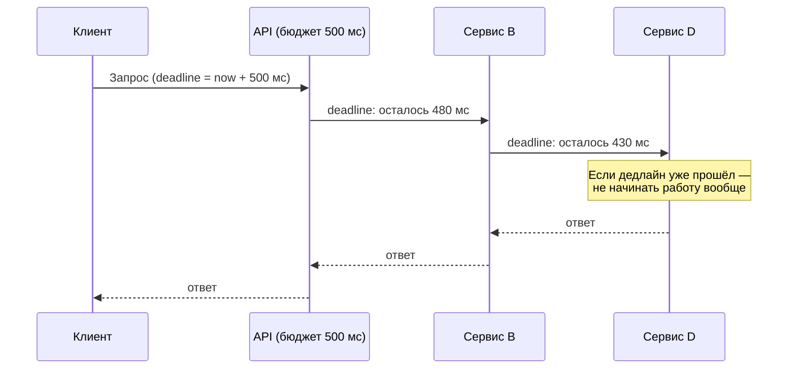
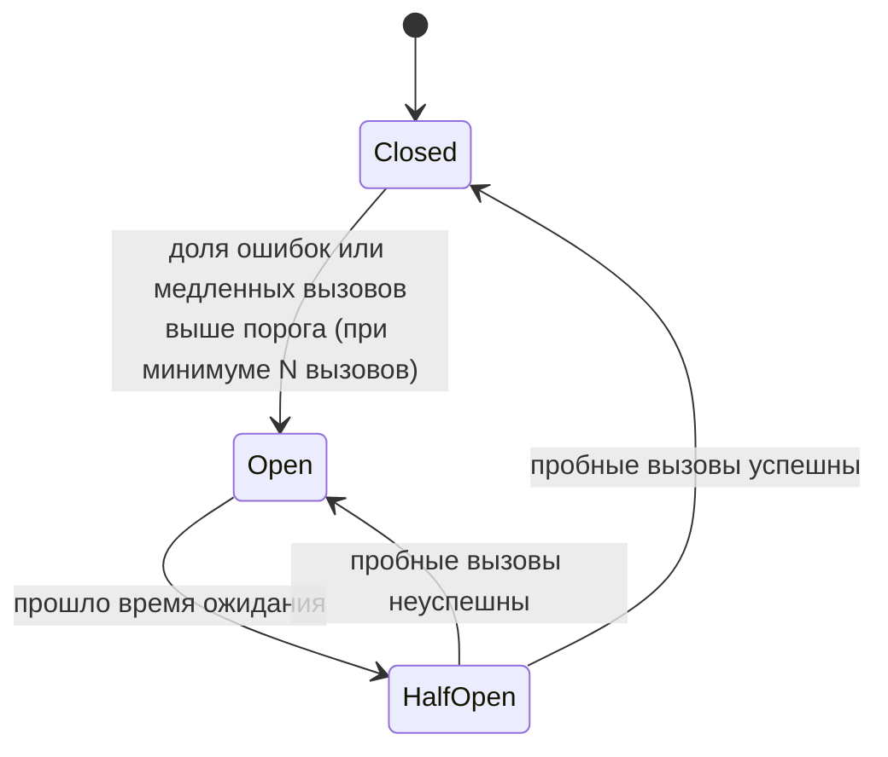
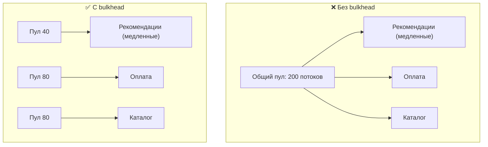
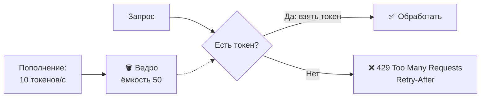
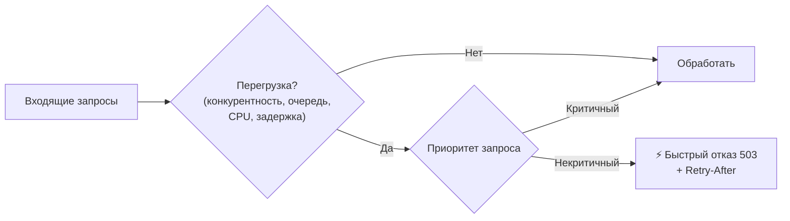
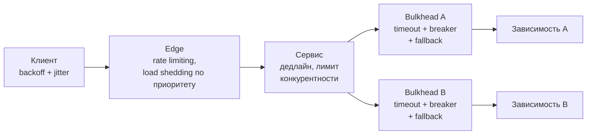

[English](README.md) | **Русский**

# 13. Паттерны надёжности

> **Что внутри:** каскадные и метастабильные сбои, математика доступности, таймауты и дедлайны, circuit breaker, bulkhead и изоляция (cells, shuffle sharding), rate limiting, load shedding и приоритизация, адаптивные лимиты конкурентности, graceful degradation и fallback, статическая стабильность, хаос-инжиниринг, безопасные деплои
> **Время на изучение:** ~5 ч · **Нужно для:** любой системы с зависимостями; обязательно на уровне Senior+
> **Практика:** разбор в формате интервью — [INTERVIEW_RU.md](./INTERVIEW_RU.md)
> **Связанные темы:** [10-idempotency](../10-idempotency/README_RU.md#9-таймауты-retry-budget-и-circuit-breaker) (ретраи, backoff, retry budget), [09-messaging](../09-messaging/README_RU.md#10-backpressure-и-управление-потоком) (backpressure), [01-scaling-basics](../01-scaling-basics/README_RU.md#9-health-checks-и-жизненный-цикл-сервера) (health checks)

---

## 📑 Содержание

1. [Сбои нормальны: каскады и метастабильность](#1-сбои-нормальны-каскады-и-метастабильность)
2. [Математика доступности](#2-математика-доступности)
3. [Таймауты и дедлайны](#3-таймауты-и-дедлайны)
4. [Circuit breaker](#4-circuit-breaker)
5. [Bulkhead и изоляция](#5-bulkhead-и-изоляция)
6. [Rate limiting](#6-rate-limiting)
7. [Load shedding и приоритизация](#7-load-shedding-и-приоритизация)
8. [Graceful degradation и fallback](#8-graceful-degradation-и-fallback)
9. [Избыточность и статическая стабильность](#9-избыточность-и-статическая-стабильность)
10. [Безопасные изменения](#10-безопасные-изменения)
11. [Проверка надёжности: хаос-инжиниринг и game days](#11-проверка-надёжности-хаос-инжиниринг-и-game-days)
12. [Как всё складывается вместе](#12-как-всё-складывается-вместе)
13. [Как говорить об этом на интервью](#13-как-говорить-об-этом-на-интервью)
14. [Вопросы для самопроверки](#14-вопросы-для-самопроверки)
15. [Глоссарий и ресурсы](#15-глоссарий-и-ресурсы)

---

## 1. Сбои нормальны: каскады и метастабильность

В распределённой системе что-то сломано **всегда**: диск, узел, сеть, зависимость, деплой. Задача — не исключить сбои, а не дать **частичному** сбою стать **полным**.

### Каскадный сбой


Типичная цепочка: медленная (а не упавшая!) зависимость → исчерпание общих ресурсов (потоки, соединения, память) → ретраи увеличивают нагрузку → отказ всего сервиса и его потребителей.

> [!IMPORTANT]
> **Медленная зависимость опаснее упавшей.** Упавшая отвечает ошибкой мгновенно, и ресурсы освобождаются. Медленная держит потоки и соединения до таймаута — и именно так распространяется каскад.

### Метастабильные сбои

**Метастабильный сбой** (Bronson и соавторы, 2021) — состояние, в котором система **остаётся** в отказе даже после того, как исходная причина устранена. Её удерживает петля положительной обратной связи:

| Триггер | Петля, которая удерживает сбой |
|:--------|:-------------------------------|
| Кратковременный всплеск нагрузки | Таймауты → ретраи → ещё больше нагрузки → ещё больше таймаутов |
| Перезапуск кэша | Промахи → нагрузка на базу → база медленная → кэш не заполняется |
| Сбой сети на минуту | Миллионы клиентов переподключаются одновременно → серверы не успевают → клиенты снова переподключаются |

Выход из метастабильного состояния обычно требует **снизить нагрузку** ниже исходной (отбросить часть трафика, остановить ретраи) — система не восстановится сама.

---

## 2. Математика доступности

### Девятки

| Доступность | Простой в год | Простой в месяц | Простой в неделю |
|:-----------:|:-------------:|:---------------:|:----------------:|
| 99% | 3,65 дня | 7,3 ч | 1,7 ч |
| 99,9% | 8,76 ч | 43,8 мин | 10,1 мин |
| 99,95% | 4,38 ч | 21,9 мин | 5 мин |
| 99,99% | 52,6 мин | 4,4 мин | 1 мин |
| 99,999% | 5,3 мин | 26 с | 6 с |

### Последовательные и параллельные зависимости

```
Последовательно (нужны ВСЕ):   A = a₁ × a₂ × … × aₙ
  5 зависимостей по 99,9%  →  0,999⁵ ≈ 99,5%

Параллельно (нужна ЛЮБАЯ из N реплик):   A = 1 − (1 − a)ⁿ
  2 реплики по 99%  →  1 − 0,01² = 99,99%
```

| Вывод | Практика |
|:------|:---------|
| Каждая синхронная зависимость на критичном пути **снижает** доступность | Минимум синхронных зависимостей на критичном пути; остальное — асинхронно или с fallback |
| Избыточность **повышает** доступность | Но только если отказы независимы (разные AZ, разные стойки) |
| Коррелированные отказы ломают математику | Один деплой, одна конфигурация, одна зависимость у всех реплик → они падают вместе |

> [!TIP]
> SLO, SLI и error budget подробно разбираются в теме про observability. Здесь достаточно помнить: целевая доступность определяет, сколько синхронных зависимостей можно позволить на критичном пути.

---

## 3. Таймауты и дедлайны

**Без таймаута любой вызов может ждать вечно.** Это первая и самая важная защита от каскадов.

### Виды таймаутов

| Таймаут | Что ограничивает |
|:--------|:-----------------|
| **Connect** | Установку соединения (обычно короткий: сотни мс) |
| **Request / read** | Ожидание ответа |
| **Idle** | Простой соединения в пуле |
| **Общий дедлайн** | Время всей операции, включая ретраи |

### Как выбирать

- По распределению задержек зависимости: чуть выше её **p99.9** в нормальном режиме, а не «5 секунд на всякий случай».
- С учётом **бюджета** запроса: если пользовательский запрос должен завершиться за 300 мс, вызов зависимости не может длиться 2 с.
- **Внешний таймаут > внутреннего:** иначе внешний вызов отменится, а внутренний продолжит тратить ресурсы.

### Распространение дедлайна



- Абсолютный дедлайн передаётся по цепочке (так делает gRPC).
- Сервис, получивший запрос с истёкшим дедлайном, **не выполняет** его: клиент уже не ждёт.
- Запрос, который **ждал в очереди** дольше дедлайна, отбрасывается без обработки.

---

## 4. Circuit breaker

**Circuit breaker** (автоматический выключатель, популяризирован в книге Майкла Найгарда «Release It!») перестаёт вызывать зависимость, которая явно неисправна, давая ей восстановиться и экономя свои ресурсы.



| Параметр | Типичное значение | Зачем |
|:---------|:------------------|:------|
| Окно измерения | Последние 100 вызовов или 10 с | На чём считать долю ошибок |
| Минимум вызовов | 20 | Не открываться из-за 2 ошибок из 3 |
| Порог ошибок | 50% | Когда открываться |
| Порог медленных вызовов | 50% вызовов дольше X мс | Реагировать на медленную зависимость, а не только на ошибки |
| Время в open | 10–60 с | Дать зависимости восстановиться |
| Пробных вызовов в half-open | 5–10 | Проверить восстановление осторожно |

### Практики

| Практика | Почему |
|:---------|:-------|
| **Breaker на зависимость** (иногда на эндпоинт) | Проблема одного метода не отключает другие |
| **Fallback при open** | Вернуть кэш, значение по умолчанию, частичный ответ — а не просто ошибку |
| **Считать таймауты ошибками** | Медленная зависимость — главный источник каскадов |
| **Не считать ошибки клиента** (`4xx`) | Неверный запрос — не признак неисправности зависимости |
| **Метрики и алерты на состояние** | Открытый breaker — важный сигнал |

**Библиотеки:** Resilience4j (Java), Polly (.NET), встроенные механизмы service mesh (outlier detection в Envoy). Hystrix от Netflix в режиме поддержки, но его идеи стали стандартом.

---

## 5. Bulkhead и изоляция

**Bulkhead** (переборка, как в корабле) — разделение ресурсов, чтобы проблема в одном отсеке не потопила весь корабль.

### Уровень процесса: пулы на зависимость



Без bulkhead медленные рекомендации занимают все 200 потоков, и оплата встаёт. С bulkhead они могут занять только свои 40 — остальное продолжает работать.

| Механизм | Как |
|:---------|:----|
| **Отдельные пулы потоков** на зависимость | Изоляция, но накладные расходы на потоки |
| **Семафоры / лимиты конкурентности** | Ограничить число одновременных вызовов зависимости — дешевле пулов |
| **Отдельные пулы соединений** | К разным базам и сервисам |

### Уровень системы: разделение флотов

| Подход | Как |
|:-------|:----|
| **Отдельные кластеры по критичности** | Критичный путь (оплата, воспроизведение) не делит серверы с некритичным (рекомендации, аналитика) |
| **Изоляция тенантов** | Крупный или «шумный» клиент — на выделенных ресурсах |
| **Cell-based architecture** | Система делится на независимые копии (cells), каждая обслуживает часть пользователей. Сбой или плохой деплой затрагивает одну cell |
| **Shuffle sharding** | Каждому клиенту назначается случайная комбинация из нескольких узлов; разные клиенты почти не пересекаются полностью |

### Shuffle sharding

```
8 узлов, каждому клиенту — 2 случайных узла
Число возможных пар: C(8,2) = 28

Если «ядовитый» клиент кладёт свои 2 узла, другой клиент
пострадает полностью, только если у него та же пара — шанс ~1/28.
С 100 узлами и 5 на клиента комбинаций — около 75 миллионов.
```

AWS описывает этот подход в Builders' Library («Workload isolation using shuffle-sharding»): он сильно ограничивает радиус поражения от одного проблемного клиента без выделения каждому отдельных серверов.

> [!IMPORTANT]
> **Сигнал Senior+:** говорить о **радиусе поражения (blast radius)**. «Если этот компонент сломается или придёт плохой деплой, какая доля пользователей пострадает?» Cells, shuffle sharding, поэтапные деплои и bulkheads — всё это способы уменьшить радиус.

---

## 6. Rate limiting

**Rate limiting** ограничивает число запросов от клиента за период: защищает от злоупотреблений, обеспечивает справедливость между клиентами и защищает от перегрузки.

### Алгоритмы

| Алгоритм | Как работает | Плюсы | Минусы |
|:---------|:-------------|:------|:-------|
| **Fixed window** | Счётчик на окно (минута); сброс в начале окна | Просто, мало памяти | Всплеск на границе окон: 2× лимит за короткое время |
| **Sliding log** | Хранить время каждого запроса, считать за последние N секунд | Точно | Много памяти |
| **Sliding window counter** | Взвешенная сумма текущего и предыдущего окна | Почти точно, мало памяти | Приближение |
| **Token bucket** | Ведро на N токенов пополняется со скоростью R; запрос тратит токен | Разрешает короткие всплески до N, средняя скорость R | Нужно хранить уровень и время |
| **Leaky bucket** | Очередь, из которой запросы уходят с постоянной скоростью | Сглаживает поток | Добавляет задержку, не допускает всплесков |



### Где и по чему ограничивать

| Уровень | По чему |
|:--------|:--------|
| Edge / API Gateway | IP, API-ключ, пользователь, тенант |
| Сервис | Вызывающий сервис, тип операции |
| Вызовы внешних API | Лимит, установленный провайдером |

### Распределённый rate limiting

- **Централизованный счётчик** в Redis (атомарные операции или Lua-скрипт) — точно, но лишний сетевой вызов на запрос.
- **Локальные лимиты** на каждом инстансе (общий лимит / число инстансов) — быстро, но неточно при неравномерной балансировке.
- **Гибрид:** локальные токены, периодически синхронизируемые с центром.

### Ответ клиенту

`429 Too Many Requests` + `Retry-After` + информационные заголовки об остатке лимита (в IETF идёт стандартизация заголовков `RateLimit`). Подробно проектирование rate limiter — отдельная задача из Tier 1.

---

## 7. Load shedding и приоритизация

**Rate limiting** защищает от конкретного клиента. **Load shedding** защищает сервис от **общей** перегрузки: когда ресурсов не хватает на всех, лучше быстро отказать части запросов, чем медленно обслуживать все и упасть.



### Принципы

| Принцип | Почему |
|:--------|:-------|
| **Отказывать рано и дёшево** | Отказ на входе почти ничего не стоит; отказ после половины работы — потраченные ресурсы |
| **Сначала некритичное** | Классы критичности: критичный (оплата, вход, воспроизведение), деградируемый (лента, рекомендации), фоновый (предзагрузка, телеметрия) |
| **Не обрабатывать устаревшее** | Запрос, ждавший в очереди дольше дедлайна клиента, бесполезен — клиент уже ушёл |
| **Ограниченные очереди** | Бесконечная очередь превращает перегрузку в бесконечную задержку |
| **Ограничивать по конкурентности, а не только по RPS** | Число одновременных запросов лучше отражает реальную нагрузку при меняющейся стоимости запросов |

### Адаптивные лимиты конкурентности

Статический лимит сложно угадать. **Адаптивные** алгоритмы (по аналогии с управлением перегрузкой в TCP) сами подбирают лимит: пока задержка не растёт — лимит увеличивается, при росте задержки — уменьшается. Пример — библиотека concurrency-limits от Netflix.

### Порядок очереди под перегрузкой

Facebook в статье «Fail at Scale» (2015) описывает два приёма:
- **Controlled delay (CoDel)** для очередей: если очередь не опустошается за определённое время, запросы с долгим ожиданием отбрасываются с коротким таймаутом;
- **Adaptive LIFO:** при перегрузке обрабатывать сначала **новые** запросы — их клиенты ещё ждут, а старые, скорее всего, уже ушли по таймауту.

---

## 8. Graceful degradation и fallback

**Graceful degradation** — продолжать работать в урезанном режиме вместо полного отказа.

### Лестница деградации

| Уровень | Что делаем | Пример (интернет-магазин) |
|:-------:|:-----------|:--------------------------|
| 0 | Всё работает | Персональные рекомендации, отзывы, наличие в реальном времени |
| 1 | Отключаем дорогие необязательные функции | Вместо персональных рекомендаций — популярные товары |
| 2 | Отдаём устаревшие данные из кэша | Цены и описания из кэша, наличие — «уточняется» |
| 3 | Упрощённые страницы | Без отзывов, фильтров и сравнения |
| 4 | Только критичный путь | Каталог из кэша и оформление заказа |
| 5 | Режим «только чтение» или страница-заглушка | «Мы скоро вернёмся» с сохранением корзины |

### Fallback: виды и ловушки

| Fallback | Когда подходит |
|:---------|:---------------|
| Кэш / устаревшие данные | Данные меняются редко или устарелость допустима |
| Значение по умолчанию | Настройки, популярные элементы, пустой блок |
| Частичный ответ | Страница без одного блока |
| Отложенная обработка | Принять запрос в очередь и выполнить позже |
| Альтернативный провайдер | Второй платёжный или SMS-провайдер |

> [!WARNING]
> **Ловушки fallback:**
> - Fallback, который вызывает **другую** зависимость, может сам перегрузить её в момент сбоя.
> - Fallback, который никогда не выполнялся в продакшене, скорее всего, **не работает**. Его надо регулярно проверять.
> - Дорогой fallback (тяжёлый запрос к базе вместо кэша) превращает сбой одной зависимости в перегрузку другой.
>
> Хороший fallback — **дешёвый, локальный и проверенный**: заранее подготовленные данные в памяти или в кэше.

### Kill switches и brownout

- **Kill switch / feature flag:** мгновенно выключить функцию без деплоя.
- **Brownout:** временно отключать необязательные функции для части запросов, чтобы снизить нагрузку, не отключая сервис.

### Constant work

AWS описывает паттерн «постоянной работы»: система выполняет **одинаковый объём работы** в нормальном режиме и при сбое (например, всегда передаёт полную конфигурацию, а не только изменения). Тогда сбой не создаёт внезапного всплеска нагрузки — режима «восстановления», который никогда не тестировался.

---

## 9. Избыточность и статическая стабильность

| Практика | Суть |
|:---------|:-----|
| **N+1, N+2** | Ёмкости хватает при потере одного или двух узлов (или зон) |
| **Несколько AZ** | Переживает отказ дата-центра |
| **Независимость отказов** | Разные стойки, зоны, версии; не обновлять всё одновременно |
| **Health checks** | Быстро выводить неисправные экземпляры из ротации (см. [01-scaling-basics](../01-scaling-basics/README_RU.md#9-health-checks-и-жизненный-цикл-сервера)) |

### Статическая стабильность

**Статически стабильная** система продолжает работать в текущем состоянии, когда её **управляющие** компоненты (control plane) недоступны: сервис конфигурации, discovery, автоскейлинг, база с правами доступа.

| Пример | Статически стабильно |
|:-------|:---------------------|
| Сервис кэширует конфигурацию и продолжает с последней известной, если сервис конфигурации упал | ✅ |
| Ёмкость заранее распределена по зонам с запасом, а не добавляется автоскейлингом при отказе зоны | ✅ |
| Токены проверяются локально по подписи, без похода в сервис авторизации | ✅ |
| При старте каждый экземпляр обязан получить конфигурацию из внешнего сервиса, иначе не запускается | ❌ |

AWS разбирает это в статье «Static stability using Availability Zones»: не рассчитывай на то, что во время сбоя control plane успеет добавить ресурсы — держи запас заранее.

---

## 10. Безопасные изменения

Большая часть крупных инцидентов вызвана **изменениями**: деплоем кода, сменой конфигурации, миграцией.

| Практика | Как снижает риск |
|:---------|:-----------------|
| **Canary** | Новая версия сначала на 1% трафика, автоматическое сравнение метрик |
| **Поэтапный раскат** | По cells, зонам, регионам — никогда везде одновременно |
| **Автоматический откат** | По ухудшению ошибок или задержки |
| **Feature flags** | Включить новую функцию для части пользователей, выключить без деплоя |
| **Конфигурация как код** | Изменения конфигурации проходят ревью и раскатываются так же поэтапно |
| **Обратно совместимые миграции** | Expand → migrate → contract |
| **Заморозка изменений** | Перед пиковыми событиями (распродажи, праздники) |

---

## 11. Проверка надёжности: хаос-инжиниринг и game days

Механизмы надёжности, которые никогда не срабатывали, скорее всего, не работают.

| Практика | Суть |
|:---------|:-----|
| **Хаос-инжиниринг** | Контролируемые эксперименты в продакшене: гипотеза («при отказе одного экземпляра ошибок не будет») → внедрение сбоя → проверка. Netflix Chaos Monkey случайно отключает экземпляры |
| **Fault injection** | Внедрение задержек и ошибок в вызовы зависимостей (через service mesh) — проверить таймауты, breaker и fallback |
| **Game days** | Запланированные учения: команда отрабатывает сценарий сбоя (отказ зоны, падение базы) и проверяет runbook |
| **Нагрузочное тестирование** | Найти предел до того, как его найдут пользователи; проверить load shedding |
| **DR-учения** | Реальное переключение на резервный регион |

**Принципы:** начинать с малого радиуса поражения, иметь кнопку остановки эксперимента, проводить в рабочее время, когда команда на месте.

---

## 12. Как всё складывается вместе



| Слой | Механизмы |
|:-----|:----------|
| Клиент | Ретраи с backoff и jitter, дедлайн, кэш |
| Edge | Rate limiting, load shedding, приоритизация, WAF |
| Сервис | Ограниченные очереди, адаптивные лимиты конкурентности, отбрасывание устаревших запросов |
| Каждая зависимость | Таймаут, bulkhead, circuit breaker, fallback, retry budget |
| Архитектура | Избыточность, cells, shuffle sharding, статическая стабильность |
| Процессы | Canary, поэтапные деплои, feature flags, хаос-эксперименты |

---

## 13. Как говорить об этом на интервью

### Ответ за 30 секунд

> «Главная угроза — не падение, а медленная зависимость, которая через общие пулы и ретраи превращает частичный сбой в полный. Поэтому: таймауты по p99.9 и дедлайны, передаваемые по цепочке; bulkhead — отдельные лимиты конкурентности на каждую зависимость и отдельные флоты для критичного пути; circuit breaker с дешёвым заранее подготовленным fallback; ретраи только с backoff, jitter и бюджетом. На входе — rate limiting по клиентам и load shedding по приоритету: при перегрузке быстро отбрасываю некритичное. Лестница деградации и kill switches. Статическая стабильность: при сбое control plane работаем на последней конфигурации. Радиус поражения уменьшаю cells и поэтапными деплоями, а механизмы проверяю хаос-экспериментами».

### Вопросы, которые стоит задать

1. Какой путь критичный, а что можно деградировать?
2. Какие синхронные зависимости на критичном пути и какова их доступность?
3. Что произойдёт, если каждая зависимость станет в 100 раз медленнее?
4. Какой радиус поражения у сбоя одного компонента или одного деплоя?
5. Как система выйдет из перегрузки — сама, или нужна ручная остановка трафика?

### Типичные ошибки

- Нет таймаутов или таймауты по умолчанию в десятки секунд.
- Общий пул потоков и соединений на все зависимости.
- Ретраи без бюджета, backoff и jitter.
- Circuit breaker без fallback или с дорогим непроверенным fallback.
- Бесконечные очереди.
- Отбрасывать запросы случайно, не учитывая критичность.
- Восстановление требует работающего control plane.
- Деплой везде одновременно.
- Механизмы надёжности, которые никогда не проверялись.

---

## 14. Вопросы для самопроверки

<details>
<summary><b>1. Почему медленная зависимость опаснее упавшей?</b></summary>

Упавшая отвечает ошибкой быстро, и ресурсы вызывающего освобождаются. Медленная держит потоки, соединения и память до таймаута; при большом потоке запросов это исчерпывает общие пулы, и встают даже вызовы, не связанные с ней.
</details>

<details>
<summary><b>2. Что такое метастабильный сбой?</b></summary>

Состояние, в котором система остаётся в отказе после исчезновения исходной причины, потому что её удерживает петля положительной обратной связи (например, таймауты → ретраи → больше нагрузки → больше таймаутов). Для выхода обычно нужно снизить нагрузку ниже нормальной.
</details>

<details>
<summary><b>3. Как пять синхронных зависимостей по 99,9% влияют на доступность?</b></summary>

Они перемножаются: 0,999⁵ ≈ 99,5%. Каждая синхронная зависимость на критичном пути снижает итоговую доступность, поэтому их число минимизируют, а остальные делают асинхронными или с fallback.
</details>

<details>
<summary><b>4. Как выбрать таймаут для вызова зависимости?</b></summary>

По её распределению задержек — немного выше p99.9 в нормальном режиме — и с учётом бюджета пользовательского запроса. Внутренние таймауты должны быть меньше внешних, а общий дедлайн передаётся по цепочке.
</details>

<details>
<summary><b>5. Зачем circuit breaker учитывает медленные вызовы, а не только ошибки?</b></summary>

Потому что главная угроза — медленная зависимость: она может почти не возвращать ошибок, но держать ресурсы. Порог по доле медленных вызовов открывает breaker раньше, чем исчерпаются пулы.
</details>

<details>
<summary><b>6. Что такое bulkhead и как его реализовать?</b></summary>

Разделение ресурсов, чтобы проблема одной зависимости не забрала ресурсы у других: отдельные пулы потоков или семафоры на зависимость, отдельные пулы соединений, отдельные кластеры для критичного и некритичного трафика, изоляция тенантов, cells.
</details>

<details>
<summary><b>7. Как работает shuffle sharding?</b></summary>

Каждому клиенту назначается случайная комбинация из нескольких узлов. Если проблемный клиент выводит из строя свои узлы, другие клиенты пострадают полностью, только если у них та же комбинация, а вероятность этого очень мала при большом числе комбинаций.
</details>

<details>
<summary><b>8. Чем load shedding отличается от rate limiting?</b></summary>

Rate limiting ограничивает конкретного клиента по его квоте, даже если сервис не перегружен. Load shedding включается при общей перегрузке сервиса и отбрасывает часть запросов (сначала некритичные), чтобы сохранить обслуживание остальных.
</details>

<details>
<summary><b>9. Какой fallback считается хорошим?</b></summary>

Дешёвый, локальный и регулярно проверяемый: заранее подготовленные данные в памяти или кэше, значение по умолчанию, частичный ответ. Плохой fallback вызывает другую зависимость или тяжёлый запрос и переносит перегрузку туда.
</details>

<details>
<summary><b>10. Что такое статическая стабильность?</b></summary>

Способность продолжать работу в текущем состоянии, когда управляющие компоненты (конфигурация, discovery, автоскейлинг) недоступны: использовать последнюю известную конфигурацию, локальную проверку токенов, заранее распределённый запас ёмкости.
</details>

---

## 15. Глоссарий и ресурсы

### Глоссарий

| Термин | Значение |
|:-------|:---------|
| Каскадный сбой | Отказ одного компонента, распространяющийся на другие |
| Метастабильный сбой | Отказ, удерживаемый петлёй обратной связи после устранения причины |
| Дедлайн | Абсолютный срок завершения операции, передаваемый по цепочке |
| Circuit breaker | Автоматическое прекращение вызовов неисправной зависимости |
| Bulkhead | Изоляция ресурсов между зависимостями или частями системы |
| Cell | Независимая копия системы, обслуживающая часть пользователей |
| Shuffle sharding | Назначение каждому клиенту случайной комбинации узлов |
| Blast radius | Доля пользователей, затронутых сбоем |
| Rate limiting | Ограничение числа запросов клиента |
| Token bucket | Алгоритм rate limiting с ведром токенов |
| Load shedding | Отбрасывание части запросов при перегрузке |
| Adaptive concurrency limit | Лимит одновременных запросов, подстраиваемый по задержке |
| Graceful degradation | Работа в урезанном режиме вместо полного отказа |
| Fallback | Запасной ответ при недоступности зависимости |
| Kill switch | Мгновенное отключение функции без деплоя |
| Статическая стабильность | Работа без доступа к control plane |
| Хаос-инжиниринг | Контролируемые эксперименты со сбоями в продакшене |

### Ресурсы

- Michael Nygard, *Release It!* (2-е изд., 2018) — circuit breaker, bulkhead, timeouts
- Google SRE Book — главы «Handling Overload» и «Addressing Cascading Failures»
- Ben Maurer, *Fail at Scale: Reliability in the face of rapid change* (ACM Queue, 2015)
- Bronson et al., *Metastable Failures in Distributed Systems* (HotOS 2021)
- Amazon Builders' Library: *Using load shedding to avoid overload*; *Workload isolation using shuffle-sharding*; *Static stability using Availability Zones*; *Avoiding insurmountable queue backlogs*; *Reliability, constant work, and a good cup of coffee*
- Netflix Tech Blog: *Performance Under Load* (adaptive concurrency limits)
- *Principles of Chaos Engineering* (principlesofchaos.org)
- Документация Resilience4j и Envoy (outlier detection, circuit breaking)