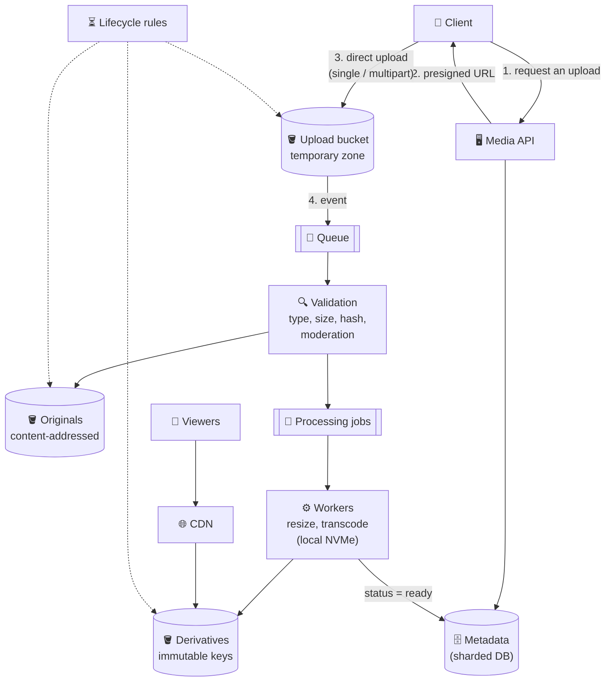
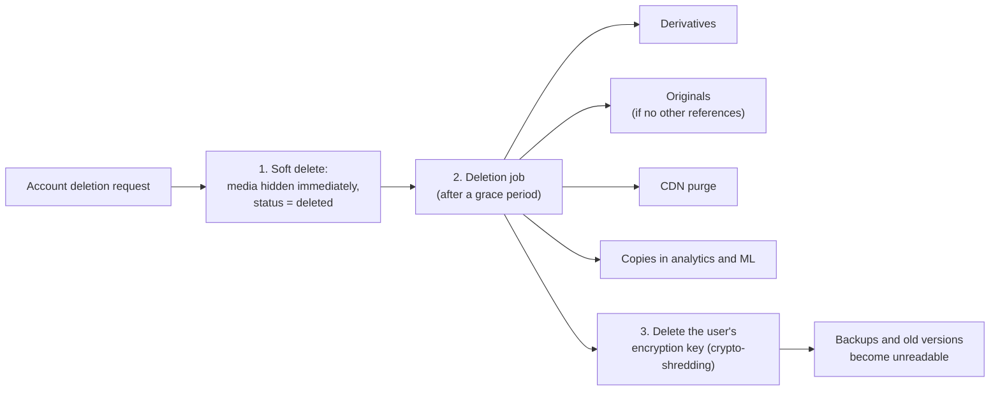

**English** | [Русский](INTERVIEW_RU.md) · Theory: [README.md](./README.md)

# 14. Storage Types: Photo and Video Storage for a Social Network

> **Topic:** choosing a storage type per kind of data, blobs + metadata, direct uploads via presigned URLs and multipart, the processing pipeline, keys and dedup, serving via CDN, storage classes and cost, small files, deletion and GDPR, protection against data loss
> **Level:** Medium–Hard · **Interview time:** 45 min · **Study time:** ~4 h
> **Where it's asked:** "Design media storage for Instagram / WhatsApp / YouTube", and as a deep dive in any problem involving files

---

## 🗺️ How to Read This Walkthrough

| Icon | Meaning |
|:----:|:--------|
| 🎤 | Interviewer |
| 🗣️ | What I (the candidate) say out loud |
| ✏️ | What I draw on the whiteboard |
| ⏱️ | Time budget for the step |

Callouts: **TIP** — a good technique, **WARNING** — a trap, **IMPORTANT** — a Senior+ signal.

---

## 📑 Contents

1. [Problem Statement](#1-problem-statement)
2. [Clarifying Questions and Requirements](#2-clarifying-questions-and-requirements)
3. [Load and Volume Estimates](#3-load-and-volume-estimates)
4. [Which Data Goes Where](#4-which-data-goes-where)
5. [API and Data Model](#5-api-and-data-model)
6. [High-Level Design](#6-high-level-design)
7. [Deep Dive 1: Uploads](#7-deep-dive-1-uploads)
8. [Deep Dive 2: Processing and Derivatives](#8-deep-dive-2-processing-and-derivatives)
9. [Deep Dive 3: Keys, Dedup, Serving](#9-deep-dive-3-keys-dedup-serving)
10. [Deep Dive 4: Storage Classes and Cost](#10-deep-dive-4-storage-classes-and-cost)
11. [Deep Dive 5: Deletion and GDPR](#11-deep-dive-5-deletion-and-gdpr)
12. [Deep Dive 6: Protection Against Data Loss](#12-deep-dive-6-protection-against-data-loss)
13. [Bottlenecks and Failure Scenarios](#13-bottlenecks-and-failure-scenarios)
14. [What Changes at 10x Scale](#14-what-changes-at-10x-scale)
15. [Interviewer Questions with Answers](#15-interviewer-questions-with-answers)
16. [Common Mistakes](#16-common-mistakes)
17. [Cheat Sheet and Self-Check](#17-cheat-sheet-and-self-check)

---

## 1. Problem Statement

> 🎤 "Design photo and video storage for a social network: users upload media with their posts, and others view it in the feed. Today the files live on an NFS server, and it can't keep up. Nothing must be lost, and the storage bill must not grow out of control."

**Time plan:**

| Step | ⏱️ |
|:-----|:--:|
| Requirements | 5 min |
| Estimates | 5 min |
| Data and storage types | 5 min |
| API, data, high-level | 7 min |
| Deep dives | 18 min |
| Failures and wrap-up | 5 min |

> [!TIP]
> There are three things the interviewer will definitely check: **separating blobs from metadata**, **direct uploads to storage** and **cost** (storage classes). The last one is often forgotten — yet at petabyte scale it's the main business question.

---

## 2. Clarifying Questions and Requirements

⏱️ 5 min

| My question | Interviewer's answer | What it changes |
|:------------|:---------------------|:----------------|
| What file sizes? | Photos up to 20 MB (3 MB average), videos up to 2 GB (50 MB average) | Video — multipart and resumable uploads |
| Are different sizes and formats needed? | Photos — several sizes; video — adaptive streaming | A processing pipeline, derivatives |
| How does popularity change over time? | Most views happen in the first days after posting | Storage classes by age |
| Can media be edited? | It can be replaced or cropped — that's a new version | Immutable objects; a new version = a new key |
| Private posts? | Yes, followers only | Signed URLs for private content |
| Deletion requirements? | Account deletion — all data deleted within 30 days (GDPR) | Deleting every copy, including derivatives and backups |
| Where are users? | Worldwide | A CDN, uploading via the nearest point |

### Functional requirements

1. Upload a photo or video with a post (including over a bad mobile network).
2. Get display-ready versions: photo sizes, video for adaptive streaming.
3. View media in the feed quickly anywhere in the world.
4. Delete media or a whole account.

### Non-functional requirements

| Requirement | Target |
|:------------|:-------|
| Durability | Zero lost originals |
| Uploads | Resumable after drops; an "uploaded" response < 1 s after the transfer ends |
| Display readiness | Photos — seconds, video — minutes |
| Serving | p95 time to first byte < 100 ms via CDN |
| Cost | Spending grows slower than volume |
| Deletion | Fully deleted within 30 days |

---

## 3. Load and Volume Estimates

⏱️ 5 min

✏️

```
Photos:  100M uploads/day × 3 MB         = 300 TB/day of originals
         + derivatives (4 sizes)         ≈ +100 TB/day
Videos:  10M uploads/day × 50 MB         = 500 TB/day of originals
         + transcodes (several qualities) ≈ +250 TB/day
Total:   ≈ 1.15 PB/day ≈ 420 PB/year (before storage redundancy)

Uploads: ~1,300/s average, peak ~5,000/s
Inbound traffic: 1.15 PB / 86,400 s ≈ 13 GB/s average

Views: 50B/day → ~600,000/s, > 95% served by the CDN
Thumbnails: tens of billions of objects of 10–50 KB
```

🗣️ **Conclusions:**
- **Hundreds of petabytes per year** — an NFS server isn't an option; we need object storage with practically unlimited scale.
- **13 GB/s of inbound traffic** can't go through API servers — uploads go directly to storage.
- **Cost is the main question:** every percent of saved space is petabytes. Storage classes, erasure coding, not storing what isn't needed.
- **Billions of small thumbnails** — a separate small files problem.

---

## 4. Which Data Goes Where

⏱️ 5 min

| Data | Storage | Why |
|:-----|:--------|:----|
| Photo and video originals | **Object** | Huge volume, cheap, durable |
| Derivatives (photo sizes, HLS segments) | **Object** + CDN | Served via CDN, immutable |
| Media metadata (owner, post, status, sizes, keys) | **DB** (sharded by `owner_id`) | Queries, relations, transactions |
| Temporary files during transcoding | **Local block disk** (NVMe) on workers | Fast, needed only during processing |
| Database disks | **Block** | Random access, low latency |
| Data for ML (moderation, recommendations) | **Object** in Parquet | Separating storage from compute |
| File storage (NFS) | ❌ Moving off it | Doesn't scale, expensive, POSIX isn't needed |

🗣️ "NFS was the wrong abstraction: the application doesn't need partial writes, locks or a directory hierarchy. It needs 'store a whole file and serve it by link' — which is exactly object storage."

---

## 5. API and Data Model

⏱️ 3 min

### API

```http
POST /v1/media/uploads
     { type: "photo" | "video", size_bytes, content_type, sha256? }
     → 201 {
         media_id,
         upload: { method: "single", url: <presigned PUT, 15 min> }          ← photo
              | { method: "multipart", upload_id, part_size, part_urls[] }   ← video
       }

POST /v1/media/{media_id}/complete      { parts: [{ n, etag }] }   ← for multipart
GET  /v1/media/{media_id}               → { status, variants: { thumb, small, large, hls } }
DELETE /v1/media/{media_id}
```

### Metadata

```sql
CREATE TABLE media (
  media_id       BIGINT PRIMARY KEY,
  owner_id       BIGINT NOT NULL,          -- shard key
  type           TEXT   NOT NULL,          -- photo | video
  status         TEXT   NOT NULL,          -- pending | uploaded | processing | ready | failed | deleted
  original_key   TEXT,                     -- the original's key in object storage
  content_hash   TEXT,                     -- sha256 of the original
  size_bytes     BIGINT,
  width, height, duration_ms INT,
  visibility     TEXT,                     -- public | followers
  created_at     TIMESTAMPTZ,
  deleted_at     TIMESTAMPTZ
);

CREATE TABLE media_variants (
  media_id     BIGINT,
  variant      TEXT,          -- thumb_150 | 640 | 1080 | hls_master | ...
  object_key   TEXT,
  size_bytes   BIGINT,
  PRIMARY KEY (media_id, variant)
);
```

---

## 6. High-Level Design

⏱️ 4 min

✏️



🗣️ "The flow: the client gets a presigned URL and uploads directly into a **temporary bucket**. A storage event triggers validation; the verified original is copied into permanent storage under a hash-based key, then workers create the derivatives. Metadata gets the `ready` status only once the derivatives exist. Viewers get media via the CDN."

---

## 7. Deep Dive 1: Uploads

> 🎤 "A user on the subway uploads a 500 MB video. How do you make that reliable?"

🗣️ "**Multipart with resumption**, directly to storage:

| Step | What happens |
|:-----|:-------------|
| 1 | The client requests an upload; the API checks quotas and limits, creates a `pending` row, initiates a multipart upload and returns presigned URLs for 8 MB parts |
| 2 | The client uploads parts in parallel (3–4 at a time), remembering each part's ETag |
| 3 | After a drop — it uploads only the missing parts (it can ask for the list of parts already received) |
| 4 | The client calls `complete` with the list of parts; the API assembles the object |
| 5 | A storage event → validation → `uploaded` |

### Checks

| Check | Why |
|:------|:----|
| A presigned URL limited by time, size and Content-Type | Prevent uploading 50 GB or an executable |
| A checksum per part and for the final file | Detect corruption in transit |
| Detecting the type from content, not the extension | Security |
| Moderation (prohibited content) | Before publishing |
| Per-user quotas | Protection against abuse |

### The temporary upload zone

🗣️ "Uploads first land in a **temporary bucket** with a lifecycle rule 'delete after 1 day'. Unfinished multipart uploads are deleted after 2 days. That way abandoned uploads and files that failed checks disappear by themselves, without a separate garbage collector."

> [!WARNING]
> Don't mark media `ready` until the derivatives exist. Otherwise the feed gets a link to a thumbnail that isn't there yet. The order is always: **objects first, then metadata "ready"**.

---

## 8. Deep Dive 2: Processing and Derivatives

> 🎤 "How are photo sizes and video versions created?"

🗣️

| Type | Derivatives | Where processing happens |
|:-----|:------------|:-------------------------|
| Photo | Thumbnail 150, 320, 640, 1080 px; WebP/AVIF | Workers, seconds |
| Video | HLS/DASH: 240p … 1080p (4K for some), 4–6 s segments, preview frames | Workers with local NVMe, minutes; long videos processed in parallel by segment |

| Principle | How |
|:----------|:----|
| **Idempotency** | Derivative keys are deterministic: `variants/{media_id}/v{version}/{variant}.webp` — reprocessing overwrites the same object |
| **Retries and DLQ** | A job fails → retries with backoff → DLQ after N attempts; status `failed` and a notification to the user |
| **A local disk for temporary files** | The transcoder writes intermediate files to the worker's NVMe; the result goes to object storage |
| **Priorities** | Photos and short videos go to a fast queue; long ones to a separate queue, so they don't delay the rest |
| **Lazy derivatives** | Rare sizes can be generated **on first request** (on-the-fly resize at the edge or in a service) and cached at the CDN — not all stored in advance |

> [!TIP]
> Storing every size for every photo is expensive. A compromise: precompute the 2–3 most popular sizes and generate the rest on demand with CDN caching. For old, rarely viewed photos, derivatives can even be deleted and regenerated from the original when needed.

---

## 9. Deep Dive 3: Keys, Dedup, Serving

> 🎤 "How do you name objects, and how do you serve them quickly worldwide?"

### Keys

| Object | Key | Why |
|:-------|:----|:----|
| Original | `originals/sha256/ab/cd/abcdef….jpg` | By hash: identical files (reposts, forwards) are stored **once**; the hash's first characters give an even spread across prefixes |
| Derivatives | `variants/{media_id}/v{n}/1080.webp` | Immutable: a new version → a new key → CDN caching without invalidation |
| Temporary uploads | `uploads/{date}/{upload_id}` | Deleted by a lifecycle rule |

> [!NOTE]
> Hash-based dedup requires **reference counting**: an original can be deleted only once no media references it. A counter or a references table lives in the metadata DB.

### Serving

| Topic | Decision |
|:------|:---------|
| Public media | CDN, `Cache-Control: public, max-age=31536000, immutable` (keys are immutable) |
| Private media | Short-lived signed URLs or cookies; the signature isn't part of the CDN cache key |
| Video | HLS segments via CDN, range requests |
| Protecting storage | Buckets aren't reachable from the internet directly — only via the CDN (origin access control) |
| Origin shield | One intermediate cache tier, so misses from hundreds of PoPs don't hammer storage |

More in [03-cdn](../03-cdn/README.md).

---

## 10. Deep Dive 4: Storage Classes and Cost

> 🎤 "420 petabytes a year. How do you avoid going broke?"

🗣️ "I'll start from access data: most views happen in the first days. Then:

| Data | Age | Storage class | Why |
|:-----|:----|:--------------|:----|
| Derivatives (popular sizes) | 0–30 days | Hot | The bulk of views (through the CDN, but misses hit storage) |
| Derivatives | > 30 days | Warm | Rare views, but immediate access is needed |
| Originals | 0–7 days | Hot | Reprocessing is possible |
| Originals | > 7 days | Warm, then cold (instant access) | Needed only for reprocessing and export |
| Temporary uploads | 1 day | Deletion | Garbage |

### Other levers

| Lever | Effect |
|:------|:-------|
| **Erasure coding** instead of triple replication (at the storage level or in your own system) | About half the disks |
| **Dedup** by hash | Reposts and forwards take no extra space |
| **Modern formats** (AVIF, WebP, HEVC/AV1) | Fewer bytes at the same quality |
| **Lazy derivatives** | Don't store rare sizes |
| **Not moving small thumbnails to cold classes** | Minimum billable sizes and request fees would eat the savings |
| **Deleting what's not needed** | Abandoned uploads, old versions, unneeded intermediate files |

> [!IMPORTANT]
> **Senior+ signal:** storage class decisions are made from **real access statistics**, not intuition. Moving data that's still being read to a cold class increases the retrieval bill. Many stores can tier objects automatically based on access.

### Billions of thumbnails

🗣️ "Thumbnails of 10–50 KB are a small files problem: request and metadata costs are comparable to the storage cost. Options:
- keep them in the hot class and rely on the CDN — usually enough;
- at very large scale — packing into large volumes with an offset index (Facebook's Haystack approach) in your own storage system."

---

## 11. Deep Dive 5: Deletion and GDPR

> 🎤 "A user deleted their account. What must be deleted, and how?"



| Where the data lives | How it's deleted |
|:---------------------|:-----------------|
| Metadata | Soft delete immediately (media hidden), then physical deletion |
| Derivatives and originals | A deletion job; for originals — decrement the reference count, delete at zero |
| CDN cache | Purge by key (or let it expire — but private media is purged immediately) |
| Versions in versioned buckets | Delete versions, or a lifecycle rule for noncurrent versions |
| Backups, cross-region replicas | **Crypto-shredding**: the user's data is encrypted with their key; deleting the key makes copies unreadable |
| Analytics and ML datasets | Deletion by `owner_id` in a table format (Iceberg/Delta support row deletes) |

> [!WARNING]
> Dedup and GDPR conflict: if an original is shared by several users (the same meme), it can't be deleted while others reference it. For crypto-shredding, shared objects must either not be deduplicated across users, or you accept that shared public content isn't a specific user's personal data.

---

## 12. Deep Dive 6: Protection Against Data Loss

> 🎤 "How do you guarantee originals are never lost?"

| Threat | Defense |
|:-------|:--------|
| Disk, node, zone failures | Storage durability: erasure coding or replication across zones |
| A region failure | Cross-region replication of **originals** (derivatives can be regenerated) |
| A bug in code deletes objects | **Versioning** on the originals bucket + delayed physical deletion; deleted data can be restored |
| Compromised credentials / ransomware | **Object Lock** on a copy in a separate account with separate permissions |
| Silent data corruption | Checksums (hash = key → verified on read) |
| Metadata and objects drifting apart | Regular reconciliation: bucket inventory vs the DB |

🗣️ "The key distinction: **originals** are irreplaceable — protect them to the maximum (versioning, a cross-region copy, object lock). **Derivatives** can be recreated from originals — standard durability is enough for them, without cross-region copies. That saves a lot of money."

---

## 13. Bottlenecks and Failure Scenarios

| Scenario | What happens | How we protect |
|:---------|:-------------|:---------------|
| A drop during a video upload | A partial upload | Multipart: upload only the missing parts |
| The upload finished, the event was lost | Media stuck in `pending` | Reconciliation: `pending` older than N minutes → check the object exists and continue |
| A worker crashed during transcoding | The job didn't finish | Retry; idempotent derivative keys |
| A corrupt or malicious file | A processing error | Validation before copying to originals; DLQ; status `failed` |
| An upload spike (a holiday) | The processing queue grows | Autoscaling workers by queue length; photos prioritized over long videos |
| Storage unavailable in a region | Uploads and CDN misses fail | The CDN serves cached content; uploads go to another region; a cross-region copy of originals |
| A hot object (a viral video) | Load on the origin | CDN + origin shield; immutable keys with long caching |
| A bug deletes objects | Media lost | Versioning, delayed physical deletion, object lock on a copy |
| DB and bucket drift | Broken links or orphans | Daily reconciliation via bucket inventory |

---

## 14. What Changes at 10x Scale

> 🎤 "4 exabytes a year?"

🗣️ "At that scale, your own storage system may be cheaper than the cloud. What changes:
1. **An in-house object store** with erasure coding and a tiered scheme: hot data replicated, warm and cold data with more aggressive encoding (as with Haystack → f4 at Facebook).
2. **Packing small objects** into large volumes with an index.
3. **Regional stores** with uploads to the nearest region and async copies of originals.
4. **Deleting derivatives for old content** and generating them on demand.
5. **Caching nodes inside ISPs** for video (like Netflix Open Connect)."

---

## 15. Interviewer Questions with Answers

<details>
<summary><b>Why not store photos in the database as BLOBs?</b></summary>

Databases are optimized for small records and random access; large BLOBs bloat tables, backups, replication and the buffer pool, and serving through a database doesn't work with a CDN. Object storage is many times cheaper per GB, scales practically without limit and serves via CDN. The database keeps only metadata and the object key.
</details>

<details>
<summary><b>Why two buckets — temporary and permanent?</b></summary>

The temporary one receives everything the client sent, including abandoned uploads, junk and malicious files. A lifecycle rule deletes them automatically. Only a verified original under a hash-based key enters the permanent one. That way there are no orphans in the main store, and access policies are simpler.
</details>

<details>
<summary><b>How do you make sure a feed link never points to a missing file?</b></summary>

Metadata gets the `ready` status only after every needed derivative has been written to storage, and the feed shows only `ready` media. Derivative keys are immutable, so a link that has become valid won't break on regeneration.
</details>

<details>
<summary><b>Why a cross-region copy only for originals?</b></summary>

Derivatives can be recreated from originals, while originals are irreplaceable. Copying derivatives to another region doubles the cost of data that can be regenerated anyway. If a region is lost, derivatives are regenerated as they're requested.
</details>

<details>
<summary><b>What are the problems with hash-based dedup?</b></summary>

You need reference counting for safe deletion; it conflicts with crypto-shredding and GDPR for shared objects; hashing large files costs CPU (it can be done on the client and verified on the server); and in theory an attacker could learn whether someone uploaded a specific file from whether its hash exists — which is why dedup is often done only within a single user or for public content.
</details>

<details>
<summary><b>When should you use file storage instead of object storage?</b></summary>

When the software requires POSIX: partial writes, appends, locks, a directory hierarchy — e.g. legacy processing tools, scientific computing, some ML frameworks that expect a shared file system. A social network's media doesn't need it.
</details>

---

## 16. Common Mistakes

| ❌ Mistake | ✅ Do this instead |
|:----------|:------------------|
| Files on NFS or in the database | Object storage + metadata in a DB |
| Uploads through API servers | Presigned URLs, directly to storage |
| Large videos in a single request | Multipart with resumption |
| Metadata `ready` before derivatives exist | Objects first, then the status |
| The file name in the object key | An ID or a content hash |
| Every size for every photo forever | Popular sizes up front, the rest on demand |
| All data in the hot class | Lifecycle based on real access statistics |
| Small thumbnails in a cold class | Keep them hot and rely on the CDN |
| Deleting only the original | Derivatives, CDN, versions, backups, analytics; crypto-shredding |
| The same protection for originals and derivatives | Originals — maximum protection; derivatives — regenerable |

---

## 17. Cheat Sheet and Self-Check

### 30-second answer

> Bytes go to object storage, metadata to a sharded DB, serving through a CDN with immutable keys. The client uploads directly via a presigned URL to a temporary bucket; video uses multipart with resumption. A storage event → validation → the original is copied under a hash-based key (dedup) → workers on local NVMe create derivatives with deterministic keys → status `ready`. Popular sizes up front, rare ones on demand. Lifecycle based on access stats: derivatives to the warm class after 30 days, originals to cold; temporary uploads deleted within a day. Originals are protected with versioning, a cross-region copy and object lock; derivatives are regenerable. Deletion — a soft delete immediately, physical deletion by a job, a CDN purge, and crypto-shredding for backups.

### Self-check

- [ ] I can map data to block, file and object storage and explain why
- [ ] I can describe a resumable upload of a large video
- [ ] I can explain the "object first, metadata second" order
- [ ] I can design keys for originals and derivatives
- [ ] I can estimate the volume and propose 5 cost levers
- [ ] I can explain the small thumbnails problem
- [ ] I can list every place a user's data must be deleted from
- [ ] I can explain the different protection for originals and derivatives

### Further reading

- Theory for this topic: [README.md](./README.md)
- Beaver et al., *Finding a needle in Haystack: Facebook's photo storage*
- Muralidhar et al., *f4: Facebook's Warm BLOB Storage System*
- AWS S3 documentation: multipart upload, presigned URLs, lifecycle, Object Lock
- The tus resumable upload protocol (tus.io)