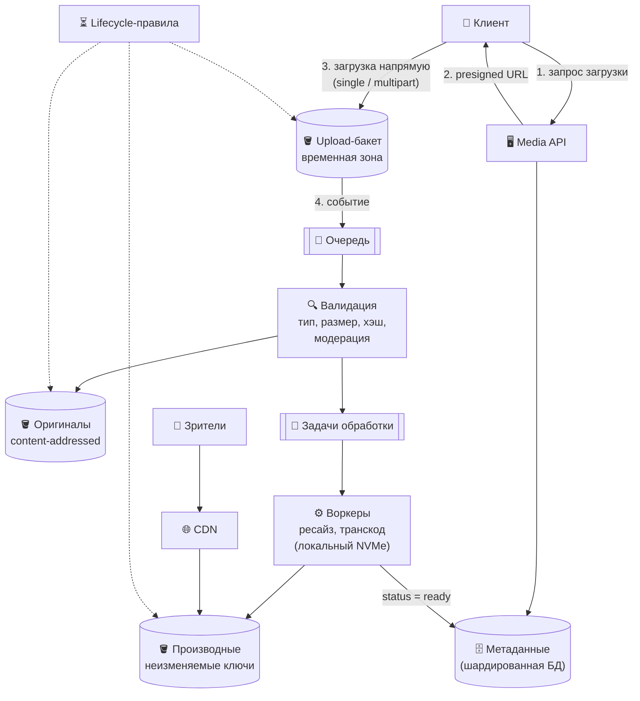
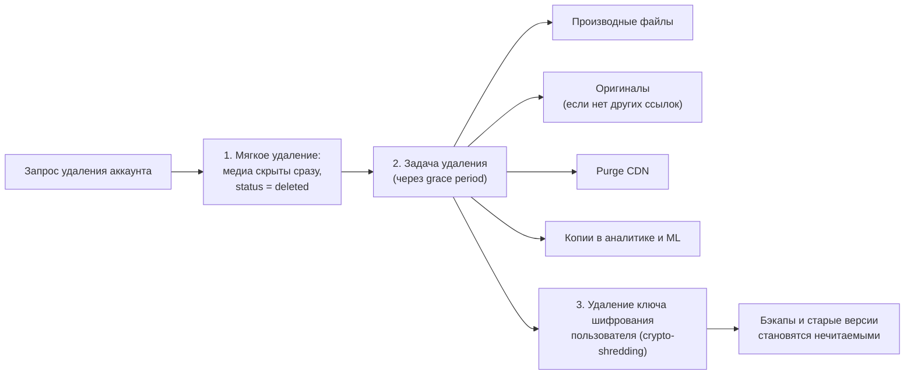

[English](INTERVIEW.md) | **Русский** · Теория: [README_RU.md](./README.ru.md)

# 14. Storage Types: хранилище фото и видео для соцсети

> **Тема:** выбор типа хранилища для разных данных, blob + метаданные, прямая загрузка по presigned URL и multipart, конвейер обработки, ключи и дедупликация, раздача через CDN, классы хранения и стоимость, мелкие файлы, удаление и GDPR, защита от потери данных
> **Уровень:** Medium–Hard · **Время на интервью:** 45 мин · **Время на разбор:** ~4 ч
> **Где спрашивают:** «Спроектируй хранилище медиа для Instagram / WhatsApp / YouTube», а также как deep dive в любой задаче с файлами

---

## 🗺️ Как читать этот разбор

| Значок | Что значит |
|:------:|:-----------|
| 🎤 | Реплика интервьюера |
| 🗣️ | Что говорю вслух я (кандидат) |
| ✏️ | Что рисую на доске |
| ⏱️ | Сколько времени тратить на шаг |

Блоки **TIP** — хороший приём, **WARNING** — ловушка, **IMPORTANT** — сигнал для уровня Senior+.

---

## 📑 Содержание

1. [Условие задачи](#1-условие-задачи)
2. [Уточняющие вопросы и требования](#2-уточняющие-вопросы-и-требования)
3. [Оценки нагрузки и объёма](#3-оценки-нагрузки-и-объёма)
4. [Какие данные в каком хранилище](#4-какие-данные-в-каком-хранилище)
5. [API и модель данных](#5-api-и-модель-данных)
6. [High-level дизайн](#6-high-level-дизайн)
7. [Deep dive 1: загрузка](#7-deep-dive-1-загрузка)
8. [Deep dive 2: обработка и производные файлы](#8-deep-dive-2-обработка-и-производные-файлы)
9. [Deep dive 3: ключи, дедупликация, раздача](#9-deep-dive-3-ключи-дедупликация-раздача)
10. [Deep dive 4: классы хранения и стоимость](#10-deep-dive-4-классы-хранения-и-стоимость)
11. [Deep dive 5: удаление и GDPR](#11-deep-dive-5-удаление-и-gdpr)
12. [Deep dive 6: защита от потери данных](#12-deep-dive-6-защита-от-потери-данных)
13. [Узкие места и сценарии сбоев](#13-узкие-места-и-сценарии-сбоев)
14. [Что изменится при росте в 10 раз](#14-что-изменится-при-росте-в-10-раз)
15. [Вопросы интервьюера с ответами](#15-вопросы-интервьюера-с-ответами)
16. [Типичные ошибки](#16-типичные-ошибки)
17. [Шпаргалка и самопроверка](#17-шпаргалка-и-самопроверка)

---

## 1. Условие задачи

> 🎤 «Спроектируй хранение фото и видео для соцсети: пользователи загружают медиа к постам, другие смотрят их в ленте. Сейчас файлы лежат на NFS-сервере, и он не справляется. Важно, чтобы ничего не терялось, а счёт за хранение не рос бесконтрольно».

**План по времени:**

| Шаг | ⏱️ |
|:----|:--:|
| Требования | 5 мин |
| Оценки | 5 мин |
| Данные и типы хранилищ | 5 мин |
| API, данные, high-level | 7 мин |
| Deep dives | 18 мин |
| Сбои и итоги | 5 мин |

> [!TIP]
> Здесь три темы, которые интервьюер обязательно проверит: **разделение blob и метаданных**, **прямая загрузка в хранилище** и **стоимость** (классы хранения). Последнюю часто забывают — а на петабайтах это главный вопрос для бизнеса.

---

## 2. Уточняющие вопросы и требования

⏱️ 5 мин

| Мой вопрос | Ответ интервьюера | Что это меняет |
|:-----------|:------------------|:---------------|
| Какие размеры файлов? | Фото до 20 МБ (в среднем 3 МБ), видео до 2 ГБ (в среднем 50 МБ) | Видео — multipart и возобновляемая загрузка |
| Нужны ли разные размеры и форматы? | Фото — несколько размеров; видео — адаптивный стриминг | Конвейер обработки, производные файлы |
| Как меняется популярность со временем? | Большинство просмотров — в первые дни после публикации | Классы хранения по возрасту |
| Можно ли редактировать медиа? | Можно заменить или обрезать — это новая версия | Неизменяемые объекты, новая версия = новый ключ |
| Приватные посты? | Да, только для подписчиков | Подписанные URL для приватного контента |
| Требования к удалению? | Удаление аккаунта — все данные удалены в течение 30 дней (GDPR) | Удаление всех копий, включая производные и бэкапы |
| Где пользователи? | По всему миру | CDN, загрузка через ближайшую точку |

### Функциональные требования

1. Загрузить фото или видео к посту (в том числе с плохой мобильной сети).
2. Получить готовые к показу версии: размеры фото, видео для адаптивного стриминга.
3. Смотреть медиа в ленте быстро в любой точке мира.
4. Удалить медиа или весь аккаунт.

### Нефункциональные требования

| Требование | Цель |
|:-----------|:-----|
| Долговечность | Ни одного потерянного оригинала |
| Загрузка | Возобновление после обрыва; ответ «загружено» < 1 с после окончания передачи |
| Готовность к показу | Фото — секунды, видео — минуты |
| Отдача | p95 первый байт < 100 мс через CDN |
| Стоимость | Рост расходов медленнее роста объёма |
| Удаление | Полное удаление за 30 дней |

---

## 3. Оценки нагрузки и объёма

⏱️ 5 мин

✏️

```
Фото:   100M загрузок/день × 3 МБ        = 300 ТБ/день оригиналов
        + производные (4 размера)        ≈ +100 ТБ/день
Видео:  10M загрузок/день × 50 МБ        = 500 ТБ/день оригиналов
        + транскоды (несколько качеств)  ≈ +250 ТБ/день
Итого:  ≈ 1,15 ПБ/день ≈ 420 ПБ/год (до учёта избыточности хранилища)

Загрузки: ~1 300/с в среднем, пик ~5 000/с
Входящий трафик: 1,15 ПБ / 86 400 с ≈ 13 ГБ/с в среднем

Просмотры: 50B/день → ~600 000/с, из них > 95% обслуживает CDN
Миниатюры: десятки миллиардов объектов по 10–50 КБ
```

🗣️ **Выводы:**
- **Сотни петабайт в год** — NFS-сервер не вариант; нужно объектное хранилище с практически неограниченным масштабом.
- **13 ГБ/с входящего трафика** нельзя пропускать через API-серверы — загрузка напрямую в хранилище.
- **Стоимость — главный вопрос:** каждый процент сэкономленного места — это петабайты. Классы хранения, erasure coding, отказ от хранения ненужного.
- **Миллиарды мелких миниатюр** — отдельная проблема мелких файлов.

---

## 4. Какие данные в каком хранилище

⏱️ 5 мин

| Данные | Хранилище | Почему |
|:-------|:----------|:-------|
| Оригиналы фото и видео | **Объектное** | Огромный объём, дёшево, долговечно |
| Производные (размеры фото, HLS-сегменты) | **Объектное** + CDN | Отдаются через CDN, неизменяемы |
| Метаданные медиа (владелец, пост, статус, размеры, ключи) | **БД** (шардированная по `owner_id`) | Запросы, связи, транзакции |
| Временные файлы при транскодировании | **Локальный блочный диск** (NVMe) воркеров | Быстро, нужно только на время обработки |
| Диски баз данных | **Блочное** | Случайный доступ, низкая задержка |
| Данные для ML (модерация, рекомендации) | **Объектное** в Parquet | Отделение хранения от вычислений |
| Файловое хранилище (NFS) | ❌ Уходим | Не масштабируется, дорого, не нужен POSIX |

🗣️ «NFS был ошибкой выбора абстракции: приложению не нужны частичная запись, блокировки и иерархия каталогов. Ему нужно «положить файл целиком и отдать по ссылке» — это ровно объектное хранилище».

---

## 5. API и модель данных

⏱️ 3 мин

### API

```http
POST /v1/media/uploads
     { type: "photo" | "video", size_bytes, content_type, sha256? }
     → 201 {
         media_id,
         upload: { method: "single", url: <presigned PUT, 15 мин> }          ← фото
              | { method: "multipart", upload_id, part_size, part_urls[] }   ← видео
       }

POST /v1/media/{media_id}/complete      { parts: [{ n, etag }] }   ← для multipart
GET  /v1/media/{media_id}               → { status, variants: { thumb, small, large, hls } }
DELETE /v1/media/{media_id}
```

### Метаданные

```sql
CREATE TABLE media (
  media_id       BIGINT PRIMARY KEY,
  owner_id       BIGINT NOT NULL,          -- ключ шардирования
  type           TEXT   NOT NULL,          -- photo | video
  status         TEXT   NOT NULL,          -- pending | uploaded | processing | ready | failed | deleted
  original_key   TEXT,                     -- ключ оригинала в объектном хранилище
  content_hash   TEXT,                     -- sha256 оригинала
  size_bytes     BIGINT,
  width, height, duration_ms INT,
  visibility     TEXT,                     -- public | followers
  created_at     TIMESTAMPTZ,
  deleted_at     TIMESTAMPTZ
);

CREATE TABLE media_variants (
  media_id     BIGINT,
  variant      TEXT,          -- thumb_150 | 640 | 1080 | hls_master | ...
  object_key   TEXT,
  size_bytes   BIGINT,
  PRIMARY KEY (media_id, variant)
);
```

---

## 6. High-level дизайн

⏱️ 4 мин

✏️



🗣️ «Поток: клиент получает presigned URL и загружает напрямую во **временный бакет**. Событие хранилища запускает валидацию; проверенный оригинал копируется в постоянное хранилище с ключом по хэшу, затем воркеры создают производные версии. Метаданные получают статус `ready` только когда производные готовы. Зрители получают медиа через CDN».

---

## 7. Deep dive 1: загрузка

> 🎤 «Пользователь в метро загружает 500-мегабайтное видео. Как это сделать надёжно?»

🗣️ «**Multipart с возобновлением**, напрямую в хранилище:

| Шаг | Что происходит |
|:----|:---------------|
| 1 | Клиент запрашивает загрузку; API проверяет квоты и лимиты, создаёт запись `pending`, инициирует multipart upload и возвращает presigned URL для частей по 8 МБ |
| 2 | Клиент загружает части параллельно (по 3–4), запоминает ETag каждой |
| 3 | При обрыве — догружает только недостающие части (можно запросить список уже принятых) |
| 4 | Клиент вызывает `complete` со списком частей; API собирает объект |
| 5 | Событие хранилища → валидация → `uploaded` |

### Проверки

| Проверка | Зачем |
|:---------|:------|
| Presigned URL ограничен по времени, размеру и Content-Type | Не загрузить 50 ГБ или исполняемый файл |
| Контрольная сумма каждой части и итогового файла | Обнаружить повреждение при передаче |
| Определение типа по содержимому, а не по расширению | Безопасность |
| Модерация (запрещённый контент) | До публикации |
| Квоты на пользователя | Защита от злоупотреблений |

### Временная зона загрузок

🗣️ «Загрузки сначала попадают во **временный бакет** с lifecycle-правилом «удалить через 1 день». Незавершённые multipart-загрузки удаляются через 2 дня. Так брошенные загрузки и непрошедшие проверку файлы исчезают сами, без отдельного сборщика мусора».

> [!WARNING]
> Не отмечай медиа как `ready`, пока производные не созданы. Иначе лента получит ссылку на миниатюру, которой ещё нет. Порядок всегда: **сначала объекты, потом метаданные «готово»**.

---

## 8. Deep dive 2: обработка и производные файлы

> 🎤 «Как создаются размеры фото и версии видео?»

🗣️

| Тип | Производные | Где обработка |
|:----|:------------|:--------------|
| Фото | Миниатюра 150, 320, 640, 1080 px; WebP/AVIF | Воркеры, секунды |
| Видео | HLS/DASH: 240p … 1080p (4K для части), сегменты по 4–6 с, превью-кадры | Воркеры с локальным NVMe, минуты; длинные видео — параллельно по фрагментам |

| Принцип | Как |
|:--------|:----|
| **Идемпотентность** | Ключ производного файла детерминирован: `variants/{media_id}/v{version}/{variant}.webp` — повторная обработка перезаписывает тот же объект |
| **Ретраи и DLQ** | Задача падает → ретраи с backoff → DLQ после N попыток; статус `failed` и уведомление пользователю |
| **Локальный диск для временных файлов** | Транскодер пишет промежуточные файлы на NVMe воркера; результат — в объектное хранилище |
| **Приоритеты** | Фото и короткие видео — в быструю очередь; длинные — в отдельную, чтобы не задерживать остальных |
| **Ленивые производные** | Редкие размеры можно генерировать **при первом запросе** (on-the-fly resize на edge или в сервисе) и кэшировать в CDN — не хранить всё заранее |

> [!TIP]
> Хранить каждый размер для каждого фото дорого. Компромисс: заранее делать 2–3 самых популярных размера, а остальные — по запросу с кэшированием на CDN. Для старых редко просматриваемых фото производные можно даже удалять и генерировать заново из оригинала при необходимости.

---

## 9. Deep dive 3: ключи, дедупликация, раздача

> 🎤 «Как назвать объекты и как отдавать их быстро по всему миру?»

### Ключи

| Объект | Ключ | Почему |
|:-------|:-----|:-------|
| Оригинал | `originals/sha256/ab/cd/abcdef….jpg` | По хэшу: одинаковые файлы (репосты, пересылки) хранятся **один раз**; первые символы хэша — равномерное распределение по префиксам |
| Производные | `variants/{media_id}/v{n}/1080.webp` | Неизменяемы: новая версия → новый ключ → кэш CDN без инвалидации |
| Временные загрузки | `uploads/{date}/{upload_id}` | Удаляются lifecycle-правилом |

> [!NOTE]
> Дедупликация по хэшу требует **подсчёта ссылок**: оригинал можно удалить, только когда на него не ссылается ни одно медиа. Счётчик или таблица ссылок — в БД метаданных.

### Раздача

| Тема | Решение |
|:-----|:--------|
| Публичные медиа | CDN, `Cache-Control: public, max-age=31536000, immutable` (ключи неизменяемы) |
| Приватные медиа | Подписанные URL или cookies с коротким сроком; подпись не входит в ключ кэша CDN |
| Видео | HLS-сегменты через CDN, range-запросы |
| Защита хранилища | Бакеты недоступны напрямую из интернета — только через CDN (origin access control) |
| Origin shield | Один промежуточный уровень кэша, чтобы промахи сотен PoP не били по хранилищу |

Подробнее — в [03-cdn](../03_CDN/README.ru.md).

---

## 10. Deep dive 4: классы хранения и стоимость

> 🎤 «420 петабайт в год. Как не разориться?»

🗣️ «Начну с данных о доступе: большинство просмотров — в первые дни. Тогда:

| Данные | Возраст | Класс хранения | Почему |
|:-------|:--------|:--------------|:-------|
| Производные (популярные размеры) | 0–30 дней | Горячий | Основная масса просмотров (через CDN, но промахи идут в хранилище) |
| Производные | > 30 дней | Тёплый | Редкие просмотры, но мгновенный доступ нужен |
| Оригиналы | 0–7 дней | Горячий | Возможна повторная обработка |
| Оригиналы | > 7 дней | Тёплый, затем холодный (мгновенный доступ) | Нужны только для повторной обработки и экспорта |
| Временные загрузки | 1 день | Удаление | Мусор |

### Другие рычаги

| Рычаг | Эффект |
|:------|:-------|
| **Erasure coding** вместо тройной репликации (на уровне хранилища или собственной системы) | Примерно вдвое меньше дисков |
| **Дедупликация** по хэшу | Репосты и пересылки не занимают места |
| **Современные форматы** (AVIF, WebP, HEVC/AV1) | Меньше байт при том же качестве |
| **Ленивые производные** | Не хранить редкие размеры |
| **Не переводить мелкие миниатюры в холодные классы** | Минимальный оплачиваемый размер и плата за запросы съедят экономию |
| **Удаление ненужного** | Брошенные загрузки, старые версии, ненужные промежуточные файлы |

> [!IMPORTANT]
> **Сигнал Senior+:** решения о классах хранения принимаются по **реальной статистике доступа**, а не по интуиции. Перевод в холодный класс данных, которые всё ещё читаются, увеличит счёт за извлечение. Многие хранилища умеют распределять объекты по классам автоматически на основе обращений.

### Миллиарды миниатюр

🗣️ «Миниатюры по 10–50 КБ — проблема мелких файлов: плата за запросы и метаданные сравнима со стоимостью хранения. Варианты:
- держать их в горячем классе и полагаться на CDN — обычно достаточно;
- на очень большом масштабе — упаковка в большие тома с индексом смещений (подход Haystack у Facebook) в собственной системе хранения».

---

## 11. Deep dive 5: удаление и GDPR

> 🎤 «Пользователь удалил аккаунт. Что нужно удалить и как?»



| Где лежат данные | Как удаляются |
|:-----------------|:--------------|
| Метаданные | Мягкое удаление сразу (медиа скрыты), затем физическое |
| Производные и оригиналы | Задача удаления; для оригиналов — уменьшение счётчика ссылок, удаление при нуле |
| Кэш CDN | Purge по ключам (или они истекут, но приватные медиа — purge сразу) |
| Версии в бакетах с версионированием | Удаление версий или lifecycle-правило для неактуальных (noncurrent) версий |
| Бэкапы, межрегиональные реплики | **Crypto-shredding**: данные пользователя зашифрованы его ключом; удаление ключа делает копии нечитаемыми |
| Аналитика и наборы данных ML | Удаление по `owner_id` в табличном формате (Iceberg/Delta поддерживают удаление строк) |

> [!WARNING]
> Дедупликация и GDPR конфликтуют: если оригинал общий для нескольких пользователей (один и тот же мем), удалить его нельзя, пока на него ссылаются другие. Для crypto-shredding общие объекты нужно либо не дедуплицировать между пользователями, либо принять, что общий публичный контент не относится к персональным данным конкретного пользователя.

---

## 12. Deep dive 6: защита от потери данных

> 🎤 «Как гарантировать, что оригиналы не потеряются?»

| Угроза | Защита |
|:-------|:-------|
| Отказ дисков, узлов, зоны | Долговечность хранилища: erasure coding или репликация между зонами |
| Отказ региона | Межрегиональная репликация **оригиналов** (производные можно пересоздать) |
| Баг в коде удаляет объекты | **Версионирование** на бакете оригиналов + задержка физического удаления; удалённое можно восстановить |
| Скомпрометированные учётные данные / вымогатели | **Object Lock** на копии в отдельном аккаунте с отдельными правами |
| Тихое повреждение данных | Контрольные суммы (хэш = ключ → проверка при чтении) |
| Рассогласование метаданных и объектов | Регулярная сверка: инвентаризация бакета против БД |

🗣️ «Ключевое разделение: **оригиналы** невосстановимы — их защищаем максимально (версионирование, межрегиональная копия, object lock). **Производные** можно создать заново из оригиналов — для них достаточно стандартной долговечности, без межрегиональных копий. Это заметно экономит деньги».

---

## 13. Узкие места и сценарии сбоев

| Сценарий | Что произойдёт | Как защищаемся |
|:---------|:---------------|:---------------|
| Обрыв при загрузке видео | Частичная загрузка | Multipart: догрузка только недостающих частей |
| Загрузка завершена, событие потерялось | Медиа висит в `pending` | Сверка: `pending` старше N минут → проверить наличие объекта и продолжить |
| Воркер упал при транскодировании | Задача не завершена | Ретрай; идемпотентные ключи производных |
| Повреждённый или вредоносный файл | Ошибка обработки | Валидация до копирования в оригиналы; DLQ; статус `failed` |
| Всплеск загрузок (праздник) | Очередь обработки растёт | Автоскейлинг воркеров по длине очереди; приоритет фото над длинными видео |
| Хранилище недоступно в регионе | Загрузка и промахи CDN падают | CDN отдаёт закэшированное; загрузки — в другой регион; межрегиональная копия оригиналов |
| Горячий объект (вирусное видео) | Нагрузка на origin | CDN + origin shield; неизменяемые ключи с долгим кэшем |
| Баг удаляет объекты | Потеря медиа | Версионирование, отложенное физическое удаление, object lock на копии |
| Расхождение БД и бакета | Битые ссылки или сироты | Ежедневная сверка по инвентаризации бакета |

---

## 14. Что изменится при росте в 10 раз

> 🎤 «4 эксабайта в год?»

🗣️ «На таком масштабе собственная система хранения может оказаться дешевле облачной. Что меняется:
1. **Собственное объектное хранилище** с erasure coding и многоуровневой схемой: горячие данные с репликацией, тёплые и холодные — с более агрессивным кодированием (как Haystack → f4 у Facebook).
2. **Упаковка мелких объектов** в большие тома с индексом.
3. **Региональные хранилища** с загрузкой в ближайший регион и асинхронной копией оригиналов.
4. **Удаление производных для старого контента** и генерация по запросу.
5. **Собственные кэширующие узлы у интернет-провайдеров** для видео (как Netflix Open Connect)».

---

## 15. Вопросы интервьюера с ответами

<details>
<summary><b>Почему не хранить фото в базе данных как BLOB?</b></summary>

Базы данных оптимизированы под мелкие записи и случайный доступ; большие BLOB раздувают таблицы, бэкапы, репликацию и buffer pool, а отдача через базу не работает с CDN. Объектное хранилище в разы дешевле за ГБ, масштабируется практически бесконечно и раздаётся через CDN. В базе остаются только метаданные и ключ объекта.
</details>

<details>
<summary><b>Почему два бакета — временный и постоянный?</b></summary>

Во временный попадает всё, что прислал клиент, включая брошенные загрузки, мусор и вредоносные файлы. Lifecycle-правило удаляет их автоматически. В постоянный попадает только проверенный оригинал под ключом по хэшу. Так нет «сирот» в основном хранилище и проще политики доступа.
</details>

<details>
<summary><b>Как обеспечить, что ссылка в ленте не ведёт на несуществующий файл?</b></summary>

Метаданные получают статус `ready` только после того, как все нужные производные записаны в хранилище, а лента показывает только `ready`-медиа. Ключи производных неизменяемы, поэтому ссылка, однажды ставшая валидной, не сломается при перегенерации.
</details>

<details>
<summary><b>Зачем межрегиональная копия только для оригиналов?</b></summary>

Производные можно воссоздать из оригиналов, а оригиналы невосстановимы. Копировать производные в другой регион — удваивать затраты на данные, которые и так можно пересоздать. При потере региона производные генерируются заново по мере обращений.
</details>

<details>
<summary><b>Какие проблемы у дедупликации по хэшу?</b></summary>

Нужен подсчёт ссылок для безопасного удаления; конфликт с crypto-shredding и GDPR для общих объектов; хэширование больших файлов стоит CPU (его можно делать на клиенте и проверять на сервере); теоретически возможны атаки, когда по существованию хэша можно узнать, загружал ли кто-то определённый файл — поэтому дедупликацию часто делают только внутри одного пользователя или для публичного контента.
</details>

<details>
<summary><b>Когда стоит использовать файловое хранилище вместо объектного?</b></summary>

Когда ПО требует POSIX: частичная запись, дозапись, блокировки, иерархия каталогов — например, legacy-инструменты обработки, научные вычисления, некоторые ML-фреймворки, ожидающие общую файловую систему. Для медиа соцсети это не нужно.
</details>

---

## 16. Типичные ошибки

| ❌ Ошибка | ✅ Как правильно |
|:---------|:----------------|
| Файлы в NFS или в базе | Объектное хранилище + метаданные в БД |
| Загрузка через API-серверы | Presigned URL, напрямую в хранилище |
| Большие видео одним запросом | Multipart с возобновлением |
| Метаданные `ready` до создания производных | Сначала объекты, потом статус |
| Имя файла в ключе объекта | ID или хэш содержимого |
| Все размеры для всех фото навсегда | Популярные заранее, остальные — по запросу |
| Все данные в горячем классе | Lifecycle по реальной статистике доступа |
| Мелкие миниатюры в холодном классе | Оставить в горячем, полагаться на CDN |
| Удаление только оригинала | Производные, CDN, версии, бэкапы, аналитика; crypto-shredding |
| Одинаковая защита для оригиналов и производных | Оригиналы — максимум защиты; производные — пересоздаваемы |

---

## 17. Шпаргалка и самопроверка

### Ответ за 30 секунд

> Байты — в объектном хранилище, метаданные — в шардированной БД, раздача — через CDN с неизменяемыми ключами. Клиент загружает напрямую по presigned URL во временный бакет; видео — multipart с возобновлением. Событие хранилища → валидация → оригинал копируется под ключом по хэшу (дедупликация) → воркеры на локальном NVMe создают производные с детерминированными ключами → статус `ready`. Популярные размеры заранее, редкие — по запросу. Lifecycle по статистике доступа: производные в тёплый класс через 30 дней, оригиналы — в холодный; временные загрузки удаляются за сутки. Оригиналы защищены версионированием, межрегиональной копией и object lock; производные пересоздаваемы. Удаление — мягкое сразу, физическое задачей, purge CDN и crypto-shredding для бэкапов.

### Самопроверка

- [ ] Могу распределить данные по блочному, файловому и объектному хранилищу и объяснить почему
- [ ] Могу описать загрузку большого видео с возобновлением
- [ ] Могу объяснить порядок «сначала объект, потом метаданные»
- [ ] Могу спроектировать ключи для оригиналов и производных
- [ ] Могу посчитать объём и предложить 5 рычагов снижения стоимости
- [ ] Могу объяснить проблему мелких миниатюр
- [ ] Могу перечислить все места, откуда нужно удалить данные пользователя
- [ ] Могу объяснить разную защиту оригиналов и производных

### Что почитать

- Теория по теме: [README_RU.md](./README.ru.md)
- Beaver et al., *Finding a needle in Haystack: Facebook's photo storage*
- Muralidhar et al., *f4: Facebook's Warm BLOB Storage System*
- Документация AWS S3: multipart upload, presigned URLs, lifecycle, Object Lock
- Протокол возобновляемой загрузки tus (tus.io)