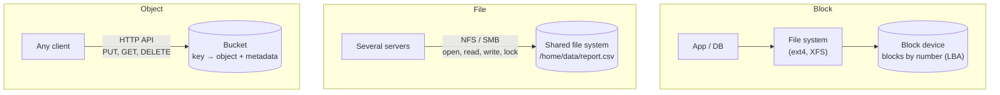
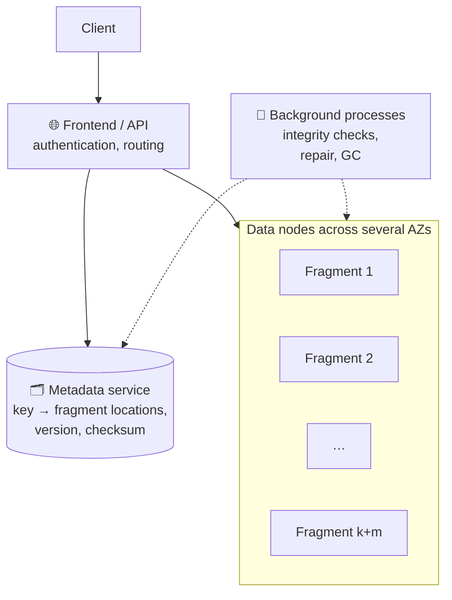
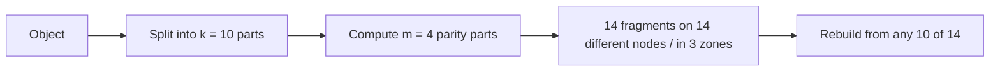
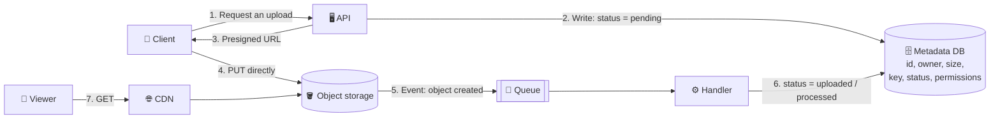
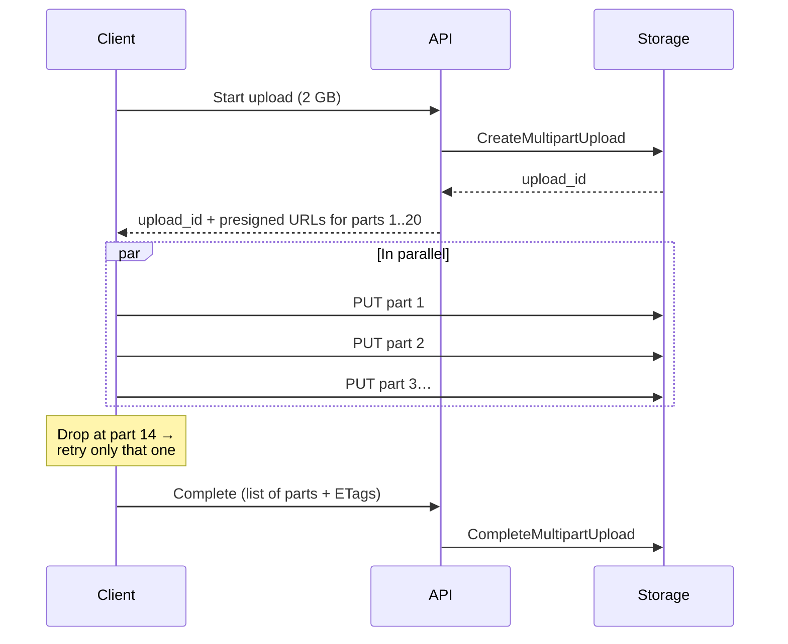

**English** | [Русский](README.ru.md)

# 14. Storage Types

> **Covers:** block, file and object storage; how object storage works internally (metadata, erasure coding, durability); splitting blobs from metadata; uploading large files; the small files problem; storage classes and lifecycle; deletion and data protection
> **Study time:** ~3–4 h · **Needed for:** any problem with files, photos, video, backups, logs or analytics (Instagram, YouTube, Dropbox, S3)
> **Practice:** interview-style walkthrough — [INTERVIEW.md](./INTERVIEW.md)
> **Related topics:** [03-cdn](../03_CDN/README.md), [04-databases](../04_Databases/README.md#4-how-a-database-stores-data-pages-wal-buffer-pool), [05-replication](../05_Replication/README.md)

---

## 📑 Contents

1. [Three Storage Abstractions](#1-three-storage-abstractions)
2. [Block Storage](#2-block-storage)
3. [File Storage](#3-file-storage)
4. [Object Storage](#4-object-storage)
5. [Comparison](#5-comparison)
6. [How Object Storage Works Internally](#6-how-object-storage-works-internally)
7. [Replication vs Erasure Coding](#7-replication-vs-erasure-coding)
8. [The Pattern: Blobs Separate From Metadata](#8-the-pattern-blobs-separate-from-metadata)
9. [Uploading Large Files](#9-uploading-large-files)
10. [The Small Files Problem](#10-the-small-files-problem)
11. [Storage Classes and Lifecycle](#11-storage-classes-and-lifecycle)
12. [Durability, Deletion and Data Protection](#12-durability-deletion-and-data-protection)
13. [Object Storage for Analytics](#13-object-storage-for-analytics)
14. [How to Choose](#14-how-to-choose)
15. [How to Talk About This in an Interview](#15-how-to-talk-about-this-in-an-interview)
16. [Self-Check Questions](#16-self-check-questions)
17. [Glossary and Resources](#17-glossary-and-resources)

---

## 1. Three Storage Abstractions



| Abstraction | Unit | How it's addressed | Interface |
|:------------|:-----|:-------------------|:----------|
| **Block** | A fixed-size block | Block number on the device | Read and write blocks (the OS sees a disk) |
| **File** | A file in a directory hierarchy | A path `/a/b/c.txt` | POSIX: open, read, write, seek, lock, rename |
| **Object** | A whole object + metadata | Bucket + key | HTTP: PUT, GET, DELETE, LIST |

**Analogy:** block storage is an empty warehouse with numbered shelves; file storage is a warehouse with a catalog and folders that several people can visit; object storage is a cloakroom: you hand in an item whole, get a ticket, and use the ticket to get the item back whole.

---

## 2. Block Storage

The lowest level: a device split into blocks that are read and written by number. A file system or a database sits on top.

| Kind | Examples | Properties |
|:-----|:---------|:-----------|
| **Local disk (NVMe SSD)** | Cloud instance store, server disks | The lowest latency (tens of microseconds), but data disappears with the machine |
| **Network block disk** | AWS EBS, Google Persistent Disk, Azure Managed Disks | Survives VM restarts, snapshots, replicated within a zone; higher latency (usually up to a millisecond) |
| **SAN** | iSCSI, Fibre Channel in data centers | Enterprise storage |

### Key characteristics

| Metric | Meaning | What it matters for |
|:-------|:--------|:--------------------|
| **IOPS** | I/O operations per second | Databases with random access |
| **Throughput** | MB/s | Sequential reads and writes (logs, analytics) |
| **Latency** | The time of one operation | Transactional workloads (WAL fsync) |

### Properties

- Usually attached to **one** machine (multi-attach exists but requires a cluster file system or coordination).
- **Snapshots:** fast incremental point-in-time copies, often stored in object storage.
- **RAID** for local disks: RAID 1 (mirror), RAID 10 (mirror + striping) — reliability and speed; RAID 5/6 — space savings with parity.

**Where:** databases, VM boot disks, Kafka logs, anything that needs a low-latency file system on a single node.

---

## 3. File Storage

A hierarchy of directories and files with POSIX semantics, accessible to **many servers at once** over the network.

| Kind | Examples | Where |
|:-----|:---------|:------|
| **Network file systems (NAS)** | NFS, SMB; AWS EFS, Google Filestore, Azure Files | Shared app files, home directories, legacy applications |
| **Distributed file systems** | HDFS, CephFS, Lustre, GPFS | Analytics, HPC, ML training |

### Properties

| ✅ Pros | ❌ Cons |
|:-------|:-------|
| A familiar model: paths, directories, permissions | Metadata scaling: the metadata server is a bottleneck |
| Partial writes and appends, locks, atomic rename | Harder to scale than object storage |
| Works with any software "like a disk" | More expensive per GB than object storage |
| Shared access for many servers | Higher latency than a local disk |

> [!NOTE]
> In HDFS and GFS, metadata (the directory tree, block locations) lives in memory on a single master node, while data sits in large blocks (64–128 MB) on data nodes. That's good for large files and bad for millions of small ones: the master runs out of memory.

**Where:** when software requires a file system (legacy, scientific computing), shared working directories, some ML pipelines.

---

## 4. Object Storage

A **flat** namespace: bucket + key → object (bytes) + metadata. Accessed over an HTTP API.

```http
PUT    /photos-bucket/users/42/7f3c9e2a.jpg      ← upload (replace whole)
GET    /photos-bucket/users/42/7f3c9e2a.jpg      ← download (Range: bytes=0-1048575 works)
HEAD   /photos-bucket/users/42/7f3c9e2a.jpg      ← metadata
DELETE /photos-bucket/users/42/7f3c9e2a.jpg
GET    /photos-bucket?prefix=users/42/            ← list by prefix
```

### Properties

| Property | What it means |
|:---------|:--------------|
| **Objects are immutable** | You can't change the middle or append to the end — only overwrite the whole object |
| **A flat namespace** | "Folders" are just key prefixes (`users/42/`); renaming a "folder" = copying every object |
| **Huge scale** | Practically unlimited volume and object count |
| **High durability** | E.g. S3 is designed for 99.999999999% (11 nines) annual object durability |
| **Consistency** | S3 has offered strong read-after-write for PUT and LIST since December 2020; check the docs for other systems |
| **Object metadata** | Content-Type, user tags, a checksum (ETag) |
| **Versioning** | Keep previous versions; protection against accidental deletion |
| **Presigned URLs** | A temporary signed link: the client uploads or downloads directly, bypassing your servers |
| **Multipart upload** | A large file uploads in parallel parts, with per-part retries |
| **Event notifications** | "Object created" → a queue or a function |
| **Storage classes and lifecycle** | Automatic transitions to cheaper classes and deletion |

| ✅ Pros | ❌ Cons |
|:-------|:-------|
| Cheap per GB, scales without limit | Tens of milliseconds of latency, not for small random access |
| Very high durability and availability | No partial updates or appends |
| An HTTP API, works great with CDNs | LIST is slow and expensive on large buckets |
| Separates storage from compute | No atomic rename and no transactions across objects |

> [!TIP]
> S3 performance scales **per prefix**: thousands of requests per second per prefix are documented (on the order of 3,500 PUT and 5,500 GET). Under very high load, spread keys across different prefixes rather than piling everything under one date.

**Where:** photos, video, attachments, backups, logs, build artifacts, data for analytics and ML, static websites.

---

## 5. Comparison

| | Block | File | Object |
|:-|:------|:-----|:-------|
| Abstraction | Blocks | Files and directories | Objects in buckets |
| Access | One machine (usually) | Many machines | Anyone over HTTP |
| Interface | An OS device | POSIX, NFS, SMB | REST API |
| Changing part of the data | ✅ | ✅ | ❌ Whole object only |
| Latency | Microseconds – ~1 ms | Milliseconds | Tens of ms |
| Scale | Terabytes per volume | Petabytes (with metadata limits) | Practically unlimited |
| Price per GB | High | Medium–high | Low |
| Durability | Depends on replication and snapshots | Depends on the system | Very high |
| Typical use | Databases, VMs | Shared files, HPC, legacy | Media, backups, data lakes |

---

## 6. How Object Storage Works Internally



| Component | What it does |
|:----------|:-------------|
| **Frontend** | Accepts HTTP requests, authentication, routing |
| **Metadata service** | An index "key → where the fragments are"; sharded by key; must be strongly consistent |
| **Data nodes** | Store object fragments on disks |
| **Background processes** | Checksum verification (scrubbing), repairing lost fragments, garbage-collecting deleted objects |

### The write path

1. The frontend accepts the object and computes a checksum.
2. The object is split into fragments, encoded (erasure coding) and written to nodes in **different zones**.
3. After the fragment writes are acknowledged — a write to the metadata service. Only then is the object visible.
4. The client gets success with an ETag.

### Why durability is so high

- Fragments live in different zones and on different disks.
- Integrity is constantly checked, and lost fragments are repaired automatically when a disk fails — before several more fragments can be lost.
- The faster the repair, the lower the chance of losing several fragments at once.

> [!NOTE]
> "11 nines of durability" means: storing 10 million objects, you can on average expect to lose one object once every 10,000 years. But that's **not availability**: durability is "not lost", availability is "readable right now". S3 availability is measured in nines at the 99.9–99.99% level depending on the storage class.

---

## 7. Replication vs Erasure Coding

**Erasure coding** (e.g. Reed-Solomon): data is split into **k** fragments, and **m** parity fragments are computed. The object can be rebuilt from **any k** of the k + m fragments.



| | Replication ×3 | Erasure coding 10+4 |
|:-|:---------------|:--------------------|
| Space overhead | 3× | 1.4× |
| Survives losing | 2 copies | 4 fragments |
| Reads | From any replica, simple | Need to gather k fragments (or read the data parts directly without parity) |
| Repair after a disk loss | Copy a replica | Read k fragments and recompute — more network traffic |
| Writing small objects | Cheap | Encoding overhead |
| Where | Hot data, databases, small objects | Warm and cold large objects, archives |

> [!TIP]
> At petabyte scale the difference between 3× and 1.4× is **half** the disk cost. That's why large stores replicate fresh hot data and move it to erasure coding once it cools down. Facebook described this in its f4 system: warm photos were stored with erasure coding rather than triple replication.

---

## 8. The Pattern: Blobs Separate From Metadata

The main pattern for files in system design: **bytes** go to object storage, **metadata** goes to a database.



| What goes where | Why |
|:----------------|:----|
| **Object storage:** the bytes themselves | Cheap, scalable, served via CDN |
| **DB:** owner, name, size, type, object key, status, permissions, time | Queries, filtering, transactions, relations to other entities |

### Why upload directly to storage

- Heavy traffic doesn't pass through your API servers.
- The storage scales by itself; the API handles only authorization and metadata.
- A presigned URL is limited by time, size and content type.

### Consistency between blobs and metadata

Writing to storage and to the database means two different systems, so discrepancies are possible:

| Situation | Defense |
|:----------|:--------|
| The object uploaded, metadata wasn't updated | A storage event → the handler updates the status; periodic reconciliation |
| A DB row exists (`pending`), but the object was never uploaded | Delete "stuck" `pending` rows by TTL |
| An object without a DB row (an orphan) | A garbage collector by prefix and time; a lifecycle rule for the temporary upload zone |
| The row was deleted, the object remains | Async object deletion on an event; reconciliation |

> [!IMPORTANT]
> **Senior+ signal:** the order of operations is **object first, then metadata "ready"**. A client must never see metadata pointing to an object that doesn't exist yet. Orphans in storage aren't a correctness error but a cost issue, solved by a garbage collector.

### Object keys

| Approach | Example | Pros |
|:---------|:--------|:-----|
| A random ID | `media/7f3c9e2a-….jpg` | No collisions, even spread across prefixes |
| **By content (hash)** | `blobs/sha256/ab/cd/abcd…` | Automatic dedup of identical files, integrity checking |
| With a version | `media/123/v2/photo.jpg` | Immutable URLs → long CDN caching |

> [!WARNING]
> Don't put **mutable** data (a file name, a username) in keys: a rename would turn into copying the object. The file name goes into metadata.

---

## 9. Uploading Large Files

| Technique | How it works |
|:----------|:-------------|
| **Multipart upload** | The file is split into parts (e.g. 8–100 MB each); parts upload in parallel and independently; then a "complete" request |
| **Resumable upload** | After a drop, continue from the last acknowledged part (the tus protocol, resumable uploads in GCS) |
| **Checksums** | Per part and for the whole file — detect corruption in transit |
| **Range GET** | Downloading in parts and in parallel; resuming after a drop; seeking in video |
| **Content-defined chunking** | Splitting by content (a rolling hash), so changing part of a file changes only the affected chunks — dedup and sync (as in Dropbox) |



> [!TIP]
> Unfinished multipart uploads take up space and cost money. You need a lifecycle rule that deletes them after a few days.

---

## 10. The Small Files Problem

Billions of objects a few kilobytes each (thumbnails, icons, small JSON):

| Problem | Why |
|:--------|:----|
| Metadata overhead | The metadata record is comparable in size to the object itself |
| Request cost | You pay for every PUT and GET — more than for storage |
| File systems | inode limits, slow listing, load on the metadata server |
| Cold storage classes | Often have a minimum billable object size and a minimum storage duration |

### Solutions

| Solution | Example |
|:---------|:--------|
| **Packing into large volumes** | Facebook Haystack: many photos in one large volume file; an in-memory index "ID → (volume, offset, size)" — one disk read per photo |
| **Storing in a DB or KV store** | Kilobyte-sized objects in Cassandra, DynamoDB or directly in a DB row |
| **Batching** | Collect logs and events into large files (per minute) before writing to object storage |
| **Not moving to cold classes** | Keep small objects in the standard class if there's no savings |

---

## 11. Storage Classes and Lifecycle

Data "cools down" over time: a week-old photo is accessed far less often than yesterday's.

| Class (conceptually) | Access latency | Storage price | Read price | For |
|:---------------------|:---------------|:--------------|:-----------|:----|
| **Hot** (Standard) | Milliseconds | High | Low | Fresh and popular data |
| **Warm** (Infrequent Access) | Milliseconds | Lower | Higher, with a retrieval fee | Rarely read but needed immediately |
| **Cold** (Glacier Instant/Flexible and equivalents) | Milliseconds to hours | Low | High | Archives, originals that are almost never accessed |
| **Archive** (Deep Archive and equivalents) | Hours | Minimal | High | Retention required by law |

### Lifecycle rules

```
Objects with prefix originals/:
  after 30 days    → warm class
  after 365 days   → cold class
Prefix tmp-uploads/:
  after 1 day      → delete
Unfinished multipart uploads:
  after 7 days     → delete
Noncurrent object versions:
  after 90 days    → delete
```

> [!WARNING]
> Moving to a cold class pays off only if the data is **really** almost never accessed. Retrieval fees and minimum storage durations can make the "savings" more expensive than the standard class. Decide based on real access statistics (many stores offer automatic tiering based on access, e.g. S3 Intelligent-Tiering).

---

## 12. Durability, Deletion and Data Protection

| Threat | Defense |
|:-------|:--------|
| Disk, node, zone failures | Erasure coding / replication across zones (built into the storage) |
| A region failure | Cross-region replication (for critical data) |
| Accidental deletion or overwrite | **Versioning**: previous versions are kept |
| An attacker or ransomware | **Object Lock (WORM):** an object can't be deleted or changed until a set date; a separate account for backups |
| Data corruption | Checksums on write and read, scrubbing |

### Deletion and GDPR

Fully deleting a user's data is harder than it seems:
- the original and **every** derivative (thumbnails, transcodes);
- the CDN cache (purge);
- previous versions in a versioned store;
- backups and replicas in other regions;
- copies in analytics.

**Crypto-shredding:** each user's data is encrypted with its own key; deleting the key makes every copy (including backups) unreadable. It's a practical way to "delete" data from immutable backups.

---

## 13. Object Storage for Analytics

Modern data architecture **separates storage from compute**: data sits in object storage in columnar formats, while query engines (Spark, Trino, Snowflake, BigQuery) scale independently.

| Element | What it is |
|:--------|:-----------|
| **Parquet / ORC** | Compressed columnar formats: only the needed columns are read |
| **Partitioning by prefix** | `events/date=2026-11-30/hour=10/…` — queries read only the needed partitions |
| **Table formats** (Apache Iceberg, Delta Lake, Hudi) | ACID transactions, schemas, time travel on top of files in object storage |
| **Tiered storage** | Kafka, databases and search engines offload old data to object storage |

---

## 14. How to Choose

| Data / task | Storage |
|:------------|:--------|
| A disk for a database or a Kafka log | Block (local NVMe or a network disk) |
| Temporary processing files (transcoding) | A local block disk (fast, temporary) |
| User photos, video, attachments, documents | Object + metadata in a DB + CDN |
| Backups, snapshots, logs, artifacts | Object, with lifecycle and versioning |
| Data for analytics and ML | Object in Parquet + a table format |
| Shared files for legacy applications or HPC | File (NFS, EFS, Lustre) |
| Huge numbers of small objects | A KV store or packing into volumes |
| File metadata, permissions, search | A database (+ a search index) |

---

## 15. How to Talk About This in an Interview

### 30-second answer

> "File bytes go to object storage, metadata to a database, serving through a CDN. The client uploads directly via a presigned URL; large files use multipart with resumption and checksums; the DB row moves to 'ready' only once the object exists, and a garbage collector cleans up orphans. Keys are immutable, by ID or content hash for dedup. Lifecycle rules move cooled-down data to cheaper classes based on real access statistics. Durability comes from erasure coding inside the storage; versioning and object lock protect against deletion; for GDPR — deleting every derivative, purging the CDN and crypto-shredding. Block storage is for databases; file storage only if the software requires POSIX."

### Questions to ask

1. How big are the objects and how many are there? Small or large?
2. How often are they accessed, and how does that change over time?
3. Do parts of a file need to change, or are files only replaced whole?
4. What are the durability, legal retention and deletion requirements?
5. Who uploads and downloads: users worldwide or internal services?

### Common mistakes

- Storing files in a relational database (BLOB columns) at scale.
- Routing uploads through API servers instead of presigned URLs.
- Metadata "ready" before the object exists.
- Mutable data (a file name) in the object key.
- Billions of small objects without packing.
- Moving to a cold class without analyzing access.
- Confusing durability with availability.
- Forgetting derivatives, the CDN and backups when deleting.

---

## 16. Self-Check Questions

<details>
<summary><b>1. How do block, file and object storage differ in their interfaces?</b></summary>

Block — a device with numbered blocks, on top of which the OS puts a file system. File — a hierarchy of files with POSIX operations (open, read, write, lock, rename), accessible to many machines over NFS/SMB. Object — a flat "bucket + key → object" space with an HTTP API, where an object can only be replaced whole.
</details>

<details>
<summary><b>2. Why does a database usually live on block storage rather than object storage?</b></summary>

A database needs low-latency random reads and writes of individual pages, and fsync for the WAL. Object storage only works with whole objects and has tens of milliseconds of latency. (Modern cloud databases offload backups and cold data to object storage, but not the hot path.)
</details>

<details>
<summary><b>3. What does erasure coding give compared to triple replication?</b></summary>

With a 10+4 scheme the overhead is 1.4× instead of 3×, and you can lose 4 fragments rather than 2. The cost is more expensive repair and reads (fragments must be gathered), so it's used for warm and cold large objects.
</details>

<details>
<summary><b>4. Why upload files via presigned URLs?</b></summary>

Heavy traffic goes directly to storage, bypassing the API servers, which handle only authorization and metadata. The URL is limited by time, size and content type, so it's safe.
</details>

<details>
<summary><b>5. In what order should you write the object and the metadata?</b></summary>

The object first, then metadata with a "ready" status (usually on a storage event). Then metadata never points to a non-existent object. Orphans in storage are removed by a garbage collector.
</details>

<details>
<summary><b>6. What are content-addressed keys and why use them?</b></summary>

The object's key is a hash of its content. Identical files get the same key and are stored once (dedup), and the key doubles as an integrity check. Objects become immutable, which suits CDNs.
</details>

<details>
<summary><b>7. What's the small files problem and how is it solved?</b></summary>

Metadata, request and inode overhead is comparable to or larger than the data itself. Solutions: packing into large volumes with an offset index (Haystack), storing in a KV store, batching into large files.
</details>

<details>
<summary><b>8. When does moving to a cold storage class not pay off?</b></summary>

When the data is still accessed regularly: retrieval and request fees outweigh the storage savings. Minimum storage durations and minimum billable object sizes for small files also get in the way.
</details>

<details>
<summary><b>9. How is durability different from availability?</b></summary>

Durability is the probability of not losing data. Availability is the ability to read it right now. A store can have 11 nines of durability and 99.9–99.99% availability: during an outage the data is temporarily unavailable but not lost.
</details>

<details>
<summary><b>10. What is crypto-shredding?</b></summary>

Each user's data is encrypted with its own key. To "delete" the data, you delete the key — every copy, including immutable backups and replicas, becomes unreadable.
</details>

---

## 17. Glossary and Resources

### Glossary

| Term | Meaning |
|:-----|:--------|
| Block storage | A device with blocks addressed by number |
| IOPS | I/O operations per second |
| File storage | A file hierarchy with POSIX access over the network |
| Object storage | A flat "bucket + key → object" space with an HTTP API |
| Bucket | A container of objects |
| Presigned URL | A temporary signed link for direct upload or download |
| Multipart upload | Uploading an object in parts |
| Erasure coding | Encoding with parity fragments; rebuild from any k of k+m |
| Durability | The probability of not losing data |
| Content-addressed storage | The object key is a hash of its content |
| Lifecycle rule | Automatic class transitions and deletion |
| Versioning | Keeping previous versions of an object |
| Object Lock / WORM | Preventing deletion and modification until a set date |
| Crypto-shredding | Deleting data by destroying its encryption key |
| Scrubbing | Background data integrity checks |

### Resources

- Beaver et al., *Finding a needle in Haystack: Facebook's photo storage* (OSDI 2010)
- Muralidhar et al., *f4: Facebook's Warm BLOB Storage System* (OSDI 2014)
- Noghabi et al., *Ambry: LinkedIn's Scalable Geo-Distributed Object Store* (SIGMOD 2016)
- Ghemawat, Gobioff, Leung, *The Google File System* (SOSP 2003)
- Weil et al., *Ceph: A Scalable, High-Performance Distributed File System* (OSDI 2006)
- Andy Warfield, *Building and operating a pretty big storage system called S3* (All Things Distributed, 2023)
- AWS S3 documentation: consistency model, performance guidelines, storage classes, lifecycle
- Backblaze: articles on Reed-Solomon and durability