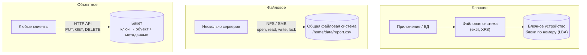
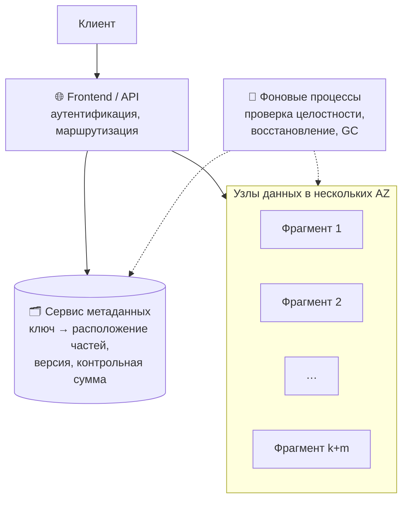
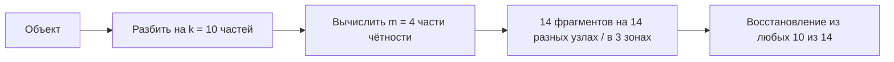
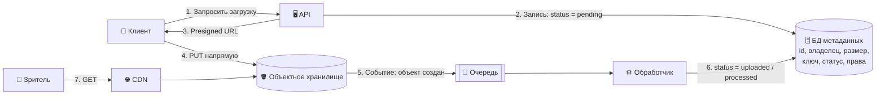
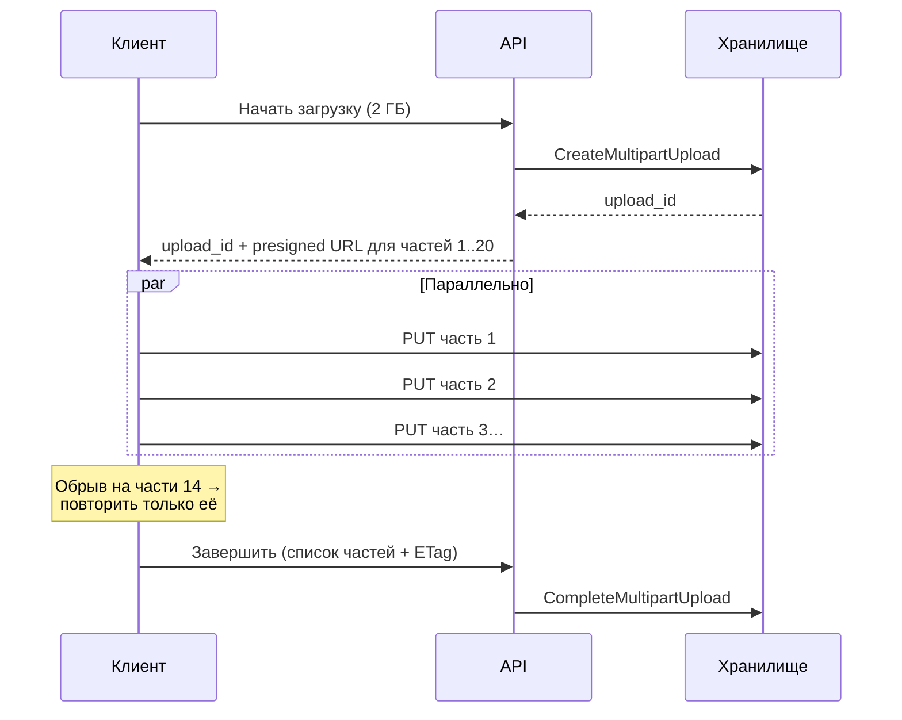

[English](README.md) | **Русский**

# 14. Типы хранилищ

> **Что внутри:** блочное, файловое и объектное хранилище; как устроено объектное хранилище внутри (метаданные, erasure coding, долговечность); разделение blob и метаданных; загрузка больших файлов; проблема мелких файлов; классы хранения и жизненный цикл; удаление и защита данных
> **Время на изучение:** ~3–4 ч · **Нужно для:** любых задач с файлами, фото, видео, бэкапами, логами, аналитикой (Instagram, YouTube, Dropbox, S3)
> **Практика:** разбор в формате интервью — [INTERVIEW_RU.md](./INTERVIEW.ru.md)
> **Связанные темы:** [03-cdn](../03_CDN/README.ru.md), [04-databases](../04_Databases/README.ru.md#4-как-база-хранит-данные-страницы-wal-buffer-pool), [05-replication](../05_Replication/README.ru.md)

---

## 📑 Содержание

1. [Три абстракции хранения](#1-три-абстракции-хранения)
2. [Блочное хранилище](#2-блочное-хранилище)
3. [Файловое хранилище](#3-файловое-хранилище)
4. [Объектное хранилище](#4-объектное-хранилище)
5. [Сравнение](#5-сравнение)
6. [Как устроено объектное хранилище внутри](#6-как-устроено-объектное-хранилище-внутри)
7. [Репликация vs erasure coding](#7-репликация-vs-erasure-coding)
8. [Паттерн: blob отдельно, метаданные отдельно](#8-паттерн-blob-отдельно-метаданные-отдельно)
9. [Загрузка больших файлов](#9-загрузка-больших-файлов)
10. [Проблема мелких файлов](#10-проблема-мелких-файлов)
11. [Классы хранения и жизненный цикл](#11-классы-хранения-и-жизненный-цикл)
12. [Долговечность, удаление и защита данных](#12-долговечность-удаление-и-защита-данных)
13. [Объектное хранилище для аналитики](#13-объектное-хранилище-для-аналитики)
14. [Как выбрать](#14-как-выбрать)
15. [Как говорить об этом на интервью](#15-как-говорить-об-этом-на-интервью)
16. [Вопросы для самопроверки](#16-вопросы-для-самопроверки)
17. [Глоссарий и ресурсы](#17-глоссарий-и-ресурсы)

---

## 1. Три абстракции хранения



| Абстракция | Единица | Как адресуется | Интерфейс |
|:-----------|:--------|:---------------|:----------|
| **Блочное** | Блок фиксированного размера | Номер блока на устройстве | Чтение и запись блоков (ОС видит диск) |
| **Файловое** | Файл в иерархии каталогов | Путь `/a/b/c.txt` | POSIX: open, read, write, seek, lock, rename |
| **Объектное** | Объект целиком + метаданные | Бакет + ключ | HTTP: PUT, GET, DELETE, LIST |

**Аналогия:** блочное хранилище — это пустой склад с пронумерованными полками, файловое — склад с каталогом и папками, к которому могут прийти несколько человек, объектное — камера хранения: сдаёшь вещь целиком, получаешь номерок, по номерку получаешь вещь обратно целиком.

---

## 2. Блочное хранилище

Самый низкий уровень: устройство, разбитое на блоки, которые читаются и пишутся по номеру. Поверх него ставят файловую систему или базу данных.

| Вид | Примеры | Свойства |
|:----|:--------|:---------|
| **Локальный диск (NVMe SSD)** | Instance store в облаке, диски сервера | Самая низкая задержка (десятки микросекунд), но данные пропадают с машиной |
| **Сетевой блочный диск** | AWS EBS, Google Persistent Disk, Azure Managed Disks | Переживает перезапуск VM, снимки, реплицирован внутри зоны; задержка выше (обычно до миллисекунды) |
| **SAN** | iSCSI, Fibre Channel в дата-центрах | Корпоративные хранилища |

### Ключевые характеристики

| Метрика | Что значит | Для чего важна |
|:--------|:-----------|:---------------|
| **IOPS** | Операций ввода-вывода в секунду | Базы данных со случайным доступом |
| **Пропускная способность** | МБ/с | Последовательное чтение и запись (логи, аналитика) |
| **Задержка** | Время одной операции | Транзакционные нагрузки (fsync WAL) |

### Свойства

- Обычно подключается к **одной** машине (multi-attach существует, но требует кластерной файловой системы или координации).
- **Снимки (snapshots):** быстрые инкрементальные копии на момент времени, часто хранятся в объектном хранилище.
- **RAID** для локальных дисков: RAID 1 (зеркало), RAID 10 (зеркало + чередование) — надёжность и скорость; RAID 5/6 — экономия места с чётностью.

**Где:** базы данных, загрузочные диски VM, журналы Kafka, всё, чему нужна файловая система с низкой задержкой на одном узле.

---

## 3. Файловое хранилище

Иерархия каталогов и файлов с POSIX-семантикой, доступная **многим серверам одновременно** по сети.

| Вид | Примеры | Где |
|:----|:--------|:----|
| **Сетевые файловые системы (NAS)** | NFS, SMB; AWS EFS, Google Filestore, Azure Files | Общие файлы приложений, домашние каталоги, legacy-приложения |
| **Распределённые файловые системы** | HDFS, CephFS, Lustre, GPFS | Аналитика, HPC, обучение ML |

### Свойства

| ✅ Плюсы | ❌ Минусы |
|:--------|:---------|
| Привычная модель: пути, каталоги, права | Масштабирование метаданных: сервер метаданных — узкое место |
| Частичная запись и дозапись, блокировки, атомарный rename | Сложнее масштабировать, чем объектное хранилище |
| Работает с любым ПО «как с диском» | Дороже объектного хранилища за ГБ |
| Общий доступ для многих серверов | Задержка выше локального диска |

> [!NOTE]
> В HDFS и GFS метаданные (дерево каталогов, расположение блоков) хранятся на одном узле-мастере в памяти, а данные — большими блоками (64–128 МБ) на узлах данных. Это хорошо для больших файлов и плохо для миллионов мелких: мастер упирается в память.

**Где:** когда ПО требует файловой системы (legacy, научные расчёты), общие рабочие каталоги, некоторые ML-пайплайны.

---

## 4. Объектное хранилище

**Плоское** пространство имён: бакет + ключ → объект (байты) + метаданные. Доступ по HTTP API.

```http
PUT    /photos-bucket/users/42/7f3c9e2a.jpg      ← загрузить (заменить целиком)
GET    /photos-bucket/users/42/7f3c9e2a.jpg      ← скачать (можно Range: bytes=0-1048575)
HEAD   /photos-bucket/users/42/7f3c9e2a.jpg      ← метаданные
DELETE /photos-bucket/users/42/7f3c9e2a.jpg
GET    /photos-bucket?prefix=users/42/            ← список по префиксу
```

### Свойства

| Свойство | Что значит |
|:---------|:-----------|
| **Объекты неизменяемы** | Нельзя изменить середину или дописать в конец — только перезаписать объект целиком |
| **Плоское пространство** | «Папки» — это просто префиксы ключа (`users/42/`); переименование «папки» = копирование каждого объекта |
| **Огромный масштаб** | Практически неограниченный объём и число объектов |
| **Высокая долговечность** | Например, S3 проектируется на 99,999999999% (11 девяток) долговечности объектов в год |
| **Консистентность** | В S3 с декабря 2020 года — строгая read-after-write для PUT и LIST; в других системах проверять документацию |
| **Метаданные объекта** | Content-Type, пользовательские теги, контрольная сумма (ETag) |
| **Версионирование** | Хранить предыдущие версии; защита от случайного удаления |
| **Presigned URL** | Временная подписанная ссылка: клиент загружает или скачивает напрямую, минуя ваши серверы |
| **Multipart upload** | Большой файл загружается частями параллельно, с повтором отдельных частей |
| **Уведомления о событиях** | «Объект создан» → очередь или функция |
| **Классы хранения и жизненный цикл** | Автоматический перевод в более дешёвые классы и удаление |

| ✅ Плюсы | ❌ Минусы |
|:--------|:---------|
| Дёшево за ГБ, бесконечно масштабируется | Задержка десятки миллисекунд, не для случайного мелкого доступа |
| Очень высокая долговечность и доступность | Нет частичных изменений и дозаписи |
| HTTP API, отлично работает с CDN | LIST медленный и дорогой на больших бакетах |
| Отделение хранения от вычислений | Нет атомарного переименования и транзакций между объектами |

> [!TIP]
> Производительность S3 масштабируется **по префиксам**: документированы тысячи запросов в секунду на префикс (порядка 3 500 PUT и 5 500 GET). При очень высокой нагрузке распределяй ключи по разным префиксам, а не складывай всё под одну дату.

**Где:** фото, видео, вложения, бэкапы, логи, артефакты сборок, данные для аналитики и ML, статика сайтов.

---

## 5. Сравнение

| | Блочное | Файловое | Объектное |
|:-|:--------|:---------|:----------|
| Абстракция | Блоки | Файлы и каталоги | Объекты в бакетах |
| Доступ | Одна машина (обычно) | Много машин | Кто угодно по HTTP |
| Интерфейс | Устройство ОС | POSIX, NFS, SMB | REST API |
| Изменение части данных | ✅ | ✅ | ❌ Только объект целиком |
| Задержка | Микросекунды – ~1 мс | Миллисекунды | Десятки мс |
| Масштаб | Терабайты на том | Петабайты (с ограничениями метаданных) | Практически неограничен |
| Цена за ГБ | Высокая | Средняя–высокая | Низкая |
| Долговечность | Зависит от репликации и снимков | Зависит от системы | Очень высокая |
| Типичное применение | Базы данных, VM | Общие файлы, HPC, legacy | Медиа, бэкапы, data lake |

---

## 6. Как устроено объектное хранилище внутри



| Компонент | Что делает |
|:----------|:-----------|
| **Frontend** | Принимает HTTP-запросы, аутентификация, маршрутизация |
| **Сервис метаданных** | Индекс «ключ → где лежат фрагменты»; шардирован по ключам; должен быть строго консистентным |
| **Узлы данных** | Хранят фрагменты объектов на дисках |
| **Фоновые процессы** | Сверка контрольных сумм (scrubbing), восстановление потерянных фрагментов, сборка мусора удалённых объектов |

### Путь записи

1. Frontend принимает объект, считает контрольную сумму.
2. Объект делится на фрагменты, кодируется (erasure coding) и записывается на узлы в **разных зонах**.
3. После подтверждения записи фрагментов — запись в сервис метаданных. Только после этого объект виден.
4. Клиенту — успех с ETag.

### Почему такая долговечность

- Фрагменты в разных зонах и на разных дисках.
- Постоянная проверка целостности и автоматическое восстановление при потере диска — до того, как потеряется ещё несколько фрагментов.
- Чем быстрее восстановление, тем меньше вероятность одновременной потери нескольких фрагментов.

> [!NOTE]
> «11 девяток долговечности» означает: при хранении 10 миллионов объектов в среднем можно ожидать потери одного объекта раз в 10 000 лет. Но это **не доступность**: долговечность — «не потеряли», доступность — «можно прочитать прямо сейчас». У S3 доступность измеряется девятками на уровне 99,9–99,99% в зависимости от класса хранения.

---

## 7. Репликация vs erasure coding

**Erasure coding** (например, Reed-Solomon): данные делятся на **k** фрагментов, к ним вычисляются **m** фрагментов чётности. Объект можно восстановить из **любых k** фрагментов из k + m.



| | Репликация ×3 | Erasure coding 10+4 |
|:-|:--------------|:--------------------|
| Накладные расходы на место | 3× | 1,4× |
| Переживает потерю | 2 копий | 4 фрагментов |
| Чтение | С любой реплики, просто | Нужно собрать k фрагментов (или есть данные целиком без чётности) |
| Восстановление после потери диска | Скопировать реплику | Прочитать k фрагментов и пересчитать — больше сетевого трафика |
| Запись мелких объектов | Дёшево | Накладные расходы на кодирование |
| Где | Горячие данные, базы, мелкие объекты | Холодные и тёплые большие объекты, архивы |

> [!TIP]
> На масштабе петабайт разница между 3× и 1,4× — это **половина** стоимости дисков. Поэтому крупные хранилища используют репликацию для свежих горячих данных и переводят их в erasure coding, когда они остывают. Так описывал свою систему f4 Facebook: тёплые фото хранились с erasure coding, а не тройной репликацией.

---

## 8. Паттерн: blob отдельно, метаданные отдельно

Главный паттерн для файлов в system design: **байты** — в объектном хранилище, **метаданные** — в базе данных.



| Что где хранится | Почему |
|:-----------------|:-------|
| **Объектное хранилище:** сами байты | Дёшево, масштабируется, отдаётся через CDN |
| **БД:** владелец, имя, размер, тип, ключ объекта, статус, права, время | Запросы, фильтрация, транзакции, связи с другими сущностями |

### Почему загрузка напрямую в хранилище

- Тяжёлый трафик не проходит через ваши API-серверы.
- Хранилище масштабируется само; API занимается только авторизацией и метаданными.
- Presigned URL ограничен по времени, размеру и типу содержимого.

### Согласованность blob и метаданных

Запись в хранилище и в базу — две разные системы, поэтому возможны рассогласования:

| Ситуация | Защита |
|:---------|:-------|
| Объект загружен, метаданные не обновились | Событие хранилища → обработчик обновит статус; периодическая сверка |
| Запись в БД есть (`pending`), объект так и не загрузили | Удаление «зависших» `pending` по TTL |
| Объект без записи в БД (сирота) | Сборщик мусора по префиксу и времени; lifecycle-правило для временной зоны загрузок |
| Удалили запись, объект остался | Асинхронное удаление объекта по событию; сверка |

> [!IMPORTANT]
> **Сигнал Senior+:** порядок операций — **сначала объект, потом метаданные «готово»**. Клиент никогда не должен увидеть метаданные, ссылающиеся на ещё не существующий объект. А «сироты» в хранилище — не ошибка корректности, а вопрос стоимости, который решает сборщик мусора.

### Ключи объектов

| Подход | Пример | Плюсы |
|:-------|:-------|:------|
| Случайный ID | `media/7f3c9e2a-….jpg` | Нет коллизий, равномерно по префиксам |
| **По содержимому (хэш)** | `blobs/sha256/ab/cd/abcd…` | Автоматическая дедупликация одинаковых файлов, проверка целостности |
| С версией | `media/123/v2/photo.jpg` | Неизменяемые URL → долгий кэш на CDN |

> [!WARNING]
> Не используй в ключах **изменяемые** данные (имя файла, имя пользователя): переименование превратится в копирование объекта. Имя файла — в метаданные.

---

## 9. Загрузка больших файлов

| Техника | Как работает |
|:--------|:-------------|
| **Multipart upload** | Файл делится на части (например, по 8–100 МБ); части загружаются параллельно и независимо; в конце — запрос «собрать» |
| **Возобновляемая загрузка** | При обрыве продолжить с последней подтверждённой части (протокол tus, resumable uploads в GCS) |
| **Контрольные суммы** | Для каждой части и всего файла — обнаружение повреждения при передаче |
| **Range GET** | Скачивание частями и параллельно; продолжение после обрыва; перемотка видео |
| **Content-defined chunking** | Разбиение по содержимому (rolling hash), чтобы при изменении части файла менялись только затронутые чанки — дедупликация и синхронизация (как в Dropbox) |



> [!TIP]
> Незавершённые multipart-загрузки занимают место и стоят денег. Нужно lifecycle-правило, удаляющее их через несколько дней.

---

## 10. Проблема мелких файлов

Миллиарды объектов по несколько килобайт (миниатюры, иконки, мелкие JSON):

| Проблема | Почему |
|:---------|:-------|
| Накладные расходы на метаданные | Запись метаданных сравнима по размеру с самим объектом |
| Стоимость запросов | Плата за каждый PUT и GET больше, чем за хранение |
| Файловые системы | Лимит inode, медленный листинг, нагрузка на сервер метаданных |
| Холодные классы хранения | Часто имеют минимальный оплачиваемый размер объекта и минимальный срок хранения |

### Решения

| Решение | Пример |
|:--------|:-------|
| **Упаковка в большие тома** | Facebook Haystack: много фото в одном большом файле-томе; в памяти индекс «ID → (том, смещение, размер)» — одно дисковое чтение на фото |
| **Хранить в БД или KV** | Объекты в килобайты — в Cassandra, DynamoDB или прямо в строке БД |
| **Батчинг** | Логи и события собирать в большие файлы (по минутам) перед записью в объектное хранилище |
| **Не переводить в холодные классы** | Мелкие объекты оставлять в стандартном классе, если экономии нет |

---

## 11. Классы хранения и жизненный цикл

Данные со временем «остывают»: к фото недельной давности обращаются намного реже, чем к вчерашнему.

| Класс (пример по смыслу) | Задержка доступа | Цена хранения | Цена чтения | Для чего |
|:-------------------------|:----------------|:--------------|:------------|:---------|
| **Горячий** (Standard) | Миллисекунды | Высокая | Низкая | Свежие и популярные данные |
| **Тёплый** (Infrequent Access) | Миллисекунды | Ниже | Выше, есть плата за извлечение | Редко читаемые, но нужные сразу |
| **Холодный** (Glacier Instant/Flexible и аналоги) | От миллисекунд до часов | Низкая | Высокая | Архивы, оригиналы, к которым почти не обращаются |
| **Архив** (Deep Archive и аналоги) | Часы | Минимальная | Высокая | Хранение по требованиям закона |

### Lifecycle-правила

```
Объекты с префиксом originals/:
  через 30 дней    → тёплый класс
  через 365 дней   → холодный класс
Префикс tmp-uploads/:
  через 1 день     → удалить
Незавершённые multipart-загрузки:
  через 7 дней     → удалить
Предыдущие версии объектов:
  через 90 дней    → удалить
```

> [!WARNING]
> Перевод в холодный класс выгоден, только если к данным **действительно** почти не обращаются. Плата за извлечение и минимальные сроки хранения могут сделать «экономию» дороже стандартного класса. Решай по реальной статистике доступа (многие хранилища предлагают автоматическое распределение по классам на основе обращений, например S3 Intelligent-Tiering).

---

## 12. Долговечность, удаление и защита данных

| Угроза | Защита |
|:-------|:-------|
| Отказ дисков, узлов, зоны | Erasure coding / репликация между зонами (встроено в хранилище) |
| Отказ региона | Межрегиональная репликация (для критичных данных) |
| Случайное удаление или перезапись | **Версионирование**: предыдущие версии сохраняются |
| Злоумышленник или вымогатель | **Object Lock (WORM):** объект нельзя удалить или изменить до определённой даты; отдельный аккаунт для бэкапов |
| Повреждение данных | Контрольные суммы при записи и чтении, scrubbing |

### Удаление и GDPR

Удалить данные пользователя полностью сложнее, чем кажется:
- оригинал и **все** производные версии (миниатюры, транскоды);
- кэш CDN (purge);
- предыдущие версии в хранилище с версионированием;
- бэкапы и реплики в других регионах;
- копии в аналитике.

**Crypto-shredding:** данные каждого пользователя шифруются отдельным ключом; удаление ключа делает все копии (включая бэкапы) нечитаемыми. Это практичный способ «удалить» данные из неизменяемых бэкапов.

---

## 13. Объектное хранилище для аналитики

Современная архитектура данных — **отделение хранения от вычислений**: данные лежат в объектном хранилище в колоночных форматах, а движки запросов (Spark, Trino, Snowflake, BigQuery) масштабируются отдельно.

| Элемент | Что это |
|:--------|:--------|
| **Parquet / ORC** | Колоночные форматы со сжатием: читаются только нужные колонки |
| **Партиционирование по префиксам** | `events/date=2026-11-30/hour=10/…` — запросы читают только нужные партиции |
| **Табличные форматы** (Apache Iceberg, Delta Lake, Hudi) | ACID-транзакции, схемы, time travel поверх файлов в объектном хранилище |
| **Tiered storage** | Kafka, базы данных и поисковые движки выносят старые данные в объектное хранилище |

---

## 14. Как выбрать

| Данные / задача | Хранилище |
|:----------------|:----------|
| Диск для базы данных, журнала Kafka | Блочное (локальный NVMe или сетевой диск) |
| Временные файлы обработки (транскодирование) | Локальный блочный диск (быстро, временно) |
| Фото, видео, вложения, документы пользователей | Объектное + метаданные в БД + CDN |
| Бэкапы, снимки, логи, артефакты | Объектное, с lifecycle и версионированием |
| Данные для аналитики и ML | Объектное в Parquet + табличный формат |
| Общие файлы для legacy-приложений или HPC | Файловое (NFS, EFS, Lustre) |
| Мелкие объекты в огромном количестве | KV-хранилище или упаковка в тома |
| Метаданные файлов, права, поиск | База данных (+ поисковый индекс) |

---

## 15. Как говорить об этом на интервью

### Ответ за 30 секунд

> «Байты файлов — в объектном хранилище, метаданные — в базе, раздача — через CDN. Клиент загружает напрямую по presigned URL, большие файлы — multipart с возобновлением и контрольными суммами; запись в БД переходит в «готово» только после того, как объект существует, а сироты убирает сборщик мусора. Ключи неизменяемые, по ID или хэшу содержимого для дедупликации. Lifecycle переводит остывшие данные в дешёвые классы по реальной статистике доступа. Долговечность даёт erasure coding внутри хранилища; от удаления — версионирование и object lock; для GDPR — удаление всех производных, purge CDN и crypto-shredding. Блочное хранилище — под базы, файловое — только если ПО требует POSIX».

### Вопросы, которые стоит задать

1. Какого размера объекты и сколько их? Мелкие или большие?
2. Как часто к ним обращаются и как это меняется со временем?
3. Нужно ли изменять части файла или только заменять целиком?
4. Требования к долговечности, хранению по закону и удалению?
5. Кто загружает и скачивает: пользователи по всему миру или внутренние сервисы?

### Типичные ошибки

- Хранить файлы в реляционной базе (BLOB-колонки) на большом масштабе.
- Пропускать загрузки через API-серверы вместо presigned URL.
- Метаданные «готово» раньше, чем объект существует.
- Изменяемые данные (имя файла) в ключе объекта.
- Миллиарды мелких объектов без упаковки.
- Перевод в холодный класс без анализа доступа.
- Путать долговечность и доступность.
- Забыть про производные файлы, CDN и бэкапы при удалении.

---

## 16. Вопросы для самопроверки

<details>
<summary><b>1. Чем блочное, файловое и объектное хранилища отличаются по интерфейсу?</b></summary>

Блочное — устройство с блоками по номеру, поверх которого ОС ставит файловую систему. Файловое — иерархия файлов с POSIX-операциями (open, read, write, lock, rename), доступная многим машинам по NFS/SMB. Объектное — плоское пространство «бакет + ключ → объект» с HTTP API, где объект заменяется только целиком.
</details>

<details>
<summary><b>2. Почему база данных обычно живёт на блочном хранилище, а не на объектном?</b></summary>

Базе нужны случайные чтения и записи отдельных страниц с низкой задержкой и fsync для WAL. Объектное хранилище работает только с объектами целиком и имеет задержку в десятки миллисекунд. (Современные облачные базы выносят в объектное хранилище бэкапы и холодные данные, но не горячий путь.)
</details>

<details>
<summary><b>3. Что даёт erasure coding по сравнению с тройной репликацией?</b></summary>

При схеме 10+4 накладные расходы 1,4× вместо 3×, и при этом можно потерять 4 фрагмента, а не 2. Цена — более дорогое восстановление и чтение (нужно собрать фрагменты), поэтому его используют для тёплых и холодных больших объектов.
</details>

<details>
<summary><b>4. Зачем загружать файлы по presigned URL?</b></summary>

Тяжёлый трафик идёт напрямую в хранилище, минуя API-серверы, которые занимаются только авторизацией и метаданными. URL ограничен по времени, размеру и типу содержимого, поэтому безопасен.
</details>

<details>
<summary><b>5. В каком порядке записывать объект и метаданные?</b></summary>

Сначала объект, затем метаданные со статусом «готово» (обычно по событию хранилища). Тогда метаданные никогда не ссылаются на несуществующий объект. Сироты в хранилище удаляет сборщик мусора.
</details>

<details>
<summary><b>6. Что такое content-addressed ключи и зачем они?</b></summary>

Ключ объекта — хэш его содержимого. Одинаковые файлы получают один ключ и хранятся один раз (дедупликация), а ключ одновременно служит проверкой целостности. Объекты становятся неизменяемыми, что удобно для CDN.
</details>

<details>
<summary><b>7. В чём проблема мелких файлов и как её решают?</b></summary>

Накладные расходы на метаданные, запросы и inode сравнимы с самими данными или больше их. Решения: упаковка в большие тома с индексом смещений (Haystack), хранение в KV-хранилище, батчинг в большие файлы.
</details>

<details>
<summary><b>8. Когда перевод в холодный класс хранения не выгоден?</b></summary>

Когда к данным всё ещё регулярно обращаются: плата за извлечение и запросы перекрывает экономию на хранении. Также мешают минимальные сроки хранения и минимальный оплачиваемый размер объекта для мелких файлов.
</details>

<details>
<summary><b>9. Чем долговечность отличается от доступности?</b></summary>

Долговечность — вероятность не потерять данные. Доступность — возможность прочитать их прямо сейчас. Хранилище может иметь 11 девяток долговечности и 99,9–99,99% доступности: при сбое данные временно недоступны, но не потеряны.
</details>

<details>
<summary><b>10. Что такое crypto-shredding?</b></summary>

Данные каждого пользователя шифруются отдельным ключом. Чтобы «удалить» данные, удаляют ключ — все копии, включая неизменяемые бэкапы и реплики, становятся нечитаемыми.
</details>

---

## 17. Глоссарий и ресурсы

### Глоссарий

| Термин | Значение |
|:-------|:---------|
| Блочное хранилище | Устройство с блоками, адресуемыми по номеру |
| IOPS | Операций ввода-вывода в секунду |
| Файловое хранилище | Иерархия файлов с POSIX-доступом по сети |
| Объектное хранилище | Плоское пространство «бакет + ключ → объект» с HTTP API |
| Бакет | Контейнер объектов |
| Presigned URL | Временная подписанная ссылка для прямой загрузки или скачивания |
| Multipart upload | Загрузка объекта частями |
| Erasure coding | Кодирование с фрагментами чётности; восстановление из любых k из k+m |
| Долговечность | Вероятность не потерять данные |
| Content-addressed storage | Ключ объекта — хэш содержимого |
| Lifecycle-правило | Автоматический перевод между классами и удаление |
| Версионирование | Хранение предыдущих версий объекта |
| Object Lock / WORM | Запрет удаления и изменения до заданной даты |
| Crypto-shredding | Удаление данных уничтожением ключа шифрования |
| Scrubbing | Фоновая проверка целостности данных |

### Ресурсы

- Beaver et al., *Finding a needle in Haystack: Facebook's photo storage* (OSDI 2010)
- Muralidhar et al., *f4: Facebook's Warm BLOB Storage System* (OSDI 2014)
- Noghabi et al., *Ambry: LinkedIn's Scalable Geo-Distributed Object Store* (SIGMOD 2016)
- Ghemawat, Gobioff, Leung, *The Google File System* (SOSP 2003)
- Weil et al., *Ceph: A Scalable, High-Performance Distributed File System* (OSDI 2006)
- Andy Warfield, *Building and operating a pretty big storage system called S3* (All Things Distributed, 2023)
- Документация AWS S3: модель консистентности, рекомендации по производительности, классы хранения, lifecycle
- Backblaze: статьи о Reed-Solomon и долговечности