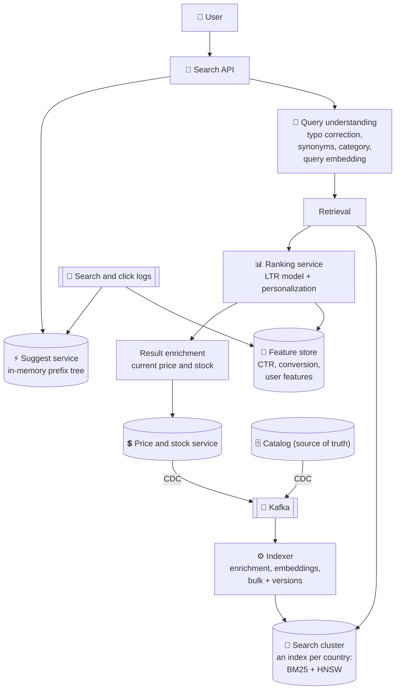
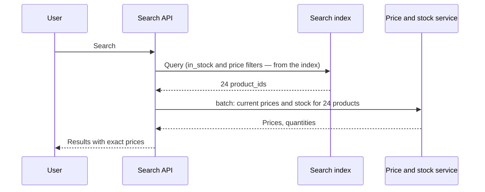
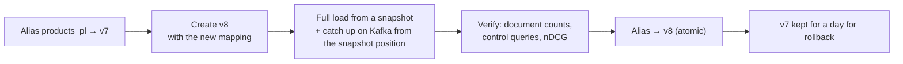

**English** | [Русский](INTERVIEW.ru.md) · Theory: [README.md](./README.md)

# 15. Search Basics: Product Search for a Marketplace

> **Topic:** indexing and text analysis for products, typos and synonyms, filters and facets, multi-stage ranking, constantly changing prices and stock, the indexing pipeline, shards and replicas, autocomplete, hybrid (lexical + vector) search, quality metrics
> **Level:** Medium–Hard · **Interview time:** 45 min · **Study time:** ~5 h
> **Where it's asked:** "Design search for Amazon / a marketplace / Airbnb", "how does product search work", and as a deep dive in catalog problems

---

## 🗺️ How to Read This Walkthrough

| Icon | Meaning |
|:----:|:--------|
| 🎤 | Interviewer |
| 🗣️ | What I (the candidate) say out loud |
| ✏️ | What I draw on the whiteboard |
| ⏱️ | Time budget for the step |

Callouts: **TIP** — a good technique, **WARNING** — a trap, **IMPORTANT** — a Senior+ signal.

---

## 📑 Contents

1. [Problem Statement](#1-problem-statement)
2. [Clarifying Questions and Requirements](#2-clarifying-questions-and-requirements)
3. [Capacity Estimates](#3-capacity-estimates)
4. [API](#4-api)
5. [The Document and Mapping](#5-the-document-and-mapping)
6. [High-Level Design](#6-high-level-design)
7. [Deep Dive 1: From Query Text to Candidates](#7-deep-dive-1-from-query-text-to-candidates)
8. [Deep Dive 2: Ranking](#8-deep-dive-2-ranking)
9. [Deep Dive 3: Prices and Stock That Change Constantly](#9-deep-dive-3-prices-and-stock-that-change-constantly)
10. [Deep Dive 4: Indexing and Reindexing](#10-deep-dive-4-indexing-and-reindexing)
11. [Deep Dive 5: Shards, Replicas and Latency](#11-deep-dive-5-shards-replicas-and-latency)
12. [Deep Dive 6: Semantic and Hybrid Search](#12-deep-dive-6-semantic-and-hybrid-search)
13. [Deep Dive 7: Autocomplete](#13-deep-dive-7-autocomplete)
14. [Bottlenecks and Failure Scenarios](#14-bottlenecks-and-failure-scenarios)
15. [Interviewer Questions with Answers](#15-interviewer-questions-with-answers)
16. [Common Mistakes](#16-common-mistakes)
17. [Cheat Sheet and Self-Check](#17-cheat-sheet-and-self-check)

---

## 1. Problem Statement

> 🎤 "Design product search for a marketplace: a user types a query and gets relevant products, with filters for price, brand, rating and availability. Today search runs as a `LIKE` in the database; it's slow and finds things poorly."

**Time plan:**

| Step | ⏱️ |
|:-----|:--:|
| Requirements | 5 min |
| Estimates | 3 min |
| API, document, high-level | 9 min |
| Deep dives | 23 min |
| Failures and wrap-up | 5 min |

> [!TIP]
> Search is two different problems: **finding** (recall: the index, text analysis, typos) and **ordering** (precision: ranking). Name both and split your time between them. The third important topic is the **freshness** of prices and stock.

---

## 2. Clarifying Questions and Requirements

⏱️ 5 min

| My question | Interviewer's answer | What it changes |
|:------------|:---------------------|:----------------|
| How many products, and in which languages? | 100M products in 5 countries, each with its own language | An index per country/language with its own analyzer |
| What kind of queries? | Short ("nike sneakers"), SKUs, descriptive ("warm jacket for hiking") | Lexical + semantic search |
| How fast must changes appear? | A new product — minutes; price and stock — seconds to minutes; in the cart — exact | Different update paths; exact price from the pricing service |
| What matters in ranking? | Relevance, but also sales, rating, price, delivery speed | Multi-stage ranking with ML |
| Personalization? | Desirable | User features at the ranking stage |
| How is quality measured? | Search-to-purchase conversion, the share of searches with no results | Metrics, A/B tests |

### Functional requirements

1. Full-text search with morphology, typo tolerance and synonyms.
2. Filters (price, brand, rating, availability, delivery) and facets with counts.
3. Sorting by relevance, price, rating, recency.
4. Query autocomplete.
5. Understanding descriptive queries.

### Non-functional requirements

| Requirement | Target |
|:------------|:-------|
| Search latency | p99 < 200 ms |
| Autocomplete latency | p99 < 50 ms |
| Freshness | A new product — < 5 min; availability — < 1 min; price in results — < 1 min |
| Availability | 99.95%; degrade on failure rather than error |
| Quality | Growing conversion, < 3% of searches with no results |

---

## 3. Capacity Estimates

⏱️ 3 min

✏️

```
Products             = 100M in 5 countries ≈ 20M per country
Document size        ≈ 3 KB in the index (fields, doc values, positions) → ~60 GB per country
                       + vectors 768 × 4 B ≈ 3 KB per product → another ~60 GB per country

Searches             = 10,000 QPS average, 30,000 peak (all countries)
Autocomplete         ≈ 5× searches = 150,000 QPS at peak
Changes              = prices 5M/day, stock 50M/day ≈ 600/s average, bursts up to 10,000/s
New products         = 1M/day
```

🗣️ **Conclusions:**
- **An index per country** — 20M documents, ~60 GB: with ~20 GB shards that's **3 primary shards**. Each query goes only to its country's index.
- **30,000 QPS × 3 shards = 90,000 shard requests per second.** With a cache for popular queries (~40% hit rate), ~55,000/s remain; at ~1,500 requests/s per shard copy, that's ~35 shard copies — i.e. **~10–12 replicas** of each shard across all countries together.
- **Stock changes 50M times a day** — reindexing a document on every change is expensive (segments are immutable). A separate path is needed.
- **Autocomplete has 5× the requests**, but they're cheap: a separate lightweight in-memory structure.

---

## 4. API

⏱️ 2 min

```http
GET /v1/search?q=nike+sneakers&country=pl
               &filters=brand:nike,price:20-80,in_stock:true,rating_gte:4
               &sort=relevance&cursor=…&limit=24
→ 200 {
    results: [{ product_id, title, image, price, rating, delivery_eta, badges }],
    facets:  { brand: [{ value: "nike", count: 1203 }, …], price_ranges: […] },
    corrected_query: null | "nike sneakers",
    next_cursor
  }

GET /v1/suggest?q=snea&country=pl
→ 200 { suggestions: ["sneakers", "sneakers men", "sneakers nike", …] }
```

🗣️ "Cursor pagination (`search_after` internally), because `from` is expensive on deep pages. Facets come in the same response — one search operation. `corrected_query` — if the query was corrected (a typo)."

---

## 5. The Document and Mapping

⏱️ 3 min

```json
{
  "product_id": "p_9001",
  "title":       "Nike Air Zoom Pegasus 40 Men's Running Shoes",
  "description": "Cushioned running shoes…",
  "brand":       "nike",
  "category_path": ["shoes", "sports shoes", "sneakers"],
  "attributes":  { "color": "black", "size": ["41", "42", "43"], "gender": "men" },
  "price":       64.99,
  "in_stock":    true,
  "rating":      4.7,
  "reviews_count": 1832,
  "sales_30d":   5400,
  "delivery_days": 2,
  "created_at":  "2026-09-01",
  "embedding":   [0.012, -0.044, …],     // 768 numbers
  "version":     1732000000123
}
```

| Field | Index type | Why |
|:------|:-----------|:----|
| `title`, `description` | Text with a language analyzer (stemming, synonyms) + a subfield without stemming for exact matches | Search and relevance; `title` boosted |
| `brand`, `category_path`, `attributes.*` | keyword | Filters and facets |
| `price`, `rating`, `delivery_days` | Numbers | Filters, sorting, ranking features |
| `in_stock` | boolean | Filter |
| `sales_30d`, `reviews_count` | Numbers | Ranking features |
| `embedding` | dense_vector + HNSW | Semantic search |
| `version` | — | External versioning |

🗣️ "The document is **denormalized**: the brand name, the category path, the rating — all inside. There are no JOINs in a search engine, and each query must be served by one index."

---

## 6. High-Level Design

⏱️ 4 min

✏️



🗣️ "Search is a **funnel**: query understanding → retrieval in the search cluster (lexical and vector) → ranking by an ML model → enrichment with current prices. The index is fed from the catalog via CDC and is never the source of truth. Search and click logs fuel ranking and suggestions."

---

## 7. Deep Dive 1: From Query Text to Candidates

> 🎤 "A user typed 'snekers naik mens'. What happens?"

🗣️ "Step by step:

| Step | What it does | Result |
|:-----|:-------------|:-------|
| 1. Normalization | Lowercase, strip extra characters | "snekers naik mens" |
| 2. Typo correction | A dictionary from titles and query logs + Levenshtein distance; weight by log frequency | "sneakers naik mens" |
| 3. Transliteration and synonyms | A brand dictionary: "naik" → nike | "sneakers nike mens" |
| 4. Query understanding | A classifier: category "sneakers", brand nike, attribute "men" | A soft boost for category and brand (not a hard filter) |
| 5. Lexical retrieval | BM25 over `title^3`, `brand^2`, `description`, with stemming; fuzzy with distance 1 for words longer than 4 letters | ~1,000 candidates |
| 6. Vector retrieval | Query embedding → HNSW top 200 with the same filters | ~200 candidates |
| 7. Fusion | Reciprocal Rank Fusion | ~1,000 candidates for ranking |
| 8. Filters | Price, availability, rating — as filters (cached, don't affect scores) | |
| 9. Facets | Aggregations over the matched documents | Brands, prices, sizes with counts |

> [!WARNING]
> Query understanding mustn't be a **hard filter**: if the classifier gets the category wrong, a hard filter drops the right products. Use a boost, and a filter only at high confidence.

### Zero results

🗣️ "If nothing is found: relax the query (drop the least important words, increase fuzziness), show 'Did you mean…', and show semantically similar products via vector search. Every zero-result search is logged — it's the to-do list for improving synonyms and the catalog."

---

## 8. Deep Dive 2: Ranking

> 🎤 "BM25 put a cheap shoe bag in first place. How do you make the results better?"

🗣️ "BM25 only knows about text. A store needs a **multi-stage funnel**:

| Stage | How many documents | Model | Features |
|:------|:------------------:|:------|:---------|
| Retrieval | 1,000 | BM25 + vectors + RRF | Text, meaning |
| Ranking | 1,000 → 100 | Learning to Rank (gradient boosting, e.g. LambdaMART) | ~200 features: per-field BM25, category match, the product's CTR and conversion for this query, sales, rating, price relative to the category, delivery speed, freshness, user features |
| Re-ranking | 100 → 24 | Business rules | Diversity (not 24 identical models), ad slots, removing duplicates, a boost for fast delivery |

### Where the training labels come from

- **Click and purchase logs:** a click is a weak signal, add-to-cart stronger, a purchase the strongest.
- **Position bias correction:** top positions get more clicks just for being on top — models are trained with a correction.
- **Human raters:** manual relevance labels for offline metrics.

### How to check it got better

| Stage | Metric |
|:------|:-------|
| Offline | nDCG@10 and MRR on a labeled query set |
| Online | An A/B test: search conversion, revenue per search, the share of searches with no clicks |
| Guardrail metrics | p99 latency, the share of zero-result searches |

> [!IMPORTANT]
> **Senior+ signal:** say up front **how you'll measure** search quality and how you'll roll out ranking changes (offline metrics → an A/B test → gradual rollout). Without that, any ranking "improvement" is a guess.

---

## 9. Deep Dive 3: Prices and Stock That Change Constantly

> 🎤 "Stock changes 50 million times a day; prices change en masse during sales. How do you keep search fresh?"

🗣️ "Updating a document in Lucene means reindexing it whole (segments are immutable). 50M updates a day for one field is expensive. I separate **what search needs** from **what display needs**:

| Data | Needed for | How it's updated |
|:-----|:-----------|:-----------------|
| `in_stock` (yes/no) | A filter | Update the index only when the **status changes**, not on every quantity change — dozens of times less often |
| The exact quantity | Showing "only 3 left" | Not in the index; fetched from the stock service during enrichment |
| The price in the index | Price filter, sorting, a ranking feature | Batched updates once a minute; an approximate value is acceptable |
| The exact price | Display and the cart | From the pricing service during result enrichment (24 products per page — one batch request) |
| Description, attributes | Search | Ordinary indexing via CDC |



🗣️ "The risk: a product is 'in stock' in the index but sold out a minute ago. During enrichment such a product is marked 'out of stock' or removed from the results. And in the cart and at checkout, price and availability are checked against the source of truth."

> [!TIP]
> A sale changes millions of prices at once. The indexer must **collapse** updates to the same product within a window (keeping the latest) and send them in batches with a rate limit, so indexing doesn't interfere with search.

---

## 10. Deep Dive 4: Indexing and Reindexing

> 🎤 "How do catalog changes reach the index, and how do you change the mapping without downtime?"

### The pipeline

| Step | How |
|:-----|:----|
| Source | CDC from the catalog database and the pricing service → Kafka (key = product_id, per-product order preserved) |
| Enrichment | Pull in category names, rating, sales; compute the embedding (only when the title or description changes) |
| Collapsing | Several changes to a product within seconds → one update |
| Writing | Bulk requests in batches of 1,000–5,000 documents |
| Versions | External versioning: a document with a version lower than the current one is rejected |
| Deletion | A product is delisted → removed from the index (or a hidden flag) |

### Full reindexing

Needed when changing the analyzer, the mapping, **the embedding model** or the shard count:



> [!WARNING]
> Changing the embedding model requires **recomputing every vector** — vectors from different models aren't comparable. Queries must be encoded by the same model as the index, so switching the query model and the index alias happens at the same time.

---

## 11. Deep Dive 5: Shards, Replicas and Latency

> 🎤 "How do you lay out the indexes and stay within 200 ms p99?"

🗣️

| Decision | Why |
|:---------|:----|
| **An index per country** | Its own language analyzer; a query touches ~20M documents, not 100M |
| **3 primary shards of ~20 GB** per country | Fewer shards per query → less tail latency; shards small enough for fast recovery |
| **Replicas for load** | The replica count per country is proportional to its traffic |
| **A cache for popular queries** | A small share of queries (head queries) makes up a large share of traffic; cached at the Search API for tens of seconds |
| **Nodes in 3 zones** | A zone failure doesn't kill search |
| **Dedicated indexing nodes?** | Indexing loads CPU and disks; large clusters dedicate ingest nodes or throttle indexing |

### The latency budget

| Stage | Time |
|:------|:-----|
| Query understanding + embedding | 15 ms |
| Retrieval (BM25 + HNSW in parallel) | 50 ms |
| Ranking 1,000 documents | 40 ms |
| Price enrichment | 20 ms |
| Network and serialization | 25 ms |
| **Total** | ~150 ms, with headroom to 200 ms |

### Protection

- A timeout on cluster search; if a slow shard doesn't respond — **partial results** beat an error.
- If the ranking service is unavailable — return retrieval results with simple boosts (graceful degradation).
- Limits on expensive queries: no leading wildcards, a cap on aggregation size, `search_after` instead of deep pagination.

---

## 12. Deep Dive 6: Semantic and Hybrid Search

> 🎤 "A user types 'gift for a dad who loves fishing'. BM25 is useless here. What do you do?"

🗣️ "Vector search over embeddings:

| Element | Decision |
|:--------|:---------|
| Model | A two-tower model: a query encoder and a product encoder, fine-tuned on 'query → purchased product' pairs |
| Product embeddings | Computed offline at indexing time (only when the text changes) |
| Query embedding | Online, ~10 ms on a GPU or on CPU with a quantized model; cached for popular queries |
| Index | HNSW in the same search cluster (next to BM25, to share the same filters) |
| Filters | Availability and country — filtering during graph traversal |
| Fusion | RRF with the BM25 list |

### When each kind of search wins

| Query | Works better |
|:------|:-------------|
| "iPhone 15 Pro 256" | BM25 (exact model and storage matches) |
| SKU "MX-4421-B" | BM25 (an exact term) |
| "gift for a dad who loves fishing" | Vector |
| "comfortable shoes for long walks" | Vector |
| "nike sneakers" | Both; RRF combines them |

> [!TIP]
> Don't replace BM25 with vectors — **combine** them. Vector search is bad at distinguishing close models and numbers ("iPhone 14" and "iPhone 15" are semantically almost identical), and for a store that's critical.

### Memory

```
20M products × 768 dimensions × 4 B ≈ 61 GB of vectors per country + the HNSW graph
→ int8 quantization cuts that roughly 4× (≈ 15 GB) with a small recall loss,
  compensated by re-ranking top candidates on exact vectors
```

---

## 13. Deep Dive 7: Autocomplete

> 🎤 "Suggestions as you type: 150,000 requests per second within 50 ms."

🗣️ "A separate lightweight service, **not** through the search cluster:

| Decision | How |
|:---------|:----|
| Suggestion source | Search logs from the last 30 days: popular queries that were followed by clicks or purchases |
| Cleanup | Normalization, typo correction, removing undesirable content and personal data, a minimum popularity threshold |
| Structure | A prefix tree (trie) with precomputed top-10 completions for each prefix, in memory |
| Refresh | Rebuilt every few hours; the snapshot is distributed to every instance |
| Latency | A prefix lookup takes microseconds; p99 is dominated by the network |
| Personalization | Add the user's recent queries on the client |
| Client | 100–150 ms debounce, cancel stale requests, a client-side cache |

In detail this is the separate 'Typeahead' problem in Tier 1."

---

## 14. Bottlenecks and Failure Scenarios

| Scenario | What happens | How we protect |
|:---------|:-------------|:---------------|
| A search cluster node dies | Some shards unavailable | Replicas in other zones; partial results on timeout |
| The indexer lags | New products and prices appear late | Kafka lag monitoring; availability updates prioritized; the exact price comes from the pricing service anyway |
| A sale: millions of price changes | Indexing load interferes with search | Collapsing updates, batching, rate limiting, dedicated ingest nodes |
| A bad mapping in a new index | Poor search after the switch | Verify before switching the alias; roll back to the old index |
| The ranking service is unavailable | No ML ranking | Degradation: retrieval with simple boosts |
| The pricing service is unavailable | No exact prices | Show the index price with a note; the cart will verify |
| Heavy queries (bots, deep pagination) | Cluster overload | Rate limiting, banning expensive constructs, `search_after`, a depth limit |
| A quality regression after a model rollout | Conversion drops | An A/B test, guardrail metrics, fast model rollback |
| Changing the embedding model | Incompatible vectors | Full reindexing, switching the query model and the alias together |

---

## 15. Interviewer Questions with Answers

<details>
<summary><b>Why not PostgreSQL full-text search?</b></summary>

For a small catalog it's a good start: `tsvector` and a GIN index provide morphology and ranking. But at 20M products per country with facets, typo tolerance, synonyms, multi-stage ranking, vectors and 30,000 QPS, a specialized search engine offers more features and scales reads with replicas more easily, without loading the transactional database.
</details>

<details>
<summary><b>Why an index per country rather than one big index filtered by country?</b></summary>

Different languages need different analyzers; each query touches 5× less data; countries have different loads, so replicas are tuned separately; reindexing one country doesn't affect the others. One index with a filter is simpler but worse for text quality and latency.
</details>

<details>
<summary><b>How do you deal with position bias when training ranking?</b></summary>

Clicks on top positions are partly explained by the position itself. Methods: estimate the probability that a position is examined (e.g. via small randomizations of the order) and weight clicks inversely to it; use stronger signals (purchases); validate models with A/B tests, not just offline.
</details>

<details>
<summary><b>What if a product in the results turns out to be out of stock?</b></summary>

During result enrichment, availability is checked with the stock service: the product is marked or removed, and the index is corrected on the next status update. The final check happens in the cart and at checkout. The index may lag; display and transactions may not.
</details>

<details>
<summary><b>Why keep embeddings in the same cluster rather than a separate vector DB?</b></summary>

Hybrid search requires the same filters (country, availability, price) for both lists; in one cluster that's one query over one dataset. A separate vector DB is justified for a very large number of vectors or advanced indexes, but adds syncing data and filters between two systems.
</details>

<details>
<summary><b>How do you handle queries that return nothing?</b></summary>

Relax the query (drop the least significant words, increase fuzziness), suggest a correction, show semantically similar products. Log and review every such query: new synonyms, catalog gaps, analyzer bugs.
</details>

---

## 16. Common Mistakes

| ❌ Mistake | ✅ Do this instead |
|:----------|:------------------|
| `LIKE '%…%'` in the database | A search engine with an inverted index |
| The search index as the source of truth | The index is derived data from CDC |
| Reindexing the document on every stock change | Index only status changes; exact data during enrichment |
| Ranking by BM25 only | A multi-stage funnel with LTR and business signals |
| A hard filter on a guessed category | A boost; a filter only at high confidence |
| One index for every language | An index (or field) per language with its own analyzer |
| Vector search instead of BM25 | Hybrid search with RRF |
| Changing the mapping on a live index | A new index + an alias |
| Deep pagination via `from` | `search_after` |
| No quality metrics | nDCG offline, A/B tests online, the share of zero-result searches |

---

## 17. Cheat Sheet and Self-Check

### 30-second answer

> An index per country in a search cluster, 3 shards of ~20 GB, replicas for load; a denormalized document fed from the catalog via CDC with external versioning; reindexing via an alias. The query: normalization, typo correction from a dictionary and logs, synonyms, category understanding as a boost; retrieval with per-field BM25 and stemming plus HNSW over embeddings, fused with RRF; filters kept separate and cached. Ranking — an LTR model on ~200 features, trained on clicks and purchases with position-bias correction; then diversity rules. Stock is indexed only on status changes; exact prices come during result enrichment. Autocomplete — a separate trie built from logs. Quality — nDCG offline and A/B tests on conversion.

### Self-check

- [ ] I can describe a query's path from text to candidates
- [ ] I can design the document and the field mapping
- [ ] I can explain the ranking funnel and where labels come from
- [ ] I can solve the problem of constantly changing prices and stock
- [ ] I can describe the indexing pipeline and reindexing via an alias
- [ ] I can compute shards and replicas and draw up a latency budget
- [ ] I can explain when BM25 wins, when vectors win, and how to combine them
- [ ] I can name the search quality metrics

### Further reading

- Theory for this topic: [README.md](./README.md)
- Manning, Raghavan, Schütze, *Introduction to Information Retrieval*
- Elasticsearch documentation: relevance tuning, search_after, aliases
- Cormack et al., *Reciprocal Rank Fusion*
- Malkov, Yashunin, *HNSW*
