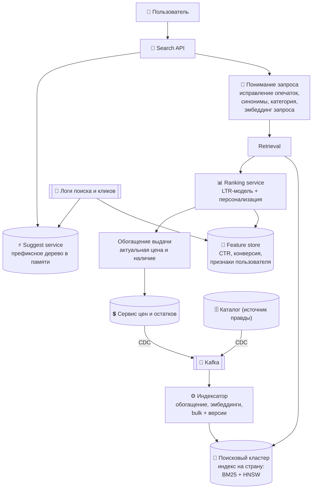
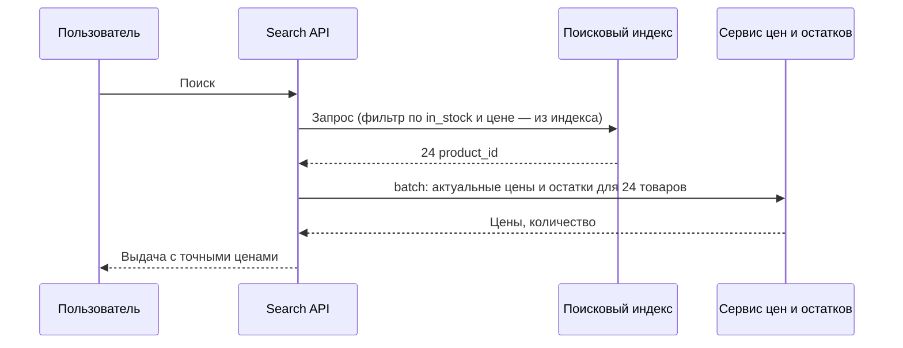
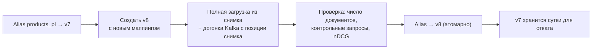

[English](INTERVIEW.md) | **Русский** · Теория: [README_RU.md](./README_RU.md)

# 15. Search Basics: поиск товаров на маркетплейсе

> **Тема:** индекс и анализ текста для товаров, опечатки и синонимы, фильтры и фасеты, многоэтапное ранжирование, часто меняющиеся цены и остатки, конвейер индексации, шарды и реплики, автодополнение, гибридный (лексический + векторный) поиск, метрики качества
> **Уровень:** Medium–Hard · **Время на интервью:** 45 мин · **Время на разбор:** ~5 ч
> **Где спрашивают:** «Спроектируй поиск для Amazon / маркетплейса / Airbnb», «как работает поиск по товарам», а также как deep dive в задачах про каталоги

---

## 🗺️ Как читать этот разбор

| Значок | Что значит |
|:------:|:-----------|
| 🎤 | Реплика интервьюера |
| 🗣️ | Что говорю вслух я (кандидат) |
| ✏️ | Что рисую на доске |
| ⏱️ | Сколько времени тратить на шаг |

Блоки **TIP** — хороший приём, **WARNING** — ловушка, **IMPORTANT** — сигнал для уровня Senior+.

---

## 📑 Содержание

1. [Условие задачи](#1-условие-задачи)
2. [Уточняющие вопросы и требования](#2-уточняющие-вопросы-и-требования)
3. [Оценки нагрузки](#3-оценки-нагрузки)
4. [API](#4-api)
5. [Документ и маппинг](#5-документ-и-маппинг)
6. [High-level дизайн](#6-high-level-дизайн)
7. [Deep dive 1: от текста запроса до кандидатов](#7-deep-dive-1-от-текста-запроса-до-кандидатов)
8. [Deep dive 2: ранжирование](#8-deep-dive-2-ранжирование)
9. [Deep dive 3: цены и остатки, которые меняются постоянно](#9-deep-dive-3-цены-и-остатки-которые-меняются-постоянно)
10. [Deep dive 4: индексация и переиндексация](#10-deep-dive-4-индексация-и-переиндексация)
11. [Deep dive 5: шарды, реплики и задержка](#11-deep-dive-5-шарды-реплики-и-задержка)
12. [Deep dive 6: семантический и гибридный поиск](#12-deep-dive-6-семантический-и-гибридный-поиск)
13. [Deep dive 7: автодополнение](#13-deep-dive-7-автодополнение)
14. [Узкие места и сценарии сбоев](#14-узкие-места-и-сценарии-сбоев)
15. [Вопросы интервьюера с ответами](#15-вопросы-интервьюера-с-ответами)
16. [Типичные ошибки](#16-типичные-ошибки)
17. [Шпаргалка и самопроверка](#17-шпаргалка-и-самопроверка)

---

## 1. Условие задачи

> 🎤 «Спроектируй поиск по товарам для маркетплейса: пользователь вводит запрос, получает релевантные товары с фильтрами по цене, бренду, рейтингу, наличию. Сейчас поиск работает через `LIKE` в базе, он медленный и находит плохо».

**План по времени:**

| Шаг | ⏱️ |
|:----|:--:|
| Требования | 5 мин |
| Оценки | 3 мин |
| API, документ, high-level | 9 мин |
| Deep dives | 23 мин |
| Сбои и итоги | 5 мин |

> [!TIP]
> Поиск — это две разные задачи: **найти** (recall: индекс, анализ текста, опечатки) и **упорядочить** (precision: ранжирование). Назови обе и раздели время между ними. Третья важная тема — **свежесть** цен и остатков.

---

## 2. Уточняющие вопросы и требования

⏱️ 5 мин

| Мой вопрос | Ответ интервьюера | Что это меняет |
|:-----------|:------------------|:---------------|
| Сколько товаров и на каких языках? | 100M товаров в 5 странах, у каждой свой язык | Индекс на страну/язык со своим анализатором |
| Какие запросы? | Короткие («кроссовки nike»), артикулы, описательные («тёплая куртка для походов») | Лексический + семантический поиск |
| Как быстро должны появляться изменения? | Новый товар — минуты; цена и наличие — секунды–минуты; в корзине — точно | Разные пути обновления; точная цена — из сервиса цен |
| Что важнее при ранжировании? | Релевантность, но также продажи, рейтинг, цена, скорость доставки | Многоэтапное ранжирование с ML |
| Персонализация? | Желательна | Признаки пользователя на этапе ранжирования |
| Как измерять качество? | Конверсия из поиска в покупку, доля поисков без результатов | Метрики, A/B-тесты |

### Функциональные требования

1. Полнотекстовый поиск с морфологией, опечатками и синонимами.
2. Фильтры (цена, бренд, рейтинг, наличие, доставка) и фасеты с количеством.
3. Сортировка по релевантности, цене, рейтингу, новизне.
4. Автодополнение запросов.
5. Понимание описательных запросов.

### Нефункциональные требования

| Требование | Цель |
|:-----------|:-----|
| Задержка поиска | p99 < 200 мс |
| Задержка автодополнения | p99 < 50 мс |
| Свежесть | Новый товар — < 5 мин; наличие — < 1 мин; цена в выдаче — < 1 мин |
| Доступность | 99,95%; при сбое — деградация, а не ошибка |
| Качество | Растущая конверсия, < 3% поисков без результатов |

---

## 3. Оценки нагрузки

⏱️ 3 мин

✏️

```
Товаров              = 100M в 5 странах ≈ 20M на страну
Размер документа     ≈ 3 КБ в индексе (поля, doc values, позиции) → ~60 ГБ на страну
                       + векторы 768 × 4 Б ≈ 3 КБ на товар → ещё ~60 ГБ на страну

Поиски               = 10 000 QPS в среднем, 30 000 в пике (все страны)
Автодополнение       ≈ 5× от поисков = 150 000 QPS в пике
Изменения            = цены 5M/день, остатки 50M/день ≈ 600/с в среднем, всплески до 10 000/с
Новые товары         = 1M/день
```

🗣️ **Выводы:**
- **Индекс на страну** — 20M документов, ~60 ГБ: при шардах ~20 ГБ это **3 primary-шарда**. Каждый запрос идёт только в индекс своей страны.
- **30 000 QPS × 3 шарда = 90 000 запросов к шардам в секунду.** С кэшем популярных запросов (~40% попаданий) остаётся ~55 000/с; при ~1 500 запросов/с на копию шарда нужно ~35 копий шардов, то есть **~10–12 реплик** каждого шарда на всех странах вместе.
- **Остатки меняются 50M раз в день** — переиндексировать документ при каждом изменении дорого (сегменты неизменяемы). Нужен отдельный путь.
- **Автодополнение — в 5 раз больше запросов**, но они дешёвые: отдельная легковесная структура в памяти.

---

## 4. API

⏱️ 2 мин

```http
GET /v1/search?q=кроссовки+nike&country=pl
               &filters=brand:nike,price:2000-8000,in_stock:true,rating_gte:4
               &sort=relevance&cursor=…&limit=24
→ 200 {
    results: [{ product_id, title, image, price, rating, delivery_eta, badges }],
    facets:  { brand: [{ value: "nike", count: 1203 }, …], price_ranges: […] },
    corrected_query: null | "кроссовки nike",
    next_cursor
  }

GET /v1/suggest?q=крос&country=pl
→ 200 { suggestions: ["кроссовки", "кроссовки мужские", "кроссовки nike", …] }
```

🗣️ «Курсорная пагинация (`search_after` внутри), потому что `from` на глубоких страницах дорогой. Фасеты в том же ответе — одна поисковая операция. `corrected_query` — если запрос исправлен (опечатка)».

---

## 5. Документ и маппинг

⏱️ 3 мин

```json
{
  "product_id": "p_9001",
  "title":       "Кроссовки Nike Air Zoom Pegasus 40 мужские",
  "description": "Беговые кроссовки с амортизацией…",
  "brand":       "nike",
  "category_path": ["обувь", "спортивная обувь", "кроссовки"],
  "attributes":  { "color": "чёрный", "size": ["41", "42", "43"], "gender": "мужской" },
  "price":       6499.00,
  "in_stock":    true,
  "rating":      4.7,
  "reviews_count": 1832,
  "sales_30d":   5400,
  "delivery_days": 2,
  "created_at":  "2026-09-01",
  "embedding":   [0.012, -0.044, …],     // 768 чисел
  "version":     1732000000123
}
```

| Поле | Тип в индексе | Зачем |
|:-----|:--------------|:------|
| `title`, `description` | Текст с русским анализатором (стемминг, синонимы) + подполе без стемминга для точных совпадений | Поиск и релевантность; `title` с бустом |
| `brand`, `category_path`, `attributes.*` | keyword | Фильтры и фасеты |
| `price`, `rating`, `delivery_days` | Числа | Фильтры, сортировка, признаки ранжирования |
| `in_stock` | boolean | Фильтр |
| `sales_30d`, `reviews_count` | Числа | Признаки ранжирования |
| `embedding` | dense_vector + HNSW | Семантический поиск |
| `version` | — | Внешнее версионирование |

🗣️ «Документ **денормализован**: название бренда, путь категории, рейтинг — всё внутри. В поисковом движке нет JOIN, и каждый запрос должен обслуживаться одним индексом».

---

## 6. High-level дизайн

⏱️ 4 мин

✏️



🗣️ «Поиск — **воронка**: понимание запроса → retrieval в поисковом кластере (лексический и векторный) → ранжирование ML-моделью → обогащение актуальными ценами. Индекс наполняется из каталога через CDC и никогда не является источником правды. Логи поиска и кликов — топливо для ранжирования и подсказок».

---

## 7. Deep dive 1: от текста запроса до кандидатов

> 🎤 «Пользователь ввёл «кросовки найк мужские». Что происходит?»

🗣️ «По шагам:

| Шаг | Что делает | Результат |
|:----|:-----------|:----------|
| 1. Нормализация | Нижний регистр, ё → е, лишние символы | «кросовки найк мужские» |
| 2. Исправление опечаток | Словарь из названий и логов запросов + расстояние Левенштейна; учитывать частоту в логах | «кроссовки найк мужские» |
| 3. Транслитерация и синонимы | Словарь брендов: «найк» → nike | «кроссовки nike мужские» |
| 4. Понимание запроса | Классификатор: категория «кроссовки», бренд nike, атрибут «мужские» | Мягкий буст категории и бренда (не жёсткий фильтр) |
| 5. Лексический retrieval | BM25 по `title^3`, `brand^2`, `description`, с русским стеммингом; fuzzy с расстоянием 1 для слов длиннее 4 букв | ~1 000 кандидатов |
| 6. Векторный retrieval | Эмбеддинг запроса → HNSW top 200 с теми же фильтрами | ~200 кандидатов |
| 7. Слияние | Reciprocal Rank Fusion | ~1 000 кандидатов на ранжирование |
| 8. Фильтры | Цена, наличие, рейтинг — как filter (кэшируются, не влияют на score) | |
| 9. Фасеты | Агрегации по найденным документам | Бренды, цены, размеры с количеством |

> [!WARNING]
> Понимание запроса не должно быть **жёстким фильтром**: если классификатор ошибся с категорией, жёсткий фильтр выбросит правильные товары. Используй буст и только при высокой уверенности — фильтр.

### Ноль результатов

🗣️ «Если результатов нет: ослабить запрос (убрать наименее важные слова, увеличить fuzzy), показать «Возможно, вы искали…» и похожие товары по векторному поиску. Каждый поиск без результатов логируется — это список для улучшения синонимов и каталога».

---

## 8. Deep dive 2: ранжирование

> 🎤 «BM25 поставил на первое место дешёвый чехол для кроссовок. Как сделать выдачу лучше?»

🗣️ «BM25 знает только о тексте. Для магазина нужна **многоэтапная воронка**:

| Этап | Сколько документов | Модель | Признаки |
|:-----|:------------------:|:-------|:---------|
| Retrieval | 1 000 | BM25 + векторы + RRF | Текст, смысл |
| Ранжирование | 1 000 → 100 | Learning to Rank (градиентный бустинг, например LambdaMART) | ~200 признаков: BM25 по полям, совпадение категории, CTR и конверсия товара по этому запросу, продажи, рейтинг, цена относительно категории, скорость доставки, свежесть, признаки пользователя |
| Re-ranking | 100 → 24 | Бизнес-правила | Разнообразие (не 24 одинаковые модели), рекламные позиции, удаление дублей, буст по скорости доставки |

### Откуда метки для обучения

- **Логи кликов и покупок:** клик — слабый сигнал, добавление в корзину — сильнее, покупка — сильнейший.
- **Поправка на позицию:** на первые позиции кликают больше просто потому, что они первые (position bias) — модели обучаются с поправкой.
- **Асессоры:** ручная разметка релевантности для офлайн-метрик.

### Как проверить, что стало лучше

| Этап | Метрика |
|:-----|:--------|
| Офлайн | nDCG@10 и MRR на размеченном наборе запросов |
| Онлайн | A/B-тест: конверсия из поиска, выручка на поиск, доля поисков без кликов |
| Защитные метрики | Задержка p99, доля нулевых результатов |

> [!IMPORTANT]
> **Сигнал Senior+:** сразу назови, **как будешь измерять** качество поиска и как выкатывать изменения ранжирования (офлайн-метрики → A/B-тест → постепенный раскат). Без этого любое «улучшение» ранжирования — догадка.

---

## 9. Deep dive 3: цены и остатки, которые меняются постоянно

> 🎤 «Остатки меняются 50 миллионов раз в день, цены — во время распродаж массово. Как держать поиск свежим?»

🗣️ «Обновление документа в Lucene — это переиндексация целиком (сегменты неизменяемы). 50M обновлений в день ради одного поля — дорого. Разделяю **что нужно для поиска** и **что нужно для показа**:

| Данные | Нужно для | Как обновляется |
|:-------|:----------|:----------------|
| `in_stock` (есть/нет) | Фильтр | Обновлять индекс только при **смене статуса**, а не при каждом изменении количества — в десятки раз реже |
| Точное количество | Показ «осталось 3 шт.» | Не в индексе; берётся из сервиса остатков при обогащении |
| Цена в индексе | Фильтр по цене, сортировка, признак ранжирования | Пакетные обновления раз в минуту; приближённое значение допустимо |
| Точная цена | Показ и корзина | Из сервиса цен при обогащении выдачи (24 товара на страницу — один batch-запрос) |
| Описание, атрибуты | Поиск | Обычная индексация через CDC |



🗣️ «Риск: товар в индексе «в наличии», а на самом деле закончился минуту назад. При обогащении такой товар помечается «нет в наличии» или убирается из выдачи. А в корзине и при оформлении цена и наличие проверяются в источнике правды».

> [!TIP]
> Распродажа меняет миллионы цен одновременно. Индексатор должен **сворачивать** обновления одного товара в окне (оставлять последнее) и отправлять их пачками с ограничением скорости, чтобы индексация не мешала поиску.

---

## 10. Deep dive 4: индексация и переиндексация

> 🎤 «Как изменения из каталога попадают в индекс и как поменять маппинг без простоя?»

### Конвейер

| Шаг | Как |
|:----|:----|
| Источник | CDC из базы каталога и сервиса цен → Kafka (ключ = product_id, порядок по товару сохраняется) |
| Обогащение | Подтянуть названия категорий, рейтинг, продажи; посчитать эмбеддинг (только при изменении названия или описания) |
| Сворачивание | Несколько изменений товара за секунды → одно обновление |
| Запись | Bulk-запросы пачками по 1 000–5 000 документов |
| Версии | Внешнее версионирование: документ с версией меньше текущей отклоняется |
| Удаление | Товар снят с продажи → удаление из индекса (или флаг скрытия) |

### Полная переиндексация

Нужна при смене анализатора, маппинга, **модели эмбеддингов** или числа шардов:



> [!WARNING]
> Смена модели эмбеддингов требует **пересчёта всех векторов** — векторы разных моделей несравнимы. Запросы должны кодироваться той же моделью, что и индекс, поэтому переключение модели запроса и alias индекса делается одновременно.

---

## 11. Deep dive 5: шарды, реплики и задержка

> 🎤 «Как разложить индексы и уложиться в 200 мс p99?»

🗣️

| Решение | Почему |
|:--------|:-------|
| **Индекс на страну** | Свой анализатор языка; запрос затрагивает ~20M документов, а не 100M |
| **3 primary-шарда по ~20 ГБ** на страну | Меньше шардов на запрос → меньше хвостовая задержка; шарды достаточно малы для быстрого восстановления |
| **Реплики под нагрузку** | Число реплик в каждой стране пропорционально её трафику |
| **Кэш популярных запросов** | Небольшая доля запросов (head queries) даёт большую долю трафика; кэш на уровне Search API на десятки секунд |
| **Узлы в 3 зонах** | Отказ зоны не убивает поиск |
| **Отдельные узлы для индексации?** | Индексация нагружает CPU и диски; на больших кластерах выделяют узлы для приёма записей или ограничивают скорость индексации |

### Бюджет задержки

| Этап | Время |
|:-----|:------|
| Понимание запроса + эмбеддинг | 15 мс |
| Retrieval (BM25 + HNSW параллельно) | 50 мс |
| Ранжирование 1 000 документов | 40 мс |
| Обогащение ценами | 20 мс |
| Сеть и сериализация | 25 мс |
| **Итого** | ~150 мс, запас до 200 мс |

### Защита

- Таймаут на поиск в кластере; если медленный шард не ответил — **частичные результаты** лучше, чем ошибка.
- Если ranking service недоступен — отдаём результаты retrieval с простыми бустами (graceful degradation).
- Ограничения на дорогие запросы: wildcard в начале слова запрещён, лимит на размер агрегаций, `search_after` вместо глубокой пагинации.

---

## 12. Deep dive 6: семантический и гибридный поиск

> 🎤 «Пользователь пишет «что подарить папе-рыбаку». BM25 тут бесполезен. Что делать?»

🗣️ «Векторный поиск по эмбеддингам:

| Элемент | Решение |
|:--------|:--------|
| Модель | Двухбашенная (two-tower) модель: энкодер запросов и энкодер товаров, дообученная на парах «запрос → купленный товар» |
| Эмбеддинги товаров | Считаются офлайн при индексации (только при изменении текста) |
| Эмбеддинг запроса | Онлайн, ~10 мс на GPU или CPU с квантизованной моделью; кэш для популярных запросов |
| Индекс | HNSW в том же поисковом кластере (рядом с BM25, чтобы использовать те же фильтры) |
| Фильтры | Наличие и страна — фильтрация во время обхода графа |
| Слияние | RRF с BM25-списком |

### Когда какой поиск выигрывает

| Запрос | Лучше работает |
|:-------|:---------------|
| «iPhone 15 Pro 256» | BM25 (точные совпадения модели и объёма) |
| Артикул «MX-4421-B» | BM25 (точный термин) |
| «что подарить папе-рыбаку» | Векторный |
| «удобная обувь для долгой ходьбы» | Векторный |
| «кроссовки nike» | Оба; RRF объединяет |

> [!TIP]
> Не заменяй BM25 векторами — **объединяй**. Векторный поиск плохо различает близкие модели и номера («iPhone 14» и «iPhone 15» семантически почти одинаковы), а для магазина это критично.

### Память

```
20M товаров × 768 измерений × 4 Б ≈ 61 ГБ векторов на страну + граф HNSW
→ квантизация до int8 сокращает примерно в 4 раза (≈ 15 ГБ), с небольшой потерей recall,
  которую компенсирует re-ranking по точным векторам для top-кандидатов
```

---

## 13. Deep dive 7: автодополнение

> 🎤 «Подсказки при вводе: 150 000 запросов в секунду и 50 мс».

🗣️ «Отдельный лёгкий сервис, **не** через поисковый кластер:

| Решение | Как |
|:--------|:----|
| Источник подсказок | Логи поиска за последние 30 дней: популярные запросы, после которых были клики или покупки |
| Очистка | Нормализация, исправление опечаток, удаление нежелательных и персональных данных, минимальный порог популярности |
| Структура | Префиксное дерево (trie) с заранее вычисленными top-10 завершениями для каждого префикса, в памяти |
| Обновление | Пересборка раз в несколько часов; снимок раздаётся на все инстансы |
| Задержка | Поиск по префиксу — микросекунды; p99 определяется сетью |
| Персонализация | Добавить недавние запросы пользователя на клиенте |
| Клиент | Debounce 100–150 мс, отмена устаревших запросов, кэш на клиенте |

Подробно это отдельная задача «Typeahead» из Tier 1».

---

## 14. Узкие места и сценарии сбоев

| Сценарий | Что произойдёт | Как защищаемся |
|:---------|:---------------|:---------------|
| Узел поискового кластера упал | Часть шардов недоступна | Реплики в других зонах; частичные результаты при таймауте |
| Индексатор отстаёт | Новые товары и цены появляются с задержкой | Мониторинг лага Kafka; приоритет обновлений наличия; точная цена всё равно из сервиса цен |
| Распродажа: миллионы изменений цен | Нагрузка на индексацию мешает поиску | Сворачивание обновлений, пачки, ограничение скорости, выделенные узлы приёма |
| Ошибочный маппинг в новом индексе | Плохой поиск после переключения | Проверка перед переключением alias; откат на старый индекс |
| Ranking service недоступен | Нет ML-ранжирования | Деградация: retrieval с простыми бустами |
| Сервис цен недоступен | Нет точных цен | Показать цену из индекса с пометкой; корзина проверит |
| Тяжёлые запросы (боты, глубокая пагинация) | Перегрузка кластера | Rate limiting, запрет дорогих конструкций, `search_after`, лимит на глубину |
| Регрессия качества после выкатки модели | Падение конверсии | A/B-тест, защитные метрики, быстрый откат модели |
| Смена модели эмбеддингов | Несовместимые векторы | Полная переиндексация, одновременное переключение модели запросов и alias |

---

## 15. Вопросы интервьюера с ответами

<details>
<summary><b>Почему не PostgreSQL с полнотекстовым поиском?</b></summary>

Для небольшого каталога это хороший старт: `tsvector` и GIN-индекс дают морфологию и ранжирование. Но на 20M товаров на страну с фасетами, опечатками, синонимами, многоэтапным ранжированием, векторами и 30 000 QPS специализированный поисковый движок даёт больше возможностей и проще масштабирует чтение репликами, не нагружая транзакционную базу.
</details>

<details>
<summary><b>Почему индекс на страну, а не один большой с фильтром по стране?</b></summary>

Разные языки требуют разных анализаторов; каждый запрос затрагивает в 5 раз меньше данных; у стран разная нагрузка — реплики настраиваются отдельно; переиндексация одной страны не затрагивает остальные. Один индекс с фильтром проще, но хуже по качеству текста и по задержке.
</details>

<details>
<summary><b>Как бороться с position bias при обучении ранжирования?</b></summary>

Клики на верхние позиции частично объясняются самим положением. Методы: оценивать вероятность просмотра позиции (например, через небольшие рандомизации порядка) и взвешивать клики обратно этой вероятности; использовать более сильные сигналы (покупка); проверять модели A/B-тестом, а не только офлайн.
</details>

<details>
<summary><b>Что если товар в выдаче оказался не в наличии?</b></summary>

При обогащении выдачи наличие проверяется в сервисе остатков: такой товар помечается или убирается, а индекс исправится при следующем обновлении статуса. Окончательная проверка — в корзине и при оформлении. Индекс допускает отставание, отображение и транзакции — нет.
</details>

<details>
<summary><b>Почему эмбеддинги в том же кластере, а не в отдельной векторной БД?</b></summary>

Гибридный поиск требует одинаковых фильтров (страна, наличие, цена) для обоих списков; в одном кластере это один запрос и один набор данных. Отдельная векторная БД оправдана при очень большом числе векторов или продвинутых индексах, но добавляет синхронизацию данных и фильтров между двумя системами.
</details>

<details>
<summary><b>Как обрабатывать запросы, по которым ничего не найдено?</b></summary>

Ослабить запрос (убрать наименее значимые слова, увеличить fuzzy), предложить исправление, показать семантически похожие товары. Каждый такой запрос логировать и разбирать: новые синонимы, пробелы в каталоге, ошибки анализатора.
</details>

---

## 16. Типичные ошибки

| ❌ Ошибка | ✅ Как правильно |
|:---------|:----------------|
| `LIKE '%…%'` в базе | Поисковый движок с инвертированным индексом |
| Поисковый индекс как источник правды | Индекс — производные данные из CDC |
| Переиндексировать документ при каждом изменении остатка | Индексировать только смену статуса; точные данные — при обогащении |
| Ранжировать только по BM25 | Многоэтапная воронка с LTR и бизнес-сигналами |
| Жёсткий фильтр по угаданной категории | Буст, фильтр только при высокой уверенности |
| Один индекс на все языки | Индекс (или поле) на язык со своим анализатором |
| Векторный поиск вместо BM25 | Гибридный поиск с RRF |
| Смена маппинга «на живом» индексе | Новый индекс + alias |
| Глубокая пагинация через `from` | `search_after` |
| Нет метрик качества | nDCG офлайн, A/B-тесты онлайн, доля нулевых результатов |

---

## 17. Шпаргалка и самопроверка

### Ответ за 30 секунд

> Индекс на страну в поисковом кластере, 3 шарда по ~20 ГБ, реплики под нагрузку, документ денормализован, наполняется из каталога через CDC с внешним версионированием, переиндексация — через alias. Запрос: нормализация, исправление опечаток по словарю и логам, синонимы, понимание категории как буст; retrieval BM25 по полям с русским стеммингом плюс HNSW по эмбеддингам, слияние через RRF; фильтры отдельно и кэшируются. Ранжирование — LTR-модель на ~200 признаках, обученная на кликах и покупках с поправкой на позицию; затем правила разнообразия. Остатки индексируются только при смене статуса, точные цены — при обогащении выдачи. Автодополнение — отдельный trie из логов. Качество — nDCG офлайн и A/B-тесты по конверсии.

### Самопроверка

- [ ] Могу описать путь запроса от текста до кандидатов
- [ ] Могу спроектировать документ и маппинг полей
- [ ] Могу объяснить воронку ранжирования и откуда берутся метки
- [ ] Могу решить проблему часто меняющихся цен и остатков
- [ ] Могу описать конвейер индексации и переиндексацию через alias
- [ ] Могу посчитать шарды и реплики и составить бюджет задержки
- [ ] Могу объяснить, когда выигрывает BM25, а когда векторы, и как их объединить
- [ ] Могу назвать метрики качества поиска

### Что почитать

- Теория по теме: [README_RU.md](./README_RU.md)
- Manning, Raghavan, Schütze, *Introduction to Information Retrieval*
- Документация Elasticsearch: relevance tuning, search_after, aliases
- Cormack et al., *Reciprocal Rank Fusion*
- Malkov, Yashunin, *HNSW*
