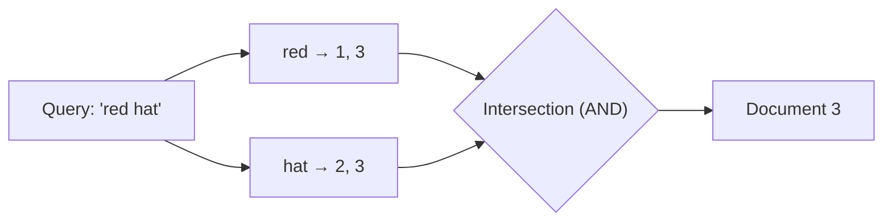
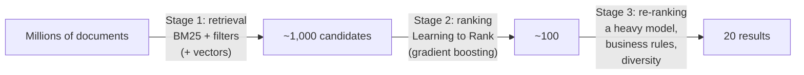
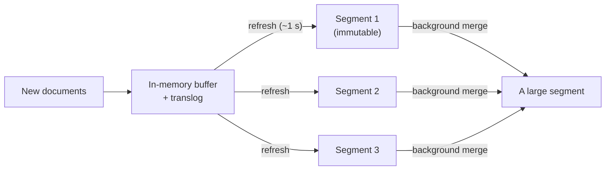
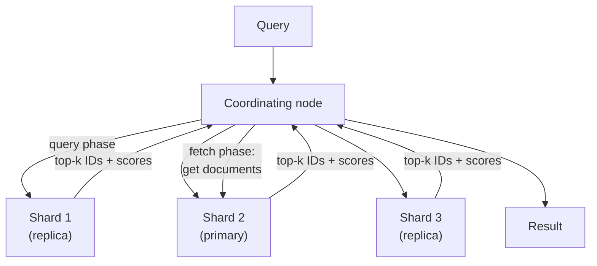
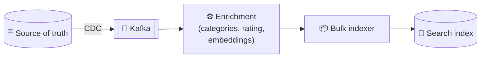
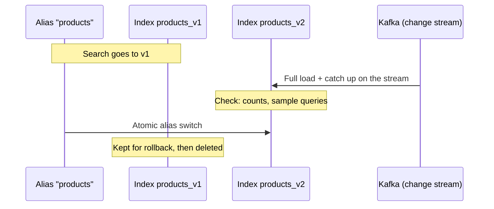
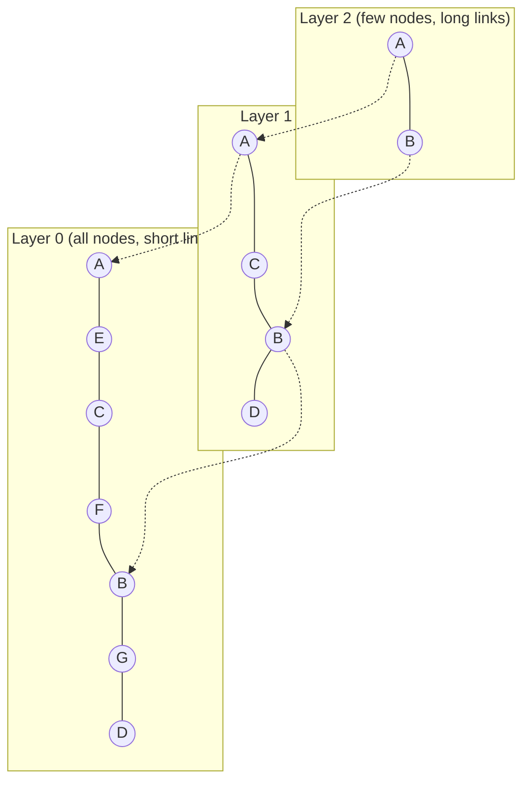
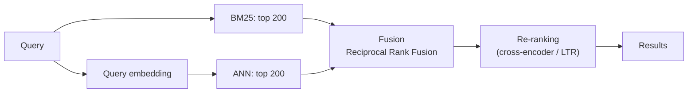

**English** | [Русский](README_RU.md)

# 15. Search Basics

> **Covers:** why search is a separate system, the inverted index, text analysis (tokenization, stemming, synonyms), query types, ranking (TF-IDF, BM25, multi-stage ranking), how Lucene/Elasticsearch work, the indexing pipeline, scaling, autocomplete, vector search (ANN, HNSW, IVF, PQ), hybrid search
> **Study time:** ~5 h · **Needed for:** search over products, documents, messages, logs; autocomplete; RAG and recommendations
> **Practice:** interview-style walkthrough — [INTERVIEW.md](./INTERVIEW.md)
> **Related topics:** [04-databases](../04-databases/README.md#5-indexes-and-b-trees), [06-partitioning](../06-partitioning/README.md#7-secondary-indexes), [11-distributed-transactions](../11-distributed-transactions/README.md#12-cdc-change-data-capture) (CDC)

---

## 📑 Contents

1. [Why a Separate Search System](#1-why-a-separate-search-system)
2. [The Inverted Index](#2-the-inverted-index)
3. [Text Analysis](#3-text-analysis)
4. [Query Types](#4-query-types)
5. [Ranking: TF-IDF and BM25](#5-ranking-tf-idf-and-bm25)
6. [Multi-Stage Ranking and Quality Metrics](#6-multi-stage-ranking-and-quality-metrics)
7. [How Lucene and Elasticsearch Work](#7-how-lucene-and-elasticsearch-work)
8. [The Indexing Pipeline](#8-the-indexing-pipeline)
9. [Scaling Search](#9-scaling-search)
10. [Autocomplete](#10-autocomplete)
11. [Vector Search](#11-vector-search)
12. [Hybrid Search](#12-hybrid-search)
13. [How to Choose](#13-how-to-choose)
14. [How to Talk About This in an Interview](#14-how-to-talk-about-this-in-an-interview)
15. [Self-Check Questions](#15-self-check-questions)
16. [Glossary and Resources](#16-glossary-and-resources)

---

## 1. Why a Separate Search System

Naive search in a relational database:

```sql
SELECT * FROM products WHERE title ILIKE '%red jacket%';
```

| Problem | Why |
|:--------|:----|
| **A full scan** | A B-tree index helps with a prefix, but not with a substring in the middle |
| **No relevance** | Results aren't ordered by how well they match |
| **No morphology** | "jackets" won't find "jacket" |
| **No typos** | "jakcet" finds nothing |
| **No synonyms** | "parka" won't find "winter jacket" |
| **No facets** | Counting "how many products of each brand are in the results" takes separate heavy queries |

Search engines (Elasticsearch, OpenSearch, Solr, Vespa) solve this with an **inverted index**, text analysis and ranking.

> [!IMPORTANT]
> A search index is **derived data**, not the source of truth. The source of truth is the database; the index is built from it (usually via CDC) and may lag by seconds. It can always be rebuilt.

---

## 2. The Inverted Index

An ordinary ("forward") index: document → the words in it. An **inverted** one: word → the list of documents containing it (a **posting list**).

```
Documents:
  1: "red winter jacket"
  2: "blue winter hat"
  3: "red hat"

Inverted index (after text analysis):
  red     → [1, 3]
  winter  → [1, 2]
  jacket  → [1]
  blue    → [2]
  hat     → [2, 3]
```



### What a posting list stores

| Data | What for |
|:-----|:---------|
| Document ID | Finding documents |
| Term frequency in the document | Ranking |
| Term **positions** | Phrase queries ("red jacket" adjacent) and proximity |
| Character offsets | Highlighting matches |

### Why it's fast

- A query touches only its terms' posting lists, not every document.
- The lists are **sorted** by document ID → intersection and union via linear merging.
- **Compression:** differences between adjacent IDs are stored (delta encoding) with variable-length encoding (varint), shrinking lists several-fold.
- **Skip lists** inside a list allow fast "jumps" when intersecting a long list with a short one.
- The **term dictionary** is stored in a compact structure (in Lucene — an FST, a finite-state transducer) that fits in memory.

---

## 3. Text Analysis

Before indexing (and before searching), text passes through an **analyzer** — a pipeline of transformations.


| Step | What it does | Example |
|:-----|:-------------|:--------|
| **Char filter** | Character preprocessing | Strip HTML, normalize accents |
| **Tokenization** | Split text into tokens | "wi-fi router" → [wi, fi, router] or [wi-fi, router] — depends on the tokenizer |
| **Lowercasing** | Case normalization | "Jacket" → "jacket" |
| **Stop words** | Remove frequent low-value words | "and", "in", "the", "a" (careful: "to be or not to be") |
| **Stemming** | Strip suffixes by rules | "jackets", "jacketed" → "jacket" |
| **Lemmatization** | Reduce to the dictionary form | "went" → "go" (more accurate than stemming; needs a dictionary) |
| **Synonyms** | Expand or replace | "notebook" ↔ "laptop" |
| **N-grams** | Split into substrings | "jacket" → "jac", "ack", "cke"… — searching by part of a word |
| **Edge n-grams** | Prefixes | "j", "ja", "jac", "jack"… — autocomplete |

> [!WARNING]
> The same analyzer must be applied **at index time and at query time**. If a document was indexed with stemming but the query isn't, "jackets" won't match "jacket". Changing an analyzer requires **reindexing** every document.

### Language specifics

- **Russian, German, Finnish** — rich morphology: a stemmer or morphological analyzer is needed.
- **Chinese, Japanese** — no spaces between words: special tokenizers (dictionary-based or n-grams) are needed.
- **A multilingual catalog** — separate fields with different analyzers per language.

---

## 4. Query Types

| Query | Example | How it works |
|:------|:--------|:-------------|
| **Term / match** | `jacket` | Lookup in the posting list after analyzing the query |
| **Boolean** | `jacket AND red NOT kids` | Intersection, union, subtraction of lists |
| **Phrase** | `"winter jacket"` | Term positions are adjacent |
| **Prefix** | `jack*` | Walking the term dictionary by prefix |
| **Fuzzy** | `jakcet~` | Terms within Levenshtein distance 1–2 (fast via Levenshtein automata over the dictionary) |
| **Range** | `price: [10 TO 50]` | Numeric indexes (BKD trees in Lucene) |
| **Geo** | Within 5 km | Geo indexes |
| **Filter** | `brand = Nike` | Like a query, but doesn't affect relevance; the result is cached |
| **Aggregations (facets)** | Counts per brand, a price histogram | Columnar data (doc values) over the matched documents |

> [!TIP]
> Separate the **query** (affects relevance: the user's text) from **filters** (don't: brand, price, availability). Filters are cheaper and cache well.

---

## 5. Ranking: TF-IDF and BM25

Finding documents is half the job. The other half is **ordering** them by relevance.

### TF-IDF

- **TF (term frequency):** the more often a term appears in a document, the more relevant the document.
- **IDF (inverse document frequency):** the **rarer** a term in the whole collection, the more important it is. "jacket" is common in a clothing store (low IDF), "gore-tex" is rare (high IDF).

```
score(term, doc) = TF(term, doc) × log(N / DF(term))
N — number of documents, DF — number of documents containing the term
```

### BM25

**BM25** is the default in Lucene and Elasticsearch. It improves on TF-IDF with two ideas:

| Idea | Why |
|:-----|:----|
| **TF saturation** (parameter k1, usually 1.2) | 10 mentions aren't 10× better than one: the contribution grows more slowly and plateaus. Protects against keyword stuffing |
| **Length normalization** (parameter b, usually 0.75) | A match in a short title means more than one in a long description |

```
           IDF(t) × TF × (k1 + 1)
BM25 = Σ  ─────────────────────────────────────────────
       t   TF + k1 × (1 − b + b × |doc| / avgdoclen)
```

### Additional signals

| Signal | Example |
|:-------|:--------|
| **Field boosts** | A match in the title outweighs one in the description |
| **Business signals** | Popularity, sales, rating, CTR |
| **Freshness** | News: newer ranks higher |
| **Personalization** | User history, location |
| **Term proximity** | Query words close together in the document rank higher |

> [!NOTE]
> IDF is computed **per shard**, not over the whole index. If documents are unevenly distributed, the same document can get different scores on different shards. On large indexes with even routing the effect is small; for accuracy there's a global statistics mode (DFS), but it's more expensive.

---

## 6. Multi-Stage Ranking and Quality Metrics

An expensive ML model can't be applied to millions of documents. So ranking is a **funnel**:



| Stage | What it does | Cost per document |
|:------|:-------------|:------------------|
| Retrieval | Quickly find candidates in the index | Microseconds |
| Ranking | An LTR model over hundreds of features (BM25, CTR, price, rating, freshness) | Tens of microseconds |
| Re-ranking | A neural network (e.g. a cross-encoder), diversity, ads, rules | Milliseconds |

### Quality metrics

| Metric | What it measures |
|:-------|:-----------------|
| **Precision@k** | The share of relevant results among the top k |
| **Recall** | The share of all relevant documents that were found |
| **MRR** | How high the first relevant result is |
| **nDCG** | Ranking quality, accounting for degree of relevance and position |
| **Online metrics** | CTR, conversion, share of searches with no clicks, share of reformulated queries |

Offline metrics are computed on labeled query sets; the final decision is an **A/B test** on online metrics.

---

## 7. How Lucene and Elasticsearch Work

**Lucene** is a library that implements an index on a single node. **Elasticsearch / OpenSearch / Solr** are distributed systems on top of Lucene.

### Segments



| Concept | Meaning |
|:--------|:--------|
| **Segment** | An immutable mini-index; a shard consists of many segments |
| **Refresh** | The buffer is flushed into a new segment, and documents become searchable — **near real-time**, by default every ~1 s |
| **Translog** | An operation log for crash recovery (like a WAL) |
| **Delete** | A document is marked deleted; it physically disappears when segments merge |
| **Update** | Delete the old version + index the new one (a single field can't be updated "in place") |
| **Merge** | Background merging of small segments into large ones |

> [!WARNING]
> Frequent updates to one document (e.g. stock count every second) are expensive: each one reindexes the whole document and creates garbage for merging. Frequently changing fields should be stored separately or updated in batches.

### Shards and replicas



- An index is split into **primary shards** (by hash of `_routing`, by default the document ID); the number of primary shards is fixed at index creation.
- Each shard has **replicas**: fault tolerance and read scaling.
- Search is **scatter-gather** in two phases: **query** (each shard returns top-k IDs and scores) and **fetch** (the coordinator fetches the documents themselves).

---

## 8. The Indexing Pipeline



| Practice | Why |
|:---------|:----|
| **CDC from the database** instead of dual writes from the app | The index doesn't drift from the database on failures (see [11-distributed-transactions](../11-distributed-transactions/README.md#12-cdc-change-data-capture)) |
| **Bulk indexing** | Batches of documents instead of single requests |
| **External versioning** | The index accepts a document only if its version is newer — out-of-order events can't overwrite fresh data |
| **Denormalization** | Every field needed for search goes into the document (category name, brand, rating): there are no JOINs in search |
| **Reindexing via an alias** | A new index is built alongside, then the alias switches atomically; rollback = switch back |

### Zero-downtime reindexing



Reindexing is needed when changing the mapping, analyzers, the embedding model or the shard count.

---

## 9. Scaling Search

| Topic | Practice |
|:------|:---------|
| **Shard size** | Aim for tens of GB (often 10–50 GB): too small — overhead; too large — slow recovery and rebalancing |
| **Replicas** | More replicas → more read throughput and fault tolerance |
| **Routing** | For multi-tenant — route by `tenant_id`: a query hits one shard, not all |
| **Splitting indexes** | By language, country, time (logs per day) — a query touches less data |
| **Hot/warm/cold** | For logs: fresh indexes on fast nodes, old ones on cheap nodes |
| **Caching** | Filter and query caches; popular queries cached at the application level |
| **Deep pagination** | `from + size` to the 10,000th position is expensive (each shard returns from + size); use `search_after` |
| **Protecting against heavy queries** | Timeouts, limits on leading wildcards and huge aggregations, memory circuit breakers |

> [!TIP]
> Every query without routing goes to **every** shard. A query's latency is the latency of the slowest shard (tail latency amplification, see [06-partitioning](../06-partitioning/README.md#7-secondary-indexes)). Fewer shards per query → a more stable p99.

---

## 10. Autocomplete

| Approach | How | Where |
|:---------|:----|:------|
| **Edge n-grams** | Index word prefixes | Simple autocomplete over names |
| **Completion suggester** | A special in-memory structure (an FST), very fast prefix lookup | Suggestions over titles |
| **A prefix tree with top-k** | For each prefix — precomputed popular completions | Query suggestions from search logs |

Query suggestions are usually built **from search logs**: popular queries, normalized, with undesirable ones filtered out, refreshed every few hours or daily. In detail — the "Typeahead / Search Autocomplete" problem in Tier 1.

---

## 11. Vector Search

Lexical search finds **words**. Vector search finds **meaning**: "warm jacket for hiking" will find "trekking parka" even with no shared words.

### Embeddings

A model (e.g. a text encoder) turns text, an image or a user into a **vector** of hundreds to thousands of numbers. Objects close in meaning have close vectors.

| Similarity | Formula | When |
|:-----------|:--------|:-----|
| **Cosine** | The cosine of the angle between vectors | Text, the default |
| **Dot product** | Σ aᵢbᵢ | Normalized vectors, recommendations |
| **Euclidean (L2)** | √Σ(aᵢ − bᵢ)² | Some models and images |

### Why approximate search (ANN) is needed

Exact k-nearest-neighbor search compares the query with **every** vector: O(N × d). For 100M vectors of dimension 768 that's tens of billions of operations per query — too slow. **ANN (approximate nearest neighbor)** trades a little accuracy (95–99% recall) for a speedup of hundreds to thousands of times.

### The main algorithms

| Algorithm | Idea | Pros | Cons |
|:----------|:-----|:-----|:-----|
| **HNSW** | A multi-layer "small world" graph: greedy moves to nearest neighbors, from sparse upper layers down to the dense bottom one | High recall at low latency; the default standard | Lots of memory (graph + vectors in RAM); deletes and updates are harder |
| **IVF** | Clustering (k-means) into N clusters; a query searches only the nprobe nearest clusters | Less memory, simpler | Recall depends on nprobe; skewed data |
| **PQ (Product Quantization)** | Vector compression: split into subvectors, replace each with a centroid number | 10–50× compression | Accuracy loss (often paired with re-ranking on full vectors) |
| **IVF-PQ** | IVF + PQ compression | Billions of vectors in memory | Harder tuning |
| **DiskANN** | A graph on SSD with a small in-memory cache | Billions of vectors on one machine | Higher latency than in-RAM HNSW |

### HNSW in more detail



- Search starts at the top layer, where there are few nodes and long "jumps", and greedily moves toward the node closest to the query.
- It then descends a layer and keeps refining until it reaches the bottom layer with every vector.
- Parameters: **M** (links per node — memory and recall), **efConstruction** (build quality), **efSearch** (search breadth — the recall vs latency trade-off, tunable per query).

### Filters in vector search

"Similar products, but only in stock and under 50" is a tricky problem:

| Approach | Problem |
|:---------|:--------|
| Post-filtering: find top-k, then filter | With a strict filter, nothing may remain of the k |
| Pre-filtering: filter, then exact search | Slow if many documents pass the filter |
| Filtering during graph traversal | Supported by modern engines; with very selective filters quality may drop |

### Where to store vectors

| Option | When |
|:-------|:-----|
| **pgvector** (PostgreSQL) | Up to millions or tens of millions of vectors, transactional with the rest of the data |
| **Elasticsearch / OpenSearch kNN** | You already have a search cluster and need hybrid search |
| **Specialized vector DBs** (Milvus, Qdrant, Weaviate, Pinecone) | Hundreds of millions to billions of vectors, advanced indexes |
| **The FAISS library** | Building your own service; offline jobs; GPUs |

---

## 12. Hybrid Search

Lexical and vector search complement each other:

| | Lexical (BM25) | Vector |
|:-|:---------------|:-------|
| Strengths | Exact matches: SKUs, model numbers, names, rare terms | Meaning, synonyms, descriptive queries, across languages |
| Weaknesses | Doesn't understand meaning or paraphrasing | Can miss an exact term ("iPhone 15 Pro" vs "iPhone 14") |



### Reciprocal Rank Fusion (RRF)

BM25 scores and vector scores are on different scales and can't be added directly. RRF uses only **positions**:

```
RRF(doc) = Σ  1 / (k + rank_i(doc))       k is usually 60
         over every list
```

A document ranked high in both lists gets the highest combined score. The method is simple, needs no training and works well in practice.

> [!TIP]
> The same scheme underpins **retrieval in RAG**: find passages with hybrid search, re-rank, pass the best to the LLM. RAG quality is most often limited by search quality.

---

## 13. How to Choose

| Scenario | Choice |
|:---------|:-------|
| A small product, search over a few fields | Full-text search in PostgreSQL (`tsvector` + GIN) |
| A catalog with facets, typo tolerance, ranking | Elasticsearch / OpenSearch / Solr |
| Logs and observability | Elasticsearch / OpenSearch (hot-warm), Loki, ClickHouse |
| Turnkey search | Managed services (Algolia, Elastic Cloud, OpenSearch Service) |
| Semantic search, RAG | A vector index + hybrid search |
| Very large scale with ML ranking | Vespa or an in-house system |

---

## 14. How to Talk About This in an Interview

### 30-second answer

> "Search is a separate system of derived data: the source of truth is the database; the index is fed via CDC with external versioning and rebuilt through an alias. An inverted index: term → posting list with positions; the same analyzer at index and query time — tokenization, lowercasing, stemming, synonyms. A query is text for relevance plus cacheable filters. Ranking is a funnel: BM25 and vector retrieval, fused with RRF, then an LTR model and re-ranking. Shards of tens of GB, replicas for load, routing where possible, `search_after` instead of deep pagination. For meaning — an HNSW index of embeddings with filtering during traversal."

### Questions to ask

1. What's being searched: short titles, long texts, codes, semantic queries?
2. How fresh must results be?
3. Which filters and facets are needed?
4. How often does the data change, especially individual fields?
5. How is search quality measured?

### Common mistakes

- `LIKE '%…%'` in the database for search at scale.
- The search index as the source of truth.
- Dual writes to the database and the index from the application.
- Different analyzers at index and query time.
- Frequent updates to one field without accounting for the cost.
- Deep pagination via `from`.
- Vector search instead of lexical rather than alongside it.
- No quality metrics or A/B tests.

---

## 15. Self-Check Questions

<details>
<summary><b>1. What is an inverted index and why is it fast?</b></summary>

A mapping "term → a sorted list of documents (a posting list)". A query reads only its terms' lists and intersects or unions them by linear merging; the lists are compressed (delta + varint) and contain skip pointers, and the term dictionary is stored compactly in memory.
</details>

<details>
<summary><b>2. Why store term positions?</b></summary>

For phrase queries (words adjacent), proximity queries and highlighting. Without positions you can only answer "does the document contain all the words".
</details>

<details>
<summary><b>3. How is stemming different from lemmatization?</b></summary>

Stemming strips suffixes by rules ("jackets" → "jacket"); it's fast but sometimes wrong. Lemmatization reduces a word to its dictionary form taking morphology into account ("went" → "go"); it's more accurate but needs a dictionary and costs more.
</details>

<details>
<summary><b>4. Which two ideas does BM25 add to TF-IDF?</b></summary>

Term frequency saturation (the contribution of repetitions grows more and more slowly and plateaus) and document length normalization (a match in a short field means more than one in a long field).
</details>

<details>
<summary><b>5. Why multi-stage ranking?</b></summary>

An expensive model can't be applied to millions of documents. Fast retrieval first selects thousands of candidates, then a mid-weight model ranks them, and only the top 100 go through the heavy model and business rules.
</details>

<details>
<summary><b>6. Why is updating a document in Elasticsearch expensive?</b></summary>

Lucene segments are immutable: an update marks the old version deleted and indexes the new one in full. Frequent updates create lots of garbage for segment merging and load on indexing.
</details>

<details>
<summary><b>7. How do you reindex without downtime?</b></summary>

Build a new index alongside (a full load + catching up on the change stream), verify it, atomically switch the alias to the new index, and keep the old one for rollback.
</details>

<details>
<summary><b>8. Why use ANN rather than exact kNN for vector search?</b></summary>

Exact search compares the query with every vector — O(N × d), too slow for hundreds of millions of vectors. ANN (HNSW, IVF) trades a small share of recall for a speedup of hundreds to thousands of times.
</details>

<details>
<summary><b>9. How does HNSW work?</b></summary>

A multi-layer graph: upper layers have few nodes with long links; the bottom layer has every node. Search greedily moves toward the node closest to the query on the top layer and descends, refining the result. The efSearch parameter sets the trade-off between recall and latency.
</details>

<details>
<summary><b>10. How do you combine BM25 and vector search results?</b></summary>

With Reciprocal Rank Fusion: the combined score is the sum of 1 / (k + position) over each list. Only positions are used, so different score scales don't matter. Then the best candidates are re-ranked by a model.
</details>

---

## 16. Glossary and Resources

### Glossary

| Term | Meaning |
|:-----|:--------|
| Inverted index | Term → list of documents |
| Posting list | The list of documents (and positions) for a term |
| Analyzer | A pipeline turning text into tokens |
| Tokenization | Splitting text into tokens |
| Stemming / lemmatization | Stripping suffixes / reducing to the dictionary form |
| N-gram | A fixed-length substring |
| TF / IDF | Term frequency in a document / inverse frequency in the collection |
| BM25 | The standard relevance function with saturation and length normalization |
| LTR | Learning to Rank: an ML ranking model |
| nDCG, MRR | Ranking quality metrics |
| Segment | An immutable Lucene mini-index |
| Refresh | Making new documents searchable (near real-time) |
| Alias | An index alias for zero-downtime switching |
| Embedding | A vector representation of an object |
| ANN | Approximate nearest neighbor search |
| HNSW | A hierarchical graph for ANN |
| PQ | Product quantization: vector compression |
| RRF | Reciprocal Rank Fusion: merging ranked lists |

### Resources

- Manning, Raghavan, Schütze, *Introduction to Information Retrieval* (2008) — free online
- Robertson, Zaragoza, *The Probabilistic Relevance Framework: BM25 and Beyond* (2009)
- Malkov, Yashunin, *Efficient and robust approximate nearest neighbor search using Hierarchical Navigable Small World graphs* (2016, TPAMI 2018)
- Jégou, Douze, Schmid, *Product Quantization for Nearest Neighbor Search* (TPAMI 2011)
- Subramanya et al., *DiskANN: Fast Accurate Billion-point Nearest Neighbor Search on a Single Node* (NeurIPS 2019)
- Johnson, Douze, Jégou, *Billion-scale similarity search with GPUs* (2017) — FAISS
- Cormack, Clarke, Büttcher, *Reciprocal Rank Fusion outperforms Condorcet and individual Rank Learning Methods* (SIGIR 2009)
- Elasticsearch / OpenSearch and Apache Lucene documentation
