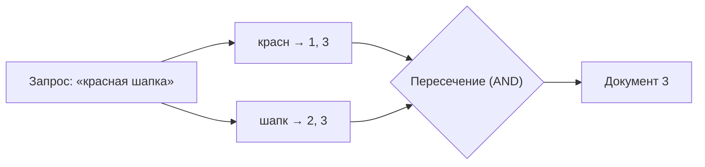
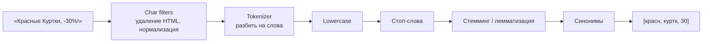
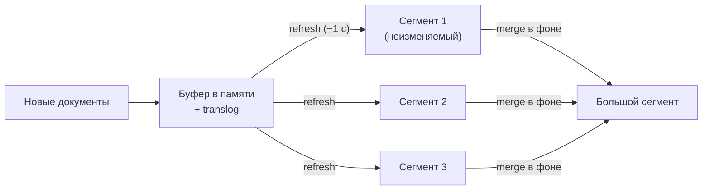
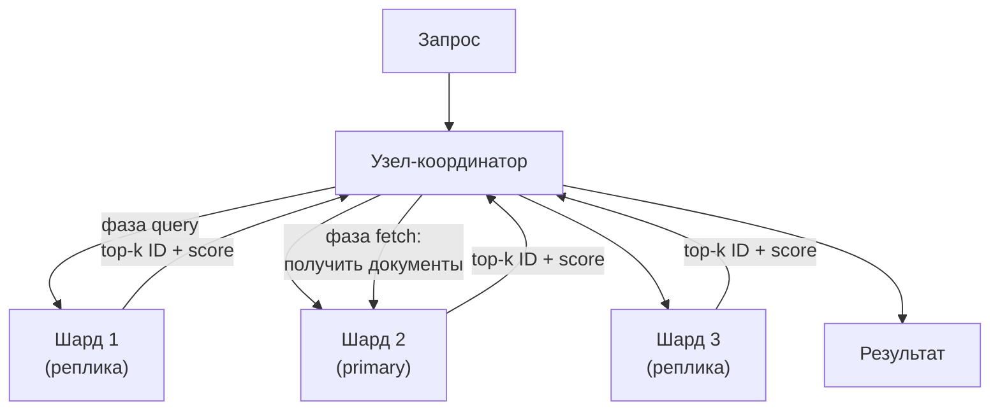
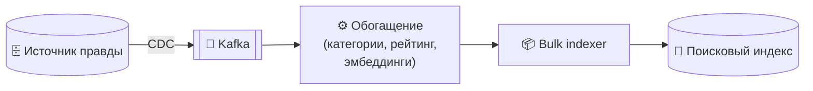
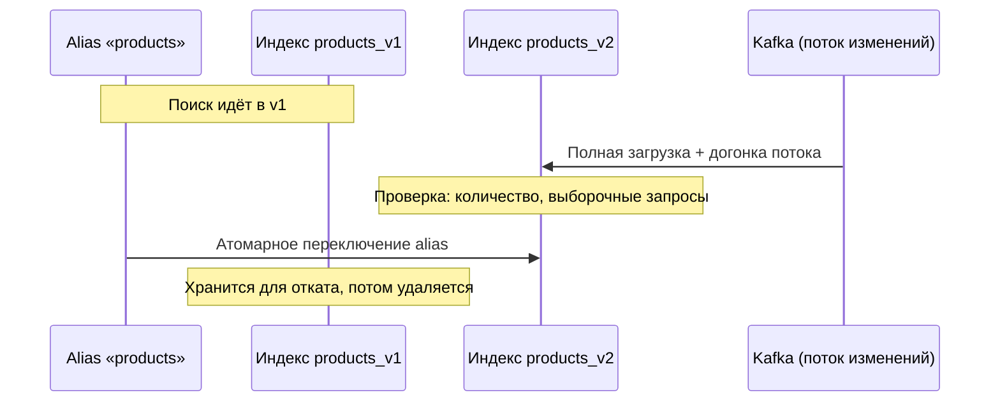
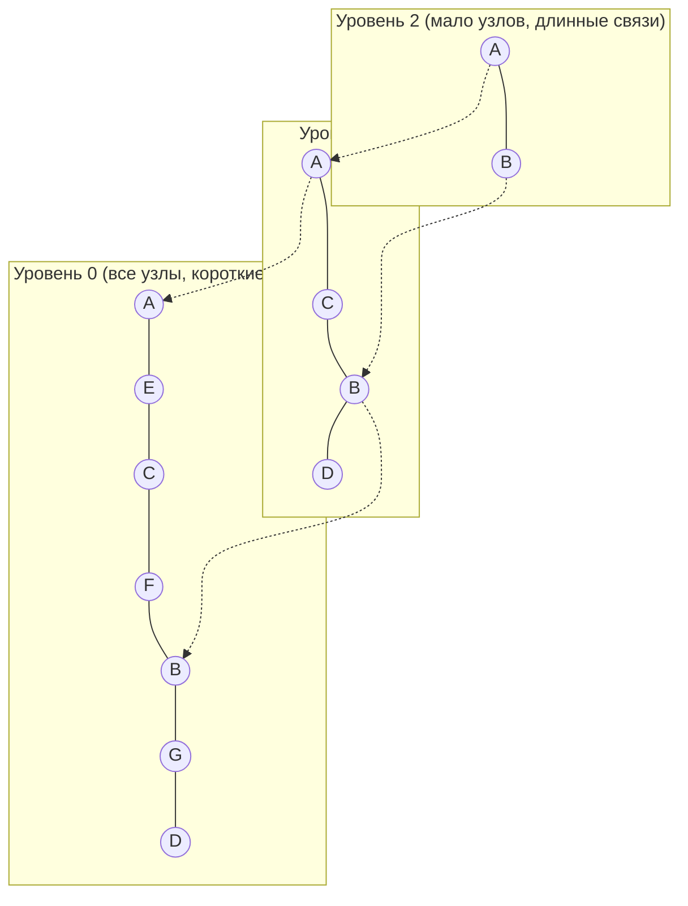
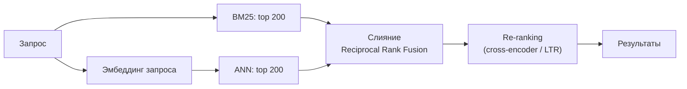

[English](README.md) | **Русский**

# 15. Основы поиска

> **Что внутри:** почему поиск — отдельная система, инвертированный индекс, анализ текста (токенизация, стемминг, синонимы), типы запросов, ранжирование (TF-IDF, BM25, многоэтапное ранжирование), устройство Lucene/Elasticsearch, конвейер индексации, масштабирование, автодополнение, векторный поиск (ANN, HNSW, IVF, PQ), гибридный поиск
> **Время на изучение:** ~5 ч · **Нужно для:** поиска по товарам, документам, сообщениям, логам; автодополнения; RAG и рекомендаций
> **Практика:** разбор в формате интервью — [INTERVIEW_RU.md](./INTERVIEW.ru.md)
> **Связанные темы:** [04-databases](../04_Databases/README.ru.md#5-индексы-и-b-tree), [06-partitioning](../06_Partitioning/README.ru.md#7-вторичные-индексы), [11-distributed-transactions](../11_Distributed%20transactions/README.ru.md#12-cdc-change-data-capture) (CDC)

---

## 📑 Содержание

1. [Зачем отдельная поисковая система](#1-зачем-отдельная-поисковая-система)
2. [Инвертированный индекс](#2-инвертированный-индекс)
3. [Анализ текста](#3-анализ-текста)
4. [Типы запросов](#4-типы-запросов)
5. [Ранжирование: TF-IDF и BM25](#5-ранжирование-tf-idf-и-bm25)
6. [Многоэтапное ранжирование и метрики качества](#6-многоэтапное-ранжирование-и-метрики-качества)
7. [Как устроены Lucene и Elasticsearch](#7-как-устроены-lucene-и-elasticsearch)
8. [Конвейер индексации](#8-конвейер-индексации)
9. [Масштабирование поиска](#9-масштабирование-поиска)
10. [Автодополнение](#10-автодополнение)
11. [Векторный поиск](#11-векторный-поиск)
12. [Гибридный поиск](#12-гибридный-поиск)
13. [Как выбрать](#13-как-выбрать)
14. [Как говорить об этом на интервью](#14-как-говорить-об-этом-на-интервью)
15. [Вопросы для самопроверки](#15-вопросы-для-самопроверки)
16. [Глоссарий и ресурсы](#16-глоссарий-и-ресурсы)

---

## 1. Зачем отдельная поисковая система

Наивный поиск в реляционной базе:

```sql
SELECT * FROM products WHERE title ILIKE '%красная куртка%';
```

| Проблема | Почему |
|:---------|:-------|
| **Полное сканирование** | B-tree индекс помогает только с префиксом, но не с подстрокой в середине |
| **Нет релевантности** | Результаты не упорядочены по тому, насколько они подходят |
| **Нет морфологии** | «куртки», «куртку», «курткой» не найдут «куртка» |
| **Нет опечаток** | «куртак» ничего не найдёт |
| **Нет синонимов** | «пуховик» не найдёт «зимняя куртка» |
| **Нет фасетов** | Подсчёт «сколько товаров каждого бренда в результатах» — отдельные тяжёлые запросы |

Поисковые системы (Elasticsearch, OpenSearch, Solr, Vespa) решают это с помощью **инвертированного индекса**, анализа текста и ранжирования.

> [!IMPORTANT]
> Поисковый индекс — **производные данные**, а не источник правды. Источник правды — база данных; индекс строится из неё (обычно через CDC) и может отставать на секунды. Его всегда можно перестроить.

---

## 2. Инвертированный индекс

Обычный («прямой») индекс: документ → слова в нём. **Инвертированный**: слово → список документов, где оно встречается (**posting list**).

```
Документы:
  1: "красная зимняя куртка"
  2: "синяя зимняя шапка"
  3: "красная шапка"

Инвертированный индекс (после анализа текста):
  красн   → [1, 3]
  зимн    → [1, 2]
  куртк   → [1]
  син     → [2]
  шапк    → [2, 3]
```



### Что хранится в posting list

| Данные | Для чего |
|:-------|:---------|
| ID документа | Найти документы |
| Частота термина в документе (term frequency) | Ранжирование |
| **Позиции** термина | Фразовые запросы («красная куртка» подряд) и близость слов |
| Смещения в тексте | Подсветка найденного |

### Почему это быстро

- Запрос обращается только к posting lists своих терминов, а не ко всем документам.
- Списки **отсортированы** по ID документа → пересечение и объединение — линейным слиянием.
- **Сжатие:** хранятся разности между соседними ID (delta encoding) с переменной длиной (varint), что сжимает списки в разы.
- **Skip lists** внутри списка позволяют быстро «перепрыгивать» при пересечении длинного списка с коротким.
- **Словарь терминов** хранится в компактной структуре (в Lucene — FST, конечный автомат), которая помещается в память.

---

## 3. Анализ текста

Перед индексацией (и перед поиском) текст проходит **анализатор** — конвейер преобразований.



| Шаг | Что делает | Пример |
|:----|:-----------|:-------|
| **Char filter** | Предварительная обработка символов | Удалить HTML, заменить «ё» на «е» |
| **Токенизация** | Разбить текст на токены | «wi-fi роутер» → [wi, fi, роутер] или [wi-fi, роутер] — зависит от токенизатора |
| **Нижний регистр** | Нормализация регистра | «Куртка» → «куртка» |
| **Стоп-слова** | Удалить частые малозначимые слова | «и», «в», «the», «a» (осторожно: «to be or not to be») |
| **Стемминг** | Обрезать окончания по правилам | «куртки», «курткой» → «куртк» |
| **Лемматизация** | Привести к словарной форме | «шёл» → «идти» (точнее стемминга, нужен словарь) |
| **Синонимы** | Расширить или заменить | «ноутбук» ↔ «лэптоп» ↔ «laptop» |
| **N-граммы** | Разбить на подстроки | «куртка» → «кур», «урт», «ртк»… — поиск по части слова |
| **Edge n-граммы** | Префиксы | «к», «ку», «кур», «курт»… — автодополнение |

> [!WARNING]
> Один и тот же анализатор должен применяться **при индексации и при поиске**. Если документ проиндексирован со стеммингом, а запрос — без, «куртки» не совпадут с «куртк». Смена анализатора требует **переиндексации** всех документов.

### Языковые особенности

- **Русский, немецкий, финский** — богатая морфология: нужен стеммер или морфологический анализатор.
- **Китайский, японский** — нет пробелов между словами: нужны специальные токенизаторы (по словарю или n-граммы).
- **Мультиязычный каталог** — отдельные поля с разными анализаторами для каждого языка.

---

## 4. Типы запросов

| Запрос | Пример | Как работает |
|:-------|:-------|:-------------|
| **Терм / match** | `куртка` | Поиск по posting list после анализа запроса |
| **Boolean** | `куртка AND красная NOT детская` | Пересечение, объединение, вычитание списков |
| **Фразовый** | `"зимняя куртка"` | Позиции терминов идут подряд |
| **Префиксный** | `курт*` | Обход словаря терминов по префиксу |
| **Нечёткий (fuzzy)** | `куртак~` | Термины в пределах расстояния Левенштейна 1–2 (быстро — через автоматы Левенштейна по словарю) |
| **Диапазон** | `price: [1000 TO 5000]` | Числовые индексы (в Lucene — BKD-деревья) |
| **Гео** | В радиусе 5 км | Геоиндексы |
| **Фильтр** | `brand = Nike` | Как запрос, но без влияния на релевантность; результат кэшируется |
| **Агрегации (фасеты)** | Количество по брендам, гистограмма цен | Колоночные данные (doc values) по найденным документам |

> [!TIP]
> Разделяй **запрос** (влияет на релевантность: текст пользователя) и **фильтры** (не влияют: бренд, цена, наличие). Фильтры дешевле и хорошо кэшируются.

---

## 5. Ранжирование: TF-IDF и BM25

Найти документы — половина задачи. Вторая — **упорядочить** их по релевантности.

### TF-IDF

- **TF (term frequency):** чем чаще термин встречается в документе, тем документ релевантнее.
- **IDF (inverse document frequency):** чем **реже** термин во всей коллекции, тем он важнее. «куртка» в магазине одежды встречается часто (низкий IDF), «gore-tex» — редко (высокий IDF).

```
score(term, doc) = TF(term, doc) × log(N / DF(term))
N — число документов, DF — число документов с термином
```

### BM25

**BM25** — стандарт по умолчанию в Lucene и Elasticsearch. Улучшает TF-IDF двумя идеями:

| Идея | Почему |
|:-----|:-------|
| **Насыщение TF** (параметр k1, обычно 1,2) | 10 упоминаний не в 10 раз лучше одного: вклад растёт медленнее и выходит на плато. Защищает от «накачки» текста ключевыми словами |
| **Нормализация по длине** (параметр b, обычно 0,75) | Упоминание в коротком заголовке значимее, чем в длинном описании |

```
           IDF(t) × TF × (k1 + 1)
BM25 = Σ  ─────────────────────────────────────────────
       t   TF + k1 × (1 − b + b × |doc| / avgdoclen)
```

### Дополнительные сигналы

| Сигнал | Пример |
|:-------|:-------|
| **Буст полей** | Совпадение в заголовке важнее, чем в описании |
| **Бизнес-сигналы** | Популярность, продажи, рейтинг, CTR |
| **Свежесть** | Новости: новое выше |
| **Персонализация** | История пользователя, местоположение |
| **Близость слов** | Слова запроса рядом в документе — выше |

> [!NOTE]
> IDF считается **по шарду**, а не по всему индексу. Если документы распределены неравномерно, один и тот же документ может получить разный score на разных шардах. На больших индексах с равномерной маршрутизацией эффект мал; для точности есть режим глобальной статистики (DFS), но он дороже.

---

## 6. Многоэтапное ранжирование и метрики качества

Дорогую ML-модель нельзя применить к миллионам документов. Поэтому ранжирование — **воронка**:


| Этап | Что делает | Стоимость на документ |
|:-----|:-----------|:---------------------|
| Retrieval | Быстро найти кандидатов по индексу | Микросекунды |
| Ранжирование | Модель LTR по сотням признаков (BM25, CTR, цена, рейтинг, свежесть) | Десятки микросекунд |
| Re-ranking | Нейросеть (например, cross-encoder), разнообразие, реклама, правила | Миллисекунды |

### Метрики качества

| Метрика | Что измеряет |
|:--------|:-------------|
| **Precision@k** | Доля релевантных среди первых k |
| **Recall** | Доля найденных среди всех релевантных |
| **MRR** | Насколько высоко первый релевантный результат |
| **nDCG** | Качество порядка с учётом степени релевантности и позиции |
| **Онлайн-метрики** | CTR, конверсия, доля поисков без кликов, доля переформулированных запросов |

Офлайн-метрики считаются на размеченных наборах запросов; окончательное решение — **A/B-тест** онлайн-метрик.

---

## 7. Как устроены Lucene и Elasticsearch

**Lucene** — библиотека, реализующая индекс на одном узле. **Elasticsearch / OpenSearch / Solr** — распределённые системы поверх Lucene.

### Сегменты



| Понятие | Что значит |
|:--------|:-----------|
| **Сегмент** | Неизменяемый мини-индекс; шард состоит из многих сегментов |
| **Refresh** | Буфер сбрасывается в новый сегмент, документы становятся видимыми для поиска — **near real-time**, по умолчанию раз в ~1 с |
| **Translog** | Журнал операций для восстановления после сбоя (как WAL) |
| **Удаление** | Документ помечается удалённым; физически исчезает при слиянии сегментов |
| **Обновление** | Удаление старой версии + индексация новой (обновить одно поле «на месте» нельзя) |
| **Merge** | Фоновое слияние мелких сегментов в крупные |

> [!WARNING]
> Частые обновления одного документа (например, остаток товара каждую секунду) дорогие: каждое — переиндексация документа целиком и мусор для слияния. Часто меняющиеся поля стоит хранить отдельно или обновлять пачками.

### Шарды и реплики



- Индекс делится на **primary-шарды** (по хэшу `_routing`, по умолчанию ID документа); число primary-шардов фиксируется при создании индекса.
- Каждый шард имеет **реплики**: отказоустойчивость и масштабирование чтения.
- Поиск — **scatter-gather** в две фазы: **query** (каждый шард возвращает top-k ID и score) и **fetch** (координатор забирает сами документы).

---

## 8. Конвейер индексации



| Практика | Зачем |
|:---------|:------|
| **CDC из базы** вместо двойной записи из приложения | Индекс не расходится с базой при сбоях (см. [11-distributed-transactions](../11_Distributed%20transactions/README.ru.md#12-cdc-change-data-capture)) |
| **Bulk-индексация** | Пачки документов вместо одиночных запросов |
| **Внешнее версионирование** | Индекс принимает документ, только если его версия новее — события, пришедшие не по порядку, не перезапишут свежие данные |
| **Денормализация** | В документ кладутся все нужные для поиска поля (имя категории, бренда, рейтинг): JOIN в поиске нет |
| **Переиндексация через alias** | Новый индекс строится рядом, затем alias переключается атомарно; откат — переключить обратно |

### Переиндексация без простоя



Переиндексация нужна при смене маппинга, анализаторов, модели эмбеддингов или числа шардов.

---

## 9. Масштабирование поиска

| Тема | Практика |
|:-----|:---------|
| **Размер шарда** | Ориентир — десятки ГБ (часто 10–50 ГБ): слишком мелкие — накладные расходы, слишком крупные — медленное восстановление и перебалансировка |
| **Реплики** | Больше реплик → больше пропускная способность чтения и отказоустойчивость |
| **Маршрутизация** | Для multi-tenant — routing по `tenant_id`: запрос идёт в один шард, а не во все |
| **Разделение индексов** | По языку, стране, времени (логи по дням) — запрос затрагивает меньше данных |
| **Hot/warm/cold** | Для логов: свежие индексы на быстрых узлах, старые — на дешёвых |
| **Кэширование** | Кэш фильтров и запросов; популярные запросы — кэш на уровне приложения |
| **Глубокая пагинация** | `from + size` до 10 000-й позиции дорогая (каждый шард отдаёт from + size); использовать `search_after` |
| **Защита от тяжёлых запросов** | Таймауты, ограничения на wildcard в начале слова и огромные агрегации, circuit breakers по памяти |

> [!TIP]
> Каждый запрос без routing идёт во **все** шарды. Задержка запроса — это задержка самого медленного шарда (tail latency amplification, см. [06-partitioning](../06_Partitioning/README.ru.md#7-вторичные-индексы)). Меньше шардов на запрос — стабильнее p99.

---

## 10. Автодополнение

| Подход | Как | Где |
|:-------|:----|:----|
| **Edge n-граммы** | Индексировать префиксы слов | Простое автодополнение по названиям |
| **Completion suggester** | Специальная структура (FST) в памяти, очень быстрый поиск по префиксу | Подсказки по заголовкам |
| **Префиксное дерево с top-k** | Для каждого префикса — заранее вычисленные популярные завершения | Подсказки запросов по логам поиска |

Подсказки запросов обычно строятся **из логов поиска**: популярные запросы, нормализованные, с фильтрацией нежелательного, обновляемые раз в часы или сутки. Детально — задача «Typeahead / Search Autocomplete» из Tier 1.

---

## 11. Векторный поиск

Лексический поиск находит **слова**. Векторный находит **смысл**: «тёплая куртка для походов» найдёт «пуховик trekking», даже если общих слов нет.

### Эмбеддинги

Модель (например, текстовый энкодер) превращает текст, картинку или пользователя в **вектор** из сотен–тысяч чисел. Близкие по смыслу объекты — близкие векторы.

| Мера близости | Формула | Когда |
|:--------------|:--------|:------|
| **Косинусная** | cos угла между векторами | Тексты, по умолчанию |
| **Скалярное произведение** | Σ aᵢbᵢ | Нормализованные векторы, рекомендации |
| **Евклидова (L2)** | √Σ(aᵢ − bᵢ)² | Некоторые модели и картинки |

### Почему нужен приближённый поиск (ANN)

Точный поиск k ближайших соседей — сравнить запрос со **всеми** векторами: O(N × d). Для 100 млн векторов размерности 768 это десятки миллиардов операций на запрос — слишком медленно. **ANN (approximate nearest neighbor)** жертвует небольшой точностью (recall 95–99%) ради скорости в сотни и тысячи раз.

### Основные алгоритмы

| Алгоритм | Идея | Плюсы | Минусы |
|:---------|:-----|:------|:-------|
| **HNSW** | Многоуровневый граф «тесного мира»: жадный переход к ближайшим соседям от верхних разреженных уровней к нижним плотным | Высокий recall при низкой задержке; стандарт по умолчанию | Много памяти (граф + векторы в RAM); удаление и обновление сложнее |
| **IVF** | Кластеризация (k-means) на N кластеров; запрос ищет только в nprobe ближайших кластерах | Меньше памяти, проще | Recall зависит от nprobe; данные с перекосом |
| **PQ (Product Quantization)** | Сжатие векторов: делим на подвекторы, каждый заменяем номером центроида | Сжатие в 10–50 раз | Потеря точности (часто с re-ranking по полным векторам) |
| **IVF-PQ** | IVF + сжатие PQ | Миллиарды векторов в памяти | Сложнее настройка |
| **DiskANN** | Граф на SSD с небольшим кэшем в памяти | Миллиарды векторов на одной машине | Задержка выше, чем у HNSW в RAM |

### HNSW подробнее



- Поиск начинается с верхнего уровня, где мало узлов и длинные «прыжки», и жадно движется к ближайшему к запросу узлу.
- Затем спускается уровнем ниже и продолжает уточнение, пока не дойдёт до нижнего уровня со всеми векторами.
- Параметры: **M** (число связей на узел — память и recall), **efConstruction** (качество построения), **efSearch** (ширина поиска — компромисс recall и задержки, настраивается на запрос).

### Фильтры в векторном поиске

«Похожие товары, но только в наличии и дешевле 5 000» — непростая задача:

| Подход | Проблема |
|:-------|:---------|
| Post-filtering: найти top-k, потом отфильтровать | При жёстком фильтре от k может ничего не остаться |
| Pre-filtering: отфильтровать, потом точный поиск | Медленно, если после фильтра много документов |
| Фильтрация во время обхода графа | Поддерживается современными движками; при очень селективных фильтрах качество может падать |

### Где хранить векторы

| Вариант | Когда |
|:--------|:------|
| **pgvector** (PostgreSQL) | До миллионов–десятков миллионов векторов, нужна транзакционность с остальными данными |
| **Elasticsearch / OpenSearch kNN** | Уже есть поисковый кластер, нужен гибридный поиск |
| **Специализированные векторные БД** (Milvus, Qdrant, Weaviate, Pinecone) | Сотни миллионов – миллиарды векторов, продвинутые индексы |
| **Библиотека FAISS** | Строить свой сервис; офлайн-задачи; GPU |

---

## 12. Гибридный поиск

Лексический и векторный поиск дополняют друг друга:

| | Лексический (BM25) | Векторный |
|:-|:-------------------|:----------|
| Сильные стороны | Точные совпадения: артикулы, модели, имена, редкие термины | Смысл, синонимы, описательные запросы, разные языки |
| Слабые стороны | Не понимает смысл и перефразирование | Может промахнуться по точному термину («iPhone 15 Pro» vs «iPhone 14») |



### Reciprocal Rank Fusion (RRF)

Score у BM25 и у векторного поиска в разных шкалах, складывать их напрямую нельзя. RRF использует только **позиции**:

```
RRF(doc) = Σ  1 / (k + rank_i(doc))       k обычно = 60
         по всем спискам
```

Документ высоко в обоих списках получает наибольший итоговый score. Метод простой, не требует обучения и хорошо работает на практике.

> [!TIP]
> Та же схема — основа **retrieval в RAG**: найти фрагменты гибридным поиском, переранжировать, передать лучшие в LLM. Качество RAG чаще всего ограничено именно качеством поиска.

---

## 13. Как выбрать

| Сценарий | Выбор |
|:---------|:------|
| Небольшой продукт, поиск по нескольким полям | Полнотекстовый поиск в PostgreSQL (`tsvector` + GIN) |
| Поиск по каталогу с фасетами, опечатками, ранжированием | Elasticsearch / OpenSearch / Solr |
| Логи и наблюдаемость | Elasticsearch / OpenSearch (hot-warm), Loki, ClickHouse |
| Нужен готовый поиск «под ключ» | Managed-сервисы (Algolia, Elastic Cloud, OpenSearch Service) |
| Семантический поиск, RAG | Векторный индекс + гибридный поиск |
| Очень большой масштаб с ML-ранжированием | Vespa или собственная система |

---

## 14. Как говорить об этом на интервью

### Ответ за 30 секунд

> «Поиск — отдельная система с производными данными: источник правды — база, индекс наполняется через CDC с внешним версионированием и перестраивается через alias. Инвертированный индекс: термин → posting list с позициями; одинаковый анализатор при индексации и поиске — токенизация, нижний регистр, стемминг, синонимы. Запрос — текст для релевантности плюс кэшируемые фильтры. Ранжирование — воронка: BM25 и векторный retrieval, слияние через RRF, затем LTR-модель и re-ranking. Шарды по десяткам ГБ, реплики под нагрузку, routing там, где можно, `search_after` вместо глубокой пагинации. Для смысла — HNSW-индекс эмбеддингов с фильтрацией при обходе».

### Вопросы, которые стоит задать

1. Что ищут: короткие названия, длинные тексты, коды, смысловые запросы?
2. Насколько свежими должны быть результаты?
3. Какие фильтры и фасеты нужны?
4. Как часто меняются данные, особенно отдельные поля?
5. Как измеряется качество поиска?

### Типичные ошибки

- `LIKE '%…%'` в базе для поиска на масштабе.
- Поисковый индекс как источник правды.
- Двойная запись в базу и индекс из приложения.
- Разные анализаторы при индексации и поиске.
- Частые обновления одного поля документа без учёта стоимости.
- Глубокая пагинация через `from`.
- Векторный поиск вместо лексического, а не вместе с ним.
- Нет метрик качества и A/B-тестов.

---

## 15. Вопросы для самопроверки

<details>
<summary><b>1. Что такое инвертированный индекс и почему он быстрый?</b></summary>

Отображение «термин → отсортированный список документов (posting list)». Запрос читает только списки своих терминов, пересекает и объединяет их линейным слиянием; списки сжаты (delta + varint) и содержат skip-указатели, а словарь терминов хранится компактно в памяти.
</details>

<details>
<summary><b>2. Зачем хранить позиции терминов?</b></summary>

Для фразовых запросов (слова идут подряд), запросов на близость слов и подсветки найденного. Без позиций можно ответить только на вопрос «есть ли все слова в документе».
</details>

<details>
<summary><b>3. Чем стемминг отличается от лемматизации?</b></summary>

Стемминг обрезает окончания по правилам («куртки» → «куртк»), быстро, но иногда ошибается. Лемматизация приводит слово к словарной форме с учётом морфологии («шёл» → «идти»), точнее, но требует словаря и дороже.
</details>

<details>
<summary><b>4. Какие две идеи добавляет BM25 к TF-IDF?</b></summary>

Насыщение частоты термина (вклад повторений растёт всё медленнее и выходит на плато) и нормализацию по длине документа (совпадение в коротком поле значимее, чем в длинном).
</details>

<details>
<summary><b>5. Зачем многоэтапное ранжирование?</b></summary>

Дорогую модель нельзя применить к миллионам документов. Сначала быстрый retrieval отбирает тысячи кандидатов, затем модель среднего веса ранжирует их, и только топ-100 обрабатывает тяжёлая модель и бизнес-правила.
</details>

<details>
<summary><b>6. Почему обновление документа в Elasticsearch дорогое?</b></summary>

Сегменты Lucene неизменяемы: обновление — это пометка старой версии удалённой и индексация новой целиком. Частые обновления создают много мусора для слияния сегментов и нагрузку на индексацию.
</details>

<details>
<summary><b>7. Как переиндексировать без простоя?</b></summary>

Построить новый индекс рядом (полная загрузка + догонка потока изменений), проверить его, атомарно переключить alias на новый индекс, старый оставить для отката.
</details>

<details>
<summary><b>8. Почему для векторного поиска используют ANN, а не точный kNN?</b></summary>

Точный поиск сравнивает запрос со всеми векторами — O(N × d), слишком медленно для сотен миллионов векторов. ANN (HNSW, IVF) жертвует небольшой долей recall ради ускорения в сотни и тысячи раз.
</details>

<details>
<summary><b>9. Как работает HNSW?</b></summary>

Многоуровневый граф: верхние уровни содержат мало узлов с длинными связями, нижний — все узлы. Поиск жадно движется к ближайшему к запросу узлу на верхнем уровне и спускается вниз, уточняя результат. Параметр efSearch задаёт компромисс между recall и задержкой.
</details>

<details>
<summary><b>10. Как объединить результаты BM25 и векторного поиска?</b></summary>

Через Reciprocal Rank Fusion: итоговый score — сумма 1 / (k + позиция) по каждому списку. Используются только позиции, поэтому разные шкалы score не мешают. Затем лучшие кандидаты переранжируются моделью.
</details>

---

## 16. Глоссарий и ресурсы

### Глоссарий

| Термин | Значение |
|:-------|:---------|
| Инвертированный индекс | Термин → список документов |
| Posting list | Список документов (и позиций) для термина |
| Анализатор | Конвейер преобразования текста в токены |
| Токенизация | Разбиение текста на токены |
| Стемминг / лемматизация | Обрезка окончаний / приведение к словарной форме |
| N-грамма | Подстрока фиксированной длины |
| TF / IDF | Частота термина в документе / обратная частота в коллекции |
| BM25 | Стандартная функция релевантности с насыщением и нормализацией по длине |
| LTR | Learning to Rank: ML-модель ранжирования |
| nDCG, MRR | Метрики качества ранжирования |
| Сегмент | Неизменяемый мини-индекс Lucene |
| Refresh | Публикация новых документов для поиска (near real-time) |
| Alias | Псевдоним индекса для переключения без простоя |
| Эмбеддинг | Векторное представление объекта |
| ANN | Приближённый поиск ближайших соседей |
| HNSW | Иерархический граф для ANN |
| PQ | Product quantization: сжатие векторов |
| RRF | Reciprocal Rank Fusion: слияние ранжированных списков |

### Ресурсы

- Manning, Raghavan, Schütze, *Introduction to Information Retrieval* (2008) — бесплатно онлайн
- Robertson, Zaragoza, *The Probabilistic Relevance Framework: BM25 and Beyond* (2009)
- Malkov, Yashunin, *Efficient and robust approximate nearest neighbor search using Hierarchical Navigable Small World graphs* (2016, TPAMI 2018)
- Jégou, Douze, Schmid, *Product Quantization for Nearest Neighbor Search* (TPAMI 2011)
- Subramanya et al., *DiskANN: Fast Accurate Billion-point Nearest Neighbor Search on a Single Node* (NeurIPS 2019)
- Johnson, Douze, Jégou, *Billion-scale similarity search with GPUs* (2017) — FAISS
- Cormack, Clarke, Büttcher, *Reciprocal Rank Fusion outperforms Condorcet and individual Rank Learning Methods* (SIGIR 2009)
- Документация Elasticsearch / OpenSearch и Apache Lucene
