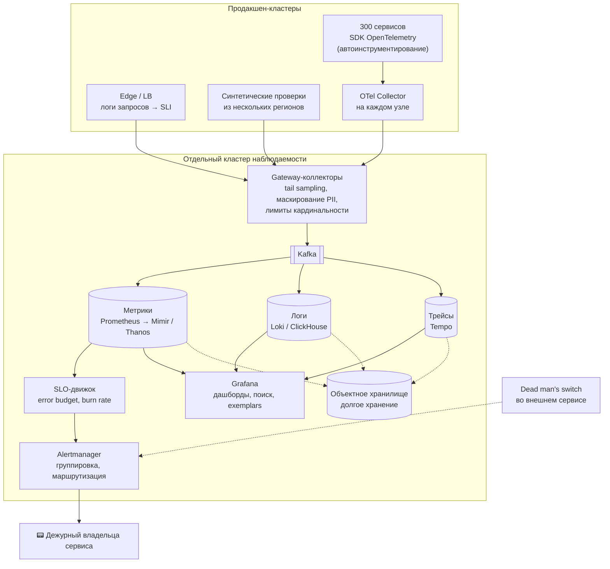
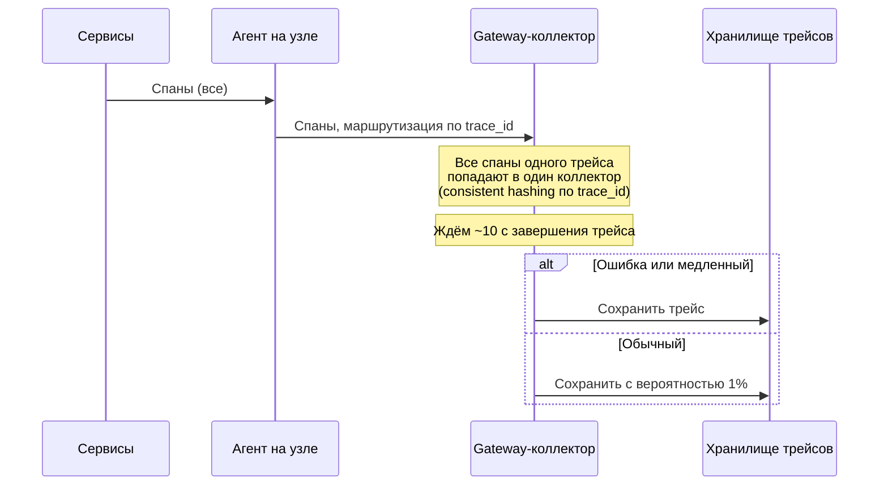

[English](INTERVIEW.md) | **Русский** · Теория: [README_RU.md](./README_RU.md)

# 16. Observability: наблюдаемость для платформы из 300 микросервисов

> **Тема:** от хаоса алертов к SLO, выбор SLI для пользовательских путей, error budget и его политика, алертинг по burn rate, распределённые трейсы и tail sampling, структурированные логи и их стоимость, платформа метрик и кардинальность, архитектура платформы, реагирование на инциденты
> **Уровень:** Hard · **Время на интервью:** 45 мин · **Время на разбор:** ~5 ч
> **Где спрашивают:** «Как вы узнаете, что система работает?», «Спроектируй мониторинг / платформу логов / метрик», а также как обязательная часть любой задачи уровня Senior+

---

## 🗺️ Как читать этот разбор

| Значок | Что значит |
|:------:|:-----------|
| 🎤 | Реплика интервьюера |
| 🗣️ | Что говорю вслух я (кандидат) |
| ✏️ | Что рисую на доске |
| ⏱️ | Сколько времени тратить на шаг |

Блоки **TIP** — хороший приём, **WARNING** — ловушка, **IMPORTANT** — сигнал для уровня Senior+.

---

## 📑 Содержание

1. [Условие задачи](#1-условие-задачи)
2. [Диагноз текущего состояния](#2-диагноз-текущего-состояния)
3. [Требования](#3-требования)
4. [Оценки объёма телеметрии](#4-оценки-объёма-телеметрии)
5. [High-level дизайн](#5-high-level-дизайн)
6. [Deep dive 1: SLI и SLO для пользовательских путей](#6-deep-dive-1-sli-и-slo-для-пользовательских-путей)
7. [Deep dive 2: error budget и его политика](#7-deep-dive-2-error-budget-и-его-политика)
8. [Deep dive 3: новая система алертов](#8-deep-dive-3-новая-система-алертов)
9. [Deep dive 4: распределённые трейсы](#9-deep-dive-4-распределённые-трейсы)
10. [Deep dive 5: логи и их стоимость](#10-deep-dive-5-логи-и-их-стоимость)
11. [Deep dive 6: платформа метрик и кардинальность](#11-deep-dive-6-платформа-метрик-и-кардинальность)
12. [Deep dive 7: надёжность самой платформы](#12-deep-dive-7-надёжность-самой-платформы)
13. [Deep dive 8: процесс реагирования на инциденты](#13-deep-dive-8-процесс-реагирования-на-инциденты)
14. [Узкие места и сценарии сбоев](#14-узкие-места-и-сценарии-сбоев)
15. [Вопросы интервьюера с ответами](#15-вопросы-интервьюера-с-ответами)
16. [Типичные ошибки](#16-типичные-ошибки)
17. [Шпаргалка и самопроверка](#17-шпаргалка-и-самопроверка)

---

## 1. Условие задачи

> 🎤 «У нас интернет-магазин на 300 микросервисах. Проблемы:
> - о серьёзных инцидентах мы узнаём из жалоб пользователей и соцсетей;
> - среднее время восстановления — 2 часа, большую часть времени ищем, какой сервис виноват;
> - дежурные получают 500 алертов в день и почти все игнорируют;
> - счёт за логи растёт быстрее выручки.
>
> Спроектируй observability: что измерять, как алертить и как устроить платформу».

**План по времени:**

| Шаг | ⏱️ |
|:----|:--:|
| Диагноз и требования | 7 мин |
| Оценки объёмов | 4 мин |
| High-level дизайн | 4 мин |
| Deep dives | 25 мин |
| Итоги | 5 мин |

> [!TIP]
> Это задача одновременно про **стратегию** (что измерять, SLO, алертинг) и про **систему** (платформа сбора и хранения телеметрии). Сначала стратегия: без правильных SLI самая дорогая платформа будет собирать бесполезные данные.

---

## 2. Диагноз текущего состояния

⏱️ 4 мин

🗣️ «Каждая жалоба — симптом конкретной проблемы»:

| Симптом | Вероятная причина | Что исправит |
|:--------|:------------------|:-------------|
| Об инцидентах узнаём от пользователей | Алерты на **причины** (CPU, память, отдельные ошибки), а не на **пользовательские симптомы** | SLI для пользовательских путей, измеряемые на edge, + алерты по burn rate |
| MTTR 2 часа, ищем виноватого | Нет распределённых трейсов и связи сигналов; логи без `trace_id` | OpenTelemetry, трейсы с tail sampling, `trace_id` везде, exemplars, единые дашборды |
| 500 алертов в день игнорируются | Шумные алерты без владельцев и действий | Только симптомные алерты, runbooks, владельцы, группировка, уровни page/ticket |
| Счёт за логи растёт | Логируется каждый успешный запрос, свободный текст, нет семплирования и уровней хранения | Структурированные логи, семплирование, квоты, многоуровневое хранение |

> [!IMPORTANT]
> **Сигнал Senior+:** начни с **процесса и целей** (SLO, политика алертов, владельцы), а не с выбора инструментов. «Поставим Datadog» не решит ни одной из четырёх проблем, если алерты по-прежнему на CPU.

---

## 3. Требования

⏱️ 3 мин

### Функциональные

1. Обнаруживать деградацию пользовательских путей раньше пользователей.
2. За минуты находить, какой сервис и какая зависимость виноваты.
3. Отслеживать SLO и error budget по сервисам и путям.
4. Искать по логам и трейсам конкретного запроса или пользователя.
5. Уведомлять владельца сервиса, а не всех.

### Нефункциональные

| Требование | Цель |
|:-----------|:-----|
| MTTD для крупных инцидентов | < 5 мин, > 90% инцидентов обнаружены мониторингом |
| MTTR | < 30 мин для типичных инцидентов |
| Шум алертов | < 2 пейджей в неделю на дежурного; > 80% пейджей требуют действий |
| Задержка телеметрии | Метрики — < 1 мин; логи и трейсы — < 2 мин до поиска |
| Доступность платформы | Выше, чем у продакшена; не падает вместе с ним |
| Стоимость | Рост телеметрии медленнее роста трафика |

---

## 4. Оценки объёма телеметрии

⏱️ 4 мин

✏️

```
Сервисы / поды          = 300 сервисов, ~10 000 подов
Трафик на edge          = 50 000 запросов/с в пике
Fan-out                 ≈ 10 внутренних вызовов на внешний запрос

МЕТРИКИ
  ~1 000 рядов на под   → ~10M активных рядов
  опрос раз в 15 с      → ~670 000 точек/с
  ~1,5 Б на точку       → ~90 ГБ/день (до прореживания)

ЛОГИ (сейчас)
  50 000 × 10 строк × 500 Б = 250 МБ/с ≈ 21 ТБ/день
  цель после оптимизации: ≈ 2 ТБ/день (×10 меньше)

ТРЕЙСЫ (если хранить всё)
  50 000 × 20 спанов × 300 Б = 300 МБ/с ≈ 26 ТБ/день
  tail sampling: 100% ошибок и медленных + 1% остальных ≈ 0,5 ТБ/день
```

🗣️ **Выводы:**
- **Метрики** дешёвые и не зависят от трафика — это основа алертинга.
- **Логи** — главная статья расходов; основной выигрыш — перестать логировать успешные запросы построчно и семплировать.
- **Трейсы** без семплирования стоят как логи; с **tail sampling** — в десятки раз дешевле при сохранении всех интересных трейсов.
- **Кардинальность** метрик — главный риск: одна неудачная метка умножит 10M рядов.

---

## 5. High-level дизайн

⏱️ 4 мин

✏️



🗣️ «Ключевые решения:
- **OpenTelemetry везде** — один стандарт для метрик, логов и трейсов, автоинструментирование популярных фреймворков, общий `trace_id`;
- **коллекторы** на узлах и gateway-слой: семплирование, маскирование и лимиты применяются централизованно;
- **Kafka** как буфер — всплески телеметрии во время инцидента не роняют хранилища;
- **отдельный кластер наблюдаемости** — он не должен падать вместе с продакшеном;
- **SLO-движок** считает error budget и burn rate, Alertmanager маршрутизирует алерты владельцам».

---

## 6. Deep dive 1: SLI и SLO для пользовательских путей

> 🎤 «С чего начнёшь?»

🗣️ «С пользовательских путей — того, что пользователь пытается сделать:

| Путь | SLI доступности | SLI задержки | SLO (30 дней) |
|:-----|:----------------|:-------------|:--------------|
| **Оформление заказа** | Доля успешных `POST /checkout` (не 5xx и не таймаут) | Доля быстрее 1 с | 99,95% доступность, 99% быстрее 1 с |
| **Вход** | Доля успешных входов (без учёта неверного пароля) | Доля быстрее 500 мс | 99,9% / 99% |
| **Поиск** | Доля успешных поисков | Доля быстрее 300 мс | 99,9% / 95% |
| **Карточка товара** | Доля успешных загрузок | Доля быстрее 400 мс | 99,9% / 95% |
| **Уведомления о заказе** | — | Свежесть: доля писем, отправленных за 5 мин | 99% |

### Где измерять

| Источник | Для чего |
|:---------|:---------|
| **Логи и метрики edge-балансировщика** | Основной SLI: видит все запросы, включая ошибки до сервисов |
| **Синтетические проверки** каждые 30 с из 3 регионов | Обнаружение ночью и при нулевом трафике; путь целиком (вход → корзина → оформление на тестовом аккаунте) |
| **RUM** (метрики из браузера и приложения) | Реальный опыт: загрузка страниц, ошибки клиента |

### SLO для сервисов

🗣️ «Помимо путей — SLO для каждого сервиса, вычисленные из требований пути: если checkout синхронно вызывает 4 сервиса, каждому нужна доступность заметно выше 99,95%. Это показывает, у какого сервиса недостаточный запас».

> [!WARNING]
> Внимательно определяй «хорошее событие». Ошибка `400` из-за неверных данных пользователя или неверный пароль — не нарушение SLO. А `200` с пустым результатом поиска из-за упавшего индекса — нарушение, хотя код ответа успешный.

---

## 7. Deep dive 2: error budget и его политика

> 🎤 «Что дают SLO, кроме графиков?»

🗣️ «Error budget и **политику** вокруг него:

```
Checkout: SLO 99,95% за 30 дней, ~100M запросов
  Бюджет = 0,05% × 100M = 50 000 неуспешных запросов (≈ 22 минуты полного простоя)
```

| Остаток бюджета | Политика |
|:----------------|:---------|
| > 50% | Обычная работа: деплои, эксперименты, хаос-тесты |
| 25–50% | Осторожнее: крупные рискованные изменения — по согласованию |
| < 25% | Только исправления надёжности и важные фичи после ревью |
| Исчерпан | Заморозка фич для сервиса; команда работает над надёжностью, пока бюджет не восстановится; постмортем |

🗣️ «Политику согласуют продукт и инженеры **заранее**. Тогда спор «выпустить фичу или чинить стабильность» решается по числу, а не по громкости голосов».

### Связь с деплоями

- Деплой-пайплайн проверяет остаток бюджета: при исчерпании — нужен явный override.
- Canary сравнивает SLI новой версии со старой и автоматически откатывает при ухудшении.

---

## 8. Deep dive 3: новая система алертов

> 🎤 «Как избавиться от 500 алертов в день?»

### Шаг 1: аудит

🗣️ «Для каждого алерта за последний месяц: сколько раз срабатывал и сколько раз кто-то что-то сделал. Алерты без действий удаляются или превращаются в тикеты и дашборды. Обычно после этого остаётся меньше 10%».

### Шаг 2: алерты на симптомы через burn rate

| Алерт | Условие | Уровень |
|:------|:--------|:--------|
| Checkout, быстрое сжигание | Burn rate > 14,4 за 1 ч **и** за 5 мин | 📟 Page |
| Checkout, среднее сжигание | Burn rate > 6 за 6 ч **и** за 30 мин | 📟 Page |
| Checkout, медленное сжигание | Burn rate > 1 за 3 дня | 🎫 Ticket |
| Синтетика пути не проходит | 3 проверки подряд из 2+ регионов | 📟 Page |
| Падение бизнес-метрики | Заказы в минуту на 40% ниже прошлой недели в то же время | 📟 Page |

```
Burn rate = (доля ошибок за окно) / (1 − SLO)

Пример: SLO 99,95% → бюджет 0,05%
За последний час 1% запросов checkout — ошибки
Burn rate = 1% / 0,05% = 20 > 14,4 → пейдж
При таком темпе бюджет на 30 дней закончится за 1,5 дня
```

### Шаг 3: причинные алерты — только как тикеты или для предсказуемых проблем

| Оставляем | Почему |
|:----------|:-------|
| Диск заполнится через < 24 ч (по прогнозу) | Предсказуемо, нужно действие до проблемы |
| Истекает сертификат через 7 дней | Предсказуемо |
| Consumer lag приближается к retention | Риск потери данных |
| DLQ растёт | Тихая потеря данных |

### Шаг 4: гигиена

| Практика | Как |
|:---------|:----|
| Владелец у каждого алерта | Метка `team` в правиле, маршрутизация в Alertmanager |
| Runbook у каждого пейджа | Ссылка в тексте алерта: что проверить, как смягчить |
| Группировка | Алерты одного сервиса и одной причины — одно уведомление |
| Подавление | Если упал регион — подавить алерты сервисов в нём |
| Ревью | Еженедельный разбор: какие пейджи были, сколько с действием, что подкрутить |

---

## 9. Deep dive 4: распределённые трейсы

> 🎤 «Как сократить 2 часа поиска виноватого сервиса?»

🗣️ «Трейсы показывают путь запроса через все сервисы и где теряется время.

| Решение | Как |
|:--------|:----|
| **Инструментирование** | SDK OpenTelemetry с автоинструментированием HTTP, gRPC, клиентов БД, Kafka; ручные спаны только для важной бизнес-логики |
| **Распространение контекста** | W3C `traceparent` в HTTP и gRPC; в заголовках сообщений Kafka; перенос контекста в пулах потоков и фоновых задачах |
| **Tail sampling** в gateway-коллекторах | Сохранять: 100% трейсов с ошибкой, 100% медленнее p99 пути, 100% для отмеченных пользователей (тестовые аккаунты), 1% остальных |
| **Exemplars** | На графике задержки — клик на точку всплеска → трейс медленного запроса |
| **Карта сервисов** | Строится из трейсов: кто кого вызывает, RED на каждом ребре |
| **`trace_id` в логах** | Из трейса — к логам всех сервисов этого запроса одним кликом |



> [!WARNING]
> Для tail sampling **все спаны одного трейса** должны попасть в один и тот же коллектор — иначе решение принимается по неполным данным. Поэтому агенты маршрутизируют спаны по `trace_id` (consistent hashing) на слой gateway-коллекторов.

🗣️ «Как это сокращает MTTR: алерт → дашборд пути показывает рост задержки → exemplar открывает медленный трейс → видно, что 80% времени уходит на вызов payments → `trace_id` открывает логи payments с ошибкой пула соединений → отметка деплоя payments 10 минут назад → откат. Минуты вместо часов».

---

## 10. Deep dive 5: логи и их стоимость

> 🎤 «21 терабайт логов в день. Как снизить и не потерять важное?»

🗣️

| Мера | Эффект | Как |
|:-----|:-------|:----|
| **Не логировать успешные запросы построчно** | Самый большой — ~60–70% объёма | Успешные запросы видны в метриках и семплированных трейсах |
| **Семплирование info** | В 10–100 раз меньше для этого уровня | 1–5% info; **100% warn и error** |
| **Debug выключен** | Нет фонового шума | Включается динамически для конкретного сервиса или пользователя на время расследования |
| **Структурированный формат** | Лучше сжатие и поиск | JSON с обязательными полями: `ts`, `level`, `service`, `version`, `trace_id`, `msg` |
| **Ограничение скорости** | Защита от лавины | Лимит строк в секунду на под; при превышении — счётчик отброшенных |
| **Уровни хранения** | Дешевле в разы | 7 дней горячие (поиск за секунды), 90 дней в объектном хранилище (поиск медленнее), аудит — дольше по требованиям |
| **Квоты и отчёты по командам** | Ответственность | Еженедельный отчёт «кто сколько логирует» |

### Безопасность логов

- Маскирование PII и секретов в gateway-коллекторе (номера карт, токены, email) как страховка поверх правил в коде.
- Доступ к логам по ролям; аудит доступа.

### Выбор хранилища

| Хранилище | Плюсы | Минусы |
|:----------|:------|:-------|
| Elasticsearch / OpenSearch | Полнотекстовый поиск по всему | Дорого на таком объёме: индексирует всё |
| **Loki** | Индексирует только метки, данные — сжатые чанки в объектном хранилище; дёшево | Поиск по содержимому медленнее |
| **ClickHouse** | Колоночное хранение, быстрые агрегации по полям структурированных логов | Нужна продуманная схема |

🗣️ «Для структурированных логов с `trace_id` выбираю Loki или ClickHouse: чаще всего логи ищут по `trace_id`, сервису и уровню, а не полнотекстом».

---

## 11. Deep dive 6: платформа метрик и кардинальность

> 🎤 «10 миллионов рядов метрик. Как не дать системе упасть?»

🗣️

| Решение | Как |
|:--------|:----|
| **Prometheus на кластер** + долгосрочное хранилище | Сбор рядом с сервисами; Mimir / Thanos / VictoriaMetrics для глобального запроса, долгого хранения в объектном хранилище и прореживания |
| **Гистограммы для задержек** | Корзины суммируются между подами; перцентили и доли «быстрее порога» для SLI |
| **Recording rules** | Заранее вычисленные SLI и агрегаты по сервисам — дашборды и алерты не пересчитывают миллионы рядов |
| **Правила для меток** | Разрешены: `service`, `endpoint` (шаблон), `method`, `status_class`, `region`; запрещены: ID пользователя, заказа, полный URL |
| **Лимиты кардинальности** | Квота рядов на сервис; при превышении — отбрасывание новых рядов и алерт владельцу |
| **Мониторинг кардинальности** | Дашборд «топ метрик и меток по числу рядов» |

> [!WARNING]
> Типичный инцидент: разработчик добавил метку `path` с полным URL (`/products/9001`). За час число рядов выросло с 10M до 60M, Prometheus упал по памяти, и **алертинг отключился** во время, когда он нужнее всего. Лимиты кардинальности на уровне коллектора — обязательная защита.

---

## 12. Deep dive 7: надёжность самой платформы

> 🎤 «Что если во время большого инцидента упадёт мониторинг?»

🗣️ «Это худший сценарий — ослепнуть в момент, когда больше всего нужно видеть. Защита:

| Мера | Зачем |
|:-----|:------|
| **Отдельный кластер** (и, если возможно, отдельный регион или аккаунт) | Сбой продакшена не затрагивает мониторинг |
| **Kafka-буфер** | Во время инцидента телеметрия вырастает в разы (ошибки, ретраи, логи); буфер сглаживает всплеск |
| **Приоритет сигналов** | Метрики и алертинг важнее логов: при перегрузке сначала семплируются логи и трейсы |
| **Dead man's switch** | Алертинг постоянно шлёт «я жив» во внешний сервис; если сигнал пропал — внешний сервис пейджит дежурного платформы |
| **Внешние синтетические проверки** | Проверки из внешнего сервиса работают, даже если вся наша инфраструктура лежит |
| **Резервный канал уведомлений** | Алерты дублируются через второго провайдера уведомлений |
| **Статические runbooks** | Доступны вне основной инфраструктуры (если вики лежит вместе с продакшеном) |

---

## 13. Deep dive 8: процесс реагирования на инциденты

> 🎤 «Инструменты есть. Что ещё нужно, чтобы MTTR стал 30 минут?»

🗣️ «Процесс:

| Этап | Практика |
|:-----|:---------|
| **Обнаружение** | Алерт по burn rate или синтетика → дежурный владельца |
| **Объявление** | Дежурный объявляет инцидент, назначается **incident commander**; канал инцидента создаётся автоматически |
| **Смягчение — первым делом** | Откат последнего деплоя, выключение feature flag, переключение трафика. Чинить корневую причину — после |
| **Коммуникация** | Отдельная роль: страница статуса, обновления каждые 15–30 мин |
| **Видимость изменений** | Деплои и изменения конфигурации — отметки на всех графиках; «что изменилось за последний час» — первый вопрос |
| **Постмортем** | Без поиска виноватых: хронология, причины, что помогло и что мешало обнаружению, действия с владельцами и сроками |
| **Метрики процесса** | MTTD, MTTR, доля инцидентов, обнаруженных мониторингом; тренд по кварталам |

> [!TIP]
> Самое эффективное сокращение MTTR — **быстрый откат**: если любой деплой и изменение конфигурации можно откатить за минуты, большая часть инцидентов (вызванных изменениями) заканчивается раньше, чем найдена корневая причина.

---

## 14. Узкие места и сценарии сбоев

| Сценарий | Что произойдёт | Как защищаемся |
|:---------|:---------------|:---------------|
| Взрыв кардинальности | Хранилище метрик падает, алертинг слепнет | Лимиты в коллекторе, квоты на сервис, алерт на рост рядов |
| Лавина логов во время инцидента | Перегрузка конвейера логов | Ограничение скорости на под, Kafka-буфер, приоритет метрик |
| Платформа наблюдаемости недоступна | Нет алертов | Dead man's switch, внешняя синтетика, отдельный кластер |
| Трейсы рвутся на очередях | Нельзя проследить асинхронные пути | Контекст в заголовках сообщений, проверка покрытия трейсами |
| Tail sampling на неполных трейсах | Ошибочные трейсы не сохраняются | Маршрутизация спанов по trace_id в один коллектор |
| Шторм алертов (упал регион) | Сотни уведомлений | Группировка и подавление в Alertmanager |
| SLO измеряется не там | Пользователи страдают, SLO «зелёный» | SLI на edge + синтетика + RUM |
| Расхождение часов между серверами | Неверный порядок спанов | NTP, длительности спанов внутри одного процесса считаются по монотонным часам |
| PII в логах | Нарушение приватности | Маскирование в коллекторе, ревью, доступ по ролям |

---

## 15. Вопросы интервьюера с ответами

<details>
<summary><b>Почему не алертить на CPU выше 90%?</b></summary>

Высокий CPU не всегда означает проблему для пользователей (сервис может нормально работать при высокой загрузке), а серьёзная проблема может возникнуть при низком CPU (зависимость отвечает медленно, потоки ждут). Алерт на симптом (сжигание error budget пути) ловит именно то, что видят пользователи. CPU и другие причины полезны на дашбордах для диагностики и в предиктивных тикетах.
</details>

<details>
<summary><b>Зачем два окна в алерте по burn rate?</b></summary>

Длинное окно (например, 1 час) подтверждает, что проблема значимая, а не секундный всплеск. Короткое (5 минут) делает алерт чувствительным к тому, что происходит сейчас: после исправления он быстро гаснет, а не висит ещё час.
</details>

<details>
<summary><b>Как выбрать цель SLO, если раньше её не было?</b></summary>

Посмотреть исторические данные SLI за несколько месяцев и поставить цель на уровне, который система обычно достигала, — это фиксирует текущую норму. Потом обсудить с продуктом, достаточно ли этого для пользователей, и постепенно менять. Слишком строгая цель сразу превратится в постоянно исчерпанный бюджет и будет игнорироваться.
</details>

<details>
<summary><b>Почему метрики, а не логи, — основа алертинга?</b></summary>

Метрики дешёвые, их объём не зависит от трафика, запросы к ним быстрые и предсказуемые. Алертинг на логах требует сканирования огромных объёмов, задерживается конвейером и ломается при лавине логов. Логи нужны для расследования, а не для обнаружения.
</details>

<details>
<summary><b>Не потеряем ли мы важное, семплируя info-логи?</b></summary>

Ошибки и предупреждения сохраняются на 100%, интересные трейсы — тоже (tail sampling), а метрики видят все запросы. Для расследования конкретного случая debug и полные логи можно включить динамически для сервиса или пользователя. Терять выборку успешных info-строк почти никогда не мешает диагностике.
</details>

<details>
<summary><b>Собственная платформа или SaaS (Datadog, New Relic, Honeycomb)?</b></summary>

SaaS быстро даёт результат и не требует команды платформы, но на объёмах в терабайты в день становится очень дорогим и создаёт привязку к вендору. Собственная платформа на открытых инструментах (OpenTelemetry, Prometheus/Mimir, Loki, Tempo) дешевле на масштабе, но требует людей. OpenTelemetry сохраняет свободу выбора: можно начать с SaaS и перейти позже или комбинировать.
</details>

---

## 16. Типичные ошибки

| ❌ Ошибка | ✅ Как правильно |
|:---------|:----------------|
| Начать с выбора инструмента | Начать с пользовательских путей, SLI и SLO |
| Алерты на CPU, память, отдельные ошибки | Алерты на сжигание error budget пути |
| SLO 100% или SLO без политики | Реалистичная цель + политика error budget |
| SLI в метриках сервиса | SLI на edge + синтетика + RUM |
| Пейдж без runbook и владельца | Каждый пейдж — действие, runbook, команда |
| `user_id` и полный URL в метках | Только ограниченные измерения, лимиты кардинальности |
| Усреднять p99 | Гистограммы и доли «быстрее порога» |
| Логи свободным текстом без `trace_id` | Структурированные логи с `trace_id` |
| Логировать каждый успешный запрос | Метрики + семплирование info, 100% ошибок |
| Head sampling трейсов 1% | Tail sampling: 100% ошибок и медленных |
| Мониторинг в продакшен-кластере | Отдельный кластер, буфер, dead man's switch |
| Сначала искать корневую причину | Сначала смягчить: откат, флаг |

---

## 17. Шпаргалка и самопроверка

### Ответ за 30 секунд

> Сначала цели: SLI для пользовательских путей как доли хороших событий (доступность и задержка), измеряемые на edge, синтетикой и RUM; SLO и error budget с политикой заморозки. Алерты — только симптомы, по burn rate в двух окнах (14,4 за 1 ч и 6 за 6 ч — пейдж, 1 за 3 дня — тикет), с владельцем и runbook; аудит удаляет шум. OpenTelemetry везде: метрики RED/USE с гистограммами и лимитами кардинальности в Prometheus + Mimir; структурированные логи с `trace_id`, без построчного логирования успешных запросов, info семплируется, ошибки 100%, хранение в Loki/ClickHouse с горячим и холодным уровнями; трейсы с tail sampling и маршрутизацией по trace_id, exemplars. Платформа — отдельный кластер с Kafka-буфером и dead man's switch. Процесс — incident commander, сначала откат, blameless postmortem.

### Самопроверка

- [ ] Могу сопоставить 4 жалобы с причинами и решениями
- [ ] Могу определить SLI и SLO для 4 пользовательских путей и объяснить, где их измерять
- [ ] Могу посчитать error budget и описать политику
- [ ] Могу объяснить алерты по burn rate с двумя окнами и посчитать пример
- [ ] Могу описать tail sampling и почему спаны маршрутизируются по trace_id
- [ ] Могу предложить 6 мер снижения стоимости логов
- [ ] Могу объяснить опасность кардинальности и защиту от неё
- [ ] Могу описать, как платформа переживает собственный сбой

### Что почитать

- Теория по теме: [README_RU.md](./README_RU.md)
- Google SRE Workbook — «Alerting on SLOs»
- Alex Hidalgo, *Implementing Service Level Objectives*
- Charity Majors et al., *Observability Engineering*
- Документация OpenTelemetry Collector: tail sampling processor
