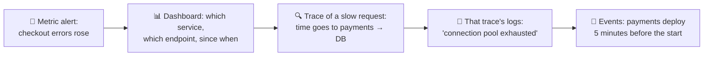
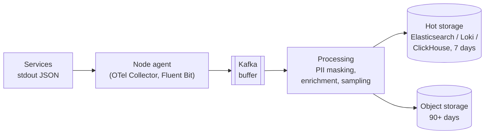
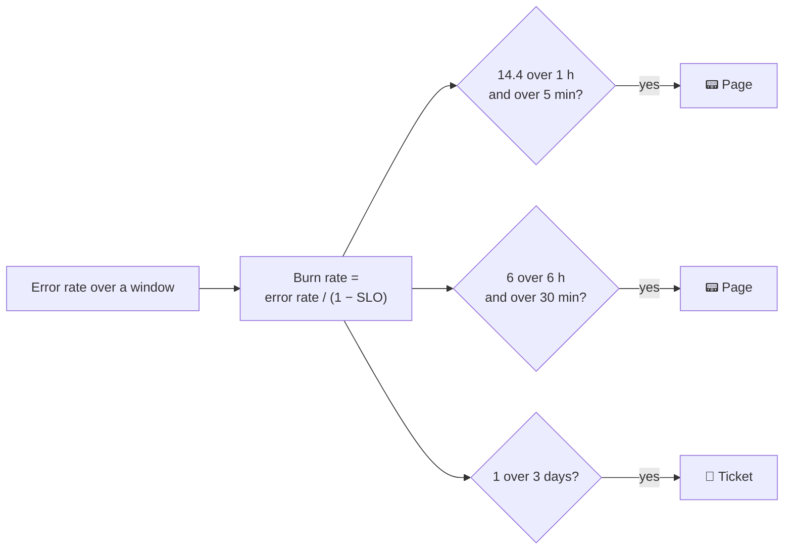
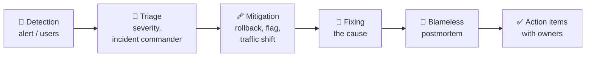
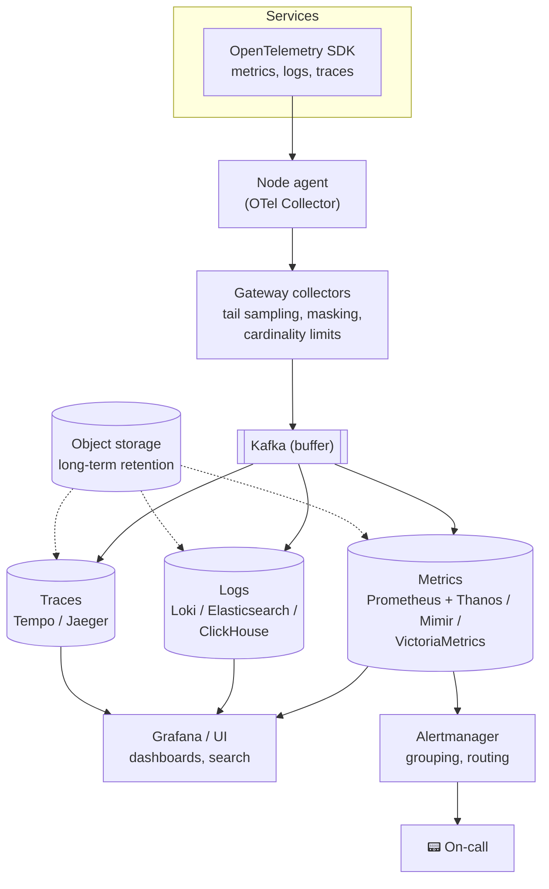

**English** | [Русский](README_RU.md)

# 16. Observability Basics

> **Covers:** monitoring vs observability, metrics (types, cardinality, RED, USE, the four golden signals), logs (structured, correlation, cost), distributed traces (OpenTelemetry, sampling), SLI/SLO/SLA, error budgets, burn-rate alerting, dashboards, incident response, observability platform architecture
> **Study time:** ~4–5 h · **Needed for:** any production system; nearly every Senior+ interview ("how will you know the system is working?")
> **Practice:** interview-style walkthrough — [INTERVIEW.md](./INTERVIEW.md)
> **Related topics:** [13-reliability-patterns](../13-reliability-patterns/README.md#2-availability-math) (availability), [09-messaging](../09-messaging/README.md#10-backpressure-and-flow-control) (consumer lag)

---

## 📑 Contents

1. [Monitoring and Observability](#1-monitoring-and-observability)
2. [Signals: Metrics, Logs, Traces and More](#2-signals-metrics-logs-traces-and-more)
3. [Metrics](#3-metrics)
4. [What to Measure: RED, USE, the Four Golden Signals](#4-what-to-measure-red-use-the-four-golden-signals)
5. [Logs](#5-logs)
6. [Distributed Traces](#6-distributed-traces)
7. [SLI, SLO and SLA](#7-sli-slo-and-sla)
8. [Error Budgets](#8-error-budgets)
9. [Alerting](#9-alerting)
10. [Dashboards](#10-dashboards)
11. [Incident Response](#11-incident-response)
12. [Observability Platform Architecture](#12-observability-platform-architecture)
13. [How to Talk About This in an Interview](#13-how-to-talk-about-this-in-an-interview)
14. [Self-Check Questions](#14-self-check-questions)
15. [Glossary and Resources](#15-glossary-and-resources)

---

## 1. Monitoring and Observability

| | Monitoring | Observability |
|:-|:-----------|:--------------|
| Question | "Is everything OK?" | "Why isn't it OK?" |
| What it catches | Known problems (known unknowns): predefined checks and thresholds | Unknown problems (unknown unknowns): you can ask the data a new question without changing code |
| Tools | Dashboards, alerts on metrics | Metrics + logs + traces with rich context, the ability to slice data by any dimension |

**Analogy:** monitoring is a car's dashboard (the "check engine" light is on). Observability is the diagnostic scanner that tells you which sensor failed and why.

### Why it's needed

| Goal | Process metric |
|:-----|:---------------|
| **Detect** a problem before users do | MTTD — mean time to detect |
| **Understand** the cause | Diagnosis time |
| **Fix** and recover | MTTR — mean time to recover |
| **Prevent** recurrence | Postmortems, trends, capacity planning |

> [!IMPORTANT]
> If you learn about incidents from users or social media, you don't have monitoring — even if you have hundreds of dashboards. The main goal is to detect problems **by the symptoms users see**.

---

## 2. Signals: Metrics, Logs, Traces and More

| Signal | What it is | Answers | Cost | Example |
|:-------|:-----------|:--------|:-----|:--------|
| **Metrics** | Numeric time series, aggregated | "What's happening and how bad is it?" | Low, independent of traffic | `http_requests_total{status="500"}` |
| **Logs** | Individual events with details | "What exactly happened in this request?" | High, grows with traffic | `{"level":"error","order_id":"9001","msg":"payment declined"}` |
| **Traces** | One request's path through every service | "Where is time spent, and where's the error?" | High, usually sampled | Request → API 12 ms → orders 40 ms → DB 350 ms |
| **Profiles** | Where a process spends CPU and memory | "Which function is slow?" | Medium | A flame graph |
| **Events** | Deploys, config changes, flag flips | "What changed before the problem?" | Low | "Deployed orders v142 at 14:03" |



> [!TIP]
> The signals work together: **metrics** say something's wrong; **traces** say where; **logs** say why. A shared `trace_id` across all three connects them.

---

## 3. Metrics

### Types

| Type | What it stores | Example | How to use it |
|:-----|:---------------|:--------|:--------------|
| **Counter** | A monotonically increasing number | Requests, errors, bytes | Look at the **rate** of increase |
| **Gauge** | A current value that can go up and down | Memory, queue length, connections | Look at the value |
| **Histogram** | A distribution across buckets | Request latency, response size | Percentiles, the share of requests faster than a threshold |
| **Summary** | Percentiles computed on the client | p50, p99 latency | Can't be aggregated across instances |

> [!WARNING]
> **Percentiles can't be averaged.** The average p99 across 10 servers isn't the p99 of the service. That's why latency uses **histograms**: buckets are summed across instances, and the percentile is computed from the combined histogram.

### Labels and cardinality

A metric with labels is many time series:

```
http_requests_total{service="orders", endpoint="/v1/orders", method="POST", status="201"}
```

**Cardinality** is the number of unique label combinations. Each combination is a separate series in memory and on disk.

| Label | Values | OK? |
|:------|:------:|:---:|
| `status` | ~10 | ✅ |
| `endpoint` (path template) | ~50 | ✅ |
| `region` | ~5 | ✅ |
| `endpoint` with an ID inside (`/orders/9001`) | Millions | ❌ |
| `user_id`, `order_id`, `trace_id` | Millions | ❌ |

```
10 services × 50 endpoints × 4 methods × 10 statuses × 5 regions × 200 instances
= 20 million series — already a lot
Add user_id — and the metrics system falls over
```

> [!IMPORTANT]
> **High-cardinality data** (user, order, request IDs) belongs in **logs and traces**, not metrics. Metrics get only dimensions with a bounded set of values.

### Storage

- **The pull model** (Prometheus): the metrics server scrapes services' `/metrics` endpoint every 15–60 s.
- **The push model** (StatsD, OTLP): services send metrics themselves — convenient for short-lived jobs.
- **A time-series DB** compresses data (on the order of 1–2 bytes per sample), keeps fresh data at full resolution and old data **downsampled** (5-minute, hourly aggregates).
- **Recording rules:** precomputed aggregates for expensive dashboard and alert queries.

---

## 4. What to Measure: RED, USE, the Four Golden Signals

### RED — for services (requests)

| Letter | Metric |
|:------:|:-------|
| **R**ate | Requests per second |
| **E**rrors | The number or share of failed requests |
| **D**uration | The latency distribution (histogram, p50/p95/p99) |

### USE — for resources

| Letter | Metric | Example for a disk |
|:------:|:-------|:-------------------|
| **U**tilization | The share of time the resource is busy | % of time the disk is busy |
| **S**aturation | How much work is waiting in a queue | I/O queue length |
| **E**rrors | Resource errors | Read errors |

Applied to CPU, memory, disks, the network, connection and thread pools, queues.

### The four golden signals (Google SRE)

| Signal | Meaning |
|:-------|:--------|
| **Latency** | Response time (separately for successes and errors: fast errors skew the picture) |
| **Traffic** | Load: requests per second, messages per second |
| **Errors** | The share of failed requests (explicit and implicit — e.g. a `200` with the wrong content) |
| **Saturation** | How "full" the system is: the most constrained resource, queues |

### What else to measure

| Where | Metrics |
|:------|:--------|
| Queues and streams | Consumer lag (in seconds), age of the oldest message, DLQ |
| Cache | Hit rate, evictions, latency |
| Databases | Query latency, replication lag, connections, locks |
| Dependencies | RED for each outgoing call, circuit breaker state |
| Business | Orders per minute, successful payments, sign-ups — often the first to show a problem |

> [!TIP]
> **Business metrics** are among the best detectors: "orders per minute dropped 40% versus the same time last week" catches problems technical metrics miss (e.g. a broken UI button).

---

## 5. Logs

### Structured logs

```json
{
  "ts": "2026-11-30T14:05:12.341Z",
  "level": "error",
  "service": "payments",
  "version": "v142",
  "trace_id": "4bf92f3577b34da6a3ce929d0e0e4736",
  "span_id": "00f067aa0ba902b7",
  "user_id": "u_42",
  "order_id": "ord_9001",
  "msg": "payment provider timeout",
  "provider": "psp-a",
  "duration_ms": 5003
}
```

| Practice | Why |
|:---------|:----|
| **JSON / key-value**, not free text | You can filter and aggregate by field |
| **A `trace_id` in every record** | Jump from a trace to logs and back |
| **Levels** (debug, info, warn, error) with clear rules | Volume control; error means "needs attention" |
| **Context** (version, region, entity IDs) | Diagnosis without reproducing the issue |
| **No secrets or personal data** | Passwords, tokens, card numbers and unnecessary PII stay out of logs; masking in the collector as a safety net |

### The cost of logs

```
50,000 requests/s × 10 lines per request across services × 500 B
= 250 MB/s ≈ 21 TB per day
```

| Technique | Effect |
|:----------|:-------|
| Don't log successful requests line by line (metrics show them) | The biggest win |
| Sample info logs (e.g. 1%), **errors at 100%** | Tens of times less volume |
| Disable debug in production; enable it dynamically for a specific service | No background noise |
| Storage tiers: hot for 7 days, then cheap storage | Cheaper |
| Per-team quotas | Visibility into who generates the volume |
| Rate-limiting logging | Protection against a log avalanche during an incident |

### The log pipeline



---

## 6. Distributed Traces

A **trace** is one request's path through every service. It's made of **spans**: each span is one operation (an incoming request, a DB call, a call to another service) with a start time, duration, attributes and a reference to its parent span.

```mermaid
gantt
    title Trace of POST /checkout (420 ms)
    dateFormat x
    axisFormat %L
    section API Gateway
    checkout           :0, 420
    section Orders
    create order       :10, 60
    section Payments
    charge             :70, 400
    db query           :80, 380
    section Notifications
    enqueue email      :405, 415
```



The chart shows right away: 300 of the 420 ms go to the DB query in payments.

### Context propagation

Each service passes the trace identifiers onward — in HTTP headers, gRPC metadata and Kafka message headers. The standard is **W3C Trace Context**:

```
traceparent: 00-4bf92f3577b34da6a3ce929d0e0e4736-00f067aa0ba902b7-01
             version | trace_id                      | parent span_id   | flags (sampled)
```

> [!WARNING]
> A trace breaks at any link that doesn't pass the context along: an async queue without headers, a hand-rolled HTTP client, a thread pool without context transfer. Check the path through the message broker and background jobs — that's where context is lost most often.

### OpenTelemetry

**OpenTelemetry (OTel)** is an open standard and set of SDKs for metrics, logs and traces. Auto-instrumentation for popular frameworks and libraries, a single OTLP protocol, and independence from the backend vendor (Jaeger, Tempo, Datadog, Honeycomb and others).

### Sampling

Storing a trace for every request is expensive. Options:

| Approach | How | Pros | Cons |
|:---------|:----|:-----|:-----|
| **Head-based** | The "keep or drop" decision is made at the start of the request (e.g. 1%) | Simple, cheap | Errors and slow requests are lost at the same rate |
| **Tail-based** | The decision is made in the collector **after** the trace completes | Keep 100% of errors and slow requests, 1% of the rest | Every span of a trace must be buffered until the decision; more complex infrastructure |

### Exemplars

An **exemplar** is a link from a metric data point to a specific trace. On a p99 latency chart, you can click a spike and open the trace of one of the slow requests.

---

## 7. SLI, SLO and SLA

| Term | What it is | Example |
|:-----|:-----------|:--------|
| **SLI** (Service Level Indicator) | A **measurable** quality indicator from the user's point of view | The share of successful checkout requests; the share of requests faster than 300 ms |
| **SLO** (Service Level Objective) | A **target** for an SLI over a period | 99.9% successful requests over 30 days |
| **SLA** (Service Level Agreement) | A **contract** with a customer with consequences (credits) | 99.5% monthly availability, or a 10% refund |

### Good SLIs

| SLI type | Formula | For |
|:---------|:--------|:----|
| **Availability** | good requests / all requests | APIs, websites |
| **Latency** | requests faster than a threshold / all requests | Interactive services |
| **Freshness** | the share of data updated no more than N minutes ago | Search, analytics, caches |
| **Correctness** | the share of correct responses (canary data) | Payments, calculations |
| **Throughput / completeness** | the share of jobs completed on time | Batch processing, data pipelines |

> [!TIP]
> Phrase an SLI as a **share of good events**: "the share of requests faster than 300 ms", not "p99 < 300 ms". Shares add up over a period, the error budget falls straight out of them, and product people understand them.

### Where to measure

| Place | Pros | Cons |
|:------|:-----|:-----|
| The service's own metrics | Simple | Misses errors before the service (LB, network, DNS) |
| **The load balancer / edge** | Close to the user, sees every request | Misses client-side errors |
| **The client (RUM)** | The real user experience | Noise from users' networks |
| **Synthetic checks** | Work even with no traffic (at night) | Don't reflect real traffic |

### How to choose a target

- **Not 100%:** unattainable, infinitely expensive and unnecessary — users' networks and devices are less reliable anyway.
- **From user journeys:** login, search, checkout — each gets its own SLO.
- **SLO stricter than SLA:** an internal target with headroom, so you breach the SLO before the SLA.
- **Account for dependencies:** you can't promise 99.99% while synchronously depending on a 99.9% service (see [13-reliability-patterns](../13-reliability-patterns/README.md#2-availability-math)).

---

## 8. Error Budgets

**Error budget = 1 − SLO** — the allowed "unreliability" over a period.

```
SLO 99.9% over 30 days:
  by time:      0.1% × 30 days × 24 h × 60 min ≈ 43 minutes
  by requests:  0.1% of 1B requests = 1M failed requests
```

### Why it matters

An error budget turns the "ship features faster" vs "be more stable" argument into a **number**:

| Budget state | What we do |
|:-------------|:-----------|
| Budget available | Ship changes, experiment, run chaos tests |
| Budget burning fast | Slow down risky changes, investigate |
| Budget exhausted | **Error budget policy:** freeze new features; reliability is the priority until the budget recovers |

> [!IMPORTANT]
> **Senior+ signal:** an error budget isn't just a metric but an **agreement** between product and engineering about what happens when it runs out. Without a policy it changes nothing.

---

## 9. Alerting

### Principles

| Principle | Why |
|:----------|:----|
| **Alert on symptoms, not causes** | "The checkout error rate went up" always matters; "CPU at 90%" might be fine |
| **Every page is an action** | If an alert can be safely ignored, it's not a page but a ticket or a dashboard |
| **A runbook for every alert** | What to check and what to do — especially at night |
| **An owner** | The alert goes to the team that can fix it |
| **Fighting fatigue** | Hundreds of ignored alerts are worse than none: the real one gets missed |

### Levels

| Level | Channel | Example |
|:------|:--------|:--------|
| **Page** (immediately, any time) | A call to the on-call | Fast error budget burn on a user journey |
| **Ticket** (business hours) | A task | Slow budget burn, a disk that fills in 5 days |
| **Info** | A dashboard, a log | Everything else |

### Burn-rate alerting

**Burn rate** is how many times faster than normal the error budget is being consumed. A burn rate of 1 — the budget runs out exactly at the end of the period; 14.4 — it runs out in ~2 days out of 30.

The approach from the SRE Workbook (Google) — **multiple windows and thresholds**:

| Severity | Condition | Burn rate | Budget consumed | Action |
|:---------|:----------|:---------:|:---------------:|:-------|
| Critical | A 1 h window (and a 5 min short window to confirm) | 14.4 | 2% of the budget in an hour | Page |
| High | A 6 h window (and 30 min) | 6 | 5% in 6 hours | Page |
| Medium | A 3-day window (and 6 h) | 1 | 10% in 3 days | Ticket |



- The **long window** — significance (don't react to a one-second spike).
- The **short window** — the alert clears quickly once the problem is fixed.
- Unlike "errors above 1%", such an alert is **tied to the target**: the stricter the SLO, the more sensitive it is.

### Grouping and inhibition

- A hundred alerts from a hundred instances with one problem → **one** incident (grouping).
- If a whole region is down — suppress alerts from the individual services in it (inhibition).
- Deduplicate repeated notifications.

---

## 10. Dashboards

| Dashboard | What's on it |
|:----------|:-------------|
| **Product overview** | SLOs and remaining error budget per user journey, business metrics |
| **Service** | RED per endpoint, latency percentiles, errors, deploys as vertical markers |
| **Dependencies** | RED for outgoing calls, circuit breaker states, connection pools |
| **Resources** | USE: CPU, memory, disks, network, queues |

**Principles:** from the general to the specific (on top — "is everything OK", below — details); the same structure for every service; deploy and config change markers on charts; comparison with the same time a week ago.

---

## 11. Incident Response



| Practice | Why |
|:---------|:----|
| **Mitigate first, investigate later** | Rolling back a deploy or flipping a flag in minutes beats an hour of root-causing under pressure |
| **Roles** | The incident commander coordinates; separate people handle communication and technical work |
| **User-facing status** | A status page, regular updates |
| **Blameless postmortem** | The goal is to change the system, not punish a person; a timeline, root causes, what helped, action items |
| **Metrics** | MTTD, MTTR, incident count, the share detected by monitoring (not by users) |

---

## 12. Observability Platform Architecture



| Principle | Why |
|:----------|:----|
| **Independence from production** | Observability must not go down with the system it observes: a separate cluster, ideally a separate region or vendor |
| **A buffer (Kafka)** | Telemetry spikes during an incident aren't lost and don't take storage down |
| **Meta-monitoring** | Who watches the monitoring? A "dead man's switch" — an alert that should always be firing; if it stops, the alerting itself is broken |
| **Limits** | Per-team quotas on metric cardinality and log volume |
| **Tiered storage** | Fresh data — fast and expensive; old data — in object storage |
| **Standards** | Uniform metric names, mandatory log fields, auto-instrumentation |

---

## 13. How to Talk About This in an Interview

### 30-second answer

> "First I define user journeys and SLIs as shares of good events — availability and latency — measured at the edge and with synthetics, then set SLOs and an error budget with a freeze policy. Alerts only on symptoms — by burn rate over multiple windows, each with a runbook and an owner. I instrument services with OpenTelemetry: RED and USE metrics with bounded cardinality and histograms for latency, structured logs with a `trace_id` and sampled info, traces with tail sampling — 100% of errors and slow requests. Signals are linked via trace_id and exemplars. The platform is separated from production, with a Kafka buffer and monitoring of itself."

### Questions to ask

1. Which user journeys are critical, and how does a user know it "works"?
2. How are incidents detected today?
3. How many alerts per week, and what share needs action?
4. What's the telemetry budget?
5. Where is request context lost (queues, background jobs)?

### Common mistakes

- Alerts on CPU and memory instead of user symptoms.
- A 100% SLO, or an SLO without an error budget policy.
- `user_id` or a full URL path in metric labels.
- Averaging percentiles.
- Free-text logs without a `trace_id`.
- Logging every successful request and being surprised by the bill.
- Only head-based trace sampling — errors get lost.
- Monitoring in the same cluster as production.
- No runbooks and no alert owners.

---

## 14. Self-Check Questions

<details>
<summary><b>1. How is monitoring different from observability?</b></summary>

Monitoring answers predefined questions ("is everything OK?") with known checks and thresholds. Observability lets you ask the data new questions ("why is it slow for Android users in this region?") without changing code, thanks to rich context in metrics, logs and traces.
</details>

<details>
<summary><b>2. Why can't you average percentiles?</b></summary>

A percentile is a property of a distribution; the average of per-server percentiles isn't the percentile of the combined distribution (especially when server loads differ). For latency, use histograms: buckets are summed, and the percentile is computed from the combined histogram.
</details>

<details>
<summary><b>3. What is metric cardinality, and why can't user_id be a label?</b></summary>

Cardinality is the number of unique label value combinations; each is a separate time series. A label with millions of values (user_id) creates millions of series and overloads the metrics system. Such data belongs in logs and traces.
</details>

<details>
<summary><b>4. What do RED and USE measure?</b></summary>

RED — for services: Rate (requests per second), Errors, Duration (latency). USE — for resources: Utilization (busyness), Saturation (queued work), Errors.
</details>

<details>
<summary><b>5. How is head-based sampling different from tail-based?</b></summary>

Head-based decides whether to keep a trace at the start of the request — simple and cheap, but errors are lost at the same rate as ordinary requests. Tail-based decides after the trace completes and can keep every error and slow request, but requires buffering spans in the collector.
</details>

<details>
<summary><b>6. How do SLI, SLO and SLA differ?</b></summary>

An SLI is a measurable indicator (the share of successful requests). An SLO is an internal target for it (99.9% over 30 days). An SLA is a contract with a customer with consequences on breach; it's usually looser than the SLO, so the internal target is breached before the contractual one.
</details>

<details>
<summary><b>7. How much downtime does a 99.9% SLO over 30 days allow?</b></summary>

0.1% × 30 × 24 × 60 ≈ 43 minutes (or 0.1% failed requests out of the total for the period).
</details>

<details>
<summary><b>8. Why do you need an error budget policy?</b></summary>

It defines what happens when the budget runs out: e.g. a feature freeze and a reliability focus. Without a policy, an error budget is just a number with no effect; with one, it's a tool for balancing development speed and stability.
</details>

<details>
<summary><b>9. Why alert on burn rate rather than a threshold like "errors above 1%"?</b></summary>

Burn rate is tied to the SLO: it shows how fast the allowed budget is being consumed. Multiple windows separate fast, severe outages (page) from slow degradation (ticket), and the short window clears the alert quickly after a fix. A fixed threshold isn't tied to the target and either pages too much or misses slow problems.
</details>

<details>
<summary><b>10. Why must the observability system be separated from production?</b></summary>

Otherwise it goes down with production exactly when it's needed most. Separate infrastructure, a buffer for spikes and meta-monitoring (a dead man's switch) ensure you'll see the incident.
</details>

---

## 15. Glossary and Resources

### Glossary

| Term | Meaning |
|:-----|:--------|
| Observability | The ability to understand a system's internal state from its external signals |
| Counter / gauge / histogram | An increasing count / a current value / a distribution across buckets |
| Cardinality | The number of unique label combinations of a metric |
| RED / USE | Rate-Errors-Duration for services / Utilization-Saturation-Errors for resources |
| The four golden signals | Latency, traffic, errors, saturation |
| Structured log | A log in key-value format (JSON) |
| Trace / span | A request's path through the system / one operation within it |
| Trace context | Trace identifiers passed between services |
| Head / tail sampling | Deciding whether to keep a trace at the start / after completion |
| Exemplar | A link from a metric data point to a trace |
| SLI / SLO / SLA | Service level indicator / objective / agreement |
| Error budget | The allowed share of errors over a period: 1 − SLO |
| Burn rate | How fast the error budget is consumed relative to normal |
| MTTD / MTTR | Mean time to detect / recover |
| Runbook | Action instructions for an alert |
| Blameless postmortem | An incident review without blaming individuals |

### Resources

- Google SRE Book — chapters "Monitoring Distributed Systems", "Service Level Objectives", "Managing Incidents", "Postmortem Culture"
- Google SRE Workbook — "Implementing SLOs", "Alerting on SLOs"
- Sigelman et al., *Dapper, a Large-Scale Distributed Systems Tracing Infrastructure* (Google, 2010)
- Brendan Gregg, *The USE Method*
- Tom Wilkie, *The RED Method*
- Charity Majors, Liz Fong-Jones, George Miranda, *Observability Engineering* (2022)
- Alex Hidalgo, *Implementing Service Level Objectives* (2020)
- OpenTelemetry documentation; the W3C Trace Context specification
- Prometheus documentation: metric types, histograms, labeling best practices
