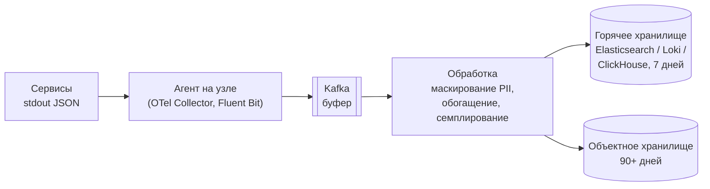
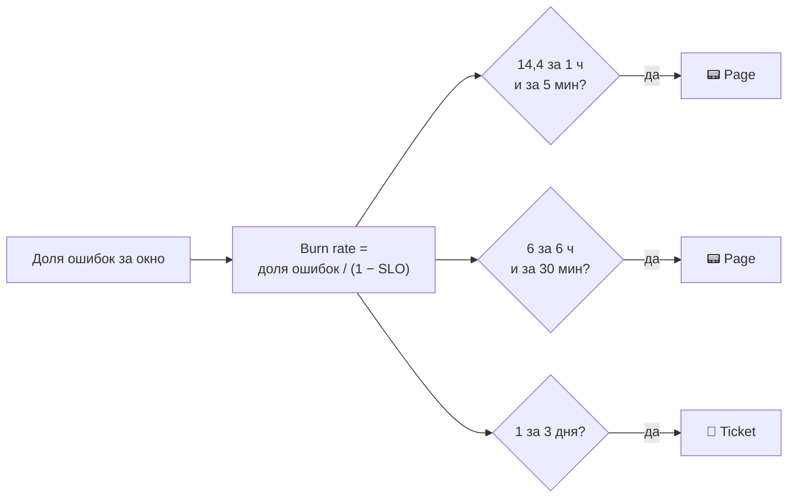
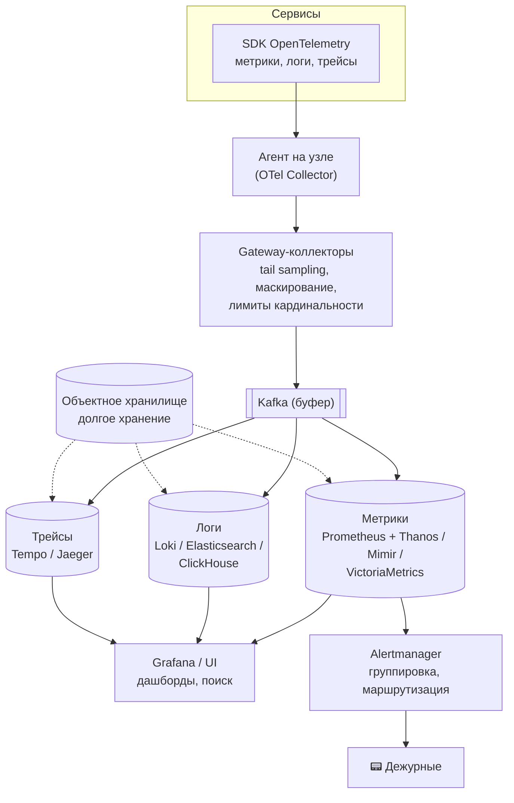

[English](README.md) | **Русский**

# 16. Основы observability

> **Что внутри:** мониторинг vs observability, метрики (типы, кардинальность, RED, USE, четыре золотых сигнала), логи (структурированные, корреляция, стоимость), распределённые трейсы (OpenTelemetry, семплирование), SLI/SLO/SLA, error budget, алертинг по burn rate, дашборды, реагирование на инциденты, архитектура платформы наблюдаемости
> **Время на изучение:** ~4–5 ч · **Нужно для:** любой продакшен-системы; почти каждое интервью уровня Senior+ («как вы узнаете, что система работает?»)
> **Практика:** разбор в формате интервью — [INTERVIEW_RU.md](./INTERVIEW_RU.md)
> **Связанные темы:** [13-reliability-patterns](../13-reliability-patterns/README_RU.md#2-математика-доступности) (доступность), [09-messaging](../09-messaging/README_RU.md#10-backpressure-и-управление-потоком) (consumer lag)

---

## 📑 Содержание

1. [Мониторинг и observability](#1-мониторинг-и-observability)
2. [Сигналы: метрики, логи, трейсы и другое](#2-сигналы-метрики-логи-трейсы-и-другое)
3. [Метрики](#3-метрики)
4. [Что измерять: RED, USE, четыре золотых сигнала](#4-что-измерять-red-use-четыре-золотых-сигнала)
5. [Логи](#5-логи)
6. [Распределённые трейсы](#6-распределённые-трейсы)
7. [SLI, SLO и SLA](#7-sli-slo-и-sla)
8. [Error budget](#8-error-budget)
9. [Алертинг](#9-алертинг)
10. [Дашборды](#10-дашборды)
11. [Реагирование на инциденты](#11-реагирование-на-инциденты)
12. [Архитектура платформы наблюдаемости](#12-архитектура-платформы-наблюдаемости)
13. [Как говорить об этом на интервью](#13-как-говорить-об-этом-на-интервью)
14. [Вопросы для самопроверки](#14-вопросы-для-самопроверки)
15. [Глоссарий и ресурсы](#15-глоссарий-и-ресурсы)

---

## 1. Мониторинг и observability

| | Мониторинг | Observability (наблюдаемость) |
|:-|:-----------|:------------------------------|
| Вопрос | «Всё ли в порядке?» | «Почему не в порядке?» |
| Что ловит | Известные проблемы (known unknowns): заранее заданные проверки и пороги | Неизвестные проблемы (unknown unknowns): можно задать новый вопрос к данным, не меняя код |
| Инструменты | Дашборды, алерты на метрики | Метрики + логи + трейсы с богатым контекстом, возможность нарезать данные по любым измерениям |

**Аналогия:** мониторинг — приборная панель автомобиля (горит лампочка «проверь двигатель»). Observability — диагностический сканер, который позволяет выяснить, какой именно датчик и почему.

### Зачем это нужно

| Цель | Метрика процесса |
|:-----|:-----------------|
| **Обнаружить** проблему раньше пользователей | MTTD — mean time to detect |
| **Понять** причину | Время диагностики |
| **Исправить** и восстановить | MTTR — mean time to recover |
| **Предотвратить** повторение | Постмортемы, тренды, планирование ёмкости |

> [!IMPORTANT]
> Если об инцидентах вы узнаёте от пользователей или из соцсетей — у вас нет мониторинга, даже если есть сотни дашбордов. Главная цель — обнаруживать проблемы **по симптомам, которые видят пользователи**.

---

## 2. Сигналы: метрики, логи, трейсы и другое

| Сигнал | Что это | Отвечает на вопрос | Стоимость | Пример |
|:-------|:--------|:-------------------|:----------|:-------|
| **Метрики** | Числовые временные ряды, агрегированные | «Что происходит и насколько плохо?» | Низкая, не зависит от трафика | `http_requests_total{status="500"}` |
| **Логи** | Отдельные события с деталями | «Что именно произошло в этом запросе?» | Высокая, растёт с трафиком | `{"level":"error","order_id":"9001","msg":"payment declined"}` |
| **Трейсы** | Путь одного запроса через все сервисы | «Где тратится время и где ошибка?» | Высокая, обычно семплируются | Запрос → API 12 мс → orders 40 мс → БД 350 мс |
| **Профили** | Где процесс тратит CPU и память | «Какая функция тормозит?» | Средняя | Flame graph |
| **События** | Деплои, изменения конфигурации, переключения флагов | «Что изменилось перед проблемой?» | Низкая | «Деплой orders v142 в 14:03» |


> [!TIP]
> Сигналы работают вместе: **метрики** говорят, что что-то не так; **трейсы** — где; **логи** — почему. Связывает их общий `trace_id` во всех трёх.

---

## 3. Метрики

### Типы

| Тип | Что хранит | Пример | Как использовать |
|:----|:-----------|:-------|:-----------------|
| **Counter** | Монотонно растущее число | Число запросов, ошибок, байт | Смотреть **скорость** роста (rate) |
| **Gauge** | Текущее значение, может расти и падать | Память, длина очереди, число соединений | Смотреть значение |
| **Histogram** | Распределение по корзинам (buckets) | Задержка запросов, размер ответа | Перцентили, доля запросов быстрее порога |
| **Summary** | Перцентили, посчитанные на клиенте | p50, p99 задержки | Нельзя агрегировать между экземплярами |

> [!WARNING]
> **Перцентили нельзя усреднять.** Среднее p99 по 10 серверам — не p99 всего сервиса. Поэтому для задержек используют **гистограммы**: корзины суммируются между экземплярами, а перцентиль вычисляется из общей гистограммы.

### Метки и кардинальность

Метрика с метками — это много временных рядов:

```
http_requests_total{service="orders", endpoint="/v1/orders", method="POST", status="201"}
```

**Кардинальность** — число уникальных комбинаций меток. Каждая комбинация — отдельный ряд в памяти и на диске.

| Метка | Значений | Подходит? |
|:------|:--------:|:---------:|
| `status` | ~10 | ✅ |
| `endpoint` (шаблон пути) | ~50 | ✅ |
| `region` | ~5 | ✅ |
| `endpoint` с ID внутри (`/orders/9001`) | Миллионы | ❌ |
| `user_id`, `order_id`, `trace_id` | Миллионы | ❌ |

```
10 сервисов × 50 эндпоинтов × 4 метода × 10 статусов × 5 регионов × 200 экземпляров
= 20 миллионов рядов — уже много
Добавь user_id — и система метрик упадёт
```

> [!IMPORTANT]
> **Высококардинальные данные** (ID пользователя, заказа, запроса) — это задача **логов и трейсов**, а не метрик. В метриках — только измерения с ограниченным набором значений.

### Хранение

- **Pull-модель** (Prometheus): сервер метрик опрашивает эндпоинт `/metrics` сервисов каждые 15–60 с.
- **Push-модель** (StatsD, OTLP): сервисы отправляют метрики сами — удобно для короткоживущих задач.
- **Time-series БД** сжимает данные (порядка 1–2 байт на точку), хранит свежие данные с полным разрешением, а старые — **прореженными** (downsampling: 5-минутные, часовые агрегаты).
- **Recording rules:** заранее вычисленные агрегаты для дорогих запросов дашбордов и алертов.

---

## 4. Что измерять: RED, USE, четыре золотых сигнала

### RED — для сервисов (запросов)

| Буква | Метрика |
|:-----:|:--------|
| **R**ate | Число запросов в секунду |
| **E**rrors | Число или доля ошибочных запросов |
| **D**uration | Распределение задержки (гистограмма, p50/p95/p99) |

### USE — для ресурсов

| Буква | Метрика | Пример для диска |
|:-----:|:--------|:-----------------|
| **U**tilization | Доля времени, когда ресурс занят | % времени диск занят |
| **S**aturation | Сколько работы ждёт в очереди | Длина очереди ввода-вывода |
| **E**rrors | Ошибки ресурса | Ошибки чтения |

Применяется к CPU, памяти, дискам, сети, пулам соединений и потоков, очередям.

### Четыре золотых сигнала (Google SRE)

| Сигнал | Что значит |
|:-------|:-----------|
| **Latency** | Время ответа (раздельно для успешных и ошибочных: быстрые ошибки искажают картину) |
| **Traffic** | Нагрузка: запросы в секунду, сообщения в секунду |
| **Errors** | Доля неуспешных запросов (явных и неявных — например, `200` с неправильным содержимым) |
| **Saturation** | Насколько «полна» система: самый ограниченный ресурс, очереди |

### Что ещё измерять

| Где | Метрики |
|:----|:--------|
| Очереди и потоки | Consumer lag (в секундах), возраст самого старого сообщения, DLQ |
| Кэш | Hit rate, вытеснения, задержка |
| Базы данных | Задержка запросов, лаг репликации, соединения, блокировки |
| Зависимости | RED для каждого исходящего вызова, состояние circuit breaker |
| Бизнес | Заказы в минуту, успешные оплаты, регистрации — часто первыми показывают проблему |

> [!TIP]
> **Бизнес-метрики** — один из лучших детекторов: «число заказов в минуту упало на 40% по сравнению с прошлой неделей в это же время» ловит проблемы, которые технические метрики пропускают (например, сломанная кнопка в интерфейсе).

---

## 5. Логи

### Структурированные логи

```json
{
  "ts": "2026-11-30T14:05:12.341Z",
  "level": "error",
  "service": "payments",
  "version": "v142",
  "trace_id": "4bf92f3577b34da6a3ce929d0e0e4736",
  "span_id": "00f067aa0ba902b7",
  "user_id": "u_42",
  "order_id": "ord_9001",
  "msg": "payment provider timeout",
  "provider": "psp-a",
  "duration_ms": 5003
}
```

| Практика | Почему |
|:---------|:-------|
| **JSON / ключ-значение**, а не свободный текст | Можно фильтровать и агрегировать по полям |
| **`trace_id` в каждой записи** | Переход от трейса к логам и обратно |
| **Уровни** (debug, info, warn, error) с ясными правилами | Управление объёмом; error — то, что требует внимания |
| **Контекст** (версия, регион, ID сущностей) | Диагностика без воспроизведения |
| **Без секретов и персональных данных** | Пароли, токены, номера карт, лишние PII не попадают в логи; маскирование в коллекторе как страховка |

### Стоимость логов

```
50 000 запросов/с × 10 строк на запрос по всем сервисам × 500 Б
= 250 МБ/с ≈ 21 ТБ в день
```

| Приём | Эффект |
|:------|:-------|
| Не логировать успешные запросы построчно (их видно в метриках) | Самый большой выигрыш |
| Семплирование info-логов (например, 1%), **ошибки — 100%** | В десятки раз меньше объёма |
| Отключить debug в продакшене, включать динамически для конкретного сервиса | Нет фонового шума |
| Уровни хранения: горячие 7 дней, затем дешёвое хранилище | Дешевле |
| Квоты на команды | Видно, кто генерирует объём |
| Ограничение скорости логирования | Защита от лавины логов во время инцидента |

### Конвейер логов



---

## 6. Распределённые трейсы

**Трейс** — путь одного запроса через все сервисы. Состоит из **спанов**: каждый спан — одна операция (входящий запрос, вызов БД, вызов другого сервиса) с временем начала, длительностью, атрибутами и ссылкой на родительский спан.

```mermaid
gantt
    title Трейс запроса POST /checkout (420 мс)
    dateFormat x
    axisFormat %L
    section API Gateway
    checkout           :0, 420
    section Orders
    create order       :10, 60
    section Payments
    charge             :70, 400
    db query           :80, 380
    section Notifications
    enqueue email      :405, 415
```



На диаграмме сразу видно: 300 из 420 мс уходят на запрос к БД в payments.

### Распространение контекста

Каждый сервис передаёт идентификаторы трейса дальше — в HTTP-заголовках, метаданных gRPC и заголовках сообщений Kafka. Стандарт — **W3C Trace Context**:

```
traceparent: 00-4bf92f3577b34da6a3ce929d0e0e4736-00f067aa0ba902b7-01
             версия | trace_id                       | span_id родителя | флаги (семплирован)
```

> [!WARNING]
> Трейс рвётся на любом звене, которое не передаёт контекст: асинхронная очередь без заголовков, самописный HTTP-клиент, пул потоков без переноса контекста. Проверь путь через брокер сообщений и фоновые задачи — там контекст теряется чаще всего.

### OpenTelemetry

**OpenTelemetry (OTel)** — открытый стандарт и набор SDK для метрик, логов и трейсов. Автоинструментирование популярных фреймворков и библиотек, единый протокол OTLP, независимость от вендора бэкенда (Jaeger, Tempo, Datadog, Honeycomb и другие).

### Семплирование

Хранить трейс каждого запроса дорого. Варианты:

| Подход | Как | Плюсы | Минусы |
|:-------|:----|:------|:-------|
| **Head-based** | Решение «сохранять или нет» принимается в начале запроса (например, 1%) | Просто, дёшево | Ошибки и медленные запросы теряются с той же вероятностью |
| **Tail-based** | Решение принимается в коллекторе **после** завершения трейса | Сохранить 100% ошибок и медленных, 1% остальных | Нужно буферизовать все спаны трейса до решения; сложнее инфраструктура |

### Exemplars

**Exemplar** — ссылка из точки метрики на конкретный трейс. На графике p99 задержки можно кликнуть на всплеск и открыть трейс одного из медленных запросов.

---

## 7. SLI, SLO и SLA

| Термин | Что это | Пример |
|:-------|:--------|:-------|
| **SLI** (Service Level Indicator) | **Измеримый** показатель качества с точки зрения пользователя | Доля успешных запросов к checkout; доля запросов быстрее 300 мс |
| **SLO** (Service Level Objective) | **Цель** для SLI за период | 99,9% успешных запросов за 30 дней |
| **SLA** (Service Level Agreement) | **Договор** с клиентом с последствиями (компенсации) | 99,5% доступности в месяц, иначе возврат 10% оплаты |

### Хорошие SLI

| Тип SLI | Формула | Для чего |
|:--------|:--------|:---------|
| **Доступность** | хорошие запросы / все запросы | API, сайты |
| **Задержка** | запросы быстрее порога / все запросы | Интерактивные сервисы |
| **Свежесть** | доля данных, обновлённых не позже N минут назад | Поиск, аналитика, кэши |
| **Корректность** | доля правильных ответов (проверочные данные) | Платежи, расчёты |
| **Пропускная способность / завершённость** | доля задач, завершённых в срок | Пакетная обработка, конвейеры данных |

> [!TIP]
> Формулируй SLI как **долю хороших событий**: «доля запросов быстрее 300 мс», а не «p99 < 300 мс». Доли складываются за период, из них прямо считается error budget, и они понятны продукту.

### Где измерять

| Место | Плюсы | Минусы |
|:------|:------|:-------|
| Метрики самого сервиса | Просто | Не видит ошибок до сервиса (LB, сеть, DNS) |
| **Балансировщик / edge** | Близко к пользователю, видит все запросы | Не видит клиентских ошибок |
| **Клиент (RUM)** | Реальный опыт пользователя | Шум сети пользователей |
| **Синтетические проверки** | Работают даже без трафика (ночью) | Не отражают реальный трафик |

### Как выбирать цель

- **Не 100%:** недостижимо, бесконечно дорого и не нужно — сеть и устройства пользователей всё равно ненадёжнее.
- **От пользовательских путей:** вход, поиск, оформление заказа — у каждого свой SLO.
- **SLO строже SLA:** внутренняя цель с запасом, чтобы нарушить SLO раньше, чем SLA.
- **Учитывать зависимости:** нельзя обещать 99,99%, если синхронно зависишь от сервиса с 99,9% (см. [13-reliability-patterns](../13-reliability-patterns/README_RU.md#2-математика-доступности)).

---

## 8. Error budget

**Error budget = 1 − SLO** — допустимая «ненадёжность» за период.

```
SLO 99,9% за 30 дней:
  по времени:   0,1% × 30 дней × 24 ч × 60 мин ≈ 43 минуты
  по запросам:  0,1% от 1 млрд запросов = 1 млн неуспешных запросов
```

### Зачем он нужен

Error budget превращает спор «быстрее выпускать фичи» против «стабильнее» в **число**:

| Состояние бюджета | Что делаем |
|:------------------|:-----------|
| Бюджет есть | Выпускаем изменения, экспериментируем, проводим хаос-тесты |
| Бюджет тратится быстро | Замедляем рискованные изменения, разбираемся |
| Бюджет исчерпан | **Политика error budget:** заморозка новых фич, приоритет — надёжность, пока бюджет не восстановится |

> [!IMPORTANT]
> **Сигнал Senior+:** error budget — это не только метрика, но и **договорённость** между продуктом и инженерами: что происходит, когда бюджет исчерпан. Без политики он ничего не меняет.

---

## 9. Алертинг

### Принципы

| Принцип | Почему |
|:--------|:-------|
| **Алертить на симптомы, а не на причины** | «Доля ошибок checkout выросла» важно всегда; «CPU 90%» — может, ничего страшного |
| **Каждый пейдж — действие** | Если на алерт можно ничего не делать — это не пейдж, а тикет или дашборд |
| **Runbook для каждого алерта** | Что проверить и что делать — особенно ночью |
| **Владелец** | Алерт приходит команде, которая может исправить |
| **Борьба с усталостью** | Сотни игнорируемых алертов хуже, чем никакие: настоящий пропустят |

### Уровни

| Уровень | Канал | Пример |
|:--------|:------|:-------|
| **Page** (немедленно, в любое время) | Звонок дежурному | Быстрое сжигание error budget пользовательского пути |
| **Ticket** (в рабочее время) | Задача | Медленное сжигание бюджета, диск заполнится через 5 дней |
| **Информация** | Дашборд, лог | Всё остальное |

### Алертинг по burn rate

**Burn rate** — во сколько раз быстрее нормы тратится error budget. Burn rate 1 — бюджет закончится ровно к концу периода; 14,4 — закончится за ~2 дня из 30.

Подход из SRE Workbook (Google) — **несколько окон и порогов**:

| Тяжесть | Условие | Burn rate | Израсходовано бюджета | Действие |
|:--------|:--------|:---------:|:---------------------:|:---------|
| Критично | Окно 1 ч (и короткое окно 5 мин для подтверждения) | 14,4 | 2% бюджета за час | Page |
| Высокая | Окно 6 ч (и 30 мин) | 6 | 5% за 6 часов | Page |
| Средняя | Окно 3 дня (и 6 ч) | 1 | 10% за 3 дня | Ticket |



- **Длинное окно** — значимость (не реагировать на секундный всплеск).
- **Короткое окно** — алерт быстро гаснет, когда проблема устранена.
- В отличие от «ошибок больше 1%» такой алерт **привязан к цели**: чем строже SLO, тем чувствительнее.

### Группировка и подавление

- Сотня алертов от сотни экземпляров одной проблемы → **один** инцидент (группировка).
- Если упал целый регион — подавить алерты отдельных сервисов в нём (inhibition).
- Дедупликация повторяющихся уведомлений.

---

## 10. Дашборды

| Дашборд | Что на нём |
|:--------|:-----------|
| **Обзор продукта** | SLO и остаток error budget по пользовательским путям, бизнес-метрики |
| **Сервис** | RED по эндпоинтам, задержки по перцентилям, ошибки, деплои как вертикальные отметки |
| **Зависимости** | RED исходящих вызовов, состояние circuit breakers, пулы соединений |
| **Ресурсы** | USE: CPU, память, диски, сеть, очереди |

**Принципы:** от общего к частному (сверху — «всё ли хорошо», ниже — детали); одинаковая структура у всех сервисов; отметки деплоев и изменений конфигурации на графиках; сравнение с той же точкой неделю назад.

---

## 11. Реагирование на инциденты


| Практика | Почему |
|:---------|:-------|
| **Сначала смягчить, потом разбираться** | Откат деплоя или выключение флага за минуты лучше, чем час поиска корня проблемы под нагрузкой |
| **Роли** | Incident commander координирует, отдельные люди — коммуникация и технические действия |
| **Статус для пользователей** | Страница статуса, регулярные обновления |
| **Blameless postmortem** | Цель — изменить систему, а не наказать человека; хронология, корневые причины, что помогло, действия |
| **Метрики** | MTTD, MTTR, число инцидентов, доля обнаруженных мониторингом (а не пользователями) |

---

## 12. Архитектура платформы наблюдаемости



| Принцип | Почему |
|:--------|:-------|
| **Независимость от продакшена** | Наблюдаемость не должна падать вместе с системой, которую наблюдает: отдельный кластер, по возможности отдельный регион или поставщик |
| **Буфер (Kafka)** | Всплески телеметрии во время инцидента не теряются и не роняют хранилища |
| **Meta-monitoring** | Кто следит за мониторингом? «Dead man's switch» — алерт, который должен приходить постоянно; если перестал — сломан сам алертинг |
| **Лимиты** | Квоты на кардинальность метрик и объём логов по командам |
| **Многоуровневое хранение** | Свежие данные — быстро и дорого, старые — в объектном хранилище |
| **Стандарты** | Единые названия метрик, обязательные поля логов, автоинструментирование |

---

## 13. Как говорить об этом на интервью

### Ответ за 30 секунд

> «Сначала определяю пользовательские пути и SLI как доли хороших событий — доступность и задержка — измеряю на edge и синтетикой, ставлю SLO и error budget с политикой заморозки. Алерты только на симптомы — по burn rate в нескольких окнах, каждый с runbook и владельцем. Сервисы инструментирую через OpenTelemetry: метрики по RED и USE с ограниченной кардинальностью и гистограммами для задержки, структурированные логи с `trace_id` и семплированием info, трейсы с tail sampling — 100% ошибок и медленных. Связь сигналов — через trace_id и exemplars. Платформа отделена от продакшена, с буфером в Kafka и мониторингом самой себя».

### Вопросы, которые стоит задать

1. Какие пользовательские пути критичны и как пользователь понимает, что «работает»?
2. Как сейчас обнаруживаются инциденты?
3. Сколько алертов в неделю и какая доля из них требует действий?
4. Каков бюджет на телеметрию?
5. Где теряется контекст запроса (очереди, фоновые задачи)?

### Типичные ошибки

- Алерты на CPU и память вместо пользовательских симптомов.
- 100% SLO или SLO без error budget политики.
- `user_id` или полный путь URL в метках метрик.
- Усреднение перцентилей.
- Логи свободным текстом без `trace_id`.
- Логировать каждый успешный запрос и удивляться счёту.
- Только head-based семплирование трейсов — ошибки теряются.
- Мониторинг в том же кластере, что и продакшен.
- Нет runbooks и владельцев алертов.

---

## 14. Вопросы для самопроверки

<details>
<summary><b>1. Чем мониторинг отличается от observability?</b></summary>

Мониторинг отвечает на заранее заданные вопросы («всё ли в порядке?») с помощью известных проверок и порогов. Observability позволяет задавать новые вопросы к данным («почему у пользователей из этого региона на Android медленно?») без изменения кода, за счёт богатого контекста в метриках, логах и трейсах.
</details>

<details>
<summary><b>2. Почему нельзя усреднять перцентили?</b></summary>

Перцентиль — свойство распределения; среднее перцентилей отдельных серверов не равно перцентилю общего распределения (особенно при разной нагрузке серверов). Для задержек используют гистограммы: корзины суммируются, а перцентиль считается из суммарной гистограммы.
</details>

<details>
<summary><b>3. Что такое кардинальность метрик и почему user_id нельзя делать меткой?</b></summary>

Кардинальность — число уникальных комбинаций значений меток; каждая — отдельный временной ряд. Метка с миллионами значений (user_id) создаёт миллионы рядов и перегружает систему метрик. Такие данные хранят в логах и трейсах.
</details>

<details>
<summary><b>4. Что измеряют RED и USE?</b></summary>

RED — для сервисов: Rate (запросы в секунду), Errors (ошибки), Duration (задержка). USE — для ресурсов: Utilization (занятость), Saturation (очередь ожидающей работы), Errors.
</details>

<details>
<summary><b>5. Чем head-based семплирование отличается от tail-based?</b></summary>

Head-based решает, сохранять ли трейс, в начале запроса — просто и дёшево, но ошибки теряются с той же вероятностью, что и обычные запросы. Tail-based решает после завершения трейса и может сохранить все ошибки и медленные запросы, но требует буферизации спанов в коллекторе.
</details>

<details>
<summary><b>6. Чем SLI, SLO и SLA отличаются друг от друга?</b></summary>

SLI — измеримый показатель (доля успешных запросов). SLO — внутренняя цель для него (99,9% за 30 дней). SLA — договор с клиентом с последствиями при нарушении; обычно мягче SLO, чтобы нарушить внутреннюю цель раньше договорной.
</details>

<details>
<summary><b>7. Сколько простоя допускает SLO 99,9% за 30 дней?</b></summary>

0,1% × 30 × 24 × 60 ≈ 43 минуты (или 0,1% неуспешных запросов от общего числа за период).
</details>

<details>
<summary><b>8. Зачем нужна политика error budget?</b></summary>

Она определяет, что происходит при исчерпании бюджета: например, заморозка новых фич и приоритет надёжности. Без политики error budget — просто число, которое ни на что не влияет; с ней — инструмент баланса между скоростью разработки и стабильностью.
</details>

<details>
<summary><b>9. Почему алертить по burn rate, а не по порогу «ошибок больше 1%»?</b></summary>

Burn rate привязан к SLO: показывает, как быстро тратится допустимый бюджет. Несколько окон отделяют быстрые сильные сбои (page) от медленной деградации (ticket), а короткое окно быстро гасит алерт после исправления. Фиксированный порог не связан с целью и либо шумит, либо пропускает медленные проблемы.
</details>

<details>
<summary><b>10. Почему система наблюдаемости должна быть отделена от продакшена?</b></summary>

Иначе она упадёт вместе с продакшеном именно тогда, когда нужнее всего. Отдельная инфраструктура, буфер для всплесков и meta-monitoring (dead man's switch) гарантируют, что вы увидите инцидент.
</details>

---

## 15. Глоссарий и ресурсы

### Глоссарий

| Термин | Значение |
|:-------|:---------|
| Observability | Способность понять внутреннее состояние системы по её внешним сигналам |
| Counter / gauge / histogram | Растущий счётчик / текущее значение / распределение по корзинам |
| Кардинальность | Число уникальных комбинаций меток метрики |
| RED / USE | Rate-Errors-Duration для сервисов / Utilization-Saturation-Errors для ресурсов |
| Четыре золотых сигнала | Latency, traffic, errors, saturation |
| Структурированный лог | Лог в формате ключ-значение (JSON) |
| Трейс / спан | Путь запроса через систему / одна операция в нём |
| Trace context | Идентификаторы трейса, передаваемые между сервисами |
| Head / tail sampling | Решение о сохранении трейса в начале / после завершения |
| Exemplar | Ссылка из точки метрики на трейс |
| SLI / SLO / SLA | Показатель / цель / договор об уровне сервиса |
| Error budget | Допустимая доля ошибок за период: 1 − SLO |
| Burn rate | Скорость расходования error budget относительно нормы |
| MTTD / MTTR | Среднее время обнаружения / восстановления |
| Runbook | Инструкция действий для алерта |
| Blameless postmortem | Разбор инцидента без поиска виноватых |

### Ресурсы

- Google SRE Book — главы «Monitoring Distributed Systems», «Service Level Objectives», «Managing Incidents», «Postmortem Culture»
- Google SRE Workbook — «Implementing SLOs», «Alerting on SLOs»
- Sigelman et al., *Dapper, a Large-Scale Distributed Systems Tracing Infrastructure* (Google, 2010)
- Brendan Gregg, *The USE Method*
- Tom Wilkie, *The RED Method*
- Charity Majors, Liz Fong-Jones, George Miranda, *Observability Engineering* (2022)
- Alex Hidalgo, *Implementing Service Level Objectives* (2020)
- Документация OpenTelemetry; спецификация W3C Trace Context
- Документация Prometheus: типы метрик, гистограммы, рекомендации по меткам
