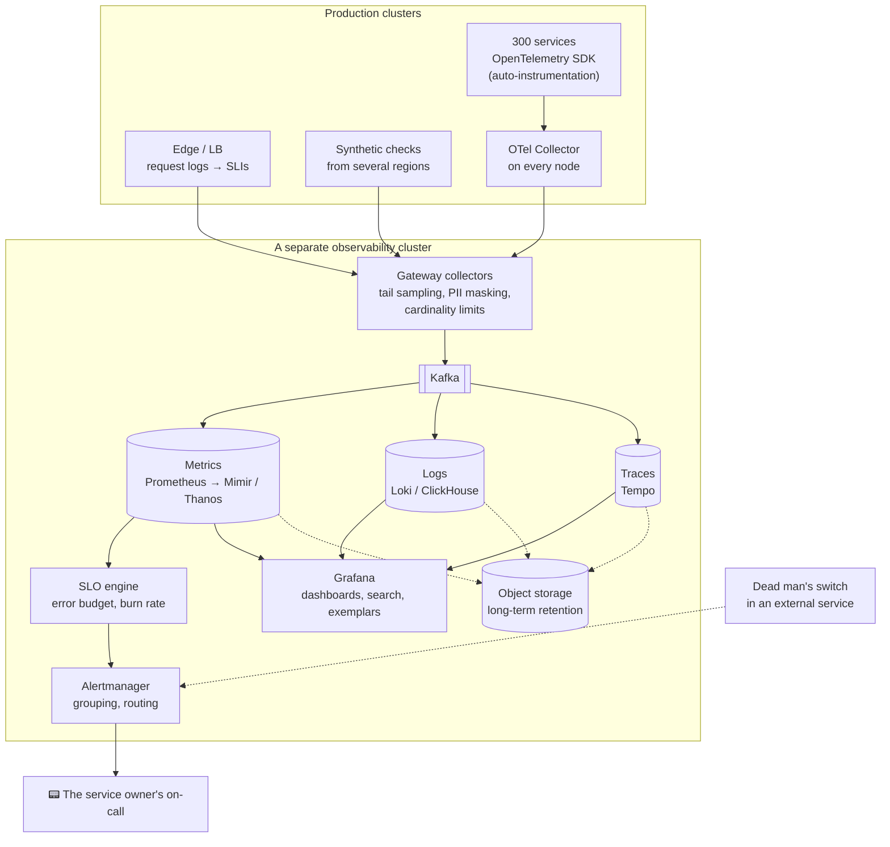
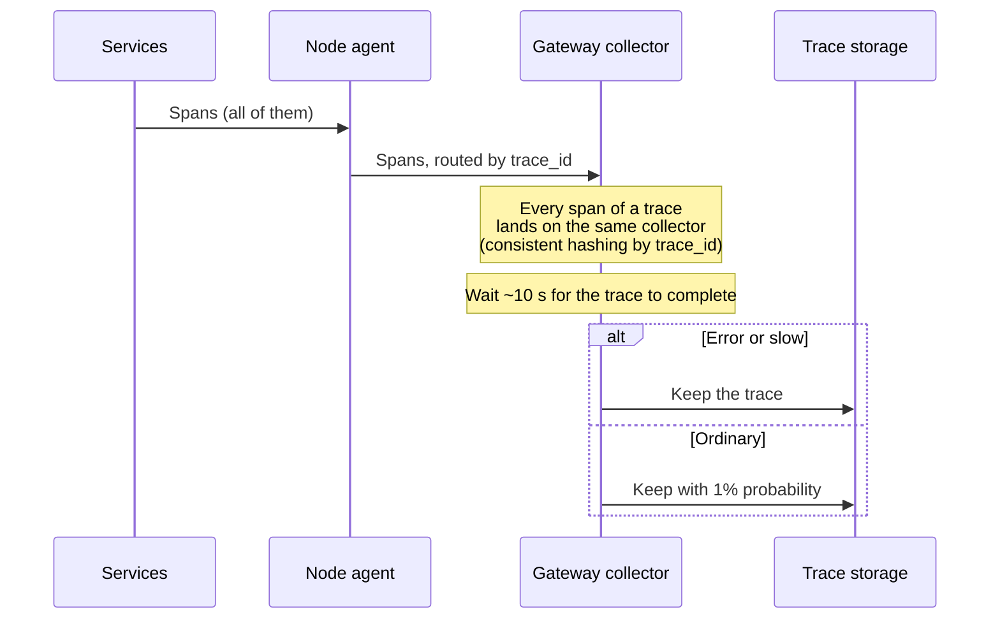

**English** | [Русский](INTERVIEW.ru.md) · Theory: [README.md](./README.md)

# 16. Observability: Observability for a 300-Microservice Platform

> **Topic:** from alert chaos to SLOs, choosing SLIs for user journeys, error budgets and their policy, burn-rate alerting, distributed traces and tail sampling, structured logs and their cost, the metrics platform and cardinality, platform architecture, incident response
> **Level:** Hard · **Interview time:** 45 min · **Study time:** ~5 h
> **Where it's asked:** "How will you know the system is working?", "Design monitoring / a logging platform / a metrics platform", and as a required part of any Senior+ problem

---

## 🗺️ How to Read This Walkthrough

| Icon | Meaning |
|:----:|:--------|
| 🎤 | Interviewer |
| 🗣️ | What I (the candidate) say out loud |
| ✏️ | What I draw on the whiteboard |
| ⏱️ | Time budget for the step |

Callouts: **TIP** — a good technique, **WARNING** — a trap, **IMPORTANT** — a Senior+ signal.

---

## 📑 Contents

1. [Problem Statement](#1-problem-statement)
2. [Diagnosing the Current State](#2-diagnosing-the-current-state)
3. [Requirements](#3-requirements)
4. [Telemetry Volume Estimates](#4-telemetry-volume-estimates)
5. [High-Level Design](#5-high-level-design)
6. [Deep Dive 1: SLIs and SLOs for User Journeys](#6-deep-dive-1-slis-and-slos-for-user-journeys)
7. [Deep Dive 2: The Error Budget and Its Policy](#7-deep-dive-2-the-error-budget-and-its-policy)
8. [Deep Dive 3: A New Alerting System](#8-deep-dive-3-a-new-alerting-system)
9. [Deep Dive 4: Distributed Traces](#9-deep-dive-4-distributed-traces)
10. [Deep Dive 5: Logs and Their Cost](#10-deep-dive-5-logs-and-their-cost)
11. [Deep Dive 6: The Metrics Platform and Cardinality](#11-deep-dive-6-the-metrics-platform-and-cardinality)
12. [Deep Dive 7: Reliability of the Platform Itself](#12-deep-dive-7-reliability-of-the-platform-itself)
13. [Deep Dive 8: The Incident Response Process](#13-deep-dive-8-the-incident-response-process)
14. [Bottlenecks and Failure Scenarios](#14-bottlenecks-and-failure-scenarios)
15. [Interviewer Questions with Answers](#15-interviewer-questions-with-answers)
16. [Common Mistakes](#16-common-mistakes)
17. [Cheat Sheet and Self-Check](#17-cheat-sheet-and-self-check)

---

## 1. Problem Statement

> 🎤 "We run an online store on 300 microservices. Problems:
> - we learn about serious incidents from user complaints and social media;
> - mean time to recover is 2 hours, most of it spent finding which service is at fault;
> - on-call engineers get 500 alerts a day and ignore almost all of them;
> - the logging bill is growing faster than revenue.
>
> Design observability: what to measure, how to alert and how to build the platform."

**Time plan:**

| Step | ⏱️ |
|:-----|:--:|
| Diagnosis and requirements | 7 min |
| Volume estimates | 4 min |
| High-level design | 4 min |
| Deep dives | 25 min |
| Wrap-up | 5 min |

> [!TIP]
> This problem is about both **strategy** (what to measure, SLOs, alerting) and the **system** (the platform that collects and stores telemetry). Strategy first: without the right SLIs, the most expensive platform will just collect useless data.

---

## 2. Diagnosing the Current State

⏱️ 4 min

🗣️ "Each complaint is a symptom of a specific problem":

| Symptom | Likely cause | What fixes it |
|:--------|:-------------|:--------------|
| We learn about incidents from users | Alerts on **causes** (CPU, memory, individual errors), not on **user symptoms** | SLIs for user journeys, measured at the edge, + burn-rate alerts |
| MTTR 2 hours, hunting for the culprit | No distributed traces and no linked signals; logs without a `trace_id` | OpenTelemetry, traces with tail sampling, `trace_id` everywhere, exemplars, uniform dashboards |
| 500 alerts a day get ignored | Noisy alerts without owners or actions | Only symptom alerts, runbooks, owners, grouping, page/ticket levels |
| The logging bill is growing | Every successful request is logged, free text, no sampling or storage tiers | Structured logs, sampling, quotas, tiered storage |

> [!IMPORTANT]
> **Senior+ signal:** start with **process and goals** (SLOs, alerting policy, owners), not with choosing tools. "Let's buy Datadog" won't fix any of the four problems if the alerts are still on CPU.

---

## 3. Requirements

⏱️ 3 min

### Functional

1. Detect degradation of user journeys before users do.
2. Find the faulty service and dependency within minutes.
3. Track SLOs and error budgets per service and journey.
4. Search the logs and traces of a specific request or user.
5. Notify the service owner, not everyone.

### Non-functional

| Requirement | Target |
|:------------|:-------|
| MTTD for major incidents | < 5 min, > 90% of incidents detected by monitoring |
| MTTR | < 30 min for typical incidents |
| Alert noise | < 2 pages per week per on-call engineer; > 80% of pages require action |
| Telemetry latency | Metrics — < 1 min; logs and traces — < 2 min to searchable |
| Platform availability | Higher than production; doesn't go down with it |
| Cost | Telemetry grows slower than traffic |

---

## 4. Telemetry Volume Estimates

⏱️ 4 min

✏️

```
Services / pods         = 300 services, ~10,000 pods
Edge traffic            = 50,000 requests/s at peak
Fan-out                 ≈ 10 internal calls per external request

METRICS
  ~1,000 series per pod → ~10M active series
  scraped every 15 s    → ~670,000 samples/s
  ~1.5 B per sample     → ~90 GB/day (before downsampling)

LOGS (today)
  50,000 × 10 lines × 500 B = 250 MB/s ≈ 21 TB/day
  target after optimization: ≈ 2 TB/day (10× less)

TRACES (if everything were stored)
  50,000 × 20 spans × 300 B = 300 MB/s ≈ 26 TB/day
  tail sampling: 100% of errors and slow + 1% of the rest ≈ 0.5 TB/day
```

🗣️ **Conclusions:**
- **Metrics** are cheap and independent of traffic — the foundation for alerting.
- **Logs** are the main expense; the main win is to stop logging successful requests line by line, and to sample.
- **Traces** cost as much as logs without sampling; with **tail sampling** they're tens of times cheaper while keeping every interesting trace.
- **Metric cardinality** is the main risk: one bad label multiplies the 10M series.

---

## 5. High-Level Design

⏱️ 4 min

✏️



🗣️ "Key decisions:
- **OpenTelemetry everywhere** — one standard for metrics, logs and traces, auto-instrumentation for popular frameworks, a shared `trace_id`;
- **collectors** on nodes plus a gateway tier: sampling, masking and limits are applied centrally;
- **Kafka** as a buffer — telemetry spikes during an incident don't take storage down;
- **a separate observability cluster** — it must not go down with production;
- an **SLO engine** computes error budgets and burn rates, and Alertmanager routes alerts to owners."

---

## 6. Deep Dive 1: SLIs and SLOs for User Journeys

> 🎤 "Where do you start?"

🗣️ "With user journeys — what the user is trying to do:

| Journey | Availability SLI | Latency SLI | SLO (30 days) |
|:--------|:-----------------|:------------|:--------------|
| **Checkout** | Share of successful `POST /checkout` (not 5xx and not a timeout) | Share faster than 1 s | 99.95% availability, 99% faster than 1 s |
| **Login** | Share of successful logins (excluding wrong passwords) | Share faster than 500 ms | 99.9% / 99% |
| **Search** | Share of successful searches | Share faster than 300 ms | 99.9% / 95% |
| **Product page** | Share of successful loads | Share faster than 400 ms | 99.9% / 95% |
| **Order notifications** | — | Freshness: share of emails sent within 5 min | 99% |

### Where to measure

| Source | For |
|:-------|:----|
| **Edge load balancer logs and metrics** | The primary SLI: sees every request, including errors before services |
| **Synthetic checks** every 30 s from 3 regions | Detection at night and at zero traffic; the whole journey (login → cart → checkout on a test account) |
| **RUM** (browser and app metrics) | The real experience: page loads, client errors |

### SLOs for services

🗣️ "Beyond journeys — an SLO for each service, derived from the journey's requirements: if checkout synchronously calls 4 services, each needs availability well above 99.95%. That shows which service lacks headroom."

> [!WARNING]
> Define the "good event" carefully. A `400` from invalid user input or a wrong password isn't an SLO violation. But a `200` with empty search results because the index went down is a violation, even though the status code is a success.

---

## 7. Deep Dive 2: The Error Budget and Its Policy

> 🎤 "What do SLOs give you besides charts?"

🗣️ "An error budget and a **policy** around it:

```
Checkout: SLO 99.95% over 30 days, ~100M requests
  Budget = 0.05% × 100M = 50,000 failed requests (≈ 22 minutes of full downtime)
```

| Budget remaining | Policy |
|:-----------------|:-------|
| > 50% | Business as usual: deploys, experiments, chaos tests |
| 25–50% | More caution: large risky changes need sign-off |
| < 25% | Only reliability fixes and important features after review |
| Exhausted | A feature freeze for the service; the team works on reliability until the budget recovers; a postmortem |

🗣️ "Product and engineering agree on the policy **in advance**. Then the 'ship the feature or fix stability' argument is settled by a number, not by who's loudest."

### Link to deploys

- The deploy pipeline checks the remaining budget: when it's exhausted, an explicit override is required.
- Canaries compare the new version's SLIs to the old one's and roll back automatically on degradation.

---

## 8. Deep Dive 3: A New Alerting System

> 🎤 "How do you get rid of 500 alerts a day?"

### Step 1: an audit

🗣️ "For every alert over the last month: how many times it fired and how many times someone actually did something. Alerts with no action are deleted or turned into tickets and dashboards. Usually less than 10% survive."

### Step 2: symptom alerts via burn rate

| Alert | Condition | Level |
|:------|:----------|:------|
| Checkout, fast burn | Burn rate > 14.4 over 1 h **and** over 5 min | 📟 Page |
| Checkout, medium burn | Burn rate > 6 over 6 h **and** over 30 min | 📟 Page |
| Checkout, slow burn | Burn rate > 1 over 3 days | 🎫 Ticket |
| A journey's synthetic check fails | 3 checks in a row from 2+ regions | 📟 Page |
| A business metric drop | Orders per minute 40% below the same time last week | 📟 Page |

```
Burn rate = (error rate over the window) / (1 − SLO)

Example: SLO 99.95% → budget 0.05%
Over the last hour, 1% of checkout requests failed
Burn rate = 1% / 0.05% = 20 > 14.4 → page
At this pace, the 30-day budget runs out in 1.5 days
```

### Step 3: cause alerts — only as tickets or for predictable problems

| We keep | Why |
|:--------|:----|
| A disk will fill within < 24 h (by forecast) | Predictable, needs action before the problem |
| A certificate expires in 7 days | Predictable |
| Consumer lag approaching retention | Risk of data loss |
| A growing DLQ | Silent data loss |

### Step 4: hygiene

| Practice | How |
|:---------|:----|
| An owner for every alert | A `team` label in the rule, routing in Alertmanager |
| A runbook for every page | A link in the alert text: what to check, how to mitigate |
| Grouping | Alerts from one service with one cause — one notification |
| Inhibition | If a region is down — suppress alerts from services in it |
| Review | A weekly review: which pages fired, how many had action, what to tune |

---

## 9. Deep Dive 4: Distributed Traces

> 🎤 "How do you cut the 2 hours of hunting for the faulty service?"

🗣️ "Traces show a request's path through every service and where time is lost.

| Decision | How |
|:---------|:----|
| **Instrumentation** | The OpenTelemetry SDK with auto-instrumentation for HTTP, gRPC, DB clients, Kafka; manual spans only for important business logic |
| **Context propagation** | W3C `traceparent` in HTTP and gRPC; in Kafka message headers; context transfer in thread pools and background jobs |
| **Tail sampling** in gateway collectors | Keep: 100% of traces with an error, 100% slower than the journey's p99, 100% for flagged users (test accounts), 1% of the rest |
| **Exemplars** | On a latency chart — click a spike → the trace of a slow request |
| **Service map** | Built from traces: who calls whom, RED on every edge |
| **`trace_id` in logs** | From a trace to every service's logs for that request in one click |



> [!WARNING]
> For tail sampling, **every span of one trace** must reach the same collector — otherwise the decision is made on incomplete data. That's why agents route spans by `trace_id` (consistent hashing) to the gateway collector tier.

🗣️ "How this cuts MTTR: an alert → the journey dashboard shows rising latency → an exemplar opens a slow trace → 80% of the time goes to the payments call → the `trace_id` opens payments logs with a connection pool error → a payments deploy marker 10 minutes earlier → rollback. Minutes instead of hours."

---

## 10. Deep Dive 5: Logs and Their Cost

> 🎤 "21 terabytes of logs a day. How do you cut that without losing what matters?"

🗣️

| Measure | Effect | How |
|:--------|:-------|:----|
| **Don't log successful requests line by line** | The largest — ~60–70% of volume | Successful requests are visible in metrics and sampled traces |
| **Sampling info** | 10–100× less for that level | 1–5% of info; **100% of warn and error** |
| **Debug off** | No background noise | Enabled dynamically for a specific service or user during an investigation |
| **A structured format** | Better compression and search | JSON with mandatory fields: `ts`, `level`, `service`, `version`, `trace_id`, `msg` |
| **Rate limiting** | Protection against an avalanche | A lines-per-second limit per pod; beyond it — a count of dropped lines |
| **Storage tiers** | Several times cheaper | 7 days hot (search in seconds), 90 days in object storage (slower search), audit logs longer as required |
| **Per-team quotas and reports** | Accountability | A weekly "who logs how much" report |

### Log security

- PII and secret masking in the gateway collector (card numbers, tokens, emails) as a safety net on top of rules in code.
- Role-based access to logs; access auditing.

### Choosing storage

| Store | Pros | Cons |
|:------|:-----|:-----|
| Elasticsearch / OpenSearch | Full-text search over everything | Expensive at this volume: indexes everything |
| **Loki** | Indexes only labels; data is compressed chunks in object storage; cheap | Content search is slower |
| **ClickHouse** | Columnar storage, fast aggregations over structured log fields | Needs a well-designed schema |

🗣️ "For structured logs with a `trace_id`, I choose Loki or ClickHouse: logs are most often searched by `trace_id`, service and level, not by full text."

---

## 11. Deep Dive 6: The Metrics Platform and Cardinality

> 🎤 "10 million metric series. How do you keep the system from falling over?"

🗣️

| Decision | How |
|:---------|:----|
| **Prometheus per cluster** + long-term storage | Collection close to services; Mimir / Thanos / VictoriaMetrics for global queries, long-term retention in object storage and downsampling |
| **Histograms for latency** | Buckets sum across pods; percentiles and "faster than threshold" shares for SLIs |
| **Recording rules** | Precomputed SLIs and per-service aggregates — dashboards and alerts don't recompute millions of series |
| **Label rules** | Allowed: `service`, `endpoint` (template), `method`, `status_class`, `region`; forbidden: user and order IDs, full URLs |
| **Cardinality limits** | A per-service series quota; when exceeded — drop new series and alert the owner |
| **Cardinality monitoring** | A "top metrics and labels by series count" dashboard |

> [!WARNING]
> A typical incident: a developer added a `path` label with the full URL (`/products/9001`). Within an hour the series count went from 10M to 60M, Prometheus ran out of memory, and **alerting went dark** exactly when it was needed most. Cardinality limits at the collector level are a mandatory safeguard.

---

## 12. Deep Dive 7: Reliability of the Platform Itself

> 🎤 "What if monitoring goes down during a major incident?"

🗣️ "That's the worst case — going blind at the moment you most need to see. Protection:

| Measure | Why |
|:--------|:----|
| **A separate cluster** (and, if possible, a separate region or account) | A production outage doesn't affect monitoring |
| **A Kafka buffer** | During an incident telemetry grows several-fold (errors, retries, logs); the buffer absorbs the spike |
| **Signal priority** | Metrics and alerting matter more than logs: under overload, logs and traces are sampled first |
| **Dead man's switch** | Alerting constantly sends "I'm alive" to an external service; if the signal stops, the external service pages the platform on-call |
| **External synthetic checks** | Checks from an external service keep working even if our entire infrastructure is down |
| **A backup notification channel** | Alerts are duplicated through a second notification provider |
| **Static runbooks** | Available outside the main infrastructure (in case the wiki goes down with production) |

---

## 13. Deep Dive 8: The Incident Response Process

> 🎤 "The tools are in place. What else is needed to get MTTR down to 30 minutes?"

🗣️ "Process:

| Stage | Practice |
|:------|:---------|
| **Detection** | A burn-rate alert or synthetic check → the owner's on-call |
| **Declaration** | The on-call declares an incident; an **incident commander** is assigned; an incident channel is created automatically |
| **Mitigation first** | Roll back the last deploy, flip a feature flag, shift traffic. Fix the root cause afterwards |
| **Communication** | A separate role: the status page, updates every 15–30 min |
| **Change visibility** | Deploys and config changes are markers on every chart; "what changed in the last hour" is the first question |
| **Postmortem** | Blameless: a timeline, causes, what helped and what hindered detection, action items with owners and deadlines |
| **Process metrics** | MTTD, MTTR, the share of incidents detected by monitoring; the quarterly trend |

> [!TIP]
> The most effective MTTR reduction is a **fast rollback**: if any deploy or config change can be rolled back in minutes, most incidents (which are caused by changes) end before the root cause is even found.

---

## 14. Bottlenecks and Failure Scenarios

| Scenario | What happens | How we protect |
|:---------|:-------------|:---------------|
| A cardinality explosion | The metrics store crashes; alerting goes blind | Limits in the collector, per-service quotas, an alert on series growth |
| A log avalanche during an incident | The log pipeline is overloaded | Per-pod rate limits, a Kafka buffer, metrics prioritized |
| The observability platform is unavailable | No alerts | Dead man's switch, external synthetics, a separate cluster |
| Traces break at queues | Async paths can't be followed | Context in message headers, checking trace coverage |
| Tail sampling on incomplete traces | Error traces aren't kept | Routing spans by trace_id to one collector |
| An alert storm (a region went down) | Hundreds of notifications | Grouping and inhibition in Alertmanager |
| SLOs measured in the wrong place | Users suffer, the SLO is "green" | SLIs at the edge + synthetics + RUM |
| Clock skew between servers | Spans in the wrong order | NTP; span durations within one process use monotonic clocks |
| PII in logs | A privacy violation | Masking in the collector, reviews, role-based access |

---

## 15. Interviewer Questions with Answers

<details>
<summary><b>Why not alert on CPU above 90%?</b></summary>

High CPU doesn't always mean a problem for users (a service can work fine under high load), and a serious problem can occur at low CPU (a dependency responds slowly while threads wait). A symptom alert (burning a journey's error budget) catches exactly what users see. CPU and other causes are useful on dashboards for diagnosis and in predictive tickets.
</details>

<details>
<summary><b>Why two windows in a burn-rate alert?</b></summary>

The long window (e.g. 1 hour) confirms the problem is significant, not a one-second spike. The short one (5 minutes) makes the alert sensitive to what's happening now: after a fix it clears quickly instead of hanging for another hour.
</details>

<details>
<summary><b>How do you choose an SLO target when there wasn't one before?</b></summary>

Look at several months of historical SLI data and set the target at the level the system usually achieved — that captures the current norm. Then discuss with product whether that's enough for users, and adjust gradually. A target that's too strict right away turns into a permanently exhausted budget that everyone ignores.
</details>

<details>
<summary><b>Why are metrics, not logs, the foundation of alerting?</b></summary>

Metrics are cheap, their volume doesn't depend on traffic, and queries against them are fast and predictable. Alerting on logs requires scanning huge volumes, is delayed by the pipeline and breaks during a log avalanche. Logs are for investigation, not detection.
</details>

<details>
<summary><b>Won't we lose something important by sampling info logs?</b></summary>

Errors and warnings are kept at 100%, interesting traces too (tail sampling), and metrics see every request. To investigate a specific case, debug and full logs can be enabled dynamically for a service or user. Losing a sample of successful info lines almost never hinders diagnosis.
</details>

<details>
<summary><b>Build your own platform or use SaaS (Datadog, New Relic, Honeycomb)?</b></summary>

SaaS delivers results quickly and doesn't require a platform team, but at terabytes per day it becomes very expensive and creates vendor lock-in. An in-house platform on open tools (OpenTelemetry, Prometheus/Mimir, Loki, Tempo) is cheaper at scale but needs people. OpenTelemetry preserves your freedom: you can start with SaaS and switch later, or combine both.
</details>

---

## 16. Common Mistakes

| ❌ Mistake | ✅ Do this instead |
|:----------|:------------------|
| Starting by choosing a tool | Start with user journeys, SLIs and SLOs |
| Alerts on CPU, memory, individual errors | Alerts on a journey's error budget burn |
| A 100% SLO, or an SLO without a policy | A realistic target + an error budget policy |
| SLIs from service metrics | SLIs at the edge + synthetics + RUM |
| A page without a runbook or owner | Every page is an action, with a runbook and a team |
| `user_id` and full URLs in labels | Only bounded dimensions, cardinality limits |
| Averaging p99 | Histograms and "faster than threshold" shares |
| Free-text logs without a `trace_id` | Structured logs with a `trace_id` |
| Logging every successful request | Metrics + sampled info, 100% of errors |
| 1% head sampling for traces | Tail sampling: 100% of errors and slow requests |
| Monitoring inside the production cluster | A separate cluster, a buffer, a dead man's switch |
| Hunting for the root cause first | Mitigate first: rollback, flag |

---

## 17. Cheat Sheet and Self-Check

### 30-second answer

> Goals first: SLIs for user journeys as shares of good events (availability and latency), measured at the edge, with synthetics and RUM; SLOs and an error budget with a freeze policy. Alerts only on symptoms, by burn rate over two windows (14.4 over 1 h and 6 over 6 h — page; 1 over 3 days — ticket), each with an owner and a runbook; an audit removes the noise. OpenTelemetry everywhere: RED/USE metrics with histograms and cardinality limits in Prometheus + Mimir; structured logs with a `trace_id`, no line-by-line logging of successful requests, sampled info, 100% of errors, stored in Loki/ClickHouse with hot and cold tiers; traces with tail sampling and routing by trace_id, exemplars. The platform is a separate cluster with a Kafka buffer and a dead man's switch. The process — an incident commander, rollback first, blameless postmortems.

### Self-check

- [ ] I can map the 4 complaints to causes and fixes
- [ ] I can define SLIs and SLOs for 4 user journeys and explain where to measure them
- [ ] I can compute an error budget and describe a policy
- [ ] I can explain two-window burn-rate alerts and work through an example
- [ ] I can describe tail sampling and why spans are routed by trace_id
- [ ] I can propose 6 measures to cut logging costs
- [ ] I can explain the danger of cardinality and how to guard against it
- [ ] I can describe how the platform survives its own failure

### Further reading

- Theory for this topic: [README.md](./README.md)
- Google SRE Workbook — "Alerting on SLOs"
- Alex Hidalgo, *Implementing Service Level Objectives*
- Charity Majors et al., *Observability Engineering*
- OpenTelemetry Collector documentation: the tail sampling processor
