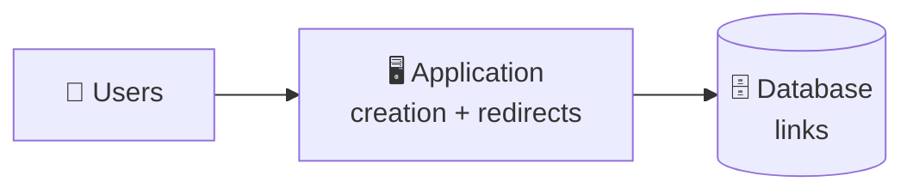
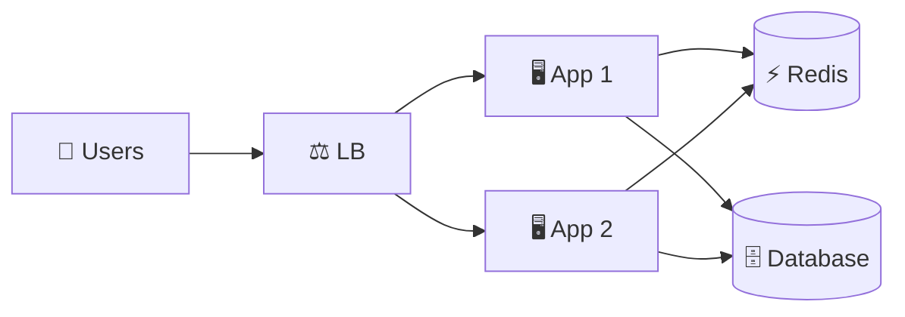
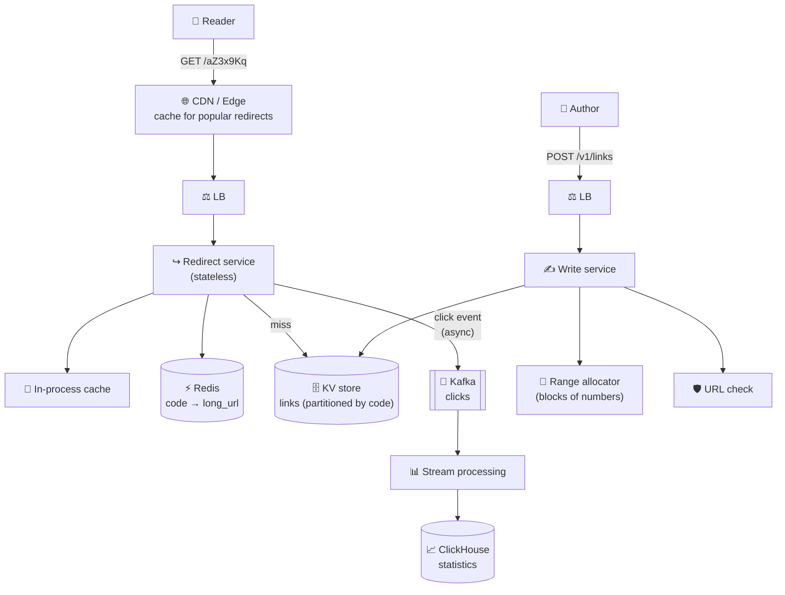
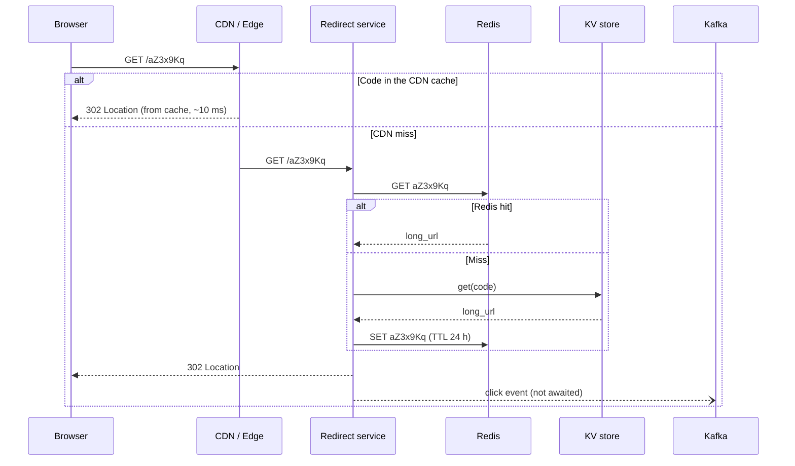
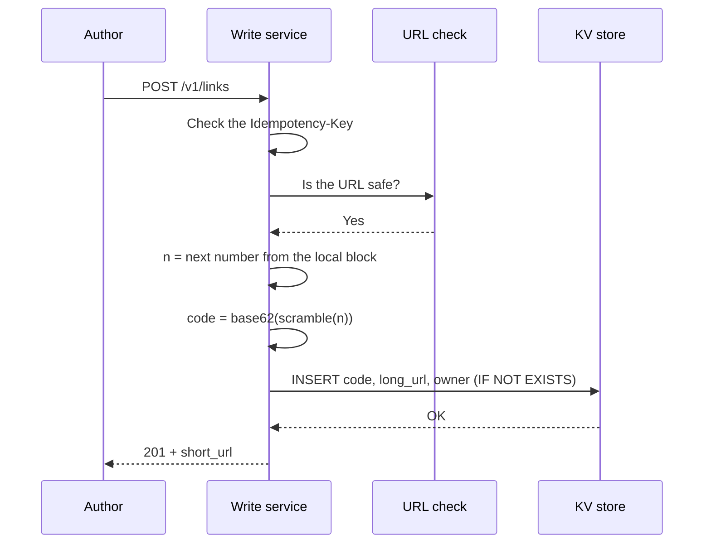
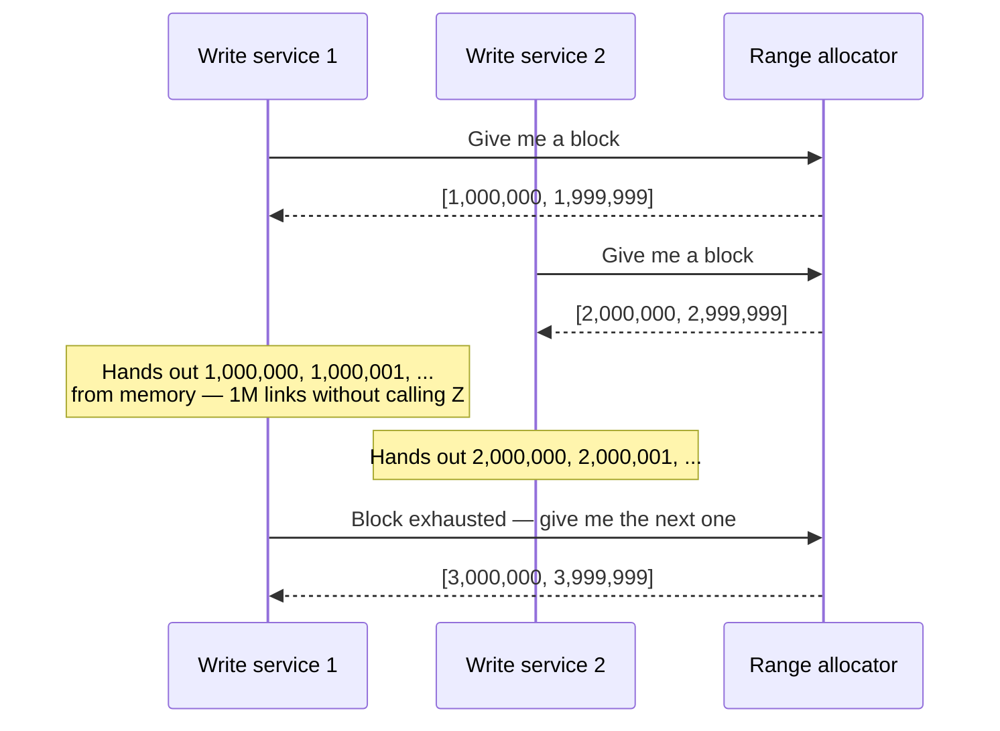
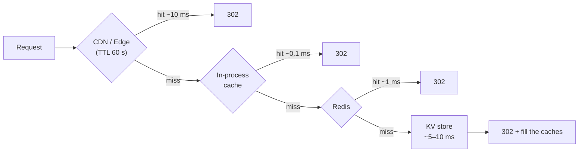
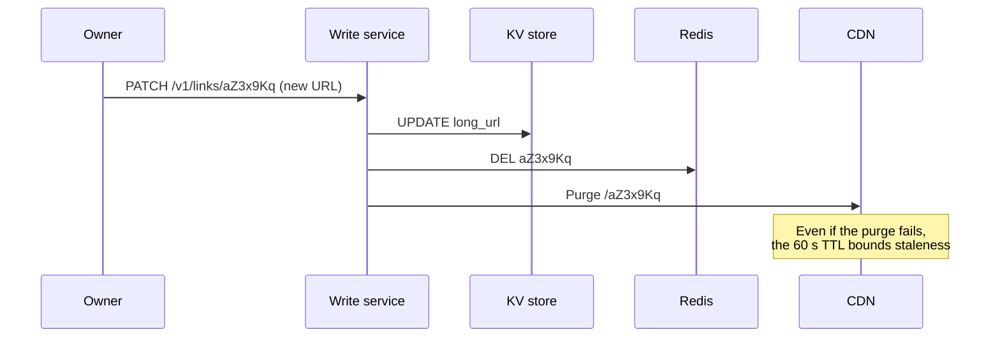
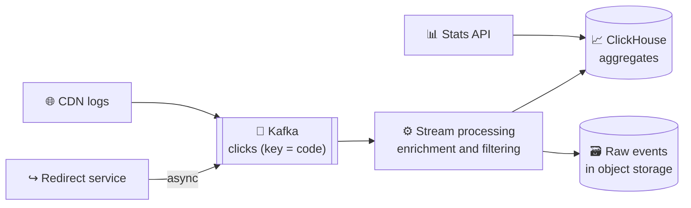
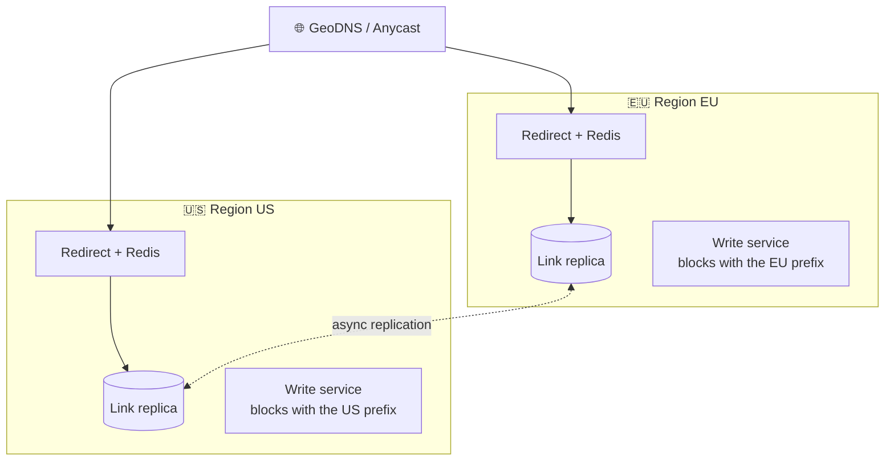

**English** | [Русский](README_RU.md)

# Tier 1 · 01. URL Shortener (TinyURL, bit.ly)

> **Level:** Easy (but depth is expected at Senior+) · **Interview time:** 45 min · **Study time:** ~4 h
> **Key aspects:** short code generation (base62, counters, ranges, hashes), redirect latency, caching, click analytics, abuse protection
> **Builds on:** [01-scaling-basics](../../01-scaling-basics/README.md), [02-caching](../../02-caching/README.md), [03-cdn](../../03-cdn/README.md), [04-databases](../../04-databases/README.md), [06-partitioning](../../06-partitioning/README.md), [09-messaging](../../09-messaging/README.md)

---

## 🗺️ How to Read This Walkthrough

The walkthrough follows an interview, but every step includes explanations: **why** a decision is made, **how** a mechanism works and **what happens** if you do it differently. The "📘 Explanation" blocks are theory right where you need it; in the interview you summarize them briefly, but you should understand them fully.

| Icon | Meaning |
|:----:|:--------|
| 🎤 | Interviewer |
| 🗣️ | What I (the candidate) say out loud |
| ✏️ | What I draw on the whiteboard |
| ⏱️ | Time budget for the step |
| 📘 | A detailed explanation of a concept |

Callouts: **TIP** — a good technique, **WARNING** — a trap, **IMPORTANT** — a Senior+ signal.

---

## 📑 Contents

0. [What This Problem Teaches](#0-what-this-problem-teaches)
1. [Problem Statement](#1-problem-statement)
2. [Clarifying Questions and Requirements](#2-clarifying-questions-and-requirements)
3. [Capacity Estimates](#3-capacity-estimates)
4. [API](#4-api)
5. [Data Model and Storage Choice](#5-data-model-and-storage-choice)
6. [High-Level Design: From Simple to Final](#6-high-level-design-from-simple-to-final)
7. [Deep Dive 1: Generating Short Codes](#7-deep-dive-1-generating-short-codes)
8. [Deep Dive 2: Fast Redirects and Caching](#8-deep-dive-2-fast-redirects-and-caching)
9. [Deep Dive 3: Click Analytics](#9-deep-dive-3-click-analytics)
10. [Deep Dive 4: Abuse and Security](#10-deep-dive-4-abuse-and-security)
11. [Deep Dive 5: Multiple Regions](#11-deep-dive-5-multiple-regions)
12. [Bottlenecks and Failure Scenarios](#12-bottlenecks-and-failure-scenarios)
13. [What Changes at 10x Scale](#13-what-changes-at-10x-scale)
14. [Key Concepts and New Terms](#14-key-concepts-and-new-terms)
15. [Variations and Follow-Up Questions](#15-variations-and-follow-up-questions)
16. [Common Mistakes](#16-common-mistakes)
17. [Cheat Sheet and Self-Check](#17-cheat-sheet-and-self-check)

---

## 0. What This Problem Teaches

A URL shortener looks simple: "store a key → value pair and serve it by key". That's exactly why interviewers like it as a first problem — the basic design takes 10 minutes to draw, and then depth is tested:

| What's tested | Where it shows up |
|:--------------|:------------------|
| Estimating and drawing conclusions from numbers | Code length, storage size, read/write ratio |
| Generating unique IDs in a distributed system | Issuing codes without collisions and without a single point of failure |
| Optimizing a read-heavy system | Cache, CDN, hot keys |
| Understanding HTTP | 301 vs 302, caching redirects |
| Async processing | Analytics mustn't slow down redirects |
| Security | Code enumeration, phishing |

> [!TIP]
> Draw the basic design **fast** (within 15 minutes) and spend most of the time on deep dives: **code generation**, **redirect latency** and **analytics**. That's where the difference between Mid and Senior shows.

---

## 1. Problem Statement

> 🎤 "Design a URL shortening service like bit.ly: a user submits a long URL and gets a short one, which takes everyone else to the original page."

**How it works from the user's point of view:**

```
1. The author submits:  https://shop.example.com/catalog/winter-sale?utm_source=newsletter&utm_campaign=dec
2. Gets back:           https://sho.rt/aZ3x9Kq
3. A reader opens https://sho.rt/aZ3x9Kq → the browser gets a "go there" response → lands on the original page
```

**Time plan:**

| Step | ⏱️ |
|:-----|:--:|
| Requirements | 4 min |
| Estimates | 4 min |
| API and data model | 6 min |
| High-level design | 6 min |
| Deep dives | 20 min |
| Failures, scale, wrap-up | 5 min |

---

## 2. Clarifying Questions and Requirements

⏱️ 4 min

Each question is asked not "for the checklist" but because the answer changes the design:

| My question | Interviewer's answer | What it changes and why |
|:------------|:---------------------|:------------------------|
| How many new links and redirects? | 100M new links per month, 100× as many redirects | The system is **read-heavy**: the read path (redirects) is what to optimize; writes are secondary |
| Are custom aliases needed (`bit.ly/my-sale`)? | Yes, for paid accounts | A **uniqueness check** on an arbitrary string — a separate write path |
| Link lifetime? | Forever by default; an expiry can be set | An `expires_at` field; a check on read; background cleanup |
| Is analytics needed? | Yes: click counts, countries, referrers, devices | Every click must **reach the server** (affects 301/302) and be recorded **asynchronously** |
| Can a link's target be changed? | Yes, for paid accounts | Browsers mustn't cache the redirect forever |
| Same long URL — same short one? | Not required | No need to look for duplicates on creation — simpler and faster |
| What redirect latency is needed? | p99 < 50 ms server-side | Redirects should almost always be served from cache |

### Functional requirements

1. Create a short link for a long URL (optionally a custom alias and an expiry).
2. Redirect from a short link to the original URL.
3. View a link's click statistics.
4. Delete or edit a link (for the owner).

**Out of scope:** the user dashboard and billing, QR codes, A/B redirects. Say explicitly what you're not doing — it saves time and shows you're managing the scope.

### Non-functional requirements

| Requirement | Target | Why exactly this |
|:------------|:-------|:-----------------|
| Redirect latency | p99 < 50 ms server-side | A redirect is an extra hop before the page loads; every delay hurts ad and newsletter conversion |
| Redirect availability | 99.99% | Short links are printed in emails, ads and on packaging — they can't be "reissued" |
| Durability | A created link is never lost | A lost link = a permanently broken link in someone else's content |
| Uniqueness | One code — one link | A collision sends the user to someone else's site — both a bug and a security threat |
| Unpredictability | Other people's links can't be found by enumeration | People share private documents via short links |
| Analytics | May lag by minutes | Allows processing clicks asynchronously and cheaply |

> [!NOTE]
> Notice the asymmetry: **redirects** need maximum availability and speed, **creation** can be a bit slower, **analytics** can lag. Different requirements → different paths in the architecture.

---

## 3. Capacity Estimates

⏱️ 4 min

### Requests per second

```
Writes:  100M links per month
         1 month ≈ 30 days × 86,400 s ≈ 2.6M seconds
         100M / 2.6M ≈ 40 creations per second on average
         Peak load is usually 5–10× the average → ~400/s

Reads:   100× more → ~4,000 redirects/s on average, ~40,000/s at peak
```

### Storage

```
Over 5 years: 100M × 12 × 5 = 6 billion links

Size of one record:
  code          ~8 B
  long_url      ~200 B on average (URLs with utm tags can be long, up to 2 KB)
  owner_id      8 B
  dates, flags  ~20 B
  storage overhead (indexes, metadata)  ~250 B
  ─────────────────────────
  ≈ 500 B

6B × 500 B ≈ 3 TB (before replication; with three replicas ≈ 9 TB)
```

### Code length

📘 **Explanation: base62**

A code is made of URL-safe characters: 10 digits + 26 lowercase + 26 uppercase letters = **62 characters**. Each position in the code is one "digit" in a base-62 number system. So **L** characters can form **62^L** distinct codes:

| Length | Combinations | Enough for |
|:------:|:-------------|:-----------|
| 5 | 62^5 ≈ 916 million | Less than a year at our load |
| 6 | 62^6 ≈ 57 billion | ~47 years, but with little headroom against enumeration |
| **7** | **62^7 ≈ 3.5 trillion** | **~590× more than needed over 5 years** |
| 8 | 62^8 ≈ 218 trillion | Enormous headroom |

> [!NOTE]
> **Why not base64?** Base64 includes `+` and `/`, which have special meanings in URLs (`/` separates path segments, `+` sometimes turns into a space). There's a URL-safe variant (with `-` and `_`), but base62 — letters and digits only — is easier to read and dictate, and it doesn't break in messengers and email clients.

🗣️ "I'll use 7 characters: 3.5 trillion combinations give huge headroom. Headroom matters not just for growth but for **security**: the larger the code space relative to the number of real links, the lower the chance of guessing an existing code."

### Analytics

```
4,000 clicks/s × ~200 B per event (code, time, IP, User-Agent, referrer)
≈ 0.8 MB/s ≈ 70 GB of raw events per day
```

### Conclusions from the numbers

| Conclusion | Design consequence |
|:-----------|:-------------------|
| 100× more reads than writes | A separate fast path for redirects, aggressive caching |
| 40,000 reads/s at peak | A cache is needed: a database alone could cope, but with lots of extra hardware and worse latency |
| 3 TB over 5 years | Doesn't fit in one machine's memory, but easily in sharded storage |
| The data is "code → URL" pairs | A key-value model; no complex queries needed |
| 70 GB of events per day | Analytics is a separate system, not a table next to the links |

---

## 4. API

⏱️ 3 min

### Creating a link

```http
POST /v1/links
Authorization: Bearer <token>
Idempotency-Key: 9b2f7c1e-4d3a-4f6b-8c2d-1e5f7a9b3c4d
Content-Type: application/json

{
  "long_url": "https://shop.example.com/catalog/winter-sale?utm_source=newsletter",
  "alias": "winter-sale",          ← optional
  "expires_at": "2027-01-01T00:00:00Z"   ← optional
}
```

| Response | When |
|:---------|:-----|
| `201 Created` + `{ code, short_url, long_url, expires_at }` | The link was created |
| `400 Bad Request` | The URL is invalid or blocklisted (phishing) |
| `409 Conflict` | The alias is already taken |
| `429 Too Many Requests` | The creation limit was exceeded |

📘 **Why `Idempotency-Key`.** A client sent a request and the response got lost (a timeout). It retries. Without a key, the server would create a **second** link to the same URL — the user would end up with two different short links, and the statistics would be split. With a key, the server recognizes the retry and returns the link it already created. More in [10-idempotency](../../10-idempotency/README.md).

### The redirect

```http
GET /aZ3x9Kq HTTP/1.1
Host: sho.rt

HTTP/1.1 302 Found
Location: https://shop.example.com/catalog/winter-sale?utm_source=newsletter
Cache-Control: private, max-age=0
```

| Response | When |
|:---------|:-----|
| `302 Found` + `Location` | The link exists |
| `404 Not Found` | The code doesn't exist or the link was deleted |
| `410 Gone` | The link expired (distinguished from "never existed") |

🗣️ "The redirect is at the root path of the short domain, without `/v1/`: shortness is the whole point of the service. That's why the API uses a separate path (`/v1/...`) or even a separate domain (`api.sho.rt`)."

### Statistics and management

```http
GET    /v1/links/{code}/stats?from=2026-11-01&to=2026-11-30&group_by=day,country
PATCH  /v1/links/{code}     { "long_url": "https://..." }
DELETE /v1/links/{code}
```

---

## 5. Data Model and Storage Choice

⏱️ 3 min

### Schema

```sql
links
  code         VARCHAR(16)  PRIMARY KEY   -- a generated code or a custom alias
  long_url     TEXT         NOT NULL      -- where to redirect
  owner_id     BIGINT                     -- the creator (NULL for anonymous)
  created_at   TIMESTAMP    NOT NULL
  expires_at   TIMESTAMP    NULL          -- NULL = never expires
  is_deleted   BOOLEAN      DEFAULT false -- soft delete
```

### Access patterns

Choosing storage starts with "which queries, and how often":

| Query | Frequency | Type |
|:------|:----------|:-----|
| Look up `long_url` by `code` | ~40,000/s (redirects) | A point read by key |
| Insert a link if the code is free | ~400/s | A conditional write by key |
| Get an owner's links | Rare (the dashboard) | A read by a secondary key |

🗣️ "The main query is a read by a single key. No JOINs, ranges or aggregations. This is the classic **key-value** pattern."

### Storage options

| Store | Pros | Cons |
|:------|:-----|:-----|
| **DynamoDB / Cassandra** | Horizontal scaling out of the box; a conditional insert (`IF NOT EXISTS` / a condition expression) solves uniqueness; TTL for expiring links | The "owner's links" query needs a separate table or a global secondary index |
| **PostgreSQL / MySQL** | Familiar, uniqueness constraints, an index on owner, transactions | 3 TB and growing → sharding (by hash of `code`) will be needed |
| **Redis as the primary store** | Very fast | 3 TB in memory is expensive; weaker durability — good as a cache, not as the source of truth |

🗣️ "I'll pick a **key-value store** (DynamoDB or Cassandra) with `code` as the partition key. For the dashboard — a separate `links_by_owner (owner_id, created_at, code)` table, filled when a link is created. PostgreSQL is also a workable option — what matters is that the shard key is `code`, so every redirect hits exactly one shard."

📘 **Why the partition key is `code`.** A redirect knows only the code. If data is spread by hash of the code, the service knows immediately which shard to query — one network request. If sharding were by `owner_id`, a redirect would have to ask every shard. More in [06-partitioning](../../06-partitioning/README.md).

---

## 6. High-Level Design: From Simple to Final

⏱️ 6 min

In an interview it helps to show **evolution**: start with the simplest working version and explain what breaks as you grow and how it's fixed.

### Stage 0: one server and a database



Works for thousands of links. Problems at our load: every redirect is a database query; one server is a single point of failure; analytics (a database write per click) would double the write load.

### Stage 1: a cache and horizontal scaling



A stateless service behind a load balancer, a cache in front of the database. Most redirects are served from Redis. Remaining problems: how to generate unique codes on several servers at once, and where to store analytics.

### Stage 2: the final design



### The redirect path, step by step



### The creation path, step by step



🗣️ "The key idea is **two independent paths**. Redirects: 40,000/s, maximum availability, almost always from cache. Creation: 400/s, can be a bit slower. So they're different services that scale differently: a problem or a deploy in the creation service won't affect redirects."

---

## 7. Deep Dive 1: Generating Short Codes

> 🎤 "How do you generate codes that are short, unique and unguessable?"

This is the main deep dive of the problem. The requirements for the code conflict with each other:

| Requirement | What gets in the way |
|:------------|:---------------------|
| **Short** (7 characters) | Little room for "randomness" |
| **Unique** | Requires coordination between servers |
| **Unguessable** | Sequential numbers are easy to enumerate |
| **No single point of failure** | Coordination usually is the single point of failure |

### 📘 Explanation: how base62 encoding works

A code is just a **number** written in base 62. The alphabet: `0–9` (values 0–9), `a–z` (10–35), `A–Z` (36–61).

Converting a number to base62 is repeated division by 62, recording the remainders (like converting to binary, just with a different base):

```
The number 5,000,000,042:

5,000,000,042 ÷ 62 = 80,645,161, remainder 60 → 'Y'
   80,645,161 ÷ 62 =  1,300,728, remainder 25 → 'p'
    1,300,728 ÷ 62 =     20,979, remainder 30 → 'u'
       20,979 ÷ 62 =        338, remainder 23 → 'n'
          338 ÷ 62 =          5, remainder 28 → 's'
            5 ÷ 62 =          0, remainder  5 → '5'

Read the remainders bottom-up: "5snupY"
```

```python
ALPHABET = "0123456789abcdefghijklmnopqrstuvwxyzABCDEFGHIJKLMNOPQRSTUVWXYZ"

def to_base62(n: int, length: int = 7) -> str:
    chars = []
    while n > 0:
        n, remainder = divmod(n, 62)
        chars.append(ALPHABET[remainder])
    return "".join(reversed(chars)).rjust(length, "0")   # pad with zeros to 7 characters
```

So "generate a unique code" reduces to "**get a unique number**". Let's look at how to get one.

### Option 1: a hash of the URL

```
code = base62(md5(long_url))[:7]
```

| ✅ Pros | ❌ Cons |
|:-------|:-------|
| No coordination between servers | **Collisions**: different URLs can produce the same first 7 characters |
| Same URL → same code (free dedup) | On a collision you must check and retry with a "salt" |

📘 **Explanation: the birthday paradox and collisions**

In a group of 23 people, the probability that two share a birthday is over 50%, even though there are 365 days. The reason: **every pair** is compared, and the number of pairs grows quadratically.

Codes work the same way. If codes are chosen randomly (and a hash behaves randomly), the expected number of collisions among **k** codes in a space of **N** is:

```
collisions ≈ k² / (2N)

k = 6 billion links, N = 62^7 ≈ 3.5 trillion
collisions ≈ (6×10⁹)² / (2 × 3.5×10¹²) ≈ 5 million
```

And for each new insert, when the database already holds 6B links, the probability of hitting a taken code is ≈ 6B / 3.5T ≈ **0.17%** — roughly one insert in 600. So a **uniqueness check is mandatory**; otherwise a new link overwrites someone else's.

### Option 2: a random code

```
code = 7 random base62 characters
INSERT ... IF NOT EXISTS → if taken, generate again
```

The same collisions as a hash, without the dedup bonus. It works if the store supports a **conditional insert** (an atomic "the code is free" check): on a collision — retry. At 0.17% collisions retries are rare, but every insert now needs a conditional write, and in a distributed multi-region database an atomic uniqueness check is expensive.

### Option 3: a single global counter

```
n = global_counter.increment()
code = base62(n)
```

| ✅ Pros | ❌ Cons |
|:-------|:-------|
| No collisions: each number is issued once | One counter is a **bottleneck** and a **single point of failure**: if it's down, link creation stops |
| Simple | Codes are **sequential**: `0000001`, `0000002`… — from one code it's easy to find all the others |

### Option 4: ranges (blocks) of numbers ⭐

The idea: don't ask the counter for **each** number; take a whole **block** of numbers and hand them out from memory.



**How the coordinator (range allocator) works.** It's just an atomic block counter:

```sql
-- The SQL variant: one row, an atomic update
UPDATE id_blocks SET next_block = next_block + 1 WHERE name = 'links'
RETURNING next_block - 1 AS my_block;
-- block my_block = numbers [my_block × 1,000,000, (my_block + 1) × 1,000,000 − 1]
```

Or a key in etcd/ZooKeeper with compare-and-swap. The load on the coordinator is negligible: at 400 creations per second and blocks of 1M numbers, each server calls it once every few hours.

| Question | Answer |
|:---------|:-------|
| What if a server dies with an unused block? | The remaining numbers are lost. Out of 3.5 trillion — insignificant. What matters is that the coordinator **never hands out the same block twice** |
| What if the coordinator is unavailable? | Servers keep issuing numbers from their current block (hours of runway). The coordinator is replicated (etcd or a database with replicas) |
| What block size? | A trade-off: larger blocks — fewer coordinator calls, but more numbers lost on crashes. 100K–1M is reasonable |
| What about multiple regions? | Each region gets its own set of blocks (e.g. by parity or by prefix) — no cross-region coordination |

| ✅ Pros | ❌ Cons |
|:-------|:-------|
| No collisions by construction | Numbers are sequential within a block → **obfuscation** is needed |
| No coordinator call per insert | Small "gaps" in numbering after crashes (irrelevant) |
| The coordinator isn't on the critical path | One more component (but a simple one) |

### Option 5: Snowflake ID

A 64-bit ID made of time, a machine number and a local counter (see Tier 1 #4 "Unique ID Generator"). It needs no coordination, but a 64-bit number in base62 is **11 characters**. Too long for a URL shortener.

### Comparison

| Approach | Collisions | Coordination | Guessable | Length | Verdict |
|:---------|:----------:|:------------:|:---------:|:------:|:-------:|
| URL hash | Yes, must check | None | No | 7 | ⚠️ |
| Random code | Yes, must check | None | No | 7 | ⚠️ |
| Global counter | No | Per insert | **Yes** | 7 | ❌ |
| **Ranges + obfuscation** | **No** | **Rare** | **No** | **7** | ✅ |
| Snowflake | No | None | Partially | 11 | ❌ |

### 📘 Explanation: obfuscating numbers

The problem with ranges: numbers are consecutive, so codes come out "adjacent" too. Knowing one code, an attacker enumerates its neighbors and finds other people's links (including private documents, personal photos, internal reports).

The fix: before encoding, **shuffle** the number with a function that:
1. is **bijective** — different numbers always produce different results (otherwise collisions return);
2. makes adjacent numbers **dissimilar**;
3. depends on a **secret key** — without it you can't compute the next code.

**The naive way — multiplying by a large number modulo 62^7:**

```
scramble(n) = (n × P) mod 62^7,   where P is coprime with 62^7

5,000,000,042 → "jgr26hg"
5,000,000,043 → "jhwHZXD"
5,000,000,044 → "jiCnTE0"
```

It's bijective, but notice: the first characters are nearly the same (`jg…`, `jh…`, `ji…`) — the order is partly visible. That's **not enough**.

**The right way — a Feistel network (a simple block cipher):**

```python
import hashlib

KEY = b"secret-key"             # stored in secrets, not in code
M = 62 ** 7                     # the size of the code space
HALF = 21                       # 42 bits = two 21-bit halves; 2^42 ≈ 4.4 trillion > 62^7

def round_fn(x: int, i: int) -> int:
    digest = hashlib.sha256(KEY + bytes([i]) + x.to_bytes(3, "big")).digest()
    return int.from_bytes(digest[:3], "big") & ((1 << HALF) - 1)

def feistel(n: int) -> int:
    left, right = n >> HALF, n & ((1 << HALF) - 1)
    for i in range(4):                        # 4 rounds of mixing
        left, right = right, left ^ round_fn(right, i)
    return (left << HALF) | right

def scramble(n: int) -> int:
    x = feistel(n)
    while x >= M:                             # "cycle walking": stay within 62^7
        x = feistel(x)
    return x

# 5,000,000,042 → "I8yVgQn"
# 5,000,000,043 → "IvGlljx"
# 5,000,000,044 → "2pLSzSd"
```

Why this works:
- **A Feistel network is always bijective** — each round is reversible (XOR is undone by the same XOR), regardless of the function inside.
- **Cycle walking**: Feistel shuffles a 42-bit space (4.4 trillion), but we need 3.5 trillion. If the result falls outside, apply Feistel again until it lands inside. A permutation of a larger set, restricted to a smaller one this way, remains a permutation.
- **Without the key**, adjacent codes look random.

> [!IMPORTANT]
> **Senior+ signal:** show that you understand **why** obfuscation is needed (enumerating private links) and that it must be **bijective** (otherwise collisions come back). Modular multiplication is weak protection; a keyed block cipher (Feistel) is the right one.

### Custom aliases

An alias (`sho.rt/winter-sale`) is chosen by a human, so it can't come from the counter:

| Rule | Why |
|:-----|:----|
| **A conditional insert** `INSERT IF NOT EXISTS` → `409` if taken | Two users wanting the same alias at once — the first wins, atomically |
| Aliases don't overlap with generated codes | E.g. generated codes are exactly 7 base62 characters, while aliases are 4–30 characters with hyphens; or one table with a uniqueness check for everything |
| Reserved words | `api`, `admin`, `login`, `help` — so aliases don't shadow service paths |
| A filter for undesirable words | Slurs, brand names (protection against phishing like `sho.rt/paypal-login`) |

---

## 8. Deep Dive 2: Fast Redirects and Caching

> 🎤 "40,000 redirects per second and p99 < 50 ms. How?"

### 📘 Explanation: how an HTTP redirect works

When a browser receives a response with a `3xx` code and a `Location` header, it automatically makes a new request to that address. The user only sees the final page. The `3xx` codes differ in **how long the browser remembers** the redirect and **whether the request method is preserved**:

| Code | Name | Cached by the browser | Request method on redirect |
|:----:|:-----|:----------------------|:---------------------------|
| 301 | Moved Permanently | **Forever** (until the cache is cleared) | May change to GET |
| 302 | Found | No (by default) | May change to GET |
| 307 | Temporary Redirect | No | Preserved |
| 308 | Permanent Redirect | Forever | Preserved |

For short links the method is always GET, so the real choice is between **301** (permanent) and **302** (temporary).

### 301 or 302

| | 301 | 302 |
|:-|:----|:----|
| A repeat click by the same user | Doesn't reach us: the browser goes straight to the remembered address | Reaches us every time |
| Service load | Lower | Higher |
| Analytics | **Lost** for repeat clicks | Complete |
| Changing the link's target | **Impossible** for anyone who already clicked | Immediate for everyone |
| Deleting the link (phishing) | Browsers keep redirecting | Works immediately |

🗣️ "I choose **302**: the requirements include analytics, editable targets and the ability to block a malicious link. 301 would save requests but take away our control over the link forever. Our own caching takes care of the load."

> [!WARNING]
> Always add **`Cache-Control: private, max-age=0`** (or a short `max-age`) to the 302. Without an explicit header, some proxies and browsers cache the response by their own heuristics, and the link gets "stuck".

### Cache layers



| Layer | What it holds | Why |
|:------|:--------------|:----|
| **CDN / edge** | Redirect responses for popular codes, TTL ~60 s | Viral links are served from the point nearest the user, without reaching our servers. The click is still counted: CDN logs are sent to analytics |
| **In-process cache (service memory)** | A few thousand of the hottest codes, LRU | Protects Redis from **hot keys**: one viral link = millions of requests to a single Redis key |
| **Redis** | `code → long_url` for active links | The main cache, ~1 ms |
| **KV store** | Every link | The source of truth, only on misses |

📘 **Why a short CDN TTL.** A link may be edited or blocked. The longer the CDN holds the response, the longer a phishing link keeps working after being blocked. 60 seconds is a compromise: a viral link with 10,000 clicks per second is served from the CDN, while changes propagate within a minute (plus an explicit purge is possible).

### Cache size

📘 **Explanation: the skewed click distribution**

Clicks are extremely uneven (a distribution close to Zipf's law): a small share of links gets most of the visits — fresh links from newsletters, viral posts. Most old links aren't clicked for years. So there's no need to cache all 6 billion links.

```
Reads per day ≈ 4,000/s × 86,400 ≈ 350M
Links active over the last day — on the order of tens of millions

Cache the ~20M most active:
  20M × 500 B ≈ 10 GB  — fits in a small Redis cluster (20–30 GB with replicas)

Expected hit rate: > 95% — the vast majority of redirects never reach the database
```

### Non-existent codes

🗣️ "A separate problem — **bots enumerating codes**. They request random codes that don't exist. Each such request misses every cache and hits the database. Thousands of them per second can overload the database. Three layers of protection."

**1. Negative caching.** Remember in Redis that "code `xYz1234` doesn't exist" for a few minutes. A repeat request for the same code gets an immediate 404.

**2. A Bloom filter.**

📘 **Explanation: how a Bloom filter works**

A Bloom filter is a compact probabilistic structure that answers "is this element in the set?" with one of two answers: **"definitely not"** or **"maybe"**.

```
A bit array of m bits, all zeros initially. k hash functions.

Add the code "aZ3x9Kq":
  h1("aZ3x9Kq") = 17   → bit 17 = 1
  h2("aZ3x9Kq") = 803  → bit 803 = 1
  h3("aZ3x9Kq") = 4021 → bit 4021 = 1

Check the code "qQ1wE2r":
  h1 = 17 (1), h2 = 950 (0!) → at least one bit is 0 → "definitely not" → immediate 404
Check the code "aZ3x9Kq":
  every bit is 1 → "maybe" → go to the cache and the database
```

False positives ("maybe" for a missing code) happen — then we just go to the database. False negatives never happen.

```
Size for n = 6 billion codes and a 1% false-positive rate:
  m = −n × ln(p) / (ln 2)² ≈ 9.6 bits per element → ~7.2 GB, 7 hash functions
```

7 GB is a lot for every instance, so the Bloom filter lives in a shared Redis cluster (the RedisBloom module) or on dedicated nodes; with fewer links it fits right in the service's memory. New codes are added to the filter at creation; deleted ones aren't removed from a Bloom filter (a limitation of the structure) — for those, the normal database check applies.

**3. Rate limiting** by IP on 404 responses: a normal user almost never gets many 404s in a row.

### Cache invalidation when a link changes



In-process caches in services live a few seconds or subscribe to invalidation events — seconds of staleness are acceptable. Expired links are checked against `expires_at` **on every read**, even from cache, and get `410 Gone`.

---

## 9. Deep Dive 3: Click Analytics

> 🎤 "How do you collect statistics without slowing down redirects?"

### Why asynchronously

If a click is written to a database **before** responding to the user:
- redirect latency = write latency (and writes are slower than cache reads);
- if the analytics database is unavailable, **redirects break** — a secondary feature takes down the main one;
- 40,000 writes per second at peak is serious load.

So the service sends the event to a queue **without waiting** (fire-and-forget) and responds to the user immediately.



### A click event

```json
{
  "event_id": "c_8f3a…",
  "code": "aZ3x9Kq",
  "ts": "2026-11-30T14:05:12.341Z",
  "ip": "203.0.113.42",
  "user_agent": "Mozilla/5.0 (iPhone; …)",
  "referrer": "https://news.example.com/…",
  "edge_pop": "WAW"
}
```

### Processing stages

| Stage | What it does | Why |
|:------|:-------------|:----|
| **Collection** | The service puts the event in a local buffer and sends batches to Kafka | Sending doesn't delay the response; batches save resources |
| **Kafka (key = code)** | Holds the event stream | A buffer in case processing falls behind; one link's events in one partition |
| **Enrichment** | IP → country and city (GeoIP), User-Agent → device and browser | Turns raw data into dimensions for reports |
| **Bot filtering** | Known bots, link previews in messengers, suspicious patterns | Messengers open a link themselves to render a preview when it's sent — those aren't human clicks |
| **Aggregation** | Counters by (code, minute, country, device) | Reports read aggregates, not billions of raw events |
| **Storage** | Aggregates — in a columnar DB (ClickHouse, Druid); raw events — in object storage | Fast reports + the ability to recompute history |

📘 **Why a columnar DB.** A query like "clicks by day and country for a month" reads just a few columns but millions of rows. A columnar store reads only the needed columns from disk and compresses them well — such queries run tens of times faster than in a row-oriented database.

### Unique visitors

📘 **Explanation: HyperLogLog**

To count **unique** visitors exactly, you'd have to store the set of all their identifiers — millions of entries for a popular link. **HyperLogLog** estimates the number of unique elements while storing just a few kilobytes:

- each visitor identifier is hashed;
- you look at how many leading zeros the hash has in binary. A hash starting with 10 zeros appears roughly once per 2^10 = 1,024 distinct values;
- if the maximum number of leading zeros across all hashes is 20, there were on the order of 2^20 ≈ a million distinct elements;
- for accuracy, hashes are spread across many "buckets" and the estimates are averaged.

The result is ~12 KB per link with about 1% error, and these structures can be **merged** (unique visitors for a week = the union of seven daily ones). Redis supports HyperLogLog (`PFADD`, `PFCOUNT`); ClickHouse has the `uniq` function.

### Hot links

A viral link = all its events in **one** Kafka partition (key = code) → a hot partition. The fix is **local pre-aggregation**: once a second the service sends "code X: +350 clicks, 200 from PL, 150 from DE", and detailed events for such a link are sampled.

🗣️ "Accuracy is at-least-once: small discrepancies from retries are possible, and that's fine for statistics. If clicks were billed (advertising), you'd need dedup by `event_id` and reconciliation against raw data — that's the separate Tier 1 problem 'Ad Click Aggregator'."

---

## 10. Deep Dive 4: Abuse and Security

> 🎤 "Spammers and phishers love URL shorteners. What do you do?"

📘 **Why this matters.** A short link **hides** the real address: the user sees `sho.rt/aZ3x9Kq`, not `paypa1-login.example`. That's why phishers use shorteners to get past email filters and user trust. If the service doesn't fight this, its domain ends up on email and antivirus blocklists — and **every** link stops working, including legitimate ones.

| Threat | How it shows up | Protection |
|:-------|:----------------|:-----------|
| **Phishing and malicious sites** | The link leads to a fake login page or a malware download | Check URLs at creation (Google Safe Browsing and similar, our own blocklists); **recheck periodically** — a site can turn malicious after the link was created; block with a warning page |
| **Mass spam creation** | Bots create millions of links for spam campaigns | Rate limiting by account and IP, CAPTCHA for anonymous users, free-tier limits |
| **Code enumeration** | Hunting for private links | Obfuscation, a large code space, rate limiting on 404s, a Bloom filter |
| **Redirect chains** | A short link to another short link — hiding the target and loops | Disallow shortening our own domain and known shorteners |
| **Complaints and takedowns** | A user reports a malicious link | An `is_deleted` flag, removal from Redis, a CDN purge — blocking takes effect within seconds (that's why 302) |
| **Private content** | Links to personal documents | For sensitive links — a longer code (10–12 characters) and optionally a password |

---

## 11. Deep Dive 5: Multiple Regions

> 🎤 "Users are worldwide. How do you make redirects fast everywhere?"

📘 **Why this is needed.** Network latency between continents is 100–200 ms round trip. If the service lives only in the US, a redirect for a user in Asia takes 200+ ms before the target page even starts loading. So the read path is deployed in several regions.



| Question | Decision | Why |
|:---------|:---------|:----|
| How to route a user to the nearest region | GeoDNS or Anycast | See [01-scaling-basics](../../01-scaling-basics/README.md) |
| Where links are created | In any region | Each region gets **its own set of number blocks** — no collisions without cross-region coordination |
| How data reaches other regions | Async replication (DynamoDB Global Tables, Cassandra multi-DC) | Synchronous replication across continents would add 100+ ms to creation |
| A link created in EU and opened immediately in US before the replica caught up | Fallback: on a local replica miss, query the owning region | The owning region is derived from the block number "baked into" the number |
| Custom aliases | Written to one "home" region or through a consensus store | Uniqueness of a human-chosen string needs global coordination; the operation is rare, so latency is acceptable |

> [!NOTE]
> This illustrates an idea from [07-consistency-models](../../07-consistency-models/README.md): **uniqueness** needs strict coordination (ranges, consensus for aliases), while **reads** are fine with eventual consistency plus a fallback.

---

## 12. Bottlenecks and Failure Scenarios

| Scenario | What happens | How we protect |
|:---------|:-------------|:---------------|
| Redis goes down | All reads hit the database | The in-process cache softens the blow; Redis replicas with automatic failover; the database is sized with headroom for temporary load |
| A viral link (a million clicks a minute) | A hot key in Redis, a hot partition in Kafka | CDN caching, the in-process cache, local click pre-aggregation |
| The range allocator is unavailable | No new number blocks | Each server holds hours' worth of numbers; the coordinator is replicated |
| Kafka is unavailable | Click events aren't sent | A local buffer; redirects keep working; some statistics may be lost — acceptable per the requirements |
| Bots enumerating codes | Database load from misses | Bloom filter, negative cache, rate limiting |
| A link created but not yet replicated | A 404 in another region | A fallback to the owning region |
| A malicious target discovered later | Users land on a phishing page | Periodic rechecks, blocking, cache removal and a CDN purge |
| The database is unavailable in a region | Cache misses can't be served | The cache serves most requests; fail over to another region |

---

## 13. What Changes at 10x Scale

> 🎤 "A billion links a month and 400,000 redirects per second?"

| Change | Why |
|:-------|:----|
| **8-character codes** for new links | 60B links over 5 years still fit in 3.5T, but the headroom against enumeration shrinks 10× |
| **Redirects at the edge** (edge compute + an edge KV) | Popular links are served from hundreds of points of presence without reaching our servers |
| **Sharding Redis and the database** | By `code`, linearly — the partition key is already right |
| **Click pre-aggregation at the edge** | Avoid shipping hundreds of thousands of raw events per second through the core |
| **Cold links in cheap storage** | Links with no clicks in years — archived, loaded on demand |

---

## 14. Key Concepts and New Terms

### What's applied from Fundamentals

| Concept | Where it's covered | How it applies here |
|:--------|:-------------------|:--------------------|
| Stateless services and load balancing | [01-scaling-basics](../../01-scaling-basics/README.md) | Redirect and write services scale horizontally |
| Cache-aside, negative caching, hot keys | [02-caching](../../02-caching/README.md) | Redis, the in-process cache, caching "code not found" |
| CDN and edge | [03-cdn](../../03-cdn/README.md) | Popular redirects at the edge |
| The key-value model, conditional inserts | [04-databases](../../04-databases/README.md) | The `links` table, alias uniqueness |
| Partitioning by key | [06-partitioning](../../06-partitioning/README.md) | Key = `code`; a redirect hits one shard |
| Consistency models | [07-consistency-models](../../07-consistency-models/README.md) | Strict for uniqueness; eventual for reads |
| Async events | [09-messaging](../../09-messaging/README.md) | Clicks via Kafka |
| Idempotency | [10-idempotency](../../10-idempotency/README.md) | `Idempotency-Key` on creation |
| Rate limiting | [13-reliability-patterns](../../13-reliability-patterns/README.md#6-rate-limiting) | Protection against spam and enumeration |

### New terms in this problem

| Term | In short |
|:-----|:---------|
| **Base62** | Writing a number with `0–9a–zA–Z`; 7 characters = 3.5 trillion combinations |
| **The birthday paradox** | Random code collisions appear much earlier than the space fills up: ≈ k² / (2N) |
| **Number ranges** | Servers take blocks of numbers from a coordinator and hand them out locally — uniqueness without per-write coordination |
| **Bijective obfuscation** | A permutation of numbers (a keyed Feistel network) that hides the order without collisions |
| **301 vs 302** | Permanent (cached forever) vs temporary (every click reaches the server) |
| **Bloom filter** | "Definitely not / maybe" in a few bits per element; cuts off non-existent codes |
| **HyperLogLog** | Estimating the number of unique elements in kilobytes of memory |

---

## 15. Variations and Follow-Up Questions

<details>
<summary><b>How do you make the same long URL produce the same short one?</b></summary>

A `url_hash → code` table with URL normalization before hashing (lowercasing the domain, sorting parameters, stripping the `#…` fragment). On creation, look up by hash first; if found, return the existing code. But different users usually should get different links (each has their own statistics and edit/delete rights), so dedup is done within one owner.
</details>

<details>
<summary><b>Why not use the database's auto-increment?</b></summary>

A single auto-increment is a write bottleneck and a single point of failure, and it works poorly with sharding (each shard counts on its own → duplicates) and across regions. Number ranges give the same uniqueness without calling a coordinator on every insert. Plus auto-increment produces sequential, easily guessable codes.
</details>

<details>
<summary><b>What if a server dies with an unused block of numbers?</b></summary>

The rest of the block is simply lost — insignificant in a 3.5T space. What matters is that the coordinator never hands out the same block twice (an atomic increment in etcd or a database row).
</details>

<details>
<summary><b>How do you delete expired links?</b></summary>

Check `expires_at` on read and respond `410 Gone`. Physical deletion — a background job or the store's built-in TTL (DynamoDB TTL, Cassandra TTL). An expired link's code is best **not reused**: old mentions of the link in emails and articles would lead to someone else's content.
</details>

<details>
<summary><b>How do you count a link's unique visitors?</b></summary>

HyperLogLog over a visitor identifier (a hash of IP + User-Agent, or a cookie): ~12 KB per link with about 1% error instead of storing every identifier. Structures for different periods can be merged.
</details>

<details>
<summary><b>Is strong consistency needed?</b></summary>

For code uniqueness — yes: number ranges and conditional inserts for aliases. For redirects, eventual is enough: a link created a second ago may be unavailable in another region — that's what the fallback to the owning region is for. Statistics may lag by minutes.
</details>

<details>
<summary><b>Why not keep everything in Redis?</b></summary>

3 TB in RAM (~9 TB with replicas) is far more expensive than on disk, and Redis's durability is weaker than a database's. Redis is great as a cache for the hot ~20M links, but the source of truth should be a durable database.
</details>

---

## 16. Common Mistakes

| ❌ Mistake | Why it's bad | ✅ Do this instead |
|:----------|:-------------|:------------------|
| Hashing the URL without handling collisions | New links overwrite old ones (~0.17% of inserts) | Number ranges or a uniqueness check on insert |
| Sequential codes without obfuscation | Enumeration finds private links | Keyed bijective shuffling |
| One global counter | A bottleneck and a single point of failure | Blocks of numbers per server |
| A Snowflake ID as the code | 11 characters isn't a "short" link | Ranges give 7 characters |
| 301 when analytics is required | Repeat clicks are invisible; the link can't be edited or blocked | 302 + caching on our side |
| Writing analytics synchronously | Slow redirects; an analytics outage breaks redirects | Async via Kafka |
| No protection against enumeration | Database load, leaked private links | Bloom filter, negative cache, rate limiting |
| No URL checks | The domain lands on blocklists | Check at creation and periodically |
| Reusing expired codes | Old links lead to someone else's content | Codes are never reused |

---

## 17. Cheat Sheet and Self-Check

### 30-second answer

> Read-heavy: 40,000 redirects and 400 creations per second, 6B links and 3 TB over 5 years. Codes are 7 base62 characters (3.5T combinations) from number ranges that servers take in blocks from a coordinator; before encoding, the number is shuffled by a keyed Feistel network so codes can't be enumerated; aliases use a conditional insert. Storage is key-value, partitioned by code. Redirects use 302 for analytics, editability and blocking; a CDN for hot links, an in-process cache and Redis; a Bloom filter and a negative cache cut off non-existent codes. Clicks go async to Kafka → enrichment → ClickHouse; unique visitors via HyperLogLog. Security — URL checks, rate limiting. Multi-region — per-region number blocks and a fallback to the owning region.

### Self-check

- [ ] I can estimate the load and volume and explain why 7 base62 characters
- [ ] I can convert a number to base62 by hand
- [ ] I can compare 5 ways to generate codes and choose one with justification
- [ ] I can explain the birthday paradox and compute collisions
- [ ] I can explain how a range allocator works and what happens on failures
- [ ] I can explain why obfuscation is needed and why it must be bijective
- [ ] I can explain the choice between 301 and 302
- [ ] I can describe the cache layers and how a Bloom filter works
- [ ] I can design async analytics and explain HyperLogLog
- [ ] I can extend the design to multiple regions

### Further reading

- Alex Xu, *System Design Interview*, Vol. 1 — chapter "Design a URL Shortener"
- DynamoDB documentation: conditional writes, TTL, Global Tables
- Burton H. Bloom, *Space/Time Trade-offs in Hash Coding with Allowable Errors* (1970) — the original Bloom filter paper
- Flajolet et al., *HyperLogLog: the analysis of a near-optimal cardinality estimation algorithm* (2007)
- Fundamentals topics: [02-caching](../../02-caching/README.md), [06-partitioning](../../06-partitioning/README.md), [09-messaging](../../09-messaging/README.md)
