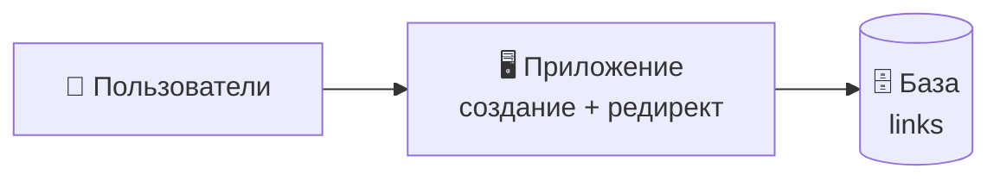
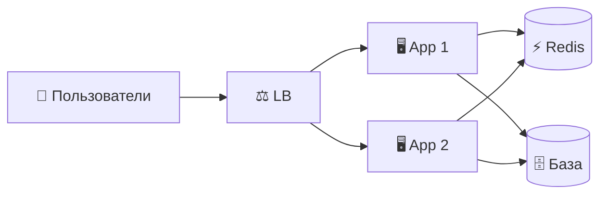
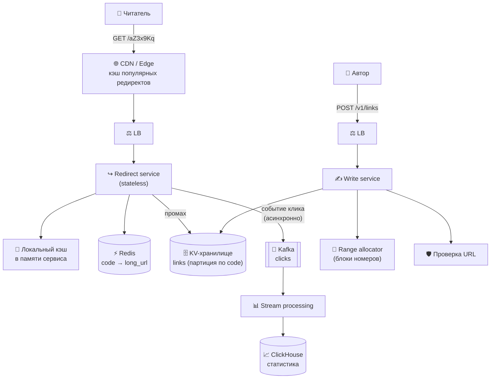
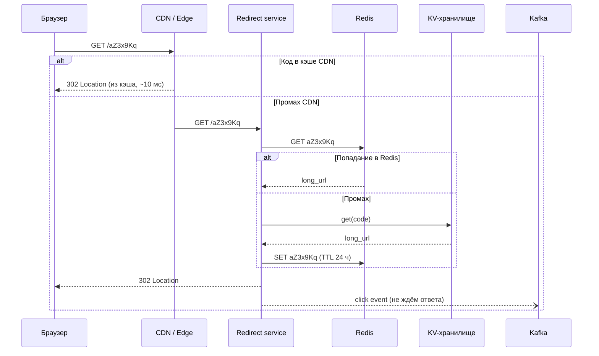
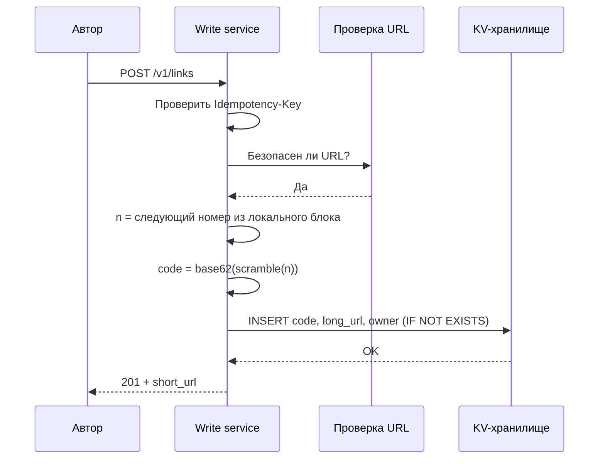
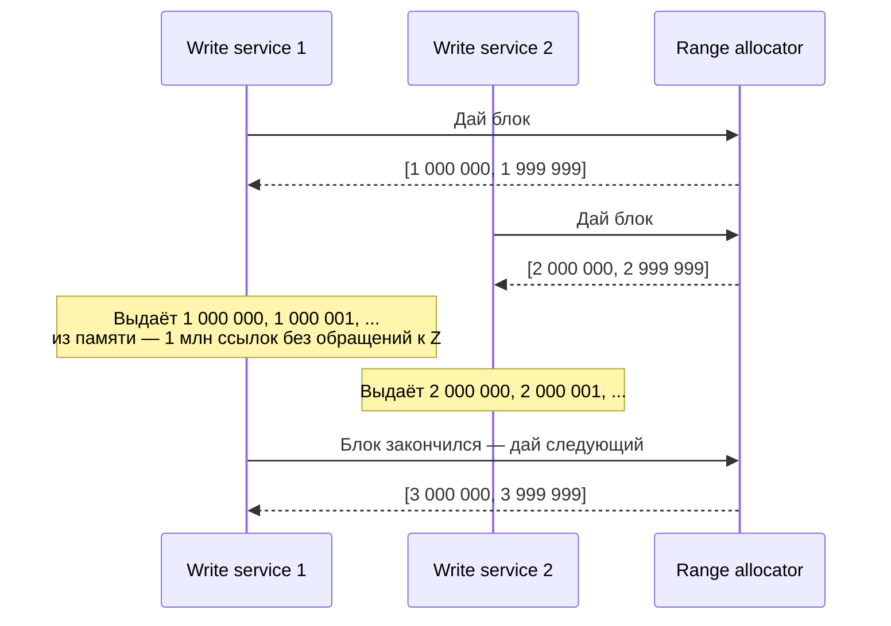
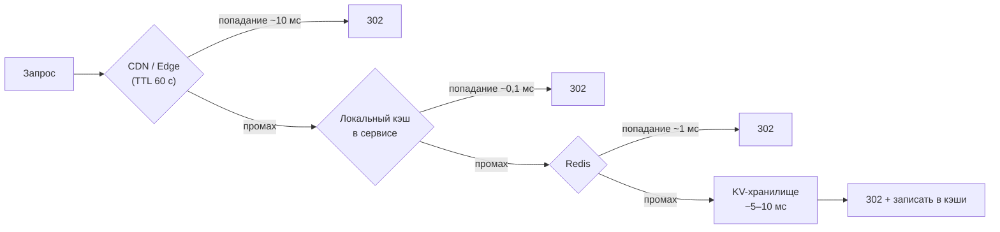
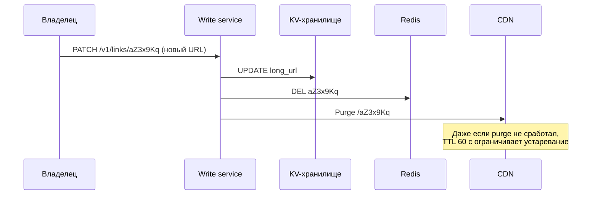
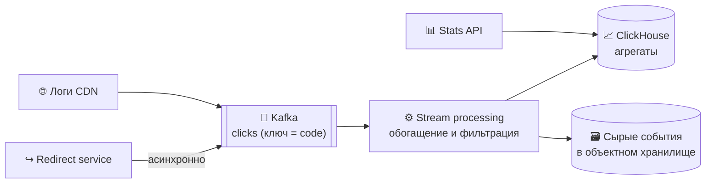
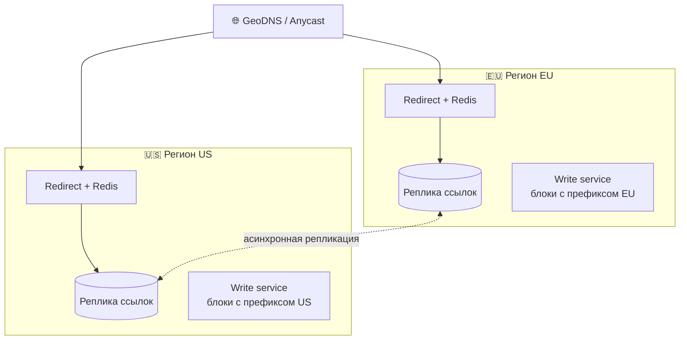

[English](README.md) | **Русский**

# Tier 1 · 01. URL Shortener (TinyURL, bit.ly)

> **Уровень:** Easy (но на Senior+ ждут глубины) · **Время на интервью:** 45 мин · **Время на разбор:** ~4 ч
> **Ключевые аспекты:** генерация коротких кодов (base62, счётчики, диапазоны, хэши), задержка редиректа, кэширование, аналитика кликов, защита от злоупотреблений
> **Опирается на:** [01-scaling-basics](../../01-scaling-basics/README_RU.md), [02-caching](../../02-caching/README_RU.md), [03-cdn](../../03-cdn/README_RU.md), [04-databases](../../04-databases/README_RU.md), [06-partitioning](../../06-partitioning/README_RU.md), [09-messaging](../../09-messaging/README_RU.md)

---

## 🗺️ Как читать этот разбор

Разбор построен как интервью, но в каждом шаге есть объяснения: **почему** принимается решение, **как работает** механизм и **что будет**, если сделать иначе. Блоки «📘 Объяснение» — теория прямо по ходу задачи; на интервью их пересказывают коротко, но понимать нужно полностью.

| Значок | Что значит |
|:------:|:-----------|
| 🎤 | Реплика интервьюера |
| 🗣️ | Что говорю вслух я (кандидат) |
| ✏️ | Что рисую на доске |
| ⏱️ | Сколько времени тратить на шаг |
| 📘 | Подробное объяснение концепции |

Блоки **TIP** — хороший приём, **WARNING** — ловушка, **IMPORTANT** — сигнал для уровня Senior+.

---

## 📑 Содержание

0. [Чему учит эта задача](#0-чему-учит-эта-задача)
1. [Условие задачи](#1-условие-задачи)
2. [Уточняющие вопросы и требования](#2-уточняющие-вопросы-и-требования)
3. [Оценки нагрузки](#3-оценки-нагрузки)
4. [API](#4-api)
5. [Модель данных и выбор хранилища](#5-модель-данных-и-выбор-хранилища)
6. [High-level дизайн: от простого к финальному](#6-high-level-дизайн-от-простого-к-финальному)
7. [Deep dive 1: генерация коротких кодов](#7-deep-dive-1-генерация-коротких-кодов)
8. [Deep dive 2: быстрый редирект и кэширование](#8-deep-dive-2-быстрый-редирект-и-кэширование)
9. [Deep dive 3: аналитика кликов](#9-deep-dive-3-аналитика-кликов)
10. [Deep dive 4: злоупотребления и безопасность](#10-deep-dive-4-злоупотребления-и-безопасность)
11. [Deep dive 5: несколько регионов](#11-deep-dive-5-несколько-регионов)
12. [Узкие места и сценарии сбоев](#12-узкие-места-и-сценарии-сбоев)
13. [Что изменится при росте в 10 раз](#13-что-изменится-при-росте-в-10-раз)
14. [Ключевые концепции и новые понятия](#14-ключевые-концепции-и-новые-понятия)
15. [Варианты задачи и follow-up вопросы](#15-варианты-задачи-и-follow-up-вопросы)
16. [Типичные ошибки](#16-типичные-ошибки)
17. [Шпаргалка и самопроверка](#17-шпаргалка-и-самопроверка)

---

## 0. Чему учит эта задача

URL shortener выглядит простым: «сохранить пару ключ → значение и отдать по ключу». Именно поэтому интервьюеры любят его как первую задачу — базовый дизайн рисуется за 10 минут, а дальше проверяется глубина:

| Что проверяют | Где это в задаче |
|:--------------|:-----------------|
| Умение считать и делать выводы из чисел | Длина кода, размер хранилища, read/write ratio |
| Генерация уникальных идентификаторов в распределённой системе | Как выдавать коды без коллизий и без единой точки отказа |
| Оптимизация read-heavy системы | Кэш, CDN, горячие ключи |
| Понимание HTTP | 301 vs 302, кэширование редиректов |
| Асинхронная обработка | Аналитика не должна тормозить редирект |
| Безопасность | Перебор кодов, фишинг |

> [!TIP]
> Базовый дизайн нужно нарисовать **быстро** (за 15 минут) и потратить основное время на deep dives: **генерация кодов**, **задержка редиректа** и **аналитика**. Именно там видна разница между Mid и Senior.

---

## 1. Условие задачи

> 🎤 «Спроектируй сервис сокращения ссылок вроде bit.ly: пользователь отправляет длинный URL и получает короткий, по которому все остальные попадают на исходную страницу».

**Как это работает с точки зрения пользователя:**

```
1. Автор отправляет:   https://shop.example.com/catalog/winter-sale?utm_source=newsletter&utm_campaign=dec
2. Получает:           https://sho.rt/aZ3x9Kq
3. Читатель открывает https://sho.rt/aZ3x9Kq → браузер получает ответ «иди туда» → попадает на исходную страницу
```

**План по времени:**

| Шаг | ⏱️ |
|:----|:--:|
| Требования | 4 мин |
| Оценки | 4 мин |
| API и модель данных | 6 мин |
| High-level дизайн | 6 мин |
| Deep dives | 20 мин |
| Сбои, масштаб, итоги | 5 мин |

---

## 2. Уточняющие вопросы и требования

⏱️ 4 мин

Каждый вопрос задаётся не «для галочки», а потому что ответ меняет дизайн:

| Мой вопрос | Ответ интервьюера | Что это меняет и почему |
|:-----------|:------------------|:------------------------|
| Сколько новых ссылок и переходов? | 100M новых ссылок в месяц, переходов в 100 раз больше | Система **read-heavy**: оптимизировать нужно путь чтения (редирект), запись — вторична |
| Нужны ли пользовательские алиасы (`bit.ly/my-sale`)? | Да, для платных аккаунтов | Нужна **проверка уникальности** произвольной строки — это отдельный путь записи |
| Срок жизни ссылок? | По умолчанию бессрочно, можно задать срок | Поле `expires_at`; при чтении — проверка; фоновая очистка |
| Нужна ли аналитика? | Да: число кликов, страны, источники, устройства | Каждый клик должен **доходить до сервера** (влияет на выбор 301/302) и записываться **асинхронно** |
| Можно ли изменить цель ссылки? | Да, для платных | Нельзя, чтобы браузеры кэшировали редирект навсегда |
| Одинаковый длинный URL — один и тот же короткий? | Не обязательно | Можно не искать дубликаты при создании — проще и быстрее |
| Какая задержка редиректа нужна? | p99 < 50 мс на сервере | Редирект почти всегда должен обслуживаться из кэша |

### Функциональные требования

1. Создать короткую ссылку для длинного URL (опционально — свой алиас и срок жизни).
2. Перенаправить по короткой ссылке на исходный URL.
3. Посмотреть статистику кликов по ссылке.
4. Удалить или изменить ссылку (для владельца).

**Вне рамок:** личный кабинет и биллинг, QR-коды, A/B-редиректы. Явно проговаривай, что не делаешь — это экономит время и показывает, что ты управляешь объёмом задачи.

### Нефункциональные требования

| Требование | Цель | Почему именно так |
|:-----------|:-----|:------------------|
| Задержка редиректа | p99 < 50 мс на сервере | Редирект — лишний шаг перед загрузкой страницы; каждая задержка ухудшает конверсию рекламы и рассылок |
| Доступность редиректа | 99,99% | Короткие ссылки напечатаны в письмах, рекламе, на упаковке — их нельзя «перевыпустить» |
| Долговечность | Созданная ссылка не теряется | Потерянная ссылка = навсегда битая ссылка в чужом контенте |
| Уникальность | Один код — одна ссылка | Коллизия отправит пользователя на чужой сайт — это и ошибка, и угроза безопасности |
| Непредсказуемость | Нельзя перебором получить чужие ссылки | Через короткие ссылки делятся приватными документами |
| Аналитика | Может отставать на минуты | Позволяет обрабатывать клики асинхронно и дёшево |

> [!NOTE]
> Обрати внимание на асимметрию: **редирект** требует максимальной доступности и скорости, **создание** может быть чуть медленнее, **аналитика** может отставать. Разные требования → разные пути в архитектуре.

---

## 3. Оценки нагрузки

⏱️ 4 мин

### Запросы в секунду

```
Запись:  100M ссылок в месяц
         1 месяц ≈ 30 дней × 86 400 с ≈ 2,6M секунд
         100M / 2,6M ≈ 40 созданий в секунду в среднем
         Пиковая нагрузка обычно в 5–10 раз выше средней → ~400/с

Чтение:  в 100 раз больше → ~4 000 редиректов/с в среднем, ~40 000/с в пике
```

### Объём хранения

```
За 5 лет: 100M × 12 × 5 = 6 миллиардов ссылок

Размер одной записи:
  code          ~8 Б
  long_url      ~200 Б в среднем (URL с utm-метками бывают длинными, до 2 КБ)
  owner_id      8 Б
  даты, флаги   ~20 Б
  накладные расходы хранилища (индексы, метаданные)  ~250 Б
  ─────────────────────────
  ≈ 500 Б

6B × 500 Б ≈ 3 ТБ (без учёта репликации; с тремя репликами ≈ 9 ТБ)
```

### Длина кода

📘 **Объяснение: base62**

Код составляется из символов, безопасных для URL: 10 цифр + 26 строчных + 26 прописных букв = **62 символа**. Каждая позиция кода — одна «цифра» в системе счисления с основанием 62. Значит, из **L** символов можно составить **62^L** разных кодов:

| Длина | Вариантов | Хватит на |
|:-----:|:----------|:----------|
| 5 | 62^5 ≈ 916 млн | Меньше года при нашей нагрузке |
| 6 | 62^6 ≈ 57 млрд | ~47 лет, но с малым запасом против перебора |
| **7** | **62^7 ≈ 3,5 трлн** | **В ~590 раз больше, чем нужно за 5 лет** |
| 8 | 62^8 ≈ 218 трлн | С огромным запасом |

> [!NOTE]
> **Почему не base64?** В base64 есть символы `+` и `/`, которые в URL имеют специальный смысл (`/` — разделитель пути, `+` иногда превращается в пробел). Есть URL-safe вариант (с `-` и `_`), но base62 из одних букв и цифр проще читать, диктовать и он не ломается в мессенджерах и почтовых клиентах.

🗣️ «Беру 7 символов: 3,5 триллиона вариантов дают огромный запас. Запас важен не только для роста, но и для **безопасности**: чем больше пространство кодов относительно числа реальных ссылок, тем меньше шанс случайно угадать существующий код».

### Аналитика

```
4 000 кликов/с × ~200 Б на событие (код, время, IP, User-Agent, referrer)
≈ 0,8 МБ/с ≈ 70 ГБ сырых событий в день
```

### Выводы из чисел

| Вывод | Следствие для дизайна |
|:------|:----------------------|
| Чтения в 100 раз больше записей | Отдельный быстрый путь для редиректа, агрессивное кэширование |
| 40 000 чтений/с в пике | Нужен кэш: база без кэша справилась бы, но с большим запасом железа и худшей задержкой |
| 3 ТБ за 5 лет | Не помещается в память одной машины, но легко в шардированное хранилище |
| Данные — пары «код → URL» | Модель key-value, сложные запросы не нужны |
| 70 ГБ событий в день | Аналитика — отдельная система, а не таблица рядом со ссылками |

---

## 4. API

⏱️ 3 мин

### Создание ссылки

```http
POST /v1/links
Authorization: Bearer <token>
Idempotency-Key: 9b2f7c1e-4d3a-4f6b-8c2d-1e5f7a9b3c4d
Content-Type: application/json

{
  "long_url": "https://shop.example.com/catalog/winter-sale?utm_source=newsletter",
  "alias": "winter-sale",          ← необязательно
  "expires_at": "2027-01-01T00:00:00Z"   ← необязательно
}
```

| Ответ | Когда |
|:------|:------|
| `201 Created` + `{ code, short_url, long_url, expires_at }` | Ссылка создана |
| `400 Bad Request` | URL невалиден или в чёрном списке (фишинг) |
| `409 Conflict` | Алиас уже занят |
| `429 Too Many Requests` | Превышен лимит создания |

📘 **Зачем `Idempotency-Key`.** Клиент отправил запрос, а ответ потерялся (таймаут). Он повторяет запрос. Без ключа сервер создаст **вторую** ссылку на тот же URL — у пользователя окажутся две разные короткие ссылки, и статистика разделится. С ключом сервер узнаёт повтор и возвращает уже созданную ссылку. Подробнее — в [10-idempotency](../../10-idempotency/README_RU.md).

### Редирект

```http
GET /aZ3x9Kq HTTP/1.1
Host: sho.rt

HTTP/1.1 302 Found
Location: https://shop.example.com/catalog/winter-sale?utm_source=newsletter
Cache-Control: private, max-age=0
```

| Ответ | Когда |
|:------|:------|
| `302 Found` + `Location` | Ссылка существует |
| `404 Not Found` | Кода нет или ссылка удалена |
| `410 Gone` | Ссылка истекла (отличаем от «никогда не было») |

🗣️ «Редирект — на корневом пути короткого домена, без `/v1/`: короткость — весь смысл сервиса. Поэтому для API используется отдельный путь (`/v1/...`) или даже отдельный домен (`api.sho.rt`)».

### Статистика и управление

```http
GET    /v1/links/{code}/stats?from=2026-11-01&to=2026-11-30&group_by=day,country
PATCH  /v1/links/{code}     { "long_url": "https://..." }
DELETE /v1/links/{code}
```

---

## 5. Модель данных и выбор хранилища

⏱️ 3 мин

### Схема

```sql
links
  code         VARCHAR(16)  PRIMARY KEY   -- сгенерированный код или пользовательский алиас
  long_url     TEXT         NOT NULL      -- куда перенаправлять
  owner_id     BIGINT                     -- кто создал (NULL для анонимных)
  created_at   TIMESTAMP    NOT NULL
  expires_at   TIMESTAMP    NULL          -- NULL = бессрочно
  is_deleted   BOOLEAN      DEFAULT false -- мягкое удаление
```

### Паттерны доступа

Выбор хранилища начинается с вопроса «какие запросы будут и как часто»:

| Запрос | Частота | Тип |
|:-------|:--------|:----|
| Найти `long_url` по `code` | ~40 000/с (редирект) | Точечное чтение по ключу |
| Вставить ссылку, если код свободен | ~400/с | Условная запись по ключу |
| Получить ссылки владельца | Редко (кабинет) | Чтение по вторичному ключу |

🗣️ «Главный запрос — чтение по одному ключу. Никаких JOIN, диапазонов, агрегаций. Это классический **key-value** паттерн».

### Варианты хранилища

| Хранилище | Плюсы | Минусы |
|:----------|:------|:-------|
| **DynamoDB / Cassandra** | Горизонтальное масштабирование из коробки; условная вставка (`IF NOT EXISTS` / condition expression) решает уникальность; TTL для истекающих ссылок | Запрос «ссылки владельца» — через отдельную таблицу или глобальный вторичный индекс |
| **PostgreSQL / MySQL** | Знакомо, ограничения уникальности, индекс по владельцу, транзакции | 3 ТБ и рост → понадобится шардирование (по хэшу `code`) |
| **Redis как основное хранилище** | Очень быстро | Данные в памяти дороги на 3 ТБ; долговечность хуже — подходит как кэш, не как источник правды |

🗣️ «Беру **key-value хранилище** (DynamoDB или Cassandra) с ключом партиции `code`. Для кабинета — отдельная таблица `links_by_owner (owner_id, created_at, code)`, которую заполняем при создании ссылки. PostgreSQL тоже рабочий вариант — главное, что ключ шардирования = `code`, и каждый редирект идёт ровно в один шард».

📘 **Почему ключ партиции — `code`.** Редирект знает только код. Если данные разложены по хэшу кода, сервис сразу знает, в каком шарде искать, — один сетевой запрос. Если бы шардирование было по `owner_id`, для редиректа пришлось бы спрашивать все шарды. Подробнее — в [06-partitioning](../../06-partitioning/README_RU.md).

---

## 6. High-level дизайн: от простого к финальному

⏱️ 6 мин

На интервью полезно показать **эволюцию**: начать с простейшего рабочего варианта и объяснить, что ломается при росте и как это чинится.

### Этап 0: один сервер и база



Работает для тысяч ссылок. Проблемы при нашей нагрузке: каждый редирект — запрос к базе; один сервер — точка отказа; аналитика (запись в базу на каждый клик) удвоит нагрузку на запись.

### Этап 1: кэш и горизонтальное масштабирование



Сервис без состояния за балансировщиком, кэш перед базой. Большинство редиректов обслуживаются из Redis. Остаётся проблема: как генерировать уникальные коды на нескольких серверах одновременно, и где хранить аналитику.

### Этап 2: финальный дизайн



### Путь редиректа по шагам



### Путь создания по шагам



🗣️ «Ключевая идея — **два независимых пути**. Редирект: 40 000/с, максимальная доступность, почти всегда из кэша. Создание: 400/с, можно чуть медленнее. Поэтому это разные сервисы с разным масштабированием: проблема или деплой в сервисе создания не затронет редиректы».

---

## 7. Deep dive 1: генерация коротких кодов

> 🎤 «Как генерировать коды, чтобы они были короткими, уникальными и не угадывались?»

Это главный deep dive задачи. Требования к коду противоречат друг другу:

| Требование | Что мешает |
|:-----------|:-----------|
| **Короткий** (7 символов) | Мало места для «случайности» |
| **Уникальный** | Нужна координация между серверами |
| **Не угадывается** | Последовательные номера легко перебрать |
| **Без единой точки отказа** | Координация обычно и есть точка отказа |

### 📘 Объяснение: как работает кодирование base62

Код — это просто **число**, записанное в системе счисления с основанием 62. Алфавит: `0–9` (значения 0–9), `a–z` (10–35), `A–Z` (36–61).

Перевод числа в base62 — последовательное деление на 62 с запоминанием остатков (как перевод в двоичную систему, только основание другое):

```
Число 5 000 000 042:

5 000 000 042 ÷ 62 = 80 645 161, остаток 60 → 'Y'
   80 645 161 ÷ 62 =  1 300 728, остаток 25 → 'p'
    1 300 728 ÷ 62 =     20 979, остаток 30 → 'u'
       20 979 ÷ 62 =        338, остаток 23 → 'n'
          338 ÷ 62 =          5, остаток 28 → 's'
            5 ÷ 62 =          0, остаток  5 → '5'

Читаем остатки снизу вверх: "5snupY"
```

```python
ALPHABET = "0123456789abcdefghijklmnopqrstuvwxyzABCDEFGHIJKLMNOPQRSTUVWXYZ"

def to_base62(n: int, length: int = 7) -> str:
    chars = []
    while n > 0:
        n, remainder = divmod(n, 62)
        chars.append(ALPHABET[remainder])
    return "".join(reversed(chars)).rjust(length, "0")   # дополняем нулями до 7 символов
```

Значит, задача «сгенерировать уникальный код» сводится к задаче «**получить уникальное число**». Дальше разберём, как его получить.

### Вариант 1: хэш от URL

```
code = base62(md5(long_url))[:7]
```

| ✅ Плюсы | ❌ Минусы |
|:--------|:---------|
| Не нужна координация между серверами | **Коллизии**: разные URL могут дать одинаковые первые 7 символов |
| Одинаковый URL → одинаковый код (бесплатная дедупликация) | При коллизии нужно проверять и повторять с «солью» |

📘 **Объяснение: парадокс дней рождения и коллизии**

В группе из 23 человек вероятность, что у двоих совпадает день рождения, — больше 50%, хотя дней в году 365. Причина: сравниваются **все пары**, а пар растёт квадратично.

То же с кодами. Если выбирать коды случайно (а хэш ведёт себя как случайный), ожидаемое число совпадений среди **k** кодов в пространстве **N**:

```
коллизий ≈ k² / (2N)

k = 6 млрд ссылок, N = 62^7 ≈ 3,5 трлн
коллизий ≈ (6×10⁹)² / (2 × 3,5×10¹²) ≈ 5 миллионов
```

И на каждую новую вставку, когда в базе уже 6B ссылок, вероятность попасть в занятый код ≈ 6B / 3,5T ≈ **0,17%** — то есть примерно каждая 600-я вставка. Значит, **проверка уникальности обязательна**, иначе новая ссылка перезапишет чужую.

### Вариант 2: случайный код

```
code = 7 случайных символов base62
INSERT ... IF NOT EXISTS → если занят, сгенерировать заново
```

Те же коллизии, что у хэша, но без бонуса дедупликации. Работает, если хранилище поддерживает **условную вставку** (атомарную проверку «код свободен»): при коллизии — повтор. При 0,17% коллизий повторы редки, но каждая вставка теперь требует условной записи, а в распределённой базе с несколькими регионами атомарная проверка уникальности дорогая.

### Вариант 3: один глобальный счётчик

```
n = global_counter.increment()
code = base62(n)
```

| ✅ Плюсы | ❌ Минусы |
|:--------|:---------|
| Никаких коллизий: каждое число выдаётся один раз | Один счётчик — **узкое место** и **точка отказа**: упал — создание ссылок встало |
| Просто | Коды **последовательны**: `0000001`, `0000002`… — по одному коду легко найти все остальные |

### Вариант 4: диапазоны (блоки) номеров ⭐

Идея: не обращаться к счётчику за **каждым** номером, а брать сразу **блок** номеров и раздавать их из памяти.



**Как устроен координатор (range allocator).** Это просто атомарный счётчик блоков:

```sql
-- Вариант на SQL: одна строка, атомарное обновление
UPDATE id_blocks SET next_block = next_block + 1 WHERE name = 'links'
RETURNING next_block - 1 AS my_block;
-- блок № my_block = номера [my_block × 1 000 000, (my_block + 1) × 1 000 000 − 1]
```

Или ключ в etcd/ZooKeeper с compare-and-swap. Нагрузка на координатор ничтожна: при 400 созданиях в секунду и блоке в 1 млн номеров каждый сервер обращается к нему раз в несколько часов.

| Вопрос | Ответ |
|:-------|:------|
| Что если сервер упал с недоиспользованным блоком? | Оставшиеся номера теряются. Из 3,5 трлн — несущественно. Главное, координатор **никогда не выдаст тот же блок повторно** |
| Что если координатор недоступен? | Серверы продолжают раздавать номера из текущего блока (часы работы). Координатор реплицирован (etcd или база с репликами) |
| Какой размер блока? | Компромисс: больше блок — реже обращения к координатору, но больше потерь при падениях. 100K–1M — разумно |
| Как с несколькими регионами? | Каждому региону свой диапазон блоков (например, по чётности или по префиксу) — без межрегиональной координации |

| ✅ Плюсы | ❌ Минусы |
|:--------|:---------|
| Никаких коллизий по построению | Номера последовательны внутри блока → нужна **обфускация** |
| Нет обращения к координатору на каждую вставку | Небольшие «дыры» в нумерации при падениях (не важно) |
| Координатор не на критическом пути | Ещё один компонент (но простой) |

### Вариант 5: Snowflake ID

64-битный ID из времени, номера машины и локального счётчика (см. Tier 1 #4 «Unique ID Generator»). Не требует координации, но 64-битное число в base62 — это **11 символов**. Для сокращателя ссылок это слишком длинно.

### Сравнение

| Подход | Коллизии | Координация | Угадывается | Длина | Вердикт |
|:-------|:--------:|:-----------:|:-----------:|:-----:|:-------:|
| Хэш URL | Да, проверять | Нет | Нет | 7 | ⚠️ |
| Случайный код | Да, проверять | Нет | Нет | 7 | ⚠️ |
| Глобальный счётчик | Нет | На каждую вставку | **Да** | 7 | ❌ |
| **Диапазоны + обфускация** | **Нет** | **Редко** | **Нет** | **7** | ✅ |
| Snowflake | Нет | Нет | Частично | 11 | ❌ |

### 📘 Объяснение: обфускация номеров

Проблема диапазонов: номера идут подряд, и коды тоже получаются «соседними». Зная один код, злоумышленник перебирает соседние и находит чужие ссылки (в том числе на приватные документы, личные фото, внутренние отчёты).

Решение — перед кодированием **перемешать** номер функцией, которая:
1. **биективна** — разные номера всегда дают разные результаты (иначе появятся коллизии);
2. делает соседние номера **непохожими**;
3. зависит от **секретного ключа** — без него нельзя вычислить следующий код.

**Наивный способ — умножение на большое число по модулю 62^7:**

```
scramble(n) = (n × P) mod 62^7,   где P взаимно просто с 62^7

5 000 000 042 → "jgr26hg"
5 000 000 043 → "jhwHZXD"
5 000 000 044 → "jiCnTE0"
```

Биективно, но видно: первые символы почти одинаковые (`jg…`, `jh…`, `ji…`) — порядок частично угадывается. Этого **недостаточно**.

**Правильный способ — сеть Фейстеля (простой блочный шифр):**

```python
import hashlib

KEY = b"secret-key"             # хранится в секретах, не в коде
M = 62 ** 7                     # размер пространства кодов
HALF = 21                       # 42 бита = две половины по 21 биту; 2^42 ≈ 4,4 трлн > 62^7

def round_fn(x: int, i: int) -> int:
    digest = hashlib.sha256(KEY + bytes([i]) + x.to_bytes(3, "big")).digest()
    return int.from_bytes(digest[:3], "big") & ((1 << HALF) - 1)

def feistel(n: int) -> int:
    left, right = n >> HALF, n & ((1 << HALF) - 1)
    for i in range(4):                        # 4 раунда перемешивания
        left, right = right, left ^ round_fn(right, i)
    return (left << HALF) | right

def scramble(n: int) -> int:
    x = feistel(n)
    while x >= M:                             # «cycle walking»: остаёмся внутри 62^7
        x = feistel(x)
    return x

# 5 000 000 042 → "I8yVgQn"
# 5 000 000 043 → "IvGlljx"
# 5 000 000 044 → "2pLSzSd"
```

Почему это работает:
- **Сеть Фейстеля всегда биективна** — каждый раунд обратим (XOR можно отменить тем же XOR), независимо от того, какая функция внутри.
- **Cycle walking**: Фейстель перемешивает 42-битное пространство (4,4 трлн), а нам нужно 3,5 трлн. Если результат выпал за пределы, применяем Фейстеля ещё раз — пока не попадём внутрь. Перестановка на большем множестве, ограниченная на меньшее таким способом, остаётся перестановкой.
- **Без ключа** соседние коды выглядят случайными.

> [!IMPORTANT]
> **Сигнал Senior+:** показать, что понимаешь, **почему** нужна обфускация (перебор приватных ссылок), и что она должна быть **биективной** (иначе вернутся коллизии). Умножение по модулю — слабая защита; блочный шифр с ключом (Фейстель) — правильная.

### Пользовательские алиасы

Алиас (`sho.rt/winter-sale`) задаёт человек, поэтому его нельзя получить из счётчика:

| Правило | Почему |
|:--------|:-------|
| **Условная вставка** `INSERT IF NOT EXISTS` → `409`, если занят | Два пользователя одновременно хотят один алиас — побеждает первый, атомарно |
| Алиасы не пересекаются со сгенерированными кодами | Например, сгенерированные коды ровно 7 символов из base62, а алиасы — от 4 до 30 символов с дефисами; или одна таблица и проверка уникальности для всех |
| Зарезервированные слова | `api`, `admin`, `login`, `help` — чтобы алиасы не перекрывали служебные пути |
| Фильтр нежелательных слов | Оскорбления, имена брендов (защита от фишинга вроде `sho.rt/paypal-login`) |

---

## 8. Deep dive 2: быстрый редирект и кэширование

> 🎤 «40 000 редиректов в секунду и p99 < 50 мс. Как?»

### 📘 Объяснение: как работает HTTP-редирект

Когда браузер получает ответ с кодом `3xx` и заголовком `Location`, он автоматически делает новый запрос по указанному адресу. Пользователь видит только итоговую страницу. Разные коды `3xx` отличаются тем, **как долго браузер помнит** редирект и **сохраняет ли метод** запроса:

| Код | Название | Кэшируется браузером | Метод запроса при переходе |
|:---:|:---------|:---------------------|:---------------------------|
| 301 | Moved Permanently | **Навсегда** (пока не очищен кэш) | Может смениться на GET |
| 302 | Found | Нет (по умолчанию) | Может смениться на GET |
| 307 | Temporary Redirect | Нет | Сохраняется |
| 308 | Permanent Redirect | Навсегда | Сохраняется |

Для коротких ссылок метод всегда GET, поэтому реальный выбор — между **301** (постоянный) и **302** (временный).

### 301 или 302

| | 301 | 302 |
|:-|:----|:----|
| Повторный клик того же пользователя | Не доходит до нас: браузер сразу идёт по сохранённому адресу | Доходит до нас каждый раз |
| Нагрузка на сервис | Меньше | Больше |
| Аналитика | **Теряется** для повторных кликов | Полная |
| Изменить цель ссылки | **Невозможно** для тех, кто уже кликал | Сразу для всех |
| Удалить ссылку (фишинг) | Браузеры продолжат перенаправлять | Работает сразу |

🗣️ «Беру **302**: требования включают аналитику, изменение цели и возможность заблокировать вредоносную ссылку. 301 сэкономил бы запросы, но лишил бы нас контроля над ссылкой навсегда. Нагрузку снимаем кэшем на своей стороне».

> [!WARNING]
> К 302 обязательно добавь **`Cache-Control: private, max-age=0`** (или короткий `max-age`). Без явного заголовка некоторые прокси и браузеры кэшируют ответ по своим эвристикам, и ссылка «залипает».

### Слои кэша



| Слой | Что хранит | Зачем |
|:-----|:-----------|:------|
| **CDN / edge** | Ответ редиректа для популярных кодов, TTL ~60 с | Вирусные ссылки обслуживаются в ближайшей к пользователю точке, не доходя до наших серверов. Клик всё равно учитывается: логи CDN отправляются в аналитику |
| **Локальный кэш (в памяти сервиса)** | Несколько тысяч самых горячих кодов, LRU | Защищает Redis от **горячих ключей**: одна вирусная ссылка = миллионы запросов к одному ключу Redis |
| **Redis** | `code → long_url` для активных ссылок | Основной кэш, ~1 мс |
| **KV-хранилище** | Все ссылки | Источник правды, только при промахах |

📘 **Почему короткий TTL на CDN.** Ссылку могут изменить или заблокировать. Чем дольше CDN хранит ответ, тем дольше после блокировки фишинговая ссылка продолжит работать. 60 секунд — компромисс: вирусная ссылка с 10 000 кликов в секунду обслуживается из CDN, а изменения расходятся за минуту (плюс можно явно сделать purge).

### Размер кэша

📘 **Объяснение: скошенное распределение кликов**

Клики распределены крайне неравномерно (распределение, близкое к закону Ципфа): небольшая доля ссылок получает основную массу переходов — свежие ссылки из рассылок, вирусные посты. Большинство старых ссылок не кликают годами. Поэтому кэшировать все 6 млрд ссылок не нужно.

```
Чтений в день ≈ 4 000/с × 86 400 ≈ 350M
Активных ссылок за последние сутки — порядка десятков миллионов

Кэшируем ~20M самых активных:
  20M × 500 Б ≈ 10 ГБ  — помещается в небольшой кластер Redis (с репликами — 20–30 ГБ)

Ожидаемый hit rate: > 95% — подавляющее большинство редиректов не доходит до базы
```

### Несуществующие коды

🗣️ «Отдельная проблема — **боты, перебирающие коды**. Они запрашивают случайные коды, которых нет. Каждый такой запрос — промах во всех кэшах и поход в базу. Тысячи таких запросов в секунду могут перегрузить базу. Защита в три слоя».

**1. Негативное кэширование.** Запомнить в Redis «кода `xYz1234` нет» на несколько минут. Повторный запрос того же кода — сразу 404.

**2. Bloom filter.**

📘 **Объяснение: как работает Bloom filter**

Bloom filter — компактная вероятностная структура, которая отвечает на вопрос «есть ли элемент в множестве?» одним из двух ответов: **«точно нет»** или **«возможно, есть»**.

```
Битовый массив из m бит, изначально все нули. k хэш-функций.

Добавить код "aZ3x9Kq":
  h1("aZ3x9Kq") = 17   → бит 17 = 1
  h2("aZ3x9Kq") = 803  → бит 803 = 1
  h3("aZ3x9Kq") = 4021 → бит 4021 = 1

Проверить код "qQ1wE2r":
  h1 = 17 (1), h2 = 950 (0!) → хотя бы один бит 0 → «точно нет» → сразу 404
Проверить код "aZ3x9Kq":
  все биты 1 → «возможно, есть» → идём в кэш и базу
```

Ложные срабатывания («возможно, есть» для отсутствующего кода) бывают — тогда просто идём в базу. Ложных отрицаний не бывает никогда.

```
Размер для n = 6 млрд кодов и 1% ложных срабатываний:
  m = −n × ln(p) / (ln 2)² ≈ 9,6 бит на элемент → ~7,2 ГБ, 7 хэш-функций
```

7 ГБ — это немало для каждого инстанса, поэтому Bloom filter держат в общем Redis-кластере (модуль RedisBloom) или на выделенных узлах; при меньшем числе ссылок он помещается прямо в память сервиса. Новые коды добавляются в фильтр при создании; удалённые из Bloom filter не удаляются (это его ограничение) — для них работает обычная проверка в базе.

**3. Rate limiting** по IP на ответы 404: нормальный пользователь почти никогда не получает много 404 подряд.

### Инвалидация кэша при изменении ссылки



Локальные кэши в сервисах живут несколько секунд или подписаны на события инвалидации — устаревание на секунды допустимо. Истёкшие ссылки проверяются по `expires_at` **при каждом чтении**, даже из кэша, и получают `410 Gone`.

---

## 9. Deep dive 3: аналитика кликов

> 🎤 «Как собирать статистику, не замедляя редирект?»

### Почему асинхронно

Если записывать клик в базу **до** ответа пользователю:
- задержка редиректа = задержка записи (а запись медленнее чтения из кэша);
- при недоступности базы аналитики **ломаются редиректы** — второстепенная функция кладёт главную;
- 40 000 записей в секунду в пике — серьёзная нагрузка.

Поэтому сервис отправляет событие в очередь **и не ждёт** (fire-and-forget), а отвечает пользователю сразу.



### Событие клика

```json
{
  "event_id": "c_8f3a…",
  "code": "aZ3x9Kq",
  "ts": "2026-11-30T14:05:12.341Z",
  "ip": "203.0.113.42",
  "user_agent": "Mozilla/5.0 (iPhone; …)",
  "referrer": "https://news.example.com/…",
  "edge_pop": "WAW"
}
```

### Этапы обработки

| Этап | Что делает | Зачем |
|:-----|:-----------|:------|
| **Сбор** | Сервис кладёт событие в локальный буфер и отправляет пачками в Kafka | Отправка не задерживает ответ; пачки экономят ресурсы |
| **Kafka (ключ = code)** | Хранит поток событий | Буфер на случай отставания обработки; события одной ссылки в одной партиции |
| **Обогащение** | IP → страна и город (GeoIP), User-Agent → устройство и браузер | Сырые данные превращаются в измерения для отчётов |
| **Фильтрация ботов** | Известные боты, превью ссылок в мессенджерах, подозрительные паттерны | Мессенджеры при отправке ссылки сами открывают её для превью — это не клики людей |
| **Агрегация** | Счётчики по (код, минута, страна, устройство) | Отчёты читают агрегаты, а не миллиарды сырых событий |
| **Хранение** | Агрегаты — в колоночной БД (ClickHouse, Druid); сырые события — в объектном хранилище | Быстрые отчёты + возможность пересчитать историю |

📘 **Почему колоночная БД.** Запрос «клики по дням и странам за месяц» читает всего несколько колонок, но миллионы строк. Колоночное хранилище читает с диска только нужные колонки и хорошо их сжимает — такие запросы выполняются в десятки раз быстрее, чем в строковой базе.

### Уникальные посетители

📘 **Объяснение: HyperLogLog**

Чтобы посчитать **уникальных** посетителей точно, нужно хранить множество всех их идентификаторов — для популярной ссылки это миллионы записей. **HyperLogLog** оценивает число уникальных элементов, храня всего несколько килобайт:

- каждый идентификатор посетителя хэшируется;
- в хэше смотрится, сколько ведущих нулей в двоичной записи. Хэш, начинающийся с 10 нулей, встречается примерно один раз на 2^10 = 1 024 разных значения;
- если максимум ведущих нулей среди всех хэшей — 20, то разных элементов было порядка 2^20 ≈ миллион;
- для точности хэши раскладываются по многим «корзинам» и оценки усредняются.

Итог — ~12 КБ на ссылку с погрешностью около 1%, и такие структуры можно **объединять** (уникальные за неделю = объединение семи дневных). Redis поддерживает HyperLogLog (`PFADD`, `PFCOUNT`), ClickHouse — функцию `uniq`.

### Горячие ссылки

Вирусная ссылка = все её события в **одной партиции** Kafka (ключ = code) → горячая партиция. Решение — **локальная предагрегация**: сервис раз в секунду отправляет «код X: +350 кликов, из них 200 из PL, 150 из DE», а детальные события для такой ссылки семплирует.

🗣️ «Точность — at-least-once: возможны небольшие расхождения из-за повторов, и для статистики это нормально. Если бы по кликам выставлялись счета (реклама), понадобились бы дедупликация по `event_id` и сверка с сырыми данными — это отдельная задача Tier 1 «Ad Click Aggregator»».

---

## 10. Deep dive 4: злоупотребления и безопасность

> 🎤 «Сокращатели ссылок любят спамеры и фишеры. Что делать?»

📘 **Почему это важно.** Короткая ссылка **скрывает** настоящий адрес: пользователь видит `sho.rt/aZ3x9Kq`, а не `paypa1-login.example`. Поэтому фишеры используют сокращатели, чтобы обойти фильтры почты и доверие пользователей. Если сервис не борется с этим, его домен попадает в чёрные списки почтовых и антивирусных систем — и перестают работать **все** ссылки, включая легитимные.

| Угроза | Как проявляется | Защита |
|:-------|:----------------|:-------|
| **Фишинг и вредоносные сайты** | Ссылка ведёт на поддельную страницу входа или загрузку вируса | Проверка URL при создании (Google Safe Browsing и аналоги, собственные чёрные списки); **периодическая перепроверка** — сайт может стать вредоносным после создания ссылки; блокировка со страницей-предупреждением |
| **Массовое создание спама** | Боты создают миллионы ссылок для рассылок | Rate limiting по аккаунту и IP, CAPTCHA для анонимных, лимиты бесплатного тарифа |
| **Перебор кодов** | Поиск приватных ссылок | Обфускация, большое пространство кодов, rate limiting на 404, Bloom filter |
| **Цепочки редиректов** | Короткая ссылка на другую короткую ссылку — скрытие цели и циклы | Запрет сокращать собственный домен и известные сокращатели |
| **Жалобы и удаление** | Пользователь сообщает о вредоносной ссылке | Флаг `is_deleted`, удаление из Redis, purge CDN — блокировка работает за секунды (вот зачем 302) |
| **Приватный контент** | Ссылки на личные документы | Для чувствительных ссылок — длиннее код (10–12 символов) и опционально пароль |

---

## 11. Deep dive 5: несколько регионов

> 🎤 «Пользователи по всему миру. Как сделать редирект быстрым везде?»

📘 **Почему это нужно.** Задержка сети между континентами — 100–200 мс туда-обратно. Если сервис только в США, редирект для пользователя из Азии займёт 200+ мс ещё до загрузки целевой страницы. Поэтому путь чтения разворачивают в нескольких регионах.



| Вопрос | Решение | Почему |
|:-------|:--------|:-------|
| Как направить пользователя в ближайший регион | GeoDNS или Anycast | См. [01-scaling-basics](../../01-scaling-basics/README_RU.md) |
| Где создавать ссылки | В любом регионе | Каждому региону **свой набор блоков номеров** — коллизий нет без межрегиональной координации |
| Как данные попадают в другие регионы | Асинхронная репликация (DynamoDB Global Tables, Cassandra multi-DC) | Синхронная между континентами добавила бы 100+ мс к созданию |
| Ссылку создали в EU и сразу открыли в US, реплика не успела | Fallback: при промахе в локальной реплике запросить регион-владелец | Регион-владелец определяется по номеру блока, «зашитому» в номер |
| Пользовательские алиасы | Записываются в один «домашний» регион или через консенсусное хранилище | Уникальность строки, выбранной человеком, требует глобальной координации; операция редкая, задержка допустима |

> [!NOTE]
> Здесь хорошо видна идея из [07-consistency-models](../../07-consistency-models/README_RU.md): для **уникальности** нужна строгая координация (диапазоны, консенсус для алиасов), а для **чтения** достаточно eventual consistency с fallback.

---

## 12. Узкие места и сценарии сбоев

| Сценарий | Что произойдёт | Как защищаемся |
|:---------|:---------------|:---------------|
| Redis упал | Все чтения идут в базу | Локальный кэш смягчает удар; реплики Redis с автоматическим failover; база рассчитана с запасом на временную нагрузку |
| Вирусная ссылка (миллион кликов в минуту) | Горячий ключ в Redis, горячая партиция в Kafka | CDN-кэш, локальный кэш, локальная предагрегация кликов |
| Range allocator недоступен | Нельзя получить новый блок номеров | У каждого сервера запас на часы; координатор реплицирован |
| Kafka недоступна | События кликов не отправляются | Локальный буфер; редиректы продолжают работать; часть статистики может потеряться — это допустимо по требованиям |
| Боты перебирают коды | Нагрузка на базу промахами | Bloom filter, негативный кэш, rate limiting |
| Ссылка создана, реплика ещё не получила | 404 в другом регионе | Fallback в регион-владелец |
| Вредоносная цель обнаружена позже | Пользователи попадают на фишинг | Периодическая перепроверка, блокировка, удаление из кэшей и purge CDN |
| База недоступна в регионе | Промахи кэша не обслуживаются | Кэш обслуживает большинство запросов; переключение на другой регион |

---

## 13. Что изменится при росте в 10 раз

> 🎤 «Миллиард ссылок в месяц и 400 000 редиректов в секунду?»

| Изменение | Почему |
|:----------|:-------|
| **8 символов в коде** для новых ссылок | 60B ссылок за 5 лет ещё помещаются в 3,5T, но запас против перебора уменьшается в 10 раз |
| **Редирект прямо на edge** (edge compute + KV на edge) | Популярные ссылки обслуживаются в сотнях точек присутствия без похода к нашим серверам |
| **Шардирование Redis и базы** | По `code`, линейно — ключ партиции уже правильный |
| **Предагрегация кликов на edge** | Не гонять сотни тысяч сырых событий в секунду через центр |
| **Холодные ссылки в дешёвое хранилище** | Ссылки без кликов за годы — в архив с подгрузкой по запросу |

---

## 14. Ключевые концепции и новые понятия

### Что из Fundamentals применяется

| Концепция | Где разобрана | Как применяется здесь |
|:----------|:--------------|:----------------------|
| Stateless-сервисы и балансировка | [01-scaling-basics](../../01-scaling-basics/README_RU.md) | Redirect и write service масштабируются горизонтально |
| Cache-aside, негативное кэширование, горячие ключи | [02-caching](../../02-caching/README_RU.md) | Redis, локальный кэш, кэш «кода нет» |
| CDN и edge | [03-cdn](../../03-cdn/README_RU.md) | Популярные редиректы на edge |
| Key-value модель, условная вставка | [04-databases](../../04-databases/README_RU.md) | Таблица `links`, уникальность алиасов |
| Партиционирование по ключу | [06-partitioning](../../06-partitioning/README_RU.md) | Ключ = `code`, редирект в один шард |
| Модели консистентности | [07-consistency-models](../../07-consistency-models/README_RU.md) | Строго — уникальность; eventual — чтение |
| Асинхронные события | [09-messaging](../../09-messaging/README_RU.md) | Клики через Kafka |
| Идемпотентность | [10-idempotency](../../10-idempotency/README_RU.md) | `Idempotency-Key` при создании |
| Rate limiting | [13-reliability-patterns](../../13-reliability-patterns/README_RU.md#6-rate-limiting) | Защита от спама и перебора |

### Новые понятия этой задачи

| Понятие | Кратко |
|:--------|:-------|
| **Base62** | Запись числа символами `0–9a–zA–Z`; 7 символов = 3,5 трлн вариантов |
| **Парадокс дней рождения** | Коллизии случайных кодов появляются намного раньше, чем заполнится пространство: ≈ k² / (2N) |
| **Диапазоны номеров** | Серверы берут блоки номеров у координатора и раздают их локально — уникальность без координации на каждую запись |
| **Биективная обфускация** | Перестановка номеров (сеть Фейстеля с ключом), скрывающая порядок без коллизий |
| **301 vs 302** | Постоянный (кэшируется навсегда) vs временный (каждый клик доходит до сервера) |
| **Bloom filter** | «Точно нет / возможно есть» в нескольких битах на элемент; отсекает несуществующие коды |
| **HyperLogLog** | Оценка числа уникальных элементов в килобайтах памяти |

---

## 15. Варианты задачи и follow-up вопросы

<details>
<summary><b>Как сделать, чтобы один и тот же длинный URL давал один и тот же короткий?</b></summary>

Таблица `url_hash → code` с нормализацией URL перед хэшированием (нижний регистр домена, сортировка параметров, удаление фрагмента `#…`). При создании сначала поиск по хэшу; если найден — вернуть существующий код. Но у разных пользователей обычно должны быть разные ссылки (у каждого своя статистика, права на изменение и удаление), поэтому дедупликацию делают в пределах одного владельца.
</details>

<details>
<summary><b>Почему не использовать автоинкремент базы?</b></summary>

Один автоинкремент — узкое место и точка отказа на запись, он плохо работает при шардировании (каждый шард считает сам → дубликаты) и в нескольких регионах. Диапазоны номеров дают ту же уникальность без обращения к координатору на каждую вставку. К тому же автоинкремент даёт последовательные, легко угадываемые коды.
</details>

<details>
<summary><b>Что если сервер упадёт с недовыданным блоком номеров?</b></summary>

Оставшиеся номера блока просто теряются — в пространстве 3,5 трлн это несущественно. Главное, что координатор никогда не выдаст тот же блок повторно (атомарный инкремент в etcd или в строке базы).
</details>

<details>
<summary><b>Как удалять истёкшие ссылки?</b></summary>

При чтении проверять `expires_at` и отвечать `410 Gone`. Физическое удаление — фоновой задачей или встроенным TTL хранилища (DynamoDB TTL, Cassandra TTL). Код истёкшей ссылки лучше **не переиспользовать**: старые упоминания ссылки в письмах и статьях вели бы на чужой контент.
</details>

<details>
<summary><b>Как посчитать уникальных посетителей ссылки?</b></summary>

HyperLogLog по идентификатору посетителя (хэш IP + User-Agent или cookie): ~12 КБ на ссылку с погрешностью около 1% вместо хранения всех идентификаторов. Структуры за разные периоды объединяются.
</details>

<details>
<summary><b>Нужна ли сильная консистентность?</b></summary>

Для уникальности кодов — да: диапазоны номеров и условная вставка алиасов. Для редиректа достаточно eventual: ссылка, созданная секунду назад, может быть недоступна в другом регионе — для этого есть fallback в регион-владелец. Статистика может отставать на минуты.
</details>

<details>
<summary><b>Почему не хранить всё в Redis?</b></summary>

3 ТБ в оперативной памяти (с репликами ~9 ТБ) намного дороже, чем на дисках, а долговечность Redis слабее, чем у базы данных. Redis отлично подходит как кэш для горячих ~20M ссылок, но источником правды должна быть надёжная база.
</details>

---

## 16. Типичные ошибки

| ❌ Ошибка | Почему плохо | ✅ Как правильно |
|:---------|:-------------|:----------------|
| Хэш URL без обработки коллизий | Новые ссылки перезаписывают старые (~0,17% вставок) | Диапазоны номеров или проверка уникальности при вставке |
| Последовательные коды без обфускации | Перебором находятся приватные ссылки | Биективное перемешивание с ключом |
| Один глобальный счётчик | Узкое место и точка отказа | Блоки номеров на сервер |
| Snowflake как код | 11 символов — не «короткая» ссылка | Диапазоны дают 7 символов |
| 301 при требовании аналитики | Повторные клики не видны, ссылку нельзя изменить или заблокировать | 302 + кэш на своей стороне |
| Синхронная запись аналитики | Медленные редиректы; сбой аналитики ломает редиректы | Асинхронно через Kafka |
| Нет защиты от перебора | Нагрузка на базу, утечка приватных ссылок | Bloom filter, негативный кэш, rate limiting |
| Нет проверки URL | Домен попадает в чёрные списки | Проверка при создании и периодически |
| Переиспользование истёкших кодов | Старые ссылки ведут на чужой контент | Коды не переиспользуются |

---

## 17. Шпаргалка и самопроверка

### Ответ за 30 секунд

> Read-heavy: 40 000 редиректов и 400 созданий в секунду, 6B ссылок и 3 ТБ за 5 лет. Коды — 7 символов base62 (3,5 трлн вариантов) из диапазонов номеров, которые серверы получают блоками у координатора; перед кодированием номер перемешивается сетью Фейстеля с ключом, чтобы коды нельзя было перебрать; алиасы — условной вставкой. Хранилище — key-value с партиционированием по коду. Редирект — 302 ради аналитики, изменяемости и блокировки; CDN для горячих ссылок, локальный кэш и Redis; несуществующие коды отсекают Bloom filter и негативный кэш. Клики — асинхронно в Kafka → обогащение → ClickHouse, уникальные — HyperLogLog. Безопасность — проверка URL, rate limiting. Мульти-регион — блоки номеров на регион и fallback в регион-владелец.

### Самопроверка

- [ ] Могу посчитать нагрузку, объём и объяснить, почему 7 символов base62
- [ ] Могу перевести число в base62 вручную
- [ ] Могу сравнить 5 способов генерации кодов и выбрать с обоснованием
- [ ] Могу объяснить парадокс дней рождения и посчитать коллизии
- [ ] Могу объяснить, как работает range allocator и что будет при сбоях
- [ ] Могу объяснить, зачем обфускация и почему она должна быть биективной
- [ ] Могу объяснить выбор между 301 и 302
- [ ] Могу описать слои кэша и как работает Bloom filter
- [ ] Могу спроектировать асинхронную аналитику и объяснить HyperLogLog
- [ ] Могу расширить дизайн на несколько регионов

### Что почитать

- Alex Xu, *System Design Interview*, Vol. 1 — глава «Design a URL Shortener»
- Документация DynamoDB: conditional writes, TTL, Global Tables
- Burton H. Bloom, *Space/Time Trade-offs in Hash Coding with Allowable Errors* (1970) — оригинальная статья о Bloom filter
- Flajolet et al., *HyperLogLog: the analysis of a near-optimal cardinality estimation algorithm* (2007)
- Темы Fundamentals: [02-caching](../../02-caching/README_RU.md), [06-partitioning](../../06-partitioning/README_RU.md), [09-messaging](../../09-messaging/README_RU.md)
