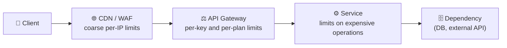
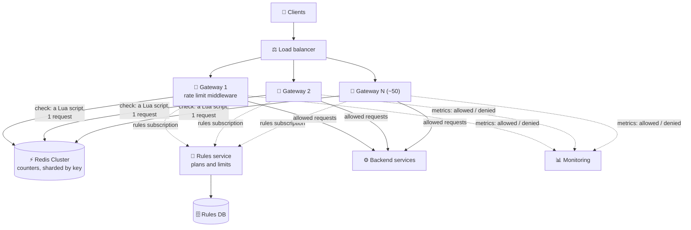
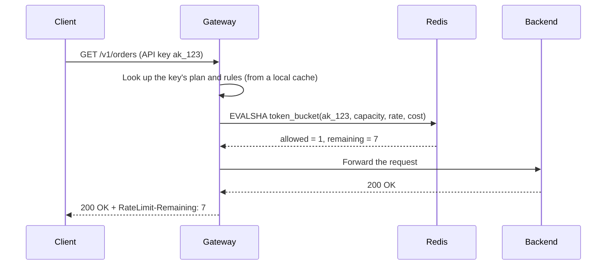
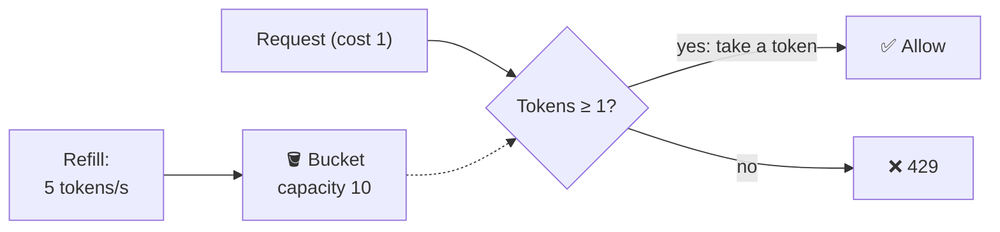
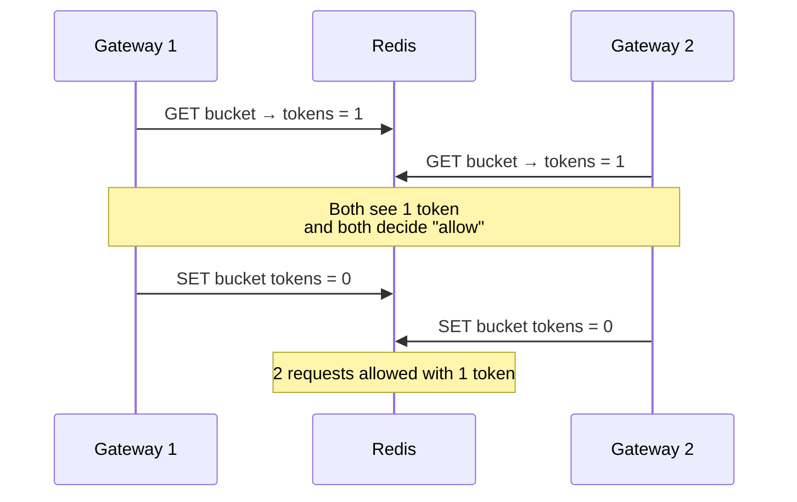
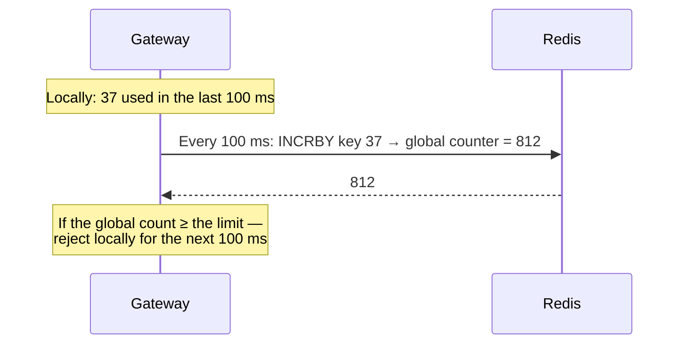
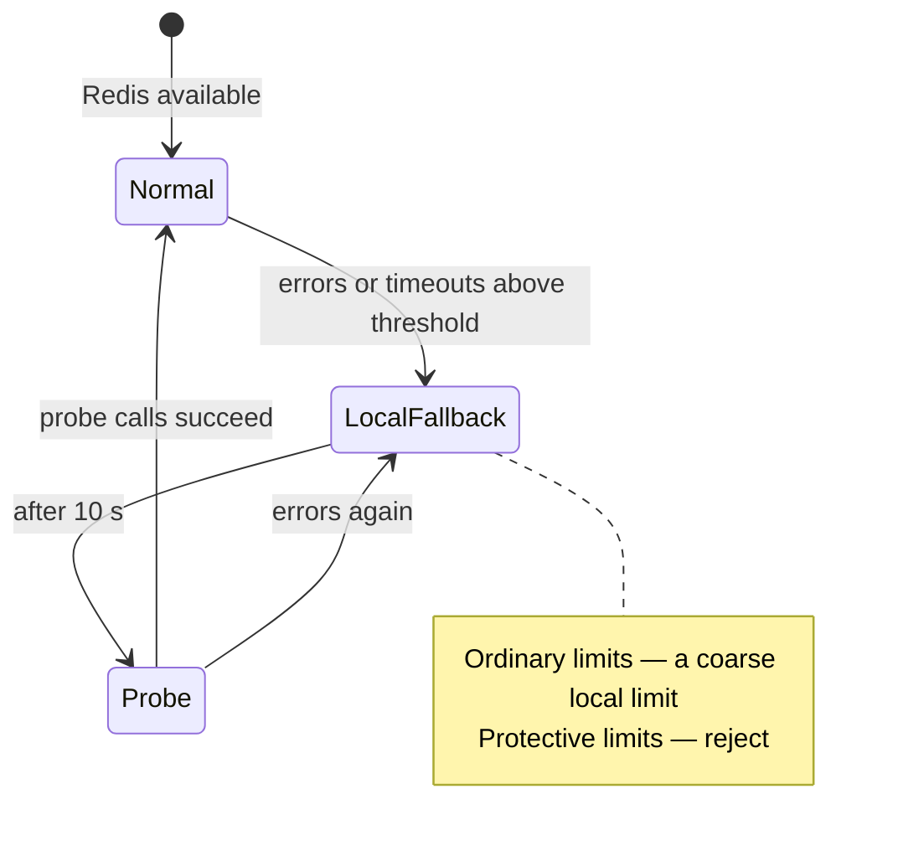
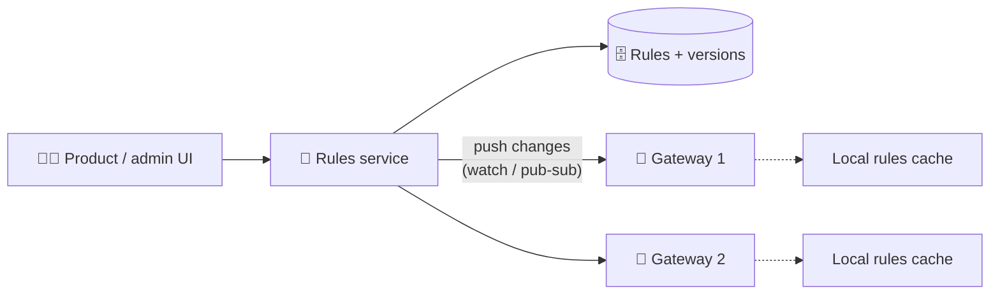

**English** | [Русский](README_RU.md)

# Tier 1 · 02. Rate Limiter / Abuse Protection

> **Level:** Medium · **Interview time:** 45 min · **Study time:** ~4–5 h
> **Key aspects:** algorithms (fixed window, sliding log, sliding window counter, token bucket, leaky bucket, GCRA), distributed counters in Redis, atomicity via Lua, per-user, per-key and per-IP limits, fail open / fail closed, multi-region
> **Builds on:** [02-caching](../../02-caching/README.md), [06-partitioning](../../06-partitioning/README.md), [07-consistency-models](../../07-consistency-models/README.md), [12-communication](../../12-communication/README.md), [13-reliability-patterns](../../13-reliability-patterns/README.md#6-rate-limiting)

---

## 🗺️ How to Read This Walkthrough

The walkthrough follows an interview, but every step includes explanations: **why** a decision is made, **how** a mechanism works and **what happens** if you do it differently. The "📘 Explanation" blocks are theory right where you need it.

| Icon | Meaning |
|:----:|:--------|
| 🎤 | Interviewer |
| 🗣️ | What I (the candidate) say out loud |
| ✏️ | What I draw on the whiteboard |
| ⏱️ | Time budget for the step |
| 📘 | A detailed explanation of a concept |

Callouts: **TIP** — a good technique, **WARNING** — a trap, **IMPORTANT** — a Senior+ signal.

---

## 📑 Contents

0. [What This Problem Teaches](#0-what-this-problem-teaches)
1. [Problem Statement](#1-problem-statement)
2. [Clarifying Questions and Requirements](#2-clarifying-questions-and-requirements)
3. [Capacity Estimates](#3-capacity-estimates)
4. [Interface and HTTP Responses](#4-interface-and-http-responses)
5. [Where to Place the Rate Limiter](#5-where-to-place-the-rate-limiter)
6. [High-Level Design](#6-high-level-design)
7. [Deep Dive 1: Algorithms](#7-deep-dive-1-algorithms)
8. [Deep Dive 2: Distributed Limits and Atomicity](#8-deep-dive-2-distributed-limits-and-atomicity)
9. [Deep Dive 3: Scaling and Hot Keys](#9-deep-dive-3-scaling-and-hot-keys)
10. [Deep Dive 4: Failures — Fail Open or Fail Closed](#10-deep-dive-4-failures--fail-open-or-fail-closed)
11. [Deep Dive 5: Rules, Limit Hierarchies and Configuration](#11-deep-dive-5-rules-limit-hierarchies-and-configuration)
12. [Deep Dive 6: Abuse Protection](#12-deep-dive-6-abuse-protection)
13. [Deep Dive 7: Multiple Regions](#13-deep-dive-7-multiple-regions)
14. [Bottlenecks and Failure Scenarios](#14-bottlenecks-and-failure-scenarios)
15. [What Changes at 10x Scale](#15-what-changes-at-10x-scale)
16. [Key Concepts and New Terms](#16-key-concepts-and-new-terms)
17. [Variations and Follow-Up Questions](#17-variations-and-follow-up-questions)
18. [Common Mistakes](#18-common-mistakes)
19. [Cheat Sheet and Self-Check](#19-cheat-sheet-and-self-check)

---

## 0. What This Problem Teaches

A **rate limiter** decides whether to let a request through or reject it because the client exceeded its quota. It shows up in almost every system: public APIs (Stripe, GitHub, OpenAI), protecting login from password guessing, protecting services from overload, fairly sharing resources between clients.

| What's tested | Where it shows up |
|:--------------|:------------------|
| Knowing the algorithms and their trade-offs | Fixed window, sliding window, token bucket, leaky bucket, GCRA |
| Handling state in a distributed system | One shared counter across dozens of gateway servers |
| Atomicity and races | Why "read, check, write" fails and how Lua helps |
| Performance on the hot path | The check adds latency to **every** request |
| Behavior under failures | What to do when the counter store is unavailable |
| Product thinking | Plans, clear responses for clients, headers |

> [!TIP]
> The problem looks algorithmic, but the interviewer almost always moves on to the **distributed** part: "you have 50 gateway servers — how do they count one shared limit?". Explain the algorithms quickly and confidently, and save most of the time for distribution and failures.

---

## 1. Problem Statement

> 🎤 "Design a rate limiter for a public API platform: we have thousands of clients on different plans, calling our API through a gateway. We need to limit request rates and protect services from overload and abuse."

**What it looks like to a client:**

```
A client on the Free plan: 10 requests per second, 10,000 per day.

Requests 1–10 within a second  → 200 OK
Request 11 in the same second  → 429 Too Many Requests
                                 Retry-After: 1
                                 RateLimit-Remaining: 0
```

**Time plan:**

| Step | ⏱️ |
|:-----|:--:|
| Requirements | 5 min |
| Estimates | 3 min |
| Interface and placement | 5 min |
| High-level design | 5 min |
| Deep dives | 22 min |
| Failures and wrap-up | 5 min |

---

## 2. Clarifying Questions and Requirements

⏱️ 5 min

| My question | Interviewer's answer | What it changes and why |
|:------------|:---------------------|:------------------------|
| What do we limit by? | Client API key, user, IP for anonymous traffic, endpoint | Several key types and **several limits at once** |
| What kinds of limits? | Per second (with short bursts allowed) and per day | Different algorithms for short and long windows |
| How precise must a limit be? | A small overshoot (a few percent) is fine, but not multiples | Approximate algorithms and async sync are allowed |
| What load? | About 1M requests per second at peak through ~50 gateway servers | The check must be very cheap |
| How much latency can we add? | No more than 1–2 ms to p99 | An in-memory check or a nearby Redis; no slow databases |
| What if the counter store is unavailable? | The API must keep working | **Fail open** for ordinary limits |
| How do rules change? | Product changes plans and limits without a deploy | Dynamic configuration |
| Multiple regions? | Yes, EU and US; a client's limit is shared | A global limit, approximated |

### Functional requirements

1. Limit requests by different keys: API key, user, IP, endpoint, and combinations.
2. Support several limits at once (e.g. 10 per second **and** 10,000 per day).
3. Allow short bursts within a configured size.
4. Return a clear response: `429`, how much is left, when to retry.
5. Change rules without a deploy.

### Non-functional requirements

| Requirement | Target | Why |
|:------------|:-------|:----|
| Added latency | p99 < 2 ms | The check runs on **every** request — any latency is multiplied by all traffic |
| Availability | A limiter failure doesn't break the API | The limiter is protection, not functionality; its failure mustn't become an API outage |
| Accuracy | Overshoot of at most a few percent | Strict global accuracy needs coordination on every request — expensive |
| Scale | 1M checks per second, 10M active keys | Determines the counter store's architecture |
| Fairness | One client can't take others' resources | The main purpose of limits on a platform |

---

## 3. Capacity Estimates

⏱️ 3 min

```
Checks:      1M requests/s at peak, 1–3 limits each → up to 3M counter operations/s

Keys:        10M active clients/users/IPs per day
Memory:      key ~40 B + value ~16 B + Redis overhead ~50 B ≈ 100 B
             10M × 100 B × 2 limits ≈ 2 GB — the whole thing fits in cluster memory

Redis:       one shard does on the order of 100,000+ simple operations/s,
             Lua scripts are a bit slower → 3M operations/s needs ~30–50 shards
             (or fewer, if some checks run locally — see deep dive 3)

Network:     a round trip to Redis in the same zone ≈ 0.3–1 ms — within the 2 ms budget
```

### Conclusions

| Conclusion | Design consequence |
|:-----------|:-------------------|
| Millions of checks per second | In-memory storage only; a relational database won't do |
| All state is ~2 GB | Memory isn't the issue; throughput and latency are |
| A 2 ms budget | One network call per check, no call chains |
| 50 gateway servers | Local counters on each server won't give a shared limit — shared state or coordination is needed |

---

## 4. Interface and HTTP Responses

⏱️ 3 min

### The internal interface

```
check(key, rule, cost = 1) → { allowed: bool, remaining: int, reset_after_ms: int, retry_after_ms: int }

Example:
  check("apikey:ak_123", rule = "per_second_free", cost = 1)
  → { allowed: false, remaining: 0, reset_after_ms: 400, retry_after_ms: 200 }
```

- **`cost`** is a request's "weight". An expensive endpoint (e.g. report generation) might cost 10 units, an ordinary one 1.
- It returns not just yes/no but the data for response headers.

### The response when the limit is exceeded

```http
HTTP/1.1 429 Too Many Requests
Retry-After: 1
RateLimit-Limit: 10
RateLimit-Remaining: 0
RateLimit-Reset: 1
Content-Type: application/json

{ "error": "rate_limit_exceeded", "message": "Limit of 10 requests per second exceeded", "retry_after": 1 }
```

📘 **Explanation: rate limit headers.** Historically every API used its own headers (`X-RateLimit-Limit`, `X-RateLimit-Remaining`, `X-RateLimit-Reset` at GitHub and many others). The IETF is standardizing `RateLimit` and `RateLimit-Policy` headers. What matters is giving the client **three things**: the limit, what's left and when it resets, plus `Retry-After` on rejection. A good client uses them to slow itself down instead of wasting requests.

| Code | When | Why not another |
|:-----|:-----|:----------------|
| `429 Too Many Requests` | The client exceeded **its own** quota | A client error: it needs to slow down |
| `503 Service Unavailable` | The **service** is overloaded (load shedding), regardless of the client's quota | A server problem, not the client's (see [13-reliability-patterns](../../13-reliability-patterns/README.md#7-load-shedding-and-prioritization)) |

---

## 5. Where to Place the Rate Limiter

⏱️ 3 min



| Place | Pros | Cons | For |
|:------|:-----|:-----|:----|
| **Client** | Reduces load up front | Clients can't be trusted | Courtesy only (an SDK with backoff) |
| **CDN / WAF** | Drops junk before it reaches our servers | Knows only the IP and simple signals | DDoS and bot protection by IP |
| **API Gateway** ⭐ | One point for every service; knows the API key and plan | Needs a shared counter across gateway nodes | The main per-client and per-plan limits |
| **Sidecar / service mesh** | No code changes needed | Local per-instance limits | Protecting a specific service |
| **A library in the service** | Knows the business context (operation cost) | Duplicated in every service | Limits on expensive operations |
| **A separate limiter service** | Centralized logic | An extra network call | Complex rules (like Envoy's global rate limit service) |

🗣️ "The main per-client limits go on the **API Gateway**: it knows the key and the plan, and one implementation protects every service. Coarse per-IP limits come earlier, at the CDN/WAF. Limits specific to expensive operations live in the services themselves. That's **layered** protection: each layer filters its own thing."

---

## 6. High-Level Design

⏱️ 5 min



### The request path



🗣️ "Key decisions:
- the check runs in **gateway middleware**, with one network call to Redis;
- a **Lua script** does the read, the computation and the write atomically;
- rules and plans live in a separate service; gateways cache them and get updates without a deploy;
- rejection metrics — to see whom we're limiting and why."

---

## 7. Deep Dive 1: Algorithms

> 🎤 "Which algorithm would you choose, and why?"

Let the limit be **100 requests per minute**. Let's see how each algorithm counts it.

### 7.1 Fixed window

📘 **How it works.** Time is split into fixed-length windows (minutes). Each window has its own counter. A request increments the current window's counter; if the counter exceeds the limit — reject.

```
Key: ratelimit:ak_123:2026-11-30T12:01   (the minute number)

INCR ratelimit:ak_123:12:01     → 57
EXPIRE ratelimit:ak_123:12:01 60
57 ≤ 100 → allow
```

**The problem: a burst at the window boundary.**

```
12:00:59 — 100 requests arrive → window 12:00 is full, all allowed
12:01:00 — 100 requests arrive → new window 12:01, counter from zero, all allowed

Result: 200 requests in 2 seconds with a "100 per minute" limit
```

| ✅ Pros | ❌ Cons |
|:-------|:-------|
| Very simple: one `INCR` | A burst of up to 2× the limit at window boundaries |
| One counter per key, little memory | Every client "resets" at the same moment — synchronized waves at the start of each minute |
| Atomic without Lua (`INCR` is atomic) | |

### 7.2 Sliding window log

📘 **How it works.** Store **the time of every request** (e.g. in a Redis sorted set). On a new request, remove entries older than a minute and count what's left.

```
ZREMRANGEBYSCORE ratelimit:ak_123 0 (now − 60,000)   ← remove entries older than a minute
ZCARD ratelimit:ak_123                                ← how many remain
if < 100 → ZADD ratelimit:ak_123 now now              ← record the request
```

| ✅ Pros | ❌ Cons |
|:-------|:-------|
| **Exact**: the window truly slides | **Memory**: every request is stored. A 10,000/hour limit × 10M keys — far too much |
| No boundary bursts | More CPU: removal and counting on every request |

### 7.3 Sliding window counter ⭐ for long windows

📘 **How it works.** Store counters for the **current and previous** fixed windows and estimate the number of requests in the sliding window with a weighted sum, assuming the previous window's requests were evenly spread.

```
estimate = current_window + previous_window × (the fraction of the previous window inside the sliding window)
```

**Example.** A limit of 100 per minute. It's now 12:01:15 — 25% of the current minute has passed.

```
Previous window (12:00):  80 requests
Current window (12:01):   30 requests

Sliding window = the last 60 seconds = [12:00:15, 12:01:15]
75% of the previous minute falls inside it → 80 × 0.75 = 60

Estimate = 30 + 60 = 90 < 100 → allow
```

| ✅ Pros | ❌ Cons |
|:-------|:-------|
| Just **two counters** per key | **An approximation**: if the previous window's requests were uneven, the estimate is off |
| Smooths the boundary burst | A bit more complex than fixed window |
| In large companies' experience (Cloudflare, for example, described this approach) the error is tiny on real traffic | |

### 7.4 Token bucket ⭐ for short limits with bursts

📘 **How it works.** Each key has a "bucket" with a capacity of **capacity** tokens. Tokens are added at **rate** per second, up to the capacity. Each request takes **cost** tokens; if there aren't enough — reject.



The parameters have clear meanings:
- **rate** — the average allowed rate (5 requests per second);
- **capacity** — the maximum burst (10 requests in a row after a pause).

**Lazy refill.** You don't need a timer adding tokens to millions of buckets every second. Store only **the token count** and **the last update time**, and compute the refill on each request:

```
tokens = min(capacity, tokens + (now − last_update) × rate)
```

**Example.** capacity = 10, rate = 5/s.

| Time | Event | Tokens before | Calculation | Decision | Tokens after |
|:----:|:------|:-------------:|:------------|:--------:|:------------:|
| 0.0 s | Bucket full | 10 | — | — | 10 |
| 0.0 s | 10 requests in a row | 10 | one per request | ✅ all 10 | 0 |
| 0.0 s | The 11th request | 0 | — | ❌ 429 | 0 |
| 0.4 s | A request | 0 | 0 + 0.4 × 5 = 2 | ✅ | 1 |
| 0.6 s | A request | 1 | 1 + 0.2 × 5 = 2 | ✅ | 1 |
| 5.0 s | A request | 1 | min(10, 1 + 4.4 × 5) = 10 | ✅ | 9 |

```python
def allow(bucket, capacity, rate, cost, now):
    elapsed = now - bucket.last_update
    bucket.tokens = min(capacity, bucket.tokens + elapsed * rate)   # lazy refill
    bucket.last_update = now
    if bucket.tokens >= cost:
        bucket.tokens -= cost
        return True
    return False
```

| ✅ Pros | ❌ Cons |
|:-------|:-------|
| Allows controlled bursts — convenient for real clients | Two values per key (tokens + time) |
| Little memory, O(1) per request | The distributed version needs atomicity (Lua) |
| Supports request "weight" (`cost`) | |
| Used by many public APIs (Stripe, for example, described using a token bucket for its limits) | |

### 7.5 Leaky bucket

📘 **How it works.** Requests enter a queue (the "bucket"), which "leaks" them out at a **constant rate**. If the bucket is full — new requests are rejected.

```
Input: an uneven stream        Bucket (queue, capacity 10)       Output: exactly 5 requests/s
  ▁▁█▁▁██▁▁▁█        →           [ ■ ■ ■ ■ ■ ■ ]          →     ▃▃▃▃▃▃▃▃▃▃▃
```

| ✅ Pros | ❌ Cons |
|:-------|:-------|
| **Smooths** the output: the downstream gets an even flow | Requests **wait** in the queue — latency grows |
| Good for protecting slow dependencies (an external API with a hard limit) | Bursts aren't served faster even when there's spare capacity |

There's also a "leaky bucket as a meter" variant without a queue — it's essentially equivalent to a token bucket.

### 7.6 GCRA (Generic Cell Rate Algorithm)

📘 **How it works.** A leaky-bucket variant from telecom that stores **a single number** — the **TAT** (theoretical arrival time of the next "allowed" request).

```
T     = 1 / rate               (the interval between requests, e.g. 200 ms for 5/s)
burst = the allowed burst      (e.g. 10 requests)

On a request:
  new_tat = max(TAT, now) + T
  if new_tat − now > burst × T → reject
  otherwise → allow, TAT = new_tat
```

**Example** (rate 5/s, T = 200 ms, burst = 10, a lead limit of 2,000 ms):

```
now = 0:     10 requests in a row → TAT grows 200, 400, …, 2,000 ms; 2,000 − 0 ≤ 2,000 → all allowed
the 11th:    new_tat = 2,200; 2,200 − 0 > 2,000 → reject
now = 400 ms: new_tat = max(2,000, 400) + 200 = 2,200; 2,200 − 400 = 1,800 ≤ 2,000 → allowed
```

It behaves like a token bucket but stores one number instead of two and avoids fractional-token arithmetic. Used, for example, in the redis-cell module.

### Comparison and choice

| Algorithm | Accuracy | Bursts | Memory per key | Complexity | For |
|:----------|:---------|:-------|:---------------|:-----------|:----|
| Fixed window | ⚠️ Up to 2× at boundaries | Uncontrolled | 1 counter | Minimal | Coarse limits where precision doesn't matter |
| Sliding log | ✅ Exact | None | Every request in the window | High | Small limits that must be exact |
| Sliding window counter | ✅ Nearly exact | Smoothed | 2 counters | Low | **Long windows** (per minute, hour, day) |
| Token bucket | ✅ | **Controlled** (capacity) | 2 numbers | Low | **Short per-second limits** with bursts |
| Leaky bucket (queue) | ✅ | Smoothed by the queue | A queue | Medium | An even flow to a fragile dependency |
| GCRA | ✅ | Controlled | 1 number | Low | Like a token bucket, more compact |

🗣️ "I choose a **token bucket** (or the equivalent GCRA) for per-second limits — it allows reasonable bursts with O(1) memory. For daily quotas — a **sliding window counter**: two counters per key, no burst at the day boundary. Each request is checked against both limits."

> [!IMPORTANT]
> **Senior+ signal:** explain that the algorithm is chosen by **the type of limit**: a short limit with bursts (token bucket), a long quota (sliding window counter), an even flow to a fragile dependency (a leaky bucket with a queue). And show the fixed window problem with numbers.

---

## 8. Deep Dive 2: Distributed Limits and Atomicity

> 🎤 "You have 50 gateway servers. How do they count one shared limit per client?"

### Why local counters don't work

If each gateway counts on its own, a client with a limit of 10 per second whose requests the load balancer spreads across 50 gateways gets up to **500** requests per second — each gateway sees only its share.

"Dividing the limit by the number of gateways" (10 / 50 = 0.2 per second per gateway) is also bad: with uneven balancing the client gets rejected on one gateway while the total limit isn't used up, and limits shift whenever the gateway count changes.

🗣️ "We need **shared state** — counters in Redis that every gateway uses."

### The race condition

📘 **Explanation: "read — check — write".** A naive three-step token bucket breaks under concurrent requests:



With thousands of requests per second from one client (e.g. from several servers at once), this race constantly lets extra requests through. We need **atomicity**: read, compute and write as a single operation.

### Solutions

| Approach | How | Fits |
|:---------|:----|:-----|
| **Atomic commands** | `INCR` + `EXPIRE`: Redis runs `INCR` atomically, and we check the result afterwards | Fixed window, sliding window counter |
| **A Lua script** ⭐ | The whole algorithm runs inside Redis as one atomic operation | Token bucket, GCRA, any logic |
| **MULTI / WATCH** (an optimistic transaction) | Retry on concurrent modification | Works, but many retries under high contention |
| **Modules** | redis-cell (GCRA) | If you can install modules |

📘 **Why a Lua script is atomic.** Redis executes commands on a single thread. A Lua script runs as a whole, and no other command can slip into the middle. So "read — compute — write" inside a script can't be interrupted by another gateway. A bonus: **one network request** instead of three.

### A token bucket in Lua

```lua
-- KEYS[1] — the bucket key, e.g. "rl:tb:ak_123:per_second"
-- ARGV[1] = capacity, ARGV[2] = rate (tokens per second), ARGV[3] = cost
local capacity = tonumber(ARGV[1])
local rate     = tonumber(ARGV[2])
local cost     = tonumber(ARGV[3])

-- Take the time from Redis itself, not the gateway: gateway clocks can drift
local t   = redis.call('TIME')
local now = tonumber(t[1]) * 1000 + math.floor(tonumber(t[2]) / 1000)   -- milliseconds

local data   = redis.call('HMGET', KEYS[1], 'tokens', 'ts')
local tokens = tonumber(data[1]) or capacity
local ts     = tonumber(data[2]) or now

-- Lazy refill
tokens = math.min(capacity, tokens + (now - ts) / 1000 * rate)

local allowed = 0
if tokens >= cost then
  tokens  = tokens - cost
  allowed = 1
end

redis.call('HSET', KEYS[1], 'tokens', tokens, 'ts', now)
-- The key disappears by itself once the bucket is full and no longer needed
redis.call('PEXPIRE', KEYS[1], math.ceil(capacity / rate * 1000) + 1000)

-- How long to wait for the next token (for Retry-After)
local retry_ms = 0
if allowed == 0 then retry_ms = math.ceil((cost - tokens) / rate * 1000) end

return { allowed, math.floor(tokens), retry_ms }
```

| Detail | Why it matters |
|:-------|:---------------|
| `redis.call('TIME')` | If time comes from gateways, a 100 ms clock difference between servers distorts the refill. Redis's time is the same for every gateway touching this key |
| `PEXPIRE` | Inactive keys delete themselves; 10M keys don't pile up forever |
| One key — one bucket | In Redis Cluster a script works with keys in one slot; one client's bucket is one key |
| `EVALSHA` | The script is loaded once and then called by hash — no sending the script text on every request |

### A sliding window counter with atomic commands

```
Window: a minute. Keys: rl:sw:ak_123:{minute_number}

1. INCR rl:sw:ak_123:{current}               → current
2. EXPIRE rl:sw:ak_123:{current} 120
3. GET  rl:sw:ak_123:{previous}               → previous
4. estimate = current + previous × (1 − fraction_of_the_minute_elapsed)
5. if estimate > limit → reject (and optionally DECR so the rejected request isn't counted)
```

For accuracy under contention, these steps are also conveniently wrapped in one Lua script.

---

## 9. Deep Dive 3: Scaling and Hot Keys

> 🎤 "3 million operations per second and 2 ms of latency. Can Redis handle it?"

### Sharding

Redis Cluster spreads keys across 16,384 slots by key hash (see [02-caching](../../02-caching/README.md)). Different clients' keys spread evenly across shards, and load scales by adding shards. ~30–50 shards (with replicas) handle 3M operations per second.

### A hot key

One big client sends 100,000 requests per second → all of them hit **one** key on **one** shard. That's a hot key: the shard is overloaded, and latency rises for every client on it.

| Solution | How | Cost |
|:---------|:----|:-----|
| **Split the bucket into N parts** | The client's key → N sub-buckets (`ak_123:0` … `ak_123:9`), each with limit / N; the gateway picks a sub-bucket at random | Slight inaccuracy with uneven picks |
| **Local pre-reservation** | The gateway takes a batch of tokens from Redis at once (e.g. 100) and hands them out locally until they run out | Inaccuracy up to one batch per gateway |
| **A local check by share** | For very large clients — a local bucket on the gateway with limit / number of gateways + rare syncing | Inaccuracy with uneven balancing |

### Hybrid: local + global

📘 **The idea.** Instead of calling Redis on **every** request, the gateway keeps a **local** counter and syncs periodically:



| | Every request to Redis | Hybrid with sync |
|:-|:-----------------------|:-----------------|
| Accuracy | Exact | Overshoot up to (rate × sync interval) |
| Latency | +0.3–1 ms on every request | Nearly zero |
| Load on Redis | 1 operation per request | 1 operation per gateway per key per interval |
| When | Strict limits, moderate traffic | Huge traffic where a small inaccuracy is acceptable |

🗣️ "By default — a Redis check on every request: it fits in the 2 ms budget. For the largest clients, which create hot keys — local reservation of tokens in batches. The 'overshoot of at most a few percent' requirement allows this."

> [!TIP]
> A nice optimization: if a client was already rejected with `retry_after = 800 ms`, the gateway **remembers that locally** and answers 429 for the next 800 ms without calling Redis. An aggressive client hammering the API after a rejection stops loading Redis.

---

## 10. Deep Dive 4: Failures — Fail Open or Fail Closed

> 🎤 "Redis is unavailable. What does the gateway do?"

📘 **Two options.**
- **Fail open** — let requests through without a limit check.
- **Fail closed** — reject every request that can't be checked.

| | Fail open | Fail closed |
|:-|:----------|:------------|
| What clients see | The API works | The API is down |
| Risk | Temporarily no protection against abuse and overload | A secondary component's failure = a full API outage |
| For | **Ordinary plan limits** | **Protective limits**, where letting traffic through is worse than refusing: login attempts, sending SMS (paid), money operations |

🗣️ "For ordinary limits — **fail open**, but not 'no protection at all':

| Mechanism | How |
|:----------|:----|
| **A short timeout** on Redis calls (e.g. 5 ms) | A slow Redis doesn't add latency to every request |
| **A circuit breaker** | After a series of errors, stop calling Redis for N seconds so we don't waste time on timeouts |
| **A local fallback limit** | In fail-open mode the gateway applies a coarse **local** token bucket (limit / number of gateways, with headroom) — protection remains, if imprecise |
| **Load shedding in services** | Independent overload protection (see [13-reliability-patterns](../../13-reliability-patterns/README.md#7-load-shedding-and-prioritization)) |
| **An alert** | A limiter in fail-open mode is worth a page |

For protective limits (login, SMS) — **fail closed** with a clear error: better a user waits a minute than we let a password-guessing attack through or rack up a bill for thousands of SMS."



> [!IMPORTANT]
> **Senior+ signal:** answering "fail open" or "fail closed" across the board is weak. A strong answer is **different behavior for different types of limits**, plus a local fallback limit and a short timeout, so a limiter failure becomes neither an API outage nor a total loss of protection.

---

## 11. Deep Dive 5: Rules, Limit Hierarchies and Configuration

> 🎤 "We have Free, Pro and Enterprise plans, separate limits on expensive endpoints, and IP-based protection. How do you describe all that?"

### Rules

```yaml
rules:
  - id: free_per_second
    match: { plan: free }
    key: api_key
    algorithm: token_bucket
    rate: 10            # per second
    burst: 20

  - id: free_per_day
    match: { plan: free }
    key: api_key
    algorithm: sliding_window
    limit: 10000
    window: 24h

  - id: pro_per_second
    match: { plan: pro }
    key: api_key
    algorithm: token_bucket
    rate: 100
    burst: 200

  - id: reports_expensive
    match: { path: "/v1/reports/*" }
    key: api_key
    algorithm: token_bucket
    rate: 1
    burst: 2

  - id: anonymous_ip
    match: { authenticated: false }
    key: ip_prefix          # /32 for IPv4, /64 for IPv6
    algorithm: token_bucket
    rate: 5
    burst: 10

  - id: login_attempts
    match: { path: "/v1/login" }
    key: [account, ip]
    algorithm: sliding_window
    limit: 5
    window: 15m
    on_store_failure: fail_closed
```

### How they're applied

| Principle | Explanation |
|:----------|:------------|
| **Several rules per request** | A Free client's request to reports is checked against `free_per_second`, `free_per_day` and `reports_expensive`; rejected if **any** rule is exhausted |
| **Request cost** | An expensive endpoint can take `cost: 10` from the shared bucket instead of a separate rule |
| **Hierarchy** | A user limit inside an organization limit: 100/s per user, 1,000/s for the whole organization |
| **Per-customer overrides** | An Enterprise customer gets its own values via rules on `customer_id` |

### Not wasting tokens

📘 If a request is checked against several rules and only the last one rejects it, the earlier ones have already spent tokens. Options: first check **every** rule without spending, then spend (two passes); or run every rule in one Lua script that spends only if all pass — but then all keys must be in the same Redis Cluster slot (hash tags `{ak_123}`).

### Dynamic configuration



| Practice | Why |
|:---------|:----|
| Gateways keep rules **in memory** | No call to the rules service on every request |
| Changes are pushed (etcd watch, pub/sub) | A new limit takes effect within seconds without a deploy |
| If the rules service is down — run on the last known rules | Static stability |
| **Shadow mode** | A new rule first only logs "would have rejected" without rejecting — to see who it affects |
| Versions and rollback | A mistakenly strict rule is rolled back in seconds |

---

## 12. Deep Dive 6: Abuse Protection

> 🎤 "Besides plans, we need protection against bots and password guessing. What should we consider?"

| Situation | Problem | Solution |
|:----------|:--------|:---------|
| **Per-IP limits behind NAT** | Thousands of users at an office or a mobile carrier share one IP — they'd all be blocked together | Per-IP limits only for anonymous traffic, and generous; per user or key for authenticated traffic |
| **IPv6** | Each client easily gets millions of addresses from its `/64` subnet and bypasses per-IP limits | Limit by **prefix** `/64` (or `/56`), not the full address |
| **Password guessing** | Guessing one account's password, or one password across many accounts | Limits per account **and** per IP; progressive delays; CAPTCHA after a few failures; fail closed |
| **Distributed attacks** | A botnet from thousands of IPs, each within its limit | Limits won't help — you need a WAF, behavioral analysis, IP reputation, CAPTCHA (bot management at the CDN) |
| **DDoS** | Huge traffic volume | A separate layer: CDN, Anycast, scrubbing — a gateway rate limiter won't withstand that volume |
| **Resource enumeration** | Guessing user IDs or codes | A limit on 404 responses per client |

> [!WARNING]
> A rate limiter is **not** DDoS protection. It works at the application layer and itself consumes resources on every request. Volumetric attacks must be cut off earlier — at the CDN and in the network infrastructure.

---

## 13. Deep Dive 7: Multiple Regions

> 🎤 "We have EU and US regions. A client's limit is shared. How?"

📘 **Why it's hard.** If every check consulted a shared counter in another region, each request would gain 80–100 ms — breaking the 2 ms budget.

| Approach | How | Accuracy | Latency |
|:---------|:----|:---------|:--------|
| **A limit per region** | Each region gets a share of the limit (e.g. by the client's historical traffic) | Worse when the traffic split changes | None added |
| **Local counters + async sync** ⭐ | Each region counts locally and exchanges totals with the others every 1–2 s; decisions use local + the last known remote | Overshoot up to (rate × sync delay) | None added |
| **A global counter in one region** | Every check goes to one region | Exact | +80–100 ms for the remote region ❌ |
| **Pinning a client to a home region** | The client is always served in one region | Exact | Depends on where the client is |

🗣️ "I choose **local counters with async sync**: each region sees its own exact counter and an approximate remote one. For daily quotas, overshooting by a few seconds of traffic is negligible. For per-second limits, a client's traffic usually arrives in one region, so regional limits are nearly exact."

---

## 14. Bottlenecks and Failure Scenarios

| Scenario | What happens | How we protect |
|:---------|:-------------|:---------------|
| Redis is unavailable | The shared limit can't be checked | A short timeout, a circuit breaker, a local fallback limit; protective limits fail closed |
| A big client's hot key | One shard is overloaded | Splitting the bucket, reserving tokens in batches, a local rejection cache |
| An aggressive client after a 429 | Keeps sending requests, loading the limiter | A local "rejected until time X" cache, rate limiting at the CDN |
| Gateway clock skew | Wrong token refill | Time comes from Redis (`TIME`) |
| A mistakenly strict rule | Mass 429s for legitimate clients | Shadow mode, gradual rollout, fast rule version rollback |
| A Redis failover with data loss | Counters reset → a brief overshoot | Acceptable for limits; critical quotas (billing) live in a durable store |
| The rules service is unavailable | Limits can't be updated | Gateways run on the last known rules |
| Users behind NAT | False blocks | Per-user rather than per-IP limits for authenticated traffic |

---

## 15. What Changes at 10x Scale

> 🎤 "10 million requests per second?"

| Change | Why |
|:-------|:----|
| **Hybrid by default** | Not every request goes to Redis: local counters synced every 50–100 ms |
| **More Redis shards**, or a dedicated limiter service with in-memory state and routing by key | Throughput |
| **Routing a client's requests to one gateway** (consistent hashing on the API key at the load balancer) | Then a client's limit can be counted **locally** on one gateway, with almost no coordination |
| **Coarse limits at the edge** | Cut off abuse before it reaches the gateways |
| **Billing quotas separately** | Exact usage accounting (for billing) lives in an event stream and a database, not in the limiter |

---

## 16. Key Concepts and New Terms

### What's applied from Fundamentals

| Concept | Where it's covered | How it applies here |
|:--------|:-------------------|:--------------------|
| Redis, clustering, hot keys | [02-caching](../../02-caching/README.md) | The counter store |
| Partitioning by key | [06-partitioning](../../06-partitioning/README.md) | Sharding counters by client |
| Approximate consistency | [07-consistency-models](../../07-consistency-models/README.md) | An acceptable overshoot for the sake of speed |
| Atomicity, races | [04-databases](../../04-databases/README.md#9-concurrency-anomalies) | Lost updates with "read — write" |
| HTTP codes and headers | [12-communication](../../12-communication/README.md) | `429`, `Retry-After`, `RateLimit-*` |
| Circuit breakers, load shedding | [13-reliability-patterns](../../13-reliability-patterns/README.md) | A limiter failure, protecting services |
| Retries with backoff and jitter | [10-idempotency](../../10-idempotency/README.md#8-exponential-backoff-and-jitter) | How clients should react to 429 |

### New terms in this problem

| Term | In short |
|:-----|:---------|
| **Fixed window** | A counter per fixed window; a burst of up to 2× at the boundary |
| **Sliding window log** | A log of request times; exact but memory-hungry |
| **Sliding window counter** | Two counters and a weighted estimate; nearly exact and cheap |
| **Token bucket** | A bucket of tokens: rate — the average speed, capacity — the burst; lazy refill |
| **Leaky bucket** | A queue with a constant output rate; smooths the flow |
| **GCRA** | A token bucket in one number — the theoretical arrival time |
| **A Lua script in Redis** | Atomic "read — compute — write" in one request |
| **Fail open / fail closed** | Let through or reject when a limit can't be checked |
| **Shadow mode** | A rule that only logs and isn't enforced |

---

## 17. Variations and Follow-Up Questions

<details>
<summary><b>How is rate limiting different from a quota?</b></summary>

A rate limit caps **speed** (requests per second or minute) and protects against overload; a little inaccuracy is fine. A quota caps **volume** over a long period (requests or tokens per month) and is often tied to billing — it must be counted exactly, in a durable store (a usage event stream and a database), and the limiter can use it as an extra check.
</details>

<details>
<summary><b>Why not store counters in a database?</b></summary>

Millions of checks per second within a 2 ms budget: a relational database won't deliver that throughput and latency, and writing every increment to disk is unnecessary — a limit counter can be lost in a failure without serious consequences. In-memory storage (Redis) fits perfectly.
</details>

<details>
<summary><b>How do you limit an LLM API by tokens rather than requests?</b></summary>

Use `cost`: a request takes the model's token count from the bucket. The catch — the exact cost is known only after the response. The fix: deduct an estimate on request (e.g. `max_tokens`), then refund or charge the difference after the response. Usually there are two limits: requests per minute and tokens per minute.
</details>

<details>
<summary><b>How do you rate-limit calls to an external API with a hard limit (e.g. 100/s)?</b></summary>

This limits **outgoing** traffic: a job queue and consumers sharing a limiter (a leaky bucket) that lets out at most 100 calls per second, plus handling the provider's `429` with backoff. Here an even flow matters more than bursts.
</details>

<details>
<summary><b>What if a client sends requests from several servers and different IPs?</b></summary>

That's exactly why the main key is the API key or user, not the IP. The Redis counter is shared by every gateway, so requests from any address draw from the same bucket.
</details>

<details>
<summary><b>Should rejected requests count toward the counter?</b></summary>

For a token bucket — no, a rejection doesn't spend tokens. For a fixed window with `INCR`, a rejected request has already incremented the counter — you can `DECR`, or treat it as an aggressive client extending its own block (sometimes that's the desired behavior). What matters is choosing the behavior deliberately.
</details>

---

## 18. Common Mistakes

| ❌ Mistake | Why it's bad | ✅ Do this instead |
|:----------|:-------------|:------------------|
| Fixed window only | A burst of up to 2× at the window boundary | A token bucket or a sliding window counter |
| Local counters on each gateway | The real limit is multiplied by the number of gateways | Shared state in Redis, or coordination |
| "Read — check — write" as separate commands | A race: extra requests get through | A Lua script or atomic commands |
| Time from the gateway servers | Clock skew distorts the calculation | Redis time (`TIME`) |
| A long timeout to Redis | A Redis failure adds latency to every request | A ~5 ms timeout, a circuit breaker |
| Fail closed for every limit | A limiter failure = a full API outage | Fail open with a local fallback limit; fail closed only for protective limits |
| Limiting by IP only | False blocks behind NAT, bypass via IPv6 | By user and key; by `/64` prefix for IPv6 |
| No headers and no `Retry-After` | Clients retry blindly and add load | `429` + `Retry-After` + `RateLimit-*` |
| Changing rules through deploys | Slow reaction to abuse | Dynamic configuration, shadow mode |
| A rate limiter as DDoS protection | It won't withstand the attack volume | DDoS belongs at the CDN and network level |

---

## 19. Cheat Sheet and Self-Check

### 30-second answer

> Layered protection: coarse per-IP limits at the CDN, the main per-API-key and per-plan limits as gateway middleware, specific ones in services. For per-second limits — a token bucket (or GCRA): rate is the average speed, capacity is the burst, with lazy refill; for daily quotas — a sliding window counter on two counters. Shared state lives in a Redis Cluster sharded by key; a check is one atomic Lua script using Redis's time, ~1 ms. Hot keys — reserving tokens in batches and a local rejection cache. If Redis fails — a short timeout, a circuit breaker and a local fallback limit (fail open); for login and SMS — fail closed. Rules are dynamic, with shadow mode. Clients get `429`, `Retry-After`, `RateLimit-*`. Multi-region — local counters with async sync.

### Self-check

- [ ] I can explain 6 algorithms and show the fixed window burst with numbers
- [ ] I can compute a sliding window counter estimate from an example
- [ ] I can trace a token bucket through a table and explain lazy refill
- [ ] I can explain GCRA via the theoretical arrival time
- [ ] I can show the "read — write" race and explain why Lua is atomic
- [ ] I can write a token bucket in Lua and explain why `TIME` and `PEXPIRE`
- [ ] I can propose 3 solutions for a hot key
- [ ] I can justify different fail open / fail closed behavior for different limits
- [ ] I can describe rules, limit hierarchies and dynamic configuration
- [ ] I can explain the NAT and IPv6 problems for per-IP limits

### Further reading

- Alex Xu, *System Design Interview*, Vol. 1 — chapter "Design a Rate Limiter"
- Stripe Engineering, *Scaling your API with rate limiters* (2017)
- Cloudflare Blog, *How we built rate limiting capable of scaling to millions of domains* (2017) — the sliding window counter
- IETF HTTPAPI WG, *RateLimit header fields for HTTP* (Internet-Draft)
- Envoy documentation: local and global rate limiting
- Redis documentation: Lua scripting (`EVAL`, `EVALSHA`), the `TIME` command; the redis-cell module (GCRA)
