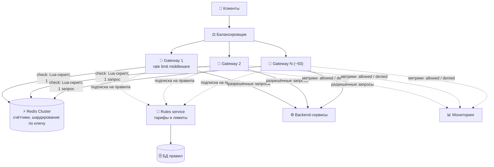
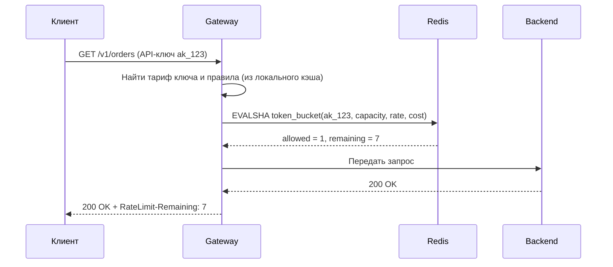
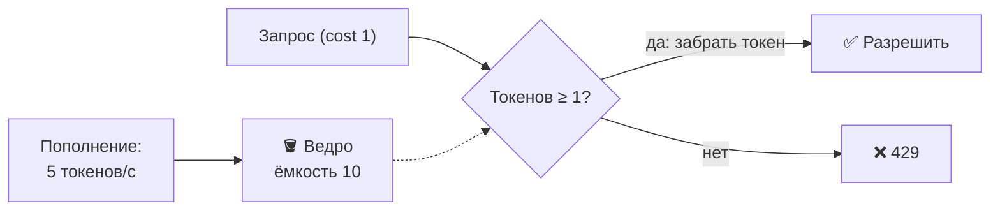
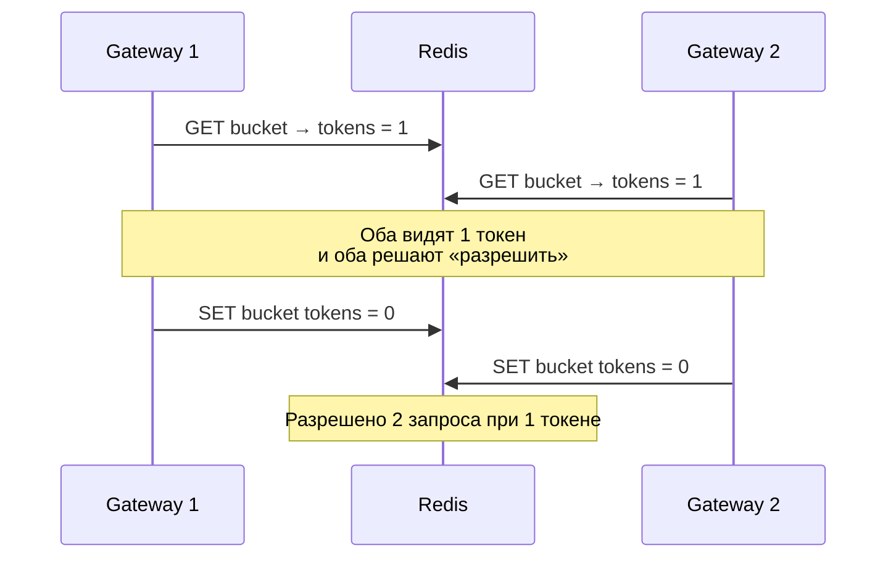
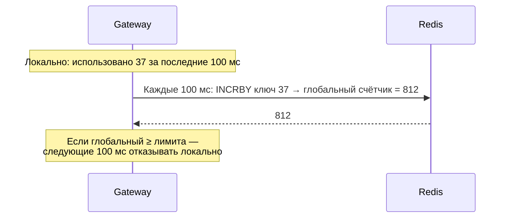
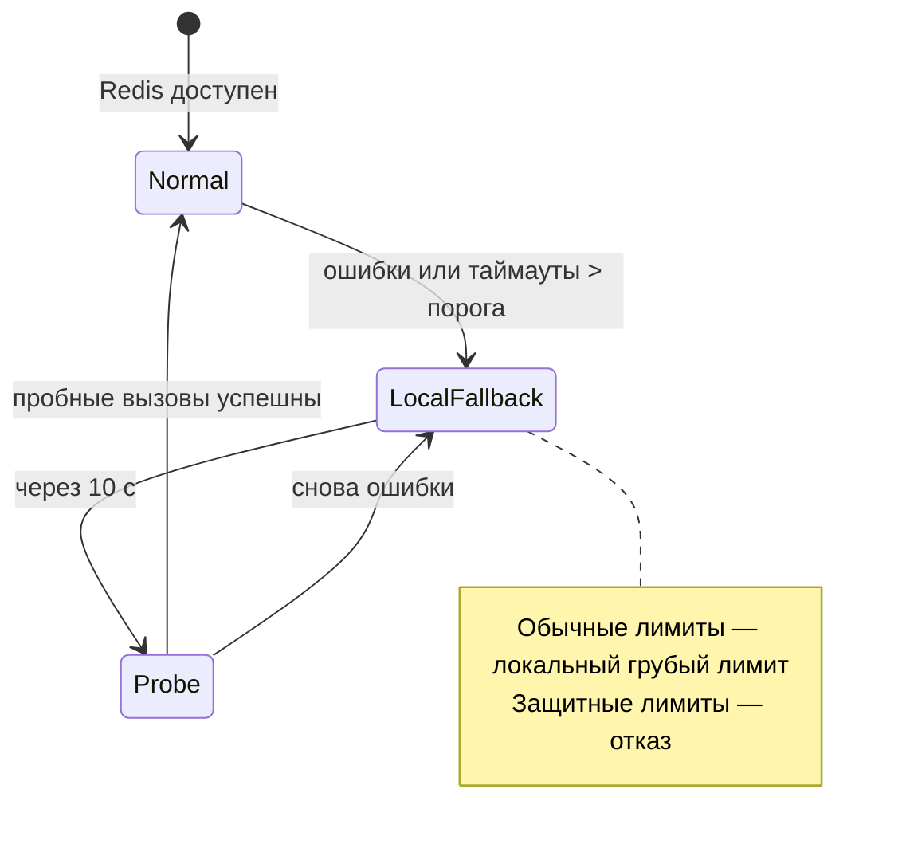
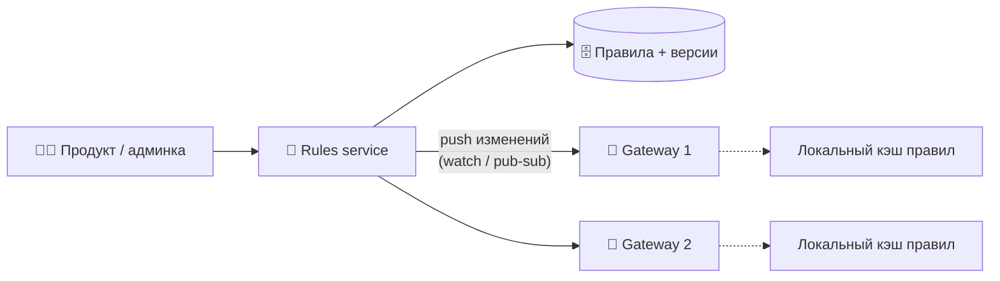

[English](README.md) | **Русский**

# Tier 1 · 02. Rate Limiter / Abuse Protection

> **Уровень:** Medium · **Время на интервью:** 45 мин · **Время на разбор:** ~4–5 ч
> **Ключевые аспекты:** алгоритмы (fixed window, sliding log, sliding window counter, token bucket, leaky bucket, GCRA), распределённые счётчики в Redis, атомарность через Lua, лимиты по пользователю, ключу и IP, fail open / fail closed, многорегиональность
> **Опирается на:** [02-caching](../../01_Fundamentals/02_Caching/README.ru.md), [06-partitioning](../../01_Fundamentals/06_Partitioning/README.ru.md), [07-consistency-models](../../01_Fundamentals/07_Consistency%20models/README.ru.md), [12-communication](../../01_Fundamentals/12_Communication/README.ru.md), [13-reliability-patterns](../../01_Fundamentals/13_Reliability%20patterns/README.ru.md#6-rate-limiting)

---

## 🗺️ Как читать этот разбор

Разбор построен как интервью, но в каждом шаге есть объяснения: **почему** принимается решение, **как работает** механизм и **что будет**, если сделать иначе. Блоки «📘 Объяснение» — теория прямо по ходу задачи.

| Значок | Что значит |
|:------:|:-----------|
| 🎤 | Реплика интервьюера |
| 🗣️ | Что говорю вслух я (кандидат) |
| ✏️ | Что рисую на доске |
| ⏱️ | Сколько времени тратить на шаг |
| 📘 | Подробное объяснение концепции |

Блоки **TIP** — хороший приём, **WARNING** — ловушка, **IMPORTANT** — сигнал для уровня Senior+.

---

## 📑 Содержание

0. [Чему учит эта задача](#0-чему-учит-эта-задача)
1. [Условие задачи](#1-условие-задачи)
2. [Уточняющие вопросы и требования](#2-уточняющие-вопросы-и-требования)
3. [Оценки нагрузки](#3-оценки-нагрузки)
4. [Интерфейс и HTTP-ответы](#4-интерфейс-и-http-ответы)
5. [Где размещать rate limiter](#5-где-размещать-rate-limiter)
6. [High-level дизайн](#6-high-level-дизайн)
7. [Deep dive 1: алгоритмы](#7-deep-dive-1-алгоритмы)
8. [Deep dive 2: распределённый лимит и атомарность](#8-deep-dive-2-распределённый-лимит-и-атомарность)
9. [Deep dive 3: масштабирование и горячие ключи](#9-deep-dive-3-масштабирование-и-горячие-ключи)
10. [Deep dive 4: отказы — fail open или fail closed](#10-deep-dive-4-отказы--fail-open-или-fail-closed)
11. [Deep dive 5: правила, иерархия лимитов и конфигурация](#11-deep-dive-5-правила-иерархия-лимитов-и-конфигурация)
12. [Deep dive 6: защита от злоупотреблений](#12-deep-dive-6-защита-от-злоупотреблений)
13. [Deep dive 7: несколько регионов](#13-deep-dive-7-несколько-регионов)
14. [Узкие места и сценарии сбоев](#14-узкие-места-и-сценарии-сбоев)
15. [Что изменится при росте в 10 раз](#15-что-изменится-при-росте-в-10-раз)
16. [Ключевые концепции и новые понятия](#16-ключевые-концепции-и-новые-понятия)
17. [Варианты задачи и follow-up вопросы](#17-варианты-задачи-и-follow-up-вопросы)
18. [Типичные ошибки](#18-типичные-ошибки)
19. [Шпаргалка и самопроверка](#19-шпаргалка-и-самопроверка)

---

## 0. Чему учит эта задача

**Rate limiter** (ограничитель частоты запросов) решает, пропустить запрос или отклонить, потому что клиент превысил свою квоту. Он встречается почти в каждой системе: публичные API (Stripe, GitHub, OpenAI), защита входа от подбора паролей, защита сервисов от перегрузки, справедливое распределение ресурсов между клиентами.

| Что проверяют | Где это в задаче |
|:--------------|:-----------------|
| Знание алгоритмов и их компромиссов | Fixed window, sliding window, token bucket, leaky bucket, GCRA |
| Работа с состоянием в распределённой системе | Общий счётчик на десятках серверов шлюза |
| Атомарность и гонки | Почему «прочитать, проверить, записать» не работает и как помогает Lua |
| Производительность на горячем пути | Проверка добавляет задержку к **каждому** запросу |
| Поведение при отказах | Что делать, если хранилище счётчиков недоступно |
| Продуктовое мышление | Тарифы, понятные ответы клиентам, заголовки |

> [!TIP]
> Задача кажется алгоритмической, но интервьюер почти всегда переходит к **распределённой** части: «у тебя 50 серверов шлюза — как они считают один общий лимит?». Алгоритмы нужно объяснить быстро и уверенно, а основное время оставить на распределённость и отказы.

---

## 1. Условие задачи

> 🎤 «Спроектируй rate limiter для публичной API-платформы: у нас тысячи клиентов с разными тарифами, они обращаются к нашему API через шлюз. Нужно ограничивать частоту запросов, защищать сервисы от перегрузки и злоупотреблений».

**Как это выглядит для клиента:**

```
Клиент на тарифе Free: 10 запросов в секунду, 10 000 в сутки.

Запросы 1–10 за секунду  → 200 OK
Запрос 11 в ту же секунду → 429 Too Many Requests
                            Retry-After: 1
                            RateLimit-Remaining: 0
```

**План по времени:**

| Шаг | ⏱️ |
|:----|:--:|
| Требования | 5 мин |
| Оценки | 3 мин |
| Интерфейс и размещение | 5 мин |
| High-level дизайн | 5 мин |
| Deep dives | 22 мин |
| Сбои и итоги | 5 мин |

---

## 2. Уточняющие вопросы и требования

⏱️ 5 мин

| Мой вопрос | Ответ интервьюера | Что это меняет и почему |
|:-----------|:------------------|:------------------------|
| По чему ограничиваем? | По API-ключу клиента, по пользователю, по IP для анонимных, по эндпоинту | Несколько видов ключей и **несколько лимитов одновременно** |
| Какие лимиты? | В секунду (с разрешёнными короткими всплесками) и в сутки | Разные алгоритмы для коротких и длинных окон |
| Насколько точным должен быть лимит? | Небольшое превышение (несколько процентов) допустимо, но не в разы | Можно использовать приближённые алгоритмы и асинхронную синхронизацию |
| Какая нагрузка? | Около 1M запросов в секунду в пике через ~50 серверов шлюза | Проверка должна быть очень дешёвой |
| Сколько задержки можно добавить? | Не больше 1–2 мс к p99 | Проверка в памяти или в Redis рядом; никаких медленных баз |
| Что если хранилище счётчиков недоступно? | API должен продолжать работать | **Fail open** для обычных лимитов |
| Как меняются правила? | Продукт меняет тарифы и лимиты без деплоя | Динамическая конфигурация |
| Несколько регионов? | Да, EU и US; лимит клиента — общий | Глобальный лимит с приближением |

### Функциональные требования

1. Ограничивать запросы по разным ключам: API-ключ, пользователь, IP, эндпоинт, их комбинации.
2. Поддерживать несколько лимитов одновременно (например, 10 в секунду **и** 10 000 в сутки).
3. Разрешать короткие всплески в пределах настроенного объёма.
4. Возвращать клиенту понятный ответ: `429`, сколько осталось, когда можно повторить.
5. Менять правила без деплоя.

### Нефункциональные требования

| Требование | Цель | Почему |
|:-----------|:-----|:-------|
| Добавленная задержка | p99 < 2 мс | Проверка выполняется на **каждом** запросе — любая задержка умножается на весь трафик |
| Доступность | Сбой лимитера не ломает API | Лимитер — защита, а не функциональность; его отказ не должен стать отказом всего API |
| Точность | Превышение не больше нескольких процентов | Строгая глобальная точность требует координации на каждом запросе — это дорого |
| Масштаб | 1M проверок в секунду, 10M активных ключей | Определяет архитектуру хранилища счётчиков |
| Справедливость | Один клиент не может занять ресурсы остальных | Основная цель лимитов для платформы |

---

## 3. Оценки нагрузки

⏱️ 3 мин

```
Проверок:      1M запросов/с в пике, на каждый 1–3 лимита → до 3M операций со счётчиками/с

Ключей:        10M активных клиентов/пользователей/IP за сутки
Память:        ключ ~40 Б + значение ~16 Б + накладные расходы Redis ~50 Б ≈ 100 Б
               10M × 100 Б × 2 лимита ≈ 2 ГБ — помещается в память кластера целиком

Redis:         один шард выполняет порядка 100 000+ простых операций/с,
               Lua-скрипты немного медленнее → для 3M операций/с нужно ~30–50 шардов
               (или меньше, если часть проверок выполнять локально — см. deep dive 3)

Сеть:          поход в Redis в той же зоне ≈ 0,3–1 мс — укладывается в бюджет 2 мс
```

### Выводы

| Вывод | Следствие для дизайна |
|:------|:----------------------|
| Миллионы проверок в секунду | Только хранилище в памяти; реляционная база не подходит |
| Всё состояние — ~2 ГБ | Память не проблема; проблема — пропускная способность и задержка |
| Бюджет 2 мс | Один сетевой запрос на проверку, без цепочек вызовов |
| 50 серверов шлюза | Локальные счётчики на каждом сервере не дадут общий лимит — нужно общее состояние или координация |

---

## 4. Интерфейс и HTTP-ответы

⏱️ 3 мин

### Внутренний интерфейс

```
check(key, rule, cost = 1) → { allowed: bool, remaining: int, reset_after_ms: int, retry_after_ms: int }

Пример:
  check("apikey:ak_123", rule = "per_second_free", cost = 1)
  → { allowed: false, remaining: 0, reset_after_ms: 400, retry_after_ms: 200 }
```

- **`cost`** — «вес» запроса. Дорогой эндпоинт (например, генерация отчёта) может стоить 10 единиц, обычный — 1.
- Возвращается не только «да/нет», но и данные для заголовков ответа.

### Ответ клиенту при превышении

```http
HTTP/1.1 429 Too Many Requests
Retry-After: 1
RateLimit-Limit: 10
RateLimit-Remaining: 0
RateLimit-Reset: 1
Content-Type: application/json

{ "error": "rate_limit_exceeded", "message": "Limit of 10 requests per second exceeded", "retry_after": 1 }
```

📘 **Объяснение: заголовки лимитов.** Исторически каждый API использовал свои заголовки (`X-RateLimit-Limit`, `X-RateLimit-Remaining`, `X-RateLimit-Reset` у GitHub и многих других). В IETF идёт стандартизация заголовков `RateLimit` и `RateLimit-Policy`. Главное — отдавать клиенту **три вещи**: лимит, остаток и когда он восстановится, плюс `Retry-After` при отказе. Хороший клиент по ним сам замедляется и не тратит запросы впустую.

| Код | Когда | Почему не другой |
|:----|:------|:-----------------|
| `429 Too Many Requests` | Клиент превысил **свою** квоту | Ошибка клиента: ему нужно замедлиться |
| `503 Service Unavailable` | **Сервис** перегружен (load shedding), независимо от квоты клиента | Проблема сервера, а не клиента (см. [13-reliability-patterns](../../01_Fundamentals/13_Reliability%20patterns/README.ru.md#7-load-shedding-и-приоритизация)) |

---

## 5. Где размещать rate limiter

⏱️ 3 мин


| Место | Плюсы | Минусы | Для чего |
|:------|:------|:-------|:---------|
| **Клиент** | Снижает нагрузку заранее | Клиенту нельзя доверять | Только как вежливость (SDK с backoff) |
| **CDN / WAF** | Отсекает мусор до наших серверов | Знает только IP и простые признаки | Защита от DDoS и ботов по IP |
| **API Gateway** ⭐ | Одна точка для всех сервисов; знает API-ключ и тариф | Нужен общий счётчик для всех узлов шлюза | Основные лимиты по клиентам и тарифам |
| **Sidecar / service mesh** | Не нужно менять код | Локальные лимиты на экземпляр | Защита конкретного сервиса |
| **Библиотека в сервисе** | Знает бизнес-контекст (стоимость операции) | Дублируется в каждом сервисе | Лимиты на дорогие операции |
| **Отдельный сервис лимитов** | Централизованная логика | Лишний сетевой вызов | Сложные правила (как global rate limit service в Envoy) |

🗣️ «Основные лимиты по клиентам — на **API Gateway**: там известен ключ и тариф, и одна реализация защищает все сервисы. Грубые лимиты по IP — раньше, на CDN/WAF. Специфичные лимиты на дорогие операции — в самих сервисах. Это **многоуровневая** защита: каждый уровень отсекает своё».

---

## 6. High-level дизайн

⏱️ 5 мин



### Путь запроса



🗣️ «Ключевые решения:
- проверка в **middleware шлюза**, одним сетевым запросом к Redis;
- **Lua-скрипт** выполняет чтение, расчёт и запись атомарно;
- правила и тарифы — в отдельном сервисе, шлюзы кэшируют их и получают обновления без деплоя;
- метрики отказов — чтобы видеть, кого и почему ограничиваем».

---

## 7. Deep dive 1: алгоритмы

> 🎤 «Какой алгоритм выберешь и почему?»

Пусть лимит — **100 запросов в минуту**. Разберём, как каждый алгоритм его считает.

### 7.1 Fixed window (фиксированное окно)

📘 **Как работает.** Время делится на окна фиксированной длины (минуты). У каждого окна свой счётчик. Запрос увеличивает счётчик текущего окна; если счётчик больше лимита — отказ.

```
Ключ: ratelimit:ak_123:2026-11-30T12:01   (номер минуты)

INCR ratelimit:ak_123:12:01     → 57
EXPIRE ratelimit:ak_123:12:01 60
57 ≤ 100 → разрешить
```

**Проблема: всплеск на границе окон.**

```
12:00:59 — пришло 100 запросов → окно 12:00 заполнено, всё разрешено
12:01:00 — пришло 100 запросов → новое окно 12:01, счётчик с нуля, всё разрешено

Итог: 200 запросов за 2 секунды при лимите «100 в минуту»
```

| ✅ Плюсы | ❌ Минусы |
|:--------|:---------|
| Очень просто: один `INCR` | Всплеск до 2× лимита на границе окон |
| Один счётчик на ключ, мало памяти | Все клиенты «обнуляются» одновременно — синхронные волны в начале минуты |
| Атомарно без Lua (`INCR` атомарен) | |

### 7.2 Sliding window log (скользящий журнал)

📘 **Как работает.** Храним **время каждого запроса** (например, в отсортированном множестве Redis). При новом запросе удаляем записи старше минуты и считаем оставшиеся.

```
ZREMRANGEBYSCORE ratelimit:ak_123 0 (now − 60 000)   ← удалить старше минуты
ZCARD ratelimit:ak_123                                ← сколько осталось
если < 100 → ZADD ratelimit:ak_123 now now            ← записать запрос
```

| ✅ Плюсы | ❌ Минусы |
|:--------|:---------|
| **Точный**: окно действительно скользит | **Память**: хранится каждый запрос. Лимит 10 000/час × 10M ключей — слишком много |
| Нет всплесков на границе | Дороже по CPU: удаление и подсчёт на каждый запрос |

### 7.3 Sliding window counter (скользящее окно со счётчиками) ⭐ для длинных окон

📘 **Как работает.** Храним счётчики **текущего и предыдущего** фиксированных окон и оцениваем число запросов в скользящем окне взвешенной суммой: считаем, что запросы предыдущего окна распределены равномерно.

```
оценка = текущее_окно + предыдущее_окно × (доля предыдущего окна, попадающая в скользящее окно)
```

**Пример.** Лимит 100 в минуту. Сейчас 12:01:15 — прошло 25% текущей минуты.

```
Предыдущее окно (12:00):  80 запросов
Текущее окно (12:01):     30 запросов

Скользящее окно = последние 60 секунд = [12:00:15, 12:01:15]
Из предыдущей минуты в него попадает 75% → 80 × 0,75 = 60

Оценка = 30 + 60 = 90 < 100 → разрешить
```

| ✅ Плюсы | ❌ Минусы |
|:--------|:---------|
| Всего **два счётчика** на ключ | **Приближение**: если запросы предыдущего окна шли неравномерно, оценка неточна |
| Сглаживает всплеск на границе | Чуть сложнее fixed window |
| По опыту крупных компаний (например, Cloudflare описывал этот подход) ошибка очень мала на реальном трафике | |

### 7.4 Token bucket (ведро с токенами) ⭐ для коротких лимитов со всплесками

📘 **Как работает.** У каждого ключа есть «ведро» ёмкостью **capacity** токенов. Токены добавляются со скоростью **rate** в секунду, но не больше ёмкости. Каждый запрос забирает **cost** токенов; если токенов не хватает — отказ.



Параметры имеют понятный смысл:
- **rate** — средняя разрешённая скорость (5 запросов в секунду);
- **capacity** — максимальный всплеск (10 запросов подряд после паузы).

**Ленивое пополнение.** Не нужен таймер, добавляющий токены каждую секунду в миллионы вёдер. Храним только **число токенов** и **время последнего обновления**, а пополнение вычисляем при запросе:

```
tokens = min(capacity, tokens + (now − last_update) × rate)
```

**Пример.** capacity = 10, rate = 5/с.

| Время | Событие | Токенов до | Расчёт | Решение | Токенов после |
|:-----:|:--------|:----------:|:-------|:-------:|:-------------:|
| 0,0 с | Ведро полное | 10 | — | — | 10 |
| 0,0 с | 10 запросов подряд | 10 | по одному на запрос | ✅ все 10 | 0 |
| 0,0 с | 11-й запрос | 0 | — | ❌ 429 | 0 |
| 0,4 с | запрос | 0 | 0 + 0,4 × 5 = 2 | ✅ | 1 |
| 0,6 с | запрос | 1 | 1 + 0,2 × 5 = 2 | ✅ | 1 |
| 5,0 с | запрос | 1 | min(10, 1 + 4,4 × 5) = 10 | ✅ | 9 |

```python
def allow(bucket, capacity, rate, cost, now):
    elapsed = now - bucket.last_update
    bucket.tokens = min(capacity, bucket.tokens + elapsed * rate)   # ленивое пополнение
    bucket.last_update = now
    if bucket.tokens >= cost:
        bucket.tokens -= cost
        return True
    return False
```

| ✅ Плюсы | ❌ Минусы |
|:--------|:---------|
| Разрешает контролируемые всплески — удобно реальным клиентам | Два значения на ключ (токены + время) |
| Мало памяти, O(1) на запрос | В распределённом варианте нужна атомарность (Lua) |
| Поддерживает «вес» запроса (`cost`) | |
| Используется многими публичными API (например, Stripe описывал token bucket в своих лимитах) | |

### 7.5 Leaky bucket (протекающее ведро)

📘 **Как работает.** Запросы попадают в очередь («ведро»), из которой «вытекают» с **постоянной скоростью**. Если ведро переполнено — новые запросы отклоняются.

```
Вход: неравномерный поток      Ведро (очередь, ёмкость 10)      Выход: ровно 5 запросов/с
  ▁▁█▁▁██▁▁▁█        →           [ ■ ■ ■ ■ ■ ■ ]          →     ▃▃▃▃▃▃▃▃▃▃▃
```

| ✅ Плюсы | ❌ Минусы |
|:--------|:---------|
| **Сглаживает** выход: downstream получает ровный поток | Запросы **ждут** в очереди — растёт задержка |
| Хорошо для защиты медленных зависимостей (внешний API с жёстким лимитом) | Всплески не обслуживаются быстрее, даже если ресурсы есть |

Есть вариант «leaky bucket как счётчик» без очереди — по сути он эквивалентен token bucket.

### 7.6 GCRA (Generic Cell Rate Algorithm)

📘 **Как работает.** Вариант leaky bucket из телекоммуникаций, который хранит **одно число** — **TAT** (theoretical arrival time, теоретическое время следующего «разрешённого» запроса).

```
T     = 1 / rate               (интервал между запросами, например 200 мс для 5/с)
burst = допустимый всплеск     (например, 10 запросов)

При запросе:
  new_tat = max(TAT, now) + T
  если new_tat − now > burst × T → отказ
  иначе → разрешить, TAT = new_tat
```

**Пример** (rate 5/с, T = 200 мс, burst = 10, лимит опережения = 2 000 мс):

```
now = 0:  10 запросов подряд → TAT растёт 200, 400, …, 2 000 мс; 2 000 − 0 ≤ 2 000 → все разрешены
11-й:     new_tat = 2 200; 2 200 − 0 > 2 000 → отказ
now = 400 мс: new_tat = max(2 000, 400) + 200 = 2 200; 2 200 − 400 = 1 800 ≤ 2 000 → разрешён
```

Поведение как у token bucket, но храним одно число вместо двух и не нужна арифметика с дробными токенами. Используется, например, в модуле redis-cell.

### Сравнение и выбор

| Алгоритм | Точность | Всплески | Память на ключ | Сложность | Для чего |
|:---------|:---------|:---------|:---------------|:----------|:---------|
| Fixed window | ⚠️ До 2× на границе | Неконтролируемые | 1 счётчик | Минимальная | Грубые лимиты, где точность не важна |
| Sliding log | ✅ Точно | Нет | Все запросы окна | Высокая | Малые лимиты, где нужна точность |
| Sliding window counter | ✅ Почти точно | Сглажены | 2 счётчика | Низкая | **Длинные окна** (в минуту, в час, в сутки) |
| Token bucket | ✅ | **Контролируемые** (capacity) | 2 числа | Низкая | **Короткие лимиты в секунду** с всплесками |
| Leaky bucket (очередь) | ✅ | Сглаживаются очередью | Очередь | Средняя | Ровный поток к хрупкой зависимости |
| GCRA | ✅ | Контролируемые | 1 число | Низкая | Как token bucket, компактнее |

🗣️ «Выбираю **token bucket** (или эквивалентный GCRA) для лимитов в секунду — он разрешает разумные всплески и требует O(1) памяти. Для суточных квот — **sliding window counter**: два счётчика на ключ, без всплеска на границе суток. Каждый запрос проверяется по обоим лимитам».

> [!IMPORTANT]
> **Сигнал Senior+:** объяснить, что алгоритм выбирается под **тип лимита**: короткий лимит со всплесками (token bucket), длинная квота (sliding window counter), ровный поток к хрупкой зависимости (leaky bucket с очередью). И показать проблему fixed window на числах.

---

## 8. Deep dive 2: распределённый лимит и атомарность

> 🎤 «У тебя 50 серверов шлюза. Как они считают один общий лимит клиента?»

### Почему локальные счётчики не работают

Если каждый шлюз считает сам, клиент с лимитом 10 в секунду, чьи запросы балансировщик раскидывает по 50 шлюзам, получит до **500** запросов в секунду — каждый шлюз видит лишь свою долю.

«Разделить лимит на число шлюзов» (10 / 50 = 0,2 в секунду на шлюз) тоже плохо: при неравномерной балансировке клиент получит отказ на одном шлюзе, хотя суммарно лимит не исчерпан, а при изменении числа шлюзов лимиты сдвигаются.

🗣️ «Нужно **общее состояние** — счётчики в Redis, к которым обращаются все шлюзы».

### Проблема гонки

📘 **Объяснение: «прочитать — проверить — записать».** Наивная реализация token bucket в три шага ломается при одновременных запросах:



При тысячах запросов в секунду от одного клиента (например, сразу с нескольких серверов) такая гонка постоянно пропускает лишнее. Нужна **атомарность**: чтение, расчёт и запись как одна операция.

### Решения

| Способ | Как | Подходит для |
|:-------|:----|:-------------|
| **Атомарные команды** | `INCR` + `EXPIRE`: Redis выполняет `INCR` атомарно, после него проверяем значение | Fixed window, sliding window counter |
| **Lua-скрипт** ⭐ | Весь алгоритм выполняется внутри Redis как одна атомарная операция | Token bucket, GCRA, любая логика |
| **MULTI / WATCH** (оптимистичная транзакция) | Повтор при конкурентном изменении | Работает, но при высокой конкуренции много повторов |
| **Модули** | redis-cell (GCRA) | Если можно ставить модули |

📘 **Почему Lua-скрипт атомарен.** Redis выполняет команды в одном потоке. Lua-скрипт выполняется целиком, и никакая другая команда не может вклиниться в середину. Поэтому «прочитать — посчитать — записать» внутри скрипта не может быть прервано другим шлюзом. Плюс бонус: **один сетевой запрос** вместо трёх.

### Token bucket на Lua

```lua
-- KEYS[1] — ключ ведра, например "rl:tb:ak_123:per_second"
-- ARGV[1] = capacity, ARGV[2] = rate (токенов в секунду), ARGV[3] = cost
local capacity = tonumber(ARGV[1])
local rate     = tonumber(ARGV[2])
local cost     = tonumber(ARGV[3])

-- Время берём у самого Redis, а не у шлюза: часы шлюзов могут расходиться
local t   = redis.call('TIME')
local now = tonumber(t[1]) * 1000 + math.floor(tonumber(t[2]) / 1000)   -- миллисекунды

local data   = redis.call('HMGET', KEYS[1], 'tokens', 'ts')
local tokens = tonumber(data[1]) or capacity
local ts     = tonumber(data[2]) or now

-- Ленивое пополнение
tokens = math.min(capacity, tokens + (now - ts) / 1000 * rate)

local allowed = 0
if tokens >= cost then
  tokens  = tokens - cost
  allowed = 1
end

redis.call('HSET', KEYS[1], 'tokens', tokens, 'ts', now)
-- Ключ сам исчезнет, когда ведро полностью наполнится и будет не нужно
redis.call('PEXPIRE', KEYS[1], math.ceil(capacity / rate * 1000) + 1000)

-- Сколько ждать до следующего токена (для Retry-After)
local retry_ms = 0
if allowed == 0 then retry_ms = math.ceil((cost - tokens) / rate * 1000) end

return { allowed, math.floor(tokens), retry_ms }
```

| Деталь | Почему важна |
|:-------|:-------------|
| `redis.call('TIME')` | Если брать время с шлюзов, расхождение часов на 100 мс между серверами искажает пополнение. Время Redis одно для всех шлюзов, обращающихся к этому ключу |
| `PEXPIRE` | Неактивные ключи удаляются сами; 10M ключей не копятся навсегда |
| Один ключ — одно ведро | В Redis Cluster скрипт работает с ключами одного слота; ведро одного клиента — один ключ |
| `EVALSHA` | Скрипт загружается один раз, дальше вызывается по хэшу — не передаём текст скрипта в каждом запросе |

### Sliding window counter на атомарных командах

```
Окно: минута. Ключи: rl:sw:ak_123:{номер_минуты}

1. INCR rl:sw:ak_123:{текущая}              → current
2. EXPIRE rl:sw:ak_123:{текущая} 120
3. GET  rl:sw:ak_123:{предыдущая}            → previous
4. estimate = current + previous × (1 − доля_прошедшей_минуты)
5. если estimate > limit → отказ (и можно DECR, чтобы не учитывать отклонённый запрос)
```

Для точности при конкуренции эти шаги тоже удобно завернуть в один Lua-скрипт.

---

## 9. Deep dive 3: масштабирование и горячие ключи

> 🎤 «3 миллиона операций в секунду и задержка 2 мс. Справится ли Redis?»

### Шардирование

Redis Cluster распределяет ключи по 16 384 слотам по хэшу ключа (см. [02-caching](../../01_Fundamentals/02_Caching/README.ru.md)). Ключи разных клиентов равномерно расходятся по шардам, и нагрузка масштабируется добавлением шардов. ~30–50 шардов (с репликами) выдерживают 3M операций в секунду.

### Горячий ключ

Один крупный клиент шлёт 100 000 запросов в секунду → все они идут в **один** ключ на **одном** шарде. Это горячий ключ: шард перегружен, задержка растёт для всех клиентов на нём.

| Решение | Как | Цена |
|:--------|:----|:-----|
| **Разбить ведро на N частей** | Ключ клиента → N под-вёдер (`ak_123:0` … `ak_123:9`), каждое с лимитом / N; шлюз выбирает под-ведро случайно | Небольшая неточность при неравномерном выборе |
| **Локальное предварительное резервирование** | Шлюз забирает у Redis сразу пачку токенов (например, 100) и раздаёт их локально, пока не кончатся | Неточность в пределах пачки на каждом шлюзе |
| **Локальная проверка по доле** | Для очень крупных клиентов — локальное ведро на шлюзе с лимитом / число шлюзов + редкая синхронизация | Неточность при неравномерной балансировке |

### Гибрид: локально + глобально

📘 **Идея.** Вместо похода в Redis на **каждый** запрос шлюз держит **локальный** счётчик и периодически синхронизируется:



| | Каждый запрос в Redis | Гибрид с синхронизацией |
|:-|:---------------------|:------------------------|
| Точность | Точно | Превышение до (скорость × интервал синхронизации) |
| Задержка | +0,3–1 мс на каждый запрос | Почти ноль |
| Нагрузка на Redis | 1 операция на запрос | 1 операция на шлюз на ключ за интервал |
| Когда | Строгие лимиты, умеренный трафик | Огромный трафик, допустима небольшая неточность |

🗣️ «По умолчанию — проверка в Redis на каждый запрос: укладывается в бюджет 2 мс. Для крупнейших клиентов, которые создают горячие ключи, — локальное резервирование токенов пачками. Требование «превышение не больше нескольких процентов» это позволяет».

> [!TIP]
> Хорошая оптимизация: если клиент уже получил отказ и `retry_after = 800 мс`, шлюз **запоминает это локально** и следующие 800 мс отвечает 429, не обращаясь к Redis. Агрессивный клиент, долбящий API после отказа, перестаёт нагружать Redis.

---

## 10. Deep dive 4: отказы — fail open или fail closed

> 🎤 «Redis недоступен. Что делает шлюз?»

📘 **Два варианта.**
- **Fail open** — пропускать запросы без проверки лимита.
- **Fail closed** — отклонять все запросы, которые нельзя проверить.

| | Fail open | Fail closed |
|:-|:----------|:------------|
| Что видят клиенты | API работает | API недоступен |
| Риск | Временно нет защиты от злоупотреблений и перегрузки | Сбой второстепенного компонента = полный отказ API |
| Для чего | **Обычные лимиты по тарифам** | **Защитные лимиты**, где пропуск опаснее отказа: попытки входа, отправка SMS (платная), операции с деньгами |

🗣️ «Для обычных лимитов — **fail open**, но не «совсем без защиты»:

| Механизм | Как |
|:---------|:----|
| **Короткий таймаут** на вызов Redis (например, 5 мс) | Медленный Redis не добавляет задержку ко всем запросам |
| **Circuit breaker** | При серии ошибок перестаём обращаться к Redis на N секунд, чтобы не тратить время на таймауты |
| **Локальный запасной лимит** | В режиме fail open шлюз применяет грубый **локальный** token bucket (лимит / число шлюзов с запасом) — защита сохраняется, хоть и неточная |
| **Load shedding в сервисах** | Независимая защита от перегрузки (см. [13-reliability-patterns](../../01_Fundamentals/13_Reliability%20patterns/README.ru.md#7-load-shedding-и-приоритизация)) |
| **Алерт** | Лимитер в режиме fail open — повод для пейджа |

Для защитных лимитов (вход, SMS) — **fail closed** с понятной ошибкой: лучше пользователь подождёт минуту, чем мы пропустим перебор паролей или счёт за тысячи SMS».



> [!IMPORTANT]
> **Сигнал Senior+:** ответ «fail open» или «fail closed» без различий — слабый. Сильный — **разное поведение для разных типов лимитов** плюс локальный запасной лимит и короткий таймаут, чтобы отказ лимитера не превращался ни в отказ API, ни в полное отсутствие защиты.

---

## 11. Deep dive 5: правила, иерархия лимитов и конфигурация

> 🎤 «У нас тарифы Free, Pro, Enterprise, отдельные лимиты на дорогие эндпоинты и защита по IP. Как это описать?»

### Правила

```yaml
rules:
  - id: free_per_second
    match: { plan: free }
    key: api_key
    algorithm: token_bucket
    rate: 10            # в секунду
    burst: 20

  - id: free_per_day
    match: { plan: free }
    key: api_key
    algorithm: sliding_window
    limit: 10000
    window: 24h

  - id: pro_per_second
    match: { plan: pro }
    key: api_key
    algorithm: token_bucket
    rate: 100
    burst: 200

  - id: reports_expensive
    match: { path: "/v1/reports/*" }
    key: api_key
    algorithm: token_bucket
    rate: 1
    burst: 2

  - id: anonymous_ip
    match: { authenticated: false }
    key: ip_prefix          # /32 для IPv4, /64 для IPv6
    algorithm: token_bucket
    rate: 5
    burst: 10

  - id: login_attempts
    match: { path: "/v1/login" }
    key: [account, ip]
    algorithm: sliding_window
    limit: 5
    window: 15m
    on_store_failure: fail_closed
```

### Как применяются

| Принцип | Пояснение |
|:--------|:----------|
| **Несколько правил на запрос** | Запрос Free-клиента к отчётам проверяется по `free_per_second`, `free_per_day` и `reports_expensive`; отказ, если **любое** правило исчерпано |
| **Стоимость запроса** | Дорогой эндпоинт может брать `cost: 10` из общего ведра вместо отдельного правила |
| **Иерархия** | Лимит пользователя внутри лимита организации: 100/с на пользователя, 1 000/с на всю организацию |
| **Индивидуальные исключения** | Enterprise-клиенту — свои значения в правилах по `customer_id` |

### Не расходовать токены впустую

📘 Если запрос проверяется по нескольким правилам, а отказывает только последнее, первые уже списали токены. Варианты: сначала проверять **все** правила без списания, а затем списывать (два прохода); или выполнять все правила одним Lua-скриптом, который списывает только при успехе всех — но тогда все ключи должны быть в одном слоте Redis Cluster (hash tags `{ak_123}`).

### Динамическая конфигурация



| Практика | Зачем |
|:---------|:------|
| Шлюзы держат правила **в памяти** | Не обращаться к сервису правил на каждый запрос |
| Изменения рассылаются push (etcd watch, pub/sub) | Новый лимит действует за секунды без деплоя |
| Если сервис правил недоступен — работаем на последних известных | Статическая стабильность |
| **Shadow mode** | Новое правило сначала только логирует «отказал бы», не отклоняя — проверить, кого заденет |
| Версии и откат | Ошибочно строгое правило откатывается за секунды |

---

## 12. Deep dive 6: защита от злоупотреблений

> 🎤 «Кроме тарифов, нужно защищаться от ботов и подбора паролей. Что учесть?»

| Ситуация | Проблема | Решение |
|:---------|:---------|:--------|
| **Лимит по IP за NAT** | Тысячи пользователей офиса или мобильного оператора выходят с одного IP — их всех заблокируют вместе | Лимит по IP — только для анонимных и щедрый; для аутентифицированных — по пользователю или ключу |
| **IPv6** | Каждый клиент легко получает миллионы адресов из своей подсети `/64` и обходит лимит по IP | Лимит по **префиксу** `/64` (или `/56`), а не по полному адресу |
| **Подбор паролей** | Перебор паролей одного аккаунта или одного пароля по многим аккаунтам | Лимит по аккаунту **и** по IP; прогрессивные задержки; CAPTCHA после нескольких неудач; fail closed |
| **Распределённые атаки** | Ботнет с тысяч IP, каждый в пределах лимита | Лимиты не помогут — нужны WAF, поведенческий анализ, репутация IP, CAPTCHA (bot management на CDN) |
| **DDoS** | Огромный объём трафика | Отдельный уровень: CDN, Anycast, scrubbing — rate limiter на шлюзе не выдержит такой объём |
| **Перебор ресурсов** (enumeration) | Перебор ID пользователей или кодов | Лимит на 404-ответы по клиенту |

> [!WARNING]
> Rate limiter — **не** защита от DDoS. Он работает на уровне приложения и сам потребляет ресурсы на каждый запрос. Объёмные атаки нужно отсекать раньше — на CDN и в сетевой инфраструктуре.

---

## 13. Deep dive 7: несколько регионов

> 🎤 «У нас регионы EU и US. Лимит клиента — общий. Как?»

📘 **Почему это сложно.** Если перед каждой проверкой спрашивать общий счётчик в другом регионе, к каждому запросу добавится 80–100 мс — это нарушает бюджет 2 мс.

| Подход | Как | Точность | Задержка |
|:-------|:----|:---------|:---------|
| **Лимит на регион** | Каждый регион получает долю лимита (например, по историческому трафику клиента) | Хуже при смене распределения трафика | Нет добавки |
| **Локальные счётчики + асинхронная синхронизация** ⭐ | Каждый регион считает локально и раз в 1–2 с обменивается суммами с другими; решение — по локальному + последнему известному удалённому | Превышение до (скорость × задержка синхронизации) | Нет добавки |
| **Глобальный счётчик в одном регионе** | Все проверки идут в один регион | Точно | +80–100 мс для удалённого региона ❌ |
| **Привязка клиента к домашнему региону** | Клиент всегда обслуживается в одном регионе | Точно | Зависит от того, где клиент |

🗣️ «Выбираю **локальные счётчики с асинхронной синхронизацией**: каждый регион видит свой точный счётчик и приблизительный удалённый. Для суточных квот превышение на секунды трафика несущественно. Для лимитов в секунду трафик клиента обычно приходит в один регион, поэтому региональные лимиты почти точны».

---

## 14. Узкие места и сценарии сбоев

| Сценарий | Что произойдёт | Как защищаемся |
|:---------|:---------------|:---------------|
| Redis недоступен | Нельзя проверить общий лимит | Короткий таймаут, circuit breaker, локальный запасной лимит; защитные лимиты — fail closed |
| Горячий ключ крупного клиента | Перегружен один шард | Разбиение ведра, резервирование токенов пачками, локальный кэш отказов |
| Агрессивный клиент после 429 | Продолжает слать запросы, нагружая лимитер | Локальный кэш «отказано до момента X», rate limit на уровне CDN |
| Расхождение часов шлюзов | Неверное пополнение токенов | Время берётся у Redis (`TIME`) |
| Ошибочно строгое правило | Массовые 429 у легитимных клиентов | Shadow mode, постепенный раскат, быстрый откат версий правил |
| Failover Redis с потерей данных | Счётчики сброшены → кратковременное превышение | Допустимо для лимитов; критичные квоты (биллинг) — в долговечном хранилище |
| Сервис правил недоступен | Нельзя обновить лимиты | Шлюзы работают на последних известных правилах |
| Пользователи за NAT | Ложные блокировки | Лимиты по пользователю, а не по IP для аутентифицированных |

---

## 15. Что изменится при росте в 10 раз

> 🎤 «10 миллионов запросов в секунду?»

| Изменение | Почему |
|:----------|:-------|
| **Гибрид по умолчанию** | Не каждый запрос в Redis: локальные счётчики с синхронизацией каждые 50–100 мс |
| **Больше шардов Redis** или специализированный сервис лимитов с состоянием в памяти и маршрутизацией по ключу | Пропускная способность |
| **Маршрутизация запросов клиента на один шлюз** (consistent hashing по API-ключу на балансировщике) | Тогда лимит клиента можно считать **локально** на одном шлюзе, почти без координации |
| **Грубые лимиты на edge** | Отсекать злоупотребления до шлюзов |
| **Квоты для биллинга — отдельно** | Точный учёт использования (для оплаты) — в потоке событий и базе, а не в лимитере |

---

## 16. Ключевые концепции и новые понятия

### Что из Fundamentals применяется

| Концепция | Где разобрана | Как применяется здесь |
|:----------|:--------------|:----------------------|
| Redis, кластер, горячие ключи | [02-caching](../../01_Fundamentals/02_Caching/README.ru.md) | Хранилище счётчиков |
| Партиционирование по ключу | [06-partitioning](../../01_Fundamentals/06_Partitioning/README.ru.md) | Шардирование счётчиков по клиенту |
| Приближённая консистентность | [07-consistency-models](../../01_Fundamentals/07_Consistency%20models/README.ru.md) | Допустимое превышение ради скорости |
| Атомарность, гонки | [04-databases](../../01_Fundamentals/04_Databases/README.ru.md#9-аномалии-конкурентного-доступа) | Lost update при «прочитать — записать» |
| HTTP-коды и заголовки | [12-communication](../../01_Fundamentals/12_Communication/README.ru.md) | `429`, `Retry-After`, `RateLimit-*` |
| Circuit breaker, load shedding | [13-reliability-patterns](../../01_Fundamentals/13_Reliability%20patterns/README.ru.md) | Отказ лимитера, защита сервисов |
| Ретраи с backoff и jitter | [10-idempotency](../../01_Fundamentals/10_Idempotency/README.ru.md#8-exponential-backoff-и-jitter) | Как клиенты должны реагировать на 429 |

### Новые понятия этой задачи

| Понятие | Кратко |
|:--------|:-------|
| **Fixed window** | Счётчик на фиксированное окно; всплеск до 2× на границе |
| **Sliding window log** | Журнал времени запросов; точно, но дорого по памяти |
| **Sliding window counter** | Два счётчика и взвешенная оценка; почти точно и дёшево |
| **Token bucket** | Ведро токенов: rate — средняя скорость, capacity — всплеск; ленивое пополнение |
| **Leaky bucket** | Очередь с постоянной скоростью выхода; сглаживает поток |
| **GCRA** | Token bucket в одном числе — теоретическое время прибытия |
| **Lua-скрипт в Redis** | Атомарное выполнение «прочитать — посчитать — записать» одним запросом |
| **Fail open / fail closed** | Пропускать или отклонять, когда лимит проверить нельзя |
| **Shadow mode** | Правило только логирует, не применяется |

---

## 17. Варианты задачи и follow-up вопросы

<details>
<summary><b>Чем rate limiting отличается от квоты?</b></summary>

Rate limit ограничивает **скорость** (запросов в секунду или минуту) и защищает от перегрузки; небольшая неточность допустима. Квота ограничивает **объём** за длинный период (запросов или токенов в месяц) и часто связана с оплатой — её нужно считать точно, в долговечном хранилище (поток событий использования и база), а лимитер может использовать её как дополнительную проверку.
</details>

<details>
<summary><b>Почему не хранить счётчики в базе данных?</b></summary>

Миллионы проверок в секунду с бюджетом 2 мс: реляционная база не даст такую пропускную способность и задержку, а запись на диск каждого инкремента не нужна — счётчик лимита можно потерять при сбое без серьёзных последствий. Хранилище в памяти (Redis) подходит идеально.
</details>

<details>
<summary><b>Как сделать лимит для LLM API по токенам, а не по запросам?</b></summary>

Использовать `cost`: запрос списывает из ведра число токенов модели. Проблема — точная стоимость известна только после ответа. Решение: при запросе списать оценку (например, `max_tokens`), после ответа вернуть разницу или доплатить. Обычно ставят два лимита: по запросам в минуту и по токенам в минуту.
</details>

<details>
<summary><b>Как ограничить скорость обращений к внешнему API с жёстким лимитом (например, 100/с)?</b></summary>

Это ограничение **исходящего** трафика: очередь задач и потребители с общим ограничителем (leaky bucket), который выпускает не больше 100 вызовов в секунду, плюс обработка `429` от провайдера с backoff. Здесь важнее ровный поток, чем всплески.
</details>

<details>
<summary><b>Что если клиент шлёт запросы с нескольких серверов и разных IP?</b></summary>

Именно поэтому основной ключ — API-ключ или пользователь, а не IP. Счётчик в Redis общий для всех шлюзов, поэтому запросы с любых адресов списываются из одного ведра.
</details>

<details>
<summary><b>Нужно ли учитывать отклонённые запросы в счётчике?</b></summary>

Для token bucket — нет, отказ не списывает токены. Для fixed window с `INCR` отклонённый запрос уже увеличил счётчик — можно сделать `DECR` или считать, что агрессивный клиент сам продлевает свою блокировку (иногда это желаемое поведение). Главное — сознательно выбрать поведение.
</details>

---

## 18. Типичные ошибки

| ❌ Ошибка | Почему плохо | ✅ Как правильно |
|:---------|:-------------|:----------------|
| Только fixed window | Всплеск до 2× на границе окна | Token bucket или sliding window counter |
| Локальные счётчики на каждом шлюзе | Реальный лимит умножается на число шлюзов | Общее состояние в Redis или координация |
| «Прочитать — проверить — записать» отдельными командами | Гонка: пропуск лишних запросов | Lua-скрипт или атомарные команды |
| Время с серверов шлюза | Расхождение часов искажает расчёт | Время Redis (`TIME`) |
| Длинный таймаут к Redis | Сбой Redis добавляет задержку ко всем запросам | Таймаут ~5 мс, circuit breaker |
| Fail closed для всех лимитов | Сбой лимитера = отказ всего API | Fail open с локальным запасным лимитом; fail closed только для защитных |
| Лимит только по IP | Ложные блокировки за NAT, обход через IPv6 | По пользователю и ключу; по префиксу `/64` для IPv6 |
| Нет заголовков и `Retry-After` | Клиенты ретраят вслепую и усиливают нагрузку | `429` + `Retry-After` + `RateLimit-*` |
| Изменение правил через деплой | Медленная реакция на злоупотребления | Динамическая конфигурация, shadow mode |
| Rate limiter как защита от DDoS | Не выдержит объём атаки | DDoS — на уровне CDN и сети |

---

## 19. Шпаргалка и самопроверка

### Ответ за 30 секунд

> Многоуровневая защита: грубые лимиты по IP на CDN, основные лимиты по API-ключу и тарифу — middleware на шлюзе, специфичные — в сервисах. Для лимитов в секунду — token bucket (или GCRA): rate — средняя скорость, capacity — всплеск, ленивое пополнение; для суточных квот — sliding window counter на двух счётчиках. Общее состояние — в Redis Cluster, шардированном по ключу; проверка — один атомарный Lua-скрипт со временем Redis, ~1 мс. Горячие ключи — резервирование токенов пачками и локальный кэш отказов. При сбое Redis — короткий таймаут, circuit breaker и локальный запасной лимит (fail open); для входа и SMS — fail closed. Правила — динамически, с shadow mode. Клиенту — `429`, `Retry-After`, `RateLimit-*`. Мульти-регион — локальные счётчики с асинхронной синхронизацией.

### Самопроверка

- [ ] Могу объяснить 6 алгоритмов и показать всплеск fixed window на числах
- [ ] Могу посчитать оценку sliding window counter на примере
- [ ] Могу проследить token bucket по таблице и объяснить ленивое пополнение
- [ ] Могу объяснить GCRA через теоретическое время прибытия
- [ ] Могу показать гонку «прочитать — записать» и объяснить, почему Lua атомарен
- [ ] Могу написать token bucket на Lua и объяснить, зачем `TIME` и `PEXPIRE`
- [ ] Могу предложить 3 решения для горячего ключа
- [ ] Могу обосновать разное поведение fail open / fail closed для разных лимитов
- [ ] Могу описать правила, иерархию лимитов и динамическую конфигурацию
- [ ] Могу объяснить проблемы NAT и IPv6 для лимитов по IP

### Что почитать

- Alex Xu, *System Design Interview*, Vol. 1 — глава «Design a Rate Limiter»
- Stripe Engineering, *Scaling your API with rate limiters* (2017)
- Cloudflare Blog, *How we built rate limiting capable of scaling to millions of domains* (2017) — sliding window counter
- IETF HTTPAPI WG, *RateLimit header fields for HTTP* (Internet-Draft)
- Документация Envoy: local и global rate limiting
- Документация Redis: Lua-скрипты (`EVAL`, `EVALSHA`), команда `TIME`; модуль redis-cell (GCRA)
