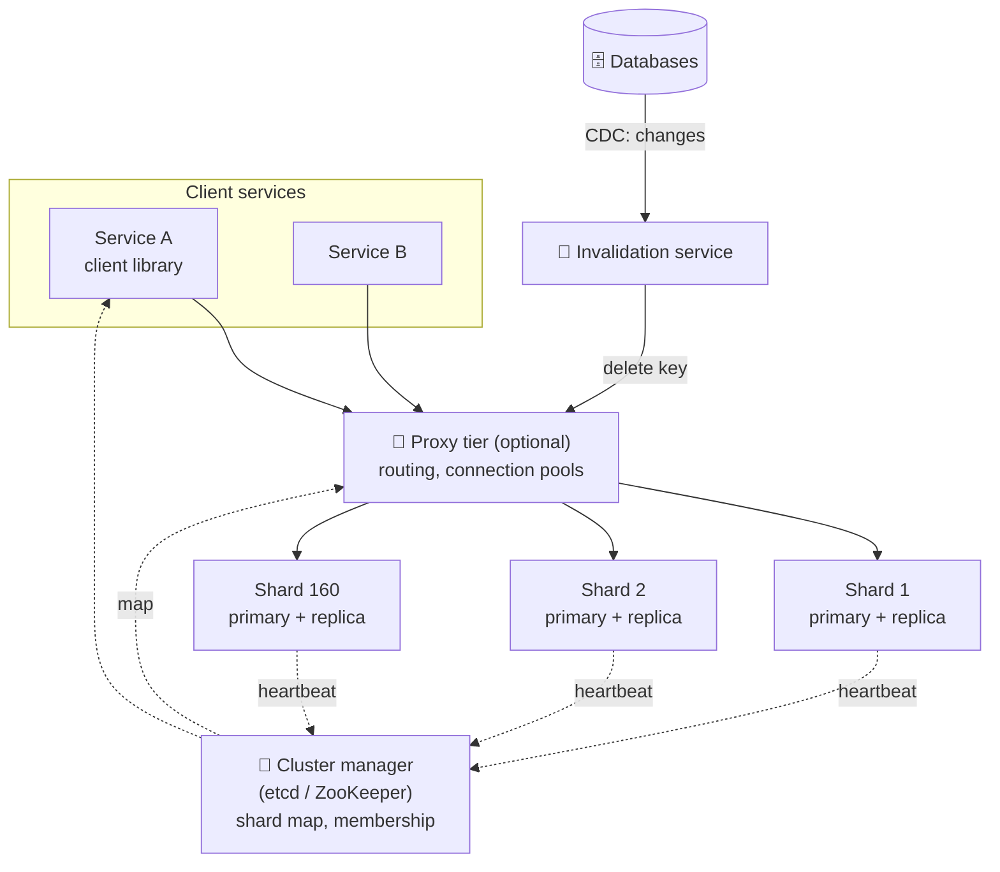
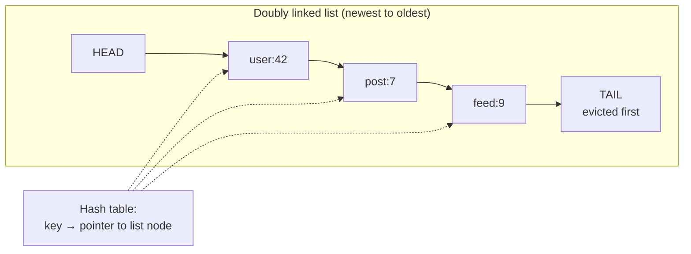
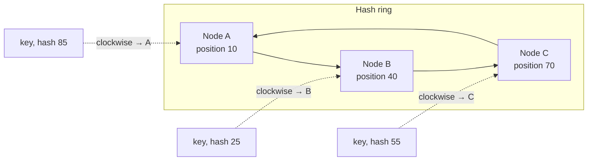
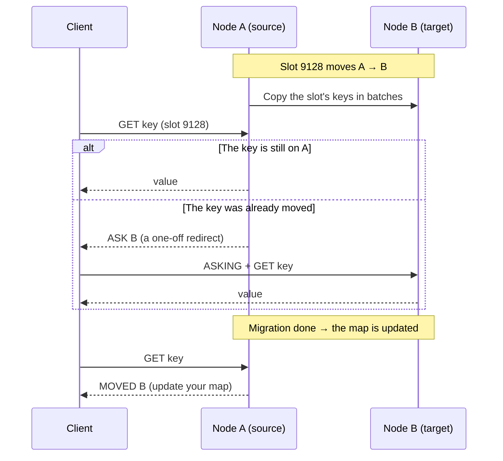
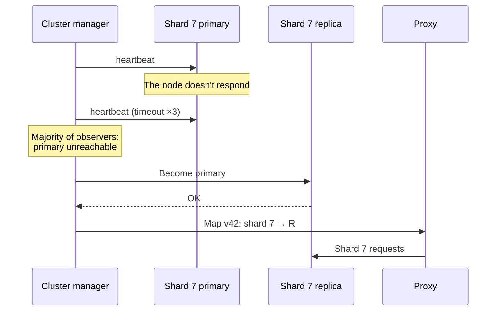
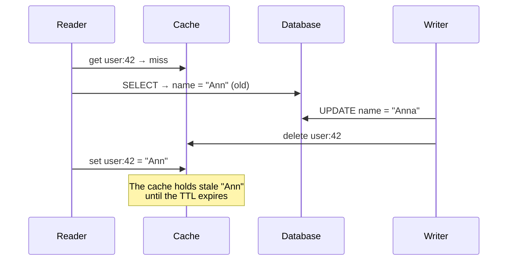
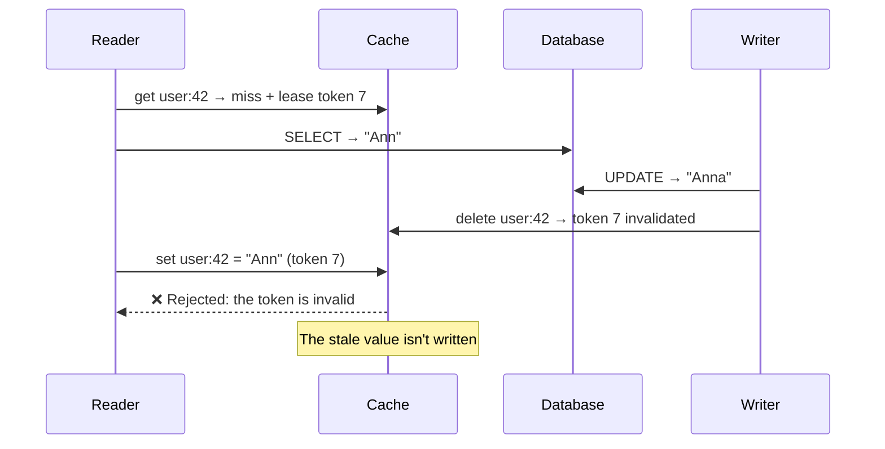
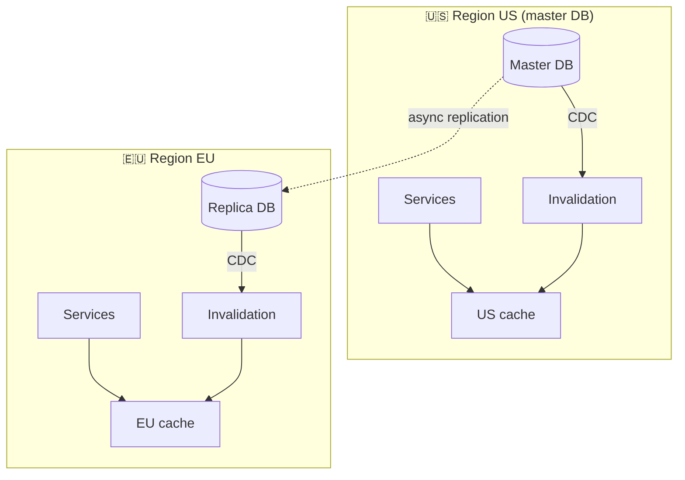

**English** | [Русский](README.ru.md)

# Tier 1 · 03. Distributed Cache (Memcached / Redis Cluster)

> **Level:** Medium · **Interview time:** 45 min · **Study time:** ~5 h
> **Key aspects:** single-node internals (hash table, eviction, TTL, memory), key distribution (consistent hashing, hash slots), routing, replication and failover, consistency with the database (leases), hot keys, stampede protection, multi-region
> **Builds on:** [02-caching](../../01_Fundamentals/02_Caching/README.md) (how to **use** a cache), [05-replication](../../01_Fundamentals/05_Replication/README.md), [06-partitioning](../../01_Fundamentals/06_Partitioning/README.md), [08-consensus](../../01_Fundamentals/08_Consensus/README.md), [13-reliability-patterns](../../01_Fundamentals/13_Reliability%20patterns/README.md)

---

## 🗺️ How to Read This Walkthrough

The walkthrough follows an interview, but every step includes explanations: **why** a decision is made, **how** a mechanism works and **what happens** if you do it differently. The "📘 Explanation" blocks are theory right where you need it.

| Icon | Meaning |
|:----:|:--------|
| 🎤 | Interviewer |
| 🗣️ | What I (the candidate) say out loud |
| ✏️ | What I draw on the whiteboard |
| ⏱️ | Time budget for the step |
| 📘 | A detailed explanation of a concept |

Callouts: **TIP** — a good technique, **WARNING** — a trap, **IMPORTANT** — a Senior+ signal.

---

## 📑 Contents

0. [What This Problem Teaches](#0-what-this-problem-teaches)
1. [Problem Statement](#1-problem-statement)
2. [Clarifying Questions and Requirements](#2-clarifying-questions-and-requirements)
3. [Capacity Estimates](#3-capacity-estimates)
4. [API](#4-api)
5. [High-Level Design](#5-high-level-design)
6. [Deep Dive 1: Inside a Single Node](#6-deep-dive-1-inside-a-single-node)
7. [Deep Dive 2: Distributing Keys Across Nodes](#7-deep-dive-2-distributing-keys-across-nodes)
8. [Deep Dive 3: Request Routing](#8-deep-dive-3-request-routing)
9. [Deep Dive 4: Replication, Failure Detection and Failover](#9-deep-dive-4-replication-failure-detection-and-failover)
10. [Deep Dive 5: Consistency With the Database](#10-deep-dive-5-consistency-with-the-database)
11. [Deep Dive 6: Hot Keys and Stampedes](#11-deep-dive-6-hot-keys-and-stampedes)
12. [Deep Dive 7: Client Performance and Multiget](#12-deep-dive-7-client-performance-and-multiget)
13. [Deep Dive 8: Multiple Regions and Warm-Up](#13-deep-dive-8-multiple-regions-and-warm-up)
14. [Bottlenecks and Failure Scenarios](#14-bottlenecks-and-failure-scenarios)
15. [What Changes at 10x Scale](#15-what-changes-at-10x-scale)
16. [Key Concepts and New Terms](#16-key-concepts-and-new-terms)
17. [Variations and Follow-Up Questions](#17-variations-and-follow-up-questions)
18. [Common Mistakes](#18-common-mistakes)
19. [Cheat Sheet and Self-Check](#19-cheat-sheet-and-self-check)

---

## 0. What This Problem Teaches

In [02-caching](../../01_Fundamentals/02_Caching/README.md) we **used** a cache: cache-aside, TTL, invalidation. Here you have to **build the cache itself** — a system like Memcached or Redis Cluster that hundreds of the company's services rely on.

| What's tested | Where it shows up |
|:--------------|:------------------|
| Data structures and memory | A hash table, O(1) LRU, eviction, fragmentation |
| Partitioning | Consistent hashing, virtual nodes, hash slots |
| Fault tolerance | Replication, failure detection, failover |
| Consistency | Stale data in the cache, invalidation races, leases |
| Handling hot spots | Hot keys, stampedes, incast |
| Performance trade-offs | Sub-millisecond latency, millions of operations per second |

> [!TIP]
> The interviewer may start with "design an LRU cache" (the algorithmic part) and then ask "now make it distributed across 200 machines". Prepare for both: node internals — 5–7 minutes, distribution — most of the time.

---

## 1. Problem Statement

> 🎤 "Design a distributed in-memory cache for the company: hundreds of services use it to take load off databases. It needs millions of operations per second at sub-millisecond latency."

**How services use it:**

```
value = cache.get("user:42:profile")
if value is None:
    value = db.load_profile(42)
    cache.set("user:42:profile", value, ttl=300)
return value
```

A service doesn't care how many machines the cache has or where a key lives — it sees one big "in-memory dictionary".

**Time plan:**

| Step | ⏱️ |
|:-----|:--:|
| Requirements | 4 min |
| Estimates | 4 min |
| API and high-level | 6 min |
| Deep dives | 26 min |
| Failures and wrap-up | 5 min |

---

## 2. Clarifying Questions and Requirements

⏱️ 4 min

| My question | Interviewer's answer | What it changes and why |
|:------------|:---------------------|:------------------------|
| Is this a cache or a primary store? | A cache only: databases are the source of truth | Data can be **lost** in a failure; durability isn't needed |
| Which operations? | get, set, delete, multi-get, TTL, increments | Simple key-value; no complex data structures (as in Redis) |
| How much hot data? | ~10 TB | Hundreds of machines |
| Load? | ~10M operations per second, ~10× more reads than writes | Per-node throughput and node count |
| Latency? | p99 < 1 ms within a data center | Memory only, minimal network hops |
| Value sizes? | Usually hundreds of bytes to a few KB, sometimes up to 1 MB | Large values need separate handling |
| How fresh must data be? | Seconds of staleness are fine, hours are not | Invalidation + TTL as a safety net |
| Regions? | Several, each with its own database replicas | A cache per region, cross-region invalidation |

### Functional requirements

1. `get`, `set` (with TTL), `delete`, `multi_get`, atomic `incr` and `compare-and-set`.
2. Automatic eviction when memory runs out.
3. Data distribution across nodes, transparent to clients.
4. Adding and removing nodes without downtime.

### Non-functional requirements

| Requirement | Target | Why |
|:------------|:-------|:----|
| Latency | p99 < 1 ms | Otherwise the cache loses its point: a page makes dozens of cache requests |
| Throughput | 10M operations/s, scaling linearly | Load grows with the products |
| Availability | A node failure mustn't take down the databases | If the cache absorbed 95% of the load, without it databases get 20× more requests |
| Consistency | Eventual, with staleness bounded to seconds | Strong consistency would kill latency |
| Durability | Not required | It's a cache; data is restored from the databases |

> [!IMPORTANT]
> **The key fact for the whole design:** the cache is **not** the source of truth. That simplifies a lot (data can be lost, replication can be async), but creates another danger: if the cache breaks, all the load falls on the databases. So the cache's **availability** matters more than its **durability**.

---

## 3. Capacity Estimates

⏱️ 4 min

### Record size and item count

```
Key                       ~40 B   ("user:42:profile")
Value                     ~500 B  (a serialized object)
Per-item overhead         ~60 B   (header: TTL, flags, LRU pointers, hash chain)
─────────────────────────────────────
≈ 600 B per item

10 TB / 600 B ≈ 16–17 billion items
```

### Machines by memory

```
Server: 128 GB RAM, ~64–100 GB for data
(the rest — OS, memory fragmentation, network buffers, headroom for spikes)

10 TB / 64 GB ≈ 160 servers (without replicas)
With one replica per shard → ~320 servers
```

### Machines by throughput

```
10M operations/s

Memcached (multithreaded): hundreds of thousands to ~1M operations/s per server
Redis (single-threaded command processing): ~100–200K operations/s per process,
                                             several processes per server

160 servers × 100K operations/s = 16M operations/s → enough throughput
```

### Network

```
10M operations/s × ~1 KB (key + value + protocol) ≈ 10 GB/s total
Per server: 10 GB/s / 160 ≈ 60 MB/s ≈ 0.5 Gbit/s — 10–25 Gbit/s NICs with plenty of headroom
```

### Conclusions

| Conclusion | Design consequence |
|:-----------|:-------------------|
| Server count is driven by **memory**, not CPU | Storage efficiency matters: per-item overhead, fragmentation |
| ~160 shards | A key distribution scheme that copes with nodes joining and failing |
| Overhead is ~10% of a record | With small values it becomes noticeable — a compact item format matters |
| The network isn't a bottleneck on average | But hot keys can overload one server's network |

---

## 4. API

⏱️ 2 min

```
get(key)                              → value | miss
multi_get([key1, key2, ...])          → { key: value }
set(key, value, ttl_seconds)          → ok
add(key, value, ttl)                  → ok | exists          (only if the key is absent)
delete(key)                           → ok
incr(key, delta)                      → new_value             (atomic)
gets(key)                             → (value, cas_token)
cas(key, value, cas_token, ttl)       → ok | conflict         (compare-and-set)
```

📘 **Why `cas` (compare-and-set).** Two services read a counter value of 10, both increment it to 11 and write — one update is lost (a lost update, see [04-databases](../../01_Fundamentals/04_Databases/README.md#9-concurrency-anomalies)). `gets` returns a **version** (a cas token) along with the value; `cas` writes only if the version hasn't changed. It's optimistic locking for a cache.

---

## 5. High-Level Design

⏱️ 4 min



🗣️ "Components:
- **cache nodes** — processes holding part of the keys in memory; each shard is a primary plus a replica;
- the **cluster manager** — stores the map of 'which key range lives on which node', tracks node liveness, drives failover;
- **routing** — a client library or a proxy that computes the right shard from the key;
- the **invalidation service** — reads the databases' change stream (CDC) and deletes stale keys."

---

## 6. Deep Dive 1: Inside a Single Node

> 🎤 "How does a single cache node work internally?"

### 6.1 The hash table

📘 **The foundation is a hash table:** key → hash → bucket number → item. Lookup, insert and delete in O(1) on average.

**The growth problem.** When items outnumber buckets, chains get longer and lookups slow down. The table must be enlarged (usually doubled) and every item **rehashed**. Rehashing 100M items at once would take seconds — and the node wouldn't respond the whole time.

**The fix — incremental rehashing** (as Redis does): keep **two** tables, old and new. Each operation moves a few buckets from the old to the new one; lookups check both. Eventually the old table empties and is freed. The work is spread over time, with no pauses.

### 6.2 Eviction

When memory runs out, something has to go. The policies are covered in [02-caching](../../01_Fundamentals/02_Caching/README.md#6-eviction-lru-lfu-and-others); what matters here is doing it **efficiently**.

📘 **Exact LRU in O(1).** A hash table + a doubly linked list:



- `get`: find the node via the hash table (O(1)) and move it to the head (O(1)).
- Eviction: remove the item at the tail (O(1)).
- The cost: two pointers (16 B) per item **and a lock** for the move on every read — a bottleneck with many threads.

📘 **Approximate LRU (as in Redis).** Instead of a list, each item has a 24-bit last-access timestamp. When memory runs out, a **random sample** (e.g. 5 keys) is taken and the least recently used of them is evicted. No list, no moves on reads, and accuracy close to true LRU, especially with a small pool of "eviction candidates".

📘 **LFU.** Instead of time — a **frequency counter**. So it uses few bits and reflects recent popularity, it's a logarithmic probabilistic counter (incremented on each access with probability ~1/current value) that decays over time. LFU beats LRU when there are consistently popular keys and one-off scans that would otherwise evict them.

| Policy | For |
|:-------|:----|
| LRU / approximate LRU | The general-purpose choice: recently used is likely needed again |
| LFU | There are "evergreen" keys and one-off scans |
| TTL-based (`volatile-ttl`) | Evict what's about to expire first |
| Only keys with a TTL (`volatile-*`) | If the same instance holds data that mustn't be evicted (bad practice for a cache) |

### 6.3 TTL expiration

How do you delete keys with expired TTLs when there are billions of them?

| Approach | How | Problem |
|:---------|:----|:--------|
| **Lazy** | On read, check the TTL; if expired — delete and return a miss | Keys nobody reads anymore sit in memory forever |
| **Active** (sampling) | Several times a second, take random keys with TTLs and delete the expired ones; if more than ~25% were expired — repeat | A little CPU |
| **A timer per key** | Delete exactly at expiry | Billions of timers — far too expensive |

Redis uses **both** of the first two: lazy expiration guarantees an expired key is never returned to a client, and active expiration frees memory from unused ones.

### 6.4 Memory management

📘 **Fragmentation.** Items of different sizes are constantly created and deleted. Memory is left with "holes" that new items don't fit into: formally 20 GB are free, yet there's nowhere to put a 1 MB object.

| Approach | How | Pros and cons |
|:---------|:----|:--------------|
| **Slab allocator** (Memcached) | Memory is split into 1 MB pages, each divided into same-size chunks (a class: 96 B, 120 B, 152 B…, growing ~1.25×). An item goes into the nearest fitting class | No external fragmentation; but internal (a 100 B item in a 120 B chunk); and if the size profile shifts, memory can get "stuck" in unsuitable classes (fixed by rebalancing pages) |
| **A general-purpose allocator** (jemalloc in Redis) | An allocator with size classes + active defragmentation | Flexible; fragmentation is controlled but exists |

> [!TIP]
> Don't give the cache all of a machine's memory: set `maxmemory` to about 60–75% of RAM. The rest is for fragmentation, client buffers, the OS and (for Redis) copy-on-write during a fork for snapshots.

### 6.5 Threading model

| | Memcached | Redis |
|:-|:----------|:------|
| Command processing | Multithreaded, with locks on table segments and on the LRU | A single thread (with optional I/O threads) |
| Pro | One process uses every core | No locks, simple atomic operations, Lua scripts |
| Con | Locks limit scaling | On a multi-core machine you need several processes |

🗣️ "For our problem — simple key-value with maximum throughput — both fit. The multithreaded model is handier on big machines; the single-threaded one is simpler and gives atomic operations. The rest of the design doesn't depend on this choice."

---

## 7. Deep Dive 2: Distributing Keys Across Nodes

> 🎤 "How do you decide which of the 160 nodes holds a key?"

### Naively: `hash(key) % N`

```
N = 160 → N = 161 (one server added)
hash(key) % 160 ≠ hash(key) % 161 for almost every key
→ ~99% of keys "move" → mass misses → an avalanche of database requests
```

For a cache this is a disaster: adding one server empties practically the whole cache. Details in [06-partitioning](../../01_Fundamentals/06_Partitioning/README.md#4-why-hash-mod-n-is-a-bad-idea-and-what-to-use-instead).

### Consistent hashing

📘 **How it works.** The hash space wraps into a **ring** (0 … 2³² − 1). Each node gets a position on the ring (the hash of its name). A key belongs to **the first node clockwise** from the key's hash.



**Adding node D at position 55:** keys with hashes 41 to 55 move from C to D. All other keys stay put. On average **1/N** of the keys move.

**The unevenness problem.** With three points on the ring, the arcs come out different sizes — one node might get twice as many keys. **The fix — virtual nodes**: each physical node takes 100–200 points on the ring (hashes of `"A#1"`, `"A#2"`, …). The arcs even out, and when a node fails its keys spread across **many** neighbors rather than all landing on one.

```
Example: 4 nodes → 5 nodes
  hash % N:              ~80% of keys move
  consistent hashing:    ~20% of keys move (exactly the new node's share)
```

This is how Memcached clients (the Ketama algorithm), Cassandra and many proxies distribute keys.

### Hash slots (Redis Cluster)

📘 **How it works.** A fixed number of **slots** — 16,384. A key's slot: `CRC16(key) mod 16384`. Each node owns a set of slots; the "slot → node" map is stored in the cluster.

```
slot("user:42:profile") = CRC16("user:42:profile") mod 16384 = 9,128 → the node owning slot 9,128

Hash tags: only the part of the key in curly braces is hashed into the slot:
  "{user:42}:profile" and "{user:42}:settings" → the same slot → multi-key operations work
```

| | Consistent hashing | Hash slots |
|:-|:-------------------|:-----------|
| What moves when a node is added | Arcs of the ring, computed automatically | Explicitly chosen slots |
| Control | Implicit | Explicit: specific slots can be moved, balanced by load |
| The map | Computed from the node list | Stored explicitly (16,384 entries) |
| Where | Memcached clients, Cassandra, Dynamo | Redis Cluster |

### Moving slots without downtime



- `ASK` — "this key is on another node right now; ask there, but don't change your map yet" (during migration).
- `MOVED` — "the slot now permanently lives on another node; update your map".

---

## 8. Deep Dive 3: Request Routing

> 🎤 "How does a client know which node to go to?"

| Approach | How | Pros | Cons | Examples |
|:---------|:----|:-----|:-----|:---------|
| **Smart client** | The library holds the node map and computes the shard itself | No extra network hop — minimal latency | Logic in every language; updating clients is hard | Memcached clients (Ketama), Redis Cluster |
| **Proxy** | A separate tier (per host or centralized) accepts requests and routes them | Simple clients; centralized logic (write replication, failover, metrics); fewer connections to nodes | An extra hop (~0.1–0.3 ms; nearly zero if the proxy is on the same host) | mcrouter (Facebook), twemproxy, Envoy |
| **Server-side redirects** | The client goes to any node, which answers `MOVED` | A simple client | An extra hop with a stale map | Redis Cluster as a fallback mechanism |

📘 **The connection count problem.** 10,000 service instances × 160 cache nodes = 1.6 million TCP connections. Each takes memory on the cache server. A per-host proxy (a sidecar) funnels requests from every process on the host into a small connection pool per node — cutting the connection count by orders of magnitude.

🗣️ "I choose a **per-host proxy** (like mcrouter): clients stay simple, the connection pool is shared, routing, failover and metrics live in one place, and a localhost hop costs almost nothing. The proxy gets the shard map from the cluster manager and caches it."

---

## 9. Deep Dive 4: Replication, Failure Detection and Failover

> 🎤 "A cache node died. What happens?"

### Why a node failure is dangerous

```
Without protection: a node holding 1/160 of the keys dies → every request for its keys misses → goes to the database.
If the cache absorbed 95% of the database load, the load for those keys grows 20×.
With an unlucky distribution (hot keys on that node), the database may not cope.
```

### Protection options

| Approach | How | Pros | Cons |
|:---------|:----|:-----|:-----|
| **Primary → replica replication** | Each shard has a replica; when the primary fails, the replica becomes primary | Data is preserved; the cache stays "warm" | Twice the memory |
| **Gutter pool** (Facebook's approach) | A small spare pool (~1% of servers); requests for a failed node temporarily go to the gutter, which fills up with a short TTL | Cheap: no full replica needed | A short window of misses after a failure; gutter data expires quickly |
| **Redistributing via the ring** | A failed node's keys move to its neighbors | Nothing extra | Neighbors take misses and load; with a "flapping" node — stale data |

### Replication

📘 Replication in a cache is **asynchronous**: the primary answers the client immediately, and the replica catches up. Losing the last writes on failover is acceptable — it's a cache, and data is restored from the database (more on modes in [05-replication](../../01_Fundamentals/05_Replication/README.md)). Replicas can also serve **reads** to offload hot shards — at the risk of reading a slightly stale value.

### Failure detection and failover

| Approach | How |
|:---------|:----|
| **An external coordinator** (Sentinel, a cluster manager on etcd) | Observers check nodes; if a **majority** of observers deems the primary unreachable, a replica is chosen and promoted, and the map is updated |
| **Gossip** (Redis Cluster) | Nodes exchange messages about each other's state; a node is marked failed when a majority of primaries report it; the replica initiates its own promotion |



### Split brain

📘 If the old primary didn't die but just ended up behind a network partition, it can keep accepting writes — giving **two** primaries. For a cache this causes diverging values. Protections:
- the new primary is chosen by a **majority** of observers (see [08-consensus](../../01_Fundamentals/08_Consensus/README.md));
- an old primary that lost contact with the majority **stops accepting writes by itself** (in Redis — `min-replicas-to-write`);
- once connectivity returns, the old primary becomes a replica and discards its data.

> [!IMPORTANT]
> **Senior+ signal:** discuss not only "how to recover" but **what happens to the database** at the moment of failure. The point of these mechanisms (a replica, a gutter pool) isn't to preserve cache data (it's recoverable) but to **prevent an avalanche onto the databases**.

---

## 10. Deep Dive 5: Consistency With the Database

> 🎤 "How do you keep stale data from lingering in the cache?"

The basic strategies (cache-aside, delete-after-write, races) are covered in [02-caching](../../01_Fundamentals/02_Caching/README.md#7-invalidation). Here — what's needed **from the cache itself** so clients can behave correctly.

### The race: a stale set



The reader read the old value **before** the change but wrote it to the cache **after** the invalidation — stale data lives until the TTL expires.

### The fix: leases

📘 The approach is described in Facebook's paper "Scaling Memcache at Facebook" (2013). On a miss, the cache gives the client a **lease token** — permission to fill this key. A `delete` **invalidates** issued tokens. A `set` is accepted only if the token is still valid.



**A bonus — stampede protection.** The cache hands out a lease for a key at most once every few seconds. Other clients that miss in the meantime get a "wait and retry" response — and milliseconds later find the value the first one stored. One database request instead of a thousand.

### Invalidation from the database change stream

| Approach | How | Pros | Cons |
|:---------|:----|:-----|:-----|
| The application deletes the key after writing | `db.update(...)`, then `cache.delete(...)` | Simple | If the app crashes between the steps, the key isn't deleted |
| **CDC** ⭐ | An invalidation service reads the database's change log (binlog, WAL) and deletes the related keys | Nothing is lost: every committed change lands in the log | Needs CDC infrastructure and a "row → cache keys" mapping |

Facebook described a system that reads the MySQL commit log and broadcasts deletes to caches (McSqueal). It's the same idea as CDC in [11-distributed-transactions](../../01_Fundamentals/11_Distributed%20transactions/README.md#12-cdc-change-data-capture).

### TTL as a safety net

Even with leases and CDC, something can go wrong (a lost event, a bug). A **TTL** guarantees a stale value disappears on its own — staleness is bounded above by the key's lifetime.

---

## 11. Deep Dive 6: Hot Keys and Stampedes

> 🎤 "A celebrity posted — 1 million requests per second to one key. What do you do?"

### Why it's a problem

The key lives on **one** shard. A node handles ~100K operations per second and has a 10–25 Gbit/s NIC. A million requests per second for one 10 KB key is 10 GB/s ≈ 80 Gbit/s. The node is overloaded, and **every** other key on it slows down too.

### Detection

| Approach | How |
|:---------|:----|
| Node statistics | Per-key frequency counters (LFU counters in Redis, `--hotkeys`), top-K over the request stream |
| Sampling at the proxy | The proxy samples requests and counts key frequency (a count-min sketch) |
| Node metrics | One node's CPU and network skewed relative to the rest |

### Solutions

| Solution | How | Cost |
|:---------|:----|:-----|
| **A local cache (L1) in the proxy or client** | Hot keys are cached in process memory for 1–5 seconds | Seconds of staleness; extra memory |
| **Replicas of the hot key** | The key is copied into N instances: `post:7#0` … `post:7#9` on different shards; reads pick one at random | Writes and invalidation go to all N copies |
| **Reading from the shard's replicas** | A hot shard serves reads from both the primary and its replicas | Possible reads of a slightly stale value |
| **Splitting a large value** | A 1 MB object is split into parts under keys on different shards | More complex reads and writes |

🗣️ "For detected hot keys the proxy enables a **local cache** with a TTL of a couple of seconds — a million requests turn into a few requests per second from each proxy. It's the most effective fix: the load is spread over thousands of client hosts."

### Stampede (thundering herd)

📘 A popular key expired or was deleted → thousands of clients miss at the same moment → all go to the database to recompute the same value.

| Solution | How |
|:---------|:----|
| **Leases** (see above) | Only one client gets the right to fill the key; the rest wait |
| **Request coalescing** in the proxy | Concurrent misses for one key on one proxy are merged into a single request |
| **Serving stale** | After invalidation the key isn't deleted but marked stale; clients get the old value while one recomputes the new (stale-while-revalidate) |
| **Probabilistic early refresh** (XFetch) | A client recomputes the value **before** the TTL expires with a small probability that grows as expiry approaches |
| **TTL jitter** | Keys written at the same time expire at different times |

📘 **XFetch in more detail.** The value is recomputed early if:

```
now − delta × beta × ln(random()) ≥ expiry

delta  — how long recomputing the value takes
beta   — aggressiveness (usually 1)
ln(random()) < 0, so the closer to expiry and the slower the recomputation, the likelier an early refresh
```

As a result, one of the clients almost certainly refreshes the value before it expires, and there's no mass miss — with no coordination between clients.

---

## 12. Deep Dive 7: Client Performance and Multiget

> 🎤 "A feed page does a multi_get for 500 keys. How do you make it fast?"

### Breaking down a multi_get

The 500 keys live on different shards. The client (or proxy) groups keys by shard and sends **one request per shard in parallel**:

```
500 keys → spread over ~100 shards → 100 parallel requests
Latency = the slowest shard's latency
```

### Problems and fixes

| Problem | Why | Fix |
|:--------|:----|:----|
| **Tail latency** | The response waits for the slowest of 100 shards: if each is slow 1% of the time, the whole request is slow ~63% of the time | A per-shard timeout and a partial result (late keys count as misses → database); hedged requests to replicas |
| **Incast** | 100 servers respond to one client at once → switch buffers overflow, packets drop, TCP waits for retransmission | Limit concurrent requests on the client (a sliding window, as Facebook described) |
| **Excessive fan-out** | Tiny requests per shard are inefficient | Co-locate related keys (hash tags) — e.g. one user's data on one shard |

### Other optimizations

| Optimization | Effect |
|:-------------|:-------|
| **Persistent connection pools** | No TCP and TLS handshakes per request |
| **Pipelining** | Several commands in one packet without waiting for each response |
| **UDP for gets** (as Facebook did for reads) | Less overhead; a lost packet = a miss |
| **Compact serialization and compression** of large values | Less network and memory |
| **A local cache** for hot keys | Some requests never hit the network |

---

## 13. Deep Dive 8: Multiple Regions and Warm-Up

> 🎤 "The company has three regions. How is the cache set up?"

### A cache in every region



| Principle | Why |
|:----------|:----|
| Each region has its own cache cluster | Cross-region cache requests (100+ ms) would defeat the purpose of a cache |
| Each region invalidates **from its own database replica** | If a key were deleted in EU **before** the change reached the EU replica, the next miss would load the **old** value from that replica. Invalidating from the local replica's CDC guarantees the replica already holds the new value when the key is deleted |

### Read-your-writes in a replica region

📘 A user in EU edited their profile (the write went to the master in US), refreshed the page — a miss in the EU cache → a read from the EU replica, which hasn't caught up → old data. Facebook described a fix — a **remote marker**: on a write in EU, a marker is set in the EU cache saying "this key was recently changed"; if the marker is present on a miss, the read goes to the master region instead of the lagging replica.

### Cold start

📘 A new cache cluster (or one after a mass restart) is empty. If traffic is switched to it right away, every request is a miss → an avalanche onto the databases.

| Fix | How |
|:----|:----|
| **Warm-up from a warm cluster** | On a miss, the new cluster first reads from a neighboring warm cluster rather than the database (Facebook called this cold cluster warmup) |
| **Gradual traffic shift** | 1% → 10% → 100% as the hit rate grows |
| **Memory snapshots** | A node periodically saves its data to disk and loads it on restart (RDB in Redis) — a "warm" restart |
| **Staged restarts** | Updates one node at a time, not the whole cluster at once |

---

## 14. Bottlenecks and Failure Scenarios

| Scenario | What happens | How we protect |
|:---------|:-------------|:---------------|
| A node fails | Misses on its keys → load on the databases | A replica with automatic failover, or a gutter pool |
| A network partition, two primaries | Diverging data | Election by majority; the old primary stops accepting writes |
| A hot key | One node overloaded | Detection, a local cache on the proxy, key replicas |
| A stampede after a popular key expires | An avalanche onto the database | Leases, coalescing, stale-while-revalidate, XFetch, jitter |
| A stale set after invalidation | Old data until the TTL | Leases |
| A lost invalidation event | Stale data | CDC (doesn't lose commits) + TTL as a safety net |
| A mass cluster restart | A cold cache, an avalanche onto the databases | Staged restarts, snapshots, warm-up, gradual shifting |
| Adding nodes | Some keys move → misses | Consistent hashing / slots: only 1/N moves; slot migration with copying |
| Incast during a multiget | Packet loss, latency growth | Limiting concurrent requests on the client |
| Memory fragmentation | Eviction despite nominally free memory | Slab classes, or jemalloc with active defragmentation; memory headroom |
| A large value (1 MB+) | Blocks the node and the network | A size limit, compression, splitting, or object storage |

---

## 15. What Changes at 10x Scale

> 🎤 "100 TB and 100M operations per second?"

| Change | Why |
|:-------|:----|
| **Tiered storage: RAM + SSD** | 100 TB in RAM is very expensive; "warm" keys live on NVMe, hot ones in memory (that's how Facebook CacheLib, Twitter Pelikan and Netflix EVCache with SSD work) |
| **Pools by workload profile** | Separate clusters for different patterns: many small keys, large values, hot keys — each with its own settings |
| **Value compression** | Saves memory and network |
| **The proxy as a standard platform** | Routing, replicating writes between pools, shadow traffic during migrations |
| **Automatic hot key detection and handling** | At this scale you can't keep up manually |

---

## 16. Key Concepts and New Terms

### What's applied from Fundamentals

| Concept | Where it's covered | How it applies here |
|:--------|:-------------------|:--------------------|
| Cache-aside, invalidation, eviction policies | [02-caching](../../01_Fundamentals/02_Caching/README.md) | How clients use the cache; LRU/LFU |
| Async replication, failover | [05-replication](../../01_Fundamentals/05_Replication/README.md) | Shard replicas |
| Consistent hashing, slots, migration | [06-partitioning](../../01_Fundamentals/06_Partitioning/README.md) | Key distribution |
| Majority-based leader election, split brain | [08-consensus](../../01_Fundamentals/08_Consensus/README.md) | Failure detection, failover |
| CDC | [11-distributed-transactions](../../01_Fundamentals/11_Distributed%20transactions/README.md#12-cdc-change-data-capture) | Invalidation from the database log |
| Tail latency, hedged requests | [13-reliability-patterns](../../01_Fundamentals/13_Reliability%20patterns/README.md) | Multigets across many shards |

### New terms in this problem

| Term | In short |
|:-----|:---------|
| **Incremental rehashing** | Growing a hash table without pauses: two tables and gradual moves |
| **Approximate LRU** | Evicting the best of a random sample instead of maintaining a list |
| **Lazy + active TTL expiration** | A check on read + periodic sampled cleanup |
| **Slab allocator** | Fixed-size chunks against external fragmentation |
| **Virtual nodes** | Many ring points per server for evenness |
| **Hash slots, MOVED/ASK** | 16,384 slots with an explicit map and redirects during migration |
| **Gutter pool** | A small spare pool instead of a full replica |
| **Leases** | A token to fill a key: protection against stale sets and stampedes |
| **Remote marker** | A "recently changed" marker for read-your-writes with a lagging replica |
| **Incast** | Packet loss when many servers respond to one client at once |
| **XFetch** | A probabilistic early refresh before the TTL expires |

---

## 17. Variations and Follow-Up Questions

<details>
<summary><b>Memcached or Redis for this problem?</b></summary>

For a plain key-value cache with maximum throughput on big machines — Memcached (multithreaded, simple, a slab allocator). If you need data structures (lists, sets, sorted sets), atomic scripts, pub/sub, built-in clustering and persistence — Redis. Many companies use both for different jobs.
</details>

<details>
<summary><b>Does a cache need persistence?</b></summary>

Not for correctness: data is restored from the databases. But disk snapshots help with **fast warm restarts**: after an update, a node loads its data from disk instead of starting with empty memory — less load on the databases. A log of every write (AOF) is usually unnecessary for a pure cache.
</details>

<details>
<summary><b>Why not make the cache strongly consistent with the database?</b></summary>

You'd have to update the cache and the database in one distributed transaction, or synchronously invalidate in every region before acknowledging a write — adding latency to every write and making the cache a point of failure for writes. Eventual consistency with bounded staleness (leases, CDC, TTL) is usually enough, and operations that need freshness read from the database directly.
</details>

<details>
<summary><b>How do you implement an LRU cache in an algorithms interview?</b></summary>

A hash table "key → node" + a doubly linked list with dummy head and tail nodes. `get`: find the node, move it to the head. `put`: if the key exists — update and move it; if not — create a node at the head, and if capacity is exceeded, remove the node before the tail and its key from the table. Every operation is O(1).
</details>

<details>
<summary><b>How do you add 20 nodes to a running cluster?</b></summary>

With consistent hashing — one node at a time, letting the cache warm up between additions (each addition causes misses for ~1/N of the keys). With hash slots — add empty nodes and gradually move slots with data copying (no misses), throttling the migration speed.
</details>

<details>
<summary><b>What do you do with very large values?</b></summary>

Cap the value size (e.g. 1 MB); compress large values; split them into parts under different keys; and store really large objects (media, files) in object storage + a CDN, caching only metadata.
</details>

---

## 18. Common Mistakes

| ❌ Mistake | Why it's bad | ✅ Do this instead |
|:----------|:-------------|:------------------|
| `hash % N` for distribution | Adding a node empties almost the whole cache | Consistent hashing with virtual nodes, or hash slots |
| No virtual nodes | Uneven load; a node failure overloads one neighbor | 100–200 virtual nodes per server |
| Giving the cache all the machine's memory | Fragmentation and buffers lead to OOM | `maxmemory` ~60–75% of RAM |
| No plan for a node failure | An avalanche onto the databases | Replicas or a gutter pool |
| Synchronous replication in a cache | Write latency for no reason | Async: losing cache data is acceptable |
| Ignoring the stale-set race | Stale data until the TTL | Leases |
| No TTL | Stale data lives forever if an invalidation is lost | TTL as a safety net |
| No stampede protection | A popular key expiring takes down the database | Leases, coalescing, stale-while-revalidate, XFetch |
| Hoping hot keys won't happen | One node overloaded | Detection + a local cache + key replicas |
| Cross-region cache requests | 100+ ms latency | A cache per region, invalidation from the local replica |
| Restarting the whole cluster at once | A cold cache, an avalanche onto the databases | Staged restarts, snapshots, warm-up |

---

## 19. Cheat Sheet and Self-Check

### 30-second answer

> 10 TB and 10M operations per second — ~160 shards, with machine count driven by memory. A node: a hash table with incremental rehashing, approximate LRU or LFU, lazy and active TTL expiration, a slab allocator or jemalloc, `maxmemory` ~70% of RAM. Keys are distributed with consistent hashing and virtual nodes, or 16,384 slots migrated via MOVED/ASK. Routing — a per-host proxy with a connection pool. Each shard is a primary with an async replica; failover is decided by a majority, and an old primary without a majority stops accepting writes; the goal isn't preserving data but preventing an avalanche onto the databases. Consistency: leases against stale sets and stampedes, invalidation from CDC, TTL as a safety net. Hot keys — a local cache on the proxy and key replicas. Multigets — parallel per shard with timeouts and incast limits. Regions — a cluster in each, invalidation from the local replica, remote markers, warming up new clusters.

### Self-check

- [ ] I can compute the node count by memory and by throughput
- [ ] I can explain incremental rehashing and approximate LRU
- [ ] I can implement an O(1) LRU and explain why production often uses an approximate one
- [ ] I can explain lazy and active TTL expiration
- [ ] I can explain the slab allocator and fragmentation
- [ ] I can compare consistent hashing and hash slots, and explain MOVED and ASK
- [ ] I can describe failover and split-brain protection
- [ ] I can show the stale-set race and how leases solve it
- [ ] I can propose 4 fixes for hot keys and 5 for stampedes
- [ ] I can explain incast and tail latency in multigets
- [ ] I can describe a multi-region cache and cold starts

### Further reading

- Nishtala et al., *Scaling Memcache at Facebook* (NSDI 2013) — leases, gutter pool, mcrouter, regions, remote markers
- Karger et al., *Consistent Hashing and Random Trees* (1997)
- Vattani, Chierichetti, Lowenstein, *Optimal Probabilistic Cache Stampede Prevention* (VLDB 2015) — XFetch
- Redis documentation: Cluster specification, eviction policies, expiration
- Memcached documentation: the slab allocator
- Netflix Tech Blog: EVCache; Facebook Engineering: CacheLib
