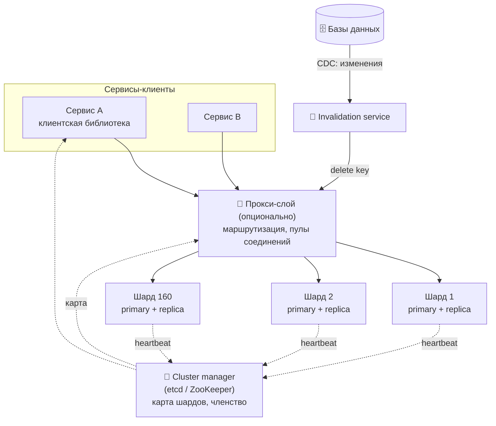
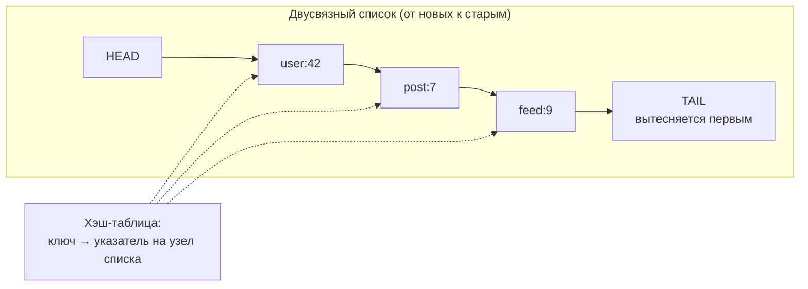
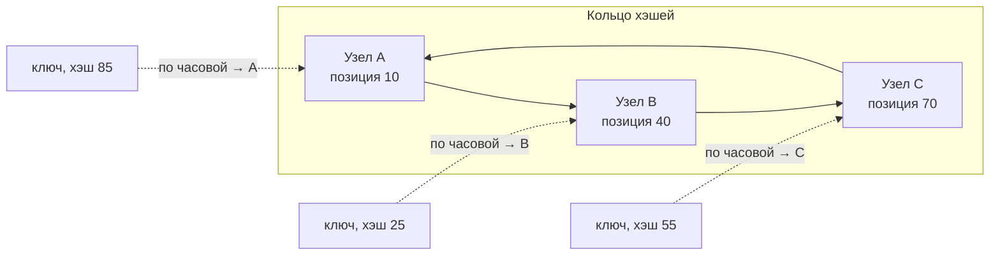
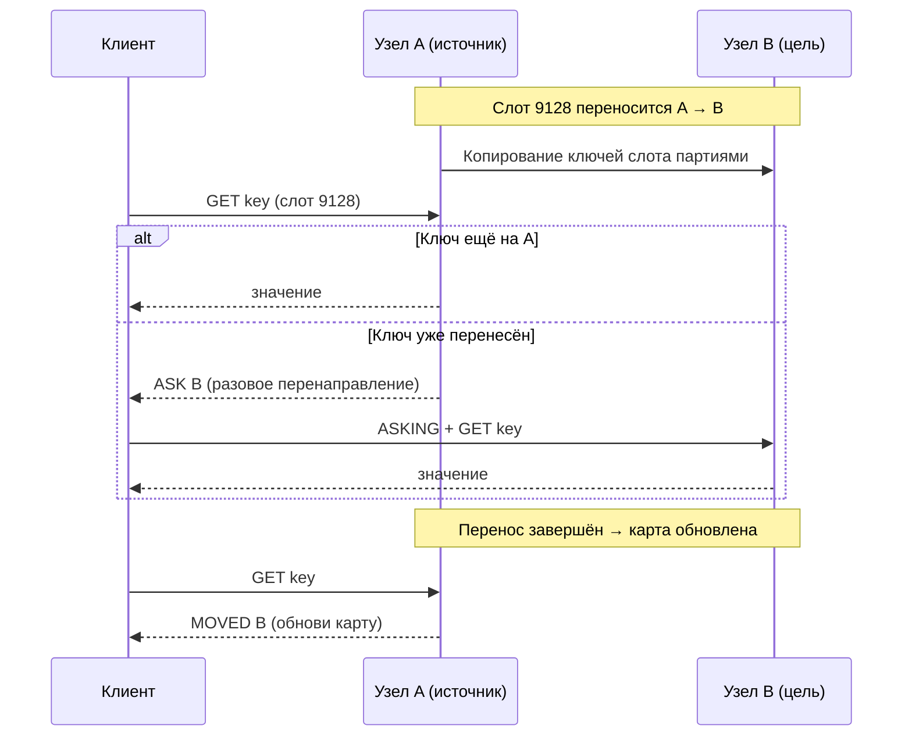
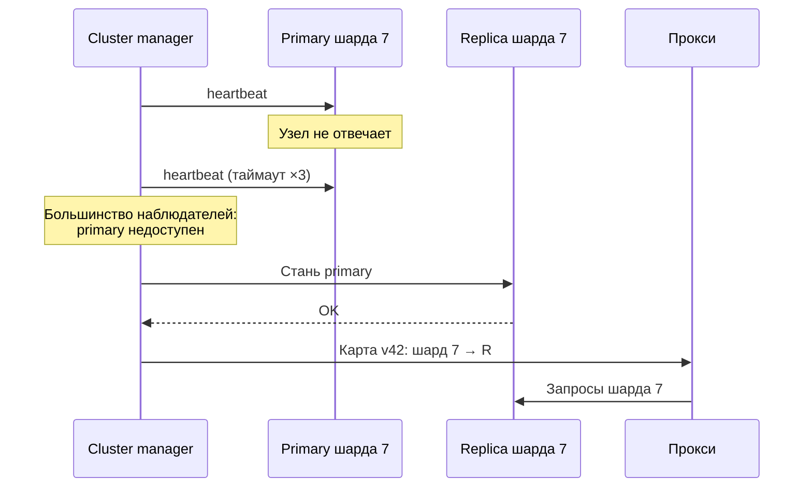
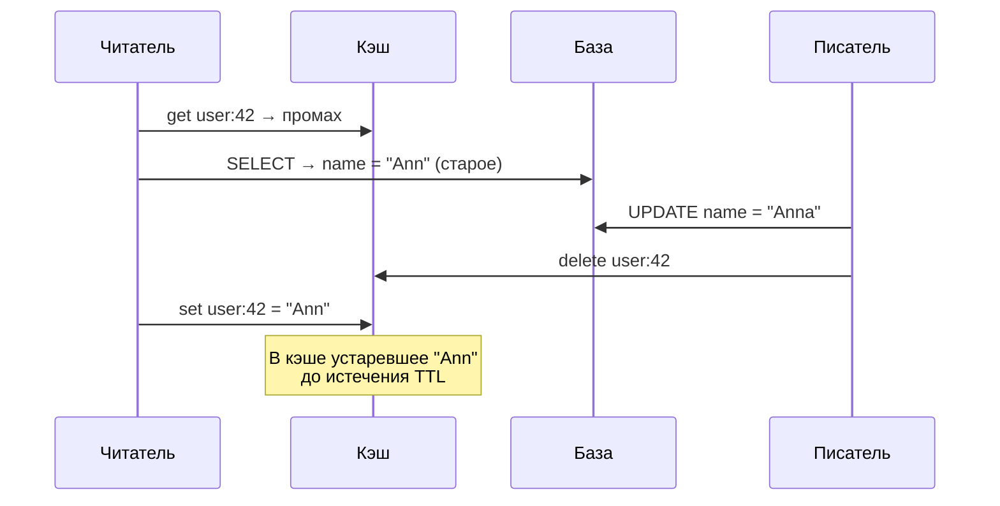
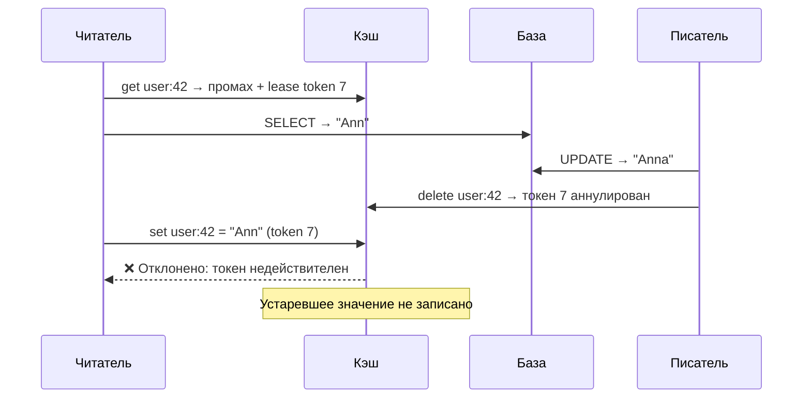
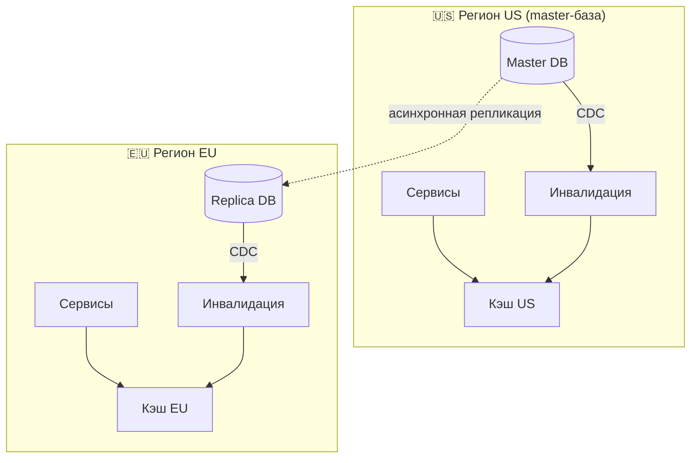

[English](README.md) | **Русский**

# Tier 1 · 03. Distributed Cache (Memcached / Redis Cluster)

> **Уровень:** Medium · **Время на интервью:** 45 мин · **Время на разбор:** ~5 ч
> **Ключевые аспекты:** устройство одного узла (хэш-таблица, вытеснение, TTL, память), распределение ключей (consistent hashing, hash slots), маршрутизация, репликация и failover, консистентность с базой (leases), горячие ключи, защита от stampede, мульти-регион
> **Опирается на:** [02-caching](../../01_Fundamentals/02_Caching/README.ru.md) (как **использовать** кэш), [05-replication](../../01_Fundamentals/05_Replication/README.ru.md), [06-partitioning](../../01_Fundamentals/06_Partitioning/README.ru.md), [08-consensus](../../01_Fundamentals/08_Consensus/README.ru.md), [13-reliability-patterns](../../01_Fundamentals/13_Reliability%20patterns/README.ru.md)

---

## 🗺️ Как читать этот разбор

Разбор построен как интервью, но в каждом шаге есть объяснения: **почему** принимается решение, **как работает** механизм и **что будет**, если сделать иначе. Блоки «📘 Объяснение» — теория прямо по ходу задачи.

| Значок | Что значит |
|:------:|:-----------|
| 🎤 | Реплика интервьюера |
| 🗣️ | Что говорю вслух я (кандидат) |
| ✏️ | Что рисую на доске |
| ⏱️ | Сколько времени тратить на шаг |
| 📘 | Подробное объяснение концепции |

Блоки **TIP** — хороший приём, **WARNING** — ловушка, **IMPORTANT** — сигнал для уровня Senior+.

---

## 📑 Содержание

0. [Чему учит эта задача](#0-чему-учит-эта-задача)
1. [Условие задачи](#1-условие-задачи)
2. [Уточняющие вопросы и требования](#2-уточняющие-вопросы-и-требования)
3. [Оценки нагрузки](#3-оценки-нагрузки)
4. [API](#4-api)
5. [High-level дизайн](#5-high-level-дизайн)
6. [Deep dive 1: устройство одного узла](#6-deep-dive-1-устройство-одного-узла)
7. [Deep dive 2: распределение ключей по узлам](#7-deep-dive-2-распределение-ключей-по-узлам)
8. [Deep dive 3: маршрутизация запросов](#8-deep-dive-3-маршрутизация-запросов)
9. [Deep dive 4: репликация, обнаружение отказов и failover](#9-deep-dive-4-репликация-обнаружение-отказов-и-failover)
10. [Deep dive 5: консистентность с базой данных](#10-deep-dive-5-консистентность-с-базой-данных)
11. [Deep dive 6: горячие ключи и stampede](#11-deep-dive-6-горячие-ключи-и-stampede)
12. [Deep dive 7: производительность клиента и multiget](#12-deep-dive-7-производительность-клиента-и-multiget)
13. [Deep dive 8: несколько регионов и прогрев](#13-deep-dive-8-несколько-регионов-и-прогрев)
14. [Узкие места и сценарии сбоев](#14-узкие-места-и-сценарии-сбоев)
15. [Что изменится при росте в 10 раз](#15-что-изменится-при-росте-в-10-раз)
16. [Ключевые концепции и новые понятия](#16-ключевые-концепции-и-новые-понятия)
17. [Варианты задачи и follow-up вопросы](#17-варианты-задачи-и-follow-up-вопросы)
18. [Типичные ошибки](#18-типичные-ошибки)
19. [Шпаргалка и самопроверка](#19-шпаргалка-и-самопроверка)

---

## 0. Чему учит эта задача

В теме [02-caching](../../01_Fundamentals/02_Caching/README.ru.md) мы **использовали** кэш: cache-aside, TTL, инвалидация. Здесь нужно **построить сам кэш** — систему вроде Memcached или Redis Cluster, которой пользуются сотни сервисов компании.

| Что проверяют | Где это в задаче |
|:--------------|:-----------------|
| Структуры данных и память | Хэш-таблица, LRU за O(1), вытеснение, фрагментация |
| Партиционирование | Consistent hashing, виртуальные узлы, hash slots |
| Отказоустойчивость | Репликация, обнаружение отказов, failover |
| Консистентность | Устаревшие данные в кэше, гонки при инвалидации, leases |
| Работа с горячими точками | Горячие ключи, stampede, incast |
| Компромиссы производительности | Задержка < 1 мс, миллионы операций в секунду |

> [!TIP]
> Интервьюер может начать с «спроектируй LRU-кэш» (алгоритмическая часть) и затем попросить «а теперь сделай его распределённым на 200 машин». Готовься к обеим частям: устройство узла — 5–7 минут, распределённость — основное время.

---

## 1. Условие задачи

> 🎤 «Спроектируй распределённый in-memory кэш для компании: им пользуются сотни сервисов, чтобы снять нагрузку с баз данных. Нужны миллионы операций в секунду с задержкой меньше миллисекунды».

**Как им пользуются сервисы:**

```
value = cache.get("user:42:profile")
if value is None:
    value = db.load_profile(42)
    cache.set("user:42:profile", value, ttl=300)
return value
```

Сервису неважно, сколько машин в кэше и где лежит ключ, — он видит один большой «словарь в памяти».

**План по времени:**

| Шаг | ⏱️ |
|:----|:--:|
| Требования | 4 мин |
| Оценки | 4 мин |
| API и high-level | 6 мин |
| Deep dives | 26 мин |
| Сбои и итоги | 5 мин |

---

## 2. Уточняющие вопросы и требования

⏱️ 4 мин

| Мой вопрос | Ответ интервьюера | Что это меняет и почему |
|:-----------|:------------------|:------------------------|
| Это кэш или основное хранилище? | Только кэш: источник правды — базы данных | Можно **потерять** данные при сбое; долговечность не нужна |
| Какие операции? | get, set, delete, multi-get, TTL, инкременты | Простой key-value; без сложных структур (как в Redis) |
| Объём горячих данных? | ~10 ТБ | Нужны сотни машин |
| Нагрузка? | ~10M операций в секунду, чтения в ~10 раз больше записей | Пропускная способность на узел и число узлов |
| Задержка? | p99 < 1 мс внутри дата-центра | Только память, минимум сетевых переходов |
| Размер значений? | Обычно сотни байт — единицы КБ, иногда до 1 МБ | Учёт больших значений отдельно |
| Насколько свежими должны быть данные? | Устаревание на секунды допустимо, но не на часы | Инвалидация + TTL как страховка |
| Регионы? | Несколько, у каждого свои базы-реплики | Кэш в каждом регионе, межрегиональная инвалидация |

### Функциональные требования

1. `get`, `set` (с TTL), `delete`, `multi_get`, атомарные `incr` и `compare-and-set`.
2. Автоматическое вытеснение при нехватке памяти.
3. Прозрачное для клиентов распределение данных по узлам.
4. Добавление и удаление узлов без остановки.

### Нефункциональные требования

| Требование | Цель | Почему |
|:-----------|:-----|:-------|
| Задержка | p99 < 1 мс | Иначе кэш теряет смысл: страница делает десятки запросов к кэшу |
| Пропускная способность | 10M операций/с, линейно масштабируется | Нагрузка растёт вместе с продуктами |
| Доступность | Отказ узла не должен обрушить базы данных | Если кэш снимал 95% нагрузки, без него базы получат в 20 раз больше запросов |
| Консистентность | Eventual, устаревание ограничено секундами | Строгая консистентность убила бы задержку |
| Долговечность | Не требуется | Это кэш; данные восстанавливаются из баз |

> [!IMPORTANT]
> **Ключевой факт для всего дизайна:** кэш — это **не** источник правды. Это сильно упрощает задачу (можно терять данные, асинхронно реплицировать), но создаёт другую опасность: если кэш ломается, вся нагрузка падает на базы. Поэтому **доступность** кэша важнее его **долговечности**.

---

## 3. Оценки нагрузки

⏱️ 4 мин

### Размер записи и число элементов

```
Ключ                         ~40 Б   ("user:42:profile")
Значение                     ~500 Б  (сериализованный объект)
Накладные расходы на элемент ~60 Б   (заголовок: TTL, флаги, указатели LRU, хэш-цепочка)
─────────────────────────────────────
≈ 600 Б на элемент

10 ТБ / 600 Б ≈ 16–17 миллиардов элементов
```

### Число машин по памяти

```
Сервер: 128 ГБ RAM, под данные ~64–100 ГБ
(остальное — ОС, фрагментация памяти, буферы сети, запас на всплески)

10 ТБ / 64 ГБ ≈ 160 серверов (без реплик)
С одной репликой на каждый шард → ~320 серверов
```

### Число машин по пропускной способности

```
10M операций/с

Memcached (многопоточный): сотни тысяч – ~1M операций/с на сервер
Redis (однопоточная обработка команд): ~100–200 тыс. операций/с на процесс,
                                        несколько процессов на сервер

160 серверов × 100 тыс. операций/с = 16M операций/с → по пропускной способности хватает
```

### Сеть

```
10M операций/с × ~1 КБ (ключ + значение + протокол) ≈ 10 ГБ/с суммарно
На сервер: 10 ГБ/с / 160 ≈ 60 МБ/с ≈ 0,5 Гбит/с — сетевые карты 10–25 Гбит/с с большим запасом
```

### Выводы

| Вывод | Следствие для дизайна |
|:------|:----------------------|
| Число серверов определяется **памятью**, а не CPU | Важна эффективность хранения: накладные расходы на элемент, фрагментация |
| ~160 шардов | Нужен механизм распределения ключей, устойчивый к добавлению и отказам узлов |
| Накладные расходы ~10% от записи | При мелких значениях они становятся заметными — компактный формат элемента важен |
| Сеть не узкое место в среднем | Но горячие ключи могут перегрузить сеть одного сервера |

---

## 4. API

⏱️ 2 мин

```
get(key)                              → value | miss
multi_get([key1, key2, ...])          → { key: value }
set(key, value, ttl_seconds)          → ok
add(key, value, ttl)                  → ok | exists          (только если ключа нет)
delete(key)                           → ok
incr(key, delta)                      → new_value             (атомарно)
gets(key)                             → (value, cas_token)
cas(key, value, cas_token, ttl)       → ok | conflict         (compare-and-set)
```

📘 **Зачем `cas` (compare-and-set).** Два сервиса прочитали значение счётчика 10, оба увеличили до 11 и записали — одно изменение потеряно (lost update, см. [04-databases](../../01_Fundamentals/04_Databases/README.ru.md#9-аномалии-конкурентного-доступа)). `gets` возвращает вместе со значением **версию** (cas token); `cas` записывает, только если версия не изменилась. Это оптимистичная блокировка для кэша.

---

## 5. High-level дизайн

⏱️ 4 мин



🗣️ «Компоненты:
- **узлы кэша** — процессы, хранящие часть ключей в памяти; каждый шард — primary и реплика;
- **cluster manager** — хранит карту «какой диапазон ключей на каком узле», следит за живостью узлов, управляет failover;
- **маршрутизация** — клиентская библиотека или прокси, которые по ключу вычисляют нужный шард;
- **сервис инвалидации** — читает поток изменений баз данных (CDC) и удаляет устаревшие ключи».

---

## 6. Deep dive 1: устройство одного узла

> 🎤 «Как устроен один узел кэша внутри?»

### 6.1 Хэш-таблица

📘 **Основа — хэш-таблица:** ключ → хэш → номер «корзины» → элемент. Поиск, вставка и удаление в среднем за O(1).

**Проблема роста.** Когда элементов становится больше, чем корзин, цепочки удлиняются и поиск замедляется. Таблицу нужно увеличить (обычно вдвое) и **перехэшировать** все элементы. Перехэширование 100 млн элементов разом заняло бы секунды — всё это время узел не отвечал бы.

**Решение — постепенное перехэширование** (так делает Redis): держать **две** таблицы, старую и новую. Каждая операция переносит несколько корзин из старой в новую; поиск идёт в обеих. Через какое-то время старая таблица пустеет и удаляется. Нагрузка размазывается по времени, пауз нет.

### 6.2 Вытеснение (eviction)

Когда память заканчивается, нужно выбросить какие-то элементы. Политики подробно разобраны в [02-caching](../../01_Fundamentals/02_Caching/README.ru.md#6-вытеснение-lru-lfu-и-другие); здесь важно, как это сделать **эффективно**.

📘 **Точный LRU за O(1).** Хэш-таблица + двусвязный список:



- `get`: найти узел через хэш-таблицу (O(1)) и переставить в начало списка (O(1)).
- Вытеснение: удалить элемент из конца списка (O(1)).
- Цена: два указателя (16 Б) на элемент **и блокировка** при перестановке на каждом чтении — при многопоточности это узкое место.

📘 **Приближённый LRU (как в Redis).** Вместо списка у каждого элемента — 24-битная отметка времени последнего доступа. При нехватке памяти берётся **случайная выборка** (например, 5 ключей) и вытесняется самый давно использованный из них. Нет списка, нет перестановок на чтении, точность близка к настоящему LRU, особенно с небольшим пулом «кандидатов на вытеснение».

📘 **LFU.** Вместо времени — **счётчик частоты**. Чтобы он не занимал много бит и отражал свежую популярность, используется логарифмический вероятностный счётчик (на каждое обращение увеличивается с вероятностью ~1/текущее значение) с постепенным уменьшением со временем. LFU лучше LRU, когда есть стабильно популярные ключи и разовые сканирования, которые иначе вытеснили бы их.

| Политика | Для чего |
|:---------|:---------|
| LRU / приближённый LRU | Универсальный выбор, недавно использованное вероятно понадобится снова |
| LFU | Есть «вечно популярные» ключи и разовые сканирования |
| TTL-based (`volatile-ttl`) | Сначала вытеснять то, что скоро истечёт |
| Только ключи с TTL (`volatile-*`) | Если в том же экземпляре есть данные, которые нельзя вытеснять (плохая практика для кэша) |

### 6.3 Истечение TTL

Как удалять ключи, у которых истёк TTL, если их миллиарды?

| Способ | Как | Проблема |
|:-------|:----|:---------|
| **Ленивый** | При чтении проверить TTL; если истёк — удалить и вернуть промах | Ключи, которые больше никто не читает, висят в памяти вечно |
| **Активный** (выборкой) | Несколько раз в секунду брать случайные ключи с TTL и удалять истёкшие; если истёкших больше ~25% — повторить | Небольшой расход CPU |
| **Таймер на каждый ключ** | Удалять точно в момент истечения | Миллиарды таймеров — слишком дорого |

Redis использует **оба** первых способа: ленивый гарантирует, что истёкший ключ никогда не вернётся клиенту, а активный освобождает память от неиспользуемых.

### 6.4 Управление памятью

📘 **Фрагментация.** Элементы разных размеров постоянно создаются и удаляются. В памяти остаются «дыры», в которые не помещаются новые элементы: формально свободно 20 ГБ, а записать объект на 1 МБ некуда.

| Подход | Как | Плюсы и минусы |
|:-------|:----|:---------------|
| **Slab allocator** (Memcached) | Память делится на страницы по 1 МБ, каждая — на ячейки одного размера (класс: 96 Б, 120 Б, 152 Б…, с шагом ~1,25×). Элемент кладётся в ближайший подходящий класс | Нет внешней фрагментации; но внутренняя (элемент 100 Б в ячейке 120 Б); и если профиль размеров меняется, память может «застрять» в неподходящих классах (решается перебалансировкой страниц) |
| **Универсальный аллокатор** (jemalloc в Redis) | Аллокатор с размерными классами + активная дефрагментация | Гибко; фрагментация контролируется, но существует |

> [!TIP]
> Отдавай кэшу не всю память машины: `maxmemory` около 60–75% RAM. Остальное — фрагментация, буферы клиентов, ОС и (для Redis) копирование при fork для снимков.

### 6.5 Модель многопоточности

| | Memcached | Redis |
|:-|:----------|:------|
| Обработка команд | Многопоточная, с блокировками на части таблицы и на LRU | Один поток (с опциональными потоками ввода-вывода) |
| Плюс | Один процесс использует все ядра | Нет блокировок, простые атомарные операции, Lua-скрипты |
| Минус | Блокировки ограничивают масштабирование | На многоядерной машине нужно несколько процессов |

🗣️ «Для нашей задачи — простой key-value с максимальной пропускной способностью — подходят оба. Многопоточная модель удобнее на больших машинах; однопоточная проще и даёт атомарные операции. Дальше дизайн не зависит от этого выбора».

---

## 7. Deep dive 2: распределение ключей по узлам

> 🎤 «Как решить, на каком из 160 узлов лежит ключ?»

### Наивно: `hash(key) % N`

```
N = 160 → N = 161 (добавили один сервер)
hash(key) % 160 ≠ hash(key) % 161 почти для всех ключей
→ ~99% ключей «переезжают» → массовые промахи → лавина запросов на базы
```

Для кэша это катастрофа: добавление одного сервера опустошает практически весь кэш. Подробно — в [06-partitioning](../../01_Fundamentals/06_Partitioning/README.ru.md#4-почему-hash-mod-n--плохая-идея-и-что-вместо-него).

### Consistent hashing

📘 **Как работает.** Пространство хэшей замыкается в **кольцо** (0 … 2³² − 1). Каждый узел получает позицию на кольце (хэш его имени). Ключ принадлежит **первому узлу по часовой стрелке** от хэша ключа.



**Добавление узла D на позицию 55:** ключи с хэшем от 41 до 55 переходят от C к D. Все остальные ключи остаются на месте. В среднем переезжает **1/N** ключей.

**Проблема неравномерности.** С тремя точками на кольце участки получаются разного размера — один узел может получить вдвое больше ключей. **Решение — виртуальные узлы**: каждый физический узел занимает 100–200 точек на кольце (хэши `"A#1"`, `"A#2"`, …). Участки усредняются, а при отказе узла его ключи расходятся по **многим** соседям, а не все на одного.

```
Пример: 4 узла → 5 узлов
  hash % N:              переезжает ~80% ключей
  consistent hashing:    переезжает ~20% ключей (ровно доля нового узла)
```

Так распределяют ключи клиенты Memcached (алгоритм Ketama), Cassandra, многие прокси.

### Hash slots (Redis Cluster)

📘 **Как работает.** Фиксированное число **слотов** — 16 384. Слот ключа: `CRC16(key) mod 16384`. Каждый узел владеет набором слотов, карта «слот → узел» хранится в кластере.

```
slot("user:42:profile") = CRC16("user:42:profile") mod 16384 = 9 128 → узел, владеющий слотом 9 128

Hash tags: в слот хэшируется только часть ключа в фигурных скобках:
  "{user:42}:profile" и "{user:42}:settings" → один слот → можно multi-key операции
```

| | Consistent hashing | Hash slots |
|:-|:-------------------|:-----------|
| Что переезжает при добавлении узла | Участки кольца, вычисляются автоматически | Явно выбранные слоты |
| Управление | Неявное | Явное: можно переносить конкретные слоты, балансировать по нагрузке |
| Карта | Вычисляется из списка узлов | Хранится явно (16 384 записи) |
| Где | Memcached-клиенты, Cassandra, Dynamo | Redis Cluster |

### Перенос слотов без остановки



- `ASK` — «этот ключ сейчас на другом узле, спроси там, но карту пока не меняй» (во время переноса).
- `MOVED` — «слот теперь постоянно на другом узле, обнови свою карту».

---

## 8. Deep dive 3: маршрутизация запросов

> 🎤 «Как клиент узнаёт, на какой узел идти?»

| Подход | Как | Плюсы | Минусы | Примеры |
|:-------|:----|:------|:-------|:--------|
| **Умный клиент** | Библиотека держит карту узлов и сама вычисляет шард | Нет лишнего сетевого перехода — минимальная задержка | Логика в каждом языке; обновлять клиенты сложно | Клиенты Memcached (Ketama), Redis Cluster |
| **Прокси** | Отдельный слой (на каждом хосте или централизованно) принимает запросы и маршрутизирует | Клиенты простые; централизованная логика (репликация записей, failover, метрики); меньше соединений к узлам | Лишний переход (~0,1–0,3 мс, если прокси на том же хосте — почти ноль) | mcrouter (Facebook), twemproxy, Envoy |
| **Серверная переадресация** | Клиент идёт на любой узел, тот отвечает `MOVED` | Простой клиент | Лишний переход при устаревшей карте | Redis Cluster как запасной механизм |

📘 **Проблема числа соединений.** 10 000 экземпляров сервисов × 160 узлов кэша = 1,6 миллиона TCP-соединений. Каждое занимает память на сервере кэша. Прокси на каждом хосте (sidecar) собирает запросы всех процессов хоста в небольшой пул соединений к каждому узлу — число соединений падает на порядки.

🗣️ «Выбираю **прокси на каждом хосте** (как mcrouter): клиенты простые, пул соединений общий, маршрутизация, failover и метрики — в одном месте, а переход через localhost почти ничего не стоит. Прокси получает карту шардов из cluster manager и кэширует её».

---

## 9. Deep dive 4: репликация, обнаружение отказов и failover

> 🎤 «Узел кэша упал. Что произойдёт?»

### Почему отказ узла опасен

```
Без защиты: узел с 1/160 ключей упал → все запросы к его ключам — промахи → идут в базу.
Если кэш снимал 95% нагрузки с базы, для этих ключей нагрузка на базу вырастет в 20 раз.
При неудачном распределении (горячие ключи на этом узле) база может не выдержать.
```

### Варианты защиты

| Подход | Как | Плюсы | Минусы |
|:-------|:----|:------|:-------|
| **Репликация primary → replica** | Каждый шард имеет реплику; при отказе primary реплика становится primary | Данные сохраняются, кэш остаётся «тёплым» | Вдвое больше памяти |
| **Gutter pool** (подход Facebook) | Небольшой резервный пул (~1% серверов); запросы к упавшему узлу временно идут в gutter, который наполняется с коротким TTL | Дёшево: не нужна полная реплика | После отказа короткий период промахов; данные в gutter быстро истекают |
| **Перераспределение по кольцу** | Ключи упавшего узла переходят к соседям | Ничего дополнительного | Соседи получают промахи и нагрузку; при «мигающем» узле — устаревшие данные |

### Репликация

📘 Репликация в кэше **асинхронная**: primary отвечает клиенту сразу, реплика догоняет. Потеря последних записей при failover допустима — это кэш, данные восстановятся из базы (подробнее о режимах — [05-replication](../../01_Fundamentals/05_Replication/README.ru.md)). Реплики можно использовать и для **чтения**, чтобы разгрузить горячие шарды — с риском прочитать чуть устаревшее значение.

### Обнаружение отказа и failover

| Способ | Как |
|:-------|:----|
| **Внешний координатор** (Sentinel, cluster manager на etcd) | Наблюдатели проверяют узлы; если **большинство** наблюдателей считает primary недоступным — выбирается и повышается реплика, карта обновляется |
| **Gossip** (Redis Cluster) | Узлы обмениваются сообщениями о состоянии друг друга; узел помечается упавшим, когда об этом сообщает большинство primary-узлов; реплика сама инициирует повышение |



### Split brain

📘 Если старый primary не упал, а просто оказался за разрывом сети, он может продолжать принимать записи — получатся **два** primary. Для кэша это приводит к расхождению значений. Защиты:
- выбор нового primary **большинством** наблюдателей (см. [08-consensus](../../01_Fundamentals/08_Consensus/README.ru.md));
- старый primary, потерявший связь с большинством, **сам перестаёт принимать записи** (в Redis — `min-replicas-to-write`);
- после восстановления связи старый primary становится репликой и сбрасывает свои данные.

> [!IMPORTANT]
> **Сигнал Senior+:** обсуждать не только «как восстановиться», но и **что происходит с базой данных** в момент отказа. Цель механизмов (реплика, gutter pool) — не сохранить данные кэша (они восстановимы), а **не допустить лавины на базы**.

---

## 10. Deep dive 5: консистентность с базой данных

> 🎤 «Как сделать, чтобы в кэше не оставались устаревшие данные?»

Базовые стратегии (cache-aside, удаление после записи, гонки) разобраны в [02-caching](../../01_Fundamentals/02_Caching/README.ru.md#7-инвалидация). Здесь — что нужно **от самого кэша**, чтобы клиенты могли работать корректно.

### Гонка: устаревший set



Читатель прочитал старое значение **до** изменения, а записал в кэш **после** инвалидации — устаревшие данные живут до истечения TTL.

### Решение: leases (аренды)

📘 Подход описан в статье Facebook «Scaling Memcache at Facebook» (2013). При промахе кэш выдаёт клиенту **lease-токен** — разрешение заполнить этот ключ. `delete` **аннулирует** выданные токены. `set` принимается, только если токен ещё действителен.



**Бонус — защита от stampede.** Кэш выдаёт lease на ключ не чаще, чем раз в несколько секунд. Остальные клиенты, получившие промах в это время, получают ответ «подожди и повтори» — и через миллисекунды находят значение, которое положил первый. Вместо тысячи запросов в базу — один.

### Инвалидация из потока изменений базы

| Подход | Как | Плюсы | Минусы |
|:-------|:----|:------|:-------|
| Приложение удаляет ключ после записи | `db.update(...)`, затем `cache.delete(...)` | Просто | Если приложение упало между шагами — ключ не удалён |
| **CDC** ⭐ | Сервис инвалидации читает журнал изменений базы (binlog, WAL) и удаляет связанные ключи | Ничего не теряется: каждое закоммиченное изменение попадает в журнал | Нужна инфраструктура CDC и соответствие «строка → ключи кэша» |

Facebook описывал систему, которая читает журнал коммитов MySQL и рассылает удаления в кэши (McSqueal). Это та же идея, что CDC в [11-distributed-transactions](../../01_Fundamentals/11_Distributed%20transactions/README.ru.md#12-cdc-change-data-capture).

### TTL как страховка

Даже с leases и CDC что-то может пойти не так (потерянное событие, баг). **TTL** гарантирует, что устаревшее значение исчезнет само — устаревание ограничено сверху временем жизни ключа.

---

## 11. Deep dive 6: горячие ключи и stampede

> 🎤 «Знаменитость опубликовала пост — 1 миллион запросов в секунду к одному ключу. Что делать?»

### Почему это проблема

Ключ лежит на **одном** шарде. Один узел обрабатывает ~100 тыс. операций в секунду и имеет сетевую карту на 10–25 Гбит/с. Миллион запросов в секунду к одному ключу размером 10 КБ — это 10 ГБ/с ≈ 80 Гбит/с. Узел перегружен, и **все** остальные ключи на нём тоже становятся медленными.

### Обнаружение

| Способ | Как |
|:-------|:----|
| Статистика на узлах | Счётчики частоты по ключам (LFU-счётчики в Redis, `--hotkeys`), top-K в потоке запросов |
| Выборка на прокси | Прокси семплирует запросы и считает частоту ключей (count-min sketch) |
| Метрики узлов | Перекос CPU и сети одного узла относительно остальных |

### Решения

| Решение | Как | Цена |
|:--------|:----|:-----|
| **Локальный кэш (L1) в прокси или клиенте** | Горячие ключи кэшируются в памяти процесса на 1–5 секунд | Устаревание на секунды; нужна дополнительная память |
| **Реплики горячего ключа** | Ключ копируется в N экземпляров: `post:7#0` … `post:7#9` на разных шардах; чтение — случайный экземпляр | Запись и инвалидация — во все N копий |
| **Чтение с реплик шарда** | Горячий шард отдаёт чтения и с primary, и с реплик | Возможно чтение чуть устаревшего значения |
| **Разбиение большого значения** | Объект на 1 МБ делится на части по ключам на разных шардах | Сложнее чтение и запись |

🗣️ «Для обнаруженных горячих ключей прокси включает **локальный кэш** с TTL в пару секунд — миллион запросов превращается в несколько запросов в секунду от каждого прокси. Это самое эффективное решение: нагрузка распределяется по тысячам хостов-клиентов».

### Stampede (thundering herd)

📘 Популярный ключ истёк или был удалён → тысячи клиентов одновременно получают промах → все идут в базу пересчитывать одно и то же значение.

| Решение | Как |
|:--------|:----|
| **Leases** (см. выше) | Только один клиент получает право заполнить ключ, остальные ждут |
| **Request coalescing** в прокси | Одновременные промахи по одному ключу на одном прокси объединяются в один запрос |
| **Отдавать устаревшее** | После инвалидации ключ не удаляется, а помечается устаревшим; клиенты получают старое значение, пока один пересчитывает новое (stale-while-revalidate) |
| **Вероятностное раннее обновление** (XFetch) | Клиент с небольшой вероятностью пересчитывает значение **до** истечения TTL; вероятность растёт ближе к истечению |
| **Jitter в TTL** | Ключи, записанные одновременно, истекают в разное время |

📘 **XFetch подробнее.** Значение пересчитывается заранее, если:

```
now − delta × beta × ln(random()) ≥ expiry

delta  — сколько времени занимает пересчёт значения
beta   — агрессивность (обычно 1)
ln(random()) < 0, поэтому чем ближе к expiry и чем дольше пересчёт, тем вероятнее ранний пересчёт
```

В итоге один из клиентов почти наверняка обновит значение до истечения, и массового промаха не будет — без координации между клиентами.

---

## 12. Deep dive 7: производительность клиента и multiget

> 🎤 «Страница ленты делает multi_get на 500 ключей. Как сделать это быстро?»

### Разбор multi_get

500 ключей лежат на разных шардах. Клиент (или прокси) группирует ключи по шардам и отправляет **по одному запросу на шард параллельно**:

```
500 ключей → распределены по ~100 шардам → 100 параллельных запросов
Задержка = задержка самого медленного шарда
```

### Проблемы и решения

| Проблема | Почему | Решение |
|:---------|:-------|:--------|
| **Tail latency** | Ответ ждёт самого медленного из 100 шардов: если каждый медленный в 1% случаев, весь запрос — в ~63% | Таймаут на шард и частичный результат (промахи для опоздавших ключей → в базу); hedged-запросы к репликам |
| **Incast** | 100 серверов одновременно отвечают одному клиенту → переполняются буферы коммутатора, пакеты теряются, TCP ждёт ретрансмиссии | Ограничить число одновременных запросов у клиента (скользящее окно, как описывал Facebook) |
| **Слишком большой fan-out** | Мелкие запросы на каждый шард неэффективны | Совместное размещение связанных ключей (hash tags) — например, данные одного пользователя на одном шарде |

### Другие оптимизации

| Оптимизация | Эффект |
|:------------|:-------|
| **Пулы постоянных соединений** | Нет TCP- и TLS-рукопожатий на запрос |
| **Pipelining** | Несколько команд в одном пакете без ожидания ответа на каждую |
| **UDP для get** (так делал Facebook для чтений) | Меньше накладных расходов; потерянный пакет = промах |
| **Компактная сериализация и сжатие** больших значений | Меньше сети и памяти |
| **Локальный кэш** горячих ключей | Часть запросов вообще не уходит в сеть |

---

## 13. Deep dive 8: несколько регионов и прогрев

> 🎤 «У компании три региона. Как устроен кэш?»

### Кэш в каждом регионе



| Принцип | Почему |
|:--------|:-------|
| Каждый регион — свой кластер кэша | Межрегиональные запросы к кэшу (100+ мс) убили бы смысл кэша |
| Инвалидация в каждом регионе **из своей реплики базы** | Если удалить ключ в EU **до** того, как изменение дошло до реплики EU, следующий промах загрузит из реплики **старое** значение. Инвалидация из CDC своей реплики гарантирует, что к моменту удаления реплика уже содержит новое |

### Read-your-writes в регионе с репликой

📘 Пользователь в EU изменил профиль (запись ушла в master в US), обновил страницу — промах в кэше EU → чтение из реплики EU, которая ещё не догнала → старые данные. Facebook описывал решение — **remote marker**: при записи в EU ставится отметка в кэше EU «этот ключ недавно изменён»; если при промахе отметка есть, чтение идёт в master-регион, а не в отстающую реплику.

### Холодный старт

📘 Новый кластер кэша (или после массового рестарта) пуст. Если сразу переключить на него трафик, все запросы — промахи → лавина на базы.

| Решение | Как |
|:--------|:----|
| **Прогрев из тёплого кластера** | Новый кластер при промахе сначала читает из соседнего тёплого кластера, а не из базы (Facebook называл это cold cluster warmup) |
| **Постепенное переключение трафика** | 1% → 10% → 100% по мере роста hit rate |
| **Снимки памяти** | Узел периодически сохраняет данные на диск и при рестарте загружает их (RDB в Redis) — «тёплый» рестарт |
| **Поэтапные рестарты** | Обновления по одному узлу, а не всего кластера сразу |

---

## 14. Узкие места и сценарии сбоев

| Сценарий | Что произойдёт | Как защищаемся |
|:---------|:---------------|:---------------|
| Отказ узла | Промахи по его ключам → нагрузка на базы | Реплика с автоматическим failover или gutter pool |
| Сетевой разрыв, два primary | Расхождение данных | Выбор большинством, старый primary перестаёт принимать записи |
| Горячий ключ | Перегрузка одного узла | Обнаружение, локальный кэш на прокси, реплики ключа |
| Stampede после истечения популярного ключа | Лавина на базу | Leases, coalescing, stale-while-revalidate, XFetch, jitter |
| Устаревший set после инвалидации | Старые данные до TTL | Leases |
| Потерянное событие инвалидации | Устаревшие данные | CDC (не теряет коммиты) + TTL как страховка |
| Массовый рестарт кластера | Холодный кэш, лавина на базы | Поэтапные рестарты, снимки, прогрев, постепенное переключение |
| Добавление узлов | Переезд части ключей → промахи | Consistent hashing / слоты: переезжает только 1/N; перенос слотов с копированием |
| Incast при multiget | Потеря пакетов, рост задержки | Ограничение одновременных запросов на клиенте |
| Фрагментация памяти | Вытеснение при формально свободной памяти | Slab-классы или jemalloc с активной дефрагментацией; запас памяти |
| Большое значение (1 МБ+) | Блокирует узел и сеть | Лимит на размер, сжатие, разбиение или хранение в объектном хранилище |

---

## 15. Что изменится при росте в 10 раз

> 🎤 «100 ТБ и 100M операций в секунду?»

| Изменение | Почему |
|:----------|:-------|
| **Многоуровневое хранение: RAM + SSD** | 100 ТБ в RAM очень дорого; «тёплые» ключи хранятся на NVMe, горячие — в памяти (так устроены Facebook CacheLib, Twitter Pelikan, Netflix EVCache с SSD) |
| **Пулы по профилю нагрузки** | Отдельные кластеры для разных паттернов: много мелких ключей, большие значения, горячие ключи — у каждого свои настройки |
| **Сжатие значений** | Экономия памяти и сети |
| **Прокси как стандартная платформа** | Маршрутизация, репликация записей между пулами, теневой трафик при миграциях |
| **Автоматическое обнаружение и обработка горячих ключей** | На таком масштабе вручную не успеть |

---

## 16. Ключевые концепции и новые понятия

### Что из Fundamentals применяется

| Концепция | Где разобрана | Как применяется здесь |
|:----------|:--------------|:----------------------|
| Cache-aside, инвалидация, политики вытеснения | [02-caching](../../01_Fundamentals/02_Caching/README.ru.md) | Как клиенты используют кэш; LRU/LFU |
| Асинхронная репликация, failover | [05-replication](../../01_Fundamentals/05_Replication/README.ru.md) | Реплики шардов |
| Consistent hashing, слоты, перенос | [06-partitioning](../../01_Fundamentals/06_Partitioning/README.ru.md) | Распределение ключей |
| Выбор лидера большинством, split brain | [08-consensus](../../01_Fundamentals/08_Consensus/README.ru.md) | Обнаружение отказов, failover |
| CDC | [11-distributed-transactions](../../01_Fundamentals/11_Distributed%20transactions/README.ru.md#12-cdc-change-data-capture) | Инвалидация из журнала базы |
| Tail latency, hedged-запросы | [13-reliability-patterns](../../01_Fundamentals/13_Reliability%20patterns/README.ru.md) | Multiget по многим шардам |

### Новые понятия этой задачи

| Понятие | Кратко |
|:--------|:-------|
| **Постепенное перехэширование** | Рост хэш-таблицы без пауз: две таблицы и перенос понемногу |
| **Приближённый LRU** | Вытеснение лучшего из случайной выборки вместо поддержки списка |
| **Ленивое + активное истечение TTL** | Проверка при чтении + периодическая выборочная чистка |
| **Slab allocator** | Ячейки фиксированных размеров против внешней фрагментации |
| **Виртуальные узлы** | Много точек на кольце на один сервер для равномерности |
| **Hash slots, MOVED/ASK** | 16 384 слота с явной картой и перенаправлениями при переносе |
| **Gutter pool** | Небольшой резервный пул вместо полной реплики |
| **Leases** | Токен на заполнение ключа: защита от устаревших set и от stampede |
| **Remote marker** | Отметка «недавно изменено» для read-your-writes при отстающей реплике |
| **Incast** | Потеря пакетов, когда много серверов одновременно отвечают одному клиенту |
| **XFetch** | Вероятностное раннее обновление до истечения TTL |

---

## 17. Варианты задачи и follow-up вопросы

<details>
<summary><b>Memcached или Redis для этой задачи?</b></summary>

Для простого key-value кэша с максимальной пропускной способностью на больших машинах — Memcached (многопоточный, простой, slab allocator). Если нужны структуры данных (списки, множества, sorted sets), атомарные скрипты, pub/sub, встроенная кластеризация и персистентность — Redis. Многие компании используют оба для разных задач.
</details>

<details>
<summary><b>Нужна ли кэшу персистентность?</b></summary>

Для корректности — нет: данные восстанавливаются из баз. Но снимки на диск полезны для **быстрого тёплого рестарта**: узел после обновления загружает данные с диска, а не начинает с пустой памятью, — меньше нагрузки на базы. Журнал каждой записи (AOF) для чистого кэша обычно лишний.
</details>

<details>
<summary><b>Почему не сделать кэш строго консистентным с базой?</b></summary>

Пришлось бы обновлять кэш и базу в одной распределённой транзакции или синхронно инвалидировать во всех регионах до подтверждения записи — это добавит задержку к каждой записи и сделает кэш точкой отказа для записей. Обычно достаточно eventual consistency с ограниченным устареванием (leases, CDC, TTL), а для операций, где нужна свежесть, — читать из базы напрямую.
</details>

<details>
<summary><b>Как реализовать LRU-кэш на интервью по алгоритмам?</b></summary>

Хэш-таблица «ключ → узел» + двусвязный список с фиктивными головой и хвостом. `get`: найти узел, переместить в голову. `put`: если ключ есть — обновить и переместить; если нет — создать узел в голове, и при превышении ёмкости удалить узел перед хвостом и его ключ из таблицы. Все операции O(1).
</details>

<details>
<summary><b>Как добавить 20 узлов в работающий кластер?</b></summary>

С consistent hashing — по одному узлу, давая кэшу прогреться между добавлениями (каждое добавление создаёт промахи для ~1/N ключей). С hash slots — добавить пустые узлы и постепенно переносить слоты с копированием данных (без промахов), ограничивая скорость переноса.
</details>

<details>
<summary><b>Что делать с очень большими значениями?</b></summary>

Ограничить размер значения (например, 1 МБ); сжимать большие значения; разбивать на части по разным ключам; а очень большие объекты (медиа, файлы) хранить в объектном хранилище + CDN, кэшируя только метаданные.
</details>

---

## 18. Типичные ошибки

| ❌ Ошибка | Почему плохо | ✅ Как правильно |
|:---------|:-------------|:----------------|
| `hash % N` для распределения | Добавление узла опустошает почти весь кэш | Consistent hashing с виртуальными узлами или hash slots |
| Без виртуальных узлов | Неравномерная нагрузка, отказ узла перегружает одного соседа | 100–200 виртуальных узлов на сервер |
| Отдавать кэшу всю память машины | Фрагментация и буферы приводят к OOM | `maxmemory` ~60–75% RAM |
| Нет плана на отказ узла | Лавина на базы | Реплики или gutter pool |
| Синхронная репликация в кэше | Задержка записи без нужды | Асинхронная: потеря данных кэша допустима |
| Игнорировать гонку устаревшего set | Устаревшие данные до TTL | Leases |
| Без TTL | Устаревшие данные живут вечно при потере инвалидации | TTL как страховка |
| Нет защиты от stampede | Истечение популярного ключа кладёт базу | Leases, coalescing, stale-while-revalidate, XFetch |
| Горячие ключи «на авось» | Один узел перегружен | Обнаружение + локальный кэш + реплики ключа |
| Межрегиональные запросы к кэшу | Задержка 100+ мс | Кэш в каждом регионе, инвалидация из своей реплики |
| Рестарт всего кластера сразу | Холодный кэш, лавина на базы | Поэтапно, снимки, прогрев |

---

## 19. Шпаргалка и самопроверка

### Ответ за 30 секунд

> 10 ТБ и 10M операций в секунду — ~160 шардов, число машин определяется памятью. Узел: хэш-таблица с постепенным перехэшированием, приближённый LRU или LFU, ленивое и активное истечение TTL, slab allocator или jemalloc, `maxmemory` ~70% RAM. Ключи распределяются consistent hashing с виртуальными узлами или 16 384 слотами с переносом через MOVED/ASK. Маршрутизация — прокси на каждом хосте с пулом соединений. Каждый шард — primary с асинхронной репликой, failover по решению большинства, старый primary без большинства перестаёт принимать записи; цель — не сохранить данные, а не допустить лавины на базы. Консистентность: leases против устаревших set и stampede, инвалидация из CDC, TTL как страховка. Горячие ключи — локальный кэш на прокси и реплики ключа. Multiget — параллельно по шардам с таймаутами и ограничением incast. Регионы — свой кластер в каждом, инвалидация из своей реплики, remote markers, прогрев новых кластеров.

### Самопроверка

- [ ] Могу посчитать число узлов по памяти и по пропускной способности
- [ ] Могу объяснить постепенное перехэширование и приближённый LRU
- [ ] Могу реализовать LRU за O(1) и объяснить, почему в продакшене часто приближённый
- [ ] Могу объяснить ленивое и активное истечение TTL
- [ ] Могу объяснить slab allocator и фрагментацию
- [ ] Могу сравнить consistent hashing и hash slots, объяснить MOVED и ASK
- [ ] Могу описать failover и защиту от split brain
- [ ] Могу показать гонку устаревшего set и как её решают leases
- [ ] Могу предложить 4 решения для горячих ключей и 5 — для stampede
- [ ] Могу объяснить incast и tail latency при multiget
- [ ] Могу описать кэш в нескольких регионах и холодный старт

### Что почитать

- Nishtala et al., *Scaling Memcache at Facebook* (NSDI 2013) — leases, gutter pool, mcrouter, регионы, remote markers
- Karger et al., *Consistent Hashing and Random Trees* (1997)
- Vattani, Chierichetti, Lowenstein, *Optimal Probabilistic Cache Stampede Prevention* (VLDB 2015) — XFetch
- Документация Redis: Cluster specification, eviction policies, expiration
- Документация Memcached: slab allocator
- Netflix Tech Blog: EVCache; Facebook Engineering: CacheLib
