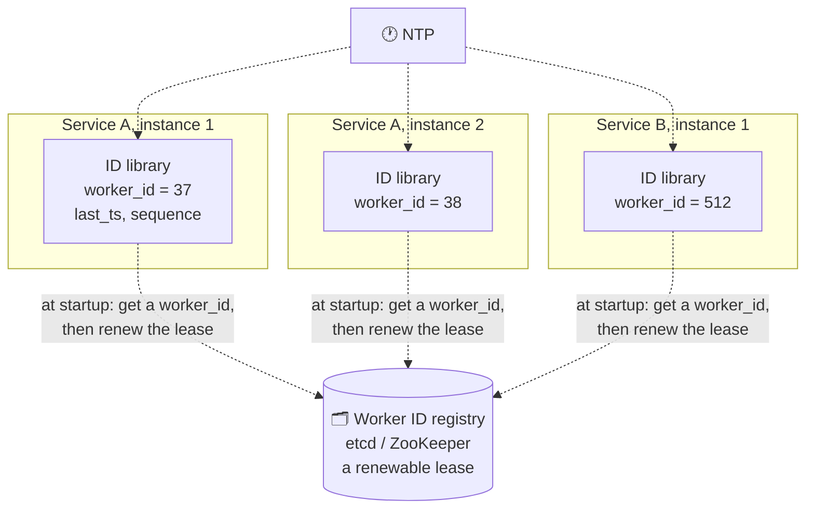
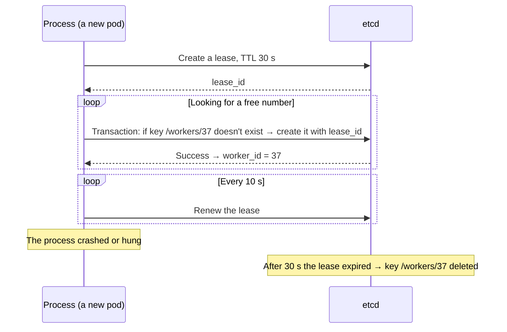

**English** | [Русский](README.ru.md)

# Tier 1 · 04. Unique ID Generator (Snowflake, UUID v7)

> **Level:** Easy–Medium · **Interview time:** 30–45 min · **Study time:** ~3–4 h
> **Key aspects:** uniqueness without per-ID coordination, the Snowflake layout (time + node + counter), assigning node IDs, clocks moving backward, time ordering, UUID v4 vs v7, how IDs affect database indexes, ID security
> **Builds on:** [04-databases](../../01_Fundamentals/04_Databases/README.md#5-indexes-and-b-trees), [06-partitioning](../../01_Fundamentals/06_Partitioning/README.md), [07-consistency-models](../../01_Fundamentals/07_Consistency%20models/README.md#9-clocks-and-event-ordering), [08-consensus](../../01_Fundamentals/08_Consensus/README.md#9-leases-and-leader-election-for-applications)

---

## 🗺️ How to Read This Walkthrough

The walkthrough follows an interview, but every step includes explanations: **why** a decision is made, **how** a mechanism works and **what happens** if you do it differently. The "📘 Explanation" blocks are theory right where you need it.

| Icon | Meaning |
|:----:|:--------|
| 🎤 | Interviewer |
| 🗣️ | What I (the candidate) say out loud |
| ✏️ | What I draw on the whiteboard |
| ⏱️ | Time budget for the step |
| 📘 | A detailed explanation of a concept |

Callouts: **TIP** — a good technique, **WARNING** — a trap, **IMPORTANT** — a Senior+ signal.

---

## 📑 Contents

0. [What This Problem Teaches](#0-what-this-problem-teaches)
1. [Problem Statement](#1-problem-statement)
2. [Clarifying Questions and Requirements](#2-clarifying-questions-and-requirements)
3. [Estimates](#3-estimates)
4. [API](#4-api)
5. [Overview of Approaches](#5-overview-of-approaches)
6. [High-Level Design](#6-high-level-design)
7. [Deep Dive 1: The Snowflake ID Layout](#7-deep-dive-1-the-snowflake-id-layout)
8. [Deep Dive 2: How Nodes Get a Worker ID](#8-deep-dive-2-how-nodes-get-a-worker-id)
9. [Deep Dive 3: Clocks Moving Backward](#9-deep-dive-3-clocks-moving-backward)
10. [Deep Dive 4: What "Time-Ordered" Means](#10-deep-dive-4-what-time-ordered-means)
11. [Deep Dive 5: UUID v7 and How IDs Affect Databases](#11-deep-dive-5-uuid-v7-and-how-ids-affect-databases)
12. [Deep Dive 6: Library or Service](#12-deep-dive-6-library-or-service)
13. [Deep Dive 7: Security and Information Leakage](#13-deep-dive-7-security-and-information-leakage)
14. [Bottlenecks and Failure Scenarios](#14-bottlenecks-and-failure-scenarios)
15. [What Changes at 10x Scale](#15-what-changes-at-10x-scale)
16. [Key Concepts and New Terms](#16-key-concepts-and-new-terms)
17. [Variations and Follow-Up Questions](#17-variations-and-follow-up-questions)
18. [Common Mistakes](#18-common-mistakes)
19. [Cheat Sheet and Self-Check](#19-cheat-sheet-and-self-check)

---

## 0. What This Problem Teaches

In a single database, getting a unique ID is easy — auto-increment. But when thousands of servers across data centers create records, and the data is spread across hundreds of shards, a single counter becomes a bottleneck and a single point of failure. The task is to issue unique IDs **without coordinating on every ID**.

| What's tested | Where it shows up |
|:--------------|:------------------|
| Understanding the "uniqueness — coordination — size" trade-off | Comparing auto-increment, UUIDs, ranges, Snowflake |
| Bit arithmetic and capacity | How many bits for time, node and counter; how many years it lasts |
| Time in distributed systems | Clocks moving backward and drifting between nodes |
| Managing node identity | How not to give two processes the same worker ID |
| Impact on storage | Why random UUIDs hurt B-trees |
| Security | What IDs reveal about the system |

This problem often shows up **inside** others: the URL shortener (#1), chat (#6, message ordering), the news feed (#7), sharding (IDs with an embedded shard).

---

## 1. Problem Statement

> 🎤 "Design a unique ID generator for a distributed system, like Twitter Snowflake: IDs for tweets, messages and orders are created on thousands of servers."

**How the IDs are used:**

```
tweet_id = id_generator.next_id()        → 915210555088850949
db.insert(tweets, id = tweet_id, ...)

Feed: SELECT ... ORDER BY tweet_id DESC  ← newest first, no separate time column needed
```

**Time plan:**

| Step | ⏱️ |
|:-----|:--:|
| Requirements | 4 min |
| Estimates | 3 min |
| Overview of approaches | 6 min |
| Snowflake design | 7 min |
| Deep dives | 15–20 min |
| Wrap-up | 3 min |

---

## 2. Clarifying Questions and Requirements

⏱️ 4 min

| My question | Interviewer's answer | What it changes and why |
|:------------|:---------------------|:------------------------|
| What ID size? | 64 bits | Fits a `BIGINT`, more compact than a UUID (128 bits), faster indexes |
| Must IDs be ordered by time? | Yes, roughly: a later ID is usually larger | Time must sit in the ID's high bits |
| Is a strict global order needed? | No, roughly is enough | Each node can generate independently |
| What load? | Up to 1M IDs per second in total, thousands of generating servers | Generation must be local, without the network |
| How fast? | Microseconds | No network calls per ID |
| Availability? | Generation must not depend on an external service | No single point of failure on the hot path |
| For how many years? | Decades | Enough bits for time |
| Must IDs be unpredictable? | No, they're not secret | Sequential parts are fine |

### Functional requirements

1. Issue **unique** IDs — never two identical ones anywhere in the system.
2. IDs are 64-bit integers.
3. IDs are **roughly ordered by** creation time.
4. The creation time can be derived from an ID (useful for debugging and time-based sharding).

### Non-functional requirements

| Requirement | Target | Why |
|:------------|:-------|:----|
| Uniqueness | Absolute | A duplicate ID overwrites someone else's data or violates a database constraint |
| Latency | Microseconds, no network call | An ID is needed on every write |
| Throughput | 1M+ IDs/s in total, thousands per node | Scales along with the services |
| Availability | Doesn't depend on external services while generating | Otherwise the generator is a point of failure for every write |
| Lifetime | Decades without overflow | Changing the ID format in a running system is very hard |

---

## 3. Estimates

⏱️ 3 min

```
Load:              1M IDs/s in total at peak
Generating nodes:  up to ~1,000 processes (with headroom for growth)
Per node:          ~1,000 IDs/s on average, up to tens of thousands at peak
```

📘 **How many bits for what — a rough calculation:**

```
Time in milliseconds for 70 years:
  70 years × 365 days × 86,400 s × 1,000 ms ≈ 2.2 × 10¹² ms → 41 bits needed (2^41 ≈ 2.2 × 10¹²)

Nodes: 1,024 nodes → 10 bits

A counter within one millisecond on one node:
  4,096 values → 12 bits → up to 4,096 IDs per ms = ~4.1M IDs/s per node

Total: 41 + 10 + 12 = 63 bits + 1 sign bit = 64 ✅
```

🗣️ "Everything fits in 64 bits with room to spare: one node can issue up to 4 million IDs per second, while we need thousands per node. That's exactly the Twitter Snowflake layout."

---

## 4. API

⏱️ 2 min

```
next_id()             → int64                       — the next unique ID
next_ids(n)           → [int64]                     — a batch (for the service variant)
parse(id)             → { timestamp, worker_id, sequence }   — for debugging
```

🗣️ "In the main variant this is a **library** inside each service: `next_id()` runs locally in a fraction of a microsecond. If a separate service is needed — in batches, so you don't go over the network for every ID."

---

## 5. Overview of Approaches

⏱️ 6 min

### 5.1 A single database's auto-increment

```sql
INSERT INTO tickets ... ; SELECT LAST_INSERT_ID();
```

| ✅ | ❌ |
|:--|:--|
| Simple, strictly sequential, compact | One database is a **bottleneck** and a **single point of failure** for every write in the system; a network call per ID |

### 5.2 Several databases with a step

📘 Each database issues numbers with its own offset and a shared step:

```
Database 1: auto_increment_offset = 1, auto_increment_increment = 2 → 1, 3, 5, 7, …
Database 2: auto_increment_offset = 2, auto_increment_increment = 2 → 2, 4, 6, 8, …
```

Flickr described this approach ("ticket servers" on two MySQL instances). Problems: adding a third database is hard (the step changes), IDs aren't time-ordered across databases, and there's still a network call per ID.

### 5.3 UUID v4 (random)

```
f47ac10b-58cc-4372-a567-0e02b2c3d479   ← 122 random bits out of 128
```

| ✅ | ❌ |
|:--|:--|
| No coordination at all | **128 bits** — twice a `BIGINT` |
| Collisions are practically impossible | **Not ordered** — can't sort by time |
| Generated anywhere (even on the client) | Random keys hurt B-tree indexes (see [deep dive 5](#11-deep-dive-5-uuid-v7-and-how-ids-affect-databases)) |

### 5.4 UUID v7 and ULID (time + randomness)

```
UUID v7: 48 bits — Unix time in ms | 4 version bits | 74 random bits (+ 2 variant bits)
```

Standardized in RFC 9562 (2024). Time-ordered, no coordination, but 128 bits. ULID is a similar format (48 bits of time + 80 bits of randomness) with a compact text representation.

### 5.5 Number ranges

Nodes take blocks of numbers from a coordinator (as in the [URL shortener](../01_Design%20a%20URL%20Shortener%20%28TinyURL%29/README.md#7-deep-dive-1-generating-short-codes)). Compact and collision-free, but **not time-ordered** across nodes (a node with the block "1,000,000…" may issue an ID later than a node with "5,000,000…").

### 5.6 Snowflake ⭐

64 bits: **time** in the high bits + a **node number** + a **counter** within the millisecond. Each node generates independently.

### 5.7 Comparison

| Approach | Size | Time-ordered | Coordination per ID | Point of failure | Verdict |
|:---------|:----:|:------------:|:-------------------:|:----------------:|:-------:|
| One DB's auto-increment | 64 | ✅ | Yes (network) | Yes | ❌ |
| Several DBs with a step | 64 | ❌ | Yes (network) | Partly | ❌ |
| UUID v4 | 128 | ❌ | No | No | ⚠️ |
| UUID v7 / ULID | 128 | ✅ | No | No | ✅ if 128 bits are OK |
| Ranges | 64 | ❌ | Rarely | No | ⚠️ |
| **Snowflake** | **64** | **✅** | **No** | **No** | **✅** |

🗣️ "The requirements — 64 bits and time ordering — leave **Snowflake**. If 128 bits were acceptable, UUID v7 would be simpler: no need to hand out node numbers."

---

## 6. High-Level Design

⏱️ 3 min



🗣️ "Generation is fully local. There are only two external dependencies, and neither is on the hot path:
- the **worker ID registry** — at startup a process gets a unique number and holds a lease on it;
- **clock synchronization** (NTP) — time must be roughly correct and must not jump backward."

---

## 7. Deep Dive 1: The Snowflake ID Layout

> 🎤 "Walk me through how the ID is structured and generated."

### The 64-bit layout

```
┌───┬──────────────────────────────────────────┬────────────┬──────────────┐
│ 0 │ 41 bits: milliseconds since a custom     │ 10 bits:   │ 12 bits:     │
│   │ epoch                                    │ worker ID  │ sequence     │
└───┴──────────────────────────────────────────┴────────────┴──────────────┘
 sign        time (≈ 69.7 years)                 1,024 nodes  4,096 / ms
```

| Part | Bits | Why |
|:-----|:----:|:----|
| Sign | 1 | Always 0 — the ID is positive in languages with signed 64-bit integers (Java `long`) |
| Time | 41 | Milliseconds since a **custom epoch**; in the high bits — which is why IDs sort by time |
| Worker ID | 10 | The generator's unique number; guarantees two nodes never issue the same ID |
| Sequence | 12 | A counter within one millisecond on one node |

### 📘 Explanation: why a custom epoch

Unix time in milliseconds is now about 1.8 × 10¹², and 41 bits would overflow around 2039. Counting from a **custom epoch** (e.g. January 1, 2020), 41 bits last ~69.7 years — until September 2089.

### 📘 Example: building an ID by hand

```
Epoch:     2020-01-01T00:00:00.000Z  = 1,577,836,800,000 ms of Unix time
Now:       2026-11-30T12:00:00.123Z  = 1,796,040,000,123 ms
Time:      1,796,040,000,123 − 1,577,836,800,000 = 218,203,200,123 ms since the epoch
Worker ID: 37
Sequence:  5   (the sixth ID in this millisecond on this node)

ID = (218,203,200,123 << 22) | (37 << 12) | 5
   = 915,210,555,088,850,949
```

The shifts: time moves left by 10 + 12 = 22 bits, the worker ID by 12. Parsing is the reverse:

```
timestamp = id >> 22                 → 218,203,200,123 → + epoch → 2026-11-30T12:00:00.123Z
worker_id = (id >> 12) & 0x3FF       → 37
sequence  = id & 0xFFF               → 5
```

### The generation algorithm

```python
import threading, time

EPOCH_MS      = 1_577_836_800_000          # 2020-01-01
WORKER_BITS   = 10
SEQUENCE_BITS = 12
MAX_SEQUENCE  = (1 << SEQUENCE_BITS) - 1   # 4095

class Snowflake:
    def __init__(self, worker_id: int):
        assert 0 <= worker_id < (1 << WORKER_BITS)
        self.worker_id = worker_id
        self.last_ts = -1
        self.sequence = 0
        self.lock = threading.Lock()

    def _now(self) -> int:
        return int(time.time() * 1000) - EPOCH_MS

    def next_id(self) -> int:
        with self.lock:
            ts = self._now()

            if ts < self.last_ts:                          # the clock went backward — see deep dive 3
                raise ClockMovedBackwards(self.last_ts - ts)

            if ts == self.last_ts:
                self.sequence = (self.sequence + 1) & MAX_SEQUENCE
                if self.sequence == 0:                     # 4,096 IDs for this ms are used up
                    while ts <= self.last_ts:              # wait for the next millisecond
                        ts = self._now()
            else:
                self.sequence = 0                          # a new millisecond — counter from zero

            self.last_ts = ts
            return (ts << (WORKER_BITS + SEQUENCE_BITS)) | (self.worker_id << SEQUENCE_BITS) | self.sequence
```

| Situation | What the algorithm does |
|:----------|:------------------------|
| A new millisecond | Counter = 0 |
| The same millisecond | Counter + 1 |
| The counter overflows (4,096 IDs in one ms) | Wait for the next millisecond (a fraction of a ms) |
| The clock went backward | An error or a wait (deep dive 3) |

📘 **Why uniqueness is guaranteed.** Two IDs differ in at least one part: if created on **different nodes** — a different worker ID; on **one node in different ms** — a different time; on **one node in the same ms** — a different counter. There's one condition: **the worker ID is unique** and **time on a node never goes backward**. The next deep dives are about those two conditions.

### Allocating bits to fit your needs

| Change | Pro | Con |
|:-------|:----|:----|
| More worker bits (12 → 4,096 nodes) | More generators | Less sequence or time |
| More sequence bits | More IDs per ms per node | Fewer nodes |
| Time in 10 ms units instead of 1 ms (as in Sonyflake) | ~174 years with 39 bits | Lower per-node throughput, coarser ordering |
| Splitting worker into datacenter (5) + machine (5) | A clear hierarchy | Hard limits per DC and per machine |
| Embedding a shard number (as Instagram did: 13 bits for a logical shard) | The ID immediately tells where the data lives | Less flexibility |

---

## 8. Deep Dive 2: How Nodes Get a Worker ID

> 🎤 "You said the worker ID must be unique. How do you guarantee that with autoscaling in Kubernetes?"

📘 **Why this is the main risk.** If two processes accidentally get the same worker ID, they'll issue **identical IDs** in the same millisecond. It's a silent failure: duplicates surface only on an insert conflict or, worse, when someone else's data is overwritten.

### Options

| Approach | How | Pros | Cons |
|:---------|:----|:-----|:-----|
| **Static configuration** | The worker ID is set in each server's config | Simple | A config mistake = duplicates; doesn't work with autoscaling |
| **From the IP or MAC** | The low bits of the address | No coordination | Collisions are possible (different subnets, containers reusing IPs) |
| **A StatefulSet ordinal** | Pod `ids-37` → worker 37 | Simple in Kubernetes | Stateful sets only; a pod moving with the same ordinal while the old one is "stuck" |
| **A lease in a coordinator** ⭐ | At startup the process claims a free number in etcd/ZooKeeper with a lease (TTL) and renews it | Works with autoscaling; numbers are freed automatically | Depends on the coordinator at startup |

### A lease in etcd



### The danger: a "stuck" old process

📘 The process with worker 37 hangs for 60 seconds (a long GC pause, a frozen VM). Its lease expires, and a **new** process takes number 37. The old one "wakes up" and keeps generating IDs with number 37 — duplicates. It's the same problem as with locks in [08-consensus](../../01_Fundamentals/08_Consensus/README.md#10-split-brain-and-fencing-tokens).

| Protection | How |
|:-----------|:----|
| **Checking the lease before generating** | The library tracks the lease's validity with its own monotonic timer and **stops** issuing IDs if the lease might have expired (with a margin) |
| **Delaying number reuse** | A freed number isn't reissued immediately, but only after an interval longer than the lease TTL + the allowed clock skew |
| **A pool larger than the process count** | 1,024 numbers for 300 processes — there are always free numbers, so the delay doesn't matter |

> [!IMPORTANT]
> **Senior+ signal:** name **worker ID uniqueness** as the main risk in the Snowflake design and propose a lease-based mechanism with protection against a "woken-up" old process. Most candidates draw the bit layout and stop there.

---

## 9. Deep Dive 3: Clocks Moving Backward

> 🎤 "What if the server's clock goes backward?"

### Why clocks go backward

| Cause | Example |
|:------|:--------|
| **An NTP step correction** | The clock was 200 ms fast; NTP "set" it back in one step |
| **A leap second** | The last second of the day may repeat |
| **VM migration or restore** | The virtual machine resumed with a lagging clock |
| **A manual time change** | An administrator's mistake |

📘 **Why it's dangerous.** Say a node issued IDs with time `T = 1000` and counters 0–50. The clock jumps back 5 ms, a "new" time `T = 995` arrives, and then `T = 1000` again. On the second pass through millisecond 1000 the counter starts from zero — and the node issues **the same** IDs it already issued.

### Solutions

| Approach | How | Pros | Cons |
|:---------|:----|:-----|:-----|
| **Refuse** | If `now < last_ts` — an error | Safe | The generator is unavailable during the rollback |
| **Wait** ⭐ for small rollbacks | If the rollback is small (up to ~5–10 ms) — wait until the clock catches up to `last_ts` | No errors, a small delay | Too long for large rollbacks |
| **Logical clock** | Use `max(now, last_ts)`: if the clock lags, continue from `last_ts`, incrementing the counter; on overflow — `last_ts + 1` ("borrowing from the future") | Never stops | IDs temporarily "run ahead" of the real clock |
| **Persisting a "high-water mark"** | Periodically write `last_ts` to disk; on startup, don't issue IDs until the clock passes the saved value | Protects against a rollback across **restarts** | An extra disk write every few seconds |

```python
def next_id(self):
    ts = self._now()
    if ts < self.last_ts:
        drift = self.last_ts - ts
        if drift <= 10:                       # a small rollback: wait
            while ts < self.last_ts:
                ts = self._now()
        else:                                 # a large rollback: stop and raise an alert
            raise ClockMovedBackwards(drift)
    ...
```

### Prevention

| Measure | Why |
|:--------|:----|
| NTP in **slew** mode rather than step | The clock speeds up or slows down but never jumps back |
| **Leap smearing** | The leap second is "smeared" over a day (as Google and AWS do) |
| Monitoring clock offset | A node whose offset exceeds a threshold mustn't generate IDs |
| A monotonic clock for measuring intervals | Durations (e.g. a lease's validity) use the monotonic clock, not system time |

> [!WARNING]
> A monotonic clock (`clock_gettime(CLOCK_MONOTONIC)`) never goes backward, but it's not tied to the calendar and resets on reboot. So the **value** of time in an ID comes from the ordinary clock, while **protection** comes from checking `last_ts` and persisting a high-water mark.

---

## 10. Deep Dive 4: What "Time-Ordered" Means

> 🎤 "The IDs are time-ordered. So if ID A is less than ID B, was A created first?"

🗣️ "Not always. The order is **approximate** — this is called *k-sorted* or *roughly sorted*."

| Case | Ordering guarantee |
|:-----|:-------------------|
| Two IDs from **one** node | ✅ Strictly increasing (if the clock doesn't go backward) |
| Two IDs from **different** nodes, created further apart than the clock skew | ✅ The order is correct |
| Two IDs from different nodes, created almost simultaneously | ❌ The order may be reversed: node clocks differ by units to tens of ms |
| Causality (a question, then an answer on another node) | ❌ Not guaranteed if the answer was created within the clock skew |

📘 **Example.** Node A's clock is 5 ms fast. A user posts via node A (an ID with time `1005`), and 2 ms later a friend comments via node B (an ID with time `1002`). The comment gets a **smaller** ID than the post, even though it was created later.

### When it's enough and when it isn't

| Task | Is Snowflake enough? |
|:-----|:---------------------|
| Sorting a feed, paginating by ID | ✅ A millisecond error is invisible |
| Time-based sharding and partitioning | ✅ |
| Message order within one chat | ⚠️ Better a separate sequence number from the chat's leader (see [07-consistency-models](../../01_Fundamentals/07_Consistency%20models/README.md)) |
| A strict global order (a financial ledger) | ❌ Needs a single sequencer or consensus |

> [!TIP]
> A good answer: "Snowflake gives uniqueness and an **approximate** order. If you need strict ordering within an entity (a chat, an account), that comes from a separate counter at the entity's owner, not from the ID generator."

---

## 11. Deep Dive 5: UUID v7 and How IDs Affect Databases

> 🎤 "Why not just use UUID v4?"

### 📘 Explanation: random keys and B-trees

Most databases store the primary key index as a **B-tree**, and InnoDB (MySQL) also stores the rows themselves by primary key (a clustered index, see [04-databases](../../01_Fundamentals/04_Databases/README.md#5-indexes-and-b-trees)).

```
Increasing keys (Snowflake, UUID v7):
  every new record → into the rightmost index page
  → that page is always in memory, and pages fill up completely

Random keys (UUID v4):
  every new record → into a random index page
  → the page must be read from disk if it's not cached;
    pages split in half and end up ~50–70% full
```

| Effect of random keys | Consequence |
|:----------------------|:------------|
| Inserts into random pages | More disk reads, fewer buffer pool hits |
| Page splits | The index is tens of percent larger, more disk writes |
| 128 bits instead of 64 | Every secondary index (which stores the primary key in InnoDB) is larger too |

That's why **time-ordered** IDs are preferable as primary keys: Snowflake (64 bits) or UUID v7 (128 bits).

### UUID v7 in more detail

```
 0                   1                   2                   3
┌───────────────────────────────────────────────┬───────┬───────────────────────┐
│ 48 bits: Unix time in milliseconds            │ ver=7 │ 12 bits: rand_a       │
├───┬───────────────────────────────────────────┴───────┴───────────────────────┤
│var│ 62 bits: rand_b                                                           │
└───┴───────────────────────────────────────────────────────────────────────────┘
```

| Property | Value |
|:---------|:------|
| Ordering | By time in ms |
| Coordination | Not needed: uniqueness comes from 74 random bits |
| Collision probability | Even with a million IDs in one millisecond ≈ n² / 2^75 ≈ 2.6 × 10⁻¹¹ per millisecond |
| Ordering within a millisecond | The standard allows using part of `rand_a` as a counter for monotonicity on one generator |
| Compatibility | The standard UUID format, supported by databases and libraries |

> [!WARNING]
> **Increasing keys in distributed databases with range partitioning** (Spanner, CockroachDB, TiDB, HBase) create a **hot spot**: every new record lands in the last range on one node. There, random keys or a hash prefix are recommended. In hash-partitioned databases (Cassandra, DynamoDB) or single-node PostgreSQL/MySQL, increasing keys are a good choice.

### Snowflake or UUID v7

| Criterion | Snowflake | UUID v7 |
|:----------|:----------|:--------|
| Size | 64 bits | 128 bits |
| Needs worker IDs | Yes | No |
| Can be generated on the client | No (needs a worker ID) | Yes |
| Strictly unique | Yes, with unique worker IDs | Probabilistically, practically always |
| Embedded metadata (shard, DC) | Possible | No |

---

## 12. Deep Dive 6: Library or Service

> 🎤 "Should the generator be a library or a separate service?"

| | A library in each process ⭐ | A separate ID service |
|:-|:----------------------------|:----------------------|
| Latency | Nanoseconds to microseconds | A network call (without batching) |
| Availability | Depends on nothing while running | The service is a dependency of every write |
| Worker IDs | Every process needs one (thousands) | Only service instances need one (a handful) |
| Languages | An implementation per language | One service for everyone |
| Control | Harder to update across every service | Centralized |

🗣️ "By default — a **library**. If the company has many languages or needs fewer worker IDs — a **service with batching**: a client requests 1,000 IDs at once and hands them out locally, so there's a network call once a second rather than per ID. Twitter originally built Snowflake as a separate service. Instagram generated IDs right in PostgreSQL with a stored procedure: 41 bits of time, 13 bits of logical shard, 10 bits of per-shard sequence — so the ID immediately tells which shard holds the data."

---

## 13. Deep Dive 7: Security and Information Leakage

> 🎤 "Are there problems if users can see the IDs?"

| What an ID reveals | Risk | Example |
|:-------------------|:-----|:--------|
| **Creation time** | When an account or document was created | A user's sign-up time from their profile ID |
| **Business volume** | Comparing IDs across days lets you estimate order counts (the "German tank problem") | A competitor estimates sales from order numbers |
| **Internal structure** | The number of nodes and data centers | Infrastructure reconnaissance |
| **Predictability** | Enumerating neighboring IDs | Access to other people's objects if a permission check is missing |

📘 **The "German tank problem".** During World War II, the Allies estimated German tank production from the serial numbers of captured tanks — and the estimate proved far more accurate than intelligence reports. Sequential IDs work the same way: a few IDs let you estimate the total volume.

### Protection

| Measure | How |
|:--------|:----|
| **Always check permissions** | An ID isn't a secret or a substitute for authorization |
| **A separate public ID** | Internally — Snowflake for indexes; externally — a random identifier (UUID v4 or a short random code) |
| **Encrypting IDs** | The external representation = the encrypted internal ID (bijective, like the obfuscation in the URL shortener) |

---

## 14. Bottlenecks and Failure Scenarios

| Scenario | What happens | How we protect |
|:---------|:-------------|:---------------|
| Two processes with the same worker ID | **Duplicate IDs** | A lease in a coordinator, checking lease validity before generating, delayed number reuse |
| The clock goes backward | Duplicates are possible | Wait on small rollbacks, refuse and alert on large ones, NTP slew, a high-water mark |
| A restart with a lagging clock | Reissuing already issued IDs | Persisting `last_ts` to disk, waiting at startup |
| Counter overflow (4,096 per ms) | Waiting for the next ms | A fraction of a millisecond; if it's hit constantly — more sequence bits |
| The coordinator is unavailable at startup | A new process gets no worker ID | Running processes continue; new ones wait to start; the coordinator is replicated |
| Time overflow after ~70 years | IDs stop being unique | A custom epoch, monitoring, a migration plan long before then |
| Increasing keys in a range-partitioned DB | A hot last range | A hash prefix or random keys in such databases |
| IDs > 2^53 in JavaScript | Loss of precision in `Number` | Send IDs as strings in JSON |

---

## 15. What Changes at 10x Scale

> 🎤 "10,000 generating processes and 10M IDs per second?"

| Change | Why |
|:-------|:----|
| **More worker bits** (13–14 bits) at the expense of sequence | 10,000 processes don't fit in 10 bits |
| **An ID service with batching** instead of a library in every process | Fewer worker IDs; one generator issues millions of IDs per second |
| **Moving to 128 bits** (UUID v7) for new entities | No need to split limited bits between nodes and time |
| **A worker ID hierarchy**: region + cluster + process | Assigning numbers without a global coordinator |

---

## 16. Key Concepts and New Terms

### What's applied from Fundamentals

| Concept | Where it's covered | How it applies here |
|:--------|:-------------------|:--------------------|
| B-trees, clustered indexes | [04-databases](../../01_Fundamentals/04_Databases/README.md#5-indexes-and-b-trees) | Why random keys cost more |
| Partitioning, hot spots | [06-partitioning](../../01_Fundamentals/06_Partitioning/README.md#8-hot-partitions-and-skew) | Increasing keys under range partitioning |
| Clocks and event ordering | [07-consistency-models](../../01_Fundamentals/07_Consistency%20models/README.md#9-clocks-and-event-ordering) | Clock skew, k-sorted order |
| Leases and a "woken-up" owner | [08-consensus](../../01_Fundamentals/08_Consensus/README.md#9-leases-and-leader-election-for-applications) | Assigning worker IDs |

### New terms in this problem

| Term | In short |
|:-----|:---------|
| **Snowflake ID** | 64 bits: time + worker ID + sequence; generation without coordination |
| **A custom epoch** | Counting time from a chosen date so 41 bits last ~70 years |
| **Worker ID** | The generator's unique number; the key uniqueness invariant |
| **K-sorted** | The order is correct up to the clock skew between nodes |
| **UUID v4 / v7** | A random 128-bit ID / a time-ordered 128-bit ID |
| **ULID** | A format similar to UUID v7 with a compact text form |
| **NTP slew vs step** | Gradual clock adjustment vs a jump |
| **Leap smearing** | "Smearing" a leap second |
| **The German tank problem** | Estimating a total from sequential numbers |

---

## 17. Variations and Follow-Up Questions

<details>
<summary><b>Why send IDs as strings in JSON?</b></summary>

JavaScript numbers are 64-bit floating-point values that represent integers exactly only up to 2^53 ≈ 9 × 10¹⁵. A Snowflake ID (~9 × 10¹⁷) is bigger — the last digits get corrupted when parsing JSON. That's why the Twitter API, for example, returned both a numeric field and a string one (`id_str`).
</details>

<details>
<summary><b>Why not just "time + a random number" in 64 bits?</b></summary>

With 41 bits of time and 22 random bits, a thousand IDs might arrive across the system in one millisecond. By the birthday paradox, the probability of a collision among 1,000 random values out of ~4M ≈ 1000² / (2 × 4M) ≈ 12% per millisecond — collisions would happen constantly. 64 bits leave too little room for randomness; the worker ID and sequence guarantee uniqueness deterministically.
</details>

<details>
<summary><b>Can IDs be generated in the database on insert?</b></summary>

Yes: sequences (`SEQUENCE`, `IDENTITY`) or a database function (as at Instagram). The downside — the ID is known only after the insert, while it's often needed earlier: for idempotency, for linking several records, for sending events. Generating in the application gives you the ID before the database write.
</details>

<details>
<summary><b>How do you guarantee message order in a chat?</b></summary>

Snowflake gives only an approximate order across nodes. For strict order within a chat — a sequence number assigned by the chat's single owner (the leader of the chat's partition), as in [12-communication](../../01_Fundamentals/12_Communication/README.md). Snowflake can still serve as the message's unique identifier.
</details>

<details>
<summary><b>How do you migrate from auto-increment to Snowflake in a running system?</b></summary>

Choose the epoch and layout so that new Snowflake IDs are **larger** than every existing auto-increment ID (which are far smaller than 2^22 × time) — then the order is preserved. Switch generation for new records and leave old IDs as they are. Check every place that stores IDs as 32-bit integers.
</details>

---

## 18. Common Mistakes

| ❌ Mistake | Why it's bad | ✅ Do this instead |
|:----------|:-------------|:------------------|
| One auto-increment for the whole system | A bottleneck and a single point of failure | Generation on every node |
| Worker IDs set manually in config | A mistake = silent duplicates | A lease in a coordinator |
| Ignoring a "woken-up" process | Duplicates after a lease expires | Checking lease validity, delayed number reuse |
| Ignoring clocks going backward | Duplicates | Wait / refuse, NTP slew, a high-water mark |
| The Unix epoch in 41 bits | Overflow around 2039 | A custom epoch |
| UUID v4 as a B-tree primary key | Bloated indexes, slow inserts | Snowflake or UUID v7 |
| Increasing keys in a range-partitioned DB | A hot last range | A hash prefix or random keys |
| Treating ID order as strict | Errors for near-simultaneous events | Strict order comes from a separate counter at the owner |
| An ID as a secret or a substitute for authorization | Enumeration and data leaks | Permission checks; a separate public ID |
| A Snowflake ID as a JSON number for JavaScript | Loss of precision | A string |

---

## 19. Cheat Sheet and Self-Check

### 30-second answer

> Snowflake: 64 bits = 1 sign bit + 41 bits of milliseconds since a custom epoch (~70 years) + 10 bits of worker ID (1,024 generators) + 12 bits of counter (4,096 IDs per ms per node). Generation is local, in a library, in microseconds; on counter overflow — wait for the next ms. Uniqueness rests on two invariants: the worker ID is unique — assigned via a lease in etcd, with lease validity checks and delayed number reuse; time never goes backward — NTP slew, waiting on small rollbacks, refusing and alerting on large ones, a persisted high-water mark. The order is approximate (k-sorted). If 128 bits are acceptable — UUID v7 with no coordination. Random UUID v4 hurts B-trees; increasing keys hurt range-partitioned databases. IDs aren't secret: expose a separate random ID, and send IDs as strings in JSON.

### Self-check

- [ ] I can compare 6 approaches to ID generation
- [ ] I can compute how many bits are needed for time, nodes and the counter
- [ ] I can build and parse a Snowflake ID by hand
- [ ] I can write the generation algorithm, including counter overflow
- [ ] I can explain why worker ID uniqueness is the main risk and how to ensure it
- [ ] I can explain why clocks go backward and 4 ways to protect against it
- [ ] I can explain why the order is only approximate
- [ ] I can explain why UUID v4 hurts B-trees and increasing keys hurt range partitioning
- [ ] I can compare Snowflake and UUID v7
- [ ] I can name what IDs reveal and how to hide it

### Further reading

- Twitter Engineering, *Announcing Snowflake* (2010)
- Instagram Engineering, *Sharding & IDs at Instagram* (2012)
- Flickr Engineering, *Ticket Servers: Distributed Unique Primary Keys on the Cheap* (2010)
- RFC 9562, *Universally Unique IDentifiers (UUIDs)* (2024) — UUID v7
- The ULID specification (github.com/ulid/spec)
- Alex Xu, *System Design Interview*, Vol. 1 — chapter "Design a Unique ID Generator in Distributed Systems"
