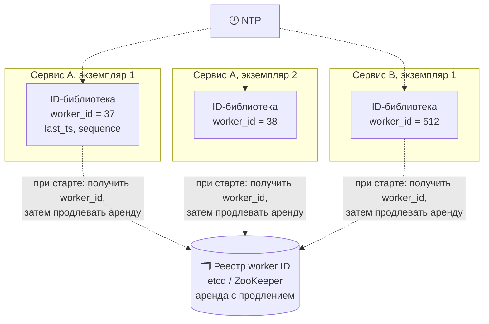
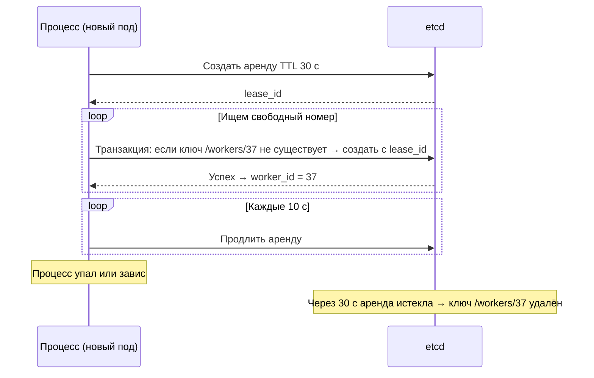

[English](README.md) | **Русский**

# Tier 1 · 04. Unique ID Generator (Snowflake, UUID v7)

> **Уровень:** Easy–Medium · **Время на интервью:** 30–45 мин · **Время на разбор:** ~3–4 ч
> **Ключевые аспекты:** уникальность без координации на каждый ID, структура Snowflake (время + узел + счётчик), выдача ID узлам, обратный ход часов, упорядоченность по времени, UUID v4 vs v7, влияние ключей на индексы БД, безопасность ID
> **Опирается на:** [04-databases](../../01_Fundamentals/04_Databases/README.ru.md#5-индексы-и-b-tree), [06-partitioning](../../01_Fundamentals/06_Partitioning/README.ru.md), [07-consistency-models](../../01_Fundamentals/07_Consistency%20models/README.ru.md#9-часы-и-порядок-событий), [08-consensus](../../01_Fundamentals/08_Consensus/README.ru.md#9-лизы-и-выбор-лидера-для-приложений)

---

## 🗺️ Как читать этот разбор

Разбор построен как интервью, но в каждом шаге есть объяснения: **почему** принимается решение, **как работает** механизм и **что будет**, если сделать иначе. Блоки «📘 Объяснение» — теория прямо по ходу задачи.

| Значок | Что значит |
|:------:|:-----------|
| 🎤 | Реплика интервьюера |
| 🗣️ | Что говорю вслух я (кандидат) |
| ✏️ | Что рисую на доске |
| ⏱️ | Сколько времени тратить на шаг |
| 📘 | Подробное объяснение концепции |

Блоки **TIP** — хороший приём, **WARNING** — ловушка, **IMPORTANT** — сигнал для уровня Senior+.

---

## 📑 Содержание

0. [Чему учит эта задача](#0-чему-учит-эта-задача)
1. [Условие задачи](#1-условие-задачи)
2. [Уточняющие вопросы и требования](#2-уточняющие-вопросы-и-требования)
3. [Оценки](#3-оценки)
4. [API](#4-api)
5. [Обзор подходов](#5-обзор-подходов)
6. [High-level дизайн](#6-high-level-дизайн)
7. [Deep dive 1: структура Snowflake ID](#7-deep-dive-1-структура-snowflake-id)
8. [Deep dive 2: как узлы получают worker ID](#8-deep-dive-2-как-узлы-получают-worker-id)
9. [Deep dive 3: часы идут назад](#9-deep-dive-3-часы-идут-назад)
10. [Deep dive 4: что значит «упорядочены по времени»](#10-deep-dive-4-что-значит-упорядочены-по-времени)
11. [Deep dive 5: UUID v7 и влияние ID на базы данных](#11-deep-dive-5-uuid-v7-и-влияние-id-на-базы-данных)
12. [Deep dive 6: библиотека или сервис](#12-deep-dive-6-библиотека-или-сервис)
13. [Deep dive 7: безопасность и утечка информации](#13-deep-dive-7-безопасность-и-утечка-информации)
14. [Узкие места и сценарии сбоев](#14-узкие-места-и-сценарии-сбоев)
15. [Что изменится при росте в 10 раз](#15-что-изменится-при-росте-в-10-раз)
16. [Ключевые концепции и новые понятия](#16-ключевые-концепции-и-новые-понятия)
17. [Варианты задачи и follow-up вопросы](#17-варианты-задачи-и-follow-up-вопросы)
18. [Типичные ошибки](#18-типичные-ошибки)
19. [Шпаргалка и самопроверка](#19-шпаргалка-и-самопроверка)

---

## 0. Чему учит эта задача

В одной базе данных уникальный ID получить просто — автоинкремент. Но когда записи создают тысячи серверов в разных дата-центрах, а данные разложены по сотням шардов, единый счётчик становится узким местом и точкой отказа. Задача — выдавать уникальные ID **без координации на каждый ID**.

| Что проверяют | Где это в задаче |
|:--------------|:-----------------|
| Понимание компромиссов «уникальность — координация — размер» | Сравнение автоинкремента, UUID, диапазонов, Snowflake |
| Битовая арифметика и ёмкость | Сколько бит на время, узел и счётчик; на сколько лет хватит |
| Время в распределённых системах | Часы идут назад, расходятся между узлами |
| Управление идентичностью узлов | Как не выдать двум процессам один worker ID |
| Влияние на хранилище | Почему случайные UUID плохи для B-tree |
| Безопасность | Что ID раскрывают о системе |

Эта задача часто встречается **внутри** других: URL shortener (#1), чат (#6, порядок сообщений), лента (#7), шардирование (ID со встроенным шардом).

---

## 1. Условие задачи

> 🎤 «Спроектируй генератор уникальных ID для распределённой системы, как Twitter Snowflake: ID для твитов, сообщений, заказов создаются на тысячах серверов».

**Как ID используются:**

```
tweet_id = id_generator.next_id()        → 915210555088850949
db.insert(tweets, id = tweet_id, ...)

Лента: SELECT ... ORDER BY tweet_id DESC  ← свежие первыми, без отдельного поля времени
```

**План по времени:**

| Шаг | ⏱️ |
|:----|:--:|
| Требования | 4 мин |
| Оценки | 3 мин |
| Обзор подходов | 6 мин |
| Дизайн Snowflake | 7 мин |
| Deep dives | 15–20 мин |
| Итоги | 3 мин |

---

## 2. Уточняющие вопросы и требования

⏱️ 4 мин

| Мой вопрос | Ответ интервьюера | Что это меняет и почему |
|:-----------|:------------------|:------------------------|
| Какой размер ID? | 64 бита | Помещается в `BIGINT`, компактнее UUID (128 бит), быстрее индексы |
| Должны ли ID быть упорядочены по времени? | Да, примерно: более поздний ID, как правило, больше | Время должно быть в старших битах ID |
| Нужен ли строгий глобальный порядок? | Нет, достаточно примерного | Можно генерировать независимо на каждом узле |
| Какая нагрузка? | До 1M ID в секунду суммарно, тысячи генерирующих серверов | Генерация должна быть локальной, без сети |
| Насколько быстро? | Микросекунды | Никаких сетевых запросов на каждый ID |
| Доступность? | Генерация не должна зависеть от внешнего сервиса | Нет единой точки отказа на горячем пути |
| На сколько лет? | Десятилетия | Достаточно бит под время |
| Должны ли ID быть непредсказуемыми? | Нет, они не секретны | Можно использовать последовательные части |

### Функциональные требования

1. Выдавать **уникальные** ID — никогда два одинаковых во всей системе.
2. ID — 64-битные целые числа.
3. ID **примерно упорядочены по времени** создания.
4. По ID можно определить время создания (полезно для отладки и шардирования по времени).

### Нефункциональные требования

| Требование | Цель | Почему |
|:-----------|:-----|:-------|
| Уникальность | Абсолютная | Дубликат ID — перезапись чужих данных или нарушение ограничения в базе |
| Задержка | Микросекунды, без сетевого запроса | ID нужен при каждой записи |
| Пропускная способность | 1M+ ID/с суммарно, тысячи на узел | Масштабирование вместе с сервисами |
| Доступность | Не зависит от внешних сервисов во время генерации | Иначе генератор — точка отказа всех записей |
| Срок работы | Десятилетия без переполнения | Сменить формат ID в работающей системе очень трудно |

---

## 3. Оценки

⏱️ 3 мин

```
Нагрузка:           1M ID/с суммарно в пике
Генерирующих узлов: до ~1 000 процессов (с запасом на рост)
На узел:            в среднем ~1 000 ID/с, в пике — до десятков тысяч
```

📘 **Сколько бит на что нужно — прикидка:**

```
Время в миллисекундах на 70 лет:
  70 лет × 365 дней × 86 400 с × 1 000 мс ≈ 2,2 × 10¹² мс → нужно 41 бит (2^41 ≈ 2,2 × 10¹²)

Узлы: 1 024 узла → 10 бит

Счётчик внутри одной миллисекунды на одном узле:
  4 096 значений → 12 бит → до 4 096 ID в мс = ~4,1M ID/с на узел

Итого: 41 + 10 + 12 = 63 бита + 1 бит знака = 64 ✅
```

🗣️ «Видно, что всё помещается в 64 бита с запасом: один узел может выдавать до 4 миллионов ID в секунду, а у нас на узел нужны тысячи. Это и есть раскладка Twitter Snowflake».

---

## 4. API

⏱️ 2 мин

```
next_id()             → int64                       — следующий уникальный ID
next_ids(n)           → [int64]                     — пачка (для сервисного варианта)
parse(id)             → { timestamp, worker_id, sequence }   — для отладки
```

🗣️ «В основном варианте это **библиотека** внутри каждого сервиса: `next_id()` выполняется локально за доли микросекунды. Если нужен отдельный сервис — пачками, чтобы не ходить по сети за каждым ID».

---

## 5. Обзор подходов

⏱️ 6 мин

### 5.1 Автоинкремент одной базы

```sql
INSERT INTO tickets ... ; SELECT LAST_INSERT_ID();
```

| ✅ | ❌ |
|:--|:--|
| Просто, строго последовательно, компактно | Одна база — **узкое место** и **точка отказа** для всех записей системы; сетевой запрос на каждый ID |

### 5.2 Несколько баз с шагом

📘 Каждая база выдаёт числа со своим смещением и общим шагом:

```
База 1: auto_increment_offset = 1, auto_increment_increment = 2 → 1, 3, 5, 7, …
База 2: auto_increment_offset = 2, auto_increment_increment = 2 → 2, 4, 6, 8, …
```

Flickr описывал такой подход («ticket servers» на двух MySQL). Проблемы: добавить третью базу сложно (меняется шаг), ID не упорядочены по времени между базами, всё ещё сетевой запрос на каждый ID.

### 5.3 UUID v4 (случайный)

```
f47ac10b-58cc-4372-a567-0e02b2c3d479   ← 122 случайных бита из 128
```

| ✅ | ❌ |
|:--|:--|
| Нет координации вообще | **128 бит** — вдвое больше `BIGINT` |
| Коллизии практически невозможны | **Не упорядочены** — нельзя сортировать по времени |
| Генерируется где угодно (даже на клиенте) | Случайные ключи плохи для B-tree индексов (см. [deep dive 5](#11-deep-dive-5-uuid-v7-и-влияние-id-на-базы-данных)) |

### 5.4 UUID v7 и ULID (время + случайность)

```
UUID v7: 48 бит — Unix-время в мс | 4 бита версии | 74 бита случайности (+ 2 бита варианта)
```

Стандартизирован в RFC 9562 (2024). Упорядочен по времени, без координации, но 128 бит. ULID — похожий формат (48 бит времени + 80 бит случайности) с компактным текстовым представлением.

### 5.5 Диапазоны номеров

Узлы берут блоки номеров у координатора (как в [URL shortener](../01_Design%20a%20URL%20Shortener%20%28TinyURL%29/README.ru.md#7-deep-dive-1-генерация-коротких-кодов)). Компактно и без коллизий, но **не упорядочено по времени** между узлами (узел с блоком «1 000 000…» может выдать ID позже узла с блоком «5 000 000…»).

### 5.6 Snowflake ⭐

64 бита: **время** в старших битах + **номер узла** + **счётчик** внутри миллисекунды. Каждый узел генерирует независимо.

### 5.7 Сравнение

| Подход | Размер | Упорядочен по времени | Координация на каждый ID | Точка отказа | Вердикт |
|:-------|:------:|:---------------------:|:------------------------:|:------------:|:-------:|
| Автоинкремент одной БД | 64 | ✅ | Да (сеть) | Да | ❌ |
| Несколько БД с шагом | 64 | ❌ | Да (сеть) | Частично | ❌ |
| UUID v4 | 128 | ❌ | Нет | Нет | ⚠️ |
| UUID v7 / ULID | 128 | ✅ | Нет | Нет | ✅ если 128 бит допустимы |
| Диапазоны | 64 | ❌ | Редко | Нет | ⚠️ |
| **Snowflake** | **64** | **✅** | **Нет** | **Нет** | **✅** |

🗣️ «Требования — 64 бита и упорядоченность по времени — оставляют **Snowflake**. Если бы 128 бит были допустимы, UUID v7 был бы проще: не нужно выдавать узлам номера».

---

## 6. High-level дизайн

⏱️ 3 мин



🗣️ «Генерация полностью локальная. Внешние зависимости только две, и обе не на горячем пути:
- **реестр worker ID** — при старте процесс получает уникальный номер и держит аренду;
- **синхронизация часов** (NTP) — время должно быть примерно правильным и не прыгать назад».

---

## 7. Deep dive 1: структура Snowflake ID

> 🎤 «Расскажи, как устроен ID и как его генерировать».

### Раскладка 64 бит

```
┌───┬──────────────────────────────────────────┬────────────┬──────────────┐
│ 0 │ 41 бит: миллисекунды с собственной эпохи │ 10 бит:    │ 12 бит:      │
│   │                                          │ worker ID  │ sequence     │
└───┴──────────────────────────────────────────┴────────────┴──────────────┘
 знак        время (≈ 69,7 лет)                 1 024 узла   4 096 / мс
```

| Часть | Бит | Зачем |
|:------|:---:|:------|
| Знак | 1 | Всегда 0 — ID положительный в языках со знаковыми 64-битными числами (Java `long`) |
| Время | 41 | Миллисекунды от **собственной эпохи**; в старших битах — поэтому ID сортируются по времени |
| Worker ID | 10 | Уникальный номер генератора; гарантирует, что два узла не выдадут одинаковые ID |
| Sequence | 12 | Счётчик внутри одной миллисекунды на одном узле |

### 📘 Объяснение: зачем собственная эпоха

Unix-время в миллисекундах сейчас — около 1,8 × 10¹², и 41 бит переполнятся примерно в 2039 году. Если отсчитывать от **собственной эпохи** (например, 1 января 2020 года), 41 бита хватит на ~69,7 лет — до сентября 2089 года.

### 📘 Пример: собираем ID вручную

```
Эпоха:     2020-01-01T00:00:00.000Z  = 1 577 836 800 000 мс Unix-времени
Сейчас:    2026-11-30T12:00:00.123Z  = 1 796 040 000 123 мс
Время:     1 796 040 000 123 − 1 577 836 800 000 = 218 203 200 123 мс от эпохи
Worker ID: 37
Sequence:  5   (шестой ID в этой миллисекунде на этом узле)

ID = (218 203 200 123 << 22) | (37 << 12) | 5
   = 915 210 555 088 850 949
```

Сдвиги: время сдвигается на 10 + 12 = 22 бита влево, worker ID — на 12. Разбор — обратные операции:

```
timestamp = id >> 22                 → 218 203 200 123 → + эпоха → 2026-11-30T12:00:00.123Z
worker_id = (id >> 12) & 0x3FF       → 37
sequence  = id & 0xFFF               → 5
```

### Алгоритм генерации

```python
import threading, time

EPOCH_MS      = 1_577_836_800_000          # 2020-01-01
WORKER_BITS   = 10
SEQUENCE_BITS = 12
MAX_SEQUENCE  = (1 << SEQUENCE_BITS) - 1   # 4095

class Snowflake:
    def __init__(self, worker_id: int):
        assert 0 <= worker_id < (1 << WORKER_BITS)
        self.worker_id = worker_id
        self.last_ts = -1
        self.sequence = 0
        self.lock = threading.Lock()

    def _now(self) -> int:
        return int(time.time() * 1000) - EPOCH_MS

    def next_id(self) -> int:
        with self.lock:
            ts = self._now()

            if ts < self.last_ts:                          # часы пошли назад — см. deep dive 3
                raise ClockMovedBackwards(self.last_ts - ts)

            if ts == self.last_ts:
                self.sequence = (self.sequence + 1) & MAX_SEQUENCE
                if self.sequence == 0:                     # 4 096 ID за эту мс исчерпаны
                    while ts <= self.last_ts:              # ждём следующую миллисекунду
                        ts = self._now()
            else:
                self.sequence = 0                          # новая миллисекунда — счётчик с нуля

            self.last_ts = ts
            return (ts << (WORKER_BITS + SEQUENCE_BITS)) | (self.worker_id << SEQUENCE_BITS) | self.sequence
```

| Ситуация | Что делает алгоритм |
|:---------|:--------------------|
| Новая миллисекунда | Счётчик = 0 |
| Та же миллисекунда | Счётчик + 1 |
| Счётчик переполнился (4 096 ID в одну мс) | Ждать следующую миллисекунду (доли мс) |
| Часы пошли назад | Ошибка или ожидание (deep dive 3) |

📘 **Почему уникальность гарантирована.** Два ID различаются хотя бы в одной из частей: если созданы на **разных узлах** — разный worker ID; на **одном узле в разные мс** — разное время; на **одном узле в одну мс** — разный счётчик. Условие одно: **worker ID уникален** и **время на узле не идёт назад**. Этим двум условиям посвящены следующие deep dives.

### Как распределять биты под свои нужды

| Изменение | Плюс | Минус |
|:----------|:-----|:------|
| Больше бит на worker (12 → 4 096 узлов) | Больше генераторов | Меньше sequence или времени |
| Больше бит на sequence | Больше ID в мс на узел | Меньше узлов |
| Время в 10 мс вместо 1 мс (как в Sonyflake) | Срок жизни ~174 года с 39 битами | Ниже пропускная способность на узел, грубее упорядоченность |
| Разделить worker на datacenter (5) + machine (5) | Понятная иерархия | Жёсткие лимиты на ЦОД и машины |
| Встроить номер шарда (как Instagram: 13 бит под логический шард) | ID сразу говорит, где лежат данные | Меньше гибкости |

---

## 8. Deep dive 2: как узлы получают worker ID

> 🎤 «Ты сказал, что worker ID должен быть уникален. Как это гарантировать при автоскейлинге в Kubernetes?»

📘 **Почему это главный риск.** Если два процесса случайно получат одинаковый worker ID, они будут выдавать **одинаковые ID** в одну и ту же миллисекунду. Это тихая ошибка: дубликаты обнаружатся только при конфликте вставки или, хуже, при перезаписи чужих данных.

### Варианты

| Способ | Как | Плюсы | Минусы |
|:-------|:----|:------|:-------|
| **Статическая конфигурация** | worker ID прописан в конфиге каждого сервера | Просто | Ошибка в конфиге = дубликаты; не работает с автоскейлингом |
| **Из IP или MAC** | Младшие биты адреса | Без координации | Совпадения возможны (разные подсети, переиспользование IP контейнерами) |
| **Порядковый номер в StatefulSet** | Под `ids-37` → worker 37 | Просто в Kubernetes | Только для stateful-наборов; переезд пода с тем же номером при «зависшем» старом поде |
| **Аренда в координаторе** ⭐ | При старте процесс захватывает свободный номер в etcd/ZooKeeper с арендой (TTL) и продлевает её | Работает с автоскейлингом, номера освобождаются автоматически | Зависимость от координатора при старте |

### Аренда в etcd



### Опасность: «зависший» старый процесс

📘 Процесс с worker 37 завис на 60 секунд (долгая пауза сборщика мусора, заморозка VM). Его аренда истекла, номер 37 получил **новый** процесс. Старый «проснулся» и продолжает генерировать ID с номером 37 — дубликаты. Это та же проблема, что с блокировками в [08-consensus](../../01_Fundamentals/08_Consensus/README.ru.md#10-split-brain-и-fencing-токены).

| Защита | Как |
|:-------|:----|
| **Проверять аренду перед генерацией** | Библиотека хранит срок действия аренды по своему монотонному таймеру и **перестаёт** выдавать ID, если аренда могла истечь (с запасом) |
| **Задержка повторного использования номера** | Освободившийся номер выдаётся не сразу, а через интервал больше TTL аренды + допустимое расхождение часов |
| **Пул номеров больше, чем процессов** | 1 024 номера при 300 процессах — свободные номера всегда есть, задержка не мешает |

> [!IMPORTANT]
> **Сигнал Senior+:** назвать **уникальность worker ID** главным риском дизайна Snowflake и предложить механизм с арендой и защитой от «проснувшегося» старого процесса. Большинство кандидатов рисуют раскладку бит и на этом останавливаются.

---

## 9. Deep dive 3: часы идут назад

> 🎤 «А если часы на сервере пошли назад?»

### Почему часы идут назад

| Причина | Пример |
|:--------|:-------|
| **Коррекция NTP шагом** | Часы спешили на 200 мс; NTP «перевёл» их назад одним шагом |
| **Секунда координации (leap second)** | Последняя секунда суток может повториться |
| **Миграция или восстановление VM** | Виртуальная машина продолжила работу с отстающими часами |
| **Ручное изменение времени** | Ошибка администратора |

📘 **Чем это опасно.** Пусть узел выдал ID с временем `T = 1000` и счётчиком 0–50. Часы откатились на 5 мс, наступило «новое» время `T = 995`, а потом снова `T = 1000`. На втором проходе через миллисекунду 1000 счётчик начнётся с нуля — и узел выдаст **те же** ID, что уже выдавал.

### Решения

| Подход | Как | Плюсы | Минусы |
|:-------|:----|:------|:-------|
| **Отказ** | Если `now < last_ts` — ошибка | Безопасно | Недоступность генератора на время отката |
| **Ожидание** ⭐ для малых откатов | Если откат небольшой (до ~5–10 мс) — подождать, пока часы догонят `last_ts` | Нет ошибок, небольшая задержка | Для больших откатов слишком долго |
| **Логические часы** | Использовать `max(now, last_ts)`: если часы отстают, продолжать с `last_ts`, увеличивая счётчик; при переполнении — `last_ts + 1` («занимать у будущего») | Никогда не останавливается | ID на время «уходят в будущее» относительно реальных часов |
| **Сохранение «высшей отметки»** | Периодически записывать `last_ts` на диск; при старте не выдавать ID, пока часы не превысили сохранённое значение | Защищает от отката при **перезапуске** | Дополнительная запись на диск раз в несколько секунд |

```python
def next_id(self):
    ts = self._now()
    if ts < self.last_ts:
        drift = self.last_ts - ts
        if drift <= 10:                       # небольшой откат: подождать
            while ts < self.last_ts:
                ts = self._now()
        else:                                 # большой откат: остановиться и поднять алерт
            raise ClockMovedBackwards(drift)
    ...
```

### Профилактика

| Мера | Зачем |
|:-----|:------|
| NTP в режиме **плавной подстройки (slew)**, а не шага | Часы замедляются или ускоряются, но не прыгают назад |
| **Leap smearing** | Секунда координации «размазывается» на сутки (так делают Google и AWS) |
| Мониторинг расхождения часов | Узел с отклонением больше порога не должен генерировать ID |
| Монотонные часы для измерения интервалов | Длительности (например, срок аренды) — по монотонным часам, а не по системному времени |

> [!WARNING]
> Монотонные часы (`clock_gettime(CLOCK_MONOTONIC)`) никогда не идут назад, но они не связаны с календарём и сбрасываются при перезагрузке. Поэтому для **значения** времени в ID используются обычные часы, а для **защиты** — проверка `last_ts` и сохранение высшей отметки.

---

## 10. Deep dive 4: что значит «упорядочены по времени»

> 🎤 «ID упорядочены по времени. Значит, если ID A меньше ID B, то A создан раньше?»

🗣️ «Не всегда. Порядок **приблизительный** — это называют *k-sorted* или *roughly sorted*».

| Случай | Гарантия порядка |
|:-------|:-----------------|
| Два ID с **одного** узла | ✅ Строго возрастают (если часы не идут назад) |
| Два ID с **разных** узлов, разница во времени больше расхождения часов | ✅ Порядок верный |
| Два ID с разных узлов, созданы почти одновременно | ❌ Порядок может быть обратным: часы узлов расходятся на единицы–десятки мс |
| Причинность (сначала вопрос, потом ответ на другом узле) | ❌ Не гарантирована, если ответ создан в пределах расхождения часов |

📘 **Пример.** Часы узла A спешат на 5 мс. Пользователь публикует пост через узел A (ID с временем `1005`), а через 2 мс друг комментирует через узел B (ID с временем `1002`). Комментарий получит **меньший** ID, чем пост, хотя создан позже.

### Когда этого достаточно, а когда нет

| Задача | Достаточно ли Snowflake |
|:-------|:------------------------|
| Сортировка ленты, пагинация по ID | ✅ Ошибка в миллисекунды незаметна |
| Шардирование и партиционирование по времени | ✅ |
| Порядок сообщений в одном чате | ⚠️ Лучше отдельный порядковый номер от лидера чата (см. [07-consistency-models](../../01_Fundamentals/07_Consistency%20models/README.ru.md)) |
| Строгий глобальный порядок (финансовый журнал) | ❌ Нужен единый упорядочивающий компонент или консенсус |

> [!TIP]
> Хороший ответ: «Snowflake даёт уникальность и **примерный** порядок. Если нужен строгий порядок внутри сущности (чат, счёт), его даёт отдельный счётчик у владельца этой сущности, а не генератор ID».

---

## 11. Deep dive 5: UUID v7 и влияние ID на базы данных

> 🎤 «Почему бы просто не использовать UUID v4?»

### 📘 Объяснение: случайные ключи и B-tree

Большинство баз хранят индекс первичного ключа в **B-tree**, а InnoDB (MySQL) хранит по первичному ключу ещё и сами строки (кластерный индекс, см. [04-databases](../../01_Fundamentals/04_Databases/README.ru.md#5-индексы-и-b-tree)).

```
Возрастающие ключи (Snowflake, UUID v7):
  каждая новая запись → в самую правую страницу индекса
  → эта страница всегда в памяти, страницы заполняются полностью

Случайные ключи (UUID v4):
  каждая новая запись → в случайную страницу индекса
  → страницу нужно прочитать с диска, если её нет в кэше;
    страницы делятся пополам и заполнены примерно на 50–70%
```

| Эффект случайных ключей | Последствие |
|:------------------------|:------------|
| Вставки в случайные страницы | Больше чтений с диска, меньше попаданий в buffer pool |
| Деление страниц | Индекс больше на десятки процентов, больше записи на диск |
| 128 бит вместо 64 | Каждый вторичный индекс (в InnoDB хранит первичный ключ) тоже больше |

Поэтому для первичных ключей предпочтительнее **упорядоченные по времени** ID: Snowflake (64 бита) или UUID v7 (128 бит).

### UUID v7 подробнее

```
 0                   1                   2                   3
┌───────────────────────────────────────────────┬───────┬───────────────────────┐
│ 48 бит: Unix-время в миллисекундах            │ ver=7 │ 12 бит: rand_a        │
├───┬───────────────────────────────────────────┴───────┴───────────────────────┤
│var│ 62 бита: rand_b                                                           │
└───┴───────────────────────────────────────────────────────────────────────────┘
```

| Свойство | Значение |
|:---------|:---------|
| Упорядоченность | По времени в мс |
| Координация | Не нужна: уникальность за счёт 74 случайных бит |
| Вероятность коллизии | Даже при миллионе ID в одну миллисекунду ≈ n² / 2^75 ≈ 2,6 × 10⁻¹¹ на миллисекунду |
| Порядок внутри миллисекунды | По стандарту часть `rand_a` можно использовать как счётчик для монотонности на одном генераторе |
| Совместимость | Стандартный формат UUID, поддерживается базами и библиотеками |

> [!WARNING]
> **Возрастающие ключи в распределённых базах с range-партиционированием** (Spanner, CockroachDB, TiDB, HBase) создают **горячую точку**: все новые записи попадают в последний диапазон на одном узле. Там рекомендуют случайные ключи или хэш-префикс. А в базах с хэш-партиционированием (Cassandra, DynamoDB) или на одном узле PostgreSQL/MySQL возрастающие ключи — хороший выбор.

### Snowflake или UUID v7

| Критерий | Snowflake | UUID v7 |
|:---------|:----------|:--------|
| Размер | 64 бита | 128 бит |
| Нужны worker ID | Да | Нет |
| Можно генерировать на клиенте | Нет (нужен worker ID) | Да |
| Строго уникально | Да, при уникальных worker ID | С вероятностью, практически всегда |
| Встроенные метаданные (шард, ЦОД) | Можно | Нет |

---

## 12. Deep dive 6: библиотека или сервис

> 🎤 «Делать генератор библиотекой или отдельным сервисом?»

| | Библиотека в каждом процессе ⭐ | Отдельный сервис ID |
|:-|:--------------------------------|:--------------------|
| Задержка | Наносекунды–микросекунды | Сетевой запрос (если без пачек) |
| Доступность | Не зависит ни от чего во время работы | Сервис — зависимость всех записей |
| Worker ID | Нужен каждому процессу (тысячи) | Нужен только экземплярам сервиса (единицы) |
| Языки | Реализация на каждом языке | Один сервис для всех |
| Контроль | Сложнее обновлять во всех сервисах | Централизованный |

🗣️ «По умолчанию — **библиотека**. Если в компании много языков или нужно меньше worker ID — **сервис с пачками**: клиент запрашивает 1 000 ID за раз и раздаёт их локально, тогда сетевой запрос раз в секунду, а не на каждый ID. Twitter изначально сделал Snowflake отдельным сервисом. Instagram генерировал ID прямо в PostgreSQL хранимой процедурой: 41 бит времени, 13 бит логического шарда, 10 бит последовательности шарда — ID сразу говорит, в каком шарде данные».

---

## 13. Deep dive 7: безопасность и утечка информации

> 🎤 «Есть ли проблемы, если ID видны пользователям?»

| Что раскрывает ID | Риск | Пример |
|:------------------|:-----|:-------|
| **Время создания** | Можно узнать, когда создан аккаунт или документ | Время регистрации пользователя по ID профиля |
| **Объём бизнеса** | Сравнивая ID в разные дни, можно оценить число заказов («проблема немецких танков») | Конкурент оценивает продажи по номерам заказов |
| **Внутренняя структура** | Число узлов и дата-центров | Разведка инфраструктуры |
| **Предсказуемость** | Перебор соседних ID | Доступ к чужим объектам, если проверка прав забыта |

📘 **«Проблема немецких танков».** Во время Второй мировой войны союзники оценивали объём производства немецких танков по серийным номерам захваченных машин — оценка оказалась гораздо точнее разведданных. Последовательные ID работают так же: по нескольким ID можно оценить общий объём.

### Защита

| Мера | Как |
|:-----|:----|
| **Всегда проверять права** | ID — не секрет и не замена авторизации |
| **Отдельный публичный ID** | Внутри — Snowflake для индексов, наружу — случайный идентификатор (UUID v4 или короткий случайный код) |
| **Шифрование ID** | Внешнее представление = зашифрованный внутренний ID (биективно, как обфускация в URL shortener) |

---

## 14. Узкие места и сценарии сбоев

| Сценарий | Что произойдёт | Как защищаемся |
|:---------|:---------------|:---------------|
| Два процесса с одним worker ID | **Дубликаты ID** | Аренда в координаторе, проверка срока аренды перед генерацией, задержка повторного использования номера |
| Часы пошли назад | Возможны дубликаты | Ожидание для малых откатов, отказ и алерт для больших, NTP slew, сохранение высшей отметки |
| Перезапуск с отстающими часами | Повтор уже выданных ID | Сохранение `last_ts` на диск, ожидание при старте |
| Переполнение счётчика (4 096 в мс) | Ожидание следующей мс | Доли миллисекунды; при постоянном упоре — больше бит на sequence |
| Координатор недоступен при старте | Новый процесс не получает worker ID | Работающие процессы продолжают; запуск новых откладывается; координатор реплицирован |
| Переполнение времени через ~70 лет | ID перестанут быть уникальными | Собственная эпоха, мониторинг, план миграции задолго до срока |
| Возрастающие ключи в range-партиционированной БД | Горячий последний диапазон | Хэш-префикс или случайные ключи в таких базах |
| ID > 2^53 в JavaScript | Потеря точности в `Number` | Передавать ID строкой в JSON |

---

## 15. Что изменится при росте в 10 раз

> 🎤 «10 000 генерирующих процессов и 10M ID в секунду?»

| Изменение | Почему |
|:----------|:-------|
| **Больше бит на worker** (13–14 бит) за счёт sequence | 10 000 процессов не помещаются в 10 бит |
| **Сервис ID с пачками** вместо библиотеки в каждом процессе | Меньше worker ID; один генератор выдаёт миллионы ID в секунду |
| **Переход на 128 бит** (UUID v7) для новых сущностей | Не нужно делить ограниченные биты между узлами и временем |
| **Иерархия worker ID**: регион + кластер + процесс | Выдача номеров без глобального координатора |

---

## 16. Ключевые концепции и новые понятия

### Что из Fundamentals применяется

| Концепция | Где разобрана | Как применяется здесь |
|:----------|:--------------|:----------------------|
| B-tree, кластерный индекс | [04-databases](../../01_Fundamentals/04_Databases/README.ru.md#5-индексы-и-b-tree) | Почему случайные ключи дороже |
| Партиционирование, горячие точки | [06-partitioning](../../01_Fundamentals/06_Partitioning/README.ru.md#8-горячие-партиции-и-перекос) | Возрастающие ключи в range-партиционировании |
| Часы и порядок событий | [07-consistency-models](../../01_Fundamentals/07_Consistency%20models/README.ru.md#9-часы-и-порядок-событий) | Расхождение часов, k-sorted порядок |
| Аренды и «проснувшийся» владелец | [08-consensus](../../01_Fundamentals/08_Consensus/README.ru.md#9-лизы-и-выбор-лидера-для-приложений) | Выдача worker ID |

### Новые понятия этой задачи

| Понятие | Кратко |
|:--------|:-------|
| **Snowflake ID** | 64 бита: время + worker ID + sequence; генерация без координации |
| **Собственная эпоха** | Отсчёт времени от выбранной даты, чтобы 41 бита хватило на ~70 лет |
| **Worker ID** | Уникальный номер генератора; главный инвариант уникальности |
| **K-sorted** | Порядок верен с точностью до расхождения часов узлов |
| **UUID v4 / v7** | Случайный 128-битный / упорядоченный по времени 128-битный |
| **ULID** | Похожий на UUID v7 формат с компактной текстовой записью |
| **NTP slew vs step** | Плавная подстройка часов против скачка |
| **Leap smearing** | «Размазывание» секунды координации |
| **Проблема немецких танков** | Оценка общего объёма по последовательным номерам |

---

## 17. Варианты задачи и follow-up вопросы

<details>
<summary><b>Почему в JSON ID лучше передавать строкой?</b></summary>

В JavaScript числа — 64-битные числа с плавающей точкой, которые точно представляют целые только до 2^53 ≈ 9 × 10¹⁵. Snowflake ID (~9 × 10¹⁷) больше — при разборе JSON последние цифры исказятся. Поэтому Twitter API, например, возвращает и числовое поле, и строковое (`id_str`).
</details>

<details>
<summary><b>Почему не просто «время + случайное число» в 64 битах?</b></summary>

Если отдать 41 бит времени и 22 случайных бита, то в одну миллисекунду по всей системе может прийти тысяча ID. По парадоксу дней рождения вероятность совпадения среди 1 000 случайных значений из ~4M ≈ 1000² / (2 × 4M) ≈ 12% на каждую миллисекунду — коллизии будут постоянно. В 64 битах случайности слишком мало; worker ID и sequence гарантируют уникальность детерминированно.
</details>

<details>
<summary><b>Можно ли генерировать ID в базе данных при вставке?</b></summary>

Да: последовательности (`SEQUENCE`, `IDENTITY`) или функция в базе (как у Instagram). Минус — ID известен только после вставки, а часто он нужен раньше: для идемпотентности, для связи нескольких записей, для отправки событий. Генерация в приложении даёт ID до записи в базу.
</details>

<details>
<summary><b>Как обеспечить порядок сообщений в чате?</b></summary>

Snowflake даёт лишь примерный порядок между узлами. Для строгого порядка внутри чата — порядковый номер, который назначает один владелец чата (лидер партиции чата), как в [12-communication](../../01_Fundamentals/12_Communication/README.ru.md). Snowflake при этом можно использовать как уникальный идентификатор сообщения.
</details>

<details>
<summary><b>Как перейти с автоинкремента на Snowflake в работающей системе?</b></summary>

Выбрать эпоху и раскладку так, чтобы новые Snowflake ID были **больше** всех существующих автоинкрементных (они намного меньше 2^22 × время), тогда порядок сохранится. Переключить генерацию для новых записей, старые ID оставить как есть. Проверить все места, где ID хранится как 32-битное число.
</details>

---

## 18. Типичные ошибки

| ❌ Ошибка | Почему плохо | ✅ Как правильно |
|:---------|:-------------|:----------------|
| Один автоинкремент для всей системы | Узкое место и точка отказа | Генерация на каждом узле |
| Worker ID из конфига вручную | Ошибка = тихие дубликаты | Аренда в координаторе |
| Игнорировать «проснувшийся» процесс | Дубликаты после истечения аренды | Проверка срока аренды, задержка повторного использования |
| Игнорировать обратный ход часов | Дубликаты | Ожидание / отказ, NTP slew, высшая отметка |
| Unix-эпоха в 41 бите | Переполнение около 2039 года | Собственная эпоха |
| UUID v4 как первичный ключ в B-tree | Раздутые индексы, медленные вставки | Snowflake или UUID v7 |
| Возрастающие ключи в range-партиционированной БД | Горячий последний диапазон | Хэш-префикс или случайные ключи |
| Считать порядок ID строгим | Ошибки при почти одновременных событиях | Строгий порядок — отдельный счётчик у владельца |
| ID как секрет или замена авторизации | Перебор и утечка данных | Проверка прав; отдельный публичный ID |
| Snowflake как число в JSON для JavaScript | Потеря точности | Строка |

---

## 19. Шпаргалка и самопроверка

### Ответ за 30 секунд

> Snowflake: 64 бита = 1 бит знака + 41 бит миллисекунд от собственной эпохи (~70 лет) + 10 бит worker ID (1 024 генератора) + 12 бит счётчика (4 096 ID в мс на узел). Генерация локальная, в библиотеке, за микросекунды; при переполнении счётчика — ждать следующую мс. Уникальность держится на двух инвариантах: worker ID уникален — выдаётся арендой в etcd с проверкой срока аренды и задержкой повторного использования; время не идёт назад — NTP slew, ожидание при малом откате, отказ и алерт при большом, сохранение высшей отметки. Порядок — примерный (k-sorted). Если допустимы 128 бит — UUID v7 без координации. Случайные UUID v4 плохи для B-tree; возрастающие ключи плохи для range-партиционированных баз. ID не секрет: наружу — отдельный случайный ID, в JSON — строкой.

### Самопроверка

- [ ] Могу сравнить 6 подходов к генерации ID
- [ ] Могу посчитать, сколько бит нужно на время, узлы и счётчик
- [ ] Могу собрать и разобрать Snowflake ID вручную
- [ ] Могу написать алгоритм генерации с обработкой переполнения счётчика
- [ ] Могу объяснить, почему уникальность worker ID — главный риск, и как её обеспечить
- [ ] Могу объяснить причины обратного хода часов и 4 способа защиты
- [ ] Могу объяснить, почему порядок только примерный
- [ ] Могу объяснить, почему UUID v4 плох для B-tree, а возрастающие ключи — для range-партиционирования
- [ ] Могу сравнить Snowflake и UUID v7
- [ ] Могу назвать, что раскрывают ID, и как это скрыть

### Что почитать

- Twitter Engineering, *Announcing Snowflake* (2010)
- Instagram Engineering, *Sharding & IDs at Instagram* (2012)
- Flickr Engineering, *Ticket Servers: Distributed Unique Primary Keys on the Cheap* (2010)
- RFC 9562, *Universally Unique IDentifiers (UUIDs)* (2024) — UUID v7
- Спецификация ULID (github.com/ulid/spec)
- Alex Xu, *System Design Interview*, Vol. 1 — глава «Design a Unique ID Generator in Distributed Systems»
