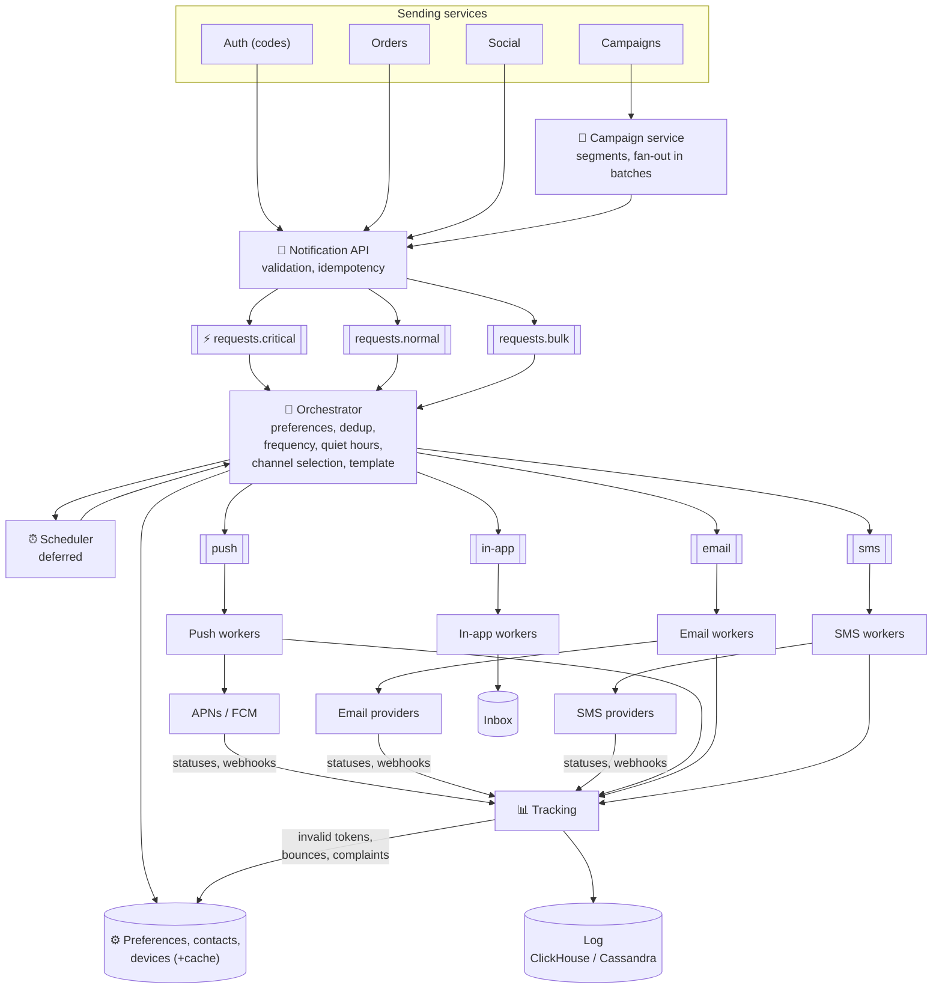
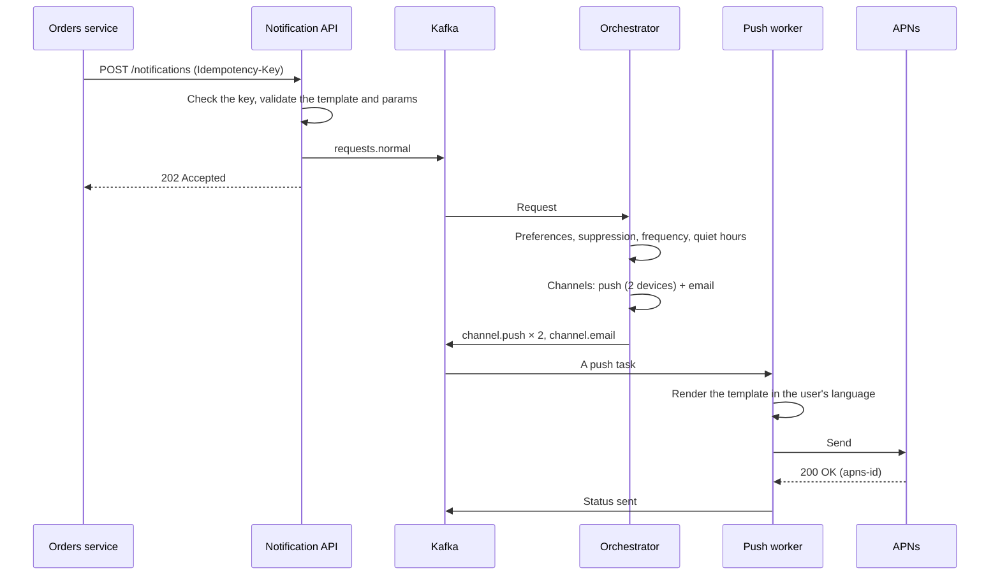
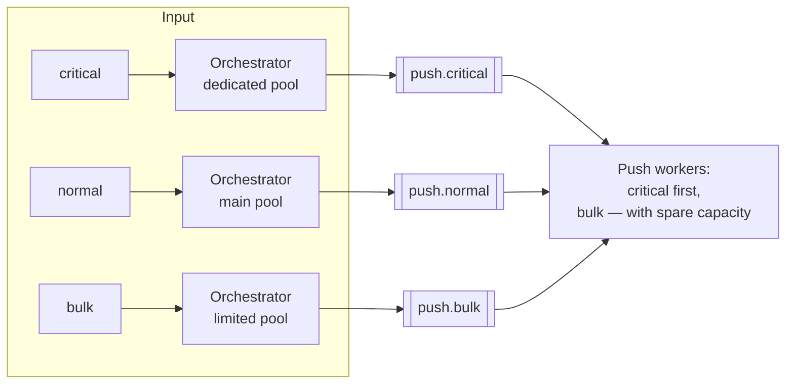
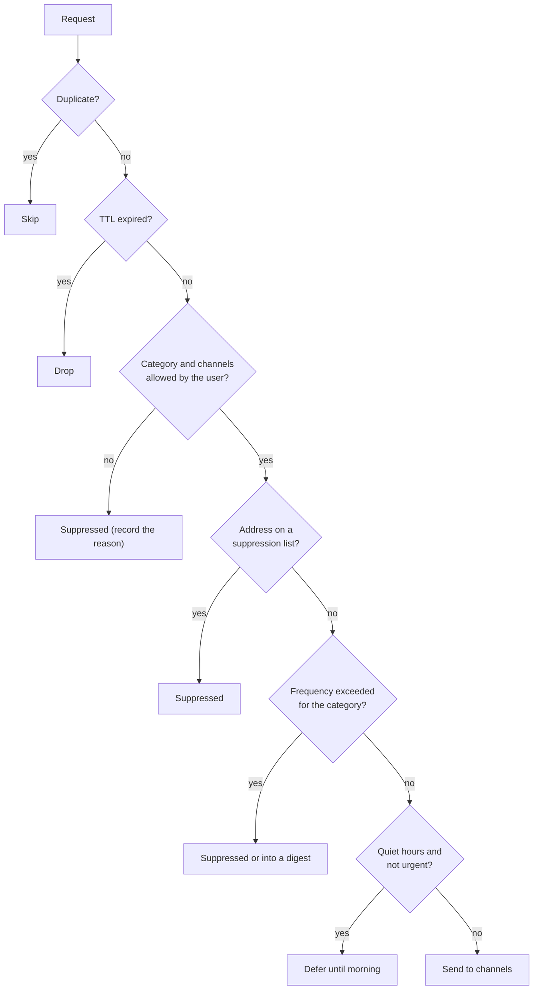
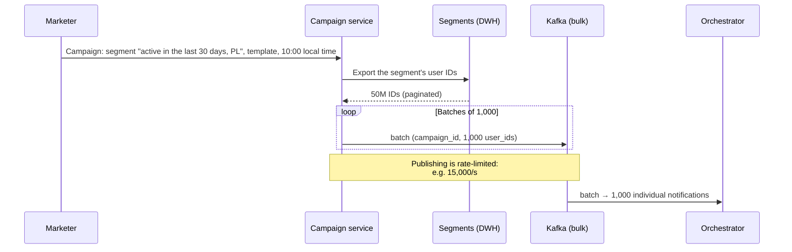
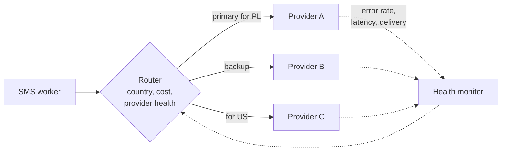
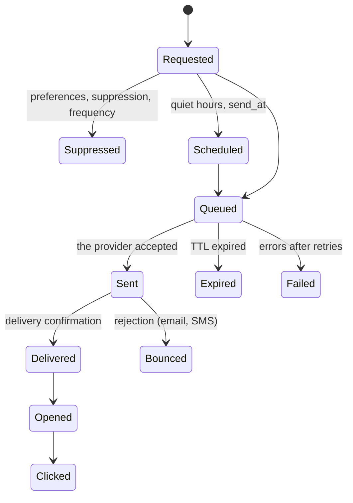

**English** | [Русский](README_RU.md)

# Tier 1 · 05. Notification System (push, email, SMS)

> **Level:** Medium · **Interview time:** 45 min · **Study time:** ~5 h
> **Key aspects:** the processing pipeline, priorities and channel isolation, at-least-once delivery and dedup, user preferences and consent, quiet hours, bulk sends (fan-out), push/email/SMS specifics, provider failover, templates, delivery tracking
> **Builds on:** [09-messaging](../../09-messaging/README.md), [10-idempotency](../../10-idempotency/README.md), [12-communication](../../12-communication/README.md#9-webhooks), [13-reliability-patterns](../../13-reliability-patterns/README.md), [Tier 1 · 02 Rate Limiter](../02-rate-limiter/README.md)

---

## 🗺️ How to Read This Walkthrough

The walkthrough follows an interview, but every step includes explanations: **why** a decision is made, **how** a mechanism works and **what happens** if you do it differently. The "📘 Explanation" blocks are theory right where you need it.

| Icon | Meaning |
|:----:|:--------|
| 🎤 | Interviewer |
| 🗣️ | What I (the candidate) say out loud |
| ✏️ | What I draw on the whiteboard |
| ⏱️ | Time budget for the step |
| 📘 | A detailed explanation of a concept |

Callouts: **TIP** — a good technique, **WARNING** — a trap, **IMPORTANT** — a Senior+ signal.

---

## 📑 Contents

0. [What This Problem Teaches](#0-what-this-problem-teaches)
1. [Problem Statement](#1-problem-statement)
2. [Clarifying Questions and Requirements](#2-clarifying-questions-and-requirements)
3. [Capacity Estimates](#3-capacity-estimates)
4. [API](#4-api)
5. [Data Model](#5-data-model)
6. [High-Level Design](#6-high-level-design)
7. [Deep Dive 1: The Pipeline, Priorities and Isolation](#7-deep-dive-1-the-pipeline-priorities-and-isolation)
8. [Deep Dive 2: Reliability and Dedup](#8-deep-dive-2-reliability-and-dedup)
9. [Deep Dive 3: Preferences, Consent and Quiet Hours](#9-deep-dive-3-preferences-consent-and-quiet-hours)
10. [Deep Dive 4: Bulk Sends and Aggregation](#10-deep-dive-4-bulk-sends-and-aggregation)
11. [Deep Dive 5: Channel Specifics](#11-deep-dive-5-channel-specifics)
12. [Deep Dive 6: Multiple Providers and Failover](#12-deep-dive-6-multiple-providers-and-failover)
13. [Deep Dive 7: Templates and Localization](#13-deep-dive-7-templates-and-localization)
14. [Deep Dive 8: Tracking and Analytics](#14-deep-dive-8-tracking-and-analytics)
15. [Bottlenecks and Failure Scenarios](#15-bottlenecks-and-failure-scenarios)
16. [What Changes at 10x Scale](#16-what-changes-at-10x-scale)
17. [Key Concepts and New Terms](#17-key-concepts-and-new-terms)
18. [Variations and Follow-Up Questions](#18-variations-and-follow-up-questions)
19. [Common Mistakes](#19-common-mistakes)
20. [Cheat Sheet and Self-Check](#20-cheat-sheet-and-self-check)

---

## 0. What This Problem Teaches

Almost every product has a notification system: a login code, "your order has shipped", "someone replied to your comment", a marketing campaign. At first glance it's "send a message through an external service". In reality it's a complex asynchronous system:

| What's tested | Where it shows up |
|:--------------|:------------------|
| Async processing and queues | The pipeline from request to provider |
| Workload isolation | A login code mustn't wait behind a 50M-recipient marketing campaign |
| Reliability and idempotency | A notification is neither lost nor delivered twice |
| Working with external systems | APNs, FCM, email and SMS providers with their own limits and outages |
| Fan-out | One event → millions of recipients |
| Product and legal thinking | Unsubscribing, consent, quiet hours, frequency |

> [!TIP]
> A strong answer stands out by considering the **user**: nobody wants 10 push notifications in a row at 3 AM. Reliable delivery is half the problem; the other half is **not sending what shouldn't be sent**.

---

## 1. Problem Statement

> 🎤 "Design a notification system for a large platform: push on iOS and Android, email, SMS and in-app notifications. Dozens of the company's services use it — for login codes, order statuses, social events and marketing campaigns."

**What it looks like to a sending service:**

```
notifications.send(
    user_id = 42,
    template = "order_shipped",
    params = { order_id: "9001", eta: "December 2" },
    idempotency_key = "order_shipped:9001"
)
```

The order service doesn't know whether the user has the app, whether they allowed push, what language they speak or whether it's night where they are. The notification system decides all of that.

**Time plan:**

| Step | ⏱️ |
|:-----|:--:|
| Requirements | 5 min |
| Estimates | 3 min |
| API and data model | 5 min |
| High-level design | 7 min |
| Deep dives | 20 min |
| Failures and wrap-up | 5 min |

---

## 2. Clarifying Questions and Requirements

⏱️ 5 min

| My question | Interviewer's answer | What it changes and why |
|:------------|:---------------------|:------------------------|
| Which channels? | Push (iOS, Android), email, SMS, in-app | Different providers, limits, formats; separate queues |
| Which notification types? | Transactional (login codes, orders), social (likes, replies), marketing | Different priorities and latency requirements |
| Volume? | ~500M notifications per day; marketing campaigns up to 50M recipients | Queues, horizontal scaling, fan-out |
| What latency? | Login codes — seconds; transactional — up to a minute; marketing — hours are fine | **Priorities** and isolation |
| Can something be sent twice? | Undesirable, but better than losing a transactional one | At-least-once + dedup |
| User preferences? | Opt-out by category and channel; some can't be disabled (security) | A preferences service on every notification's path |
| Quiet hours? | Don't disturb at night, except for urgent things | Deferred sending by the user's time zone |
| Are statistics needed? | Delivered, opened, clicked; history for support | Collecting provider events |
| Provider limits and cost? | SMS is expensive; providers have rate limits | Rate limiting toward providers, cost-based routing |

### Functional requirements

1. Accept notification requests from internal services (for one user or a segment).
2. Deliver via push, email, SMS and in-app, respecting user preferences.
3. Templates with localization.
4. Deferred and scheduled sending, quiet hours.
5. Status tracking (sent, delivered, opened, clicked) and history.
6. Managing preferences and unsubscribes.

### Non-functional requirements

| Requirement | Target | Why |
|:------------|:-------|:----|
| Critical latency | Login codes — p99 < 10 s to the provider | The user is waiting on the login screen |
| Reliability | Transactional notifications aren't lost | "Order shipped" or a login code must arrive |
| No duplicates | Duplicates are rare | A double push annoys; a double SMS costs money |
| Scale | 500M per day, with peaks during campaigns | Growth and marketing campaigns |
| Isolation | Campaigns don't delay transactional notifications | Otherwise a login code arrives an hour late |
| Compliance | Unsubscribing, consent, SMS restrictions | Fines and providers blocking the sender |

---

## 3. Capacity Estimates

⏱️ 3 min

```
Notifications:   500M per day → ~6,000/s on average, peaks up to ~30,000/s
A campaign:      50M recipients in 1 hour → ~14,000/s for that alone

By channel (an example split):
  push    70% → 350M/day
  email   25% → 125M/day
  SMS      1% →   5M/day (expensive: codes and critical only)
  in-app  — stored in a database, shown when the app opens

Devices:         ~1B push tokens × ~200 B ≈ 200 GB
Log:             500M × ~1 KB (statuses, metadata) ≈ 500 GB/day
                 kept for 90 days ≈ 45 TB → a columnar or wide-column store
```

### Conclusions

| Conclusion | Design consequence |
|:-----------|:-------------------|
| Thousands to tens of thousands per second | An async pipeline built on queues |
| Campaigns create peaks comparable to normal traffic | Separate queues and rate limiting for campaigns |
| SMS — rare but expensive | Strict dedup and limits specifically for SMS |
| The log is tens of TB | Not in the main relational database; Cassandra or ClickHouse |
| Providers have their own limits | Rate limiting outgoing calls to each provider |

---

## 4. API

⏱️ 3 min

### Sending to one user

```http
POST /v1/notifications
Idempotency-Key: order_shipped:9001

{
  "user_id": 42,
  "category": "orders",                    ← for user preferences
  "template": "order_shipped",
  "params": { "order_id": "9001", "eta": "2026-12-02" },
  "channels": ["push", "email"],           ← optional: otherwise per the category's rules
  "priority": "high",                      ← critical | high | normal | low
  "send_at": null,                         ← or a time for deferred sending
  "ttl": "24h"                             ← irrelevant after this
}

→ 202 Accepted { "notification_id": "ntf_7f3c…" }
```

📘 **Why `202 Accepted` rather than `200 OK`.** The notification hasn't been delivered yet — it's been accepted for processing. The sending service shouldn't wait on providers (seconds) or depend on their availability. It's an async contract, as in [09-messaging](../../09-messaging/README.md).

### Everything else

```http
POST /v1/campaigns                          { segment_id, template, schedule, rate_limit }
GET  /v1/notifications/{id}                 → status and per-channel history
PUT  /v1/users/{id}/preferences             { "marketing": { "email": false, "push": true }, ... }
POST /v1/users/{id}/devices                 { platform: "ios", token: "…", app_version: "5.2" }
GET  /v1/users/{id}/inbox?cursor=…          → in-app notifications
POST /v1/unsubscribe?token=…                → one-click unsubscribe from an email
```

---

## 5. Data Model

⏱️ 2 min

| Entity | Fields | Where to store | Why |
|:-------|:-------|:---------------|:----|
| **Contacts** | user_id, email (+verified), phone (+verified), locale, timezone | A relational DB + cache | Read on every notification → cache |
| **Devices** | user_id, device_id, platform, push_token, app_version, last_seen | Wide-column / KV (key — user_id) | ~1B records; reading all of a user's devices |
| **Preferences** | user_id, category, channel, enabled; quiet_hours | KV + cache | On every notification's path |
| **Templates** | template_id, version, channel, locale, subject, body | A relational DB + local cache | Few records, read often |
| **Notification log** | notification_id, user_id, category, channel, status, timestamps, provider_message_id | Cassandra / ClickHouse | Tens of TB, streaming writes, reads by user and for analytics |
| **Dedup keys** | idempotency_key → notification_id, TTL | Redis | A fast check with a short lifetime |
| **Suppression lists** | email or phone, reason (hard bounce, complaint, unsubscribe) | KV | A global check before sending |
| **In-app inbox** | user_id, notification_id, created_at, read | Wide-column, partition key user_id | The user's notification feed |

---

## 6. High-Level Design

⏱️ 7 min



### One notification's path



🗣️ "Key decisions:
- an **async API** with idempotency: the sender gets a `202` and doesn't depend on providers;
- **priority queues** on input and **per-channel queues** on output — isolation;
- the **orchestrator** — one place for every rule: preferences, duplicates, frequency, quiet hours, channel selection;
- **channel workers** with provider adapters and rate limiting;
- **feedback** from providers (invalid tokens, email bounces) flows back into contact data."

---

## 7. Deep Dive 1: The Pipeline, Priorities and Isolation

> 🎤 "Marketing launched a 50-million-recipient campaign. At the same time a user is trying to log in and waiting for a code. What happens?"

### The problem with a shared queue

If everything goes into one queue, the login code ends up **behind** 50 million marketing messages and arrives an hour later. The user can't log in.

### The fix: isolation at two levels

**1. Priority queues on input:**

| Queue | What | Workers | Latency target |
|:------|:-----|:--------|:---------------|
| `critical` | Login codes, security, payments | A dedicated pool, always with headroom | Seconds |
| `normal` | Orders, social events | The main pool | Up to a minute |
| `bulk` | Marketing, digests | A rate-limited pool | Hours are fine |

**2. Per-channel queues on output** — with priorities inside each channel too: a slow email provider doesn't delay push, and marketing emails don't consume the provider quota needed for transactional ones.

📘 **This is a bulkhead** (see [13-reliability-patterns](../../13-reliability-patterns/README.md#5-bulkheads-and-isolation)): resources are separated so that a problem or load in one part can't take resources from another.



> [!IMPORTANT]
> **Senior+ signal:** bring up **isolation by priority** right away, and note that provider limits are a shared resource to be **divided** between classes: e.g. 70% of the SMS provider's throughput is reserved for login codes.

### Why Kafka (or similar)

- It buffers peaks (a 50M campaign lands in a queue instead of knocking over services).
- The partition key is `user_id`: one user's notifications are processed in order by one consumer — simpler frequency and dedup accounting.
- Replay after consumer failures.

---

## 8. Deep Dive 2: Reliability and Dedup

> 🎤 "How do you guarantee a notification is neither lost nor delivered twice?"

### Where losses and duplicates can happen

| Step | Loss | Duplicate |
|:-----|:-----|:----------|
| Service → API | The service crashed before sending the request | The service retried after a timeout |
| API → queue | The API crashed after responding but before writing to the queue | — |
| Queue → orchestrator → channels | — | A consumer crashed after passing the task on but before acknowledging → reprocessing |
| Worker → provider | — | The provider accepted, the response was lost → a retry |

### Fixes by step

| Step | Mechanism |
|:-----|:----------|
| **The sender** | Publishes the request through an **outbox** in its own transaction (order shipped + the notification event atomically) — see [09-messaging](../../09-messaging/README.md#7-the-producer-side-the-dual-write-problem-and-the-outbox) |
| **The API** | `Idempotency-Key`: `SETNX dedup:{key} → notification_id` in Redis with a 24 h TTL; a retry returns the same `notification_id` |
| **API → queue** | Respond `202` only after the Kafka write is acknowledged (`acks=all`) |
| **The orchestrator** | Deterministic task IDs: `{notification_id}:{channel}:{device_id}`; reprocessing creates the same IDs |
| **The worker** | Before calling the provider, check "task already sent" (by task ID); after the provider responds — record the `sent` status |
| **The provider** | Where supported — pass an idempotency key; otherwise accept a small risk of duplicates |

📘 **The uncertainty window at the provider.** A worker sent a request to the SMS provider, the provider sent the SMS, and the response was lost on the network. The worker doesn't know whether the SMS went out. Options:
- **retry** — a duplicate is possible (fine for a login code: two codes beat none);
- **don't retry** — a loss is possible (unacceptable for critical notifications);
- **query the status** from the provider by your message identifier, if the provider allows it.

🗣️ "I choose **at-least-once** with dedup at every step where possible. The residual duplicate risk exists only when a provider response is lost, and it's resolved by type: for codes — retry; for marketing — no retry under uncertainty."

### Retries and provider errors

| Error | Type | Action |
|:------|:-----|:-------|
| A provider timeout, 5xx, 429 | Transient | Retry with exponential backoff and jitter; honor `Retry-After` |
| Push: the token is invalid (APNs 410 Unregistered, FCM UNREGISTERED) | Permanent | Delete the device; don't retry |
| Email: a hard bounce (the address doesn't exist) | Permanent | Add the address to the suppression list |
| Email: a spam complaint | Permanent | Suppress marketing to that address |
| SMS: the number is invalid or blocked | Permanent | Flag the number |
| Attempts exhausted | — | DLQ, an alert, status `failed` |

> [!WARNING]
> **Notification TTL.** A login code that arrives 20 minutes late is useless, and "your order is on the way" after the order was delivered is harmful. Every notification carries a `ttl`; the worker drops expired tasks instead of sending them.

---

## 9. Deep Dive 3: Preferences, Consent and Quiet Hours

> 🎤 "How do you respect what the user wants?"

### The preferences model

```
Categories:  security | orders | social | marketing | product_updates
Channels:    push | email | sms | in_app

user 42:
  security:   push ✅ email ✅ sms ✅    ← can't be fully disabled
  orders:     push ✅ email ✅ sms ❌
  social:     push ✅ email ❌
  marketing:  push ❌ email ✅            ← only with explicit consent
  quiet_hours: 23:00–08:00, timezone Europe/Warsaw
```

### The orchestrator's checks, in order



| Rule | How | Why |
|:-----|:----|:----|
| **Mandatory categories** | Security can't be disabled (at least one channel remains) | The user must learn about a login from a new device |
| **Marketing only with consent** | Explicit opt-in, stored with a date and source | GDPR and advertising law requirements |
| **One-click unsubscribe** | A link in every marketing email + the `List-Unsubscribe` and `List-Unsubscribe-Post` headers (RFC 8058) | Mailbox providers (Gmail, Yahoo) require it from bulk senders; without it emails go to spam |
| **Frequency** | At most N marketing notifications per day, at most M pushes per hour | Prevents "fatigue" — otherwise users disable notifications entirely |
| **Quiet hours** | By the user's time zone; urgent (`critical`) ones go without delay | Don't wake people up |
| **Global suppression lists** | Addresses with hard bounces, complaints, unsubscribes | Sender reputation |

📘 **Caching preferences.** Preferences are read on **every** notification — 6,000+ times per second. They're cached (Redis + a local cache with a short TTL) and invalidated on change. An unsubscribe must take effect quickly — seconds, not hours: an email arriving after an unsubscribe annoys people and may break the law.

---

## 10. Deep Dive 4: Bulk Sends and Aggregation

> 🎤 "A campaign to 50 million users. How do you send it?"

### Campaign fan-out



| Decision | Why |
|:---------|:----|
| The segment is computed from the data warehouse, not the production database | A heavy query doesn't load production systems |
| Publishing in **batches** of 1,000 | Fewer messages in the queue; the orchestrator expands the batch |
| **Rate-limiting** the campaign | Doesn't consume all provider and orchestrator capacity; email providers dislike sudden bursts from one sender |
| Idempotency on `{campaign_id}:{user_id}` | Restarting the campaign after a failure won't resend |
| Sending **by local time** | Recipients are split by time zone, and each group is scheduled separately |
| The ability to **stop** a campaign | A template error spotted after 5 minutes — stop it rather than send 50M broken emails |

### Social fan-out and aggregation

📘 A popular user posted → 10M followers need notifying. It's the same fan-out, but triggered by an event rather than a marketer. The fix is similar: the event → a fan-out service exports followers page by page and publishes batches to `bulk` (or `normal` for close friends).

**Aggregation.** A post got 500 likes in 10 minutes — sending 500 pushes is out of the question.

| Approach | How |
|:---------|:----|
| **An aggregation window** | The first event starts an N-minute timer; events within the window are combined into one: "Anna and 499 others liked your photo" |
| **A collapse key** | A push with the same key replaces the previous one on the device (`apns-collapse-id`, the FCM collapse key) — only the latest is visible |
| **A digest** | Low-priority events accumulate and go out once a day in a single email |

---

## 11. Deep Dive 5: Channel Specifics

> 🎤 "How do the channels differ from a design perspective?"

### Push (APNs, FCM)

| Specific | What to do |
|:---------|:-----------|
| A **device token** registered by the app at launch is required | A device registration API; tokens change — update them on every launch |
| A user has **several devices** | Send to every active one (or per rules); delete devices inactive for months |
| The provider reports **invalid tokens** | Delete devices on 410 / UNREGISTERED responses |
| A **payload size limit** (4 KB) | Send a short text and an ID; the app fetches details itself |
| **Delivery isn't guaranteed** | A device that's off → APNs/FCM hold messages for a limited time; duplicate important ones into the in-app inbox |
| Persistent HTTP/2 connections to APNs | A connection pool in the workers; token-based authentication |

### Email

| Specific | What to do |
|:---------|:-----------|
| **Deliverability** is the main issue | SPF, DKIM, DMARC for the domain; otherwise emails land in spam |
| **Sender reputation** | Different subdomains and IPs for transactional and marketing mail: complaints about campaigns mustn't hurt receipt delivery |
| **IP warm-up** | New IPs start at low volumes and ramp up gradually |
| **Bounces and complaints** | Handle provider webhooks: hard bounce → suppression; the complaint rate must stay very low |
| Unsubscribing | `List-Unsubscribe` and a link in every marketing email |

### SMS

| Specific | What to do |
|:---------|:-----------|
| **Expensive** (cents per message, varies by country) | Critical only; strict dedup; per-user limits |
| **Regulation** | Consent for marketing, sender registration in some countries, no marketing at night |
| **Abuse** (SMS pumping) | Attackers request codes to premium numbers to earn a cut from the carrier → rate limiting by number, IP and country, CAPTCHA, blocking suspicious ranges |
| Different providers per country | Routing by country, cost and delivery quality |

### In-app

| Specific | What to do |
|:---------|:-----------|
| Stored in the user's **inbox** | A table with partition key `user_id`, sorted by time |
| An unread count | A separate counter (incremented on creation, reset on read) |
| Instant appearance | If the user is online — via WebSocket (see [12-communication](../../12-communication/README.md#8-scaling-websockets)) |
| A reliable "fallback" channel | A push may not arrive, but the user sees the inbox the next time they open the app |

---

## 12. Deep Dive 6: Multiple Providers and Failover

> 🎤 "The SMS provider has been down for an hour. Login codes aren't arriving. What do you do?"



| Mechanism | How |
|:----------|:----|
| **Several providers per channel** | At least two for SMS and email; push has a single provider (APNs, FCM), but they're highly available |
| **Health monitoring** | Error rate, response latency and **actual delivery rate** (from webhooks) per provider and country |
| **A circuit breaker** | As errors rise — shift traffic to the backup provider (see [13-reliability-patterns](../../13-reliability-patterns/README.md#4-circuit-breaker)) |
| **Cost-based routing** | For SMS — the cheaper provider for a country, if its delivery quality is good enough |
| **Failover without duplicates** | Switch providers only on an **explicit** failure (the provider didn't accept the message); under uncertainty (a timeout) — query the status first |
| **A fallback channel** | For critical ones: push not delivered within N seconds → SMS; email code not opened → offer SMS |

> [!WARNING]
> Failing over to the backup provider after a **timeout** is a classic source of duplicates: the first provider may have sent the SMS, and the response was just slow. For login codes it's acceptable; for paid marketing SMS it isn't.

---

## 13. Deep Dive 7: Templates and Localization

> 🎤 "How do you manage notification texts in 20 languages?"

| Principle | How |
|:----------|:----|
| **Templates are separate from code** | Texts live in a template service with versions; product changes text without a deploy |
| **Per channel and language** | One logical template `order_shipped` → variants for push (short), email (HTML), SMS (160 characters), in every language |
| **Typed parameters** | A template declares its parameters (`order_id: string`, `eta: date`); the API validates them **when accepting the request**, not at send time |
| **Locale-aware formatting** | Dates, numbers, currencies by the user's `locale` |
| **Language fallback** | No translation → the default language |
| **Preview and test sends** | Before publishing a new version |
| **The version is pinned in the request** | A notification is rendered with the version current at creation (important for deferred sends and campaigns) |

📘 **Why validate parameters on accept.** If a missing parameter were discovered at render time in the worker, the notification would have traveled the whole pipeline only to land in the DLQ, while the sender long since got a `202`. Validating at the entrance returns a `400` immediately, while the sender can still fix it.

---

## 14. Deep Dive 8: Tracking and Analytics

> 🎤 "Support asks: 'why didn't the user get the code?' How do you answer?"

### Notification statuses



### Event sources

| Event | Where from |
|:------|:-----------|
| Requested, Suppressed, Scheduled | The orchestrator |
| Sent, Failed | Channel workers |
| Delivered, Bounced | Provider webhooks (email, SMS); for push — partially via the app SDK |
| Opened (email) | A tracking pixel (imprecise: mail clients block or prefetch images) |
| Opened (push) | The app SDK when the notification is opened |
| Clicked | Links through a redirect service with a counter |

### Storage and use

| Task | Solution |
|:-----|:---------|
| One user's history for support | A log with partition key `user_id` (Cassandra) or ClickHouse sorted by user |
| Analytics by campaign and template | ClickHouse: deliverability, opens, clicks, unsubscribes |
| Monitoring | Delivery rate by provider and country, latency by priority, queue sizes, suppression rate |
| Alerts | A provider's delivery drop, rising `critical` latency, rising bounces or complaints |

🗣️ "The answer for support: the user's history shows the request arrived at 10:03:12, the push was sent at 10:03:13, the provider returned 'token invalid' (the user reinstalled the app), the SMS fallback was sent at 10:03:43 and delivered at 10:03:47."

---

## 15. Bottlenecks and Failure Scenarios

| Scenario | What happens | How we protect |
|:---------|:-------------|:---------------|
| A 50M campaign at the same time as login codes | Codes are delayed | Priority queues, dedicated pools, reserved provider capacity |
| The SMS provider is down | Codes don't arrive | Circuit breaker, a backup provider, a fallback channel |
| A service retries a request | A duplicate | An idempotency key in the API |
| A worker crashes after sending | A resend | Deterministic task IDs, a status check before sending |
| A provider response is lost | Uncertainty | A status query; retry only for critical ones |
| Mass invalid tokens | Wasted requests, errors | Deleting devices based on provider responses |
| A bug in a campaign template | 50M emails with an error | Preview, test sends, a gradual start, a stop button |
| A user unsubscribed | Emails keep arriving | Fast preferences cache invalidation, a check before sending |
| An SMS pumping attack | A huge bill | Rate limiting by number, IP, country; CAPTCHA |
| The bulk queue falls behind | The campaign drags on | Acceptable; monitoring, worker autoscaling |
| Expired notifications after an outage | A "login code" an hour late | TTL, dropping expired ones |

---

## 16. What Changes at 10x Scale

> 🎤 "5 billion notifications a day?"

| Change | Why |
|:-------|:----|
| **Sharding the orchestrator and preference caches** by `user_id` | Load grows linearly |
| **In-house email infrastructure** (MTAs) for marketing | At that volume third-party providers are very expensive |
| **Regional clusters** | Closer to providers and users; data residency requirements |
| **ML optimization** | The best send time, channel and frequency per user |
| **Aggressive aggregation and digests** | Volume grows; user attention doesn't |

---

## 17. Key Concepts and New Terms

### What's applied from Fundamentals

| Concept | Where it's covered | How it applies here |
|:--------|:-------------------|:--------------------|
| Queues, outbox, DLQ, retries | [09-messaging](../../09-messaging/README.md) | The whole pipeline |
| Idempotency, backoff with jitter | [10-idempotency](../../10-idempotency/README.md) | Dedup, retries toward providers |
| Webhooks, WebSocket | [12-communication](../../12-communication/README.md) | Provider statuses, in-app |
| Bulkheads, circuit breakers | [13-reliability-patterns](../../13-reliability-patterns/README.md) | Priority isolation, provider failover |
| Rate limiting | [Tier 1 · 02](../02-rate-limiter/README.md) | Provider limits, per-user frequency, SMS protection |
| Columnar stores | [09-messaging](../../09-messaging/README.md) and the URL shortener | The log and analytics |

### New terms in this problem

| Term | In short |
|:-----|:---------|
| **Transactional vs marketing** | Different priorities, consent rules and sending infrastructure |
| **Suppression list** | Addresses you must not send to (bounce, complaint, unsubscribe) |
| **Hard / soft bounce** | A permanent / temporary email delivery failure |
| **SPF, DKIM, DMARC** | Mechanisms proving an email really comes from your domain |
| **IP warm-up** | Gradually increasing volume from new sending addresses |
| **One-click unsubscribe** | Unsubscribing without logging in (RFC 8058) |
| **Collapse key** | A new push replaces the previous one with the same key |
| **Aggregation window, digest** | Combining many events into one notification |
| **SMS pumping** | Fraud requesting SMS to premium numbers |
| **Fallback channel** | Another channel when the primary didn't deliver |

---

## 18. Variations and Follow-Up Questions

<details>
<summary><b>How do you design sending a login code (OTP)?</b></summary>

The code is generated and stored in the auth service (a hash, a ~5-minute lifetime, a limit on entry attempts); the notification system only delivers it. Priority `critical`, the notification TTL equals the code's lifetime, the channel is the user's choice with a fallback (push → SMS), rate limiting on code requests per user, number and IP, and SMS pumping protection. Requesting a code again means a new code and a new notification, not a resend of the old one.
</details>

<details>
<summary><b>How do you send a campaign at 10:00 local time for every user?</b></summary>

Group recipients by time zone and schedule each group separately (≈ 24–40 groups). The scheduler publishes a group's batches when 10:00 arrives in its time zone, rate-limited so the peak isn't instantaneous.
</details>

<details>
<summary><b>Is notification ordering needed?</b></summary>

Usually strict order isn't needed, but logic matters: "order delivered" mustn't arrive before "order shipped". Partitioning Kafka by `user_id` preserves processing order per user, and checking the order's version or status lets you drop a stale notification.
</details>

<details>
<summary><b>How do you implement "at most 3 marketing notifications per day"?</b></summary>

A per-user, per-category counter with a sliding window (as in the [rate limiter](../02-rate-limiter/README.md)) in Redis; the orchestrator checks and increments it before sending. If the limit is used up — suppress or defer into a digest. Processing one user's notifications in one partition simplifies the counting.
</details>

<details>
<summary><b>Why not send notifications directly from the order service?</b></summary>

Every service would have to know about providers, tokens, preferences, quiet hours, templates and unsubscribes — the logic would be duplicated and drift apart. A centralized system provides uniform rules, shared frequency accounting (a user won't get 5 notifications from 5 services in a minute) and one place for legal compliance.
</details>

---

## 19. Common Mistakes

| ❌ Mistake | Why it's bad | ✅ Do this instead |
|:----------|:-------------|:------------------|
| One queue for everything | Login codes wait behind a campaign | Queues per priority and channel |
| Sending synchronously from the API | Services wait on providers and depend on their availability | `202 Accepted` and an async pipeline |
| No idempotency | Duplicates on retries | An idempotency key + deterministic task IDs |
| Retrying everything the same way | Retries on invalid tokens and non-existent addresses | Separate transient from permanent errors |
| No notification TTL | Stale codes and statuses arrive after a delay | A TTL and dropping expired notifications |
| Ignoring preferences and unsubscribes | Annoyance, complaints, legal violations | Checks in the orchestrator, fast unsubscribes |
| The same IPs and domain for marketing and transactional mail | Campaign complaints break receipt delivery | Separate sending infrastructure |
| A campaign without rate limiting | Overloaded providers and our own systems | Batches and a campaign rate limit |
| A push for every like | Users disable notifications | Aggregation, collapse keys, digests |
| A single SMS provider | Its outage = nobody can log in | Several providers, a circuit breaker, a fallback |
| No SMS abuse protection | A huge bill | Rate limiting, CAPTCHA, geo restrictions |

---

## 20. Cheat Sheet and Self-Check

### 30-second answer

> An async API with an idempotency key and a `202` response; senders publish via an outbox. Kafka with priority queues (critical, normal, bulk) keyed by `user_id`. The orchestrator applies rules in order: dedup, TTL, preferences and consent by category and channel, suppression lists, frequency, quiet hours by time zone; it picks channels and devices. Per-channel queues with workers and provider adapters: rate limiting toward each provider, reserved capacity for critical, retries with backoff for transient errors, deleting tokens and suppressing addresses on permanent ones, a DLQ. At-least-once with deterministic task IDs; the residual duplicate risk exists only when a provider response is lost. Campaigns — a segment from the DWH, batches of 1,000, rate limiting, a stop button. Aggregation and collapse keys against spam. Several SMS and email providers with circuit breakers and fallback channels. Templates are versioned; parameters are validated on entry. Statuses go into a log (Cassandra/ClickHouse) for support and analytics.

### Self-check

- [ ] I can explain why queues per priority and channel are needed
- [ ] I can find every point of loss and duplication and the mechanism for each
- [ ] I can explain the uncertainty window when calling a provider
- [ ] I can split provider errors into transient and permanent
- [ ] I can describe the order of the orchestrator's checks
- [ ] I can design a 50M campaign with rate limiting and a stop button
- [ ] I can explain aggregation and collapse keys
- [ ] I can name 3 specifics each of push, email and SMS
- [ ] I can describe provider failover without extra duplicates
- [ ] I can tell support why a user didn't get a notification

### Further reading

- Alex Xu, *System Design Interview*, Vol. 1 — chapter "Design a Notification System"
- Apple Push Notification service and Firebase Cloud Messaging documentation
- RFC 8058, *Signaling One-Click Functionality for List Email Headers*
- Google and Yahoo bulk email sender requirements (2024)
- Uber Engineering, Airbnb Engineering — articles on notification platforms
