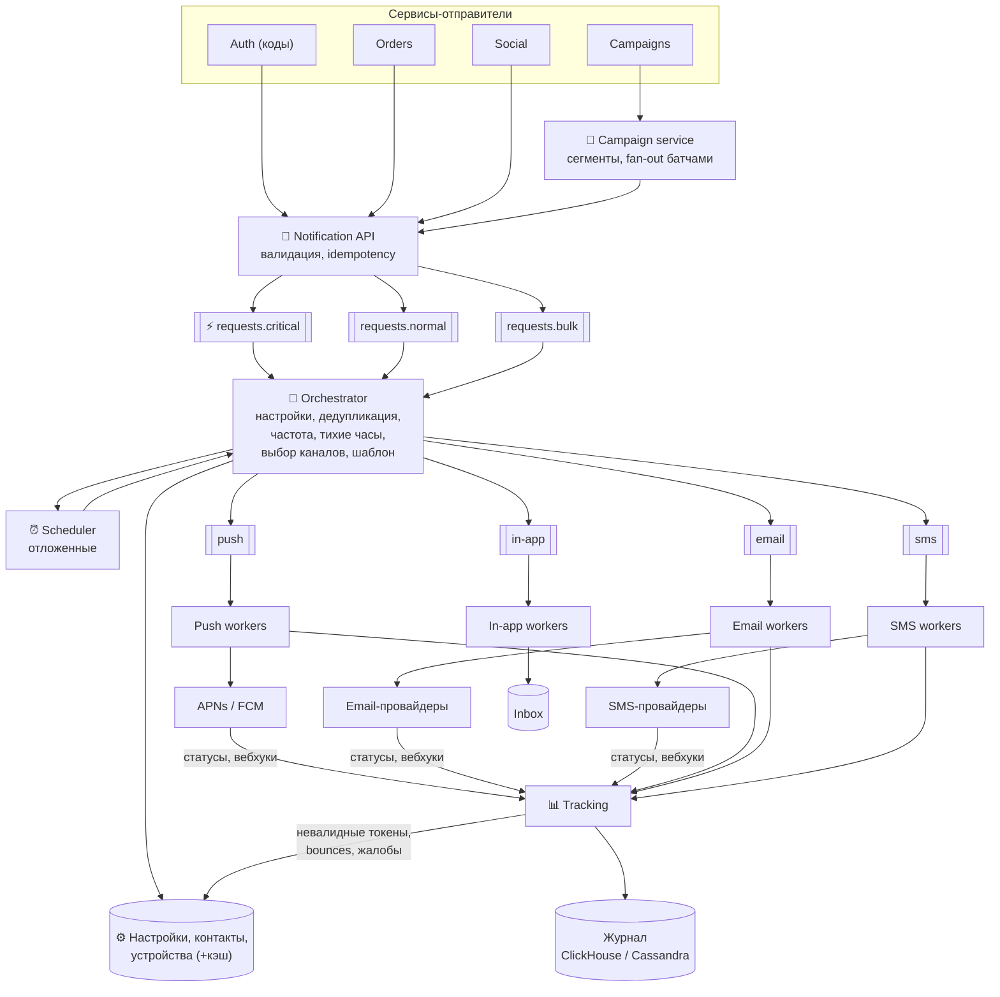
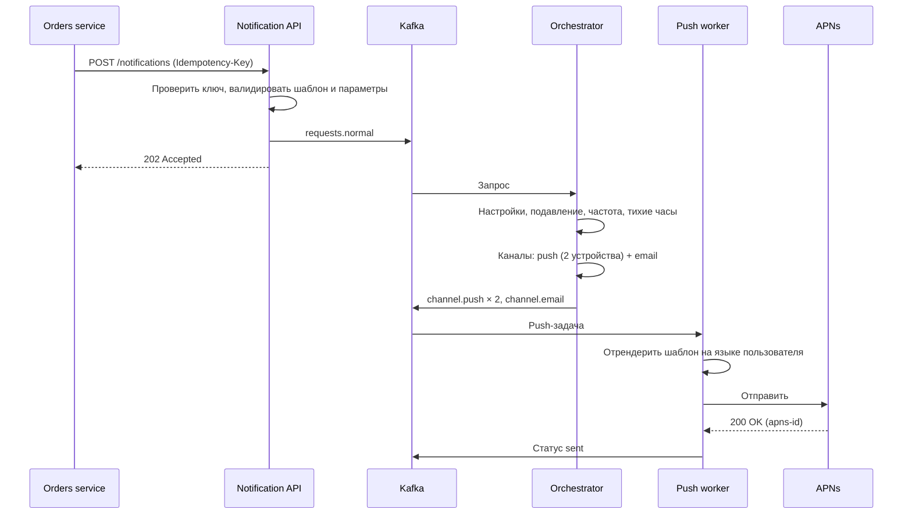
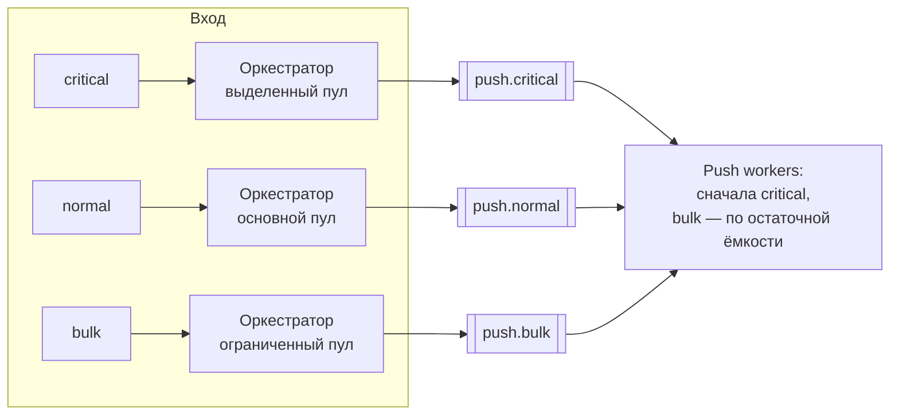
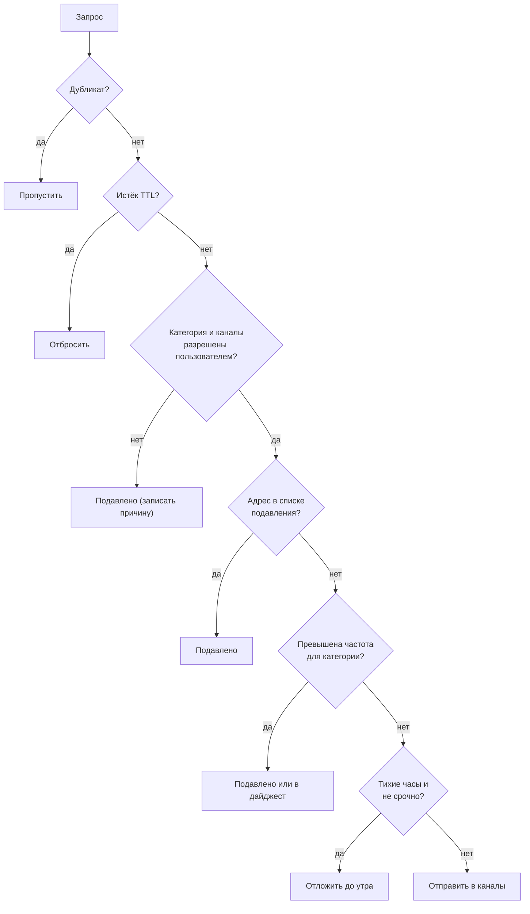
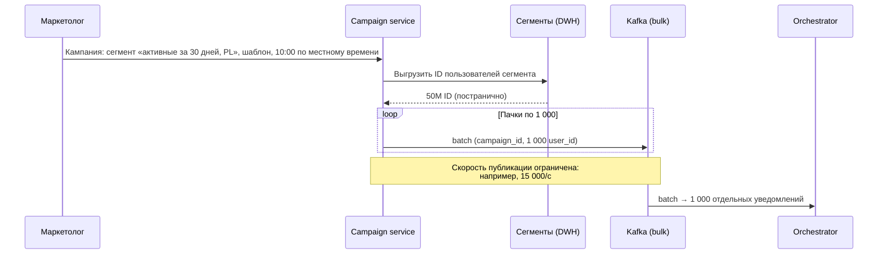
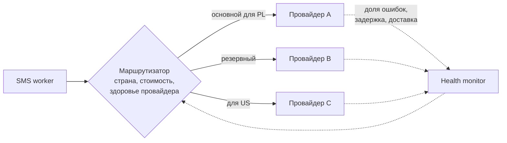
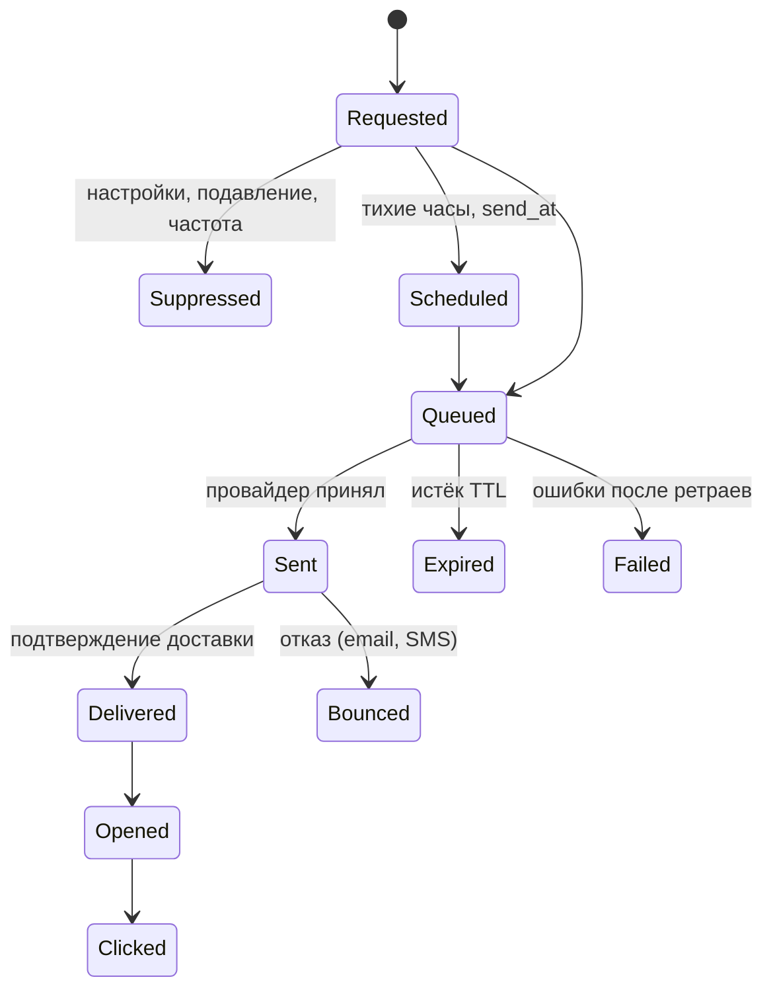

[English](README.md) | **Русский**

# Tier 1 · 05. Notification System (push, email, SMS)

> **Уровень:** Medium · **Время на интервью:** 45 мин · **Время на разбор:** ~5 ч
> **Ключевые аспекты:** конвейер обработки, приоритеты и изоляция каналов, доставка at-least-once и дедупликация, настройки и согласия пользователей, тихие часы, массовые рассылки (fan-out), особенности push/email/SMS, переключение провайдеров, шаблоны, отслеживание доставки
> **Опирается на:** [09-messaging](../../01_Fundamentals/09_Messaging/README.ru.md), [10-idempotency](../../01_Fundamentals/10_Idempotency/README.ru.md), [12-communication](../../01_Fundamentals/12_Communication/README.ru.md#9-вебхуки), [13-reliability-patterns](../../01_Fundamentals/13_Reliability%20patterns/README.ru.md), [Tier 1 · 02 Rate Limiter](../02_Design%20a%20Rate%20Limiter%20or%20Abuse%20Protection/README.ru.md)

---

## 🗺️ Как читать этот разбор

Разбор построен как интервью, но в каждом шаге есть объяснения: **почему** принимается решение, **как работает** механизм и **что будет**, если сделать иначе. Блоки «📘 Объяснение» — теория прямо по ходу задачи.

| Значок | Что значит |
|:------:|:-----------|
| 🎤 | Реплика интервьюера |
| 🗣️ | Что говорю вслух я (кандидат) |
| ✏️ | Что рисую на доске |
| ⏱️ | Сколько времени тратить на шаг |
| 📘 | Подробное объяснение концепции |

Блоки **TIP** — хороший приём, **WARNING** — ловушка, **IMPORTANT** — сигнал для уровня Senior+.

---

## 📑 Содержание

0. [Чему учит эта задача](#0-чему-учит-эта-задача)
1. [Условие задачи](#1-условие-задачи)
2. [Уточняющие вопросы и требования](#2-уточняющие-вопросы-и-требования)
3. [Оценки нагрузки](#3-оценки-нагрузки)
4. [API](#4-api)
5. [Модель данных](#5-модель-данных)
6. [High-level дизайн](#6-high-level-дизайн)
7. [Deep dive 1: конвейер, приоритеты и изоляция](#7-deep-dive-1-конвейер-приоритеты-и-изоляция)
8. [Deep dive 2: надёжность и дедупликация](#8-deep-dive-2-надёжность-и-дедупликация)
9. [Deep dive 3: настройки, согласия и тихие часы](#9-deep-dive-3-настройки-согласия-и-тихие-часы)
10. [Deep dive 4: массовые рассылки и группировка](#10-deep-dive-4-массовые-рассылки-и-группировка)
11. [Deep dive 5: особенности каналов](#11-deep-dive-5-особенности-каналов)
12. [Deep dive 6: несколько провайдеров и переключение](#12-deep-dive-6-несколько-провайдеров-и-переключение)
13. [Deep dive 7: шаблоны и локализация](#13-deep-dive-7-шаблоны-и-локализация)
14. [Deep dive 8: отслеживание и аналитика](#14-deep-dive-8-отслеживание-и-аналитика)
15. [Узкие места и сценарии сбоев](#15-узкие-места-и-сценарии-сбоев)
16. [Что изменится при росте в 10 раз](#16-что-изменится-при-росте-в-10-раз)
17. [Ключевые концепции и новые понятия](#17-ключевые-концепции-и-новые-понятия)
18. [Варианты задачи и follow-up вопросы](#18-варианты-задачи-и-follow-up-вопросы)
19. [Типичные ошибки](#19-типичные-ошибки)
20. [Шпаргалка и самопроверка](#20-шпаргалка-и-самопроверка)

---

## 0. Чему учит эта задача

Система уведомлений есть почти в каждом продукте: код подтверждения входа, «заказ отправлен», «вам ответили в комментариях», маркетинговая рассылка. На первый взгляд — «отправить сообщение через внешний сервис». На деле это сложная асинхронная система:

| Что проверяют | Где это в задаче |
|:--------------|:-----------------|
| Асинхронная обработка и очереди | Конвейер от запроса до провайдера |
| Изоляция нагрузок | Код входа не должен ждать за маркетинговой рассылкой на 50 млн |
| Надёжность и идемпотентность | Уведомление не теряется и не приходит дважды |
| Работа с внешними системами | APNs, FCM, email- и SMS-провайдеры со своими лимитами и сбоями |
| Fan-out | Одно событие → миллионы получателей |
| Продуктовое и юридическое мышление | Отписка, согласия, тихие часы, частота |

> [!TIP]
> Сильный ответ отличается тем, что учитывает **пользователя**: никто не хочет получить 10 push-уведомлений подряд в 3 часа ночи. Надёжность доставки — половина задачи; вторая половина — **не отправлять лишнего**.

---

## 1. Условие задачи

> 🎤 «Спроектируй систему уведомлений для большой платформы: push на iOS и Android, email, SMS и уведомления внутри приложения. Её используют десятки сервисов компании — для кодов входа, статусов заказов, социальных событий и маркетинговых рассылок».

**Как это выглядит для сервиса-отправителя:**

```
notifications.send(
    user_id = 42,
    template = "order_shipped",
    params = { order_id: "9001", eta: "2 декабря" },
    idempotency_key = "order_shipped:9001"
)
```

Сервис заказов не знает, есть ли у пользователя приложение, разрешил ли он push, какой у него язык и не ночь ли у него сейчас. Всё это решает система уведомлений.

**План по времени:**

| Шаг | ⏱️ |
|:----|:--:|
| Требования | 5 мин |
| Оценки | 3 мин |
| API и модель данных | 5 мин |
| High-level дизайн | 7 мин |
| Deep dives | 20 мин |
| Сбои и итоги | 5 мин |

---

## 2. Уточняющие вопросы и требования

⏱️ 5 мин

| Мой вопрос | Ответ интервьюера | Что это меняет и почему |
|:-----------|:------------------|:------------------------|
| Какие каналы? | Push (iOS, Android), email, SMS, in-app | Разные провайдеры, лимиты, форматы; отдельные очереди |
| Какие типы уведомлений? | Транзакционные (код входа, заказ), социальные (лайки, ответы), маркетинговые | Разные приоритеты и требования к задержке |
| Объём? | ~500M уведомлений в сутки; маркетинговые рассылки до 50M получателей | Нужны очереди, горизонтальное масштабирование, fan-out |
| Какая задержка? | Код входа — секунды; транзакционные — до минуты; маркетинг — часы допустимы | **Приоритеты** и изоляция |
| Можно ли отправить дважды? | Нежелательно, но лучше, чем потерять транзакционное | At-least-once + дедупликация |
| Настройки пользователя? | Отписка по категориям и каналам; некоторые нельзя отключить (безопасность) | Сервис настроек на пути каждого уведомления |
| Тихие часы? | Не беспокоить ночью, кроме срочного | Отложенная отправка по часовому поясу пользователя |
| Нужна ли статистика? | Доставлено, открыто, клики; история для поддержки | Сбор событий от провайдеров |
| Ограничения провайдеров и стоимость? | SMS дорогие; у провайдеров лимиты скорости | Rate limiting к провайдерам, маршрутизация по стоимости |

### Функциональные требования

1. Принимать запросы на уведомления от внутренних сервисов (одному пользователю или сегменту).
2. Доставлять через push, email, SMS, in-app с учётом настроек пользователя.
3. Шаблоны с локализацией.
4. Отложенная и запланированная отправка, тихие часы.
5. Отслеживание статусов (отправлено, доставлено, открыто, клик) и история.
6. Управление настройками и отписками.

### Нефункциональные требования

| Требование | Цель | Почему |
|:-----------|:-----|:-------|
| Задержка критичных | Код входа — p99 < 10 с до провайдера | Пользователь ждёт с открытым экраном входа |
| Надёжность | Транзакционные не теряются | «Заказ отправлен» или код входа обязаны дойти |
| Без дублей | Дубликаты — редкость | Двойной push раздражает, двойная SMS стоит денег |
| Масштаб | 500M в сутки, пики при рассылках | Рост и маркетинговые кампании |
| Изоляция | Рассылка не задерживает транзакционные | Иначе код входа придёт через час |
| Соответствие правилам | Отписка, согласия, ограничения на SMS | Штрафы и блокировка отправителя провайдерами |

---

## 3. Оценки нагрузки

⏱️ 3 мин

```
Уведомлений:     500M в сутки → ~6 000/с в среднем, пики до ~30 000/с
Рассылка:        50M получателей за 1 час → ~14 000/с только на неё

По каналам (пример распределения):
  push    70% → 350M/сутки
  email   25% → 125M/сутки
  SMS      1% →   5M/сутки (дорого: только коды и критичное)
  in-app  — хранится в базе, показывается при открытии приложения

Устройства:      ~1B токенов push × ~200 Б ≈ 200 ГБ
Журнал:          500M × ~1 КБ (статусы, метаданные) ≈ 500 ГБ/сутки
                 хранить 90 дней ≈ 45 ТБ → колоночное или wide-column хранилище
```

### Выводы

| Вывод | Следствие для дизайна |
|:------|:----------------------|
| Тысячи–десятки тысяч в секунду | Асинхронный конвейер на очередях |
| Рассылки создают пики сопоставимые с обычным трафиком | Отдельные очереди и ограничение скорости рассылок |
| SMS — редкие, но дорогие | Строгая дедупликация и лимиты именно для SMS |
| Журнал — десятки ТБ | Не в основной реляционной базе; Cassandra или ClickHouse |
| Провайдеры имеют свои лимиты | Rate limiting исходящих вызовов к каждому провайдеру |

---

## 4. API

⏱️ 3 мин

### Отправка одному пользователю

```http
POST /v1/notifications
Idempotency-Key: order_shipped:9001

{
  "user_id": 42,
  "category": "orders",                    ← для настроек пользователя
  "template": "order_shipped",
  "params": { "order_id": "9001", "eta": "2026-12-02" },
  "channels": ["push", "email"],           ← необязательно: иначе по правилам категории
  "priority": "high",                      ← critical | high | normal | low
  "send_at": null,                         ← или время для отложенной отправки
  "ttl": "24h"                             ← неактуально после этого срока
}

→ 202 Accepted { "notification_id": "ntf_7f3c…" }
```

📘 **Почему `202 Accepted`, а не `200 OK`.** Уведомление ещё не доставлено — оно принято в обработку. Сервис-отправитель не должен ждать провайдеров (секунды) и не должен зависеть от их доступности. Это асинхронный контракт, как в [09-messaging](../../01_Fundamentals/09_Messaging/README.ru.md).

### Остальное

```http
POST /v1/campaigns                          { segment_id, template, schedule, rate_limit }
GET  /v1/notifications/{id}                 → статус и история по каналам
PUT  /v1/users/{id}/preferences             { "marketing": { "email": false, "push": true }, ... }
POST /v1/users/{id}/devices                 { platform: "ios", token: "…", app_version: "5.2" }
GET  /v1/users/{id}/inbox?cursor=…          → in-app уведомления
POST /v1/unsubscribe?token=…                → отписка в один клик из письма
```

---

## 5. Модель данных

⏱️ 2 мин

| Сущность | Поля | Где хранить | Почему |
|:---------|:-----|:------------|:-------|
| **Контакты** | user_id, email (+подтверждён), phone (+подтверждён), locale, timezone | Реляционная БД + кэш | Читаются при каждом уведомлении → кэш |
| **Устройства** | user_id, device_id, platform, push_token, app_version, last_seen | Wide-column / KV (ключ — user_id) | ~1B записей; чтение всех устройств пользователя |
| **Настройки** | user_id, category, channel, enabled; quiet_hours | KV + кэш | На пути каждого уведомления |
| **Шаблоны** | template_id, version, channel, locale, subject, body | Реляционная БД + локальный кэш | Мало записей, часто читаются |
| **Журнал уведомлений** | notification_id, user_id, category, channel, status, timestamps, provider_message_id | Cassandra / ClickHouse | Десятки ТБ, запись потоком, чтение по пользователю и для аналитики |
| **Ключи дедупликации** | idempotency_key → notification_id, TTL | Redis | Быстрая проверка, короткий срок жизни |
| **Списки подавления** | email или телефон, причина (hard bounce, жалоба, отписка) | KV | Глобальная проверка перед отправкой |
| **In-app inbox** | user_id, notification_id, created_at, read | Wide-column, ключ партиции user_id | Лента уведомлений пользователя |

---

## 6. High-level дизайн

⏱️ 7 мин



### Путь одного уведомления



🗣️ «Ключевые решения:
- **асинхронный API** с идемпотентностью: отправитель получает `202` и не зависит от провайдеров;
- **очереди по приоритетам** на входе и **очереди по каналам** на выходе — изоляция;
- **оркестратор** — единое место для всех правил: настройки, дубликаты, частота, тихие часы, выбор каналов;
- **воркеры каналов** с адаптерами провайдеров и ограничением скорости;
- **обратная связь** от провайдеров (невалидные токены, отказы email) возвращается в данные контактов».

---

## 7. Deep dive 1: конвейер, приоритеты и изоляция

> 🎤 «Маркетинг запустил рассылку на 50 миллионов. В это же время пользователь пытается войти и ждёт код. Что произойдёт?»

### Проблема общей очереди

Если всё идёт в одну очередь, код входа окажется **за** 50 миллионами маркетинговых сообщений и придёт через час. Пользователь не войдёт в приложение.

### Решение: изоляция на двух уровнях

**1. Приоритетные очереди на входе:**

| Очередь | Что | Обработчики | Цель задержки |
|:--------|:----|:------------|:--------------|
| `critical` | Коды входа, безопасность, оплата | Выделенный пул, всегда с запасом | Секунды |
| `normal` | Заказы, социальные события | Основной пул | До минуты |
| `bulk` | Маркетинг, дайджесты | Пул с ограничением скорости | Часы допустимы |

**2. Очереди по каналам на выходе** — и внутри каналов тоже по приоритетам: медленный email-провайдер не задерживает push, а маркетинговые письма не занимают лимит провайдера, нужный для транзакционных.

📘 **Это bulkhead** (см. [13-reliability-patterns](../../01_Fundamentals/13_Reliability%20patterns/README.ru.md#5-bulkhead-и-изоляция)): ресурсы разделены так, что проблема или нагрузка в одной части не забирает ресурсы у другой.



> [!IMPORTANT]
> **Сигнал Senior+:** сразу сказать про **изоляцию по приоритетам** и про то, что лимиты провайдеров — общий ресурс, который нужно **делить** между классами: например, 70% пропускной способности SMS-провайдера зарезервировано за кодами входа.

### Почему Kafka (или аналог)

- Буферизует пики (рассылка на 50M ложится в очередь, а не роняет сервисы).
- Ключ партиции — `user_id`: уведомления одного пользователя обрабатываются по порядку одним обработчиком — проще считать частоту и дубликаты.
- Повторное чтение после сбоя обработчиков.

---

## 8. Deep dive 2: надёжность и дедупликация

> 🎤 «Как гарантировать, что уведомление не потеряется и не придёт дважды?»

### Где могут возникнуть потери и дубли

| Шаг | Потеря | Дубль |
|:----|:-------|:------|
| Сервис → API | Сервис упал, не отправив запрос | Сервис повторил запрос после таймаута |
| API → очередь | API упал после ответа, не записав в очередь | — |
| Очередь → оркестратор → каналы | — | Обработчик упал после отправки дальше, но до подтверждения → повторная обработка |
| Воркер → провайдер | — | Провайдер принял, ответ потерялся → повтор |

### Решения по шагам

| Шаг | Механизм |
|:----|:---------|
| **Отправитель** | Публикует запрос через **outbox** в своей транзакции (заказ отправлен + событие уведомления атомарно) — см. [09-messaging](../../01_Fundamentals/09_Messaging/README.ru.md#7-сторона-продюсера-проблема-двойной-записи-и-outbox) |
| **API** | `Idempotency-Key`: `SETNX dedup:{key} → notification_id` в Redis с TTL 24 ч; повтор возвращает тот же `notification_id` |
| **API → очередь** | Ответ `202` только после подтверждения записи в Kafka (`acks=all`) |
| **Оркестратор** | Детерминированные ID задач: `{notification_id}:{channel}:{device_id}`; повторная обработка создаёт те же ID |
| **Воркер** | Перед вызовом провайдера проверить «задача уже отправлена» (по ID задачи); после ответа провайдера — записать статус `sent` |
| **Провайдер** | Где поддерживается — передать идемпотентный ключ; иначе принять небольшой риск дубля |

📘 **Окно неопределённости у провайдера.** Воркер отправил запрос в SMS-провайдер, провайдер отправил SMS, а ответ потерялся по сети. Воркер не знает, ушла ли SMS. Варианты:
- **повторить** — возможен дубль (для кода входа это допустимо: лучше два кода, чем ни одного);
- **не повторять** — возможна потеря (недопустимо для критичных);
- **запросить статус** у провайдера по своему идентификатору сообщения, если провайдер это позволяет.

🗣️ «Выбираю **at-least-once** с дедупликацией на каждом шаге, где это возможно. Остаточный риск дубля — только при потере ответа провайдера, и его разрешаем по типу: для кодов — повтор, для маркетинга — без повтора при неопределённости».

### Ретраи и ошибки провайдеров

| Ошибка | Тип | Действие |
|:-------|:----|:---------|
| Таймаут, 5xx, 429 провайдера | Временная | Ретрай с exponential backoff и jitter; уважать `Retry-After` |
| Push: токен недействителен (APNs 410 Unregistered, FCM UNREGISTERED) | Постоянная | Удалить устройство; не ретраить |
| Email: hard bounce (адреса не существует) | Постоянная | Добавить адрес в список подавления |
| Email: жалоба на спам | Постоянная | Подавление маркетинга этому адресу |
| SMS: номер недействителен или заблокирован | Постоянная | Пометить номер |
| Исчерпаны попытки | — | DLQ, алерт, статус `failed` |

> [!WARNING]
> **TTL уведомления.** Код входа, который придёт через 20 минут, бесполезен, а «ваш заказ в пути» после доставки заказа — вреден. Каждое уведомление несёт `ttl`; воркер отбрасывает просроченные задачи вместо отправки.

---

## 9. Deep dive 3: настройки, согласия и тихие часы

> 🎤 «Как учитывать желания пользователя?»

### Модель настроек

```
Категории:   security | orders | social | marketing | product_updates
Каналы:      push | email | sms | in_app

user 42:
  security:   push ✅ email ✅ sms ✅    ← нельзя отключить полностью
  orders:     push ✅ email ✅ sms ❌
  social:     push ✅ email ❌
  marketing:  push ❌ email ✅            ← только с явным согласием
  quiet_hours: 23:00–08:00, timezone Europe/Warsaw
```

### Проверки оркестратора по порядку



| Правило | Как | Зачем |
|:--------|:----|:------|
| **Обязательные категории** | Безопасность нельзя отключить (хотя бы один канал остаётся) | Пользователь должен узнать о входе с нового устройства |
| **Маркетинг только с согласием** | Явное согласие (opt-in), хранится с датой и источником | Требования GDPR и законов о рекламе |
| **Отписка в один клик** | Ссылка в каждом маркетинговом письме + заголовки `List-Unsubscribe` и `List-Unsubscribe-Post` (RFC 8058) | Почтовые сервисы (Gmail, Yahoo) требуют этого от массовых отправителей; без этого письма уходят в спам |
| **Частота** | Не больше N маркетинговых в сутки, не больше M push в час | Защита от «усталости» — иначе пользователи отключают уведомления совсем |
| **Тихие часы** | По часовому поясу пользователя; срочные (`critical`) — без задержки | Не будить людей |
| **Глобальные списки подавления** | Адреса с hard bounce, жалобами, отписками | Репутация отправителя |

📘 **Кэширование настроек.** Настройки читаются при **каждом** уведомлении — 6 000+ раз в секунду. Их кэшируют (Redis + локальный кэш с коротким TTL) и инвалидируют при изменении. Отписка должна применяться быстро — секунды, а не часы: письмо, пришедшее после отписки, раздражает и может нарушать закон.

---

## 10. Deep dive 4: массовые рассылки и группировка

> 🎤 «Рассылка на 50 миллионов пользователей. Как её отправить?»

### Fan-out рассылки



| Решение | Почему |
|:--------|:-------|
| Сегмент вычисляется из хранилища данных, а не из продакшен-базы | Тяжёлый запрос не нагружает рабочие системы |
| Публикация **пачками** по 1 000 | Меньше сообщений в очереди; оркестратор разворачивает пачку |
| **Ограничение скорости** кампании | Не занять всю ёмкость провайдеров и оркестратора; провайдеры email не любят резкие всплески с одного отправителя |
| Идемпотентность `{campaign_id}:{user_id}` | Перезапуск кампании после сбоя не отправит повторно |
| Отправка **по местному времени** | Пользователи разбиваются по часовым поясам, каждая группа планируется отдельно |
| Возможность **остановить** кампанию | Ошибка в шаблоне обнаружена через 5 минут — остановить, а не отправить 50M писем с ошибкой |

### Социальный fan-out и группировка

📘 Популярный пользователь опубликовал пост → нужно уведомить 10M подписчиков. Это тот же fan-out, но инициированный событием, а не маркетологом. Решение аналогичное: событие → сервис fan-out выгружает подписчиков постранично и публикует пачками в `bulk` (или `normal` для близких друзей).

**Группировка (агрегация).** Пост получил 500 лайков за 10 минут — отправлять 500 push нельзя.

| Подход | Как |
|:-------|:----|
| **Окно агрегации** | Первое событие запускает таймер на N минут; события за окно собираются в одно: «Анна и ещё 499 человек оценили ваше фото» |
| **Collapse key** | Push с одинаковым ключом заменяет предыдущее на устройстве (`apns-collapse-id`, FCM collapse key) — виден только последний |
| **Дайджест** | Низкоприоритетные события копятся и отправляются раз в день одним письмом |

---

## 11. Deep dive 5: особенности каналов

> 🎤 «Чем отличаются каналы с точки зрения дизайна?»

### Push (APNs, FCM)

| Особенность | Что делать |
|:------------|:-----------|
| Нужен **токен устройства**, который приложение регистрирует при запуске | API регистрации устройств; токены меняются — обновлять при каждом запуске |
| У пользователя **несколько устройств** | Отправлять на все активные (или по правилам); устройства без активности месяцами — удалять |
| Провайдер сообщает о **невалидных токенах** | Удалять устройства по ответам 410 / UNREGISTERED |
| **Ограничение размера** полезной нагрузки (4 КБ) | Отправлять краткий текст и ID; детали приложение загружает само |
| **Доставка не гарантирована** | Устройство выключено → APNs/FCM хранят ограниченное время; важное дублировать в in-app inbox |
| Постоянные HTTP/2-соединения к APNs | Пул соединений в воркерах; токен-аутентификация |

### Email

| Особенность | Что делать |
|:------------|:-----------|
| **Доставляемость** — главный вопрос | SPF, DKIM, DMARC для домена; иначе письма в спаме |
| **Репутация отправителя** | Разные поддомены и IP для транзакционных и маркетинговых: жалобы на рассылку не должны портить доставку чеков |
| **Прогрев IP** | Новые IP начинают с малых объёмов и наращивают постепенно |
| **Bounces и жалобы** | Обрабатывать вебхуки провайдера: hard bounce → подавление; доля жалоб должна оставаться очень низкой |
| Отписка | `List-Unsubscribe` и ссылка в каждом маркетинговом письме |

### SMS

| Особенность | Что делать |
|:------------|:-----------|
| **Дорого** (центы за сообщение, зависит от страны) | Только для критичного; строгая дедупликация; лимиты на пользователя |
| **Регулирование** | Согласие для маркетинга, регистрация отправителей в некоторых странах, запрет ночной отправки маркетинга |
| **Злоупотребления** (SMS pumping) | Злоумышленники запрашивают коды на дорогие номера, чтобы получать долю от оператора → rate limiting по номеру, IP и стране, CAPTCHA, блокировка подозрительных диапазонов |
| Разные провайдеры по странам | Маршрутизация по стране, стоимости и качеству доставки |

### In-app

| Особенность | Что делать |
|:------------|:-----------|
| Хранится в **inbox** пользователя | Таблица с ключом партиции `user_id`, сортировка по времени |
| Счётчик непрочитанных | Отдельный счётчик (инкремент при создании, сброс при чтении) |
| Мгновенное появление | Если пользователь онлайн — через WebSocket (см. [12-communication](../../01_Fundamentals/12_Communication/README.ru.md#8-масштабирование-websocket)) |
| Надёжный «запасной» канал | Push может не дойти, а inbox пользователь увидит при следующем открытии |

---

## 12. Deep dive 6: несколько провайдеров и переключение

> 🎤 «SMS-провайдер упал на час. Коды входа не доходят. Что делать?»



| Механизм | Как |
|:---------|:----|
| **Несколько провайдеров на канал** | Для SMS и email — минимум два; для push провайдер единственный (APNs, FCM), но у них высокая доступность |
| **Мониторинг здоровья** | Доля ошибок, задержка ответа, **доля фактической доставки** (из вебхуков) по каждому провайдеру и стране |
| **Circuit breaker** | При росте ошибок — трафик на резервного провайдера (см. [13-reliability-patterns](../../01_Fundamentals/13_Reliability%20patterns/README.ru.md#4-circuit-breaker)) |
| **Маршрутизация по стоимости** | Для SMS — дешёвый провайдер для страны, если качество доставки достаточное |
| **Переключение без дублей** | Переключать на другого провайдера только при **явной** ошибке (провайдер не принял сообщение); при неопределённости (таймаут) — сначала запрос статуса |
| **Резервный канал** | Для критичного: push не доставлен за N секунд → SMS; email-код не открыт → предложить SMS |

> [!WARNING]
> Переключение на резервного провайдера после **таймаута** — классический источник дублей: первый провайдер мог отправить SMS, просто ответ задержался. Для кодов входа это допустимо, для платных маркетинговых SMS — нет.

---

## 13. Deep dive 7: шаблоны и локализация

> 🎤 «Как управлять текстами уведомлений на 20 языках?»

| Принцип | Как |
|:--------|:----|
| **Шаблоны отделены от кода** | Тексты хранятся в сервисе шаблонов с версиями; продукт меняет текст без деплоя |
| **По каналу и языку** | Один логический шаблон `order_shipped` → варианты для push (короткий), email (HTML), SMS (160 символов), на каждом языке |
| **Параметры с типами** | Шаблон объявляет параметры (`order_id: string`, `eta: date`); API проверяет их **при приёме запроса**, а не при отправке |
| **Форматирование по локали** | Даты, числа, валюты по `locale` пользователя |
| **Fallback языка** | Нет перевода → язык по умолчанию |
| **Предпросмотр и тестовая отправка** | Перед публикацией новой версии |
| **Версия фиксируется в запросе** | Уведомление рендерится той версией, что была при создании (важно для отложенных и рассылок) |

📘 **Почему проверять параметры при приёме.** Если отсутствующий параметр обнаружится при рендеринге в воркере, уведомление уже прошло весь конвейер и упадёт в DLQ, а отправитель давно получил `202`. Проверка на входе возвращает ошибку `400` сразу, когда отправитель ещё может её исправить.

---

## 14. Deep dive 8: отслеживание и аналитика

> 🎤 «Поддержка спрашивает: “почему пользователь не получил код?” Как ответить?»

### Статусы уведомления



### Источники событий

| Событие | Откуда |
|:--------|:-------|
| Requested, Suppressed, Scheduled | Оркестратор |
| Sent, Failed | Воркеры каналов |
| Delivered, Bounced | Вебхуки провайдеров (email, SMS); для push — частично через SDK приложения |
| Opened (email) | Пиксель отслеживания (неточно: почтовые клиенты блокируют или предзагружают изображения) |
| Opened (push) | SDK приложения при открытии уведомления |
| Clicked | Ссылки через сервис переадресации со счётчиком |

### Хранение и использование

| Задача | Решение |
|:-------|:--------|
| История одного пользователя для поддержки | Журнал с ключом партиции `user_id` (Cassandra) или ClickHouse с сортировкой по пользователю |
| Аналитика по кампаниям и шаблонам | ClickHouse: доставляемость, открытия, клики, отписки |
| Мониторинг | Доля доставки по провайдеру и стране, задержка по приоритетам, размер очередей, доля подавлений |
| Алерты | Падение доставки у провайдера, рост задержки `critical`, рост bounces или жалоб |

🗣️ «Ответ поддержке: в истории пользователя видно — запрос пришёл в 10:03:12, push отправлен в 10:03:13, провайдер вернул «токен недействителен» (пользователь переустановил приложение), SMS-fallback отправлен в 10:03:43 и доставлен в 10:03:47».

---

## 15. Узкие места и сценарии сбоев

| Сценарий | Что произойдёт | Как защищаемся |
|:---------|:---------------|:---------------|
| Рассылка на 50M одновременно с кодами входа | Коды задерживаются | Приоритетные очереди, выделенные пулы, резерв лимитов провайдеров |
| SMS-провайдер недоступен | Коды не доходят | Circuit breaker, резервный провайдер, fallback-канал |
| Повтор запроса от сервиса | Дубль | Idempotency key в API |
| Падение воркера после отправки | Повторная отправка | Детерминированные ID задач, проверка статуса перед отправкой |
| Потерян ответ провайдера | Неопределённость | Запрос статуса; повтор только для критичных |
| Массовые невалидные токены | Лишние запросы, ошибки | Удаление устройств по ответам провайдера |
| Ошибка в шаблоне рассылки | 50M писем с ошибкой | Предпросмотр, тестовая отправка, постепенный старт, кнопка остановки |
| Пользователь отписался | Письма продолжают приходить | Быстрая инвалидация кэша настроек, проверка перед отправкой |
| SMS pumping-атака | Огромный счёт | Rate limiting по номеру, IP, стране; CAPTCHA |
| Отставание очереди bulk | Рассылка затягивается | Допустимо; мониторинг, автоскейлинг воркеров |
| Просроченные уведомления после сбоя | «Код входа» через час | TTL, отбрасывание просроченных |

---

## 16. Что изменится при росте в 10 раз

> 🎤 «5 миллиардов уведомлений в сутки?»

| Изменение | Почему |
|:----------|:-------|
| **Шардирование оркестратора и кэшей настроек** по `user_id` | Нагрузка растёт линейно |
| **Собственная email-инфраструктура** (MTA) для маркетинга | При таком объёме сторонние провайдеры очень дороги |
| **Региональные кластеры** | Ближе к провайдерам и пользователям, соответствие требованиям о данных |
| **ML для оптимизации** | Лучшее время отправки, канал, частота для каждого пользователя |
| **Агрессивная агрегация и дайджесты** | Объём растёт, внимание пользователей — нет |

---

## 17. Ключевые концепции и новые понятия

### Что из Fundamentals применяется

| Концепция | Где разобрана | Как применяется здесь |
|:----------|:--------------|:----------------------|
| Очереди, outbox, DLQ, ретраи | [09-messaging](../../01_Fundamentals/09_Messaging/README.ru.md) | Весь конвейер |
| Идемпотентность, backoff с jitter | [10-idempotency](../../01_Fundamentals/10_Idempotency/README.ru.md) | Дедупликация, повторы к провайдерам |
| Вебхуки, WebSocket | [12-communication](../../01_Fundamentals/12_Communication/README.ru.md) | Статусы от провайдеров, in-app |
| Bulkhead, circuit breaker | [13-reliability-patterns](../../01_Fundamentals/13_Reliability%20patterns/README.ru.md) | Изоляция приоритетов, переключение провайдеров |
| Rate limiting | [Tier 1 · 02](../02_Design%20a%20Rate%20Limiter%20or%20Abuse%20Protection/README.ru.md) | Лимиты к провайдерам, частота для пользователя, защита SMS |
| Колоночные хранилища | [09-messaging](../../01_Fundamentals/09_Messaging/README.ru.md) и URL shortener | Журнал и аналитика |

### Новые понятия этой задачи

| Понятие | Кратко |
|:--------|:-------|
| **Транзакционные vs маркетинговые** | Разные приоритеты, правила согласия, инфраструктура отправки |
| **Список подавления** | Адреса, на которые нельзя отправлять (bounce, жалоба, отписка) |
| **Hard / soft bounce** | Постоянная / временная ошибка доставки email |
| **SPF, DKIM, DMARC** | Механизмы подтверждения, что письмо действительно от вашего домена |
| **Прогрев IP** | Постепенное наращивание объёма с новых адресов отправки |
| **One-click unsubscribe** | Отписка без входа в аккаунт (RFC 8058) |
| **Collapse key** | Новый push заменяет предыдущий с тем же ключом |
| **Окно агрегации, дайджест** | Объединение многих событий в одно уведомление |
| **SMS pumping** | Мошенничество с запросом SMS на дорогие номера |
| **Fallback-канал** | Другой канал, если основной не доставил |

---

## 18. Варианты задачи и follow-up вопросы

<details>
<summary><b>Как спроектировать отправку кода входа (OTP)?</b></summary>

Код генерируется и хранится в сервисе аутентификации (хэш, срок жизни ~5 минут, ограничение попыток ввода); система уведомлений только доставляет. Приоритет `critical`, TTL уведомления равен сроку кода, канал по выбору пользователя с fallback (push → SMS), rate limiting на запросы кода по пользователю, номеру и IP, защита от SMS pumping. Повторный запрос кода — новый код и новое уведомление, а не повтор старого.
</details>

<details>
<summary><b>Как отправить рассылку в 10:00 по местному времени каждому пользователю?</b></summary>

Сгруппировать получателей по часовым поясам и запланировать каждую группу отдельно (≈ 24–40 групп). Планировщик публикует пачки группы, когда в её часовом поясе наступает 10:00, с ограничением скорости, чтобы пик не был мгновенным.
</details>

<details>
<summary><b>Нужен ли порядок уведомлений?</b></summary>

Обычно строгий порядок не нужен, но важна логика: «заказ доставлен» не должен прийти раньше «заказ отправлен». Ключ партиции `user_id` в Kafka сохраняет порядок обработки для пользователя, а проверка по версии или статусу заказа позволяет отбросить устаревшее уведомление.
</details>

<details>
<summary><b>Как реализовать «не больше 3 маркетинговых уведомлений в сутки»?</b></summary>

Счётчик на пользователя и категорию со скользящим окном (как в [rate limiter](../02_Design%20a%20Rate%20Limiter%20or%20Abuse%20Protection/README.ru.md)) в Redis; оркестратор проверяет и увеличивает его перед отправкой. Если лимит исчерпан — подавить или отложить в дайджест. Обработка уведомлений одного пользователя в одной партиции упрощает подсчёт.
</details>

<details>
<summary><b>Почему не отправлять уведомления прямо из сервиса заказов?</b></summary>

Каждому сервису пришлось бы знать о провайдерах, токенах, настройках, тихих часах, шаблонах и отписках — логика дублировалась бы и расходилась. Централизованная система даёт единые правила, общий учёт частоты (пользователь не получит 5 уведомлений от 5 сервисов за минуту) и одно место для соответствия законам.
</details>

---

## 19. Типичные ошибки

| ❌ Ошибка | Почему плохо | ✅ Как правильно |
|:---------|:-------------|:----------------|
| Одна очередь на всё | Коды входа ждут за рассылкой | Очереди по приоритетам и каналам |
| Синхронная отправка из API | Сервисы ждут провайдеров и зависят от их доступности | `202 Accepted` и асинхронный конвейер |
| Нет идемпотентности | Дубли при повторах | Idempotency key + детерминированные ID задач |
| Ретраить всё одинаково | Повторы на невалидные токены и несуществующие адреса | Разделять временные и постоянные ошибки |
| Нет TTL уведомлений | Устаревшие коды и статусы приходят после задержки | TTL и отбрасывание просроченных |
| Игнорировать настройки и отписку | Раздражение, жалобы, нарушение законов | Проверки в оркестраторе, быстрая отписка |
| Одни IP и домен для маркетинга и транзакционных | Жалобы на рассылку ломают доставку чеков | Разделить инфраструктуру отправки |
| Рассылка без ограничения скорости | Перегрузка провайдеров и своих систем | Пачки и rate limit кампании |
| Push каждому лайку | Пользователи отключают уведомления | Агрегация, collapse key, дайджесты |
| Один SMS-провайдер | Его сбой = никто не может войти | Несколько провайдеров, circuit breaker, fallback |
| Нет защиты SMS от злоупотреблений | Огромный счёт | Rate limiting, CAPTCHA, гео-ограничения |

---

## 20. Шпаргалка и самопроверка

### Ответ за 30 секунд

> Асинхронный API с idempotency key и ответом `202`; отправители публикуют через outbox. Kafka с очередями по приоритетам (critical, normal, bulk) и ключом `user_id`. Оркестратор применяет правила по порядку: дедупликация, TTL, настройки и согласия по категориям и каналам, списки подавления, частота, тихие часы по часовому поясу; выбирает каналы и устройства. Очереди по каналам с воркерами и адаптерами провайдеров: rate limiting к каждому провайдеру, резерв ёмкости под critical, ретраи с backoff для временных ошибок, удаление токенов и подавление адресов при постоянных, DLQ. At-least-once с детерминированными ID задач; остаточный риск дубля только при потере ответа провайдера. Рассылки — сегмент из DWH, пачки по 1 000, ограничение скорости, остановка. Агрегация и collapse key против спама. Несколько провайдеров SMS и email с circuit breaker и fallback-каналами. Шаблоны версионированы, параметры проверяются на входе. Статусы — в журнал (Cassandra/ClickHouse) для поддержки и аналитики.

### Самопроверка

- [ ] Могу объяснить, почему нужны очереди по приоритетам и каналам
- [ ] Могу найти все места потерь и дублей и механизм для каждого
- [ ] Могу объяснить окно неопределённости при вызове провайдера
- [ ] Могу разделить ошибки провайдеров на временные и постоянные
- [ ] Могу описать порядок проверок оркестратора
- [ ] Могу спроектировать рассылку на 50M с ограничением скорости и остановкой
- [ ] Могу объяснить агрегацию и collapse key
- [ ] Могу назвать по 3 особенности push, email и SMS
- [ ] Могу описать переключение провайдеров без лишних дублей
- [ ] Могу ответить поддержке, почему пользователь не получил уведомление

### Что почитать

- Alex Xu, *System Design Interview*, Vol. 1 — глава «Design a Notification System»
- Документация Apple Push Notification service и Firebase Cloud Messaging
- RFC 8058, *Signaling One-Click Functionality for List Email Headers*
- Требования Google и Yahoo к массовым отправителям email (2024)
- Uber Engineering, Airbnb Engineering — статьи о платформах уведомлений
