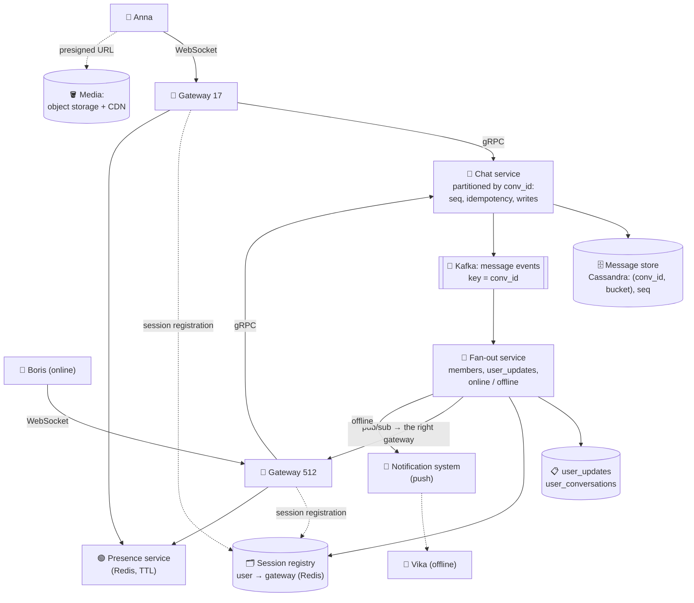
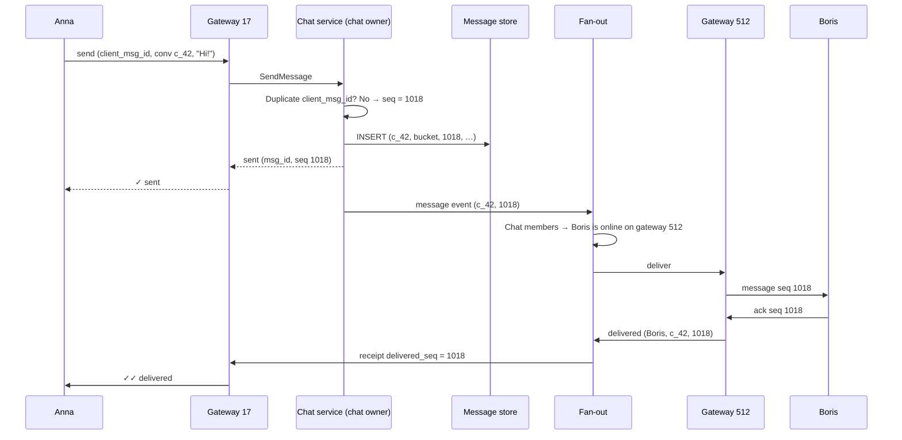
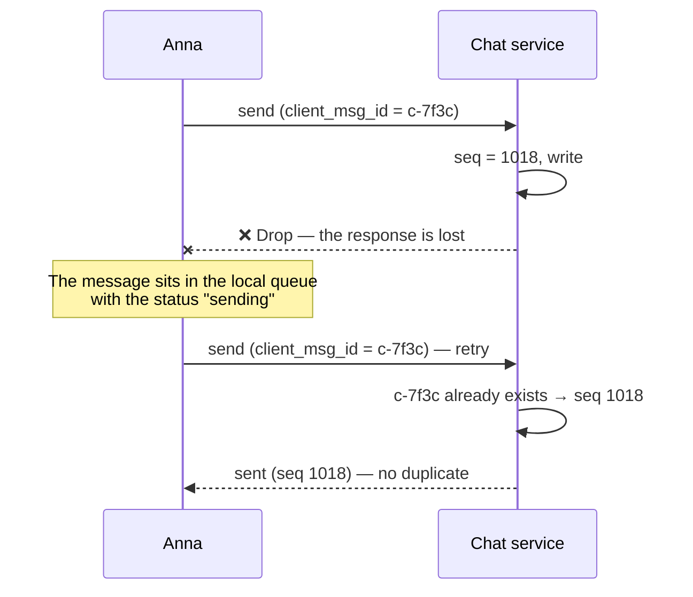
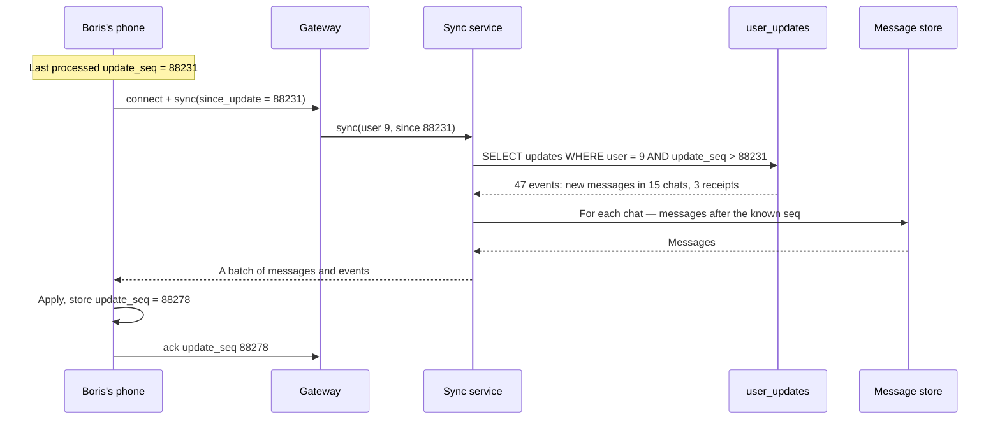
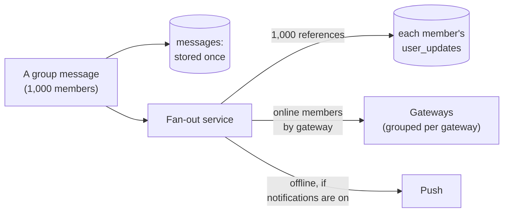
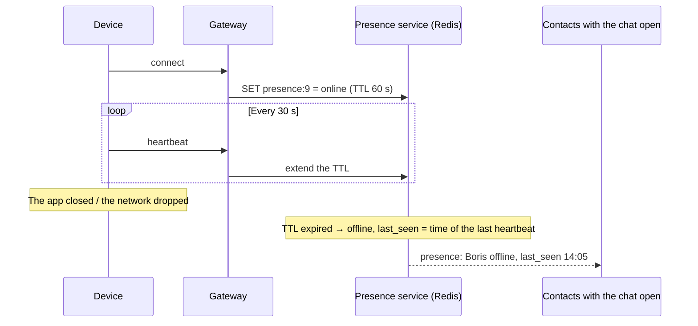

**English** | [Русский](README.ru.md)

# Tier 1 · 06. Chat System (WhatsApp / Messenger)

> **Level:** Hard · **Interview time:** 45–60 min · **Study time:** ~6 h
> **Key aspects:** WebSocket gateways and a session registry, the send path and acknowledgments, message ordering within a chat, history storage, online and offline delivery, sync after reconnecting, "delivered" and "read" receipts, group chats, presence and "typing", multiple devices, end-to-end encryption
> **Builds on:** [12-communication](../../01_Fundamentals/12_Communication/README.md#8-scaling-websockets), [06-partitioning](../../01_Fundamentals/06_Partitioning/README.md), [07-consistency-models](../../01_Fundamentals/07_Consistency%20models/README.md), [09-messaging](../../01_Fundamentals/09_Messaging/README.md), [Tier 1 · 04 ID Generator](../04_Design%20a%20Unique%20ID%20Generator/README.md), [Tier 1 · 05 Notifications](../05_Design%20a%20Notification%20System%20%28push%2C%20email%2C%20SMS%29/README.md)

---

## 🗺️ How to Read This Walkthrough

The walkthrough follows an interview, but every step includes explanations: **why** a decision is made, **how** a mechanism works and **what happens** if you do it differently. The "📘 Explanation" blocks are theory right where you need it.

| Icon | Meaning |
|:----:|:--------|
| 🎤 | Interviewer |
| 🗣️ | What I (the candidate) say out loud |
| ✏️ | What I draw on the whiteboard |
| ⏱️ | Time budget for the step |
| 📘 | A detailed explanation of a concept |

Callouts: **TIP** — a good technique, **WARNING** — a trap, **IMPORTANT** — a Senior+ signal.

---

## 📑 Contents

0. [What This Problem Teaches](#0-what-this-problem-teaches)
1. [Problem Statement](#1-problem-statement)
2. [Clarifying Questions and Requirements](#2-clarifying-questions-and-requirements)
3. [Capacity Estimates](#3-capacity-estimates)
4. [API and Protocol](#4-api-and-protocol)
5. [Data Model](#5-data-model)
6. [High-Level Design](#6-high-level-design)
7. [Deep Dive 1: The Connection Layer](#7-deep-dive-1-the-connection-layer)
8. [Deep Dive 2: Sending a Message and Ordering](#8-deep-dive-2-sending-a-message-and-ordering)
9. [Deep Dive 3: Storing History](#9-deep-dive-3-storing-history)
10. [Deep Dive 4: Online and Offline Delivery and Sync](#10-deep-dive-4-online-and-offline-delivery-and-sync)
11. [Deep Dive 5: Delivery and Read Receipts](#11-deep-dive-5-delivery-and-read-receipts)
12. [Deep Dive 6: Group Chats](#12-deep-dive-6-group-chats)
13. [Deep Dive 7: Presence and "Typing"](#13-deep-dive-7-presence-and-typing)
14. [Deep Dive 8: Multiple Devices and End-to-End Encryption](#14-deep-dive-8-multiple-devices-and-end-to-end-encryption)
15. [Deep Dive 9: Media and Multiple Regions](#15-deep-dive-9-media-and-multiple-regions)
16. [Bottlenecks and Failure Scenarios](#16-bottlenecks-and-failure-scenarios)
17. [What Changes at 10x Scale](#17-what-changes-at-10x-scale)
18. [Key Concepts and New Terms](#18-key-concepts-and-new-terms)
19. [Variations and Follow-Up Questions](#19-variations-and-follow-up-questions)
20. [Common Mistakes](#20-common-mistakes)
21. [Cheat Sheet and Self-Check](#21-cheat-sheet-and-self-check)

---

## 0. What This Problem Teaches

Chat is one of the most popular Hard problems because almost every Fundamentals topic comes together in it:

| What's tested | Where it shows up |
|:--------------|:------------------|
| Real-time communication | Hundreds of millions of persistent WebSocket connections |
| Ordering and consistency | Every participant sees messages in the same order |
| Reliable delivery | A message is neither lost nor duplicated across network drops |
| Handling offline clients | A phone off for a week syncs everything once it's back on |
| Storage with huge write volume | Hundreds of thousands of messages per second |
| Fan-out | A message to a 1,000-member group |
| "Right now" state | Online, "typing", "read" |
| Security | End-to-end encryption, where the server can't read messages |

> [!TIP]
> The problem is huge — you can't cover everything in 45 minutes. A strong strategy: quickly draw the core message path (send → store → deliver → acknowledge), then ask the interviewer what to go deeper on. The most common asks are **ordering**, **offline sync**, **groups** and **presence**.

---

## 1. Problem Statement

> 🎤 "Design a messenger like WhatsApp or Facebook Messenger: one-on-one and group chats, delivery and read receipts, online status, and support for multiple devices."

**What the user sees:**

```
Anna sends "Hi!" to Boris:
  ✓       — the message reached the server ("sent")
  ✓✓      — the message reached Boris's device ("delivered")
  ✓✓ blue — Boris opened the chat ("read")

Boris was offline on the subway for 20 minutes — when the network came back, every message arrived in order.
```

**Time plan:**

| Step | ⏱️ |
|:-----|:--:|
| Requirements | 5 min |
| Estimates | 4 min |
| API, protocol, data | 6 min |
| High-level design | 7 min |
| Deep dives | 20–30 min |
| Failures and wrap-up | 3 min |

---

## 2. Clarifying Questions and Requirements

⏱️ 5 min

| My question | Interviewer's answer | What it changes and why |
|:------------|:---------------------|:------------------------|
| Scale? | 500M daily active users, ~20B messages per day | Hundreds of thousands of messages per second; hundreds of millions of connections |
| One-on-one and group chats? | Yes, groups of up to 1,000 members | Fan-out per group; capping the size simplifies the design |
| Keep history on the server? | Yes, to sync new devices | Storage with huge write volume (rather than "delete after delivery") |
| Multiple devices per user? | Yes: phone, web, desktop | Syncing across one user's devices |
| Delivery and read receipts? | Yes, in one-on-one and group chats | An extra event stream comparable to messages |
| Online status and "typing"? | Yes | Ephemeral events that don't need storage |
| Media? | Photos, videos, documents | A separate path through object storage |
| End-to-end encryption? | Worth discussing | Affects search, moderation, multi-device |
| Latency? | Delivery to an online recipient — under 500 ms | WebSocket, minimal hops |

### Functional requirements

1. One-on-one (1:1) and group (up to 1,000 members) chats.
2. Sending text messages and media.
3. Statuses: sent, delivered, read.
4. Delivery to offline users once they connect; push notifications.
5. Message history and sync across devices.
6. Online status, "last seen", a typing indicator.

### Non-functional requirements

| Requirement | Target | Why |
|:------------|:-------|:----|
| Delivery latency | p99 < 500 ms for an online recipient | Chat should feel like a live conversation |
| Reliability | Zero lost messages | A lost message is the worst failure a messenger can have |
| Ordering | Every participant sees the same order in a chat | Otherwise the conversation stops making sense |
| No duplicates | Resends after drops aren't duplicated | Mobile networks drop constantly |
| Availability | 99.99% | For many people the messenger is their main means of communication |
| Scale | 200M concurrent connections, ~700K messages/s at peak | Drives the architecture of every layer |

---

## 3. Capacity Estimates

⏱️ 4 min

```
Messages:         20B per day → ~230,000/s on average, peak ~700,000/s
Receipts:         every message gets "delivered" and "read" (in groups — from each member)
                  → more receipt events than messages

Connections:      ~200M concurrent at peak
Gateways:         ~200,000 connections per server → ~1,000 gateway servers (+ headroom)
Heartbeats:       every 30 s → ~6.7M heartbeats/s — handled at the gateways, never reaching the backend

Text storage:     20B × ~200 B ≈ 4 TB per day ≈ 1.5 PB per year (before replication)
                  × 3 replicas ≈ 4.4 PB per year
Media:            separately in object storage; much larger than text
```

### Conclusions

| Conclusion | Design consequence |
|:-----------|:-------------------|
| 200M persistent connections | A separate gateway tier with no business logic (as in [12-communication](../../01_Fundamentals/12_Communication/README.md#8-scaling-websockets)) |
| ~700K message writes per second | Write-optimized storage (LSM: Cassandra, ScyllaDB, HBase) |
| Petabytes per year | Sharding by chat, cold storage for old messages |
| Receipts outnumber messages | They must be aggregated (watermarks), not stored one per message |
| Millions of heartbeats per second | Handled locally on the gateways |

---

## 4. API and Protocol

⏱️ 3 min

### The WebSocket protocol (the main channel)

```
Client → server
  { "type": "send",      "client_msg_id": "c-7f3c…", "conv_id": "c_42", "body": "Hi!" }
  { "type": "ack",       "conv_id": "c_42", "seq": 1018 }            ← "delivered to this device"
  { "type": "read",      "conv_id": "c_42", "seq": 1018 }            ← "read up to seq 1018"
  { "type": "typing",    "conv_id": "c_42" }
  { "type": "sync",      "since_update": 88231 }                     ← after reconnecting

Server → client
  { "type": "sent",      "client_msg_id": "c-7f3c…", "msg_id": "m_9…", "seq": 1018, "ts": … }   ← ✓
  { "type": "message",   "conv_id": "c_42", "seq": 1018, "sender": 7, "body": "…", "ts": … }
  { "type": "receipt",   "conv_id": "c_42", "user": 9, "delivered_seq": 1018, "read_seq": 1015 }
  { "type": "presence",  "user": 9, "online": true }
  { "type": "typing",    "conv_id": "c_42", "user": 9 }
```

### REST (non-real-time operations)

```http
GET  /v1/conversations?cursor=…                       → the chat list with the latest message
GET  /v1/conversations/{id}/messages?before_seq=1000&limit=50   → history (scrolling up)
POST /v1/conversations                                { type: "group", members: [...] }
POST /v1/media/uploads                                → a presigned URL (see Storage types)
```

📘 **Why `client_msg_id`.** A client sent a message, and the connection dropped before the acknowledgment. After reconnecting, the client sends **the same** message with the same `client_msg_id`. The server recognizes the retry and returns the `msg_id` and `seq` it already assigned instead of creating a duplicate (see [10-idempotency](../../01_Fundamentals/10_Idempotency/README.md)).

---

## 5. Data Model

⏱️ 3 min

```sql
-- Messages: partition = (chat, bucket), clustering = sequence number within the chat
messages (
  conv_id     BIGINT,
  bucket      INT,          -- seq / 10,000: bounds the partition size
  seq         BIGINT,       -- the sequence number within the chat
  msg_id      BIGINT,       -- a global Snowflake ID
  sender_id   BIGINT,
  client_msg_id TEXT,
  body        BLOB,         -- encrypted, with E2E
  media_ref   TEXT,
  created_at  TIMESTAMP,
  PRIMARY KEY ((conv_id, bucket), seq)
) WITH CLUSTERING ORDER BY (seq DESC);

conversations (conv_id PK, type, title, created_at, last_seq, member_count)
members       ((conv_id), user_id, role, joined_at)

-- A user's chat list, sorted by latest activity
user_conversations ((user_id), last_activity DESC, conv_id, unread_count)

-- Read state: per-member watermarks
read_state    ((conv_id), user_id, delivered_seq, read_seq)

-- A user's update stream for syncing devices
user_updates  ((user_id, bucket), update_seq, conv_id, kind, payload)
```

| Table | Store | Why |
|:------|:------|:----|
| `messages` | Cassandra / ScyllaDB | Huge write volume, reads per chat sorted — the ideal wide-column pattern |
| `user_conversations`, `read_state`, `user_updates` | Cassandra / ScyllaDB | Partitioned by user or chat |
| `conversations`, `members` | A relational DB or the same Cassandra | Metadata, small volume |
| Sessions (user → gateways) | Redis | Ephemeral data, fast reads |
| Presence | Redis with TTLs | Ephemeral |

📘 **Why the partition is `(conv_id, bucket)` rather than just `conv_id`.** A chat used for years can accumulate millions of messages. A partition with unbounded size becomes a problem: slow reads, skewed load, compaction trouble. A bucket (e.g. 10,000 messages or 10 days) keeps partitions bounded. Discord described exactly this scheme — `(channel_id, bucket)` with a time-based bucket (see [06-partitioning](../../01_Fundamentals/06_Partitioning/README.md#8-hot-partitions-and-skew)).

---

## 6. High-Level Design

⏱️ 7 min



### A message's path



🗣️ "Key decisions:
- **gateways** hold connections and know nothing about business logic;
- **the chat service is partitioned by `conv_id`**: each chat has a single owner that assigns sequence numbers — that gives one order;
- **a message is acknowledged to the sender after it's written to storage** — from then on it can't be lost;
- **delivery is async** via fan-out: online recipients through pub/sub to their gateway, offline ones via a push notification and a sync on connect."

---

## 7. Deep Dive 1: The Connection Layer

> 🎤 "How do you hold 200 million connections?"

Scaling WebSockets is covered in detail in [12-communication](../../01_Fundamentals/12_Communication/README.md#8-scaling-websockets). In short, for chat:

| Aspect | Decision |
|:-------|:---------|
| Gateways | ~1,000 servers with ~200K connections each; no business logic, rarely deployed |
| Load balancing | L4, least connections; Anycast or GeoDNS to the nearest region |
| Session registry | On connect: `user:{id} → {device_id: gateway_id}` in Redis with a TTL, extended by heartbeats |
| Heartbeats | Every ~30 s; handled by the gateway, only changes (connected / disconnected) reach the backend |
| Routing to the recipient | Fan-out looks up the registry and publishes to the right gateway's channel (pub/sub) |
| Reconnection | Backoff with jitter; after connecting the client calls `sync` |
| Mobile networks | Short drops are normal; the client keeps unacknowledged messages in a local queue and resends them |

🗣️ "One detail matters for chat: a user can be connected through **several** gateways at once (a phone and a laptop), so the registry stores not one value but a set of sessions per device."

---

## 8. Deep Dive 2: Sending a Message and Ordering

> 🎤 "How do you guarantee every participant sees messages in the same order?"

### Why not the send time

📘 Phone clocks differ by seconds and minutes, server clocks by milliseconds. If you sort by time, two near-simultaneous messages end up in different orders for different participants. A Snowflake ID also gives only an **approximate** order across nodes (see [Tier 1 · 04](../04_Design%20a%20Unique%20ID%20Generator/README.md#10-deep-dive-4-what-time-ordered-means)).

### The fix: a sequence number from the chat's owner

Each message in a chat gets a **seq** — a monotonically increasing number within that chat. It's assigned by **one** component — the chat's owner. Every client sorts by `seq`.

| Way to assign seq | How | Pros | Cons |
|:------------------|:----|:-----|:-----|
| **The chat owner in the chat service** ⭐ | The chat service is partitioned by `conv_id` (consistent hashing); the owning instance keeps the counter in memory and persists `last_seq` | Fast, no external calls; messages in a chat are naturally serialized | On an ownership change, `last_seq` must be restored from storage |
| **An atomic counter in Redis** | `INCR seq:{conv_id}` | Simple | An extra network call; a Redis failover may roll the counter back |
| **A conditional write in the DB** | `INSERT … IF NOT EXISTS` with seq = last + 1, retrying on conflict | Strict | Slow for active chats |

📘 **The "one owner per chat" model.** It resembles the actor model: every message in a chat passes through one process that handles them one at a time. WhatsApp is built on Erlang, where such a process is natural. The pro: no races within a chat. The con: a very active chat is limited to one process — but even the most active group chat is tens of messages per second, not thousands.

### Protecting against two owners

During rebalancing or a failure, two instances may briefly both believe they own the same chat and assign the same `seq` to different messages. The protection is a **conditional write** to storage: `INSERT … IF NOT EXISTS` on the key `(conv_id, seq)`; the loser gets a conflict, rereads `last_seq` and retries. It's fencing at the data level (see [08-consensus](../../01_Fundamentals/08_Consensus/README.md#10-split-brain-and-fencing-tokens)).

### Idempotency



The chat owner keeps the chat's recent `client_msg_id`s (in memory and in Redis with a TTL) and checks them before assigning a `seq`.

### An optimistic UI

The client shows the message **immediately** with a "sending" status (a clock ⏱), then ✓ after the server responds. Once the server assigns a `seq`, the client puts the message in the right place (sometimes after messages that arrived from others in the meantime).

> [!IMPORTANT]
> **Senior+ signal:** clearly separate **uniqueness** (the Snowflake `msg_id` or `client_msg_id`) from **ordering** (the `seq` from the chat owner). Ordering is needed only **within a chat** — a global order of all messages isn't needed and would be very expensive.

---

## 9. Deep Dive 3: Storing History

> 🎤 "700 thousand messages per second and petabytes per year. Where and how do you store them?"

### Why wide-column / LSM

| Requirement | Why Cassandra / ScyllaDB / HBase fit |
|:------------|:-------------------------------------|
| Huge write volume | An LSM tree: a write is an append to a log and to memory, with no random updates on disk (see [04-databases](../../01_Fundamentals/04_Databases/README.md#7-b-tree-vs-lsm-tree)) |
| Reading "the last 50 messages of a chat" | One partition, data sorted by `seq` — one sequential read |
| Horizontal scaling | Adding nodes, partitioning by key |
| Multi-region | Built-in cross-datacenter replication |

### Access patterns

| Query | How it's served |
|:------|:----------------|
| The latest messages when opening a chat | `SELECT … WHERE conv_id = ? AND bucket = latest ORDER BY seq DESC LIMIT 50` |
| Scrolling up | The same query with `seq < ?`, moving to the previous bucket if needed |
| Sync "everything after seq N" | The range `seq > N` in the relevant buckets |
| Text search | A separate search index (without E2E) or local search on the device (with E2E) |

### Data lifecycle

| Age | Where |
|:----|:------|
| Fresh (days to weeks) | The hot cluster, often in the page cache |
| Old (months to years) | Cheaper nodes or tiered storage into object storage |
| Deleted by the user | A tombstone (a deletion marker) + background cleanup; for "delete for everyone" — a delete event to every participant |

> [!WARNING]
> In Cassandra a delete is a **tombstone** write. If a chat deletes messages often, reading a partition means skipping thousands of deletion markers — queries slow down. Bounded-size buckets and proper cleanup settings reduce the problem.

---

## 10. Deep Dive 4: Online and Offline Delivery and Sync

> 🎤 "Boris was offline for 20 minutes. Meanwhile he got messages in 15 chats. What happens when he connects?"

### The problem

You can't just "send everything missed" — the server doesn't know exactly what the device received before the drop. And scanning all of a user's chats (there can be thousands) for new messages is expensive.

### The fix: a per-user update stream

📘 Each user has an **update stream** (`user_updates`) — an ordered log of events concerning them: a new message in chat X, a status change, being added to a group. Each event has an `update_seq` that increases per user. Each **device** remembers the last `update_seq` it processed.



| Element | Why |
|:--------|:----|
| A per-user `update_seq` | A device states what it already knows with one number |
| A cursor on each **device** | The phone and the laptop sync independently |
| Messages are read from `messages`, not copied into the stream | The stream holds references (`conv_id`, `seq`), not bodies — saving space |
| A big gap (a device not connected for a month) | Sync the chat list and the last N messages of each; the rest on scroll |

### Online or offline

| Recipient state | What fan-out does |
|:----------------|:------------------|
| Online (has sessions in the registry) | Publishes the message to the gateway's channel; the gateway sends it to the device; the device acknowledges |
| Offline | Writes the event to `user_updates`; sends a push notification via the notification system (see [Tier 1 · 05](../05_Design%20a%20Notification%20System%20%28push%2C%20email%2C%20SMS%29/README.md)) |
| Online, but the device didn't acknowledge within N seconds | Treat that device as offline: a push + sync on the next connect |

> [!TIP]
> The event is **always** written to `user_updates`, even if the recipient is online. Direct delivery through the gateway is a speed optimization, while the stream is the source of truth. That way a message lost at a gateway (a restart, a drop) isn't lost for good: the device gets it on the next sync.

---

## 11. Deep Dive 5: Delivery and Read Receipts

> 🎤 "How do you implement the checkmarks — sent, delivered, read?"

| Status | When | Source |
|:-------|:-----|:-------|
| ✓ Sent | The message was written to storage | The chat service responds to the sender |
| ✓✓ Delivered | The recipient's device acknowledged receipt | An `ack` from the device |
| ✓✓ blue Read | The recipient opened the chat and saw the message | A `read` from the client |

### Watermarks instead of a status per message

📘 Storing a status for **every** message from **every** participant means trillions of records. Instead, a **watermark** is stored per participant and chat:

```
read_state (conv c_42, user Boris): delivered_seq = 1018, read_seq = 1015

Meaning: every message with seq ≤ 1018 was delivered to Boris,
         every one with seq ≤ 1015 was read.
```

One record per participant instead of one per message. Anna's client computes the checkmarks itself: "my message seq 1017 ≤ Boris's read_seq → blue checkmarks".

### Receipts in groups

- In a 100-member group, "read" means "37 of 99 have read it". Every member's watermark lets you compute that for any message.
- The sender doesn't need 99 separate events instantly: receipts are aggregated and sent every few seconds.
- For large groups, detailed receipts are shown only on request ("Message info").

### Event volume

Receipts generate more events than the messages themselves. Optimizations:
- `ack` and `read` are sent as a **watermark** ("read up to 1015"), not per message;
- the client sends `read` at most once per second;
- in groups, receipts are aggregated on the server.

---

## 12. Deep Dive 6: Group Chats

> 🎤 "A message to a 1,000-member group. How do you deliver it?"

### Fan-out on write or on read

| | Fan-out on write | Fan-out on read |
|:-|:-----------------|:----------------|
| How | On send, an event is written to the `user_updates` of **every** member | The message is stored once in the chat; members fetch it during sync |
| Writes | 1,000 writes per message | 1 write |
| Reads / sync | Cheap: everything is in the user's stream | Every one of the user's chats must be checked for new messages |
| For | One-on-one and groups up to ~1,000 | Channels and communities of tens of thousands or more |

🗣️ "For groups up to 1,000 — **fan-out on write**: the message is stored once in `messages`, and a lightweight reference (`conv_id`, `seq`) is written to each member's `user_updates`. 1,000 small writes are acceptable. For large channels (if we had them) — fan-out on read: the client syncs the channel by `seq` directly, and online delivery goes only to those who currently have the channel open."



| Optimization | Why |
|:-------------|:----|
| Grouping delivery **by gateway** | One packet per gateway with a list of recipients instead of 1,000 separate publishes |
| Aggregated pushes for groups | "5 new messages in the 'Family' group" instead of 5 pushes |
| The user muted the group | Only the stream write, no push |
| A group size limit | Caps fan-out — a key product decision |

---

## 13. Deep Dive 7: Presence and "Typing"

> 🎤 "How do you show 'online' and 'last seen 5 minutes ago'?"

### Presence



| Problem | Solution |
|:--------|:---------|
| Broadcasting status changes to every contact is expensive (a user has hundreds of contacts) | Broadcast only to those who **currently have** a chat with this user open, or the chat list (on-demand subscriptions) |
| "Flapping" on a bad network (online → offline → online) | A delay before announcing offline (a TTL with headroom) |
| Millions of heartbeats | Handled by the gateway; the presence service only gets batched TTL extensions or state changes |
| Privacy | "Who can see my status" settings; checked when serving |

### "Typing…"

| Property | Decision |
|:---------|:---------|
| Ephemeral | Not stored, not synced; losing it is fine |
| Frequency | The client sends at most once every 3–5 s while the user types |
| Delivery | Only to online members with the chat open, via the gateways |
| Ending | The indicator fades by itself after a few seconds without new events |

📘 **Different guarantees for different events** — the same idea as in [12-communication](../../01_Fundamentals/12_Communication/README.md): messages are at-least-once with storage and sync; receipts are stored as watermarks; presence and "typing" are best-effort, with no storage.

---

## 14. Deep Dive 8: Multiple Devices and End-to-End Encryption

> 🎤 "A user writes from their phone and reads on their laptop. And we want end-to-end encryption."

### Multiple devices

| Aspect | Decision |
|:-------|:---------|
| A message sent from the phone is visible on the laptop | The sender's message also goes into the **sender's** `user_updates` — their other devices sync |
| Read on the laptop — clear notifications on the phone | A `read` event in the user's stream → the phone clears the badge and the notification |
| Each device has its own cursor | `device_id` → `last_update_seq` |
| A new device | Loads the chat list and recent messages, then history on demand |

### End-to-end encryption (E2E)

📘 With end-to-end encryption, a message is encrypted on the sender's device and decrypted only on the recipient's. **The server stores and relays only encrypted data** and can't read it. WhatsApp and Signal use the Signal Protocol:

| Element | What it does |
|:--------|:-------------|
| **Device keys** | Each device has its own key pair; public keys live on a key server |
| **X3DH** | The initial key exchange, even if the recipient is offline (via pre-uploaded "one-time" keys — prekeys) |
| **Double Ratchet** | The key changes with every message: compromising one key doesn't expose past or future messages |
| **Sender Keys** for groups | The sender encrypts the message once with a group key and distributes that key to members over their pairwise channels — instead of encrypting separately for each of 1,000 members |

### How E2E changes the design

| Feature | Without E2E | With E2E |
|:--------|:------------|:---------|
| History search | A server-side search index | **Local** on the device only |
| A new device | Downloads history from the server | History is encrypted with the old device's keys → transfer between devices or an encrypted backup |
| Multiple devices | One copy of the message | The sender encrypts **for each device** of the recipient (and their own) |
| Moderation, anti-spam | Content analysis | Only metadata and user reports |
| Link previews | Generated by the server | Generated by the sender's device |

> [!NOTE]
> In an interview it's enough to understand E2E's **consequences** for the architecture (search, multi-device, moderation), not the cryptographic details.

---

## 15. Deep Dive 9: Media and Multiple Regions

### Media

Photos and videos don't go through the WebSocket or the chat service:

1. The client requests a presigned URL and uploads the file **directly** to object storage (encrypted, with E2E).
2. The message carries only a **reference** (`media_ref`) and metadata (size, thumbnail, the decryption key — inside the encrypted body).
3. Recipients download via a CDN.

Details in [14-storage-types](../../01_Fundamentals/14_Storage%20types/README.md#8-the-pattern-blobs-separate-from-metadata).

### Multiple regions

| Question | Decision |
|:---------|:---------|
| Where to hold the connection | A gateway in the region nearest the user |
| Where a chat "lives" | The chat's home region (e.g. the creator's region); the chat owner and `seq` live there |
| A member in another region | Their gateway sends the message to the chat's home region (a ~100 ms cross-region hop is acceptable for chat) |
| Delivery | Fan-out in the home region publishes events to the recipients' gateway regions |
| Storage | Replicating `messages` to the members' regions for fast history reads |
| A region failure | Move chat ownership to another region; the latest `seq` values are restored from a storage replica |

---

## 16. Bottlenecks and Failure Scenarios

| Scenario | What happens | How we protect |
|:---------|:-------------|:---------------|
| A gateway dies | 200K devices reconnect | Backoff with jitter, other gateways, sync by `update_seq` |
| A drop before the send is acknowledged | The client doesn't know if the message went out | A local queue + a retry with the same `client_msg_id` |
| The chat owner dies | The chat's messages are briefly not accepted | Ownership moves, `last_seq` is restored, conditional writes prevent two owners |
| A message lost at a gateway during direct delivery | Not delivered online | `user_updates` is the source of truth; it arrives on sync |
| A recipient offline for a week | Thousands of events pile up | Sync in batches; for a huge gap — a snapshot of the chat list |
| An active 1,000-member group | Fan-out load | References instead of copies, grouping by gateway, aggregated pushes |
| Slow storage | ✓ latency grows | Writes with `LOCAL_QUORUM`, monitoring, separate clusters for hot and cold data |
| Presence flapping | Event noise | A delay before offline |
| A receipt storm | Load | Watermarks, rate-limiting `read`, aggregation |
| A region failure | The region's chats are unavailable | Moving ownership, storage replicas in other regions |

---

## 17. What Changes at 10x Scale

> 🎤 "5 billion users and 200 billion messages a day?"

| Change | Why |
|:-------|:----|
| **More gateways and regions**, a protocol over QUIC | Fewer reconnects on mobile networks |
| **Deleting delivered messages from the server** (the WhatsApp model) with encrypted backups | Storing petabytes of history becomes the main cost |
| **Channels with fan-out on read** | Communities and channels with millions of subscribers |
| **Hierarchical fan-out** | Fan-out services per region and gateway |
| **Compression and a delta protocol** | Saving bandwidth and battery |

---

## 18. Key Concepts and New Terms

### What's applied from Fundamentals

| Concept | Where it's covered | How it applies here |
|:--------|:-------------------|:--------------------|
| WebSocket gateways, a session registry, pub/sub | [12-communication](../../01_Fundamentals/12_Communication/README.md#8-scaling-websockets) | The connection layer and delivery |
| LSM stores, wide-column | [04-databases](../../01_Fundamentals/04_Databases/README.md#7-b-tree-vs-lsm-tree) | Storing messages |
| Bucketed partitions | [06-partitioning](../../01_Fundamentals/06_Partitioning/README.md#8-hot-partitions-and-skew) | `(conv_id, bucket)` |
| Ordering within an entity | [07-consistency-models](../../01_Fundamentals/07_Consistency%20models/README.md) | `seq` from the chat owner |
| Fencing against two owners | [08-consensus](../../01_Fundamentals/08_Consensus/README.md#10-split-brain-and-fencing-tokens) | A conditional write on `(conv_id, seq)` |
| Idempotency | [10-idempotency](../../01_Fundamentals/10_Idempotency/README.md) | `client_msg_id` |
| Push notifications | [Tier 1 · 05](../05_Design%20a%20Notification%20System%20%28push%2C%20email%2C%20SMS%29/README.md) | Offline delivery |
| Media through object storage | [14-storage-types](../../01_Fundamentals/14_Storage%20types/README.md) | Photos and videos |

### New terms in this problem

| Term | In short |
|:-----|:---------|
| **seq within a chat** | A message's sequence number, assigned by the chat owner |
| **The chat owner** | The single handler that serializes one chat's messages |
| **client_msg_id** | A client-provided identifier for deduplicating resends |
| **A per-user update stream** | A user's event log with an `update_seq` for syncing devices |
| **Watermark** | "Delivered / read everything up to seq N" instead of a status per message |
| **Fan-out on write / on read** | Copying references to members / members reading from a shared stream |
| **Presence with a TTL** | An online status that expires without heartbeats |
| **The Signal Protocol, Sender Keys** | End-to-end encryption for one-on-one and group chats |

---

## 19. Variations and Follow-Up Questions

<details>
<summary><b>How do you make a message appear "exactly once" on screen?</b></summary>

Delivery is at-least-once (retries on drops), and duplicates are cut off at two levels: the server doesn't create a second message for the same `client_msg_id`, and the client doesn't display a message with an already-known `(conv_id, seq)` a second time. To the user it looks like exactly once.
</details>

<details>
<summary><b>How do you implement editing and deleting messages?</b></summary>

As separate events in the chat with their own `seq`: "message 1018 edited, new text …", "message 1018 deleted for everyone". Clients apply them when received or during sync. The original record in storage is updated (or marked deleted), and the event ensures every device learns about the change.
</details>

<details>
<summary><b>How do you count unread messages?</b></summary>

`unread = the chat's last_seq − the user's read_seq` — with no per-message counter. The total unread count (the app badge) is a sum over chats, conveniently maintained in `user_conversations` and recomputed on events.
</details>

<details>
<summary><b>Why not store messages in a relational database?</b></summary>

700 thousand inserts per second and petabytes per year require horizontally scaled writes. A relational database would have to be sharded by hand, and B-tree indexes handle that write stream worse than LSM. Meanwhile the access pattern is simple (by chat and a `seq` range) and needs no complex queries — a wide-column store fits perfectly. Facebook Messenger, for example, historically used HBase; Discord used Cassandra, then ScyllaDB.
</details>

<details>
<summary><b>What if a chat owner is overloaded by a very active group?</b></summary>

Even the most active group is tens of messages per second, which one process handles easily. The problem arises with huge channels (millions of members) — those use fan-out on read, and the owner only assigns `seq` and writes the message once.
</details>

---

## 20. Common Mistakes

| ❌ Mistake | Why it's bad | ✅ Do this instead |
|:----------|:-------------|:------------------|
| Sorting by send time | Different participants see different orders | `seq` from the chat owner |
| A global order of all messages | Expensive and unnecessary | Ordering only within a chat |
| Acknowledging the send before writing to storage | Losing the message on a failure | ✓ only after the write |
| No `client_msg_id` | Duplicates on resends after a drop | Idempotency by `client_msg_id` |
| Delivery only via the gateway, without a stream | Loss on a gateway restart | `user_updates` as the source of truth + sync |
| A status per message per participant | Trillions of records | Watermarks |
| Broadcasting presence to every contact | Huge load | Subscriptions only from open chats |
| Storing "typing" | Unnecessary load | Ephemeral, best-effort |
| Partitioning only by `conv_id` | Unbounded partitions in long-running chats | `(conv_id, bucket)` |
| Media over the WebSocket | Overloaded gateways | Presigned URLs + object storage + a CDN |
| Ignoring E2E | The wrong design for search and multi-device | Discuss the consequences of E2E |

---

## 21. Cheat Sheet and Self-Check

### 30-second answer

> 200M connections are held by ~1,000 WebSocket gateways with no business logic; a session registry of user → devices → gateways lives in Redis. The chat service is partitioned by `conv_id`: the chat owner checks `client_msg_id`, assigns a `seq` and writes to Cassandra/ScyllaDB keyed `((conv_id, bucket), seq)` with a conditional write; after the write — ✓ to the sender. Fan-out writes references into each member's update stream (`user_updates` with an `update_seq`) and delivers online via pub/sub to gateways, offline via push. Devices acknowledge delivery; on reconnect they sync by their own `update_seq`. Receipts are per-member `delivered_seq` and `read_seq` watermarks. Groups up to 1,000 — fan-out on write of references; large channels — on read. Presence — Redis with TTLs and subscriptions from open chats; "typing" is ephemeral. Media — object storage and a CDN. E2E with the Signal Protocol changes search (local), multi-device (encrypting per device) and moderation.

### Self-check

- [ ] I can estimate connections, gateways, messages per second and storage volume
- [ ] I can describe a message's path from sending to ✓✓
- [ ] I can explain why ordering uses the owner's `seq` rather than time
- [ ] I can explain the protection against two owners of one chat
- [ ] I can explain idempotent sending via `client_msg_id`
- [ ] I can design the message storage schema and explain buckets
- [ ] I can describe syncing a device after being offline via `update_seq`
- [ ] I can explain watermarks for receipts, including in groups
- [ ] I can compare fan-out on write and on read for groups
- [ ] I can design presence and "typing"
- [ ] I can name the consequences of end-to-end encryption for the architecture

### Further reading

- Alex Xu, *System Design Interview*, Vol. 1 — chapter "Design a Chat System"
- Discord Engineering, *How Discord Stores Billions of Messages* (2017) and *How Discord Stores Trillions of Messages* (2023)
- Signal, *The X3DH Key Agreement Protocol* and *The Double Ratchet Algorithm*
- The WhatsApp Security Whitepaper
- Facebook Engineering articles on Messenger and sync
