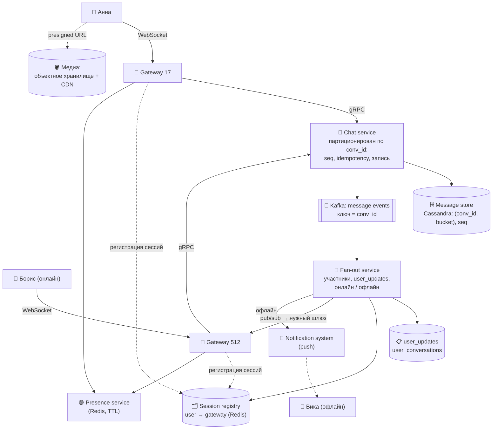
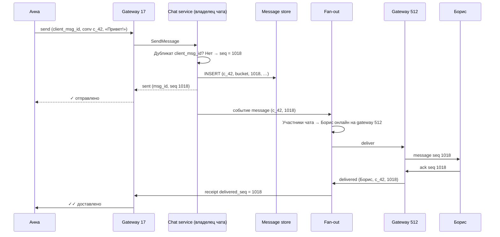
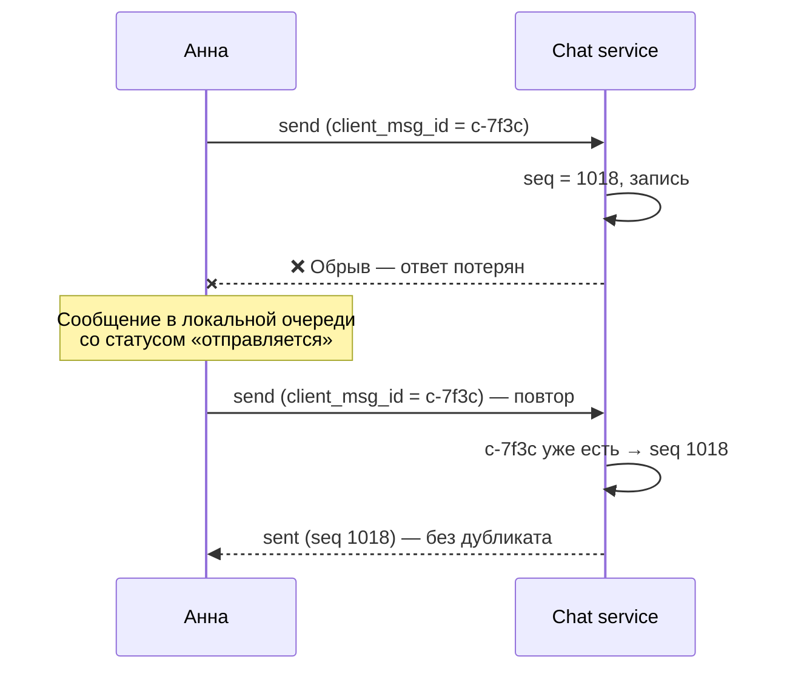
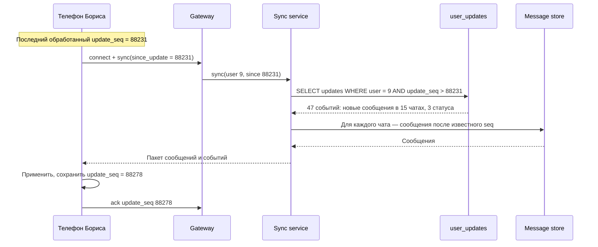
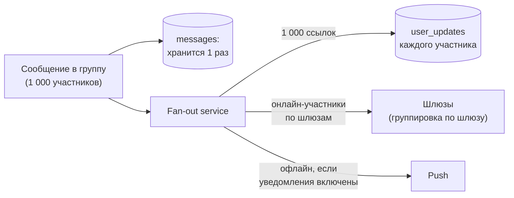
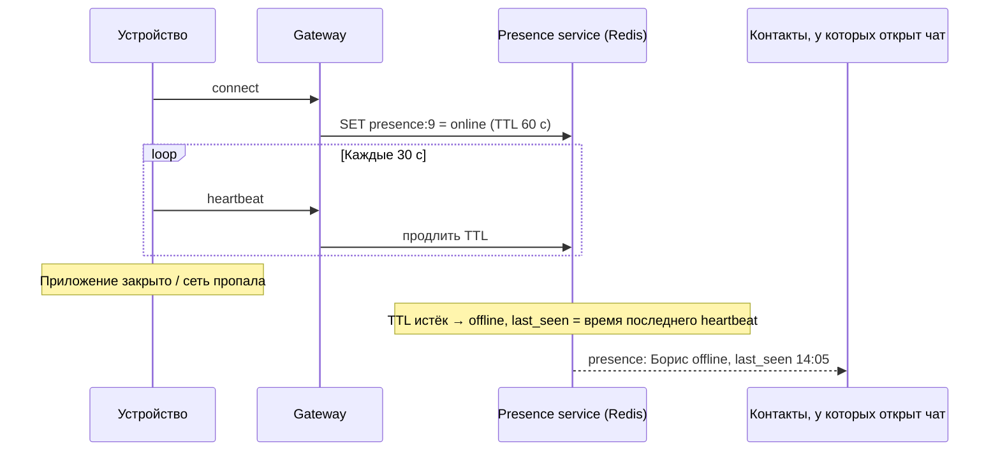

[English](README.md) | **Русский**

# Tier 1 · 06. Chat System (WhatsApp / Messenger)

> **Уровень:** Hard · **Время на интервью:** 45–60 мин · **Время на разбор:** ~6 ч
> **Ключевые аспекты:** WebSocket-шлюзы и реестр сессий, путь отправки и подтверждения, порядок сообщений в чате, хранение истории, доставка онлайн и офлайн, синхронизация после переподключения, статусы «доставлено» и «прочитано», групповые чаты, присутствие и «печатает», несколько устройств, сквозное шифрование
> **Опирается на:** [12-communication](../../12-communication/README_RU.md#8-масштабирование-websocket), [06-partitioning](../../06-partitioning/README_RU.md), [07-consistency-models](../../07-consistency-models/README_RU.md), [09-messaging](../../09-messaging/README_RU.md), [Tier 1 · 04 ID Generator](../04-unique-id-generator/README_RU.md), [Tier 1 · 05 Notifications](../05-notification-system/README_RU.md)

---

## 🗺️ Как читать этот разбор

Разбор построен как интервью, но в каждом шаге есть объяснения: **почему** принимается решение, **как работает** механизм и **что будет**, если сделать иначе. Блоки «📘 Объяснение» — теория прямо по ходу задачи.

| Значок | Что значит |
|:------:|:-----------|
| 🎤 | Реплика интервьюера |
| 🗣️ | Что говорю вслух я (кандидат) |
| ✏️ | Что рисую на доске |
| ⏱️ | Сколько времени тратить на шаг |
| 📘 | Подробное объяснение концепции |

Блоки **TIP** — хороший приём, **WARNING** — ловушка, **IMPORTANT** — сигнал для уровня Senior+.

---

## 📑 Содержание

0. [Чему учит эта задача](#0-чему-учит-эта-задача)
1. [Условие задачи](#1-условие-задачи)
2. [Уточняющие вопросы и требования](#2-уточняющие-вопросы-и-требования)
3. [Оценки нагрузки](#3-оценки-нагрузки)
4. [API и протокол](#4-api-и-протокол)
5. [Модель данных](#5-модель-данных)
6. [High-level дизайн](#6-high-level-дизайн)
7. [Deep dive 1: слой соединений](#7-deep-dive-1-слой-соединений)
8. [Deep dive 2: отправка сообщения и порядок](#8-deep-dive-2-отправка-сообщения-и-порядок)
9. [Deep dive 3: хранение истории](#9-deep-dive-3-хранение-истории)
10. [Deep dive 4: доставка онлайн, офлайн и синхронизация](#10-deep-dive-4-доставка-онлайн-офлайн-и-синхронизация)
11. [Deep dive 5: статусы доставки и прочтения](#11-deep-dive-5-статусы-доставки-и-прочтения)
12. [Deep dive 6: групповые чаты](#12-deep-dive-6-групповые-чаты)
13. [Deep dive 7: присутствие и «печатает»](#13-deep-dive-7-присутствие-и-печатает)
14. [Deep dive 8: несколько устройств и сквозное шифрование](#14-deep-dive-8-несколько-устройств-и-сквозное-шифрование)
15. [Deep dive 9: медиа и несколько регионов](#15-deep-dive-9-медиа-и-несколько-регионов)
16. [Узкие места и сценарии сбоев](#16-узкие-места-и-сценарии-сбоев)
17. [Что изменится при росте в 10 раз](#17-что-изменится-при-росте-в-10-раз)
18. [Ключевые концепции и новые понятия](#18-ключевые-концепции-и-новые-понятия)
19. [Варианты задачи и follow-up вопросы](#19-варианты-задачи-и-follow-up-вопросы)
20. [Типичные ошибки](#20-типичные-ошибки)
21. [Шпаргалка и самопроверка](#21-шпаргалка-и-самопроверка)

---

## 0. Чему учит эта задача

Чат — одна из самых популярных задач уровня Hard, потому что в ней сходятся почти все темы Fundamentals:

| Что проверяют | Где это в задаче |
|:--------------|:-----------------|
| Real-time коммуникация | Сотни миллионов постоянных WebSocket-соединений |
| Порядок и консистентность | Все участники видят сообщения в одном порядке |
| Надёжная доставка | Сообщение не теряется и не дублируется при обрывах сети |
| Работа с офлайн-клиентами | Телефон выключен неделю — после включения всё синхронизируется |
| Хранение с огромной записью | Сотни тысяч сообщений в секунду |
| Fan-out | Сообщение в группу на 1 000 человек |
| Состояние «прямо сейчас» | Онлайн, «печатает», «прочитано» |
| Безопасность | Сквозное шифрование, при котором сервер не может прочитать сообщения |

> [!TIP]
> Задача огромная — за 45 минут всё не покрыть. Сильная стратегия: быстро нарисовать базовый путь сообщения (отправка → хранение → доставка → подтверждения), затем спросить интервьюера, что углубить. Чаще всего просят **порядок**, **офлайн-синхронизацию**, **группы** и **присутствие**.

---

## 1. Условие задачи

> 🎤 «Спроектируй мессенджер вроде WhatsApp или Facebook Messenger: личные и групповые чаты, статусы доставки и прочтения, онлайн-статус, работа на нескольких устройствах».

**Что видит пользователь:**

```
Анна отправляет «Привет!» Борису:
  ✓   — сообщение получено сервером («отправлено»)
  ✓✓  — сообщение дошло до устройства Бориса («доставлено»)
  ✓✓ синие — Борис открыл чат («прочитано»)

Борис был без сети в метро 20 минут — когда сеть появилась, все сообщения пришли по порядку.
```

**План по времени:**

| Шаг | ⏱️ |
|:----|:--:|
| Требования | 5 мин |
| Оценки | 4 мин |
| API, протокол, данные | 6 мин |
| High-level дизайн | 7 мин |
| Deep dives | 20–30 мин |
| Сбои и итоги | 3 мин |

---

## 2. Уточняющие вопросы и требования

⏱️ 5 мин

| Мой вопрос | Ответ интервьюера | Что это меняет и почему |
|:-----------|:------------------|:------------------------|
| Масштаб? | 500M активных пользователей в день, ~20B сообщений в сутки | Сотни тысяч сообщений в секунду; сотни миллионов соединений |
| Личные и групповые чаты? | Да, группы до 1 000 участников | Fan-out на группу; ограничение размера упрощает дизайн |
| Хранить историю на сервере? | Да, для синхронизации новых устройств | Хранилище с огромной записью (а не «удалить после доставки») |
| Несколько устройств на пользователя? | Да: телефон, веб, десктоп | Синхронизация между устройствами одного пользователя |
| Статусы доставки и прочтения? | Да, в личных и групповых чатах | Дополнительный поток событий, сопоставимый с сообщениями |
| Онлайн-статус и «печатает»? | Да | Эфемерные события, не требующие хранения |
| Медиа? | Фото, видео, документы | Отдельный путь через объектное хранилище |
| Сквозное шифрование? | Желательно обсудить | Влияет на поиск, модерацию, мультиустройство |
| Задержка? | Доставка онлайн-получателю — менее 500 мс | WebSocket, минимум переходов |

### Функциональные требования

1. Личные (1:1) и групповые (до 1 000 участников) чаты.
2. Отправка текстовых сообщений и медиа.
3. Статусы: отправлено, доставлено, прочитано.
4. Доставка офлайн-пользователям после подключения, push-уведомления.
5. История сообщений и синхронизация между устройствами.
6. Онлайн-статус, «был в сети», индикатор набора текста.

### Нефункциональные требования

| Требование | Цель | Почему |
|:-----------|:-----|:-------|
| Задержка доставки | p99 < 500 мс для онлайн-получателя | Чат воспринимается как живой разговор |
| Надёжность | Ни одного потерянного сообщения | Потерянное сообщение — самая серьёзная ошибка мессенджера |
| Порядок | Все участники видят одинаковый порядок в чате | Иначе диалог теряет смысл |
| Без дублей | Повторные отправки при обрывах не дублируются | Мобильная сеть постоянно рвётся |
| Доступность | 99,99% | Мессенджер — основное средство связи для многих |
| Масштаб | 200M одновременных соединений, ~700K сообщений/с в пике | Определяет архитектуру всех слоёв |

---

## 3. Оценки нагрузки

⏱️ 4 мин

```
Сообщения:        20B в сутки → ~230 000/с в среднем, пик ~700 000/с
Статусы:          на каждое сообщение — «доставлено» и «прочитано» (в группах — от каждого)
                  → событий статусов больше, чем самих сообщений

Соединения:       ~200M одновременных в пике
Шлюзы:            ~200 000 соединений на сервер → ~1 000 серверов шлюзов (+ запас)
Heartbeat:        раз в 30 с → ~6,7M heartbeat/с — обрабатываются на шлюзах, не доходят до бэкенда

Хранение текста:  20B × ~200 Б ≈ 4 ТБ в сутки ≈ 1,5 ПБ в год (без репликации)
                  × 3 реплики ≈ 4,4 ПБ в год
Медиа:            отдельно в объектном хранилище; значительно больше текста
```

### Выводы

| Вывод | Следствие для дизайна |
|:------|:----------------------|
| 200M постоянных соединений | Отдельный слой шлюзов без бизнес-логики (как в [12-communication](../../12-communication/README_RU.md#8-масштабирование-websocket)) |
| ~700K записей сообщений в секунду | Хранилище, оптимизированное под запись (LSM: Cassandra, ScyllaDB, HBase) |
| Петабайты в год | Шардирование по чату, холодное хранение старых сообщений |
| Статусы — больше событий, чем сообщения | Их нужно агрегировать (водяные знаки), а не хранить по одному на сообщение |
| Heartbeat в миллионах в секунду | Обрабатываются локально на шлюзах |

---

## 4. API и протокол

⏱️ 3 мин

### WebSocket-протокол (основной канал)

```
Клиент → сервер
  { "type": "send",      "client_msg_id": "c-7f3c…", "conv_id": "c_42", "body": "Привет!" }
  { "type": "ack",       "conv_id": "c_42", "seq": 1018 }            ← «доставлено на это устройство»
  { "type": "read",      "conv_id": "c_42", "seq": 1018 }            ← «прочитано до seq 1018»
  { "type": "typing",    "conv_id": "c_42" }
  { "type": "sync",      "since_update": 88231 }                     ← после переподключения

Сервер → клиент
  { "type": "sent",      "client_msg_id": "c-7f3c…", "msg_id": "m_9…", "seq": 1018, "ts": … }   ← ✓
  { "type": "message",   "conv_id": "c_42", "seq": 1018, "sender": 7, "body": "…", "ts": … }
  { "type": "receipt",   "conv_id": "c_42", "user": 9, "delivered_seq": 1018, "read_seq": 1015 }
  { "type": "presence",  "user": 9, "online": true }
  { "type": "typing",    "conv_id": "c_42", "user": 9 }
```

### REST (не real-time операции)

```http
GET  /v1/conversations?cursor=…                       → список чатов с последним сообщением
GET  /v1/conversations/{id}/messages?before_seq=1000&limit=50   → история (прокрутка вверх)
POST /v1/conversations                                { type: "group", members: [...] }
POST /v1/media/uploads                                → presigned URL (см. Storage types)
```

📘 **Зачем `client_msg_id`.** Клиент отправил сообщение, и соединение оборвалось до подтверждения. После переподключения клиент отправляет **то же** сообщение с тем же `client_msg_id`. Сервер узнаёт повтор и возвращает уже назначенные `msg_id` и `seq`, вместо того чтобы создать дубликат (см. [10-idempotency](../../10-idempotency/README_RU.md)).

---

## 5. Модель данных

⏱️ 3 мин

```sql
-- Сообщения: партиция = (чат, бакет), сортировка = порядковый номер в чате
messages (
  conv_id     BIGINT,
  bucket      INT,          -- seq / 10 000: ограничивает размер партиции
  seq         BIGINT,       -- порядковый номер внутри чата
  msg_id      BIGINT,       -- глобальный Snowflake ID
  sender_id   BIGINT,
  client_msg_id TEXT,
  body        BLOB,         -- зашифрованный, если E2E
  media_ref   TEXT,
  created_at  TIMESTAMP,
  PRIMARY KEY ((conv_id, bucket), seq)
) WITH CLUSTERING ORDER BY (seq DESC);

conversations (conv_id PK, type, title, created_at, last_seq, member_count)
members       ((conv_id), user_id, role, joined_at)

-- Список чатов пользователя, отсортированный по последней активности
user_conversations ((user_id), last_activity DESC, conv_id, unread_count)

-- Состояние прочтения: водяные знаки на участника
read_state    ((conv_id), user_id, delivered_seq, read_seq)

-- Поток обновлений пользователя для синхронизации устройств
user_updates  ((user_id, bucket), update_seq, conv_id, kind, payload)
```

| Таблица | Хранилище | Почему |
|:--------|:----------|:-------|
| `messages` | Cassandra / ScyllaDB | Огромная запись, чтение по чату с сортировкой — идеальный паттерн для wide-column |
| `user_conversations`, `read_state`, `user_updates` | Cassandra / ScyllaDB | Партиция по пользователю или чату |
| `conversations`, `members` | Реляционная БД или та же Cassandra | Метаданные, малый объём |
| Сессии (user → шлюзы) | Redis | Эфемерные данные, быстрые чтения |
| Присутствие | Redis с TTL | Эфемерное |

📘 **Почему партиция `(conv_id, bucket)`, а не просто `conv_id`.** Чат, в котором переписываются годами, может накопить миллионы сообщений. Партиция без ограничения размера становится проблемой: медленное чтение, перекос нагрузки, проблемы при compaction. Бакет (например, 10 000 сообщений или 10 дней) делает партиции ограниченными. Discord описывал именно такую схему — `(channel_id, bucket)` с бакетом по времени (см. [06-partitioning](../../06-partitioning/README_RU.md#8-горячие-партиции-и-перекос)).

---

## 6. High-level дизайн

⏱️ 7 мин



### Путь сообщения



🗣️ «Ключевые решения:
- **шлюзы** держат соединения и ничего не знают о бизнес-логике;
- **chat service партиционирован по `conv_id`**: у каждого чата один владелец, который назначает порядковые номера — это даёт единый порядок;
- **сообщение подтверждается отправителю после записи в хранилище** — с этого момента оно не потеряется;
- **доставка асинхронна** через fan-out: онлайн-получатели — через pub/sub на их шлюз, офлайн — push-уведомление и синхронизация при подключении».

---

## 7. Deep dive 1: слой соединений

> 🎤 «Как держать 200 миллионов соединений?»

Подробно масштабирование WebSocket разобрано в [12-communication](../../12-communication/README_RU.md#8-масштабирование-websocket). Кратко для чата:

| Аспект | Решение |
|:-------|:--------|
| Шлюзы | ~1 000 серверов по ~200K соединений; без бизнес-логики, редко деплоятся |
| Балансировка | L4, least connections; Anycast или GeoDNS к ближайшему региону |
| Реестр сессий | При подключении: `user:{id} → {device_id: gateway_id}` в Redis с TTL, продлевается heartbeat |
| Heartbeat | Раз в ~30 с; обрабатывается шлюзом, в бэкенд уходят только изменения (подключился / отключился) |
| Маршрутизация к получателю | Fan-out смотрит реестр и публикует в канал нужного шлюза (pub/sub) |
| Переподключение | Backoff с jitter; после подключения клиент вызывает `sync` |
| Мобильная сеть | Короткие обрывы — норма; клиент держит неподтверждённые сообщения в локальной очереди и переотправляет |

🗣️ «Для чата важна одна деталь: устройство пользователя может быть подключено к **нескольким** шлюзам (телефон и ноутбук), поэтому реестр хранит не одно значение, а набор сессий по устройствам».

---

## 8. Deep dive 2: отправка сообщения и порядок

> 🎤 «Как гарантировать, что все участники видят сообщения в одинаковом порядке?»

### Почему не время отправки

📘 Часы телефонов расходятся на секунды и минуты, часы серверов — на миллисекунды. Если сортировать по времени, два почти одновременных сообщения у разных участников окажутся в разном порядке. Snowflake ID тоже даёт только **примерный** порядок между узлами (см. [Tier 1 · 04](../04-unique-id-generator/README_RU.md#10-deep-dive-4-что-значит-упорядочены-по-времени)).

### Решение: порядковый номер от владельца чата

Каждому сообщению в чате назначается **seq** — монотонно растущий номер внутри этого чата. Назначает его **один** компонент — владелец чата. Все клиенты сортируют по `seq`.

| Способ назначить seq | Как | Плюсы | Минусы |
|:---------------------|:----|:------|:-------|
| **Владелец чата в chat service** ⭐ | Chat service партиционирован по `conv_id` (consistent hashing); экземпляр-владелец держит счётчик в памяти и сохраняет `last_seq` | Быстро, без внешних вызовов; естественная сериализация сообщений чата | При смене владельца нужно восстановить `last_seq` из хранилища |
| **Атомарный счётчик в Redis** | `INCR seq:{conv_id}` | Просто | Лишний сетевой вызов; при failover Redis возможен откат счётчика |
| **Условная запись в БД** | `INSERT … IF NOT EXISTS` с seq = last + 1, повтор при конфликте | Строгость | Медленно при активных чатах |

📘 **Модель «один владелец на чат».** Это похоже на модель акторов: все сообщения чата проходят через один процесс, который обрабатывает их по очереди. WhatsApp построен на Erlang, где такой процесс естественен. Плюс: внутри чата нет гонок. Минус: очень активный чат упирается в один процесс — но даже самый активный групповой чат — это десятки сообщений в секунду, а не тысячи.

### Защита от двух владельцев

При перебалансировке или сбое на короткое время два экземпляра могут считать себя владельцами одного чата и назначить один и тот же `seq` разным сообщениям. Защита — **условная запись** в хранилище: `INSERT … IF NOT EXISTS` по ключу `(conv_id, seq)`; проигравший получает конфликт, перечитывает `last_seq` и повторяет. Это fencing на уровне данных (см. [08-consensus](../../08-consensus/README_RU.md#10-split-brain-и-fencing-токены)).

### Идемпотентность



Владелец чата хранит недавние `client_msg_id` чата (в памяти и в Redis с TTL) и проверяет их перед назначением `seq`.

### Оптимистичный интерфейс

Клиент показывает сообщение **сразу** со статусом «отправляется» (часы ⏱), затем — ✓ после ответа сервера. Если сервер назначил `seq`, клиент ставит сообщение на правильное место (иногда после сообщений, пришедших от других за это время).

> [!IMPORTANT]
> **Сигнал Senior+:** чётко разделить **уникальность** (Snowflake `msg_id` или `client_msg_id`) и **порядок** (`seq` от владельца чата). Порядок нужен только **внутри чата** — глобальный порядок всех сообщений не нужен и был бы очень дорогим.

---

## 9. Deep dive 3: хранение истории

> 🎤 «700 тысяч сообщений в секунду и петабайты в год. Где и как хранить?»

### Почему wide-column / LSM

| Требование | Почему подходит Cassandra / ScyllaDB / HBase |
|:-----------|:---------------------------------------------|
| Огромная запись | LSM-дерево: запись — дозапись в журнал и в память, без случайных обновлений на диске (см. [04-databases](../../04-databases/README_RU.md#7-b-tree-vs-lsm-tree)) |
| Чтение «последние 50 сообщений чата» | Одна партиция, данные отсортированы по `seq` — одно последовательное чтение |
| Горизонтальное масштабирование | Добавление узлов, партиционирование по ключу |
| Мульти-регион | Встроенная репликация между дата-центрами |

### Паттерны доступа

| Запрос | Как обслуживается |
|:-------|:------------------|
| Последние сообщения при открытии чата | `SELECT … WHERE conv_id = ? AND bucket = последний ORDER BY seq DESC LIMIT 50` |
| Прокрутка вверх | Тот же запрос с `seq < ?`, при необходимости — предыдущий бакет |
| Синхронизация «всё после seq N» | Диапазон `seq > N` в нужных бакетах |
| Поиск по тексту | Отдельный поисковый индекс (без E2E) или локальный поиск на устройстве (с E2E) |

### Жизненный цикл данных

| Возраст | Где |
|:--------|:----|
| Свежие (дни–недели) | Горячий кластер, часто в кэше страниц |
| Старые (месяцы–годы) | Более дешёвые узлы или tiered storage в объектное хранилище |
| Удалённые пользователем | Tombstone (метка удаления) + фоновая очистка; для «удалить у всех» — событие удаления всем участникам |

> [!WARNING]
> В Cassandra удаление — это запись **tombstone**. Если чат часто удаляет сообщения, при чтении партиции приходится пропускать тысячи меток удаления — запросы замедляются. Бакеты ограниченного размера и правильные настройки очистки уменьшают проблему.

---

## 10. Deep dive 4: доставка онлайн, офлайн и синхронизация

> 🎤 «Борис был без сети 20 минут. За это время ему пришли сообщения в 15 чатах. Что происходит при подключении?»

### Проблема

Нельзя просто «отправить всё, что пропущено», — сервер не знает, что именно устройство успело получить до обрыва. И перебирать все чаты пользователя (их могут быть тысячи), чтобы найти новые сообщения, — дорого.

### Решение: поток обновлений пользователя

📘 Для каждого пользователя ведётся **поток обновлений** (`user_updates`) — упорядоченный журнал событий, касающихся его: новое сообщение в чате X, изменение статуса, добавление в группу. У каждого события — `update_seq`, растущий для пользователя. Каждое **устройство** помнит последний обработанный `update_seq`.



| Элемент | Зачем |
|:--------|:------|
| `update_seq` на пользователя | Устройство одним числом говорит, что уже знает |
| Курсор на каждом **устройстве** | Телефон и ноутбук синхронизируются независимо |
| Сообщения читаются из `messages`, а не копируются в поток | Поток содержит ссылки (`conv_id`, `seq`), а не тела — экономия места |
| Большой разрыв (устройство не подключалось месяц) | Синхронизировать список чатов и последние N сообщений каждого, остальное — при прокрутке |

### Онлайн или офлайн

| Состояние получателя | Что делает fan-out |
|:---------------------|:-------------------|
| Онлайн (есть сессии в реестре) | Публикует сообщение в канал шлюза; шлюз отправляет устройству; устройство подтверждает |
| Офлайн | Записывает событие в `user_updates`; отправляет push-уведомление через систему уведомлений (см. [Tier 1 · 05](../05-notification-system/README_RU.md)) |
| Онлайн, но устройство не подтвердило за N секунд | Считать офлайн для этого устройства: push + синхронизация при следующем подключении |

> [!TIP]
> Событие **всегда** записывается в `user_updates`, даже если получатель онлайн. Прямая доставка через шлюз — оптимизация скорости, а источник правды — поток. Тогда потеря сообщения на шлюзе (рестарт, обрыв) не приводит к потере: при следующей синхронизации устройство его получит.

---

## 11. Deep dive 5: статусы доставки и прочтения

> 🎤 «Как реализовать галочки — отправлено, доставлено, прочитано?»

| Статус | Когда | Источник |
|:-------|:------|:---------|
| ✓ Отправлено | Сообщение записано в хранилище | Chat service отвечает отправителю |
| ✓✓ Доставлено | Устройство получателя подтвердило получение | `ack` от устройства |
| ✓✓ синие Прочитано | Получатель открыл чат и увидел сообщение | `read` от клиента |

### Водяные знаки вместо статуса на каждое сообщение

📘 Хранить статус для **каждого** сообщения от **каждого** участника — это триллионы записей. Вместо этого хранится **водяной знак** (watermark) на участника и чат:

```
read_state (conv c_42, user Борис): delivered_seq = 1018, read_seq = 1015

Значит: все сообщения с seq ≤ 1018 доставлены Борису,
        все с seq ≤ 1015 — прочитаны.
```

Одна запись на участника вместо записи на каждое сообщение. Клиент Анны вычисляет галочки сам: «моё сообщение seq 1017 ≤ read_seq Бориса → синие галочки».

### Статусы в группах

- В группе на 100 человек статус «прочитано» — это «прочитали 37 из 99». Водяные знаки всех участников позволяют посчитать это для любого сообщения.
- Отправителю не нужно получать 99 отдельных событий мгновенно: статусы агрегируются и отправляются раз в несколько секунд.
- Для больших групп подробные статусы показывают только по запросу («Информация о сообщении»).

### Объём событий

Статусы порождают больше событий, чем сами сообщения. Оптимизации:
- `ack` и `read` отправляются **водяным знаком** («прочитано до 1015»), а не по каждому сообщению;
- клиент отправляет `read` не чаще раза в секунду;
- в группах статусы агрегируются на сервере.

---

## 12. Deep dive 6: групповые чаты

> 🎤 «Сообщение в группу на 1 000 человек. Как доставить?»

### Fan-out на запись или на чтение

| | Fan-out на запись | Fan-out на чтение |
|:-|:------------------|:------------------|
| Как | При отправке событие записывается в `user_updates` **каждого** участника | Сообщение хранится один раз в чате; участники забирают его при синхронизации |
| Запись | 1 000 записей на сообщение | 1 запись |
| Чтение / синхронизация | Дёшево: всё в потоке пользователя | Нужно проверить все чаты пользователя на новые сообщения |
| Для чего | Личные и группы до ~1 000 | Каналы и сообщества на десятки тысяч и больше |

🗣️ «Для групп до 1 000 — **fan-out на запись**: сообщение хранится один раз в `messages`, а в `user_updates` каждого участника пишется лёгкая ссылка (`conv_id`, `seq`). 1 000 мелких записей — приемлемо. Для больших каналов (если бы они были) — fan-out на чтение: клиент синхронизирует канал по `seq` напрямую, а онлайн-доставка — только тем, кто сейчас открыл канал».



| Оптимизация | Зачем |
|:------------|:------|
| Группировка доставки **по шлюзам** | Один пакет на шлюз со списком получателей вместо 1 000 отдельных публикаций |
| Push для групп — с агрегацией | «5 новых сообщений в группе „Семья“» вместо 5 push |
| Пользователь отключил уведомления группы | Только запись в поток, без push |
| Лимит размера группы | Ограничивает fan-out — ключевое продуктовое решение |

---

## 13. Deep dive 7: присутствие и «печатает»

> 🎤 «Как показывать “в сети” и “был в сети 5 минут назад”?»

### Присутствие



| Проблема | Решение |
|:---------|:--------|
| Рассылать изменения статуса всем контактам дорого (у пользователя сотни контактов) | Рассылать только тем, у кого **сейчас открыт** чат с этим пользователем или список чатов (подписка по запросу) |
| «Мерцание» при плохой сети (online → offline → online) | Задержка перед объявлением offline (TTL с запасом) |
| Миллионы heartbeat | Обрабатываются шлюзом; в Presence service — только продление TTL пакетами или только смена состояния |
| Приватность | Настройки «кто видит мой статус»; проверка при выдаче |

### «Печатает…»

| Свойство | Решение |
|:---------|:--------|
| Эфемерно | Не хранится, не синхронизируется; потеря допустима |
| Частота | Клиент отправляет не чаще раза в 3–5 с, пока пользователь печатает |
| Доставка | Только онлайн-участникам с открытым чатом, через шлюзы |
| Окончание | Индикатор гаснет сам через несколько секунд без новых событий |

📘 **Разные гарантии для разных событий** — та же идея, что в [12-communication](../../12-communication/README_RU.md): сообщения — at-least-once с хранением и синхронизацией; статусы — хранятся как водяные знаки; присутствие и «печатает» — best-effort, без хранения.

---

## 14. Deep dive 8: несколько устройств и сквозное шифрование

> 🎤 «Пользователь пишет с телефона и читает на ноутбуке. А ещё мы хотим сквозное шифрование».

### Несколько устройств

| Аспект | Решение |
|:-------|:--------|
| Отправленное с телефона видно на ноутбуке | Сообщение отправителя тоже попадает в `user_updates` **отправителя** — его другие устройства синхронизируются |
| Прочитано на ноутбуке — убрать уведомления на телефоне | Событие `read` в поток пользователя → телефон снимает счётчик и уведомление |
| Каждое устройство — свой курсор | `device_id` → `last_update_seq` |
| Новое устройство | Загружает список чатов и последние сообщения, затем историю по запросу |

### Сквозное шифрование (E2E)

📘 При сквозном шифровании сообщение шифруется на устройстве отправителя и расшифровывается только на устройстве получателя. **Сервер хранит и пересылает только зашифрованные данные** и не может их прочитать. WhatsApp и Signal используют Signal Protocol:

| Элемент | Что делает |
|:--------|:-----------|
| **Ключи устройств** | У каждого устройства своя пара ключей; публичные ключи хранятся на сервере ключей |
| **X3DH** | Начальный обмен ключами, даже если получатель офлайн (через заранее загруженные «одноразовые» ключи — prekeys) |
| **Double Ratchet** | Ключ меняется с каждым сообщением: компрометация одного ключа не раскрывает прошлые и будущие сообщения |
| **Sender Keys** для групп | Отправитель шифрует сообщение один раз групповым ключом, а ключ раздаёт участникам по их парным каналам — вместо шифрования отдельно для каждого из 1 000 участников |

### Как E2E меняет дизайн

| Функция | Без E2E | С E2E |
|:--------|:--------|:------|
| Поиск по истории | Серверный поисковый индекс | Только **локально** на устройстве |
| Новое устройство | Загружает историю с сервера | История зашифрована ключами старого устройства → перенос между устройствами или зашифрованный бэкап |
| Несколько устройств | Одна копия сообщения | Отправитель шифрует **для каждого устройства** получателя (и своих) |
| Модерация, борьба со спамом | Анализ содержимого | Только метаданные и жалобы пользователей |
| Превью ссылок | Генерирует сервер | Генерирует устройство отправителя |

> [!NOTE]
> На интервью достаточно понимать **последствия** E2E для архитектуры (поиск, мультиустройство, модерация), а не детали криптографии.

---

## 15. Deep dive 9: медиа и несколько регионов

### Медиа

Фото и видео не идут через WebSocket и chat service:

1. Клиент запрашивает presigned URL и загружает файл **напрямую** в объектное хранилище (с E2E — зашифрованным).
2. В сообщение кладётся только **ссылка** (`media_ref`) и метаданные (размер, превью, ключ расшифровки — внутри зашифрованного тела).
3. Получатели скачивают через CDN.

Подробно — в [14-storage-types](../../14-storage-types/README_RU.md#8-паттерн-blob-отдельно-метаданные-отдельно).

### Несколько регионов

| Вопрос | Решение |
|:-------|:--------|
| Где держать соединение | Шлюз в ближайшем к пользователю регионе |
| Где «живёт» чат | Домашний регион чата (например, регион создателя); владелец чата и `seq` — там |
| Участник в другом регионе | Его шлюз отправляет сообщение в домашний регион чата (межрегиональный переход ~100 мс — приемлемо для чата) |
| Доставка | Fan-out в домашнем регионе публикует события в регионы шлюзов получателей |
| Хранение | Репликация `messages` в регионы участников для быстрого чтения истории |
| Отказ региона | Перенос владения чатами в другой регион; последние `seq` восстанавливаются из реплики хранилища |

---

## 16. Узкие места и сценарии сбоев

| Сценарий | Что произойдёт | Как защищаемся |
|:---------|:---------------|:---------------|
| Падение шлюза | 200K устройств переподключаются | Backoff с jitter, другие шлюзы, синхронизация по `update_seq` |
| Обрыв до подтверждения отправки | Клиент не знает, ушло ли сообщение | Локальная очередь + повтор с тем же `client_msg_id` |
| Падение владельца чата | Сообщения чата временно не принимаются | Перенос владения, восстановление `last_seq`, условная запись против двух владельцев |
| Сообщение потеряно на шлюзе при прямой доставке | Не дошло онлайн | Источник правды — `user_updates`; при синхронизации дойдёт |
| Получатель офлайн неделю | Накопились тысячи событий | Синхронизация пачками; при огромном разрыве — снимок списка чатов |
| Активная группа на 1 000 | Fan-out-нагрузка | Ссылки вместо копий, группировка по шлюзам, агрегация push |
| Хранилище медленное | Растёт задержка ✓ | Запись с `LOCAL_QUORUM`, мониторинг, отдельные кластеры для горячих и холодных данных |
| Мерцание присутствия | Шум событий | Задержка перед offline |
| Шторм статусов | Нагрузка | Водяные знаки, ограничение частоты `read`, агрегация |
| Отказ региона | Чаты региона недоступны | Перенос владения, реплики хранилища в других регионах |

---

## 17. Что изменится при росте в 10 раз

> 🎤 «5 миллиардов пользователей и 200 миллиардов сообщений в сутки?»

| Изменение | Почему |
|:----------|:-------|
| **Больше шлюзов и регионов**, протокол поверх QUIC | Меньше переподключений на мобильных сетях |
| **Удаление доставленных сообщений с сервера** (модель WhatsApp) с зашифрованными бэкапами | Хранение петабайт истории становится главной статьёй расходов |
| **Каналы с fan-out на чтение** | Сообщества и каналы на миллионы подписчиков |
| **Иерархический fan-out** | Сервисы fan-out по регионам и шлюзам |
| **Сжатие и дельта-протокол** | Экономия трафика и батареи |

---

## 18. Ключевые концепции и новые понятия

### Что из Fundamentals применяется

| Концепция | Где разобрана | Как применяется здесь |
|:----------|:--------------|:----------------------|
| WebSocket-шлюзы, реестр сессий, pub/sub | [12-communication](../../12-communication/README_RU.md#8-масштабирование-websocket) | Слой соединений и доставка |
| LSM-хранилища, wide-column | [04-databases](../../04-databases/README_RU.md#7-b-tree-vs-lsm-tree) | Хранение сообщений |
| Партиции с бакетами | [06-partitioning](../../06-partitioning/README_RU.md#8-горячие-партиции-и-перекос) | `(conv_id, bucket)` |
| Порядок внутри сущности | [07-consistency-models](../../07-consistency-models/README_RU.md) | `seq` от владельца чата |
| Fencing против двух владельцев | [08-consensus](../../08-consensus/README_RU.md#10-split-brain-и-fencing-токены) | Условная запись `(conv_id, seq)` |
| Идемпотентность | [10-idempotency](../../10-idempotency/README_RU.md) | `client_msg_id` |
| Push-уведомления | [Tier 1 · 05](../05-notification-system/README_RU.md) | Доставка офлайн |
| Медиа через объектное хранилище | [14-storage-types](../../14-storage-types/README_RU.md) | Фото и видео |

### Новые понятия этой задачи

| Понятие | Кратко |
|:--------|:-------|
| **seq в чате** | Порядковый номер сообщения, назначаемый владельцем чата |
| **Владелец чата** | Единственный обработчик, сериализующий сообщения одного чата |
| **client_msg_id** | Идентификатор от клиента для дедупликации повторной отправки |
| **Поток обновлений пользователя** | Журнал событий пользователя с `update_seq` для синхронизации устройств |
| **Водяной знак (watermark)** | «Доставлено / прочитано всё до seq N» вместо статуса на каждое сообщение |
| **Fan-out на запись / на чтение** | Копирование ссылок участникам / чтение участниками из общего потока |
| **Presence с TTL** | Онлайн-статус, истекающий без heartbeat |
| **Signal Protocol, Sender Keys** | Сквозное шифрование для личных и групповых чатов |

---

## 19. Варианты задачи и follow-up вопросы

<details>
<summary><b>Как сделать «сообщение доставлено ровно один раз» на экране?</b></summary>

Доставка at-least-once (повторы при обрывах), а дубли отсекаются на двух уровнях: сервер не создаёт второе сообщение для того же `client_msg_id`, а клиент не показывает второй раз сообщение с уже известным `(conv_id, seq)`. Для пользователя это выглядит как ровно один раз.
</details>

<details>
<summary><b>Как реализовать редактирование и удаление сообщений?</b></summary>

Как отдельные события в чате с собственным `seq`: «сообщение 1018 изменено, новый текст …», «сообщение 1018 удалено у всех». Клиенты применяют их при получении или синхронизации. Исходная запись в хранилище обновляется (или помечается удалённой), а событие гарантирует, что все устройства узнают об изменении.
</details>

<details>
<summary><b>Как считать непрочитанные сообщения?</b></summary>

`unread = last_seq чата − read_seq пользователя` — без хранения счётчика на каждое сообщение. Общее число непрочитанных (бейдж приложения) — сумма по чатам, которую удобно поддерживать в `user_conversations` и пересчитывать при событиях.
</details>

<details>
<summary><b>Почему не хранить сообщения в реляционной базе?</b></summary>

700 тысяч вставок в секунду и петабайты в год требуют горизонтального масштабирования записи. Реляционную базу пришлось бы шардировать вручную, а B-tree-индексы хуже переносят такой поток записи, чем LSM. При этом паттерн доступа простой (по чату и диапазону `seq`), сложные запросы не нужны — wide-column хранилище подходит идеально. Facebook Messenger, например, исторически использовал HBase, Discord — Cassandra, затем ScyllaDB.
</details>

<details>
<summary><b>Что если владелец чата перегружен очень активной группой?</b></summary>

Даже самая активная группа — это десятки сообщений в секунду, что один процесс обрабатывает легко. Проблема возникает с огромными каналами (миллионы участников) — там fan-out на чтение, а владелец только назначает `seq` и пишет сообщение один раз.
</details>

---

## 20. Типичные ошибки

| ❌ Ошибка | Почему плохо | ✅ Как правильно |
|:---------|:-------------|:--------------[English](README.md) | **Русский**

# Tier 1 · 06. Chat System (WhatsApp / Messenger)

> **Уровень:** Hard · **Время на интервью:** 45–60 мин · **Время на разбор:** ~6 ч
> **Ключевые аспекты:** WebSocket-шлюзы и реестр сессий, путь отправки и подтверждения, порядок сообщений в чате, хранение истории, доставка онлайн и офлайн, синхронизация после переподключения, статусы «доставлено» и «прочитано», групповые чаты, присутствие и «печатает», несколько устройств, сквозное шифрование
> **Опирается на:** [12-communication](../../12-communication/README_RU.md#8-масштабирование-websocket), [06-partitioning](../../06-partitioning/README_RU.md), [07-consistency-models](../../07-consistency-models/README_RU.md), [09-messaging](../../09-messaging/README_RU.md), [Tier 1 · 04 ID Generator](../04-unique-id-generator/README_RU.md), [Tier 1 · 05 Notifications](../05-notification-system/README_RU.md)

---

## 🗺️ Как читать этот разбор

Разбор построен как интервью, но в каждом шаге есть объяснения: **почему** принимается решение, **как работает** механизм и **что будет**, если сделать иначе. Блоки «📘 Объяснение» — теория прямо по ходу задачи.

| Значок | Что значит |
|:------:|:-----------|
| 🎤 | Реплика интервьюера |
| 🗣️ | Что говорю вслух я (кандидат) |
| ✏️ | Что рисую на доске |
| ⏱️ | Сколько времени тратить на шаг |
| 📘 | Подробное объяснение концепции |

Блоки **TIP** — хороший приём, **WARNING** — ловушка, **IMPORTANT** — сигнал для уровня Senior+.

---

## 📑 Содержание

0. [Чему учит эта задача](#0-чему-учит-эта-задача)
1. [Условие задачи](#1-условие-задачи)
2. [Уточняющие вопросы и требования](#2-уточняющие-вопросы-и-требования)
3. [Оценки нагрузки](#3-оценки-нагрузки)
4. [API и протокол](#4-api-и-протокол)
5. [Модель данных](#5-модель-данных)
6. [High-level дизайн](#6-high-level-дизайн)
7. [Deep dive 1: слой соединений](#7-deep-dive-1-слой-соединений)
8. [Deep dive 2: отправка сообщения и порядок](#8-deep-dive-2-отправка-сообщения-и-порядок)
9. [Deep dive 3: хранение истории](#9-deep-dive-3-хранение-истории)
10. [Deep dive 4: доставка онлайн, офлайн и синхронизация](#10-deep-dive-4-доставка-онлайн-офлайн-и-синхронизация)
11. [Deep dive 5: статусы доставки и прочтения](#11-deep-dive-5-статусы-доставки-и-прочтения)
12. [Deep dive 6: групповые чаты](#12-deep-dive-6-групповые-чаты)
13. [Deep dive 7: присутствие и «печатает»](#13-deep-dive-7-присутствие-и-печатает)
14. [Deep dive 8: несколько устройств и сквозное шифрование](#14-deep-dive-8-несколько-устройств-и-сквозное-шифрование)
15. [Deep dive 9: медиа и несколько регионов](#15-deep-dive-9-медиа-и-несколько-регионов)
16. [Узкие места и сценарии сбоев](#16-узкие-места-и-сценарии-сбоев)
17. [Что изменится при росте в 10 раз](#17-что-изменится-при-росте-в-10-раз)
18. [Ключевые концепции и новые понятия](#18-ключевые-концепции-и-новые-понятия)
19. [Варианты задачи и follow-up вопросы](#19-варианты-задачи-и-follow-up-вопросы)
20. [Типичные ошибки](#20-типичные-ошибки)
21. [Шпаргалка и самопроверка](#21-шпаргалка-и-самопроверка)

---

## 0. Чему учит эта задача

Чат — одна из самых популярных задач уровня Hard, потому что в ней сходятся почти все темы Fundamentals:

| Что проверяют | Где это в задаче |
|:--------------|:-----------------|
| Real-time коммуникация | Сотни миллионов постоянных WebSocket-соединений |
| Порядок и консистентность | Все участники видят сообщения в одном порядке |
| Надёжная доставка | Сообщение не теряется и не дублируется при обрывах сети |
| Работа с офлайн-клиентами | Телефон выключен неделю — после включения всё синхронизируется |
| Хранение с огромной записью | Сотни тысяч сообщений в секунду |
| Fan-out | Сообщение в группу на 1 000 человек |
| Состояние «прямо сейчас» | Онлайн, «печатает», «прочитано» |
| Безопасность | Сквозное шифрование, при котором сервер не может прочитать сообщения |

> [!TIP]
> Задача огромная — за 45 минут всё не покрыть. Сильная стратегия: быстро нарисовать базовый путь сообщения (отправка → хранение → доставка → подтверждения), затем спросить интервьюера, что углубить. Чаще всего просят **порядок**, **офлайн-синхронизацию**, **группы** и **присутствие**.

---

## 1. Условие задачи

> 🎤 «Спроектируй мессенджер вроде WhatsApp или Facebook Messenger: личные и групповые чаты, статусы доставки и прочтения, онлайн-статус, работа на нескольких устройствах».

**Что видит пользователь:**

```
Анна отправляет «Привет!» Борису:
  ✓   — сообщение получено сервером («отправлено»)
  ✓✓  — сообщение дошло до устройства Бориса («доставлено»)
  ✓✓ синие — Борис открыл чат («прочитано»)

Борис был без сети в метро 20 минут — когда сеть появилась, все сообщения пришли по порядку.
```

**План по времени:**

| Шаг | ⏱️ |
|:----|:--:|
| Требования | 5 мин |
| Оценки | 4 мин |
| API, протокол, данные | 6 мин |
| High-level дизайн | 7 мин |
| Deep dives | 20–30 мин |
| Сбои и итоги | 3 мин |

---

## 2. Уточняющие вопросы и требования

⏱️ 5 мин

| Мой вопрос | Ответ интервьюера | Что это меняет и почему |
|:-----------|:------------------|:------------------------|
| Масштаб? | 500M активных пользователей в день, ~20B сообщений в сутки | Сотни тысяч сообщений в секунду; сотни миллионов соединений |
| Личные и групповые чаты? | Да, группы до 1 000 участников | Fan-out на группу; ограничение размера упрощает дизайн |
| Хранить историю на сервере? | Да, для синхронизации новых устройств | Хранилище с огромной записью (а не «удалить после доставки») |
| Несколько устройств на пользователя? | Да: телефон, веб, десктоп | Синхронизация между устройствами одного пользователя |
| Статусы доставки и прочтения? | Да, в личных и групповых чатах | Дополнительный поток событий, сопоставимый с сообщениями |
| Онлайн-статус и «печатает»? | Да | Эфемерные события, не требующие хранения |
| Медиа? | Фото, видео, документы | Отдельный путь через объектное хранилище |
| Сквозное шифрование? | Желательно обсудить | Влияет на поиск, модерацию, мультиустройство |
| Задержка? | Доставка онлайн-получателю — менее 500 мс | WebSocket, минимум переходов |

### Функциональные требования

1. Личные (1:1) и групповые (до 1 000 участников) чаты.
2. Отправка текстовых сообщений и медиа.
3. Статусы: отправлено, доставлено, прочитано.
4. Доставка офлайн-пользователям после подключения, push-уведомления.
5. История сообщений и синхронизация между устройствами.
6. Онлайн-статус, «был в сети», индикатор набора текста.

### Нефункциональные требования

| Требование | Цель | Почему |
|:-----------|:-----|:-------|
| Задержка доставки | p99 < 500 мс для онлайн-получателя | Чат воспринимается как живой разговор |
| Надёжность | Ни одного потерянного сообщения | Потерянное сообщение — самая серьёзная ошибка мессенджера |
| Порядок | Все участники видят одинаковый порядок в чате | Иначе диалог теряет смысл |
| Без дублей | Повторные отправки при обрывах не дублируются | Мобильная сеть постоянно рвётся |
| Доступность | 99,99% | Мессенджер — основное средство связи для многих |
| Масштаб | 200M одновременных соединений, ~700K сообщений/с в пике | Определяет архитектуру всех слоёв |

---

## 3. Оценки нагрузки

⏱️ 4 мин

```
Сообщения:        20B в сутки → ~230 000/с в среднем, пик ~700 000/с
Статусы:          на каждое сообщение — «доставлено» и «прочитано» (в группах — от каждого)
                  → событий статусов больше, чем самих сообщений

Соединения:       ~200M одновременных в пике
Шлюзы:            ~200 000 соединений на сервер → ~1 000 серверов шлюзов (+ запас)
Heartbeat:        раз в 30 с → ~6,7M heartbeat/с — обрабатываются на шлюзах, не доходят до бэкенда

Хранение текста:  20B × ~200 Б ≈ 4 ТБ в сутки ≈ 1,5 ПБ в год (без репликации)
                  × 3 реплики ≈ 4,4 ПБ в год
Медиа:            отдельно в объектном хранилище; значительно больше текста
```

### Выводы

| Вывод | Следствие для дизайна |
|:------|:----------------------|
| 200M постоянных соединений | Отдельный слой шлюзов без бизнес-логики (как в [12-communication](../../12-communication/README_RU.md#8-масштабирование-websocket)) |
| ~700K записей сообщений в секунду | Хранилище, оптимизированное под запись (LSM: Cassandra, ScyllaDB, HBase) |
| Петабайты в год | Шардирование по чату, холодное хранение старых сообщений |
| Статусы — больше событий, чем сообщения | Их нужно агрегировать (водяные знаки), а не хранить по одному на сообщение |
| Heartbeat в миллионах в секунду | Обрабатываются локально на шлюзах |

---

## 4. API и протокол

⏱️ 3 мин

### WebSocket-протокол (основной канал)

```
Клиент → сервер
  { "type": "send",      "client_msg_id": "c-7f3c…", "conv_id": "c_42", "body": "Привет!" }
  { "type": "ack",       "conv_id": "c_42", "seq": 1018 }            ← «доставлено на это устройство»
  { "type": "read",      "conv_id": "c_42", "seq": 1018 }            ← «прочитано до seq 1018»
  { "type": "typing",    "conv_id": "c_42" }
  { "type": "sync",      "since_update": 88231 }                     ← после переподключения

Сервер → клиент
  { "type": "sent",      "client_msg_id": "c-7f3c…", "msg_id": "m_9…", "seq": 1018, "ts": … }   ← ✓
  { "type": "message",   "conv_id": "c_42", "seq": 1018, "sender": 7, "body": "…", "ts": … }
  { "type": "receipt",   "conv_id": "c_42", "user": 9, "delivered_seq": 1018, "read_seq": 1015 }
  { "type": "presence",  "user": 9, "online": true }
  { "type": "typing",    "conv_id": "c_42", "user": 9 }
```

### REST (не real-time операции)

```http
GET  /v1/conversations?cursor=…                       → список чатов с последним сообщением
GET  /v1/conversations/{id}/messages?before_seq=1000&limit=50   → история (прокрутка вверх)
POST /v1/conversations                                { type: "group", members: [...] }
POST /v1/media/uploads                                → presigned URL (см. Storage types)
```

📘 **Зачем `client_msg_id`.** Клиент отправил сообщение, и соединение оборвалось до подтверждения. После переподключения клиент отправляет **то же** сообщение с тем же `client_msg_id`. Сервер узнаёт повтор и возвращает уже назначенные `msg_id` и `seq`, вместо того чтобы создать дубликат (см. [10-idempotency](../../10-idempotency/README_RU.md)).

---

## 5. Модель данных

⏱️ 3 мин

```sql
-- Сообщения: партиция = (чат, бакет), сортировка = порядковый номер в чате
messages (
  conv_id     BIGINT,
  bucket      INT,          -- seq / 10 000: ограничивает размер партиции
  seq         BIGINT,       -- порядковый номер внутри чата
  msg_id      BIGINT,       -- глобальный Snowflake ID
  sender_id   BIGINT,
  client_msg_id TEXT,
  body        BLOB,         -- зашифрованный, если E2E
  media_ref   TEXT,
  created_at  TIMESTAMP,
  PRIMARY KEY ((conv_id, bucket), seq)
) WITH CLUSTERING ORDER BY (seq DESC);

conversations (conv_id PK, type, title, created_at, last_seq, member_count)
members       ((conv_id), user_id, role, joined_at)

-- Список чатов пользователя, отсортированный по последней активности
user_conversations ((user_id), last_activity DESC, conv_id, unread_count)

-- Состояние прочтения: водяные знаки на участника
read_state    ((conv_id), user_id, delivered_seq, read_seq)

-- Поток обновлений пользователя для синхронизации устройств
user_updates  ((user_id, bucket), update_seq, conv_id, kind, payload)
```

| Таблица | Хранилище | Почему |
|:--------|:----------|:-------|
| `messages` | Cassandra / ScyllaDB | Огромная запись, чтение по чату с сортировкой — идеальный паттерн для wide-column |
| `user_conversations`, `read_state`, `user_updates` | Cassandra / ScyllaDB | Партиция по пользователю или чату |
| `conversations`, `members` | Реляционная БД или та же Cassandra | Метаданные, малый объём |
| Сессии (user → шлюзы) | Redis | Эфемерные данные, быстрые чтения |
| Присутствие | Redis с TTL | Эфемерное |

📘 **Почему партиция `(conv_id, bucket)`, а не просто `conv_id`.** Чат, в котором переписываются годами, может накопить миллионы сообщений. Партиция без ограничения размера становится проблемой: медленное чтение, перекос нагрузки, проблемы при compaction. Бакет (например, 10 000 сообщений или 10 дней) делает партиции ограниченными. Discord описывал именно такую схему — `(channel_id, bucket)` с бакетом по времени (см. [06-partitioning](../../06-partitioning/README_RU.md#8-горячие-партиции-и-перекос)).

---

## 6. High-level дизайн

⏱️ 7 мин


### Путь сообщения


🗣️ «Ключевые решения:
- **шлюзы** держат соединения и ничего не знают о бизнес-логике;
- **chat service партиционирован по `conv_id`**: у каждого чата один владелец, который назначает порядковые номера — это даёт единый порядок;
- **сообщение подтверждается отправителю после записи в хранилище** — с этого момента оно не потеряется;
- **доставка асинхронна** через fan-out: онлайн-получатели — через pub/sub на их шлюз, офлайн — push-уведомление и синхронизация при подключении».

---

## 7. Deep dive 1: слой соединений

> 🎤 «Как держать 200 миллионов соединений?»

Подробно масштабирование WebSocket разобрано в [12-communication](../../12-communication/README_RU.md#8-масштабирование-websocket). Кратко для чата:

| Аспект | Решение |
|:-------|:--------|
| Шлюзы | ~1 000 серверов по ~200K соединений; без бизнес-логики, редко деплоятся |
| Балансировка | L4, least connections; Anycast или GeoDNS к ближайшему региону |
| Реестр сессий | При подключении: `user:{id} → {device_id: gateway_id}` в Redis с TTL, продлевается heartbeat |
| Heartbeat | Раз в ~30 с; обрабатывается шлюзом, в бэкенд уходят только изменения (подключился / отключился) |
| Маршрутизация к получателю | Fan-out смотрит реестр и публикует в канал нужного шлюза (pub/sub) |
| Переподключение | Backoff с jitter; после подключения клиент вызывает `sync` |
| Мобильная сеть | Короткие обрывы — норма; клиент держит неподтверждённые сообщения в локальной очереди и переотправляет |

🗣️ «Для чата важна одна деталь: устройство пользователя может быть подключено к **нескольким** шлюзам (телефон и ноутбук), поэтому реестр хранит не одно значение, а набор сессий по устройствам».

---

## 8. Deep dive 2: отправка сообщения и порядок

> 🎤 «Как гарантировать, что все участники видят сообщения в одинаковом порядке?»

### Почему не время отправки

📘 Часы телефонов расходятся на секунды и минуты, часы серверов — на миллисекунды. Если сортировать по времени, два почти одновременных сообщения у разных участников окажутся в разном порядке. Snowflake ID тоже даёт только **примерный** порядок между узлами (см. [Tier 1 · 04](../04-unique-id-generator/README_RU.md#10-deep-dive-4-что-значит-упорядочены-по-времени)).

### Решение: порядковый номер от владельца чата

Каждому сообщению в чате назначается **seq** — монотонно растущий номер внутри этого чата. Назначает его **один** компонент — владелец чата. Все клиенты сортируют по `seq`.

| Способ назначить seq | Как | Плюсы | Минусы |
|:---------------------|:----|:------|:-------|
| **Владелец чата в chat service** ⭐ | Chat service партиционирован по `conv_id` (consistent hashing); экземпляр-владелец держит счётчик в памяти и сохраняет `last_seq` | Быстро, без внешних вызовов; естественная сериализация сообщений чата | При смене владельца нужно восстановить `last_seq` из хранилища |
| **Атомарный счётчик в Redis** | `INCR seq:{conv_id}` | Просто | Лишний сетевой вызов; при failover Redis возможен откат счётчика |
| **Условная запись в БД** | `INSERT … IF NOT EXISTS` с seq = last + 1, повтор при конфликте | Строгость | Медленно при активных чатах |

📘 **Модель «один владелец на чат».** Это похоже на модель акторов: все сообщения чата проходят через один процесс, который обрабатывает их по очереди. WhatsApp построен на Erlang, где такой процесс естественен. Плюс: внутри чата нет гонок. Минус: очень активный чат упирается в один процесс — но даже самый активный групповой чат — это десятки сообщений в секунду, а не тысячи.

### Защита от двух владельцев

При перебалансировке или сбое на короткое время два экземпляра могут считать себя владельцами одного чата и назначить один и тот же `seq` разным сообщениям. Защита — **условная запись** в хранилище: `INSERT … IF NOT EXISTS` по ключу `(conv_id, seq)`; проигравший получает конфликт, перечитывает `last_seq` и повторяет. Это fencing на уровне данных (см. [08-consensus](../../08-consensus/README_RU.md#10-split-brain-и-fencing-токены)).

### Идемпотентность


Владелец чата хранит недавние `client_msg_id` чата (в памяти и в Redis с TTL) и проверяет их перед назначением `seq`.

### Оптимистичный интерфейс

Клиент показывает сообщение **сразу** со статусом «отправляется» (часы ⏱), затем — ✓ после ответа сервера. Если сервер назначил `seq`, клиент ставит сообщение на правильное место (иногда после сообщений, пришедших от других за это время).

> [!IMPORTANT]
> **Сигнал Senior+:** чётко разделить **уникальность** (Snowflake `msg_id` или `client_msg_id`) и **порядок** (`seq` от владельца чата). Порядок нужен только **внутри чата** — глобальный порядок всех сообщений не нужен и был бы очень дорогим.

---

## 9. Deep dive 3: хранение истории

> 🎤 «700 тысяч сообщений в секунду и петабайты в год. Где и как хранить?»

### Почему wide-column / LSM

| Требование | Почему подходит Cassandra / ScyllaDB / HBase |
|:-----------|:---------------------------------------------|
| Огромная запись | LSM-дерево: запись — дозапись в журнал и в память, без случайных обновлений на диске (см. [04-databases](../../04-databases/README_RU.md#7-b-tree-vs-lsm-tree)) |
| Чтение «последние 50 сообщений чата» | Одна партиция, данные отсортированы по `seq` — одно последовательное чтение |
| Горизонтальное масштабирование | Добавление узлов, партиционирование по ключу |
| Мульти-регион | Встроенная репликация между дата-центрами |

### Паттерны доступа

| Запрос | Как обслуживается |
|:-------|:------------------|
| Последние сообщения при открытии чата | `SELECT … WHERE conv_id = ? AND bucket = последний ORDER BY seq DESC LIMIT 50` |
| Прокрутка вверх | Тот же запрос с `seq < ?`, при необходимости — предыдущий бакет |
| Синхронизация «всё после seq N» | Диапазон `seq > N` в нужных бакетах |
| Поиск по тексту | Отдельный поисковый индекс (без E2E) или локальный поиск на устройстве (с E2E) |

### Жизненный цикл данных

| Возраст | Где |
|:--------|:----|
| Свежие (дни–недели) | Горячий кластер, часто в кэше страниц |
| Старые (месяцы–годы) | Более дешёвые узлы или tiered storage в объектное хранилище |
| Удалённые пользователем | Tombstone (метка удаления) + фоновая очистка; для «удалить у всех» — событие удаления всем участникам |

> [!WARNING]
> В Cassandra удаление — это запись **tombstone**. Если чат часто удаляет сообщения, при чтении партиции приходится пропускать тысячи меток удаления — запросы замедляются. Бакеты ограниченного размера и правильные настройки очистки уменьшают проблему.

---

## 10. Deep dive 4: доставка онлайн, офлайн и синхронизация

> 🎤 «Борис был без сети 20 минут. За это время ему пришли сообщения в 15 чатах. Что происходит при подключении?»

### Проблема

Нельзя просто «отправить всё, что пропущено», — сервер не знает, что именно устройство успело получить до обрыва. И перебирать все чаты пользователя (их могут быть тысячи), чтобы найти новые сообщения, — дорого.

### Решение: поток обновлений пользователя

📘 Для каждого пользователя ведётся **поток обновлений** (`user_updates`) — упорядоченный журнал событий, касающихся его: новое сообщение в чате X, изменение статуса, добавление в группу. У каждого события — `update_seq`, растущий для пользователя. Каждое **устройство** помнит последний обработанный `update_seq`.


| Элемент | Зачем |
|:--------|:------|
| `update_seq` на пользователя | Устройство одним числом говорит, что уже знает |
| Курсор на каждом **устройстве** | Телефон и ноутбук синхронизируются независимо |
| Сообщения читаются из `messages`, а не копируются в поток | Поток содержит ссылки (`conv_id`, `seq`), а не тела — экономия места |
| Большой разрыв (устройство не подключалось месяц) | Синхронизировать список чатов и последние N сообщений каждого, остальное — при прокрутке |

### Онлайн или офлайн

| Состояние получателя | Что делает fan-out |
|:---------------------|:-------------------|
| Онлайн (есть сессии в реестре) | Публикует сообщение в канал шлюза; шлюз отправляет устройству; устройство подтверждает |
| Офлайн | Записывает событие в `user_updates`; отправляет push-уведомление через систему уведомлений (см. [Tier 1 · 05](../05-notification-system/README_RU.md)) |
| Онлайн, но устройство не подтвердило за N секунд | Считать офлайн для этого устройства: push + синхронизация при следующем подключении |

> [!TIP]
> Событие **всегда** записывается в `user_updates`, даже если получатель онлайн. Прямая доставка через шлюз — оптимизация скорости, а источник правды — поток. Тогда потеря сообщения на шлюзе (рестарт, обрыв) не приводит к потере: при следующей синхронизации устройство его получит.

---

## 11. Deep dive 5: статусы доставки и прочтения

> 🎤 «Как реализовать галочки — отправлено, доставлено, прочитано?»

| Статус | Когда | Источник |
|:-------|:------|:---------|
| ✓ Отправлено | Сообщение записано в хранилище | Chat service отвечает отправителю |
| ✓✓ Доставлено | Устройство получателя подтвердило получение | `ack` от устройства |
| ✓✓ синие Прочитано | Получатель открыл чат и увидел сообщение | `read` от клиента |

### Водяные знаки вместо статуса на каждое сообщение

📘 Хранить статус для **каждого** сообщения от **каждого** участника — это триллионы записей. Вместо этого хранится **водяной знак** (watermark) на участника и чат:

```
read_state (conv c_42, user Борис): delivered_seq = 1018, read_seq = 1015

Значит: все сообщения с seq ≤ 1018 доставлены Борису,
        все с seq ≤ 1015 — прочитаны.
```

Одна запись на участника вместо записи на каждое сообщение. Клиент Анны вычисляет галочки сам: «моё сообщение seq 1017 ≤ read_seq Бориса → синие галочки».

### Статусы в группах

- В группе на 100 человек статус «прочитано» — это «прочитали 37 из 99». Водяные знаки всех участников позволяют посчитать это для любого сообщения.
- Отправителю не нужно получать 99 отдельных событий мгновенно: статусы агрегируются и отправляются раз в несколько секунд.
- Для больших групп подробные статусы показывают только по запросу («Информация о сообщении»).

### Объём событий

Статусы порождают больше событий, чем сами сообщения. Оптимизации:
- `ack` и `read` отправляются **водяным знаком** («прочитано до 1015»), а не по каждому сообщению;
- клиент отправляет `read` не чаще раза в секунду;
- в группах статусы агрегируются на сервере.

---

## 12. Deep dive 6: групповые чаты

> 🎤 «Сообщение в группу на 1 000 человек. Как доставить?»

### Fan-out на запись или на чтение

| | Fan-out на запись | Fan-out на чтение |
|:-|:------------------|:------------------|
| Как | При отправке событие записывается в `user_updates` **каждого** участника | Сообщение хранится один раз в чате; участники забирают его при синхронизации |
| Запись | 1 000 записей на сообщение | 1 запись |
| Чтение / синхронизация | Дёшево: всё в потоке пользователя | Нужно проверить все чаты пользователя на новые сообщения |
| Для чего | Личные и группы до ~1 000 | Каналы и сообщества на десятки тысяч и больше |

🗣️ «Для групп до 1 000 — **fan-out на запись**: сообщение хранится один раз в `messages`, а в `user_updates` каждого участника пишется лёгкая ссылка (`conv_id`, `seq`). 1 000 мелких записей — приемлемо. Для больших каналов (если бы они были) — fan-out на чтение: клиент синхронизирует канал по `seq` напрямую, а онлайн-доставка — только тем, кто сейчас открыл канал».


| Оптимизация | Зачем |
|:------------|:------|
| Группировка доставки **по шлюзам** | Один пакет на шлюз со списком получателей вместо 1 000 отдельных публикаций |
| Push для групп — с агрегацией | «5 новых сообщений в группе „Семья“» вместо 5 push |
| Пользователь отключил уведомления группы | Только запись в поток, без push |
| Лимит размера группы | Ограничивает fan-out — ключевое продуктовое решение |

---

## 13. Deep dive 7: присутствие и «печатает»

> 🎤 «Как показывать “в сети” и “был в сети 5 минут назад”?»

### Присутствие


| Проблема | Решение |
|:---------|:--------|
| Рассылать изменения статуса всем контактам дорого (у пользователя сотни контактов) | Рассылать только тем, у кого **сейчас открыт** чат с этим пользователем или список чатов (подписка по запросу) |
| «Мерцание» при плохой сети (online → offline → online) | Задержка перед объявлением offline (TTL с запасом) |
| Миллионы heartbeat | Обрабатываются шлюзом; в Presence service — только продление TTL пакетами или только смена состояния |
| Приватность | Настройки «кто видит мой статус»; проверка при выдаче |

### «Печатает…»

| Свойство | Решение |
|:---------|:--------|
| Эфемерно | Не хранится, не синхронизируется; потеря допустима |
| Частота | Клиент отправляет не чаще раза в 3–5 с, пока пользователь печатает |
| Доставка | Только онлайн-участникам с открытым чатом, через шлюзы |
| Окончание | Индикатор гаснет сам через несколько секунд без новых событий |

📘 **Разные гарантии для разных событий** — та же идея, что в [12-communication](../../12-communication/README_RU.md): сообщения — at-least-once с хранением и синхронизацией; статусы — хранятся как водяные знаки; присутствие и «печатает» — best-effort, без хранения.

---

## 14. Deep dive 8: несколько устройств и сквозное шифрование

> 🎤 «Пользователь пишет с телефона и читает на ноутбуке. А ещё мы хотим сквозное шифрование».

### Несколько устройств

| Аспект | Решение |
|:-------|:--------|
| Отправленное с телефона видно на ноутбуке | Сообщение отправителя тоже попадает в `user_updates` **отправителя** — его другие устройства синхронизируются |
| Прочитано на ноутбуке — убрать уведомления на телефоне | Событие `read` в поток пользователя → телефон снимает счётчик и уведомление |
| Каждое устройство — свой курсор | `device_id` → `last_update_seq` |
| Новое устройство | Загружает список чатов и последние сообщения, затем историю по запросу |

### Сквозное шифрование (E2E)

📘 При сквозном шифровании сообщение шифруется на устройстве отправителя и расшифровывается только на устройстве получателя. **Сервер хранит и пересылает только зашифрованные данные** и не может их прочитать. WhatsApp и Signal используют Signal Protocol:

| Элемент | Что делает |
|:--------|:-----------|
| **Ключи устройств** | У каждого устройства своя пара ключей; публичные ключи хранятся на сервере ключей |
| **X3DH** | Начальный обмен ключами, даже если получатель офлайн (через заранее загруженные «одноразовые» ключи — prekeys) |
| **Double Ratchet** | Ключ меняется с каждым сообщением: компрометация одного ключа не раскрывает прошлые и будущие сообщения |
| **Sender Keys** для групп | Отправитель шифрует сообщение один раз групповым ключом, а ключ раздаёт участникам по их парным каналам — вместо шифрования отдельно для каждого из 1 000 участников |

### Как E2E меняет дизайн

| Функция | Без E2E | С E2E |
|:--------|:--------|:------|
| Поиск по истории | Серверный поисковый индекс | Только **локально** на устройстве |
| Новое устройство | Загружает историю с сервера | История зашифрована ключами старого устройства → перенос между устройствами или зашифрованный бэкап |
| Несколько устройств | Одна копия сообщения | Отправитель шифрует **для каждого устройства** получателя (и своих) |
| Модерация, борьба со спамом | Анализ содержимого | Только метаданные и жалобы пользователей |
| Превью ссылок | Генерирует сервер | Генерирует устройство отправителя |

> [!NOTE]
> На интервью достаточно понимать **последствия** E2E для архитектуры (поиск, мультиустройство, модерация), а не детали криптографии.

---

## 15. Deep dive 9: медиа и несколько регионов

### Медиа

Фото и видео не идут через WebSocket и chat service:

1. Клиент запрашивает presigned URL и загружает файл **напрямую** в объектное хранилище (с E2E — зашифрованным).
2. В сообщение кладётся только **ссылка** (`media_ref`) и метаданные (размер, превью, ключ расшифровки — внутри зашифрованного тела).
3. Получатели скачивают через CDN.

Подробно — в [14-storage-types](../../14-storage-types/README_RU.md#8-паттерн-blob-отдельно-метаданные-отдельно).

### Несколько регионов

| Вопрос | Решение |
|:-------|:--------|
| Где держать соединение | Шлюз в ближайшем к пользователю регионе |
| Где «живёт» чат | Домашний регион чата (например, регион создателя); владелец чата и `seq` — там |
| Участник в другом регионе | Его шлюз отправляет сообщение в домашний регион чата (межрегиональный переход ~100 мс — приемлемо для чата) |
| Доставка | Fan-out в домашнем регионе публикует события в регионы шлюзов получателей |
| Хранение | Репликация `messages` в регионы участников для быстрого чтения истории |
| Отказ региона | Перенос владения чатами в другой регион; последние `seq` восстанавливаются из реплики хранилища |

---

## 16. Узкие места и сценарии сбоев

| Сценарий | Что произойдёт | Как защищаемся |
|:---------|:---------------|:---------------|
| Падение шлюза | 200K устройств переподключаются | Backoff с jitter, другие шлюзы, синхронизация по `update_seq` |
| Обрыв до подтверждения отправки | Клиент не знает, ушло ли сообщение | Локальная очередь + повтор с тем же `client_msg_id` |
| Падение владельца чата | Сообщения чата временно не принимаются | Перенос владения, восстановление `last_seq`, условная запись против двух владельцев |
| Сообщение потеряно на шлюзе при прямой доставке | Не дошло онлайн | Источник правды — `user_updates`; при синхронизации дойдёт |
| Получатель офлайн неделю | Накопились тысячи событий | Синхронизация пачками; при огромном разрыве — снимок списка чатов |
| Активная группа на 1 000 | Fan-out-нагрузка | Ссылки вместо копий, группировка по шлюзам, агрегация push |
| Хранилище медленное | Растёт задержка ✓ | Запись с `LOCAL_QUORUM`, мониторинг, отдельные кластеры для горячих и холодных данных |
| Мерцание присутствия | Шум событий | Задержка перед offline |
| Шторм статусов | Нагрузка | Водяные знаки, ограничение частоты `read`, агрегация |
| Отказ региона | Чаты региона недоступны | Перенос владения, реплики хранилища в других регионах |

---

## 17. Что изменится при росте в 10 раз

> 🎤 «5 миллиардов пользователей и 200 миллиардов сообщений в сутки?»

| Изменение | Почему |
|:----------|:-------|
| **Больше шлюзов и регионов**, протокол поверх QUIC | Меньше переподключений на мобильных сетях |
| **Удаление доставленных сообщений с сервера** (модель WhatsApp) с зашифрованными бэкапами | Хранение петабайт истории становится главной статьёй расходов |
| **Каналы с fan-out на чтение** | Сообщества и каналы на миллионы подписчиков |
| **Иерархический fan-out** | Сервисы fan-out по регионам и шлюзам |
| **Сжатие и дельта-протокол** | Экономия трафика и батареи |

---

## 18. Ключевые концепции и новые понятия

### Что из Fundamentals применяется

| Концепция | Где разобрана | Как применяется здесь |
|:----------|:--------------|:----------------------|
| WebSocket-шлюзы, реестр сессий, pub/sub | [12-communication](../../12-communication/README_RU.md#8-масштабирование-websocket) | Слой соединений и доставка |
| LSM-хранилища, wide-column | [04-databases](../../04-databases/README_RU.md#7-b-tree-vs-lsm-tree) | Хранение сообщений |
| Партиции с бакетами | [06-partitioning](../../06-partitioning/README_RU.md#8-горячие-партиции-и-перекос) | `(conv_id, bucket)` |
| Порядок внутри сущности | [07-consistency-models](../../07-consistency-models/README_RU.md) | `seq` от владельца чата |
| Fencing против двух владельцев | [08-consensus](../../08-consensus/README_RU.md#10-split-brain-и-fencing-токены) | Условная запись `(conv_id, seq)` |
| Идемпотентность | [10-idempotency](../../10-idempotency/README_RU.md) | `client_msg_id` |
| Push-уведомления | [Tier 1 · 05](../05-notification-system/README_RU.md) | Доставка офлайн |
| Медиа через объектное хранилище | [14-storage-types](../../14-storage-types/README_RU.md) | Фото и видео |

### Новые понятия этой задачи

| Понятие | Кратко |
|:--------|:-------|
| **seq в чате** | Порядковый номер сообщения, назначаемый владельцем чата |
| **Владелец чата** | Единственный обработчик, сериализующий сообщения одного чата |
| **client_msg_id** | Идентификатор от клиента для дедупликации повторной отправки |
| **Поток обновлений пользователя** | Журнал событий пользователя с `update_seq` для синхронизации устройств |
| **Водяной знак (watermark)** | «Доставлено / прочитано всё до seq N» вместо статуса на каждое сообщение |
| **Fan-out на запись / на чтение** | Копирование ссылок участникам / чтение участниками из общего потока |
| **Presence с TTL** | Онлайн-статус, истекающий без heartbeat |
| **Signal Protocol, Sender Keys** | Сквозное шифрование для личных и групповых чатов |

---

## 19. Варианты задачи и follow-up вопросы

<details>
<summary><b>Как сделать «сообщение доставлено ровно один раз» на экране?</b></summary>

Доставка at-least-once (повторы при обрывах), а дубли отсекаются на двух уровнях: сервер не создаёт второе сообщение для того же `client_msg_id`, а клиент не показывает второй раз сообщение с уже известным `(conv_id, seq)`. Для пользователя это выглядит как ровно один раз.
</details>

<details>
<summary><b>Как реализовать редактирование и удаление сообщений?</b></summary>

Как отдельные события в чате с собственным `seq`: «сообщение 1018 изменено, новый текст …», «сообщение 1018 удалено у всех». Клиенты применяют их при получении или синхронизации. Исходная запись в хранилище обновляется (или помечается удалённой), а событие гарантирует, что все устройства узнают об изменении.
</details>

<details>
<summary><b>Как считать непрочитанные сообщения?</b></summary>

`unread = last_seq чата − read_seq пользователя` — без хранения счётчика на каждое сообщение. Общее число непрочитанных (бейдж приложения) — сумма по чатам, которую удобно поддерживать в `user_conversations` и пересчитывать при событиях.
</details>

<details>
<summary><b>Почему не хранить сообщения в реляционной базе?</b></summary>

700 тысяч вставок в секунду и петабайты в год требуют горизонтального масштабирования записи. Реляционную базу пришлось бы шардировать вручную, а B-tree-индексы хуже переносят такой поток записи, чем LSM. При этом паттерн доступа простой (по чату и диапазону `seq`), сложные запросы не нужны — wide-column хранилище подходит идеально. Facebook Messenger, например, исторически использовал HBase, Discord — Cassandra, затем ScyllaDB.
</details>

<details>
<summary><b>Что если владелец чата перегружен очень активной группой?</b></summary>

Даже самая активная группа — это десятки сообщений в секунду, что один процесс обрабатывает легко. Проблема возникает с огромными каналами (миллионы участников) — там fan-out на чтение, а владелец только назначает `seq` и пишет сообщение один раз.
</details>

---

## 20. Типичные ошибки

| ❌ Ошибка | Почему плохо | ✅ Как правильно |
|:---------|:-------------|:----------------|
| Сортировка по времени отправки | Разный порядок у разных участников | `seq` от владельца чата |
| Глобальный порядок всех сообщений | Дорого и не нужно | Порядок только внутри чата |
| Подтверждать отправку до записи в хранилище | Потеря сообщения при сбое | ✓ только после записи |
| Нет `client_msg_id` | Дубли при переотправке после обрыва | Идемпотентность по `client_msg_id` |
| Доставка только через шлюз, без потока | Потеря при рестарте шлюза | `user_updates` как источник правды + синхронизация |
| Статус на каждое сообщение от каждого участника | Триллионы записей | Водяные знаки |
| Рассылать присутствие всем контактам | Огромная нагрузка | Подписка только от открытых чатов |
| Хранить «печатает» | Лишняя нагрузка | Эфемерно, best-effort |
| Партиция только по `conv_id` | Неограниченные партиции в долгих чатах | `(conv_id, bucket)` |
| Медиа через WebSocket | Перегрузка шлюзов | Presigned URL + объектное хранилище + CDN |
| Не учитывать E2E | Неверный дизайн поиска и мультиустройства | Обсудить последствия E2E |

---

## 21. Шпаргалка и самопроверка

### Ответ за 30 секунд

> 200M соединений держат ~1 000 WebSocket-шлюзов без бизнес-логики; реестр сессий user → устройства → шлюзы в Redis. Chat service партиционирован по `conv_id`: владелец чата проверяет `client_msg_id`, назначает `seq` и пишет в Cassandra/ScyllaDB с ключом `((conv_id, bucket), seq)` условной записью; после записи — ✓ отправителю. Fan-out пишет ссылки в поток обновлений каждого участника (`user_updates` с `update_seq`) и доставляет онлайн через pub/sub на шлюзы, офлайн — через push. Устройства подтверждают доставку; при переподключении синхронизируются по своему `update_seq`. Статусы — водяные знаки `delivered_seq` и `read_seq` на участника. Группы до 1 000 — fan-out на запись ссылок; большие каналы — на чтение. Присутствие — Redis с TTL и подписка от открытых чатов; «печатает» — эфемерно. Медиа — объектное хранилище и CDN. E2E по Signal Protocol меняет поиск (локально), мультиустройство (шифрование на каждое устройство) и модерацию.

### Самопроверка

- [ ] Могу посчитать соединения, шлюзы, сообщения в секунду и объём хранения
- [ ] Могу описать путь сообщения от отправки до ✓✓
- [ ] Могу объяснить, почему порядок — по `seq` владельца, а не по времени
- [ ] Могу объяснить защиту от двух владельцев одного чата
- [ ] Могу объяснить идемпотентную отправку через `client_msg_id`
- [ ] Могу спроектировать схему хранения сообщений и объяснить бакеты
- [ ] Могу описать синхронизацию устройства после офлайна через `update_seq`
- [ ] Могу объяснить водяные знаки для статусов, в том числе в группах
- [ ] Могу сравнить fan-out на запись и на чтение для групп
- [ ] Могу спроектировать присутствие и «печатает»
- [ ] Могу назвать последствия сквозного шифрования для архитектуры

### Что почитать

- Alex Xu, *System Design Interview*, Vol. 1 — глава «Design a Chat System»
- Discord Engineering, *How Discord Stores Billions of Messages* (2017) и *How Discord Stores Trillions of Messages* (2023)
- Signal, *The X3DH Key Agreement Protocol* и *The Double Ratchet Algorithm*
- WhatsApp Security Whitepaper
- Facebook Engineering, статьи о Messenger и синхронизации--|
| Сортировка по времени отправки | Разный порядок у разных участников | `seq` от владельца чата |
| Глобальный порядок всех сообщений | Дорого и не нужно | Порядок только внутри чата |
| Подтверждать отправку до записи в хранилище | Потеря сообщения при сбое | ✓ только после записи |
| Нет `client_msg_id` | Дубли при переотправке после обрыва | Идемпотентность по `client_msg_id` |
| Доставка только через шлюз, без потока | Потеря при рестарте шлюза | `user_updates` как источник правды + синхронизация |
| Статус на каждое сообщение от каждого участника | Триллионы записей | Водяные знаки |
| Рассылать присутствие всем контактам | Огромная нагрузка | Подписка только от открытых чатов |
| Хранить «печатает» | Лишняя нагрузка | Эфемерно, best-effort |
| Партиция только по `conv_id` | Неограниченные партиции в долгих чатах | `(conv_id, bucket)` |
| Медиа через WebSocket | Перегрузка шлюзов | Presigned URL + объектное хранилище + CDN |
| Не учитывать E2E | Неверный дизайн поиска и мультиустройства | Обсудить последствия E2E |

---

## 21. Шпаргалка и самопроверка

### Ответ за 30 секунд

> 200M соединений держат ~1 000 WebSocket-шлюзов без бизнес-логики; реестр сессий user → устройства → шлюзы в Redis. Chat service партиционирован по `conv_id`: владелец чата проверяет `client_msg_id`, назначает `seq` и пишет в Cassandra/ScyllaDB с ключом `((conv_id, bucket), seq)` условной записью; после записи — ✓ отправителю. Fan-out пишет ссылки в поток обновлений каждого участника (`user_updates` с `update_seq`) и доставляет онлайн через pub/sub на шлюзы, офлайн — через push. Устройства подтверждают доставку; при переподключении синхронизируются по своему `update_seq`. Статусы — водяные знаки `delivered_seq` и `read_seq` на участника. Группы до 1 000 — fan-out на запись ссылок; большие каналы — на чтение. Присутствие — Redis с TTL и подписка от открытых чатов; «печатает» — эфемерно. Медиа — объектное хранилище и CDN. E2E по Signal Protocol меняет поиск (локально), мультиустройство (шифрование на каждое устройство) и модерацию.

### Самопроверка

- [ ] Могу посчитать соединения, шлюзы, сообщения в секунду и объём хранения
- [ ] Могу описать путь сообщения от отправки до ✓✓
- [ ] Могу объяснить, почему порядок — по `seq` владельца, а не по времени
- [ ] Могу объяснить защиту от двух владельцев одного чата
- [ ] Могу объяснить идемпотентную отправку через `client_msg_id`
- [ ] Могу спроектировать схему хранения сообщений и объяснить бакеты
- [ ] Могу описать синхронизацию устройства после офлайна через `update_seq`
- [ ] Могу объяснить водяные знаки для статусов, в том числе в группах
- [ ] Могу сравнить fan-out на запись и на чтение для групп
- [ ] Могу спроектировать присутствие и «печатает»
- [ ] Могу назвать последствия сквозного шифрования для архитектуры

### Что почитать

- Alex Xu, *System Design Interview*, Vol. 1 — глава «Design a Chat System»
- Discord Engineering, *How Discord Stores Billions of Messages* (2017) и *How Discord Stores Trillions of Messages* (2023)
- Signal, *The X3DH Key Agreement Protocol* и *The Double Ratchet Algorithm*
- WhatsApp Security Whitepaper
- Facebook Engineering, статьи о Messenger и синхронизации
