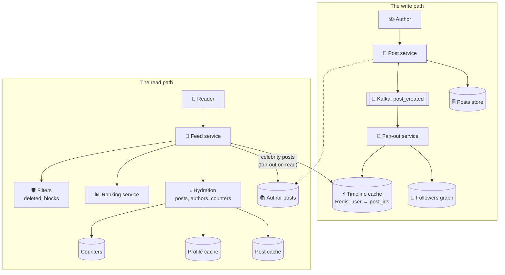
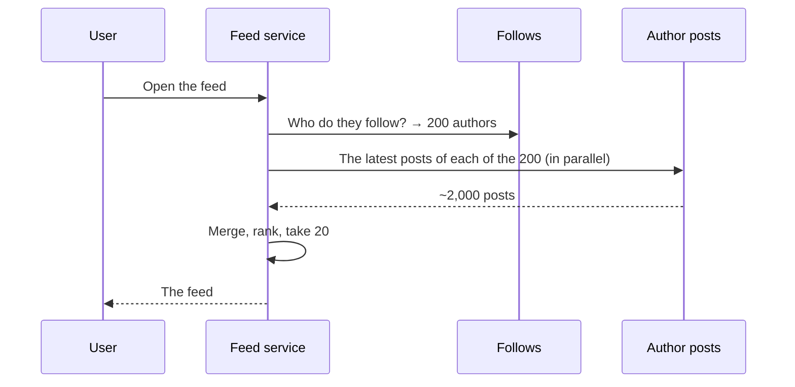
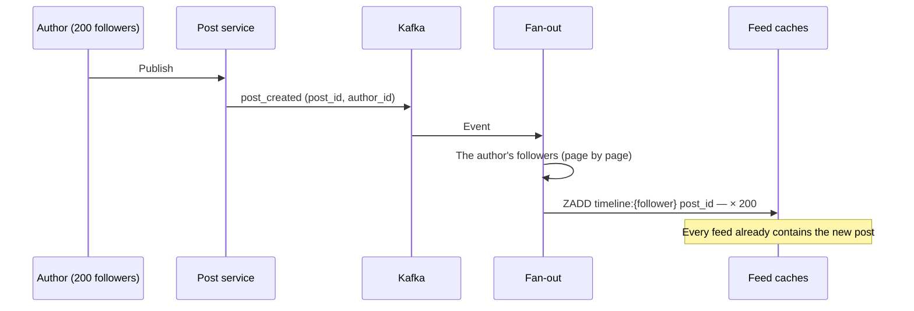
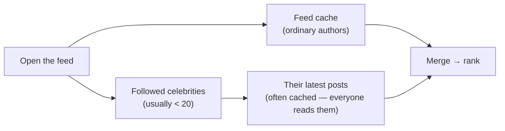
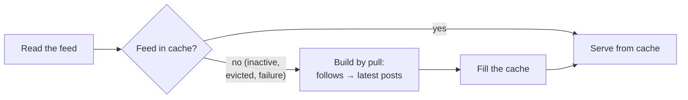
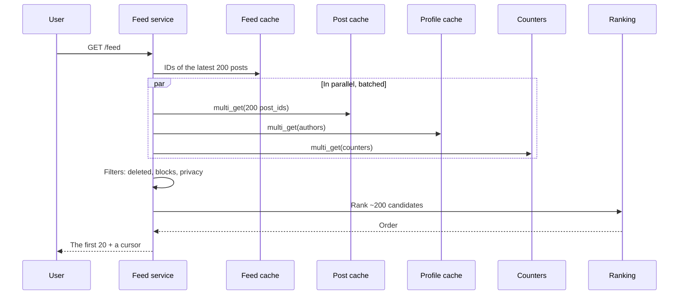
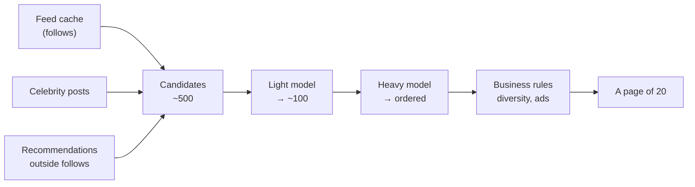

**English** | [Русский](README_RU.md)

# Tier 1 · 07. News Feed (Facebook / X)

> **Level:** Hard · **Interview time:** 45–60 min · **Study time:** ~5–6 h
> **Key aspects:** fan-out on write vs on read, a hybrid for celebrities, the feed cache, post hydration, ranking, pagination and consistency, deletion and privacy, hot posts and counters
> **Builds on:** [02-caching](../../02-caching/README.md), [06-partitioning](../../06-partitioning/README.md#8-hot-partitions-and-skew), [09-messaging](../../09-messaging/README.md), [15-search-basics](../../15-search-basics/README.md#6-multi-stage-ranking-and-quality-metrics), [Tier 1 · 04 ID Generator](../04-unique-id-generator/README.md), [Tier 1 · 06 Chat](../06-chat-system/README.md#12-deep-dive-6-group-chats)

---

## 🗺️ How to Read This Walkthrough

The walkthrough follows an interview, but every step includes explanations: **why** a decision is made, **how** a mechanism works and **what happens** if you do it differently. The "📘 Explanation" blocks are theory right where you need it.

| Icon | Meaning |
|:----:|:--------|
| 🎤 | Interviewer |
| 🗣️ | What I (the candidate) say out loud |
| ✏️ | What I draw on the whiteboard |
| ⏱️ | Time budget for the step |
| 📘 | A detailed explanation of a concept |

Callouts: **TIP** — a good technique, **WARNING** — a trap, **IMPORTANT** — a Senior+ signal.

---

## 📑 Contents

0. [What This Problem Teaches](#0-what-this-problem-teaches)
1. [Problem Statement](#1-problem-statement)
2. [Clarifying Questions and Requirements](#2-clarifying-questions-and-requirements)
3. [Capacity Estimates](#3-capacity-estimates)
4. [API](#4-api)
5. [Data Model](#5-data-model)
6. [High-Level Design](#6-high-level-design)
7. [Deep Dive 1: Fan-Out on Write, on Read and Hybrid](#7-deep-dive-1-fan-out-on-write-on-read-and-hybrid)
8. [Deep Dive 2: The Feed Cache](#8-deep-dive-2-the-feed-cache)
9. [Deep Dive 3: Reading the Feed and Hydration](#9-deep-dive-3-reading-the-feed-and-hydration)
10. [Deep Dive 4: Ranking](#10-deep-dive-4-ranking)
11. [Deep Dive 5: Pagination and Consistency](#11-deep-dive-5-pagination-and-consistency)
12. [Deep Dive 6: Deletion, Privacy and Follows](#12-deep-dive-6-deletion-privacy-and-follows)
13. [Deep Dive 7: Hot Posts and Counters](#13-deep-dive-7-hot-posts-and-counters)
14. [Deep Dive 8: Failures and Multiple Regions](#14-deep-dive-8-failures-and-multiple-regions)
15. [Bottlenecks and Failure Scenarios](#15-bottlenecks-and-failure-scenarios)
16. [What Changes at 10x Scale](#16-what-changes-at-10x-scale)
17. [Key Concepts and New Terms](#17-key-concepts-and-new-terms)
18. [Variations and Follow-Up Questions](#18-variations-and-follow-up-questions)
19. [Common Mistakes](#19-common-mistakes)
20. [Cheat Sheet and Self-Check](#20-cheat-sheet-and-self-check)

---

## 0. What This Problem Teaches

The news feed is the classic problem about **the trade-off between the cost of writes and the cost of reads**. Every post must be shown to all of the author's followers, and every feed is assembled from the posts of hundreds of people. Where to do that work — at publish time or at read time — is the central question.

| What's tested | Where it shows up |
|:--------------|:------------------|
| The write vs read trade-off | Fan-out on write, on read, hybrid |
| Data skew | A celebrity with 100M followers |
| Caching at scale | Terabytes of feed caches in memory |
| Assembling a response from many sources | Hydration: posts, authors, counters |
| Ranking | Multi-stage selection and ordering |
| User-facing consistency | Your own post shows up immediately, no duplicates when scrolling |
| Hot keys | A viral post, like counters |

> [!TIP]
> The key to the problem is naming **the celebrity problem** right away and proposing a **hybrid**. That's what the interviewer expects to hear; the rest of the time goes to the cache, hydration and ranking.

---

## 1. Problem Statement

> 🎤 "Design a news feed like Facebook's or X's: a user follows other people and sees their posts in a feed — ordered by relevance, with infinite scroll."

**What the user sees:**

```
Opens the app → a feed of 20 posts from the people they follow
Scrolls → the next 20 load
Comes back an hour later → a "12 new posts" banner at the top
Publishes a post → it's in their own feed immediately, and in followers' feeds within seconds
```

**Time plan:**

| Step | ⏱️ |
|:-----|:--:|
| Requirements | 5 min |
| Estimates | 4 min |
| API and data | 5 min |
| High-level design | 6 min |
| Deep dives | 22–30 min |
| Failures and wrap-up | 3 min |

---

## 2. Clarifying Questions and Requirements

⏱️ 5 min

| My question | Interviewer's answer | What it changes and why |
|:------------|:---------------------|:------------------------|
| Scale? | 500M daily active users, ~500M new posts per day | Huge fan-out volumes |
| How many follows and followers? | ~200 follows on average; celebrities have up to 100M followers | **Skew**: the average case and celebrities need different solutions |
| Feed order? | Ranked ("For you" from follows); chronological as an option | Ranking on top of a candidate set |
| How fast must a post reach followers? | Seconds; up to a minute is fine | Async delivery into feeds |
| Feed load latency? | p99 < 200 ms | The feed must be assembled almost entirely from cache |
| How often is the feed opened? | ~10 times a day | Far more reads than posts |
| Media? | Photos and video | Separate storage and a CDN (see [14-storage-types](../../14-storage-types/README.md)) |
| Privacy? | Private accounts, blocks, deleting posts | Filtering at read time |

### Functional requirements

1. Publish a post (text, media).
2. Follow and unfollow.
3. Get the feed: posts from follows, ranked, with infinite scroll.
4. Delete a post; respect blocks and private accounts.

### Non-functional requirements

| Requirement | Target | Why |
|:------------|:-------|:----|
| Feed latency | p99 < 200 ms | The feed is the app's first screen |
| Freshness | A post reaches followers within seconds (up to a minute) | A "live" social network feel |
| Availability | 99.99% for feed reads | More important than instant freshness |
| Consistency | Eventual; your own post — immediately (read-your-writes) | Strong consistency isn't needed and is expensive |
| Scale | Hundreds of thousands of feed reads per second at peak | Drives the caching |

---

## 3. Capacity Estimates

⏱️ 4 min

```
Posts:          500M per day → ~6,000/s on average, peak ~20,000/s
Feed reads:     500M × 10 = 5B per day → ~58,000/s on average, peak ~175,000/s
                → roughly 10× more feed reads than posts

Fan-out on write (delivering every post to every follower):
  500M posts × 200 followers = 100B feed inserts per day ≈ 1.2M inserts/s
A celebrity with 100M followers:
  one post = 100M inserts → at 1M inserts/s that's ~100 seconds of the whole cluster's work

The feed cache (storing only post IDs, the latest ~800 per user):
  800 × 8 B ≈ 6.4 KB per user (plus data-structure overhead)
  300M active users → ~2 TB of raw data, 5–10 TB in Redis with overhead and replicas
```

### Conclusions

| Conclusion | Design consequence |
|:-----------|:-------------------|
| ~10× more reads than writes | It pays to do the work at write time so reads are cheap |
| Fan-out on write — ~1M inserts per second | Tolerable for ordinary users if an insert is cheap (an ID into a cache) |
| Celebrities — 100M inserts per post | Fan-out on write doesn't work for them → **a hybrid** |
| The feed cache is terabytes | Store only IDs, only for active users, with a length cap |

---

## 4. API

⏱️ 2 min

```http
POST   /v1/posts                 { text, media_ids[], visibility }   → 201 { post_id }
DELETE /v1/posts/{id}
POST   /v1/users/{id}/follow
DELETE /v1/users/{id}/follow

GET    /v1/feed?cursor=…&limit=20
→ 200 {
    items: [{ post_id, author: {id, name, avatar}, text, media[], created_at,
              like_count, comment_count, liked_by_me, reason: "following" }],
    next_cursor: "…",
    new_items_token: "…"          ← for the "N new posts" banner
  }
```

🗣️ "Pagination is cursor-based: a ranked feed changes between requests, and offsets would produce duplicates and gaps. The cursor records which posts were already shown in this session (details in deep dive 5)."

---

## 5. Data Model

⏱️ 3 min

| Data | Schema | Store | Why |
|:-----|:-------|:------|:----|
| **Posts** | post_id (Snowflake), author_id, text, media_refs, visibility, created_at, deleted | A sharded DB (Cassandra / MySQL by post_id) + a post cache | Batched reads by ID; Snowflake sorts by time |
| **An author's posts** | (author_id) → post_id DESC | Wide-column, partitioned by author | "An author's latest posts" — for fan-out on read and the profile |
| **Followers** | (followee_id) → follower_id | Wide-column / a graph store | "Who to deliver the post to" |
| **Follows** | (follower_id) → followee_id | Wide-column | "Who I follow" — for assembling the feed |
| **The feed cache** | user_id → [post_id …] (up to ~800) | Redis, sharded by user_id | Fast feed reads |
| **Counters** | post_id → likes, comments, shares | A separate counter service | High write frequency |
| **Profiles** | user_id → name, avatar, is_celebrity, is_private | A DB + cache | Hydration |

📘 **Why follows are stored twice.** Queries go in both directions: "who follows Anna" (for fanning out her posts) and "who does Anna follow" (for assembling her feed). One table answers only one of those quickly, so the graph is stored in both directions — denormalization for the sake of reads.

---

## 6. High-Level Design

⏱️ 6 min



🗣️ "Two paths:
- **write**: the post is stored, an event goes to Kafka, and fan-out places the **post ID** into followers' feed caches (except followers of celebrities);
- **read**: the feed service takes IDs from the feed cache, adds fresh posts from celebrities the user follows, **hydrates** them (pulls in text, authors, counters), filters, ranks and returns a page."

---

## 7. Deep Dive 1: Fan-Out on Write, on Read and Hybrid

> 🎤 "When do you place posts into feeds — at publish time or at read time?"

### Fan-out on read (pull)

📘 The feed is assembled **when opened**: take the user's follow list, get each one's latest posts, merge and sort.



| ✅ Pros | ❌ Cons |
|:-------|:-------|
| Publishing is cheap: one write | **Reads are expensive**: 200+ requests every time a feed opens |
| No celebrity problem at write time | 175,000 opens/s × 200 = 35M requests per second to storage |
| No work wasted on inactive users | Latency = the slowest of 200 requests (tail latency) |

### Fan-out on write (push)

📘 At publish time, the post ID is **appended to every follower's feed cache**. Opening the feed is one cache read.



| ✅ Pros | ❌ Cons |
|:-------|:-------|
| **Reads are cheap**: one cache operation | A celebrity's post = 100M inserts |
| Predictable feed latency | Work is spent on people who'll never open the feed |
| | Follows/unfollows require rebuilding the feed |

### Hybrid ⭐

🗣️ "Use both approaches, depending on the author:

| Author | Strategy | Why |
|:-------|:---------|:----|
| Ordinary (fewer followers than a threshold, e.g. 100,000) | **Fan-out on write** | Cheap delivery, fast reads |
| Celebrity (above the threshold) | **Fan-out on read** | Avoid 100M inserts; pull their latest posts when a feed is read |

When a feed opens: the feed cache (ordinary authors' posts, already placed) **+** the latest posts of celebrities the user follows (usually few — single digits to tens) → merge → rank."



📘 **Why this works.** Celebrity posts are read by millions — they're **always hot in the post cache**. Pulling the latest 20 posts of 10 celebrities at read time is 10 requests to a hot cache, which is cheap. And the savings at write time are tens of millions of inserts per post.

### Additional fan-out optimizations

| Optimization | Effect |
|:-------------|:-------|
| **Skipping inactive users** (no visit in > 30 days) | Significant savings; when they return, the feed is assembled by pull |
| **Delivering in batches** of 1,000 followers | Less overhead on Kafka and Redis (pipelining) |
| **Priority** — currently active users first | Online followers see the post sooner |
| A dynamic "celebrity" threshold | It can consider posting frequency, not just follower count |

> [!IMPORTANT]
> **Senior+ signal:** show the math for why pure push breaks on celebrities (100M inserts ≈ 100 seconds of the whole cluster per post) and pure pull breaks on reads (35M requests per second), and choose a hybrid with a threshold. Twitter described exactly this scheme: fan-out on write into Redis, with celebrity posts mixed in at read time.

---

## 8. Deep Dive 2: The Feed Cache

> 🎤 "How is the feed cache structured, and how big is it?"

### Structure

```
Redis sorted set:  timeline:{user_id}
  score  = the post's time (or the Snowflake post_id, which is already time-ordered)
  member = post_id

ZADD timeline:42 <post_id> <post_id>
ZREMRANGEBYRANK timeline:42 0 -801     ← trim to the latest 800
ZREVRANGE timeline:42 0 199            ← the latest 200 candidates for ranking
```

| Decision | Why |
|:---------|:----|
| Store **only IDs**, not content | Content is shared across millions of feeds — store it once in the post cache |
| **A length cap** (~800) | Users rarely scroll that far; deeper — pull from storage |
| Only **active** users | Inactive users aren't cached — their feed is built when they return |
| Sharding by `user_id` | A user's feed lives on one shard; a read is one request |
| Replicas | A feed cache can be rebuilt, but rebuilding is expensive — replicas reduce rebuilds |

📘 **More compact than a sorted set.** A Redis sorted set spends tens of bytes per element. To save memory, a feed can be stored as a **list of packed 8-byte IDs** (append + trim): Snowflake IDs are already time-ordered, so a separate score isn't needed. That's several times less memory.

### A cache miss



The rebuild is that "expensive" fan-out on read, but it runs **rarely**: once when a user returns or after a failure.

---

## 9. Deep Dive 3: Reading the Feed and Hydration

> 🎤 "You have 200 post IDs. How do you turn them into a finished feed in 200 ms?"

📘 **Hydration** turns a list of IDs into full objects: the post text, media, the author's name and avatar, like counts, "did I like it".



### The latency budget

| Step | Time |
|:-----|:-----|
| Feed cache + celebrity posts | ~10 ms |
| Hydration (parallel multi_gets) | ~30 ms |
| Filters | ~5 ms |
| Ranking 200 candidates | ~50 ms |
| Serialization, network | ~30 ms |
| **Total** | ~125 ms, with headroom to 200 ms |

| Practice | Why |
|:---------|:----|
| **Batched multi_gets**, not a request per post | Otherwise 200 sequential requests (the N+1 problem) |
| Parallel requests to different sources | Latency = the maximum, not the sum |
| Fully hydrate **only what we'll show** (20); light features for ranking | Saves on heavy data |
| A partial response | If counters don't respond in time — show the post without them, not an error |

---

## 10. Deep Dive 4: Ranking

> 🎤 "How do you decide which posts to show first?"

A ranked feed is the same **funnel** as in search (see [15-search-basics](../../15-search-basics/README.md#6-multi-stage-ranking-and-quality-metrics)):



### Features

| Group | Examples |
|:------|:---------|
| **Affinity with the author** | How often the user likes, comments on, or visits the author's profile |
| **The post** | Type (photo, video, text), freshness, engagement in the first minutes |
| **The user** | Which content types they prefer, time of day, device |
| **Context** | Whether they've already seen the post, how many of this author's posts are already in the feed |

### Prediction and scoring

The model predicts action probabilities: like, comment, share, long view, hiding the post. The final score is a weighted sum whose weights reflect product goals (e.g. "meaningful interactions" matter more than a simple view).

### Business rules after the model

| Rule | Why |
|:-----|:----|
| At most N posts in a row from one author | Diversity |
| Mixing content types | Not 20 videos in a row |
| Inserting ads at certain positions | Monetization |
| Demoting already-seen posts | Feed freshness |

> [!TIP]
> It's good to mention a **chronological** feed as an option: it needs no model — the same candidates, sorted by time. The architecture (fan-out, cache, hydration) doesn't change — only the last step does.

---

## 11. Deep Dive 5: Pagination and Consistency

> 🎤 "The user is scrolling. How do you avoid showing a post twice or skipping one?"

### The problem

A ranked feed changes every second: new posts appear, counters change, and so does the order. Offset pagination over a changing list produces **duplicates** (a post moved down onto the next page) and **gaps** (a post moved up).

### The fix: a session snapshot

| Approach | How |
|:---------|:----|
| **Rank a batch and remember it** | On the first request, ~200 candidates are ranked; the ordered ID list is stored for the session (a cache with a ~30 min TTL); pages are served from it by cursor |
| **The cursor** | Holds a snapshot identifier and a position; for a chronological feed, the `post_id` of the last shown post is enough (Snowflake is ordered) |
| **A shown list** | The next batch of candidates excludes posts already shown in this session |
| **New posts on top** | They're not inserted into the current snapshot; the client periodically asks "anything new after the token" and shows a "12 new posts" banner |

### Read-your-writes

🗣️ "A user published a post and immediately opened the feed — the post must be there. Fan-out is async and may take seconds. Fixes:
- **synchronously** add the post to **the author's own** feed at publish time (one insert — cheap);
- the client **optimistically** shows its own post right after publishing;
- when reading your own feed, mix in your latest posts from the author's posts table."

📘 This is the **read-your-writes** guarantee from [07-consistency-models](../../07-consistency-models/README.md#7-session-guarantees): the author always sees their own changes, while everyone else sees them with a small delay.

---

## 12. Deep Dive 6: Deletion, Privacy and Follows

> 🎤 "A post was deleted. It's already been placed into 10 million feeds. What do you do?"

### Deletion

| Approach | How | Pros and cons |
|:---------|:----|:--------------|
| **A filter at read time** ⭐ | The post is marked deleted; deleted posts are dropped during hydration | Instant for everyone; the ID lingers in caches until evicted |
| Async cleanup | A background job removes the ID from feeds | Frees space; expensive for popular posts |

🗣️ "The key is **filtering during hydration**: the post disappears for everyone as soon as it's marked deleted and its cache entry is invalidated. Removing IDs from feeds is optional and runs in the background."

### Privacy and blocks

| Situation | Solution |
|:----------|:---------|
| The user blocked the author | Filter at read time by the block list (cached) |
| A private account | Fan-out only to approved followers; a visibility check at read time |
| A "close friends only" post | Fan-out only into the feeds of list members |

### Follows and unfollows

| Event | Solution |
|:------|:---------|
| **Follow** | Pull the new author's latest N posts into the follower's feed (a backfill) so the feed "comes alive" immediately |
| **Unfollow** | Don't remove old IDs from the cache right away; filter out posts from authors no longer followed at read time; the cache clears naturally |

---

## 13. Deep Dive 7: Hot Posts and Counters

> 🎤 "A celebrity's post is read by millions at once, and they all like it. What breaks?"

### A hot post in the cache

One post — one key in the post cache — millions of reads per second → one cache node is overloaded (see [Tier 1 · 03](../03-distributed-cache/README.md#11-deep-dive-6-hot-keys-and-stampedes)).

| Solution | How |
|:---------|:----|
| A local cache in the feed service | Hot posts in process memory for a few seconds |
| Key replicas | Copies on several cache nodes |

### Like counters

📘 100,000 likes per second on one post. If every like is `UPDATE posts SET likes = likes + 1`, the row becomes a contention point and the database can't keep up.

| Solution | How |
|:---------|:----|
| **Sharded counters** | A post's counter is split into N parts; a like increments a random one; the total is the sum |
| **Async aggregation** | Likes are written as events to Kafka; an aggregator updates the counter once a second |
| **Approximate display** | "12.4K" — single-digit precision isn't needed |
| **The like itself stored separately** | `(user_id, post_id)` in a separate table — for "did I like it" and for idempotency (you can't like twice) |

---

## 14. Deep Dive 8: Failures and Multiple Regions

> 🎤 "Fan-out is 10 minutes behind. What do users see?"

| Failure | What they see | Solution |
|:--------|:--------------|:---------|
| **Fan-out lag** (Kafka lag) | New posts appear in feeds late | Lag monitoring; under high lag, the feed service mixes in authors' fresh posts by pull (for active follows) |
| **Losing the feed cache** (a Redis failure) | Misses → mass rebuilds by pull | Replicas; rate-limiting rebuilds; active users first |
| **The ranking service is down** | No personalization | Degrade to chronological order |
| **Counters are down** | Posts without like counts | A partial response |

### Multiple regions

| Question | Solution |
|:---------|:---------|
| Where the feed cache lives | In the user's region |
| A post by an author in another region | The post is replicated to every region; each region's fan-out processes the `post_created` event for its own users |
| Your own post is visible immediately | A write to the author's region + a synchronous insert into their feed |
| A region failure | Users switch to another region; feed caches there are rebuilt by pull |

---

## 15. Bottlenecks and Failure Scenarios

| Scenario | What happens | How we protect |
|:---------|:-------------|:---------------|
| A celebrity post with 100M followers | Fan-out into 100M feeds | Hybrid: celebrities use fan-out on read |
| Many inactive users returning at once | Many feed rebuilds | Rate limiting, caching authors' posts |
| A hot post | A post cache node is overloaded | A local cache, key replicas |
| A flood of likes | Contention on the counter | Sharded counters, async aggregation |
| Fan-out lag | Freshness drops | Mixing in by pull, autoscaling fan-out |
| Losing the feed cache | Slow feeds | Replicas, on-demand rebuilds |
| A deleted post in millions of feeds | The post is visible | Filtering during hydration |
| Duplicates while scrolling | A poor experience | A session snapshot, a cursor, a shown list |
| Your own post isn't visible | The user thinks it wasn't published | A synchronous insert into your feed, an optimistic UI |
| Ranking is down | No personalization | Chronological order |

---

## 16. What Changes at 10x Scale

> 🎤 "5 billion users?"

| Change | Why |
|:-------|:----|
| **A larger share of recommendations outside follows** | Feeds are increasingly built from recommendations — candidate generation from vector search and an interest graph |
| **Lowering the "celebrity" threshold** | Fan-out on write gets more expensive; more authors move to pull |
| **Dropping the feed cache for some users** | Assembling at read time with well-cached author posts may be cheaper than terabytes of feed caches (Facebook described a read-time assembly approach — Multifeed) |
| **Regional models and caches** | Latency and cost |
| **Precomputing the feed** when it's likely to be opened soon | E.g. on a push notification — prepare the feed in advance |

---

## 17. Key Concepts and New Terms

### What's applied from Fundamentals

| Concept | Where it's covered | How it applies here |
|:--------|:-------------------|:--------------------|
| Caching, hot keys | [02-caching](../../02-caching/README.md), [Tier 1 · 03](../03-distributed-cache/README.md) | The feed cache, the post cache, hot posts |
| Skew, hot partitions | [06-partitioning](../../06-partitioning/README.md#8-hot-partitions-and-skew) | Celebrities, sharded counters |
| Read-your-writes | [07-consistency-models](../../07-consistency-models/README.md#7-session-guarantees) | Your own post in your feed immediately |
| Async events | [09-messaging](../../09-messaging/README.md) | Fan-out via Kafka |
| Multi-stage ranking | [15-search-basics](../../15-search-basics/README.md#6-multi-stage-ranking-and-quality-metrics) | Feed ranking |
| Snowflake IDs | [Tier 1 · 04](../04-unique-id-generator/README.md) | Time-ordered post IDs |
| Fan-out on write vs read | [Tier 1 · 06](../06-chat-system/README.md#12-deep-dive-6-group-chats) | The same idea as for groups and channels |

### New terms in this problem

| Term | In short |
|:-----|:---------|
| **Fan-out on write (push)** | A post is placed into followers' feeds at publish time |
| **Fan-out on read (pull)** | The feed is assembled from follows' posts when opened |
| **Hybrid fan-out** | Push for ordinary authors, pull for celebrities |
| **The feed cache** | A per-user list of post IDs in memory |
| **Hydration** | Turning IDs into full objects with data from several sources |
| **Backfill on follow** | Adding a new author's latest posts to the feed |
| **A session snapshot** | A fixed feed order for stable pagination |
| **A sharded counter** | A counter split into parts for parallel increments |

---

## 18. Variations and Follow-Up Questions

<details>
<summary><b>Why not assemble the feed with one SQL query using a JOIN?</b></summary>

`SELECT … FROM posts JOIN follows … ORDER BY created_at LIMIT 20` works for thousands of users. At scale, posts and follows are sharded by different keys, a cross-shard JOIN is impossible or very expensive, and no database can handle 175,000 such queries per second. That's why the work moves into fan-out and caches.
</details>

<details>
<summary><b>How do you show the "12 new posts" banner?</b></summary>

The client remembers a token (the time or ID of the newest candidate shown) and periodically (or on a server event) asks for the count of posts in the feed cache after that token. The posts themselves aren't inserted into the current feed until the user taps the banner — so the content doesn't jump while they read.
</details>

<details>
<summary><b>How does Instagram's feed differ from X's?</b></summary>

Architecturally — not by much: both use candidates from follows and recommendations, ranking and caches. The differences are in the product: Instagram gives more weight to media and out-of-network recommendations (Reels), while X puts more weight on freshness and has a chronological tab. For the interview, explaining the common scheme and the fan-out trade-offs matters more.
</details>

<details>
<summary><b>What if a user follows 5,000 accounts and they're all celebrities?</b></summary>

Pulling 5,000 sources on every read is expensive. Options: cap the number of sources at read time (take the most relevant), keep celebrity posts in a shared "latest celebrity posts" cache, or for such users partially switch to push from "small celebrities". The threshold can consider both follower count and activity.
</details>

<details>
<summary><b>How do you make a celebrity's post show up for followers quickly?</b></summary>

With pull, the post appears for a reader the next time they open the feed — right after it's written to the author's posts table and cache. For "notifications" about a favorite celebrity's post — a separate notification system with fan-out only to those who turned notifications on (usually a small share of followers).
</details>

---

## 19. Common Mistakes

| ❌ Mistake | Why it's bad | ✅ Do this instead |
|:----------|:-------------|:------------------|
| Fan-out on write only | Celebrities take the system down | A hybrid with a threshold |
| Fan-out on read only | Hundreds of requests every time a feed opens | Push for ordinary authors |
| Storing full posts in the feed cache | Terabytes of duplicates; edits and deletes don't apply | Only IDs + a shared post cache |
| A feed cache for every user | Memory spent on inactive users | Active users only; pull for the rest when they return |
| Hydrating one post at a time | N+1, high latency | Batched parallel multi_gets |
| Offset pagination | Duplicates and gaps | A session snapshot and a cursor |
| Your own post via async fan-out | The author doesn't see their post | A synchronous insert into your own feed |
| Deletion = cleaning every feed | Slow; the post stays visible until done | Filtering during hydration |
| `UPDATE likes = likes + 1` | Contention on a hot post | Sharded counters, aggregation |
| No degradation when ranking fails | An empty feed | Chronological order |

---

## 20. Cheat Sheet and Self-Check

### 30-second answer

> 500M posts and 5B feed opens per day — more reads, so most work happens at write time. Hybrid fan-out: for ordinary authors, the post's ID is placed via Kafka into active followers' feed caches (Redis, up to ~800 IDs, sharded by user_id); for celebrities above a threshold — fan-out on read: their latest posts are pulled from a hot cache when a feed opens. Reads: IDs from the feed cache + celebrity posts → batched parallel hydration (posts, authors, counters) → filters (deleted, blocks) → multi-stage ranking → a page of 20; a ~125 ms budget. Pagination — a session snapshot and a cursor; new posts via a banner. Your own post — synchronously into your own feed. Deletion — filtering during hydration. Hot posts — a local cache; likes — sharded counters. On failures — pull-based rebuilds and chronological order.

### Self-check

- [ ] I can estimate the load and the cost of fan-out on write and on read
- [ ] I can explain why pure push breaks on celebrities and pure pull on reads
- [ ] I can describe the hybrid and choosing the threshold
- [ ] I can design the feed cache and estimate its size
- [ ] I can describe the read path with hydration and a latency budget
- [ ] I can describe the ranking funnel and business rules
- [ ] I can explain pagination without duplicates and the new-posts banner
- [ ] I can ensure read-your-writes for the author
- [ ] I can explain deleting posts and handling follows/unfollows
- [ ] I can solve the hot post and counter problems

### Further reading

- Raffi Krikorian, *Timelines at Scale* (Twitter, QCon 2013)
- Facebook Engineering, *Serving Facebook Multifeed: Efficiency, performance gains through redesign* (2015)
- Alex Xu, *System Design Interview*, Vol. 1 — chapter "Design a News Feed System"
- Instagram Engineering articles on feed ranking
- Fundamentals topics: [02-caching](../../02-caching/README.md), [06-partitioning](../../06-partitioning/README.md), [15-search-basics](../../15-search-basics/README.md)