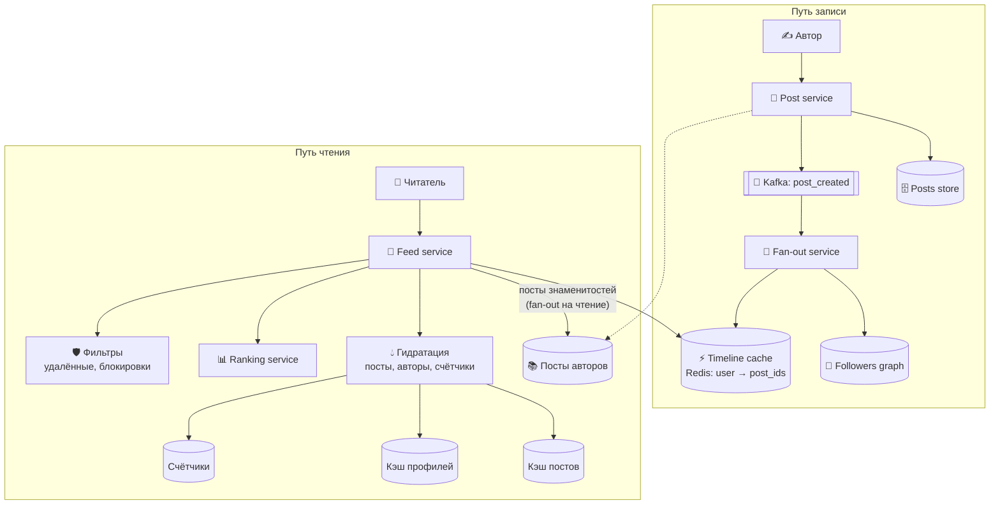
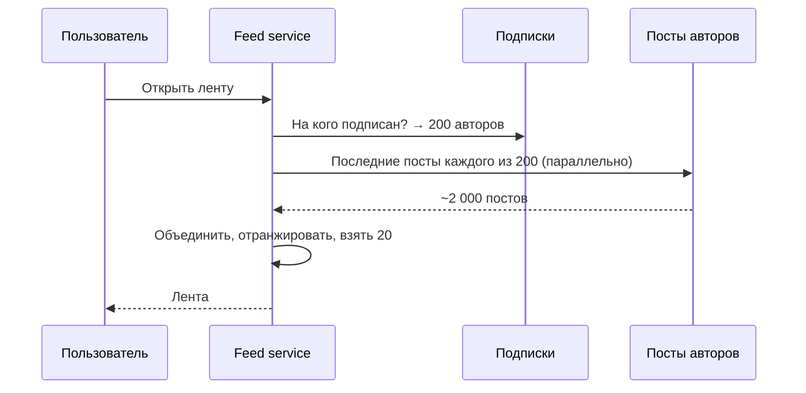
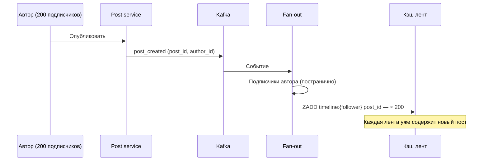
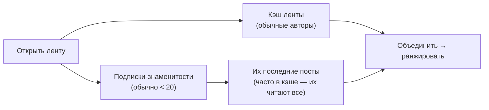
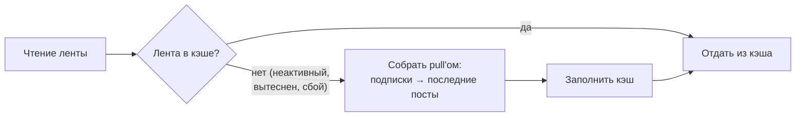
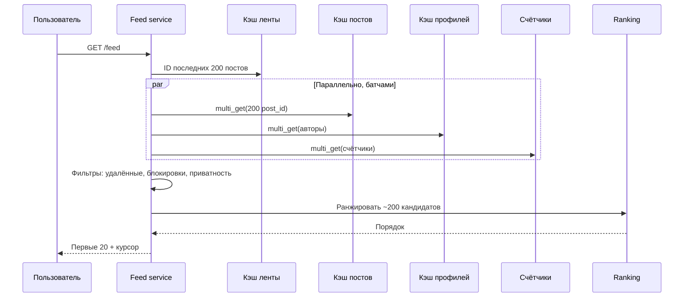
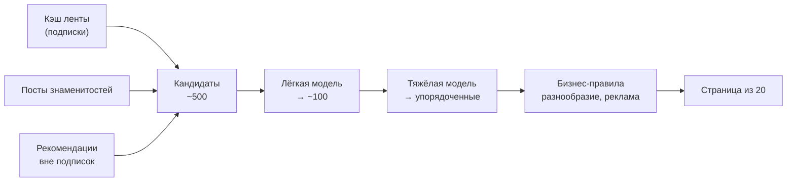

[English](README.md) | **Русский**

# Tier 1 · 07. News Feed (Facebook / X)

> **Уровень:** Hard · **Время на интервью:** 45–60 мин · **Время на разбор:** ~5–6 ч
> **Ключевые аспекты:** fan-out на запись vs на чтение, гибрид для знаменитостей, кэш ленты, гидратация постов, ранжирование, пагинация и консистентность, удаление и приватность, горячие посты и счётчики
> **Опирается на:** [02-caching](../../02-caching/README_RU.md), [06-partitioning](../../06-partitioning/README_RU.md#8-горячие-партиции-и-перекос), [09-messaging](../../09-messaging/README_RU.md), [15-search-basics](../../15-search-basics/README_RU.md#6-многоэтапное-ранжирование-и-метрики-качества), [Tier 1 · 04 ID Generator](../04-unique-id-generator/README_RU.md), [Tier 1 · 06 Chat](../06-chat-system/README_RU.md#12-deep-dive-6-групповые-чаты)

---

## 🗺️ Как читать этот разбор

Разбор построен как интервью, но в каждом шаге есть объяснения: **почему** принимается решение, **как работает** механизм и **что будет**, если сделать иначе. Блоки «📘 Объяснение» — теория прямо по ходу задачи.

| Значок | Что значит |
|:------:|:-----------|
| 🎤 | Реплика интервьюера |
| 🗣️ | Что говорю вслух я (кандидат) |
| ✏️ | Что рисую на доске |
| ⏱️ | Сколько времени тратить на шаг |
| 📘 | Подробное объяснение концепции |

Блоки **TIP** — хороший приём, **WARNING** — ловушка, **IMPORTANT** — сигнал для уровня Senior+.

---

## 📑 Содержание

0. [Чему учит эта задача](#0-чему-учит-эта-задача)
1. [Условие задачи](#1-условие-задачи)
2. [Уточняющие вопросы и требования](#2-уточняющие-вопросы-и-требования)
3. [Оценки нагрузки](#3-оценки-нагрузки)
4. [API](#4-api)
5. [Модель данных](#5-модель-данных)
6. [High-level дизайн](#6-high-level-дизайн)
7. [Deep dive 1: fan-out на запись, на чтение и гибрид](#7-deep-dive-1-fan-out-на-запись-на-чтение-и-гибрид)
8. [Deep dive 2: кэш ленты](#8-deep-dive-2-кэш-ленты)
9. [Deep dive 3: чтение ленты и гидратация](#9-deep-dive-3-чтение-ленты-и-гидратация)
10. [Deep dive 4: ранжирование](#10-deep-dive-4-ранжирование)
11. [Deep dive 5: пагинация и консистентность](#11-deep-dive-5-пагинация-и-консистентность)
12. [Deep dive 6: удаление, приватность и подписки](#12-deep-dive-6-удаление-приватность-и-подписки)
13. [Deep dive 7: горячие посты и счётчики](#13-deep-dive-7-горячие-посты-и-счётчики)
14. [Deep dive 8: сбои и несколько регионов](#14-deep-dive-8-сбои-и-несколько-регионов)
15. [Узкие места и сценарии сбоев](#15-узкие-места-и-сценарии-сбоев)
16. [Что изменится при росте в 10 раз](#16-что-изменится-при-росте-в-10-раз)
17. [Ключевые концепции и новые понятия](#17-ключевые-концепции-и-новые-понятия)
18. [Варианты задачи и follow-up вопросы](#18-варианты-задачи-и-follow-up-вопросы)
19. [Типичные ошибки](#19-типичные-ошибки)
20. [Шпаргалка и самопроверка](#20-шпаргалка-и-самопроверка)

---

## 0. Чему учит эта задача

Лента новостей — классическая задача про **компромисс между стоимостью записи и стоимостью чтения**. Каждый пост нужно показать всем подписчикам автора, а каждая лента собирается из постов сотен людей. Где делать эту работу — при публикации или при чтении — главный вопрос.

| Что проверяют | Где это в задаче |
|:--------------|:-----------------|
| Компромисс запись vs чтение | Fan-out на запись, на чтение, гибрид |
| Перекосы в данных | Знаменитость со 100 млн подписчиков |
| Кэширование на масштабе | Терабайты кэшей лент в памяти |
| Сборка ответа из многих источников | Гидратация: посты, авторы, счётчики |
| Ранжирование | Многоэтапный отбор и сортировка |
| Консистентность для пользователя | Свой пост сразу в ленте, нет дублей при прокрутке |
| Горячие ключи | Вирусный пост, счётчики лайков |

> [!TIP]
> Ключ к задаче — сразу назвать **проблему знаменитостей** и предложить **гибрид**. Это то, что интервьюер ждёт услышать; остальное время уйдёт на кэш, гидратацию и ранжирование.

---

## 1. Условие задачи

> 🎤 «Спроектируй ленту новостей как в Facebook или X: пользователь подписан на других людей и видит их посты в ленте — в порядке релевантности, с бесконечной прокруткой».

**Что видит пользователь:**

```
Открывает приложение → лента из 20 постов от тех, на кого подписан
Прокручивает → подгружаются следующие 20
Возвращается через час → сверху баннер «12 новых постов»
Публикует пост → он сразу виден в его ленте, через секунды — в лентах подписчиков
```

**План по времени:**

| Шаг | ⏱️ |
|:----|:--:|
| Требования | 5 мин |
| Оценки | 4 мин |
| API и данные | 5 мин |
| High-level дизайн | 6 мин |
| Deep dives | 22–30 мин |
| Сбои и итоги | 3 мин |

---

## 2. Уточняющие вопросы и требования

⏱️ 5 мин

| Мой вопрос | Ответ интервьюера | Что это меняет и почему |
|:-----------|:------------------|:------------------------|
| Масштаб? | 500M активных пользователей в день, ~500M новых постов в сутки | Огромные объёмы fan-out |
| Сколько подписок и подписчиков? | В среднем ~200 подписок; у знаменитостей — до 100M подписчиков | **Перекос**: средний случай и знаменитости требуют разных решений |
| Порядок ленты? | Ранжированная («Для вас» из подписок); хронологическая — как опция | Ранжирование поверх набора кандидатов |
| Как быстро пост виден подписчикам? | Секунды; до минуты допустимо | Асинхронная доставка в ленты |
| Задержка открытия ленты? | p99 < 200 мс | Лента должна собираться почти из кэша |
| Сколько раз в день открывают ленту? | ~10 раз | Чтений намного больше, чем публикаций |
| Медиа? | Фото и видео | Отдельное хранилище и CDN (см. [14-storage-types](../../14-storage-types/README_RU.md)) |
| Приватность? | Закрытые аккаунты, блокировки, удаление постов | Фильтрация при чтении |

### Функциональные требования

1. Опубликовать пост (текст, медиа).
2. Подписаться и отписаться.
3. Получить ленту: посты от подписок, ранжированные, с бесконечной прокруткой.
4. Удалить пост; соблюдать блокировки и закрытые аккаунты.

### Нефункциональные требования

| Требование | Цель | Почему |
|:-----------|:-----|:-------|
| Задержка ленты | p99 < 200 мс | Лента — первый экран приложения |
| Свежесть | Пост у подписчиков за секунды (до минуты) | Ощущение «живой» соцсети |
| Доступность | 99,99% для чтения ленты | Важнее, чем мгновенная свежесть |
| Консистентность | Eventual; свой пост — сразу (read-your-writes) | Строгая консистентность не нужна и дорога |
| Масштаб | Сотни тысяч чтений лент в секунду в пике | Определяет кэширование |

---

## 3. Оценки нагрузки

⏱️ 4 мин

```
Посты:          500M в сутки → ~6 000/с в среднем, пик ~20 000/с
Чтения ленты:   500M × 10 = 5B в сутки → ~58 000/с в среднем, пик ~175 000/с
                → чтений ленты примерно в 10 раз больше, чем публикаций

Fan-out на запись (если доставлять каждый пост каждому подписчику):
  500M постов × 200 подписчиков = 100B вставок в ленты в сутки ≈ 1,2M вставок/с
Знаменитость со 100M подписчиков:
  один пост = 100M вставок → при 1M вставок/с это ~100 секунд работы всего кластера

Кэш лент (храним только ID постов, последние ~800 на пользователя):
  800 × 8 Б ≈ 6,4 КБ на пользователя (плюс накладные расходы структуры)
  300M активных пользователей → ~2 ТБ сырых данных, 5–10 ТБ в Redis с накладными расходами и репликами
```

### Выводы

| Вывод | Следствие для дизайна |
|:------|:----------------------|
| Чтений в ~10 раз больше, чем записей | Выгодно делать работу при записи, чтобы чтение было дешёвым |
| Fan-out на запись — ~1M вставок в секунду | Терпимо для обычных пользователей, если вставка дешёвая (ID в кэш) |
| Знаменитости — 100M вставок на пост | Fan-out на запись для них не подходит → **гибрид** |
| Кэш лент — терабайты | Хранить только ID, только активных пользователей, ограничивать длину |

---

## 4. API

⏱️ 2 мин

```http
POST   /v1/posts                 { text, media_ids[], visibility }   → 201 { post_id }
DELETE /v1/posts/{id}
POST   /v1/users/{id}/follow
DELETE /v1/users/{id}/follow

GET    /v1/feed?cursor=…&limit=20
→ 200 {
    items: [{ post_id, author: {id, name, avatar}, text, media[], created_at,
              like_count, comment_count, liked_by_me, reason: "following" }],
    next_cursor: "…",
    new_items_token: "…"          ← для баннера «N новых постов»
  }
```

🗣️ «Пагинация курсорная: ранжированная лента меняется между запросами, и offset дал бы дубли и пропуски. Курсор фиксирует, какие посты уже показаны в этой сессии (подробно — в deep dive 5)».

---

## 5. Модель данных

⏱️ 3 мин

| Данные | Схема | Хранилище | Почему |
|:-------|:------|:----------|:-------|
| **Посты** | post_id (Snowflake), author_id, text, media_refs, visibility, created_at, deleted | Шардированная БД (Cassandra / MySQL по post_id) + кэш постов | Чтение по ID пачками; Snowflake сортируется по времени |
| **Посты автора** | (author_id) → post_id DESC | Wide-column, партиция по автору | «Последние посты автора» — для fan-out на чтение и профиля |
| **Подписчики** | (followee_id) → follower_id | Wide-column / графовое хранилище | «Кому доставить пост» |
| **Подписки** | (follower_id) → followee_id | Wide-column | «На кого я подписан» — для сборки ленты |
| **Кэш ленты** | user_id → [post_id …] (до ~800) | Redis, шардирован по user_id | Быстрое чтение ленты |
| **Счётчики** | post_id → likes, comments, shares | Отдельный сервис счётчиков | Высокая частота записи |
| **Профили** | user_id → name, avatar, is_celebrity, is_private | БД + кэш | Гидратация |

📘 **Почему подписки хранятся дважды.** Запросы идут в обе стороны: «кто подписан на Анну» (для fan-out её постов) и «на кого подписана Анна» (для сборки её ленты). Одна таблица быстро отвечает только на один из этих вопросов, поэтому граф хранится в двух направлениях — денормализация ради чтения.

---

## 6. High-level дизайн

⏱️ 6 мин



🗣️ «Два пути:
- **запись**: пост сохраняется, событие идёт в Kafka, fan-out раскладывает **ID поста** по кэшам лент подписчиков (кроме подписчиков знаменитостей);
- **чтение**: feed service берёт ID из кэша ленты, добавляет свежие посты знаменитостей, на которых подписан пользователь, **гидратирует** (подтягивает тексты, авторов, счётчики), фильтрует, ранжирует и отдаёт страницу».

---

## 7. Deep dive 1: fan-out на запись, на чтение и гибрид

> 🎤 «Когда раскладывать посты по лентам — при публикации или при чтении?»

### Fan-out на чтение (pull)

📘 Лента собирается **при открытии**: взять список подписок пользователя, для каждой — последние посты, объединить и отсортировать.



| ✅ Плюсы | ❌ Минусы |
|:--------|:---------|
| Публикация дешёвая: одна запись | **Чтение дорогое**: 200+ запросов на каждое открытие ленты |
| Нет проблемы знаменитостей при записи | 175 000 открытий/с × 200 = 35M запросов в секунду к хранилищу |
| Не тратится работа на неактивных пользователей | Задержка = самый медленный из 200 запросов (tail latency) |

### Fan-out на запись (push)

📘 При публикации ID поста **дописывается в кэш ленты каждого подписчика**. Открытие ленты — одно чтение из кэша.



| ✅ Плюсы | ❌ Минусы |
|:--------|:---------|
| **Чтение дешёвое**: одна операция с кэшем | Публикация знаменитости = 100M вставок |
| Предсказуемая задержка ленты | Работа тратится и на тех, кто ленту не откроет |
| | Подписка/отписка требует перестроения ленты |

### Гибрид ⭐

🗣️ «Используем оба подхода по типу автора:

| Автор | Стратегия | Почему |
|:------|:----------|:-------|
| Обычный (подписчиков меньше порога, например 100 000) | **Fan-out на запись** | Дешёвая доставка, быстрое чтение |
| Знаменитость (больше порога) | **Fan-out на чтение** | Не делать 100M вставок; при чтении ленты подтянуть её последние посты |

При открытии ленты: кэш ленты (посты обычных авторов, уже разложенные) **+** последние посты знаменитостей, на которых подписан пользователь (обычно их немного — единицы–десятки) → объединение → ранжирование».



📘 **Почему это работает.** Посты знаменитостей читают миллионы людей — они **всегда горячие в кэше постов**. Подтянуть последние 20 постов 10 знаменитостей при чтении — 10 запросов к горячему кэшу, это дёшево. А экономия при записи — десятки миллионов вставок на каждый пост.

### Дополнительные оптимизации fan-out

| Оптимизация | Эффект |
|:------------|:-------|
| **Не доставлять неактивным** (не заходили > 30 дней) | Существенная экономия; при возвращении лента собирается pull'ом |
| **Доставка пачками** по 1 000 подписчиков | Меньше накладных расходов на Kafka и Redis (pipelining) |
| **Приоритет** — сначала активным сейчас | Онлайн-подписчики видят пост быстрее |
| Порог «знаменитости» — динамический | Можно учитывать не только число подписчиков, но и частоту публикаций |

> [!IMPORTANT]
> **Сигнал Senior+:** показать расчёт, почему чистый push ломается на знаменитостях (100M вставок ≈ 100 секунд работы всего кластера на один пост), а чистый pull — на чтении (35M запросов в секунду), и выбрать гибрид с порогом. Twitter описывал именно такую схему: fan-out на запись в Redis и подмешивание постов знаменитостей при чтении.

---

## 8. Deep dive 2: кэш ленты

> 🎤 «Как устроен кэш ленты и сколько он занимает?»

### Структура

```
Redis sorted set:  timeline:{user_id}
  score  = время поста (или Snowflake post_id, он уже упорядочен по времени)
  member = post_id

ZADD timeline:42 <post_id> <post_id>
ZREMRANGEBYRANK timeline:42 0 -801     ← обрезать до последних 800
ZREVRANGE timeline:42 0 199            ← последние 200 кандидатов для ранжирования
```

| Решение | Почему |
|:--------|:-------|
| Храним **только ID**, не содержимое | Содержимое общее для миллионов лент — хранить один раз в кэше постов |
| **Ограничение длины** (~800) | Пользователи редко прокручивают так далеко; глубже — pull из хранилища |
| Только **активные** пользователи | Неактивных нет в кэше — ленту соберут при возвращении |
| Шардирование по `user_id` | Лента пользователя — на одном шарде, чтение — один запрос |
| Реплики | Кэш ленты можно восстановить, но восстановление дорогое — реплики снижают число перестроений |

📘 **Компактнее, чем sorted set.** Sorted set в Redis тратит десятки байт на элемент. Для экономии ленту можно хранить как **список упакованных 8-байтных ID** (append + обрезка): ID Snowflake уже упорядочены по времени, отдельный score не нужен. Это в несколько раз меньше памяти.

### Промах кэша



Перестроение — тот самый «дорогой» fan-out на чтение, но выполняется **редко**: один раз при возвращении пользователя или после сбоя.

---

## 9. Deep dive 3: чтение ленты и гидратация

> 🎤 «Есть 200 ID постов. Как за 200 мс превратить их в готовую ленту?»

📘 **Гидратация** — превращение списка ID в полноценные объекты: текст поста, медиа, имя и аватар автора, счётчики лайков, «лайкнул ли я».



### Бюджет задержки

| Шаг | Время |
|:----|:------|
| Кэш ленты + посты знаменитостей | ~10 мс |
| Гидратация (параллельные multi_get) | ~30 мс |
| Фильтры | ~5 мс |
| Ранжирование 200 кандидатов | ~50 мс |
| Сериализация, сеть | ~30 мс |
| **Итого** | ~125 мс, запас до 200 мс |

| Практика | Почему |
|:---------|:-------|
| **Батчевые multi_get**, не запрос на каждый пост | Иначе 200 последовательных запросов (проблема N+1) |
| Параллельные запросы к разным источникам | Задержка = максимум, а не сумма |
| Гидратировать **только то, что покажем** (20) полностью; для ранжирования — лёгкие признаки | Экономия на тяжёлых данных |
| Частичный ответ | Если счётчики не ответили вовремя — показать пост без них, а не ошибку |

---

## 10. Deep dive 4: ранжирование

> 🎤 «Как решить, какие посты показать первыми?»

Ранжированная лента — та же **воронка**, что в поиске (см. [15-search-basics](../../15-search-basics/README_RU.md#6-многоэтапное-ранжирование-и-метрики-качества)):



### Признаки

| Группа | Примеры |
|:-------|:--------|
| **Связь с автором** | Как часто пользователь лайкает, комментирует, открывает профиль автора |
| **Пост** | Тип (фото, видео, текст), свежесть, вовлечённость в первые минуты |
| **Пользователь** | Какие типы контента он предпочитает, время суток, устройство |
| **Контекст** | Уже видел ли пост, сколько постов от этого автора уже в ленте |

### Предсказание и оценка

Модель предсказывает вероятности действий: лайк, комментарий, репост, долгий просмотр, скрытие поста. Итоговый score — взвешенная сумма, веса которой определяют продуктовые цели (например, «осмысленные взаимодействия» важнее простого просмотра).

### Бизнес-правила после модели

| Правило | Зачем |
|:--------|:------|
| Не больше N постов подряд от одного автора | Разнообразие |
| Смешивание типов контента | Не 20 видео подряд |
| Вставка рекламы на определённые позиции | Монетизация |
| Понижение уже увиденного | Свежесть ленты |

> [!TIP]
> Хорошо упомянуть **хронологическую** ленту как опцию: для неё не нужна модель — те же кандидаты, отсортированные по времени. Архитектура (fan-out, кэш, гидратация) от этого не меняется — меняется только последний шаг.

---

## 11. Deep dive 5: пагинация и консистентность

> 🎤 «Пользователь прокручивает ленту. Как не показать один пост дважды и не пропустить?»

### Проблема

Ранжированная лента меняется каждую секунду: появляются новые посты, меняются счётчики, а значит и порядок. Пагинация по `offset` на меняющемся списке даёт **дубли** (пост сдвинулся вниз и попал на следующую страницу) и **пропуски** (пост сдвинулся вверх).

### Решение: снимок сессии

| Подход | Как |
|:-------|:----|
| **Ранжировать пачку и запомнить** | При первом запросе ранжируется ~200 кандидатов; упорядоченный список ID сохраняется на время сессии (кэш с TTL ~30 мин); страницы отдаются из него по курсору |
| **Курсор** | Содержит идентификатор снимка и позицию; для хронологической ленты достаточно `post_id` последнего показанного (Snowflake упорядочен) |
| **Список показанного** | При следующей пачке кандидатов исключаются уже показанные в этой сессии |
| **Новые посты сверху** | Не вставляются в текущий снимок; клиент периодически спрашивает «есть ли новые после токена» и показывает баннер «12 новых постов» |

### Read-your-writes

🗣️ «Пользователь опубликовал пост и сразу открыл ленту — пост должен быть там. Fan-out асинхронный и может занять секунды. Решения:
- **синхронно** добавить пост в ленту **самого автора** при публикации (одна вставка — дёшево);
- клиент **оптимистично** показывает свой пост сразу после публикации;
- при чтении своей ленты подмешивать собственные последние посты из таблицы постов автора».

📘 Это гарантия **read-your-writes** из [07-consistency-models](../../07-consistency-models/README_RU.md#7-сессионные-гарантии): автор всегда видит свои изменения, а остальные — с небольшой задержкой.

---

## 12. Deep dive 6: удаление, приватность и подписки

> 🎤 «Пост удалили. Он уже разложен по 10 миллионам лент. Что делать?»

### Удаление

| Подход | Как | Плюсы и минусы |
|:-------|:----|:---------------|
| **Фильтр при чтении** ⭐ | Пост помечается удалённым; при гидратации удалённые отбрасываются | Мгновенно для всех; ID остаётся в кэшах до вытеснения |
| Асинхронная очистка | Фоновая задача удаляет ID из лент | Освобождает место; дорого для популярных постов |

🗣️ «Главное — **фильтр при гидратации**: пост исчезает у всех сразу, как только помечен удалённым и кэш поста инвалидирован. Очистка ID из лент — необязательная и фоновая».

### Приватность и блокировки

| Ситуация | Решение |
|:---------|:--------|
| Пользователь заблокировал автора | Фильтр при чтении по списку блокировок (кэшируется) |
| Закрытый аккаунт | Fan-out только одобренным подписчикам; при чтении проверка видимости |
| Пост «только для близких друзей» | Fan-out только в ленты членов списка |

### Подписка и отписка

| Событие | Решение |
|:--------|:--------|
| **Подписка** | Подтянуть последние N постов нового автора в ленту подписчика (backfill), чтобы лента сразу «ожила» |
| **Отписка** | Не удалять старые ID из кэша сразу; при чтении отфильтровывать посты авторов, на которых больше не подписан; кэш очистится естественно |

---

## 13. Deep dive 7: горячие посты и счётчики

> 🎤 «Пост знаменитости читают миллионы людей одновременно, и все лайкают. Что сломается?»

### Горячий пост в кэше

Один пост — один ключ в кэше постов — миллионы чтений в секунду → перегрузка одного узла кэша (см. [Tier 1 · 03](../03-distributed-cache/README_RU.md#11-deep-dive-6-горячие-ключи-и-stampede)).

| Решение | Как |
|:--------|:----|
| Локальный кэш в feed service | Горячие посты в памяти процесса на несколько секунд |
| Реплики ключа | Копии на нескольких узлах кэша |

### Счётчики лайков

📘 100 000 лайков в секунду одного поста. Если каждый лайк — `UPDATE posts SET likes = likes + 1`, строка станет точкой конкуренции и база не выдержит.

| Решение | Как |
|:--------|:----|
| **Шардированные счётчики** | Счётчик поста разбит на N частей; лайк увеличивает случайную; итог — сумма |
| **Асинхронная агрегация** | Лайки пишутся событиями в Kafka; агрегатор раз в секунду обновляет счётчик |
| **Приблизительное отображение** | «12,4 тыс.» — точность до единиц не нужна |
| **Факт лайка отдельно** | `(user_id, post_id)` в отдельной таблице — для «лайкнул ли я» и для идемпотентности (нельзя лайкнуть дважды) |

---

## 14. Deep dive 8: сбои и несколько регионов

> 🎤 «Fan-out отстаёт на 10 минут. Что видят пользователи?»

| Сбой | Что видят | Решение |
|:-----|:----------|:--------|
| **Отставание fan-out** (лаг Kafka) | Новые посты появляются в лентах с задержкой | Мониторинг лага; при большом лаге feed service подмешивает свежие посты авторов pull'ом (для активных подписок) |
| **Потеря кэша лент** (сбой Redis) | Промахи → массовое перестроение pull'ом | Реплики; ограничение скорости перестроения; приоритет активным |
| **Сервис ранжирования недоступен** | Нет персонализации | Деградация до хронологического порядка |
| **Счётчики недоступны** | Посты без цифр лайков | Частичный ответ |

### Несколько регионов

| Вопрос | Решение |
|:-------|:--------|
| Где кэш ленты | В регионе пользователя |
| Пост автора из другого региона | Пост реплицируется во все регионы; событие `post_created` обрабатывается fan-out'ом в каждом регионе для его пользователей |
| Свой пост сразу виден | Запись в регион автора + синхронная вставка в его ленту |
| Отказ региона | Пользователи переключаются в другой регион; кэши лент там перестраиваются pull'ом |

---

## 15. Узкие места и сценарии сбоев

| Сценарий | Что произойдёт | Как защищаемся |
|:---------|:---------------|:---------------|
| Пост знаменитости со 100M подписчиков | Fan-out на 100M лент | Гибрид: знаменитости — fan-out на чтение |
| Массовое возвращение неактивных | Много перестроений лент | Ограничение скорости, кэширование постов авторов |
| Горячий пост | Перегрузка узла кэша постов | Локальный кэш, реплики ключа |
| Шквал лайков | Конкуренция на счётчике | Шардированные счётчики, асинхронная агрегация |
| Отставание fan-out | Свежесть падает | Подмешивание pull'ом, автоскейлинг fan-out |
| Потеря кэша лент | Медленные ленты | Реплики, перестроение по требованию |
| Удалённый пост в миллионах лент | Пост виден | Фильтр при гидратации |
| Дубли при прокрутке | Плохой опыт | Снимок сессии, курсор, список показанного |
| Свой пост не виден | Пользователь думает, что пост не опубликован | Синхронная вставка в свою ленту, оптимистичный UI |
| Ранжирование недоступно | Нет персонализации | Хронологический порядок |

---

## 16. Что изменится при росте в 10 раз

> 🎤 «5 миллиардов пользователей?»

| Изменение | Почему |
|:----------|:-------|
| **Больше доля рекомендаций вне подписок** | Ленты всё больше строятся из рекомендаций — генерация кандидатов из векторного поиска и графа интересов |
| **Понижение порога «знаменитости»** | Fan-out на запись дорожает; больше авторов переходят на pull |
| **Отказ от кэша лент для части пользователей** | Сборка на чтении с хорошо кэшированными постами авторов может быть дешевле, чем терабайты кэшей лент (Facebook описывал подход сборки при чтении — Multifeed) |
| **Региональные модели и кэши** | Задержка и стоимость |
| **Предвычисление ленты** при признаках скорого открытия | Например, при push-уведомлении — подготовить ленту заранее |

---

## 17. Ключевые концепции и новые понятия

### Что из Fundamentals применяется

| Концепция | Где разобрана | Как применяется здесь |
|:----------|:--------------|:----------------------|
| Кэширование, горячие ключи | [02-caching](../../02-caching/README_RU.md), [Tier 1 · 03](../03-distributed-cache/README_RU.md) | Кэш лент, кэш постов, горячие посты |
| Перекос, горячие партиции | [06-partitioning](../../06-partitioning/README_RU.md#8-горячие-партиции-и-перекос) | Знаменитости, шардированные счётчики |
| Read-your-writes | [07-consistency-models](../../07-consistency-models/README_RU.md#7-сессионные-гарантии) | Свой пост сразу в ленте |
| Асинхронные события | [09-messaging](../../09-messaging/README_RU.md) | Fan-out через Kafka |
| Многоэтапное ранжирование | [15-search-basics](../../15-search-basics/README_RU.md#6-многоэтапное-ранжирование-и-метрики-качества) | Ранжирование ленты |
| Snowflake ID | [Tier 1 · 04](../04-unique-id-generator/README_RU.md) | ID постов, упорядоченные по времени |
| Fan-out на запись vs чтение | [Tier 1 · 06](../06-chat-system/README_RU.md#12-deep-dive-6-групповые-чаты) | Та же идея, что для групп и каналов |

### Новые понятия этой задачи

| Понятие | Кратко |
|:--------|:-------|
| **Fan-out на запись (push)** | Пост раскладывается по лентам подписчиков при публикации |
| **Fan-out на чтение (pull)** | Лента собирается из постов подписок при открытии |
| **Гибридный fan-out** | Push для обычных авторов, pull для знаменитостей |
| **Кэш ленты** | Список ID постов на пользователя в памяти |
| **Гидратация** | Превращение ID в полные объекты с данными из разных источников |
| **Backfill при подписке** | Добавление последних постов нового автора в ленту |
| **Снимок сессии** | Зафиксированный порядок ленты для стабильной пагинации |
| **Шардированный счётчик** | Счётчик, разбитый на части для параллельных инкрементов |

---

## 18. Варианты задачи и follow-up вопросы

<details>
<summary><b>Почему не собрать ленту одним SQL-запросом с JOIN?</b></summary>

`SELECT … FROM posts JOIN follows … ORDER BY created_at LIMIT 20` работает для тысяч пользователей. На масштабе посты и подписки шардированы по разным ключам, JOIN между шардами невозможен или очень дорог, а 175 000 таких запросов в секунду не выдержит ни одна база. Поэтому работа выносится в fan-out и кэши.
</details>

<details>
<summary><b>Как показать баннер «12 новых постов»?</b></summary>

Клиент запоминает токен (время или ID самого нового показанного кандидата) и периодически (или по событию от сервера) спрашивает количество постов в кэше ленты после этого токена. Сами посты не вставляются в текущую ленту, пока пользователь не нажмёт баннер — чтобы содержимое не прыгало при чтении.
</details>

<details>
<summary><b>Чем лента Instagram отличается от ленты X?</b></summary>

Архитектурно — немногим: обе используют кандидатов из подписок и рекомендаций, ранжирование и кэши. Различия в продукте: у Instagram больше веса у медиа и рекомендаций вне подписок (Reels), у X — сильнее значение свежести и есть хронологическая вкладка. Для интервью важнее объяснить общую схему и компромиссы fan-out.
</details>

<details>
<summary><b>Что если пользователь подписан на 5 000 аккаунтов, и все — знаменитости?</b></summary>

Pull 5 000 источников на каждое чтение — дорого. Решения: ограничить число источников при чтении (взять самых релевантных), держать посты знаменитостей в общем кэше «последние посты знаменитостей», или для таких пользователей частично переходить на push от «малых знаменитостей». Порог можно выбирать с учётом и числа подписчиков, и активности.
</details>

<details>
<summary><b>Как обеспечить, чтобы пост знаменитости появился у подписчиков быстро?</b></summary>

При pull пост появляется у читателя при следующем открытии ленты — сразу после записи в таблицу постов автора и кэш. Для «уведомления» о посте любимой знаменитости — отдельная система уведомлений с fan-out только тем, кто включил уведомления (это обычно небольшая доля подписчиков).
</details>

---

## 19. Типичные ошибки

| ❌ Ошибка | Почему плохо | ✅ Как правильно |
|:---------|:-------------|:----------------|
| Только fan-out на запись | Знаменитости кладут систему | Гибрид с порогом |
| Только fan-out на чтение | Сотни запросов на каждое открытие ленты | Push для обычных авторов |
| Хранить в кэше ленты полные посты | Терабайты дублей; правки и удаления не применяются | Только ID + общий кэш постов |
| Кэш лент для всех пользователей | Память на неактивных | Только активные, остальным — pull при возвращении |
| Гидратация по одному посту | N+1, высокая задержка | Батчевые параллельные multi_get |
| Offset-пагинация | Дубли и пропуски | Снимок сессии и курсор |
| Свой пост через асинхронный fan-out | Автор не видит пост | Синхронная вставка в свою ленту |
| Удаление — чистка всех лент | Медленно, пост виден до конца | Фильтр при гидратации |
| `UPDATE likes = likes + 1` | Конкуренция на горячем посте | Шардированные счётчики, агрегация |
| Нет деградации при сбое ранжирования | Пустая лента | Хронологический порядок |

---

## 20. Шпаргалка и самопроверка

### Ответ за 30 секунд

> 500M публикаций и 5B открытий лент в сутки — чтений больше, поэтому основную работу делаем при записи. Гибридный fan-out: для обычных авторов пост через Kafka раскладывается ID-шником в кэши лент активных подписчиков (Redis, до ~800 ID, шард по user_id); для знаменитостей выше порога — fan-out на чтение: их последние посты подтягиваются при открытии ленты из горячего кэша. Чтение: ID из кэша ленты + посты знаменитостей → батчевая параллельная гидратация (посты, авторы, счётчики) → фильтры (удалённые, блокировки) → многоэтапное ранжирование → страница из 20; бюджет ~125 мс. Пагинация — снимок сессии и курсор, новые посты — баннером. Свой пост — синхронно в свою ленту. Удаление — фильтр при гидратации. Горячие посты — локальный кэш; лайки — шардированные счётчики. При сбоях — pull-перестроение и хронологический порядок.

### Самопроверка

- [ ] Могу посчитать нагрузку и стоимость fan-out на запись и на чтение
- [ ] Могу объяснить, почему чистый push ломается на знаменитостях, а чистый pull — на чтении
- [ ] Могу описать гибрид и выбор порога
- [ ] Могу спроектировать кэш ленты и посчитать его размер
- [ ] Могу описать путь чтения с гидратацией и бюджетом задержки
- [ ] Могу описать воронку ранжирования и бизнес-правила
- [ ] Могу объяснить пагинацию без дублей и баннер новых постов
- [ ] Могу обеспечить read-your-writes для автора
- [ ] Могу объяснить удаление постов и обработку подписки/отписки
- [ ] Могу решить проблему горячих постов и счётчиков

### Что почитать

- Raffi Krikorian, *Timelines at Scale* (Twitter, QCon 2013)
- Facebook Engineering, *Serving Facebook Multifeed: Efficiency, performance gains through redesign* (2015)
- Alex Xu, *System Design Interview*, Vol. 1 — глава «Design a News Feed System»
- Instagram Engineering, статьи о ранжировании ленты
- Темы Fundamentals: [02-caching](../../02-caching/README_RU.md), [06-partitioning](../../06-partitioning/README_RU.md), [15-search-basics](../../15-search-basics/README_RU.md)