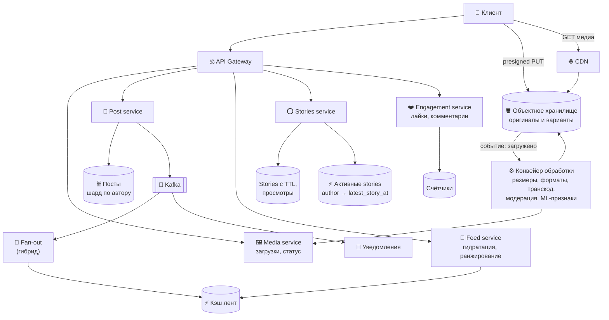
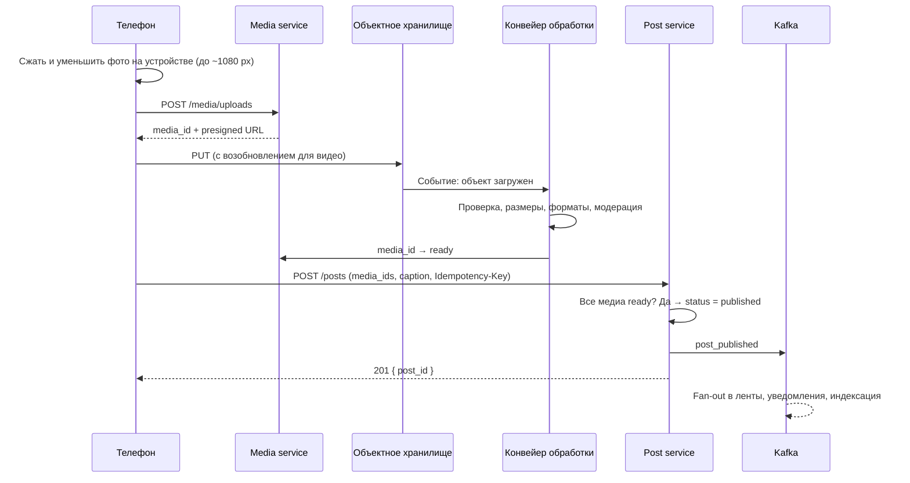
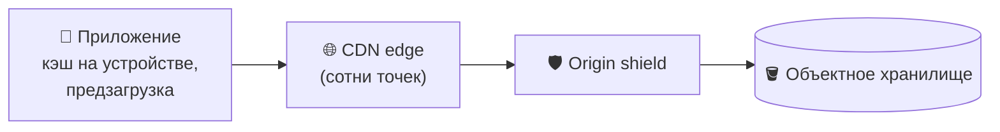

[English](README.md) | **Русский**

# Tier 1 · 08. Instagram

> **Уровень:** Medium · **Время на интервью:** 45 мин · **Время на разбор:** ~4–5 ч
> **Ключевые аспекты:** публикация медиа от телефона до ленты, конвейер обработки, доставка изображений и видео через CDN, лента (повторное использование гибридного fan-out), stories с TTL 24 часа, лайки и комментарии, профиль и социальный граф, шардирование по пользователю
> **Опирается на:** [14-storage-types](../../14-storage-types/INTERVIEW_RU.md) (хранение медиа), [03-cdn](../../03-cdn/README_RU.md), [Tier 1 · 07 News Feed](../07-news-feed/README_RU.md), [Tier 1 · 04 ID Generator](../04-unique-id-generator/README_RU.md#12-deep-dive-6-библиотека-или-сервис), [Tier 1 · 05 Notifications](../05-notification-system/README_RU.md)

---

## 🗺️ Как читать этот разбор

Разбор построен как интервью, но в каждом шаге есть объяснения: **почему** принимается решение, **как работает** механизм и **что будет**, если сделать иначе. Блоки «📘 Объяснение» — теория прямо по ходу задачи.

| Значок | Что значит |
|:------:|:-----------|
| 🎤 | Реплика интервьюера |
| 🗣️ | Что говорю вслух я (кандидат) |
| ✏️ | Что рисую на доске |
| ⏱️ | Сколько времени тратить на шаг |
| 📘 | Подробное объяснение концепции |

Блоки **TIP** — хороший приём, **WARNING** — ловушка, **IMPORTANT** — сигнал для уровня Senior+.

---

## 📑 Содержание

0. [Чему учит эта задача](#0-чему-учит-эта-задача)
1. [Условие задачи](#1-условие-задачи)
2. [Уточняющие вопросы и требования](#2-уточняющие-вопросы-и-требования)
3. [Оценки нагрузки](#3-оценки-нагрузки)
4. [API](#4-api)
5. [Модель данных](#5-модель-данных)
6. [High-level дизайн](#6-high-level-дизайн)
7. [Deep dive 1: публикация поста от телефона до ленты](#7-deep-dive-1-публикация-поста-от-телефона-до-ленты)
8. [Deep dive 2: доставка медиа](#8-deep-dive-2-доставка-медиа)
9. [Deep dive 3: лента](#9-deep-dive-3-лента)
10. [Deep dive 4: stories](#10-deep-dive-4-stories)
11. [Deep dive 5: лайки, комментарии и счётчики](#11-deep-dive-5-лайки-комментарии-и-счётчики)
12. [Deep dive 6: профиль и социальный граф](#12-deep-dive-6-профиль-и-социальный-граф)
13. [Deep dive 7: шардирование и ID](#13-deep-dive-7-шардирование-и-id)
14. [Узкие места и сценарии сбоев](#14-узкие-места-и-сценарии-сбоев)
15. [Что изменится при росте в 10 раз](#15-что-изменится-при-росте-в-10-раз)
16. [Ключевые концепции и новые понятия](#16-ключевые-концепции-и-новые-понятия)
17. [Варианты задачи и follow-up вопросы](#17-варианты-задачи-и-follow-up-вопросы)
18. [Типичные ошибки](#18-типичные-ошибки)
19. [Шпаргалка и самопроверка](#19-шпаргалка-и-самопроверка)

---

## 0. Чему учит эта задача

Instagram — задача на **сборку продукта из уже знакомых блоков**: хранилище медиа, CDN, лента, счётчики, уведомления. Новое в ней — эфемерный контент (**stories**) и то, что почти весь трафик — это **изображения и видео**, а не текст.

| Что проверяют | Где это в задаче |
|:--------------|:-----------------|
| Конвейер загрузки и обработки медиа | Публикация поста: телефон → хранилище → обработка → лента |
| Доставка тяжёлого контента | Петабайты в сутки через CDN, адаптивные размеры |
| Повторное использование решений | Лента — тот же гибридный fan-out, что в News Feed |
| Эфемерные данные | Stories: исчезают через 24 часа, отметки просмотра |
| Счётчики и горячие записи | Лайки на постах знаменитостей |
| Шардирование по пользователю | Данные пользователя вместе, ID со встроенным шардом |

> [!TIP]
> Не пытайся заново проектировать всё в деталях. Скажи: «хранение медиа устроено как в задаче про storage, лента — как в News Feed», нарисуй их коротко и потрать время на то, что специфично для Instagram: **путь публикации**, **доставку медиа** и **stories**.

---

## 1. Условие задачи

> 🎤 «Спроектируй Instagram: пользователи публикуют фото и видео, подписываются друг на друга, листают ленту, смотрят stories, которые исчезают через 24 часа, ставят лайки и комментируют».

**Что видит пользователь:**

```
1. Выбирает фото, накладывает фильтр, пишет подпись → «Поделиться»
2. Пост через секунды появляется в его профиле и в лентах подписчиков
3. Сверху ленты — кружки stories: непросмотренные с цветной обводкой, просмотренные — серые
4. Через 24 часа story исчезает
```

**План по времени:**

| Шаг | ⏱️ |
|:----|:--:|
| Требования | 4 мин |
| Оценки | 4 мин |
| API и данные | 5 мин |
| High-level дизайн | 6 мин |
| Deep dives | 22 мин |
| Сбои и итоги | 4 мин |

---

## 2. Уточняющие вопросы и требования

⏱️ 4 мин

| Мой вопрос | Ответ интервьюера | Что это меняет и почему |
|:-----------|:------------------|:------------------------|
| Масштаб? | 500M активных пользователей в день | Миллиарды просмотров медиа |
| Сколько публикаций? | ~100M постов и ~400M stories в сутки | Stories — основная масса загрузок |
| Фото и видео? | Оба; видео в постах и stories — короткие (до минуты) | Транскодирование; длинное видео — отдельная задача (YouTube) |
| Лента — ранжированная? | Да, из подписок и рекомендаций | Переиспользуем дизайн News Feed |
| Stories — сколько живут? | 24 часа; автор может сохранить в архив | TTL, но не обязательно физическое удаление |
| Важна ли скорость открытия медиа? | Очень: лента должна листаться без задержек | CDN, предзагрузка, адаптивные размеры |
| Приватные аккаунты? | Да | Проверка доступа при выдаче |
| Поиск, рекомендации, Reels, DM? | Вне рамок (упомянуть кратко) | Фокус на основных функциях |

### Функциональные требования

1. Публиковать посты (фото, видео, подпись) и stories.
2. Подписываться на пользователей (с одобрением для приватных аккаунтов).
3. Лента постов от подписок и рекомендаций.
4. Stories: лента кружков, просмотр по авторам, исчезновение через 24 часа, список просмотревших для автора.
5. Лайки и комментарии.
6. Профиль с сеткой постов.

### Нефункциональные требования

| Требование | Цель | Почему |
|:-----------|:-----|:-------|
| Открытие ленты | p99 < 200 мс для метаданных | Первый экран приложения |
| Загрузка изображения | Первое изображение — менее 1 с на мобильной сети | Иначе пользователь уходит |
| Надёжность | Опубликованные фото не теряются | Это воспоминания пользователя |
| Свежесть | Пост у подписчиков за секунды–минуту | Как в News Feed |
| Доступность | 99,99% для просмотра | Чтение важнее мгновенной публикации |
| Stories | Исчезают точно через 24 часа для зрителей | Ключевое продуктовое обещание |

---

## 3. Оценки нагрузки

⏱️ 4 мин

```
Публикации
  Посты:     100M в сутки × ~2,5 МБ (оригинал + размеры)    ≈ 250 ТБ/сутки
  Stories:   400M в сутки × ~1 МБ                           ≈ 400 ТБ/сутки (но живут 24 ч)
  Загрузки:  500M в сутки → ~6 000/с в среднем, пик ~20 000/с

Чтения
  Открытия ленты:  500M × 10 = 5B в сутки → ~58 000/с, пик ~175 000/с
  Просмотры медиа: ~50B в сутки × ~200 КБ (оптимизированный размер)
                   ≈ 10 ПБ/сутки ≈ ~1 Тбит/с в среднем, в пике в разы больше
```

### Выводы

| Вывод | Следствие для дизайна |
|:------|:----------------------|
| Отдача медиа — ~1 Тбит/с и больше | Без CDN невозможно; это главная статья расходов |
| Загрузки — сотни ТБ в сутки | Напрямую в объектное хранилище, не через API |
| Stories — больше загрузок, чем постов, но живут сутки | Отдельный жизненный цикл: TTL и удаление/архив |
| Метаданные малы по сравнению с медиа | Метаданные — в базах и кэшах, медиа — в объектном хранилище |
| Чтение ленты — как в News Feed | Переиспользуем гибридный fan-out |

---

## 4. API

⏱️ 3 мин

```http
# Загрузка медиа (общая для постов и stories)
POST /v1/media/uploads          { type: "image" | "video", size, content_type }
                                → { media_id, upload_url (presigned) }
PUT  {upload_url}               ← клиент загружает напрямую в объектное хранилище

# Посты
POST /v1/posts                  Idempotency-Key
                                { media_ids: [...], caption, location? }   → 202 { post_id, status: "processing" }
GET  /v1/posts/{id}
GET  /v1/users/{id}/posts?cursor=…              → сетка профиля

# Лента
GET  /v1/feed?cursor=…

# Stories
POST /v1/stories                { media_id, audience: "all" | "close_friends" }
GET  /v1/stories/tray                           → кружки: авторы с активными stories
GET  /v1/users/{id}/stories                     → stories автора по порядку
POST /v1/stories/seen           { author_id, last_seen_story_id }
GET  /v1/stories/{id}/viewers?cursor=…          → только для автора

# Взаимодействия
POST   /v1/posts/{id}/like
DELETE /v1/posts/{id}/like
POST   /v1/posts/{id}/comments  { text }
GET    /v1/posts/{id}/comments?cursor=…
```

---

## 5. Модель данных

⏱️ 3 мин

| Данные | Ключ / схема | Хранилище | Почему |
|:-------|:-------------|:----------|:-------|
| **Пользователи** | user_id → профиль, is_private | Шардированная БД + кэш | Читаются при каждой гидратации |
| **Подписки** | (follower) → followee и (followee) → follower | Wide-column / граф | Два направления, как в News Feed |
| **Посты** | post_id → author_id, caption, media_refs, created_at, status | Шардированная БД (по автору) + кэш постов | Метаданные |
| **Посты автора** | (author_id, bucket) → post_id DESC | Wide-column | Сетка профиля, fan-out на чтение |
| **Медиа** | media_id → оригинал, варианты (размеры, форматы), статус | БД метаданных; байты — в объектном хранилище | Паттерн blob + метаданные |
| **Stories** | (author_id) → story_id, media_ref, audience, expires_at | Wide-column с TTL | Автоматическое истечение |
| **Просмотры stories** | (viewer_id, author_id) → last_seen_story_id | Wide-column / KV | Водяной знак просмотра |
| **Зрители story** | (story_id) → viewer_id, время | Wide-column с TTL | Список для автора |
| **Лайки** | (post_id, user_id) | Wide-column | Уникальность лайка, список лайкнувших |
| **Счётчики** | post_id → likes, comments | Сервис счётчиков | Высокая частота |
| **Комментарии** | (post_id, bucket) → comment_id, author, text | Wide-column | Чтение по посту с пагинацией |

---

## 6. High-level дизайн

⏱️ 6 мин



🗣️ «Компоненты:
- **медиа** — клиент загружает напрямую в объектное хранилище, конвейер создаёт размеры и форматы, раздача — через CDN;
- **посты и лента** — как в News Feed: событие в Kafka, гибридный fan-out в кэши лент, гидратация и ранжирование при чтении;
- **stories** — отдельный сервис с TTL, индексом активных авторов и отметками просмотра;
- **лайки и комментарии** — отдельный сервис со счётчиками;
- **уведомления** — по событиям из Kafka».

---

## 7. Deep dive 1: публикация поста от телефона до ленты

> 🎤 «Пользователь нажал “Поделиться”. Что происходит до момента, когда пост виден подписчикам?»



### Решения по шагам

| Шаг | Решение | Почему |
|:----|:--------|:-------|
| **Обработка на клиенте** | Фото уменьшается до ~1080 px и сжимается перед загрузкой | Оригинал с камеры — 5–10 МБ; после — сотни КБ. Быстрее загрузка на мобильной сети, меньше хранения |
| **Загрузка напрямую** | Presigned URL в объектное хранилище | Сотни ТБ в сутки не проходят через API-серверы (см. [14-storage-types](../../14-storage-types/README_RU.md#8-паттерн-blob-отдельно-метаданные-отдельно)) |
| **Загрузка заранее** | Клиент начинает загружать медиа, пока пользователь пишет подпись и выбирает фильтр | При нажатии «Поделиться» медиа уже на сервере — публикация кажется мгновенной |
| **Возобновляемая загрузка** | Для видео — multipart с докачкой | Мобильная сеть рвётся |
| **Конвейер обработки** | Размеры (150, 320, 640, 1080 px), форматы (WebP/AVIF, JPEG как запасной), видео — несколько качеств, превью-кадр | Устройствам нужны разные размеры (см. deep dive 2) |
| **Модерация** | Автоматическая проверка запрещённого контента до публикации | Нельзя показывать подписчикам и потом удалять |
| **Публикация после готовности** | Пост `published` только когда все медиа `ready` | Лента не получит ссылку на несуществующее изображение |
| **Идемпотентность** | `Idempotency-Key` при создании поста | Повтор после обрыва не создаст дубликат |

📘 **Почему загружать заранее.** Instagram описывал этот приём: загрузка начинается сразу после выбора фото, ещё на экране фильтров и подписи. Если пользователь отменит публикацию, загруженный объект останется «сиротой» и будет удалён lifecycle-правилом временной зоны загрузок.

> [!TIP]
> Состояния поста — `draft → uploading → processing → published` (или `failed`). Клиент сразу показывает пост в профиле автора с пометкой «Публикуется…» — это оптимистичный интерфейс и read-your-writes для автора.

---

## 8. Deep dive 2: доставка медиа

> 🎤 «Петабайты изображений в сутки. Как сделать так, чтобы лента листалась без задержек?»

### Слои доставки



| Приём | Как | Эффект |
|:------|:----|:-------|
| **CDN** | Медиа раздаётся из ближайшей точки присутствия; origin shield собирает промахи | Задержка десятки мс вместо сотен; хранилище получает долю процента запросов |
| **Неизменяемые URL** | `…/media/{media_id}/v1/640.webp`; изменение → новый URL | `Cache-Control: immutable`, долгий кэш без инвалидации |
| **Правильный размер под экран** | Клиент запрашивает вариант под ширину экрана и плотность пикселей | Не качать 1080 px для миниатюры 150 px — в разы меньше трафика |
| **Современные форматы** | WebP/AVIF для поддерживающих устройств | Меньше байт при том же качестве |
| **Адаптация к сети** | На медленной сети — меньший размер или более сильное сжатие | Лента листается и на 3G |
| **Плейсхолдер** | Маленькое размытое превью (несколько десятков байт, например BlurHash) приходит вместе с метаданными | Вместо пустого прямоугольника — размытая версия, пока грузится изображение |
| **Предзагрузка** | Клиент заранее загружает медиа следующих 3–5 постов ленты | При прокрутке изображение уже на устройстве |
| **Видео** | Короткие видео — несколько качеств; для длинных — адаптивный стриминг HLS/DASH | См. YouTube (#9) |

📘 **Почему размер под экран так важен.** Изображение 1080 px — около 200–300 КБ, 320 px — около 20–30 КБ. Миниатюры в сетке профиля, открытой на 30 постов, в правильном размере — ~1 МБ вместо ~8 МБ. На масштабе 50B просмотров в сутки выбор размера — это разница в петабайтах трафика.

### Приватность медиа

| Вариант | Как | Компромисс |
|:--------|:----|:-----------|
| Публичные URL с неугадываемыми ключами | Ключ содержит случайную часть; кто знает URL — может открыть | Просто и отлично кэшируется; ссылку можно переслать |
| Подписанные URL с истечением | Подпись и срок в URL, проверка на CDN | Строже для приватных аккаунтов; подпись не должна входить в ключ кэша CDN |

---

## 9. Deep dive 3: лента

> 🎤 «Как устроена лента?»

🗣️ «Так же, как в [News Feed](../07-news-feed/README_RU.md): гибридный fan-out (push для обычных авторов в кэши лент, pull для знаменитостей), гидратация, ранжирование, курсорная пагинация. Особенности Instagram:

| Особенность | Как учесть |
|:------------|:-----------|
| Контент — медиа | При гидратации добавить URL нужного размера, плейсхолдер, соотношение сторон (чтобы интерфейс не прыгал) |
| Много рекомендаций вне подписок | Источник кандидатов из рекомендательной системы (векторы, граф интересов) смешивается с подписками |
| Карусели (несколько фото в посте) | Один пост, несколько `media_refs`; предзагружать первое изображение, остальные — при свайпе |
| Предзагрузка следующей страницы | Клиент запрашивает следующую страницу заранее, медиа — для ближайших постов |
| Приватные аккаунты | Fan-out только одобренным подписчикам; проверка доступа при гидратации |

Из deep dives News Feed переиспользуем: расчёт порога знаменитостей, кэш ленты с ID, снимок сессии для пагинации, фильтр удалённых при гидратации».

---

## 10. Deep dive 4: stories

> 🎤 «Расскажи подробно про stories: кружки сверху, исчезновение через 24 часа, “кто посмотрел”».

### Требования stories

| Функция | Что нужно |
|:--------|:----------|
| **Лента кружков (tray)** | Авторы, на которых подписан пользователь и у которых есть активные stories; непросмотренные — первыми, отсортированы по близости |
| **Просмотр автора** | Все его активные stories по порядку, начиная с первой непросмотренной |
| **Исчезновение** | Ровно через 24 часа story недоступна зрителям |
| **Просмотрено / не просмотрено** | Цветная или серая обводка кружка |
| **Кто посмотрел** | Автор видит список и число зрителей |
| **Близкие друзья** | Story только для выбранного списка |

### Хранение с TTL

```sql
stories (
  author_id   BIGINT,
  story_id    BIGINT,          -- Snowflake: упорядочен по времени
  media_ref   TEXT,
  audience    TEXT,            -- all | close_friends
  created_at  TIMESTAMP,
  PRIMARY KEY ((author_id), story_id)
) WITH default_time_to_live = 86400;      -- запись исчезнет сама через 24 часа
```

📘 **TTL в хранилище.** Cassandra, ScyllaDB, DynamoDB поддерживают TTL записи: по истечении она перестаёт возвращаться в чтениях и физически удаляется при compaction. Не нужна фоновая задача «удалить истёкшие» на каждую story. Но для **точности** сервис дополнительно проверяет `created_at + 24 ч > now` при выдаче: физическое удаление может запаздывать.

### Лента кружков: pull или push

| | Pull при открытии | Push при публикации |
|:-|:------------------|:--------------------|
| Как | Для подписок пользователя проверить, у кого есть активные stories | При публикации story добавить автора в «кэш кружков» каждого подписчика |
| Стоимость | Подписок может быть тысяча; проверка каждой — дорого без индекса | 400M stories × сотни подписчиков — огромный fan-out |

🗣️ «Гибрид, но проще, чем в ленте: поддерживаем **индекс активных авторов** — `latest_story_at` по `author_id` в Redis. При открытии tray:
1. берём подписки пользователя (кэшированный список);
2. одним multi_get получаем `latest_story_at` для всех подписок;
3. оставляем тех, у кого `latest_story_at > now − 24 ч`;
4. для каждого автора определяем «просмотрено или нет» по водяному знаку (ниже);
5. ранжируем: непросмотренные первыми, затем по близости (частота взаимодействий).

Для пользователей с тысячами подписок результат tray кэшируется на минуту».

### Отметка просмотра: водяной знак

📘 Хранить «просмотрел story X» для **каждой** пары зрителя и story — сотни миллиардов записей в сутки. Вместо этого — **водяной знак** на пару (зритель, автор), как статусы прочтения в [чате](../06-chat-system/README_RU.md#11-deep-dive-5-статусы-доставки-и-прочтения):

```
story_seen (viewer = Анна, author = Борис) → last_seen_story_id = 7031

Stories Бориса: 7020, 7031, 7045
  7020, 7031 ≤ 7031 → просмотрены
  7045 > 7031       → не просмотрена → кружок Бориса цветной, просмотр начнётся с 7045
```

Story ID — Snowflake, упорядочены по времени, поэтому «всё до X просмотрено» корректно. Клиент отправляет `seen` пачками, а не на каждую story.

### Кто посмотрел

| Решение | Почему |
|:--------|:-------|
| Таблица `(story_id) → viewer_id, время` с тем же TTL (или дольше, если story в архиве) | Запись при просмотре, чтение — только автором |
| Запись асинхронно через Kafka | Просмотр не должен ждать записи |
| Счётчик просмотров отдельно | Для знаменитостей список на миллионы — отдаётся постранично, а число — приблизительное |

### Жизненный цикл медиа stories

| Ситуация | Что происходит |
|:---------|:---------------|
| Story опубликована | Медиа в объектном хранилище, URL в CDN с `max-age`, не превышающим оставшееся время жизни |
| Прошло 24 часа | Запись истекает; CDN-кэш тоже истёк; медиа удаляется lifecycle-правилом (или переносится в архив автора) |
| Автор удалил раньше срока | Удаление записи + purge CDN |
| Архив включён | Story остаётся видимой **только автору**; медиа переводится в более дешёвый класс хранения |

> [!WARNING]
> Типичная ошибка — кэшировать медиа stories на CDN на неделю. Тогда story «исчезает» из приложения, но остаётся доступной по прямой ссылке. TTL кэша не должен превышать оставшееся время жизни story.

---

## 11. Deep dive 5: лайки, комментарии и счётчики

> 🎤 «Пост знаменитости — 1 миллион лайков за час. Как считать?»

| Задача | Решение |
|:-------|:--------|
| **Лайк один раз** | Запись `(post_id, user_id)` с уникальностью; повторный лайк — no-op; удаление — снятие лайка |
| **Счётчик лайков** | Не `UPDATE likes = likes + 1` на каждый лайк: события в Kafka → агрегатор раз в секунду, или шардированные счётчики (см. [News Feed](../07-news-feed/README_RU.md#13-deep-dive-7-горячие-посты-и-счётчики)) |
| **Отображение** | «1,2 млн» — точность до единиц не нужна; для автора — точнее с задержкой |
| **«Нравится Анне и ещё 2 345»** | Пересечение лайкнувших с подписками зрителя: для популярных постов — проверить только небольшой набор близких друзей зрителя по таблице лайков |
| **«Лайкнул ли я»** | Проверка `(post_id, my_user_id)` при гидратации — батчем для всей страницы ленты |
| **Комментарии** | Партиция `(post_id, bucket)`, сортировка по времени; для популярных постов — ранжирование «лучших» комментариев сверху |
| **Спам в комментариях** | Классификатор и rate limiting на автора комментариев |
| **Уведомление автору** | Агрегированное: «Анна и ещё 120 человек оценили ваше фото» (см. [Notifications](../05-notification-system/README_RU.md#10-deep-dive-4-массовые-рассылки-и-группировка)) |

---

## 12. Deep dive 6: профиль и социальный граф

> 🎤 «Как отображается профиль с сеткой постов и числом подписчиков?»

| Элемент | Решение |
|:--------|:--------|
| **Сетка постов** | Партиция `(author_id, bucket)` с `post_id DESC`; страница — 12–30 постов; миниатюры 320 px из CDN |
| **Число подписчиков** | Отдельный счётчик (обновляется асинхронно при подписках); не `COUNT(*)` по таблице подписчиков |
| **Список подписчиков** | Постраничный; у знаменитостей — сотни миллионов, отдавать только первые страницы, без полной выгрузки |
| **Приватный аккаунт** | Подписка через запрос; посты и stories видны только одобренным; проверка при каждом чтении |
| **Блокировки** | Фильтр в ленте, профиле, комментариях, stories |
| **Подписка** | Запись в обе таблицы графа (follower → followee и followee → follower); backfill последних постов в ленту; счётчики асинхронно |

📘 **Почему граф подписок дорого «посчитать на лету».** У знаменитости 300M подписчиков: `SELECT COUNT(*)` по такой партиции — чтение сотен миллионов строк. Поэтому все счётчики поддерживаются отдельно и обновляются событиями подписки и отписки.

---

## 13. Deep dive 7: шардирование и ID

> 🎤 «Как шардировать данные?»

🗣️ «По **пользователю** (`author_id`): профиль, посты, stories и сетка пользователя лежат в одном шарде — запросы «посты автора» и «stories автора» не выходят за его пределы.

Instagram описывал такую схему на PostgreSQL: тысячи **логических шардов** (схем), распределённых по меньшему числу физических серверов, и ID, в который встроен номер логического шарда (41 бит времени, 13 бит шарда, 10 бит последовательности — см. [Tier 1 · 04](../04-unique-id-generator/README_RU.md#12-deep-dive-6-библиотека-или-сервис)). По ID поста сразу понятно, в каком шарде он лежит, без отдельного справочника».

| Данные | Ключ шардирования | Почему |
|:-------|:------------------|:-------|
| Профиль, посты, stories автора | author_id | Чтения профиля и fan-out — по автору |
| Лайки, комментарии | post_id | Чтение и запись по посту |
| Подписчики | followee_id | Fan-out по автору |
| Подписки | follower_id | Сборка ленты и tray по зрителю |
| Кэш лент, водяные знаки stories | viewer_id | Чтение по зрителю |

> [!NOTE]
> Логические шарды упрощают рост: при добавлении физических серверов логические шарды переносятся целиком, без перехэширования данных (подробнее — [06-partitioning](../../06-partitioning/README_RU.md)).

---

## 14. Узкие места и сценарии сбоев

| Сценарий | Что произойдёт | Как защищаемся |
|:---------|:---------------|:---------------|
| Обрыв при загрузке видео | Неполная загрузка | Multipart с докачкой |
| Отмена публикации после загрузки | Объекты-сироты | Lifecycle-правило временной зоны загрузок |
| Конвейер обработки отстаёт | Посты долго в «Публикуется» | Автоскейлинг воркеров, приоритет постов над stories архива, мониторинг очереди |
| Вирусный пост | Нагрузка на CDN и origin | CDN + origin shield, неизменяемые URL |
| Лайки знаменитости | Конкуренция на счётчике | Асинхронная агрегация, шардированные счётчики |
| Story видна после 24 часов | Нарушение продуктового обещания | Проверка времени при выдаче, TTL CDN ≤ оставшегося времени |
| Огромный tray (тысячи подписок) | Медленное открытие | Индекс активных авторов, multi_get, кэш tray |
| Хранилище метаданных недоступно | Ленты не собираются | Кэши лент и постов, деградация |
| Регион CDN недоступен | Медленная загрузка медиа | Несколько CDN или точки присутствия в соседних регионах |
| Запрещённый контент прошёл модерацию | Репутационный риск | Жалобы пользователей, повторная проверка, быстрое удаление и purge CDN |

---

## 15. Что изменится при росте в 10 раз

> 🎤 «5 миллиардов пользователей?»

| Изменение | Почему |
|:----------|:-------|
| **Собственные кэширующие узлы у интернет-провайдеров** | Трафик медиа — главная статья расходов |
| **Больше обработки на устройстве** | Сжатие, форматы, превью — экономия на конвейере и загрузке |
| **Многоуровневое хранение медиа** | Старые посты — в тёплые и холодные классы (см. [14-storage-types](../../14-storage-types/INTERVIEW_RU.md#10-deep-dive-4-классы-хранения-и-стоимость)) |
| **Рекомендации занимают большую долю ленты** | Генерация кандидатов на векторах и графе интересов |
| **Региональная обработка** | Конвейер и хранилище ближе к пользователям |

---

## 16. Ключевые концепции и новые понятия

### Что переиспользуется

| Решение | Где разобрано | Как применяется здесь |
|:--------|:--------------|:----------------------|
| Blob + метаданные, presigned URL, конвейер, классы хранения | [14-storage-types](../../14-storage-types/INTERVIEW_RU.md) | Загрузка и хранение медиа |
| CDN, origin shield, неизменяемые URL | [03-cdn](../../03-cdn/README_RU.md) | Доставка медиа |
| Гибридный fan-out, кэш ленты, гидратация | [Tier 1 · 07](../07-news-feed/README_RU.md) | Лента постов |
| Водяные знаки | [Tier 1 · 06](../06-chat-system/README_RU.md#11-deep-dive-5-статусы-доставки-и-прочтения) | Просмотр stories |
| ID со встроенным шардом | [Tier 1 · 04](../04-unique-id-generator/README_RU.md#12-deep-dive-6-библиотека-или-сервис) | Шардирование по пользователю |
| Агрегированные уведомления | [Tier 1 · 05](../05-notification-system/README_RU.md) | Лайки, комментарии |

### Новые понятия этой задачи

| Понятие | Кратко |
|:--------|:-------|
| **Обработка на клиенте** | Сжатие и уменьшение медиа до загрузки |
| **Загрузка заранее** | Медиа загружается, пока пользователь редактирует пост |
| **Адаптивные размеры** | Вариант изображения под экран и сеть |
| **Плейсхолдер (BlurHash)** | Крошечное размытое превью в метаданных |
| **Stories с TTL** | Записи истекают автоматически через 24 часа |
| **Индекс активных авторов** | `latest_story_at` по автору для сборки tray |
| **Логические шарды** | Много логических разделов на меньшем числе серверов |

---

## 17. Варианты задачи и follow-up вопросы

<details>
<summary><b>Почему не обрабатывать оригиналы только на сервере?</b></summary>

Оригинал с камеры весит 5–10 МБ; загрузка по мобильной сети займёт десятки секунд, а хранить и обрабатывать нужно в разы больше. Сжатие на устройстве до ~1080 px даёт сотни КБ без заметной потери качества в приложении. Серверная обработка всё равно создаёт нужные размеры и форматы.
</details>

<details>
<summary><b>Как удаление поста распространяется до CDN?</b></summary>

Пост помечается удалённым → при гидратации ленты он отфильтровывается сразу у всех. Медиа на CDN имеют неугадываемые URL, но ссылка могла сохраниться — поэтому делается purge CDN по URL вариантов и удаление объектов из хранилища (с задержкой на случай восстановления).
</details>

<details>
<summary><b>Как считать просмотры видео?</b></summary>

События просмотра (с порогом, например 3 секунды) → Kafka → потоковая агрегация с дедупликацией по (пользователь, видео, окно) → счётчик. Точность до единиц не нужна, задержка в минуты допустима. Подробнее — в задачах YouTube (#9) и Ad Click Aggregator (#17).
</details>

<details>
<summary><b>Чем stories отличаются от постов архитектурно?</b></summary>

Stories эфемерны (TTL), их больше по количеству, они показываются в tray по авторам, а не в ранжированной ленте, и для них нужен статус «просмотрено» и список зрителей. Поэтому отдельный сервис, хранение с TTL, индекс активных авторов и водяные знаки вместо гибридного fan-out ленты.
</details>

<details>
<summary><b>Как добавить Reels (короткие видео)?</b></summary>

Это отдельная лента почти полностью из рекомендаций (не из подписок): генерация кандидатов на векторах и интересах, сильное ранжирование, адаптивный стриминг видео и агрессивная предзагрузка следующих роликов. Конвейер загрузки и CDN — общие с постами.
</details>

---

## 18. Типичные ошибки

| ❌ Ошибка | Почему плохо | ✅ Как правильно |
|:---------|:-------------|:----------------|
| Загрузка медиа через API-серверы | Сотни ТБ в сутки через API | Presigned URL напрямую в хранилище |
| Загрузка оригиналов с камеры | Медленно и дорого | Сжатие на устройстве |
| Публикация до готовности медиа | Битые изображения в лентах | `published` только после `ready` |
| Один размер изображения для всех | Лишние петабайты трафика | Варианты под экран и сеть |
| Без CDN | Невозможная нагрузка на хранилище | CDN + origin shield |
| Stories через fan-out ленты | Огромный fan-out на 400M stories | Индекс активных авторов и pull при открытии tray |
| Отметка просмотра на каждую story | Сотни миллиардов записей | Водяной знак на пару (зритель, автор) |
| Долгий кэш stories на CDN | Story доступна после 24 часов | TTL кэша ≤ оставшегося времени |
| `COUNT(*)` для подписчиков и лайков | Чтение миллионов строк | Отдельные счётчики |
| Проектировать ленту с нуля | Потеря времени | Переиспользовать дизайн News Feed |

---

## 19. Шпаргалка и самопроверка

### Ответ за 30 секунд

> Медиа: клиент сжимает фото до ~1080 px и начинает загрузку заранее, напрямую в объектное хранилище по presigned URL; конвейер создаёт размеры (150–1080 px), WebP/AVIF, качества видео, проверяет модерацию; пост становится `published`, только когда все медиа готовы. Доставка — CDN с origin shield, неизменяемые URL, размер под экран и сеть, BlurHash-плейсхолдеры, предзагрузка следующих постов. Лента — как в News Feed: гибридный fan-out, кэш лент, гидратация с медиа-метаданными, ранжирование с рекомендациями. Stories — отдельный сервис: хранение с TTL 24 ч и проверкой при выдаче, индекс активных авторов `latest_story_at` для tray, водяной знак просмотра на пару (зритель, автор), список зрителей асинхронно, TTL CDN не дольше жизни story. Лайки — уникальная пара и асинхронные счётчики. Шардирование по пользователю, логические шарды и ID со встроенным шардом.

### Самопроверка

- [ ] Могу описать путь публикации поста от телефона до ленты
- [ ] Могу объяснить, зачем обработка на клиенте и загрузка заранее
- [ ] Могу посчитать трафик доставки медиа и объяснить роль CDN
- [ ] Могу перечислить 6 приёмов быстрой доставки изображений
- [ ] Могу объяснить, что переиспользуется из News Feed
- [ ] Могу спроектировать stories: TTL, tray, водяные знаки, зрители
- [ ] Могу объяснить ловушку с кэшированием stories на CDN
- [ ] Могу спроектировать лайки и «Нравится Анне и ещё N»
- [ ] Могу выбрать ключи шардирования для разных данных
- [ ] Могу объяснить логические шарды и ID со встроенным шардом

### Что почитать

- Instagram Engineering, *Sharding & IDs at Instagram* (2012)
- Instagram Engineering, статьи о производительности загрузки и ленты
- Alex Xu, *System Design Interview*, Vol. 1 — главы «Design a News Feed System» и «Design YouTube»
- Спецификация BlurHash (blurha.sh)
- Задачи: [Tier 1 · 07 News Feed](../07-news-feed/README_RU.md), [14-storage-types: разбор интервью](../../14-storage-types/INTERVIEW_RU.md)