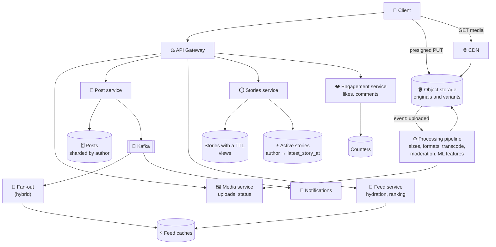
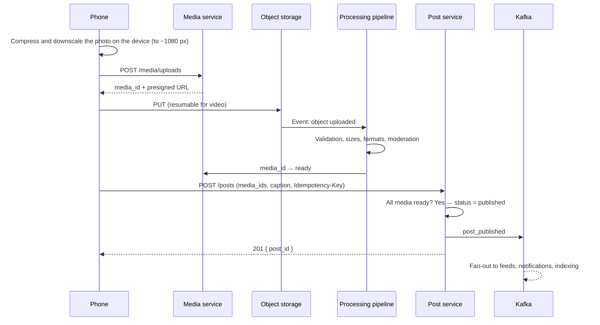
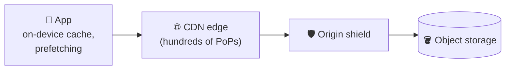

**English** | [Русский](README.ru.md)

# Tier 1 · 08. Instagram

> **Level:** Medium · **Interview time:** 45 min · **Study time:** ~4–5 h
> **Key aspects:** publishing media from phone to feed, the processing pipeline, delivering images and video via CDN, the feed (reusing hybrid fan-out), stories with a 24-hour TTL, likes and comments, the profile and social graph, sharding by user
> **Builds on:** [14-storage-types](../../01_Fundamentals/14_Storage%20types/INTERVIEW.md) (media storage), [03-cdn](../../01_Fundamentals/03_CDN/README.md), [Tier 1 · 07 News Feed](../07_Design%20a%20News%20Feed%20%28Facebook%20or%20X%29/README.md), [Tier 1 · 04 ID Generator](../04_Design%20a%20Unique%20ID%20Generator/README.md#12-deep-dive-6-library-or-service), [Tier 1 · 05 Notifications](../05_Design%20a%20Notification%20System%20%28push%2C%20email%2C%20SMS%29/README.md)

---

## 🗺️ How to Read This Walkthrough

The walkthrough follows an interview, but every step includes explanations: **why** a decision is made, **how** a mechanism works and **what happens** if you do it differently. The "📘 Explanation" blocks are theory right where you need it.

| Icon | Meaning |
|:----:|:--------|
| 🎤 | Interviewer |
| 🗣️ | What I (the candidate) say out loud |
| ✏️ | What I draw on the whiteboard |
| ⏱️ | Time budget for the step |
| 📘 | A detailed explanation of a concept |

Callouts: **TIP** — a good technique, **WARNING** — a trap, **IMPORTANT** — a Senior+ signal.

---

## 📑 Contents

0. [What This Problem Teaches](#0-what-this-problem-teaches)
1. [Problem Statement](#1-problem-statement)
2. [Clarifying Questions and Requirements](#2-clarifying-questions-and-requirements)
3. [Capacity Estimates](#3-capacity-estimates)
4. [API](#4-api)
5. [Data Model](#5-data-model)
6. [High-Level Design](#6-high-level-design)
7. [Deep Dive 1: Publishing a Post From Phone to Feed](#7-deep-dive-1-publishing-a-post-from-phone-to-feed)
8. [Deep Dive 2: Delivering Media](#8-deep-dive-2-delivering-media)
9. [Deep Dive 3: The Feed](#9-deep-dive-3-the-feed)
10. [Deep Dive 4: Stories](#10-deep-dive-4-stories)
11. [Deep Dive 5: Likes, Comments and Counters](#11-deep-dive-5-likes-comments-and-counters)
12. [Deep Dive 6: The Profile and the Social Graph](#12-deep-dive-6-the-profile-and-the-social-graph)
13. [Deep Dive 7: Sharding and IDs](#13-deep-dive-7-sharding-and-ids)
14. [Bottlenecks and Failure Scenarios](#14-bottlenecks-and-failure-scenarios)
15. [What Changes at 10x Scale](#15-what-changes-at-10x-scale)
16. [Key Concepts and New Terms](#16-key-concepts-and-new-terms)
17. [Variations and Follow-Up Questions](#17-variations-and-follow-up-questions)
18. [Common Mistakes](#18-common-mistakes)
19. [Cheat Sheet and Self-Check](#19-cheat-sheet-and-self-check)

---

## 0. What This Problem Teaches

Instagram is a problem about **assembling a product from familiar building blocks**: media storage, a CDN, a feed, counters, notifications. What's new is ephemeral content (**stories**) and the fact that nearly all traffic is **images and video**, not text.

| What's tested | Where it shows up |
|:--------------|:------------------|
| A media upload and processing pipeline | Publishing a post: phone → storage → processing → feed |
| Delivering heavy content | Petabytes per day through a CDN, adaptive sizes |
| Reusing solutions | The feed is the same hybrid fan-out as in News Feed |
| Ephemeral data | Stories: they disappear after 24 hours, with view markers |
| Counters and hot writes | Likes on celebrity posts |
| Sharding by user | A user's data stays together; IDs embed the shard |

> [!TIP]
> Don't try to redesign everything in detail. Say "media storage works as in the storage problem, the feed as in News Feed", sketch them briefly, and spend the time on what's specific to Instagram: **the publishing path**, **media delivery** and **stories**.

---

## 1. Problem Statement

> 🎤 "Design Instagram: users publish photos and videos, follow each other, scroll a feed, watch stories that disappear after 24 hours, like and comment."

**What the user sees:**

```
1. Picks a photo, applies a filter, writes a caption → "Share"
2. Within seconds the post shows up on their profile and in followers' feeds
3. At the top of the feed — story circles: unseen ones with a colored ring, seen ones gray
4. After 24 hours the story disappears
```

**Time plan:**

| Step | ⏱️ |
|:-----|:--:|
| Requirements | 4 min |
| Estimates | 4 min |
| API and data | 5 min |
| High-level design | 6 min |
| Deep dives | 22 min |
| Failures and wrap-up | 4 min |

---

## 2. Clarifying Questions and Requirements

⏱️ 4 min

| My question | Interviewer's answer | What it changes and why |
|:------------|:---------------------|:------------------------|
| Scale? | 500M daily active users | Billions of media views |
| How many uploads? | ~100M posts and ~400M stories per day | Stories are the bulk of uploads |
| Photos and video? | Both; videos in posts and stories are short (up to a minute) | Transcoding; long video is a separate problem (YouTube) |
| Is the feed ranked? | Yes, from follows and recommendations | Reuse the News Feed design |
| How long do stories live? | 24 hours; the author can save them to an archive | A TTL, but not necessarily physical deletion |
| Does media load speed matter? | A lot: the feed must scroll without stalls | A CDN, prefetching, adaptive sizes |
| Private accounts? | Yes | Access checks when serving |
| Search, recommendations, Reels, DMs? | Out of scope (mention briefly) | Focus on the core features |

### Functional requirements

1. Publish posts (photo, video, caption) and stories.
2. Follow users (with approval for private accounts).
3. A feed of posts from follows and recommendations.
4. Stories: a tray of circles, viewing by author, disappearing after 24 hours, a viewer list for the author.
5. Likes and comments.
6. A profile with a grid of posts.

### Non-functional requirements

| Requirement | Target | Why |
|:------------|:-------|:----|
| Opening the feed | p99 < 200 ms for metadata | The app's first screen |
| Image loading | The first image in under 1 s on a mobile network | Otherwise the user leaves |
| Reliability | Published photos are never lost | They're users' memories |
| Freshness | A post reaches followers within seconds to a minute | As in News Feed |
| Availability | 99.99% for viewing | Reading matters more than instant publishing |
| Stories | Disappear for viewers exactly after 24 hours | A key product promise |

---

## 3. Capacity Estimates

⏱️ 4 min

```
Uploads
  Posts:     100M per day × ~2.5 MB (original + sizes)       ≈ 250 TB/day
  Stories:   400M per day × ~1 MB                            ≈ 400 TB/day (but they live 24 h)
  Uploads:   500M per day → ~6,000/s on average, peak ~20,000/s

Reads
  Feed opens:   500M × 10 = 5B per day → ~58,000/s, peak ~175,000/s
  Media views:  ~50B per day × ~200 KB (an optimized size)
                ≈ 10 PB/day ≈ ~1 Tbit/s on average, several times more at peak
```

### Conclusions

| Conclusion | Design consequence |
|:-----------|:-------------------|
| Media delivery is ~1 Tbit/s or more | Impossible without a CDN; it's the biggest cost item |
| Uploads are hundreds of TB per day | Straight into object storage, not through the API |
| Stories outnumber posts in uploads but live a day | A separate lifecycle: a TTL and deletion/archiving |
| Metadata is small compared to media | Metadata in databases and caches, media in object storage |
| Feed reads look like News Feed | Reuse hybrid fan-out |

---

## 4. API

⏱️ 3 min

```http
# Uploading media (shared by posts and stories)
POST /v1/media/uploads          { type: "image" | "video", size, content_type }
                                → { media_id, upload_url (presigned) }
PUT  {upload_url}               ← the client uploads directly to object storage

# Posts
POST /v1/posts                  Idempotency-Key
                                { media_ids: [...], caption, location? }   → 202 { post_id, status: "processing" }
GET  /v1/posts/{id}
GET  /v1/users/{id}/posts?cursor=…              → the profile grid

# Feed
GET  /v1/feed?cursor=…

# Stories
POST /v1/stories                { media_id, audience: "all" | "close_friends" }
GET  /v1/stories/tray                           → circles: authors with active stories
GET  /v1/users/{id}/stories                     → an author's stories in order
POST /v1/stories/seen           { author_id, last_seen_story_id }
GET  /v1/stories/{id}/viewers?cursor=…          → author only

# Interactions
POST   /v1/posts/{id}/like
DELETE /v1/posts/{id}/like
POST   /v1/posts/{id}/comments  { text }
GET    /v1/posts/{id}/comments?cursor=…
```

---

## 5. Data Model

⏱️ 3 min

| Data | Key / schema | Store | Why |
|:-----|:-------------|:------|:----|
| **Users** | user_id → profile, is_private | A sharded DB + cache | Read on every hydration |
| **Follows** | (follower) → followee and (followee) → follower | Wide-column / a graph | Two directions, as in News Feed |
| **Posts** | post_id → author_id, caption, media_refs, created_at, status | A sharded DB (by author) + a post cache | Metadata |
| **An author's posts** | (author_id, bucket) → post_id DESC | Wide-column | The profile grid, fan-out on read |
| **Media** | media_id → original, variants (sizes, formats), status | A metadata DB; bytes in object storage | The blob + metadata pattern |
| **Stories** | (author_id) → story_id, media_ref, audience, expires_at | Wide-column with a TTL | Automatic expiry |
| **Story views** | (viewer_id, author_id) → last_seen_story_id | Wide-column / KV | A view watermark |
| **Story viewers** | (story_id) → viewer_id, time | Wide-column with a TTL | The list for the author |
| **Likes** | (post_id, user_id) | Wide-column | Like uniqueness, the liker list |
| **Counters** | post_id → likes, comments | A counter service | High frequency |
| **Comments** | (post_id, bucket) → comment_id, author, text | Wide-column | Reads per post with pagination |

---

## 6. High-Level Design

⏱️ 6 min



🗣️ "Components:
- **media** — the client uploads directly to object storage, the pipeline creates sizes and formats, delivery goes through a CDN;
- **posts and the feed** — as in News Feed: an event to Kafka, hybrid fan-out into feed caches, hydration and ranking on read;
- **stories** — a separate service with a TTL, an index of active authors and view markers;
- **likes and comments** — a separate service with counters;
- **notifications** — driven by Kafka events."

---

## 7. Deep Dive 1: Publishing a Post From Phone to Feed

> 🎤 "The user tapped 'Share'. What happens before the post is visible to followers?"



### Decisions step by step

| Step | Decision | Why |
|:-----|:---------|:----|
| **Processing on the client** | The photo is downscaled to ~1080 px and compressed before upload | A camera original is 5–10 MB; afterwards it's hundreds of KB. Faster uploads on mobile networks, less storage |
| **Uploading directly** | A presigned URL into object storage | Hundreds of TB per day don't pass through API servers (see [14-storage-types](../../01_Fundamentals/14_Storage%20types/README.md#8-the-pattern-blobs-separate-from-metadata)) |
| **Uploading early** | The client starts uploading media while the user writes the caption and picks a filter | By the time "Share" is tapped the media is already on the server — publishing feels instant |
| **Resumable uploads** | Multipart with resumption for video | Mobile networks drop |
| **The processing pipeline** | Sizes (150, 320, 640, 1080 px), formats (WebP/AVIF, JPEG as a fallback), several video qualities, a preview frame | Devices need different sizes (see deep dive 2) |
| **Moderation** | Automatic checks for prohibited content before publishing | You can't show it to followers and remove it later |
| **Publishing after readiness** | A post becomes `published` only when every media item is `ready` | The feed never gets a link to a non-existent image |
| **Idempotency** | An `Idempotency-Key` when creating the post | A retry after a drop won't create a duplicate |

📘 **Why upload early.** Instagram described this technique: the upload starts right after the photo is chosen, while the user is still on the filter and caption screens. If the user cancels, the uploaded object becomes an "orphan" and is removed by the temporary upload zone's lifecycle rule.

> [!TIP]
> Post states — `draft → uploading → processing → published` (or `failed`). The client immediately shows the post on the author's profile marked "Posting…" — an optimistic UI and read-your-writes for the author.

---

## 8. Deep Dive 2: Delivering Media

> 🎤 "Petabytes of images a day. How do you make the feed scroll without stalls?"

### Delivery layers



| Technique | How | Effect |
|:----------|:----|:-------|
| **CDN** | Media is served from the nearest point of presence; an origin shield aggregates misses | Tens of ms of latency instead of hundreds; storage gets a fraction of a percent of requests |
| **Immutable URLs** | `…/media/{media_id}/v1/640.webp`; a change → a new URL | `Cache-Control: immutable`, long caching with no invalidation |
| **The right size for the screen** | The client requests the variant matching the screen width and pixel density | Don't download 1080 px for a 150 px thumbnail — several times less traffic |
| **Modern formats** | WebP/AVIF for supporting devices | Fewer bytes at the same quality |
| **Adapting to the network** | On a slow network — a smaller size or stronger compression | The feed scrolls even on 3G |
| **A placeholder** | A tiny blurred preview (a few dozen bytes, e.g. BlurHash) arrives with the metadata | A blurred version instead of an empty rectangle while the image loads |
| **Prefetching** | The client downloads media for the next 3–5 feed posts in advance | The image is already on the device when the user scrolls |
| **Video** | Short videos in several qualities; for long ones — adaptive streaming with HLS/DASH | See YouTube (#9) |

📘 **Why sizing for the screen matters so much.** A 1080 px image is about 200–300 KB, a 320 px one about 20–30 KB. Thumbnails for a profile grid showing 30 posts at the right size — ~1 MB instead of ~8 MB. At 50B views per day, choosing the size is the difference of petabytes of traffic.

### Media privacy

| Option | How | Trade-off |
|:-------|:----|:----------|
| Public URLs with unguessable keys | The key contains a random part; anyone who knows the URL can open it | Simple and caches perfectly; the link can be shared |
| Signed URLs with expiry | A signature and an expiry in the URL, checked at the CDN | Stricter for private accounts; the signature mustn't be part of the CDN cache key |

---

## 9. Deep Dive 3: The Feed

> 🎤 "How does the feed work?"

🗣️ "The same as in [News Feed](../07_Design%20a%20News%20Feed%20%28Facebook%20or%20X%29/README.md): hybrid fan-out (push for ordinary authors into feed caches, pull for celebrities), hydration, ranking, cursor pagination. Instagram specifics:

| Specific | How to handle it |
|:---------|:-----------------|
| The content is media | Hydration adds the URL of the right size, a placeholder and the aspect ratio (so the UI doesn't jump) |
| Many recommendations outside follows | A candidate source from the recommendation system (vectors, an interest graph) is mixed with follows |
| Carousels (several photos in a post) | One post, several `media_refs`; prefetch the first image, the rest on swipe |
| Prefetching the next page | The client requests the next page early, plus media for the nearest posts |
| Private accounts | Fan-out only to approved followers; an access check during hydration |

From the News Feed deep dives we reuse: the celebrity threshold math, the feed cache with IDs, the session snapshot for pagination, and filtering deleted posts during hydration."

---

## 10. Deep Dive 4: Stories

> 🎤 "Tell me about stories in detail: the circles at the top, disappearing after 24 hours, 'who viewed it'."

### Stories requirements

| Feature | What's needed |
|:--------|:--------------|
| **The tray of circles** | Authors the user follows who have active stories; unseen ones first, sorted by closeness |
| **Viewing an author** | All their active stories in order, starting from the first unseen |
| **Disappearing** | Exactly 24 hours later the story is unavailable to viewers |
| **Seen / unseen** | A colored or gray ring around the circle |
| **Who viewed it** | The author sees the list and the count of viewers |
| **Close friends** | A story only for a chosen list |

### Storage with a TTL

```sql
stories (
  author_id   BIGINT,
  story_id    BIGINT,          -- Snowflake: time-ordered
  media_ref   TEXT,
  audience    TEXT,            -- all | close_friends
  created_at  TIMESTAMP,
  PRIMARY KEY ((author_id), story_id)
) WITH default_time_to_live = 86400;      -- the row disappears by itself after 24 hours
```

📘 **TTL in the store.** Cassandra, ScyllaDB and DynamoDB support row TTLs: once expired, the row stops being returned by reads and is physically removed during compaction. There's no need for a "delete expired" background job per story. But for **precision**, the service also checks `created_at + 24 h > now` when serving: physical deletion can lag.

### The tray: pull or push

| | Pull on open | Push on publish |
|:-|:-------------|:----------------|
| How | For the user's follows, check who has active stories | On publishing a story, add the author to every follower's "tray cache" |
| Cost | There can be a thousand follows; checking each is expensive without an index | 400M stories × hundreds of followers — a huge fan-out |

🗣️ "A hybrid, but simpler than the feed: maintain an **index of active authors** — `latest_story_at` by `author_id` in Redis. When the tray opens:
1. take the user's follows (a cached list);
2. fetch `latest_story_at` for every follow in one multi_get;
3. keep those with `latest_story_at > now − 24 h`;
4. for each author, determine 'seen or not' from the watermark (below);
5. rank: unseen first, then by closeness (interaction frequency).

For users with thousands of follows, the tray result is cached for a minute."

### The view marker: a watermark

📘 Storing "viewed story X" for **every** viewer–story pair means hundreds of billions of records per day. Instead — a **watermark** per (viewer, author) pair, like read receipts in [chat](../06_Design%20a%20Chat%20System%20%28WhatsApp%20or%20Messenger%29/README.md#11-deep-dive-5-delivery-and-read-receipts):

```
story_seen (viewer = Anna, author = Boris) → last_seen_story_id = 7031

Boris's stories: 7020, 7031, 7045
  7020, 7031 ≤ 7031 → seen
  7045 > 7031       → unseen → Boris's circle is colored, viewing starts at 7045
```

Story IDs are Snowflake IDs, ordered by time, so "everything up to X was seen" is correct. The client sends `seen` in batches, not per story.

### Who viewed it

| Decision | Why |
|:---------|:----|
| A `(story_id) → viewer_id, time` table with the same TTL (or longer if the story is archived) | Written on view, read only by the author |
| Writes are async via Kafka | Viewing shouldn't wait on the write |
| A separate view counter | For celebrities the list runs to millions — served page by page, and the count is approximate |

### The lifecycle of story media

| Situation | What happens |
|:----------|:-------------|
| A story is published | Media in object storage, the URL cached at the CDN with a `max-age` not exceeding the remaining lifetime |
| 24 hours pass | The row expires; the CDN cache has expired too; the media is deleted by a lifecycle rule (or moved to the author's archive) |
| The author deletes it early | The row is deleted + a CDN purge |
| Archive is on | The story stays visible **only to the author**; the media moves to a cheaper storage class |

> [!WARNING]
> A typical mistake is caching story media at the CDN for a week. Then the story "disappears" from the app but stays reachable via a direct link. The cache TTL must not exceed the story's remaining lifetime.

---

## 11. Deep Dive 5: Likes, Comments and Counters

> 🎤 "A celebrity's post gets 1 million likes in an hour. How do you count?"

| Task | Solution |
|:-----|:---------|
| **Liking once** | A `(post_id, user_id)` record with uniqueness; a repeat like is a no-op; deleting it removes the like |
| **The like counter** | Not `UPDATE likes = likes + 1` per like: events to Kafka → an aggregator once a second, or sharded counters (see [News Feed](../07_Design%20a%20News%20Feed%20%28Facebook%20or%20X%29/README.md#13-deep-dive-7-hot-posts-and-counters)) |
| **Display** | "1.2M" — single-digit precision isn't needed; more precise for the author, with a delay |
| **"Liked by Anna and 2,345 others"** | Intersecting likers with the viewer's follows: for popular posts, check only a small set of the viewer's close friends against the likes table |
| **"Did I like it"** | Check `(post_id, my_user_id)` during hydration — batched for the whole feed page |
| **Comments** | Partition `(post_id, bucket)`, sorted by time; for popular posts — ranking "top" comments first |
| **Comment spam** | A classifier and rate limiting per comment author |
| **Notifying the author** | Aggregated: "Anna and 120 others liked your photo" (see [Notifications](../05_Design%20a%20Notification%20System%20%28push%2C%20email%2C%20SMS%29/README.md#10-deep-dive-4-bulk-sends-and-aggregation)) |

---

## 12. Deep Dive 6: The Profile and the Social Graph

> 🎤 "How is a profile with a post grid and a follower count displayed?"

| Element | Solution |
|:--------|:---------|
| **The post grid** | Partition `(author_id, bucket)` with `post_id DESC`; a page is 12–30 posts; 320 px thumbnails from the CDN |
| **The follower count** | A separate counter (updated asynchronously on follows); not a `COUNT(*)` over the followers table |
| **The follower list** | Paginated; celebrities have hundreds of millions — serve only the first pages, never a full export |
| **A private account** | Following by request; posts and stories visible only to approved followers; checked on every read |
| **Blocks** | Filtered in the feed, profile, comments and stories |
| **Following** | A write to both graph tables (follower → followee and followee → follower); a backfill of recent posts into the feed; counters asynchronously |

📘 **Why the follow graph is expensive to "count on the fly".** A celebrity has 300M followers: a `SELECT COUNT(*)` over that partition reads hundreds of millions of rows. That's why every counter is maintained separately and updated by follow and unfollow events.

---

## 13. Deep Dive 7: Sharding and IDs

> 🎤 "How do you shard the data?"

🗣️ "By **user** (`author_id`): a user's profile, posts, stories and grid live in one shard — queries for 'an author's posts' and 'an author's stories' never leave it.

Instagram described such a scheme on PostgreSQL: thousands of **logical shards** (schemas) spread over a smaller number of physical servers, and IDs embedding the logical shard number (41 bits of time, 13 bits of shard, 10 bits of sequence — see [Tier 1 · 04](../04_Design%20a%20Unique%20ID%20Generator/README.md#12-deep-dive-6-library-or-service)). A post's ID immediately tells which shard holds it, with no separate lookup."

| Data | Shard key | Why |
|:-----|:----------|:----|
| An author's profile, posts, stories | author_id | Profile reads and fan-out are by author |
| Likes, comments | post_id | Reads and writes are by post |
| Followers | followee_id | Fan-out is by author |
| Follows | follower_id | Assembling the feed and tray is by viewer |
| Feed caches, story watermarks | viewer_id | Reads are by viewer |

> [!NOTE]
> Logical shards make growth easier: when physical servers are added, logical shards move whole, with no rehashing of data (more in [06-partitioning](../../01_Fundamentals/06_Partitioning/README.md)).

---

## 14. Bottlenecks and Failure Scenarios

| Scenario | What happens | How we protect |
|:---------|:-------------|:---------------|
| A drop during a video upload | An incomplete upload | Multipart with resumption |
| Cancelling a post after upload | Orphaned objects | A lifecycle rule on the temporary upload zone |
| The processing pipeline falls behind | Posts stuck in "Posting…" | Autoscaling workers, prioritizing posts over archive stories, queue monitoring |
| A viral post | Load on the CDN and origin | CDN + origin shield, immutable URLs |
| A celebrity's likes | Contention on the counter | Async aggregation, sharded counters |
| A story visible after 24 hours | A broken product promise | A time check when serving, CDN TTL ≤ remaining lifetime |
| A huge tray (thousands of follows) | Slow opening | The active-author index, multi_get, a tray cache |
| The metadata store is down | Feeds can't be assembled | Feed and post caches, degradation |
| A CDN region is down | Slow media loading | Several CDNs, or PoPs in neighboring regions |
| Prohibited content passes moderation | Reputational risk | User reports, rechecks, fast removal and a CDN purge |

---

## 15. What Changes at 10x Scale

> 🎤 "5 billion users?"

| Change | Why |
|:-------|:----|
| **In-house caching nodes inside ISPs** | Media traffic is the biggest cost |
| **More processing on the device** | Compression, formats, previews — savings in the pipeline and uploads |
| **Tiered media storage** | Old posts in warm and cold classes (see [14-storage-types](../../01_Fundamentals/14_Storage%20types/INTERVIEW.md#10-deep-dive-4-storage-classes-and-cost)) |
| **Recommendations take a larger share of the feed** | Candidate generation on vectors and an interest graph |
| **Regional processing** | The pipeline and storage closer to users |

---

## 16. Key Concepts and New Terms

### What's reused

| Solution | Where it's covered | How it applies here |
|:---------|:-------------------|:--------------------|
| Blobs + metadata, presigned URLs, a pipeline, storage classes | [14-storage-types](../../01_Fundamentals/14_Storage%20types/INTERVIEW.md) | Uploading and storing media |
| CDN, origin shield, immutable URLs | [03-cdn](../../01_Fundamentals/03_CDN/README.md) | Media delivery |
| Hybrid fan-out, the feed cache, hydration | [Tier 1 · 07](../07_Design%20a%20News%20Feed%20%28Facebook%20or%20X%29/README.md) | The post feed |
| Watermarks | [Tier 1 · 06](../06_Design%20a%20Chat%20System%20%28WhatsApp%20or%20Messenger%29/README.md#11-deep-dive-5-delivery-and-read-receipts) | Story views |
| IDs with an embedded shard | [Tier 1 · 04](../04_Design%20a%20Unique%20ID%20Generator/README.md#12-deep-dive-6-library-or-service) | Sharding by user |
| Aggregated notifications | [Tier 1 · 05](../05_Design%20a%20Notification%20System%20%28push%2C%20email%2C%20SMS%29/README.md) | Likes, comments |

### New terms in this problem

| Term | In short |
|:-----|:---------|
| **Client-side processing** | Compressing and downscaling media before upload |
| **Uploading early** | Media uploads while the user edits the post |
| **Adaptive sizes** | An image variant for the screen and the network |
| **A placeholder (BlurHash)** | A tiny blurred preview in the metadata |
| **Stories with a TTL** | Rows expire automatically after 24 hours |
| **The active-author index** | `latest_story_at` per author for assembling the tray |
| **Logical shards** | Many logical partitions on fewer servers |

---

## 17. Variations and Follow-Up Questions

<details>
<summary><b>Why not process originals only on the server?</b></summary>

A camera original weighs 5–10 MB; uploading it over a mobile network takes tens of seconds, and storage and processing grow several-fold. Compressing on the device to ~1080 px gives hundreds of KB with no visible quality loss in the app. Server-side processing still produces the needed sizes and formats.
</details>

<details>
<summary><b>How does deleting a post propagate to the CDN?</b></summary>

The post is marked deleted → it's filtered out during feed hydration for everyone immediately. CDN media has unguessable URLs, but a link may have been saved — so the CDN is purged for the variants' URLs, and the objects are deleted from storage (with a delay in case of restoration).
</details>

<details>
<summary><b>How do you count video views?</b></summary>

View events (with a threshold, e.g. 3 seconds) → Kafka → stream aggregation with dedup by (user, video, window) → a counter. Single-digit precision isn't needed, and minutes of delay are fine. More in the YouTube (#9) and Ad Click Aggregator (#17) problems.
</details>

<details>
<summary><b>How do stories differ from posts architecturally?</b></summary>

Stories are ephemeral (a TTL), more numerous, shown in a per-author tray rather than a ranked feed, and need a "seen" status and a viewer list. Hence a separate service, TTL storage, an active-author index and watermarks instead of the feed's hybrid fan-out.
</details>

<details>
<summary><b>How would you add Reels (short videos)?</b></summary>

It's a separate feed made almost entirely of recommendations (not follows): candidate generation on vectors and interests, heavy ranking, adaptive video streaming and aggressive prefetching of the next clips. The upload pipeline and CDN are shared with posts.
</details>

---

## 18. Common Mistakes

| ❌ Mistake | Why it's bad | ✅ Do this instead |
|:----------|:-------------|:------------------|
| Uploading media through API servers | Hundreds of TB per day through the API | Presigned URLs straight to storage |
| Uploading camera originals | Slow and expensive | Compression on the device |
| Publishing before media is ready | Broken images in feeds | `published` only after `ready` |
| One image size for everyone | Extra petabytes of traffic | Variants for screen and network |
| No CDN | Impossible load on storage | A CDN + origin shield |
| Stories via feed fan-out | A huge fan-out for 400M stories | An active-author index and pull when the tray opens |
| A view marker per story | Hundreds of billions of records | A watermark per (viewer, author) pair |
| Long CDN caching for stories | A story stays reachable after 24 hours | Cache TTL ≤ remaining lifetime |
| `COUNT(*)` for followers and likes | Reading millions of rows | Separate counters |
| Designing the feed from scratch | Wasted time | Reuse the News Feed design |

---

## 19. Cheat Sheet and Self-Check

### 30-second answer

> Media: the client compresses the photo to ~1080 px and starts uploading early, straight into object storage via a presigned URL; the pipeline creates sizes (150–1080 px), WebP/AVIF, video qualities, and runs moderation; a post becomes `published` only when all its media is ready. Delivery — a CDN with an origin shield, immutable URLs, sizes for screen and network, BlurHash placeholders, prefetching upcoming posts. The feed — as in News Feed: hybrid fan-out, feed caches, hydration with media metadata, ranking with recommendations. Stories — a separate service: storage with a 24 h TTL plus a check when serving, an active-author index `latest_story_at` for the tray, a view watermark per (viewer, author) pair, an async viewer list, and a CDN TTL no longer than the story's life. Likes — a unique pair and async counters. Sharding by user, with logical shards and IDs embedding the shard.

### Self-check

- [ ] I can describe a post's publishing path from phone to feed
- [ ] I can explain client-side processing and uploading early
- [ ] I can estimate media delivery traffic and explain the CDN's role
- [ ] I can list 6 techniques for fast image delivery
- [ ] I can explain what's reused from News Feed
- [ ] I can design stories: TTL, the tray, watermarks, viewers
- [ ] I can explain the trap of caching stories at the CDN
- [ ] I can design likes and "Liked by Anna and N others"
- [ ] I can choose shard keys for different data
- [ ] I can explain logical shards and IDs with an embedded shard

### Further reading

- Instagram Engineering, *Sharding & IDs at Instagram* (2012)
- Instagram Engineering articles on upload and feed performance
- Alex Xu, *System Design Interview*, Vol. 1 — chapters "Design a News Feed System" and "Design YouTube"
- The BlurHash specification (blurha.sh)
- Problems: [Tier 1 · 07 News Feed](../07_Design%20a%20News%20Feed%20%28Facebook%20or%20X%29/README.md), [14-storage-types: interview walkthrough](../../01_Fundamentals/14_Storage%20types/INTERVIEW.md)