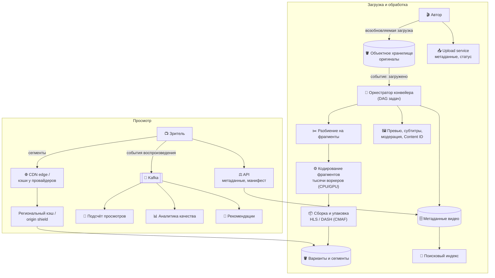
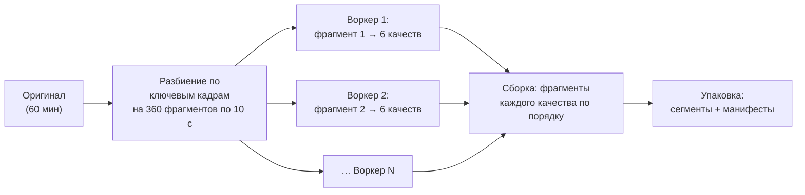
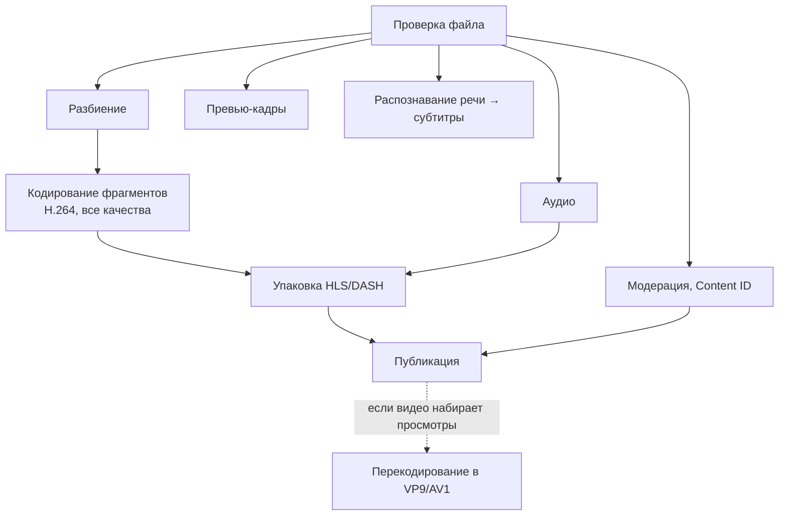
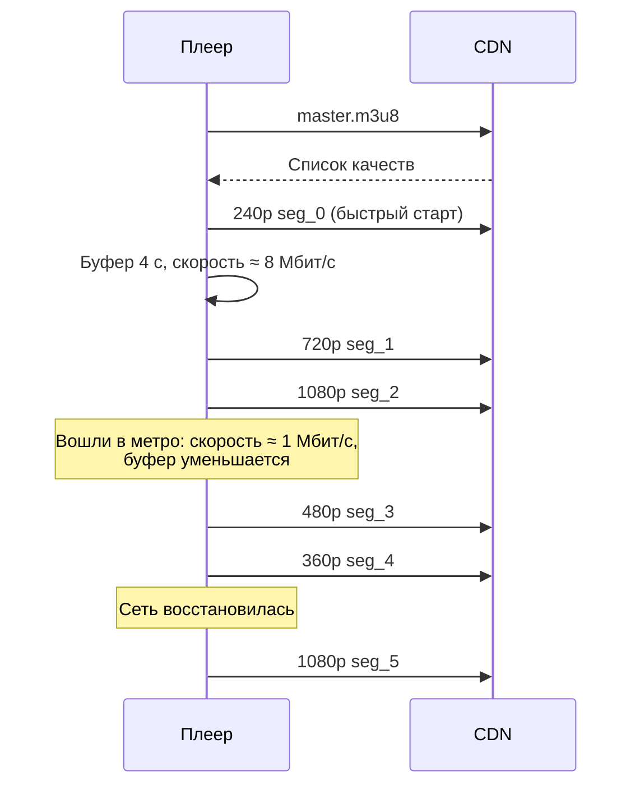
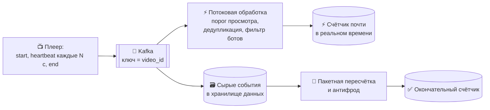

[English](README.md) | **Русский**

# Tier 1 · 09. YouTube / Netflix

> **Уровень:** Hard · **Время на интервью:** 45–60 мин · **Время на разбор:** ~5–6 ч
> **Ключевые аспекты:** загрузка больших файлов, конвейер транскодирования (DAG, параллельное кодирование по фрагментам), лестница битрейтов и кодеки, адаптивный стриминг (HLS/DASH), CDN и кэши у провайдеров, подсчёт просмотров, метаданные и рекомендации, различия YouTube и Netflix, качество воспроизведения
> **Опирается на:** [03-cdn](../../03-cdn/README_RU.md#10-медиа-и-видео), [14-storage-types](../../14-storage-types/README_RU.md#9-загрузка-больших-файлов), [09-messaging](../../09-messaging/README_RU.md), [11-distributed-transactions](../../11-distributed-transactions/README_RU.md#13-движки-рабочих-процессов), [Tier 1 · 08 Instagram](../08-instagram/README_RU.md)

---

## 🗺️ Как читать этот разбор

Разбор построен как интервью, но в каждом шаге есть объяснения: **почему** принимается решение, **как работает** механизм и **что будет**, если сделать иначе. Блоки «📘 Объяснение» — теория прямо по ходу задачи.

| Значок | Что значит |
|:------:|:-----------|
| 🎤 | Реплика интервьюера |
| 🗣️ | Что говорю вслух я (кандидат) |
| ✏️ | Что рисую на доске |
| ⏱️ | Сколько времени тратить на шаг |
| 📘 | Подробное объяснение концепции |

Блоки **TIP** — хороший приём, **WARNING** — ловушка, **IMPORTANT** — сигнал для уровня Senior+.

---

## 📑 Содержание

0. [Чему учит эта задача](#0-чему-учит-эта-задача)
1. [Условие задачи](#1-условие-задачи)
2. [Уточняющие вопросы и требования](#2-уточняющие-вопросы-и-требования)
3. [Оценки нагрузки](#3-оценки-нагрузки)
4. [API](#4-api)
5. [Модель данных](#5-модель-данных)
6. [High-level дизайн](#6-high-level-дизайн)
7. [Deep dive 1: загрузка видео](#7-deep-dive-1-загрузка-видео)
8. [Deep dive 2: конвейер транскодирования](#8-deep-dive-2-конвейер-транскодирования)
9. [Deep dive 3: адаптивный стриминг](#9-deep-dive-3-адаптивный-стриминг)
10. [Deep dive 4: доставка через CDN](#10-deep-dive-4-доставка-через-cdn)
11. [Deep dive 5: подсчёт просмотров](#11-deep-dive-5-подсчёт-просмотров)
12. [Deep dive 6: метаданные, поиск и рекомендации](#12-deep-dive-6-метаданные-поиск-и-рекомендации)
13. [Deep dive 7: чем Netflix отличается от YouTube](#13-deep-dive-7-чем-netflix-отличается-от-youtube)
14. [Deep dive 8: качество воспроизведения и отказоустойчивость](#14-deep-dive-8-качество-воспроизведения-и-отказоустойчивость)
15. [Узкие места и сценарии сбоев](#15-узкие-места-и-сценарии-сбоев)
16. [Что изменится при росте в 10 раз](#16-что-изменится-при-росте-в-10-раз)
17. [Ключевые концепции и новые понятия](#17-ключевые-концепции-и-новые-понятия)
18. [Варианты задачи и follow-up вопросы](#18-варианты-задачи-и-follow-up-вопросы)
19. [Типичные ошибки](#19-типичные-ошибки)
20. [Шпаргалка и самопроверка](#20-шпаргалка-и-самопроверка)

---

## 0. Чему учит эта задача

Видеоплатформа — задача про **самые тяжёлые данные и самый большой трафик**. Видео весит в тысячи раз больше фото, его нужно превратить в десятки вариантов под разные устройства и сети, а потом раздать сотни терабит в секунду по всему миру.

| Что проверяют | Где это в задаче |
|:--------------|:-----------------|
| Загрузка гигабайтных файлов | Возобновляемая загрузка по частям |
| Обработка как конвейер | Транскодирование — DAG задач, параллельно по фрагментам |
| Компромисс качество — трафик — стоимость | Лестница битрейтов, выбор кодеков |
| Адаптация к сети клиента | HLS/DASH: плеер сам переключает качество |
| Доставка на экстремальном масштабе | CDN, кэши внутри сетей провайдеров |
| Подсчёт событий на масштабе | Просмотры: дедупликация, накрутки, приблизительность |
| Понимание разных продуктов | Чем Netflix отличается от YouTube |

> [!TIP]
> Интервьюер почти всегда углубляется в два места: **конвейер транскодирования** (как обработать часовое видео за минуты) и **адаптивный стриминг + CDN** (как смотреть без буферизации). Подготовь их особенно хорошо.

---

## 1. Условие задачи

> 🎤 «Спроектируй YouTube: пользователи загружают видео, другие смотрят их на любых устройствах и в любых сетях. Нужны счётчик просмотров, поиск и рекомендации».

**Что видит пользователь:**

```
Автор:   загружает 2-гигабайтное видео → через несколько минут оно доступно в 1080p,
         чуть позже — в 4K
Зритель: нажимает «Play» → видео стартует за 1–2 секунды в низком качестве
         и быстро переходит на HD; в метро качество падает, но видео не останавливается
```

**План по времени:**

| Шаг | ⏱️ |
|:----|:--:|
| Требования | 5 мин |
| Оценки | 4 мин |
| API и данные | 4 мин |
| High-level дизайн | 7 мин |
| Deep dives | 22–30 мин |
| Сбои и итоги | 3 мин |

---

## 2. Уточняющие вопросы и требования

⏱️ 5 мин

| Мой вопрос | Ответ интервьюера | Что это меняет и почему |
|:-----------|:------------------|:------------------------|
| Масштаб загрузок? | ~500 часов видео в минуту | Огромный поток обработки — тысячи машин для транскодирования |
| Масштаб просмотров? | ~1 млрд часов просмотра в сутки | Сотни терабит в секунду — только CDN |
| Устройства? | Телефоны, браузеры, ТВ, приставки | Разные разрешения, кодеки, контейнеры |
| Как быстро видео должно стать доступно? | Минуты для основного качества | Параллельное транскодирование |
| Максимальный размер? | До нескольких часов и десятков ГБ | Возобновляемая загрузка |
| Прямые трансляции? | Вне рамок (обсудить кратко) | Фокус на видео по запросу |
| Счётчик просмотров? | Почти в реальном времени, защищён от накруток | Потоковая агрегация + фильтрация |
| Рекомендации, поиск? | Да, на уровне архитектуры | Отдельные системы, кратко |

### Функциональные требования

1. Загрузить видео (с метаданными: название, описание, превью).
2. Смотреть видео с адаптивным качеством на любом устройстве.
3. Поиск и рекомендации.
4. Счётчик просмотров, лайки, комментарии.
5. Продолжить просмотр с места остановки.

### Нефункциональные требования

| Требование | Цель | Почему |
|:-----------|:-----|:-------|
| Время до старта воспроизведения | < 2 с | Каждая секунда ожидания — уход части зрителей |
| Буферизация | Минимальная доля времени | Остановки раздражают больше, чем снижение качества |
| Доступность просмотра | 99,99% | Основная функция |
| Время обработки | Минуты для первого качества | Авторы ждут публикации |
| Долговечность | Загруженные видео не теряются | Оригинал невосстановим |
| Стоимость | Трафик и транскодирование — основные расходы | Решения постоянно оцениваются по деньгам |

---

## 3. Оценки нагрузки

⏱️ 4 мин

```
Загрузки
  500 часов в минуту × 60 × 24 = 720 000 часов видео в сутки
  Оригинал ~3 ГБ/час (HD)            → ~2,2 ПБ оригиналов в сутки
  Варианты (качества × кодеки)       → сопоставимо с оригиналом и больше
  Итого                              → несколько ПБ в сутки, порядка эксабайта в год

Транскодирование
  Час HD-видео в одном варианте кодируется за единицы процессорных часов
  (сильно зависит от кодека: AV1 — в разы дороже H.264)
  720 000 часов × несколько вариантов × часы CPU на вариант
  → десятки миллионов процессорных часов в сутки → тысячи–десятки тысяч машин

Просмотры
  1B часов × 3 600 с × ~2,5 Мбит/с (средний битрейт) / 8
  ≈ 1,1 ЭБ в сутки ≈ ~100 Тбит/с в среднем, в вечерний пик в разы больше
```

### Выводы

| Вывод | Следствие для дизайна |
|:------|:----------------------|
| ~100 Тбит/с отдачи | Только распределённая CDN, кэши у интернет-провайдеров; это главный расход |
| Эксабайты хранения | Объектное хранилище, классы хранения, не хранить лишние варианты для непопулярных видео |
| Десятки миллионов процессорных часов в сутки | Транскодирование — отдельная огромная вычислительная платформа; дорогие кодеки — только когда окупаются |
| Загрузки гигабайтные | Возобновляемая загрузка напрямую в хранилище |
| Метаданные малы | Обычные базы с шардированием и кэшем |

---

## 4. API

⏱️ 2 мин

```http
# Загрузка
POST /v1/videos                          { title, description, privacy }   → { video_id, upload_url }
PUT  {upload_url}  (Content-Range)       ← возобновляемая загрузка частями
GET  /v1/videos/{id}/status              → { status: "processing", ready_qualities: ["360p", "720p"] }

# Просмотр
GET  /v1/videos/{id}                     → метаданные + URL манифеста (подписанный)
GET  {cdn}/videos/{id}/master.m3u8       → манифест HLS (список качеств)
GET  {cdn}/videos/{id}/720p/seg_00042.m4s → сегмент видео

# События
POST /v1/events/playback                 { video_id, event: "start" | "heartbeat" | "end", position, quality, … }

# Прочее
GET  /v1/search?q=…
GET  /v1/recommendations?context=home
PUT  /v1/users/me/progress/{video_id}    { position_sec }
```

🗣️ «Видео не отдаётся одним файлом и не проходит через наши API-серверы: API выдаёт ссылку на **манифест** в CDN, а плеер дальше сам скачивает сегменты из CDN».

---

## 5. Модель данных

⏱️ 2 мин

| Данные | Схема | Хранилище |
|:-------|:------|:----------|
| **Видео** | video_id, channel_id, title, description, duration, status, created_at, privacy | Шардированная БД (по video_id) + кэш |
| **Варианты** | video_id, quality, codec, bitrate, manifest_key, segments_prefix | БД; файлы — в объектном хранилище |
| **Оригиналы и сегменты** | ключи вида `originals/{id}`, `renditions/{id}/{codec}/{quality}/seg_N` | Объектное хранилище + CDN |
| **Задачи обработки** | job_id, video_id, этап, статус, попытки | Движок рабочих процессов |
| **Каналы, подписки** | channel_id, owner; (user) → channels | БД |
| **Просмотры** | события → агрегаты по video_id | Kafka → потоковая агрегация → счётчики; сырые события — в хранилище данных |
| **История и прогресс** | (user_id) → video_id, position, updated_at | Wide-column |
| **Комментарии** | (video_id, bucket) → comment | Wide-column |

---

## 6. High-level дизайн

⏱️ 7 мин



🗣️ «Две независимые части:
- **загрузка и обработка**: оригинал загружается напрямую в хранилище; оркестратор запускает DAG задач — разбить на фрагменты, параллельно закодировать во все качества, собрать и упаковать в формат стриминга, сделать превью, субтитры, проверку контента;
- **просмотр**: API отдаёт метаданные и ссылку на манифест; плеер скачивает сегменты из ближайшего кэша CDN и сам переключает качество; события воспроизведения идут в Kafka для просмотров, аналитики и рекомендаций».

---

## 7. Deep dive 1: загрузка видео

> 🎤 «Автор загружает 20-гигабайтное видео по нестабильному Wi-Fi. Как не начинать заново при каждом обрыве?»

🗣️ «**Возобновляемая загрузка по частям** напрямую в объектное хранилище (см. [14-storage-types](../../14-storage-types/README_RU.md#9-загрузка-больших-файлов)):

| Шаг | Что происходит |
|:----|:---------------|
| 1 | Клиент создаёт видео → получает `video_id` и сессию загрузки |
| 2 | Файл загружается частями (например, по 8–64 МБ), каждая с контрольной суммой |
| 3 | При обрыве клиент спрашивает «сколько принято» и продолжает с этого места |
| 4 | После последней части — сборка объекта, событие «загружено» |
| 5 | Запуск конвейера обработки; статус видео — `processing` |

| Деталь | Почему |
|:-------|:-------|
| Загрузка в ближайший регион | Быстрее для автора; дальше оригинал реплицируется |
| Проверка формата по содержимому | Защита от неподдерживаемых и вредоносных файлов |
| Оригинал хранится всегда | Его можно перекодировать в будущем новыми кодеками |
| Метаданные можно редактировать во время обработки | Автор не ждёт окончания загрузки, чтобы заполнить описание |

---

## 8. Deep dive 2: конвейер транскодирования

> 🎤 «Как превратить загруженный файл в то, что можно смотреть на любом устройстве, — и за минуты, а не часы?»

### 📘 Зачем вообще транскодировать

| Причина | Пояснение |
|:--------|:----------|
| **Устройства** | Разные устройства поддерживают разные кодеки и разрешения |
| **Сеть** | На мобильной сети 4K не посмотреть — нужны варианты меньшего битрейта |
| **Размер** | Оригинал с камеры закодирован неэффективно; перекодирование уменьшает объём в разы |
| **Стриминг** | Видео нужно разрезать на короткие сегменты для адаптивного стриминга |

### Лестница битрейтов

📘 Видео кодируется в **набор вариантов** — лестницу битрейтов (bitrate ladder). Плеер выбирает ступень под текущую скорость сети.

| Качество | Разрешение | Битрейт (H.264, ориентир) |
|:---------|:-----------|:--------------------------|
| 240p | 426×240 | ~0,3–0,4 Мбит/с |
| 360p | 640×360 | ~0,7 Мбит/с |
| 480p | 854×480 | ~1–1,5 Мбит/с |
| 720p | 1280×720 | ~2,5–4 Мбит/с |
| 1080p | 1920×1080 | ~4–6 Мбит/с |
| 4K | 3840×2160 | ~15–25 Мбит/с |

**Per-title encoding.** Netflix описывал подход, при котором лестница подбирается **под каждое видео**: мультфильм с простой картинкой выглядит отлично на низком битрейте, а боевик с быстрыми сценами требует большего. Это экономит трафик без потери качества.

### Кодеки

| Кодек | Сжатие | Стоимость кодирования | Поддержка |
|:------|:-------|:----------------------|:----------|
| **H.264 (AVC)** | Базовое | Дёшево | Везде |
| **VP9 / HEVC** | На ~30–50% лучше H.264 | Дороже | Большинство современных устройств |
| **AV1** | Ещё лучше | Намного дороже | Растущая поддержка |

🗣️ «Каждое видео кодируется в **H.264** — он работает везде. Дорогие кодеки (VP9, AV1) — только для видео, которые **набирают просмотры**: экономия трафика на миллионах просмотров окупает дорогое кодирование, а для видео с десятью просмотрами — нет. YouTube описывал именно такой подход и специализированные аппаратные кодировщики для снижения стоимости».

### Параллельное кодирование по фрагментам

📘 Кодирование часового видео в 4K на одной машине может занять часы. Решение — **разрезать видео на фрагменты** и кодировать их параллельно на сотнях машин:



| Деталь | Почему |
|:-------|:-------|
| Резать по **ключевым кадрам** (GOP) | Каждый фрагмент декодируется независимо, швов не видно |
| Фрагменты ~10 с | Баланс параллелизма и накладных расходов |
| Сначала низкие качества | Видео становится доступно в 360p–720p быстрее, 4K — позже |
| Аудио — отдельно | Аудиодорожка кодируется один раз и подключается ко всем видеовариантам |

Время обработки становится почти **не зависящим от длины видео**: часовое видео обрабатывается за минуты, если хватает воркеров.

### Оркестрация как DAG



| Принцип | Почему |
|:--------|:-------|
| **Движок рабочих процессов** (как в [11-distributed-transactions](../../11-distributed-transactions/README_RU.md#13-движки-рабочих-процессов)) | Ретраи, таймауты, видимость статуса каждого этапа |
| **Идемпотентные задачи** | Ключ результата детерминирован (`renditions/{id}/{codec}/{quality}/chunk_N`) — повтор перезаписывает тот же объект |
| **Приоритеты** | Популярные авторы и короткие видео — быстрее; перекодирование старых видео — в фоне |
| **Воркеры на дешёвых прерываемых машинах** | Задачи короткие и повторяемые — потеря машины = повтор одного фрагмента |
| **Публикация после модерации** | Видео не становится публичным до проверки |

> [!IMPORTANT]
> **Сигнал Senior+:** объяснить, что время обработки зависит не от длины видео, а от **параллелизма** (разбиение по ключевым кадрам), и что выбор кодека — это **экономический** компромисс: дорогое кодирование окупается только на популярных видео.

---

## 9. Deep dive 3: адаптивный стриминг

> 🎤 «Как плеер смотрит видео без остановок, если скорость сети постоянно меняется?»

### 📘 Как устроены HLS и DASH

Каждый вариант качества разрезан на **сегменты** по 2–6 секунд. **Манифест** — текстовый файл со списком качеств и ссылками на их сегменты.

```
master.m3u8 (HLS)
  #EXT-X-STREAM-INF:BANDWIDTH=400000,RESOLUTION=426x240
  240p/playlist.m3u8
  #EXT-X-STREAM-INF:BANDWIDTH=2800000,RESOLUTION=1280x720
  720p/playlist.m3u8
  #EXT-X-STREAM-INF:BANDWIDTH=5000000,RESOLUTION=1920x1080
  1080p/playlist.m3u8

720p/playlist.m3u8
  seg_00000.m4s   (4 с)
  seg_00001.m4s   (4 с)
  …
```

**Плеер сам выбирает**, какое качество скачать для каждого следующего сегмента:



| Механизм | Как |
|:---------|:----|
| **Быстрый старт** | Первые сегменты — в низком качестве, чтобы видео началось за доли секунды |
| **Оценка скорости** | По времени скачивания последних сегментов |
| **Учёт буфера** | Если буфер большой — можно рискнуть качеством выше; если маленький — снижать (алгоритмы на основе буфера, например BBA) |
| **Плавность** | Не прыгать между качествами каждую секунду — пользователю это заметно |
| **Перемотка** | Плеер сразу запрашивает нужный сегмент по номеру |

| | HLS | DASH |
|:-|:----|:-----|
| Кто создал | Apple | Стандарт MPEG |
| Манифест | `.m3u8` | `.mpd` (XML) |
| Где обязателен | Устройства Apple | Android, браузеры, ТВ |
| Общий формат сегментов | CMAF (fMP4) позволяет использовать одни и те же сегменты для обоих | |

📘 **CMAF** — общий формат сегментов для HLS и DASH: одни файлы сегментов, два манифеста. Это вдвое сокращает хранение и улучшает попадания в кэш CDN.

> [!TIP]
> Ключевая мысль: **решения принимает клиент**. Сервер просто раздаёт статичные файлы (манифесты и сегменты), которые идеально кэшируются на CDN. Никакого «серверного стриминга» с состоянием на каждого зрителя.

---

## 10. Deep dive 4: доставка через CDN

> 🎤 «100 терабит в секунду. Как это доставить?»

### Иерархия кэшей


| Уровень | Что даёт |
|:--------|:---------|
| **Кэши внутри сетей провайдеров** | Трафик не выходит за пределы сети провайдера — дешевле и быстрее для всех; провайдер выигрывает, потому что разгружает свои внешние каналы |
| **Edge CDN** | Ближайшая точка присутствия |
| **Региональный кэш / origin shield** | Собирает промахи сотен edge-узлов, защищает хранилище |
| **Объектное хранилище** | Источник для редких видео |

📘 **Netflix Open Connect.** Netflix ставит собственные серверы-кэши прямо в сетях провайдеров и по ночам, когда сеть свободна, **заранее загружает** на них видео, которые, по прогнозу, будут популярны завтра в этом регионе. Вечером почти весь трафик идёт из этих кэшей.

### Длинный хвост

| Видео | Доля просмотров | Где обслуживается |
|:------|:----------------|:------------------|
| Популярные (небольшая доля каталога) | Основная масса | Edge и кэши провайдеров — почти всегда попадание |
| Средние | Заметная часть | Региональные кэши |
| Длинный хвост (большая часть каталога YouTube) | Малая доля | Промахи → origin shield → хранилище |

🗣️ «Каталог YouTube огромен, и все видео в кэшах не поместятся. Это нормально: популярные видео дают основной трафик и почти всегда в кэше, а редкие — из глубоких уровней. Важно, чтобы промахи собирал **origin shield** и чтобы одновременные промахи по одному сегменту объединялись (request collapsing, см. [03-cdn](../../03-cdn/README_RU.md))».

### Прочие решения

| Решение | Зачем |
|:--------|:------|
| Сегменты неизменяемы, URL с версией | Долгий кэш без инвалидации |
| Подписанные URL или токены | Защита платного и приватного контента |
| **Несколько CDN** | Распределение нагрузки, переключение при сбое, переговоры о цене |
| Выбор узла по качеству | Сервис выбора (steering) отдаёт клиенту лучшие узлы по измеренной задержке и загрузке |
| Предзагрузка популярного | Новый выпуск популярного автора заранее раскладывается по кэшам |

---

## 11. Deep dive 5: подсчёт просмотров

> 🎤 «Как считать просмотры, чтобы цифра была почти в реальном времени и не накручивалась?»

### Что такое «просмотр»

📘 Не каждый запрос к видео — просмотр. Платформа определяет правила: например, просмотр засчитывается, если видео смотрели не меньше нескольких секунд, с учётом повторов одним пользователем и фильтрации ботов. Точные правила обычно не раскрываются, чтобы их было сложнее обойти.

### Конвейер



| Элемент | Как |
|:--------|:----|
| **События от плеера** | Начало, периодические heartbeat (позиция и качество), конец — нужны и для просмотров, и для времени просмотра, и для аналитики качества |
| **Дедупликация** | По (пользователь или устройство, видео, окно времени) |
| **Антифрод** | Боты, циклические перезапуски, подозрительные IP — фильтры в потоке и тщательнее в пакетной обработке |
| **Два пути (lambda)** | Быстрый поток даёт приблизительную цифру сразу; пакетная обработка пересчитывает точно и исправляет |
| **Горячие видео** | Ключ партиции = video_id → у вирусного видео горячая партиция; предварительная агрегация на уровне сборщиков событий |
| **Отображение** | «1,2 млн просмотров» — точность до единиц не нужна; возможна заморозка счётчика на время проверки |

📘 Это та же задача, что агрегатор кликов по рекламе (Tier 1 #17) — там требования к точности строже, потому что за клики платят.

---

## 12. Deep dive 6: метаданные, поиск и рекомендации

> 🎤 «Где хранятся метаданные и как работают поиск и рекомендации — на уровне архитектуры?»

### Метаданные

| Решение | Почему |
|:--------|:-------|
| Шардированная реляционная БД по `video_id` | Метаданных немного, но запросов на чтение очень много |
| Кэш метаданных популярных видео | Страница видео открывается миллионы раз |
| YouTube описывал Vitess — систему шардирования MySQL, созданную для таких нагрузок | Пример реального решения |

### Поиск

- Индекс по названию, описанию, субтитрам (из распознавания речи), тегам — в поисковом движке (см. [15-search-basics](../../15-search-basics/README_RU.md)).
- Ранжирование учитывает текстовую релевантность, популярность, свежесть, качество канала.

### Рекомендации

📘 Двухэтапная схема, описанная в статье YouTube «Deep Neural Networks for YouTube Recommendations» (2016):

| Этап | Что делает |
|:-----|:-----------|
| **Генерация кандидатов** | Из миллионов видео быстро отобрать сотни подходящих: по истории просмотров, похожим пользователям, эмбеддингам |
| **Ранжирование** | Модель с богатыми признаками оценивает кандидатов, оптимизируя, например, ожидаемое время просмотра |

События воспроизведения (что смотрели, сколько, где бросили) — основной сигнал для обеих стадий.

---

## 13. Deep dive 7: чем Netflix отличается от YouTube

> 🎤 «А если бы это был Netflix?»

| | YouTube | Netflix |
|:-|:--------|:--------|
| Кто загружает | Миллионы пользователей | Студии и сам Netflix |
| Размер каталога | Миллиарды видео | Десятки тысяч наименований |
| Загрузок | Сотни часов в минуту | Небольшой поток, но очень высокое качество исходников |
| Время обработки | Минуты — авторы ждут | Часы и дни допустимы — релиз планируется заранее |
| Кодирование | Быстрое; дорогие кодеки — для популярного | Максимально тщательное: per-title, per-scene, все кодеки |
| Доставка | CDN + кэши; длинный хвост из глубины | Почти всё заранее разложено по кэшам у провайдеров (Open Connect) |
| Монетизация и права | Реклама; Content ID для авторских прав | Подписка; лицензии по странам, DRM |
| Рекомендации | Из огромного каталога | Из небольшого каталога, с персонализированными обложками |

🗣️ «Главное отличие для дизайна — **размер каталога**. У Netflix он маленький, поэтому можно заранее положить весь популярный контент в кэши провайдеров и тратить сколько угодно вычислений на кодирование каждого фильма. У YouTube каталог огромный и пополняется непрерывно — отсюда быстрый конвейер, кодирование по популярности и длинный хвост из глубоких уровней кэша».

---

## 14. Deep dive 8: качество воспроизведения и отказоустойчивость

### Метрики качества (QoE)

| Метрика | Что показывает |
|:--------|:---------------|
| **Время до старта** | Сколько ждать после нажатия «Play» |
| **Доля буферизации** | Доля времени, когда видео стоит |
| **Средний битрейт** | Какое качество реально видят зрители |
| **Число переключений качества** | Плавность |
| **Ошибки воспроизведения** | Не запустилось, оборвалось |

Метрики собираются из heartbeat-событий плеера и разрезаются по CDN, провайдеру, региону, устройству — так видно, например, что у одного провайдера вечером падает битрейт.

### Отказоустойчивость

| Сбой | Решение |
|:-----|:--------|
| Узел CDN недоступен | Манифест содержит несколько базовых URL; плеер переключается на другой CDN или узел |
| Медленный узел | Сервис выбора узлов учитывает измеренное качество; плеер снижает битрейт |
| Сбой метаданных | Кэш метаданных; видео, уже открытое у зрителя, продолжает играть из CDN |
| Сбой конвейера | Задачи повторяются; уже опубликованные видео не затронуты |
| Регион недоступен | Netflix описывал регулярные учения по переключению трафика между регионами и хаос-инжиниринг (см. [13-reliability-patterns](../../13-reliability-patterns/README_RU.md#11-проверка-надёжности-хаос-инжиниринг-и-game-days)) |

---

## 15. Узкие места и сценарии сбоев

| Сценарий | Что произойдёт | Как защищаемся |
|:---------|:---------------|:---------------|
| Обрыв при загрузке 20 ГБ | Начинать заново | Возобновляемая загрузка частями |
| Очередь транскодирования растёт | Видео долго в обработке | Автоскейлинг воркеров, приоритеты, прерываемые машины |
| Воркер упал посреди фрагмента | Фрагмент не готов | Повтор задачи; идемпотентные ключи результатов |
| Вирусное видео | Нагрузка на кэши | Многоуровневая CDN, origin shield, request collapsing |
| Новый выпуск популярного автора | Шквал промахов в первые минуты | Предзагрузка в кэши |
| Узел CDN недоступен | Остановки у зрителей | Несколько CDN, переключение в плеере |
| Плохая сеть зрителя | Буферизация | Адаптивный битрейт |
| Накрутка просмотров | Неверные цифры | Фильтры в потоке, пакетная пересчётка |
| Нарушение авторских прав | Юридический риск | Content ID в конвейере, удаление и purge CDN |
| Дорогое кодирование всего в AV1 | Огромные расходы | Дорогие кодеки только для популярных видео |

---

## 16. Что изменится при росте в 10 раз

> 🎤 «В 10 раз больше просмотров и загрузок?»

| Изменение | Почему |
|:----------|:-------|
| **Больше кэшей внутри сетей провайдеров** | Трафик — главный расход |
| **Специализированные кодировщики** (аппаратные ускорители) | Снижение стоимости транскодирования |
| **AV1 для большей доли просмотров** | Экономия трафика окупает кодирование |
| **Удаление вариантов непопулярных видео** | Хранить оригинал и пару качеств; остальное — перекодировать по требованию |
| **Прямые трансляции** | Отдельный конвейер с низкой задержкой (LL-HLS, сегменты по секунде) |

---

## 17. Ключевые концепции и новые понятия

### Что из Fundamentals применяется

| Концепция | Где разобрана | Как применяется здесь |
|:----------|:--------------|:----------------------|
| CDN, origin shield, видео на edge | [03-cdn](../../03-cdn/README_RU.md#10-медиа-и-видео) | Доставка сегментов |
| Загрузка больших файлов, классы хранения | [14-storage-types](../../14-storage-types/README_RU.md) | Оригиналы и варианты |
| Очереди и потоковая обработка | [09-messaging](../../09-messaging/README_RU.md) | События воспроизведения, просмотры |
| Движки рабочих процессов | [11-distributed-transactions](../../11-distributed-transactions/README_RU.md#13-движки-рабочих-процессов) | Оркестрация конвейера |
| Поиск, многоэтапное ранжирование | [15-search-basics](../../15-search-basics/README_RU.md) | Поиск и рекомендации |
| Хаос-инжиниринг | [13-reliability-patterns](../../13-reliability-patterns/README_RU.md) | Отказоустойчивость Netflix |

### Новые понятия этой задачи

| Понятие | Кратко |
|:--------|:-------|
| **Транскодирование** | Перекодирование видео в другие форматы, разрешения и битрейты |
| **Лестница битрейтов** | Набор вариантов качества для адаптивного стриминга |
| **Per-title encoding** | Лестница, подобранная под сложность конкретного видео |
| **Ключевой кадр (GOP)** | Кадр, с которого можно начать декодирование; граница для разбиения |
| **HLS / DASH** | Протоколы адаптивного стриминга: сегменты + манифест |
| **CMAF** | Общий формат сегментов для HLS и DASH |
| **ABR** | Адаптивный битрейт: плеер выбирает качество каждого сегмента |
| **Кэш внутри сети провайдера** | Серверы платформы в сети интернет-провайдера (Open Connect) |
| **QoE** | Качество восприятия: старт, буферизация, битрейт |

---

## 18. Варианты задачи и follow-up вопросы

<details>
<summary><b>Чем прямая трансляция отличается от видео по запросу?</b></summary>

Видео поступает непрерывно, транскодирование должно идти в реальном времени (без параллелизма по фрагментам всего файла), сегменты короче (1–2 с, LL-HLS) для малой задержки, а все зрители смотрят «одно и то же место» — это хорошо для кэша, но создаёт мгновенные пики. Нужна обработка обрывов у стримера и запись трансляции для последующего просмотра.
</details>

<details>
<summary><b>Как продолжить просмотр с места остановки на другом устройстве?</b></summary>

Плеер периодически отправляет позицию (heartbeat) → сохраняется в `(user_id, video_id) → position` с последним временем обновления. При открытии видео на другом устройстве API возвращает позицию, плеер запрашивает нужный сегмент. Конфликты между устройствами — побеждает последнее обновление.
</details>

<details>
<summary><b>Почему не отдавать видео одним файлом MP4?</b></summary>

Один файл — одно качество: нельзя адаптироваться к сети, перемотка требует запросов по диапазонам, а файл целиком хуже кэшируется. Сегменты по несколько секунд в разных качествах позволяют плееру переключаться и хорошо кэшируются на CDN.
</details>

<details>
<summary><b>Как работает защита авторских прав (Content ID)?</b></summary>

Правообладатели загружают эталоны; для них вычисляются «отпечатки» аудио и видео. Каждое новое видео в конвейере проверяется сравнением отпечатков; при совпадении применяется политика правообладателя: блокировать, монетизировать в его пользу или просто отслеживать.
</details>

<details>
<summary><b>Что происходит при удалении видео?</b></summary>

Метаданные помечаются удалёнными → страница и манифест больше не отдаются. Сегменты в кэшах CDN истекут или удаляются purge; оригинал и варианты удаляются из хранилища (с задержкой для возможного восстановления и соблюдения юридических требований).
</details>

---

## 19. Типичные ошибки

| ❌ Ошибка | Почему плохо | ✅ Как правильно |
|:---------|:-------------|:----------------|
| Загрузка видео через API-серверы | Гигабайты через API | Возобновляемая загрузка напрямую в хранилище |
| Кодирование целого видео на одной машине | Часы обработки | Разбиение по ключевым кадрам и параллельное кодирование |
| Все видео во всех кодеках | Огромные расходы | Дорогие кодеки только для популярных |
| Одно качество для всех | Буферизация или лишний трафик | Лестница битрейтов и ABR |
| Сервер решает, какое качество отдавать | Состояние на каждого зрителя, плохое кэширование | Клиентский ABR и статичные сегменты |
| Отдача из хранилища без CDN | Невозможная нагрузка | Многоуровневая CDN и кэши у провайдеров |
| Считать каждый запрос сегмента просмотром | Неверные цифры | Порог просмотра, дедупликация, антифрод |
| Только потоковый подсчёт | Накрутки не исправляются | Поток + пакетная пересчётка |
| Публикация до модерации | Нарушения видны всем | Публикация после проверки |
| Проектировать Netflix как YouTube | Неверные компромиссы | Учитывать размер каталога и модель контента |

---

## 20. Шпаргалка и самопроверка

### Ответ за 30 секунд

> Загрузка — возобновляемая, частями, напрямую в объектное хранилище; оригинал хранится всегда. Событие запускает DAG в движке рабочих процессов: проверка → разбиение по ключевым кадрам на ~10-секундные фрагменты → параллельное кодирование на тысячах прерываемых воркеров в лестницу битрейтов (240p–4K) в H.264 → сборка и упаковка в CMAF с манифестами HLS/DASH; параллельно — аудио, превью, субтитры, модерация, Content ID; публикация после проверки; VP9/AV1 — позже и только для набирающих просмотры. Воспроизведение: API отдаёт метаданные и подписанный URL манифеста; плеер сам выбирает качество каждого сегмента по скорости и буферу. Доставка — кэши у провайдеров (Open Connect), edge, origin shield, request collapsing, несколько CDN. Просмотры — события плеера в Kafka, порог и дедупликация в потоке, пакетная пересчётка и антифрод. Netflix: маленький каталог → заранее разложен по кэшам, тщательное per-title кодирование.

### Самопроверка

- [ ] Могу посчитать объём загрузок, хранения и трафика
- [ ] Могу объяснить, зачем транскодирование и что такое лестница битрейтов
- [ ] Могу объяснить параллельное кодирование по фрагментам и почему режут по ключевым кадрам
- [ ] Могу нарисовать DAG конвейера с оркестрацией
- [ ] Могу объяснить экономику выбора кодеков
- [ ] Могу объяснить, как работают HLS/DASH и клиентский ABR
- [ ] Могу описать иерархию кэшей и роль кэшей у провайдеров
- [ ] Могу объяснить проблему длинного хвоста
- [ ] Могу спроектировать подсчёт просмотров с защитой от накруток
- [ ] Могу объяснить отличия Netflix от YouTube

### Что почитать

- Netflix Tech Blog: *Per-Title Encode Optimization* (2015), статьи об Open Connect
- Covington, Adams, Sargin, *Deep Neural Networks for YouTube Recommendations* (RecSys 2016)
- Huang et al., *A Buffer-Based Approach to Rate Adaptation* (SIGCOMM 2014) — BBA
- Документация Apple HLS и стандарт MPEG-DASH, спецификация CMAF
- Alex Xu, *System Design Interview*, Vol. 1 — глава «Design YouTube»