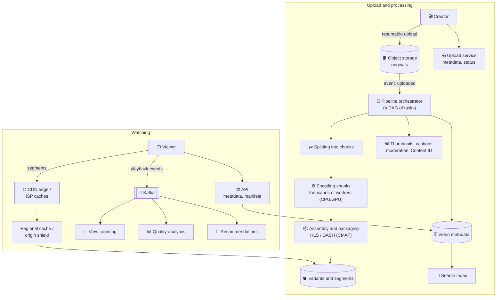
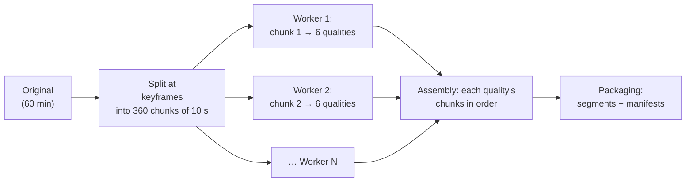
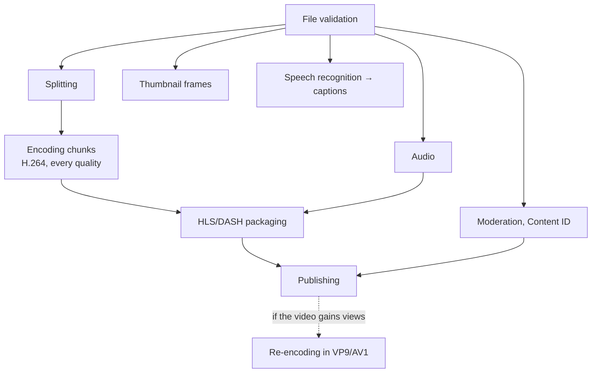
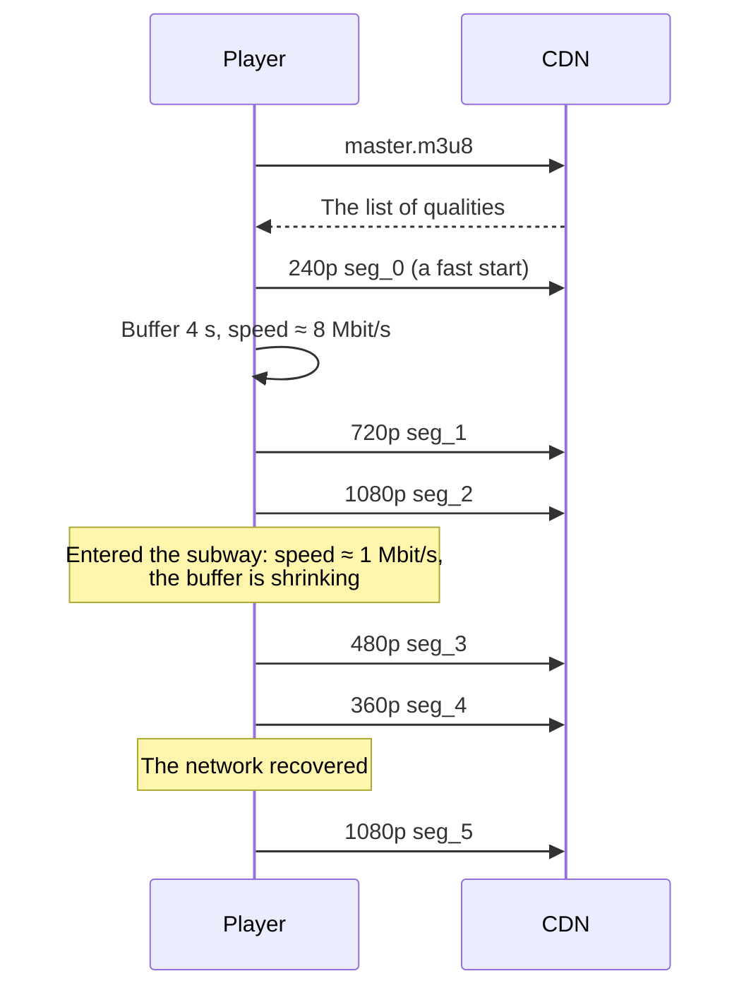
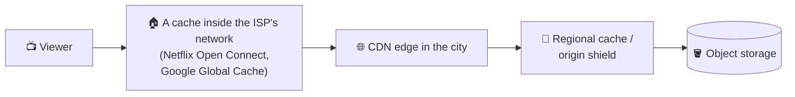
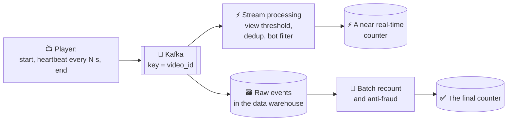

**English** | [Русский](README.ru.md)

# Tier 1 · 09. YouTube / Netflix

> **Level:** Hard · **Interview time:** 45–60 min · **Study time:** ~5–6 h
> **Key aspects:** uploading large files, the transcoding pipeline (a DAG, parallel chunk encoding), the bitrate ladder and codecs, adaptive streaming (HLS/DASH), CDN and ISP-embedded caches, view counting, metadata and recommendations, YouTube vs Netflix differences, playback quality
> **Builds on:** [03-cdn](../../01_Fundamentals/03_CDN/README.md#10-media-and-video), [14-storage-types](../../01_Fundamentals/14_Storage%20types/README.md#9-uploading-large-files), [09-messaging](../../01_Fundamentals/09_Messaging/README.md), [11-distributed-transactions](../../01_Fundamentals/11_Distributed%20transactions/README.md#13-workflow-engines), [Tier 1 · 08 Instagram](../08_Design%20Instagram/README.md)

---

## 🗺️ How to Read This Walkthrough

The walkthrough follows an interview, but every step includes explanations: **why** a decision is made, **how** a mechanism works and **what happens** if you do it differently. The "📘 Explanation" blocks are theory right where you need it.

| Icon | Meaning |
|:----:|:--------|
| 🎤 | Interviewer |
| 🗣️ | What I (the candidate) say out loud |
| ✏️ | What I draw on the whiteboard |
| ⏱️ | Time budget for the step |
| 📘 | A detailed explanation of a concept |

Callouts: **TIP** — a good technique, **WARNING** — a trap, **IMPORTANT** — a Senior+ signal.

---

## 📑 Contents

0. [What This Problem Teaches](#0-what-this-problem-teaches)
1. [Problem Statement](#1-problem-statement)
2. [Clarifying Questions and Requirements](#2-clarifying-questions-and-requirements)
3. [Capacity Estimates](#3-capacity-estimates)
4. [API](#4-api)
5. [Data Model](#5-data-model)
6. [High-Level Design](#6-high-level-design)
7. [Deep Dive 1: Uploading Video](#7-deep-dive-1-uploading-video)
8. [Deep Dive 2: The Transcoding Pipeline](#8-deep-dive-2-the-transcoding-pipeline)
9. [Deep Dive 3: Adaptive Streaming](#9-deep-dive-3-adaptive-streaming)
10. [Deep Dive 4: Delivery via CDN](#10-deep-dive-4-delivery-via-cdn)
11. [Deep Dive 5: Counting Views](#11-deep-dive-5-counting-views)
12. [Deep Dive 6: Metadata, Search and Recommendations](#12-deep-dive-6-metadata-search-and-recommendations)
13. [Deep Dive 7: How Netflix Differs From YouTube](#13-deep-dive-7-how-netflix-differs-from-youtube)
14. [Deep Dive 8: Playback Quality and Resilience](#14-deep-dive-8-playback-quality-and-resilience)
15. [Bottlenecks and Failure Scenarios](#15-bottlenecks-and-failure-scenarios)
16. [What Changes at 10x Scale](#16-what-changes-at-10x-scale)
17. [Key Concepts and New Terms](#17-key-concepts-and-new-terms)
18. [Variations and Follow-Up Questions](#18-variations-and-follow-up-questions)
19. [Common Mistakes](#19-common-mistakes)
20. [Cheat Sheet and Self-Check](#20-cheat-sheet-and-self-check)

---

## 0. What This Problem Teaches

A video platform is a problem about **the heaviest data and the largest traffic**. Video weighs thousands of times more than photos, it must be turned into dozens of variants for different devices and networks, and then hundreds of terabits per second must be delivered worldwide.

| What's tested | Where it shows up |
|:--------------|:------------------|
| Uploading gigabyte files | Resumable chunked uploads |
| Processing as a pipeline | Transcoding — a DAG of tasks, parallelized by chunk |
| The quality — traffic — cost trade-off | The bitrate ladder, choosing codecs |
| Adapting to the client's network | HLS/DASH: the player switches quality itself |
| Delivery at extreme scale | CDNs, caches inside ISP networks |
| Counting events at scale | Views: dedup, fraud, approximation |
| Understanding different products | How Netflix differs from YouTube |

> [!TIP]
> The interviewer almost always goes deep in two places: **the transcoding pipeline** (how to process an hour-long video in minutes) and **adaptive streaming + CDN** (how to watch without buffering). Prepare these especially well.

---

## 1. Problem Statement

> 🎤 "Design YouTube: users upload videos, and others watch them on any device and any network. We need a view counter, search and recommendations."

**What the user sees:**

```
Creator: uploads a 2 GB video → a few minutes later it's available in 1080p,
         a bit later in 4K
Viewer:  presses "Play" → the video starts within 1–2 seconds in low quality
         and quickly moves up to HD; on the subway the quality drops, but the video doesn't stop
```

**Time plan:**

| Step | ⏱️ |
|:-----|:--:|
| Requirements | 5 min |
| Estimates | 4 min |
| API and data | 4 min |
| High-level design | 7 min |
| Deep dives | 22–30 min |
| Failures and wrap-up | 3 min |

---

## 2. Clarifying Questions and Requirements

⏱️ 5 min

| My question | Interviewer's answer | What it changes and why |
|:------------|:---------------------|:------------------------|
| Upload scale? | ~500 hours of video per minute | A huge processing stream — thousands of machines for transcoding |
| Viewing scale? | ~1B hours watched per day | Hundreds of terabits per second — CDN only |
| Devices? | Phones, browsers, TVs, set-top boxes | Different resolutions, codecs, containers |
| How fast must a video become available? | Minutes for the main quality | Parallel transcoding |
| Maximum size? | Up to several hours and tens of GB | Resumable uploads |
| Live streaming? | Out of scope (discuss briefly) | Focus on video on demand |
| A view counter? | Near real time, protected from fraud | Stream aggregation + filtering |
| Recommendations, search? | Yes, at the architecture level | Separate systems, briefly |

### Functional requirements

1. Upload a video (with metadata: title, description, thumbnail).
2. Watch video with adaptive quality on any device.
3. Search and recommendations.
4. A view counter, likes, comments.
5. Resume watching where you left off.

### Non-functional requirements

| Requirement | Target | Why |
|:------------|:-------|:----|
| Time to start playback | < 2 s | Every second of waiting loses some viewers |
| Buffering | A minimal share of time | Stalls annoy more than a drop in quality |
| Viewing availability | 99.99% | The core function |
| Processing time | Minutes for the first quality | Creators wait to publish |
| Durability | Uploaded videos are never lost | The original is irreplaceable |
| Cost | Traffic and transcoding are the main expenses | Decisions are constantly weighed in money |

---

## 3. Capacity Estimates

⏱️ 4 min

```
Uploads
  500 hours per minute × 60 × 24 = 720,000 hours of video per day
  Original ~3 GB/hour (HD)               → ~2.2 PB of originals per day
  Variants (qualities × codecs)          → comparable to the original or more
  Total                                  → several PB per day, on the order of an exabyte per year

Transcoding
  An hour of HD video in one variant takes single-digit CPU-hours to encode
  (it depends heavily on the codec: AV1 is several times more expensive than H.264)
  720,000 hours × several variants × CPU-hours per variant
  → tens of millions of CPU-hours per day → thousands to tens of thousands of machines

Viewing
  1B hours × 3,600 s × ~2.5 Mbit/s (average bitrate) / 8
  ≈ 1.1 EB per day ≈ ~100 Tbit/s on average, several times more at the evening peak
```

### Conclusions

| Conclusion | Design consequence |
|:-----------|:-------------------|
| ~100 Tbit/s of delivery | Only a distributed CDN, caches inside ISPs; it's the main expense |
| Exabytes of storage | Object storage, storage classes, no extra variants for unpopular videos |
| Tens of millions of CPU-hours per day | Transcoding is a separate huge compute platform; expensive codecs only when they pay off |
| Uploads are gigabytes | Resumable uploads directly to storage |
| Metadata is small | Ordinary databases with sharding and a cache |

---

## 4. API

⏱️ 2 min

```http
# Uploading
POST /v1/videos                          { title, description, privacy }   → { video_id, upload_url }
PUT  {upload_url}  (Content-Range)       ← a resumable chunked upload
GET  /v1/videos/{id}/status              → { status: "processing", ready_qualities: ["360p", "720p"] }

# Watching
GET  /v1/videos/{id}                     → metadata + a manifest URL (signed)
GET  {cdn}/videos/{id}/master.m3u8       → the HLS manifest (the list of qualities)
GET  {cdn}/videos/{id}/720p/seg_00042.m4s → a video segment

# Events
POST /v1/events/playback                 { video_id, event: "start" | "heartbeat" | "end", position, quality, … }

# Other
GET  /v1/search?q=…
GET  /v1/recommendations?context=home
PUT  /v1/users/me/progress/{video_id}    { position_sec }
```

🗣️ "Video isn't served as one file and doesn't pass through our API servers: the API returns a link to a **manifest** on the CDN, and the player then downloads segments from the CDN by itself."

---

## 5. Data Model

⏱️ 2 min

| Data | Schema | Store |
|:-----|:-------|:------|
| **Videos** | video_id, channel_id, title, description, duration, status, created_at, privacy | A sharded DB (by video_id) + cache |
| **Variants** | video_id, quality, codec, bitrate, manifest_key, segments_prefix | A DB; files in object storage |
| **Originals and segments** | keys like `originals/{id}`, `renditions/{id}/{codec}/{quality}/seg_N` | Object storage + CDN |
| **Processing jobs** | job_id, video_id, stage, status, attempts | A workflow engine |
| **Channels, subscriptions** | channel_id, owner; (user) → channels | A DB |
| **Views** | events → aggregates by video_id | Kafka → stream aggregation → counters; raw events in the data warehouse |
| **History and progress** | (user_id) → video_id, position, updated_at | Wide-column |
| **Comments** | (video_id, bucket) → comment | Wide-column |

---

## 6. High-Level Design

⏱️ 7 min



🗣️ "Two independent parts:
- **upload and processing**: the original is uploaded directly to storage; the orchestrator runs a DAG of tasks — split into chunks, encode into every quality in parallel, assemble and package into a streaming format, make thumbnails, captions, content checks;
- **watching**: the API returns metadata and a manifest link; the player downloads segments from the nearest CDN cache and switches quality by itself; playback events go to Kafka for views, analytics and recommendations."

---

## 7. Deep Dive 1: Uploading Video

> 🎤 "A creator uploads a 20 GB video over flaky Wi-Fi. How do you avoid starting over on every drop?"

🗣️ "A **resumable chunked upload** directly into object storage (see [14-storage-types](../../01_Fundamentals/14_Storage%20types/README.md#9-uploading-large-files)):

| Step | What happens |
|:-----|:-------------|
| 1 | The client creates the video → gets a `video_id` and an upload session |
| 2 | The file is uploaded in parts (e.g. 8–64 MB each), each with a checksum |
| 3 | After a drop the client asks "how much was received" and continues from there |
| 4 | After the last part — the object is assembled, an "uploaded" event fires |
| 5 | The processing pipeline starts; the video's status is `processing` |

| Detail | Why |
|:-------|:----|
| Uploading to the nearest region | Faster for the creator; the original is replicated afterwards |
| Validating the format by content | Protection against unsupported and malicious files |
| The original is always kept | It can be re-encoded with new codecs in the future |
| Metadata is editable during processing | The creator doesn't wait for the upload to finish before filling in the description |

---

## 8. Deep Dive 2: The Transcoding Pipeline

> 🎤 "How do you turn the uploaded file into something watchable on any device — in minutes rather than hours?"

### 📘 Why transcode at all

| Reason | Explanation |
|:-------|:------------|
| **Devices** | Different devices support different codecs and resolutions |
| **Network** | You can't watch 4K on a mobile network — lower-bitrate variants are needed |
| **Size** | A camera original is encoded inefficiently; re-encoding shrinks it several-fold |
| **Streaming** | Video must be cut into short segments for adaptive streaming |

### The bitrate ladder

📘 A video is encoded into **a set of variants** — a bitrate ladder. The player picks the rung that matches the current network speed.

| Quality | Resolution | Bitrate (H.264, approximate) |
|:--------|:-----------|:-----------------------------|
| 240p | 426×240 | ~0.3–0.4 Mbit/s |
| 360p | 640×360 | ~0.7 Mbit/s |
| 480p | 854×480 | ~1–1.5 Mbit/s |
| 720p | 1280×720 | ~2.5–4 Mbit/s |
| 1080p | 1920×1080 | ~4–6 Mbit/s |
| 4K | 3840×2160 | ~15–25 Mbit/s |

**Per-title encoding.** Netflix described an approach where the ladder is chosen **per video**: a cartoon with simple imagery looks great at a low bitrate, while an action movie with fast scenes needs more. It saves traffic without losing quality.

### Codecs

| Codec | Compression | Encoding cost | Support |
|:------|:------------|:--------------|:--------|
| **H.264 (AVC)** | Baseline | Cheap | Everywhere |
| **VP9 / HEVC** | ~30–50% better than H.264 | More expensive | Most modern devices |
| **AV1** | Better still | Much more expensive | Growing support |

🗣️ "Every video is encoded in **H.264** — it works everywhere. Expensive codecs (VP9, AV1) only for videos that **gain views**: the traffic savings across millions of views pay for the expensive encoding, while for a video with ten views they don't. YouTube described exactly this approach, along with specialized hardware encoders to bring the cost down."

### Parallel encoding by chunk

📘 Encoding an hour-long 4K video on one machine can take hours. The fix — **cut the video into chunks** and encode them in parallel on hundreds of machines:



| Detail | Why |
|:-------|:----|
| Cut at **keyframes** (GOP boundaries) | Each chunk decodes independently, so no seams are visible |
| ~10 s chunks | A balance between parallelism and overhead |
| Lower qualities first | The video becomes available in 360p–720p sooner, 4K later |
| Audio — separately | The audio track is encoded once and attached to every video variant |

Processing time becomes almost **independent of the video's length**: an hour-long video is processed in minutes, given enough workers.

### Orchestration as a DAG



| Principle | Why |
|:----------|:----|
| **A workflow engine** (as in [11-distributed-transactions](../../01_Fundamentals/11_Distributed%20transactions/README.md#13-workflow-engines)) | Retries, timeouts, visibility into each stage's status |
| **Idempotent tasks** | The result key is deterministic (`renditions/{id}/{codec}/{quality}/chunk_N`) — a retry overwrites the same object |
| **Priorities** | Popular creators and short videos go faster; re-encoding old videos runs in the background |
| **Workers on cheap preemptible machines** | Tasks are short and retryable — losing a machine = retrying one chunk |
| **Publishing after moderation** | A video doesn't become public before it's checked |

> [!IMPORTANT]
> **Senior+ signal:** explain that processing time depends not on the video's length but on **parallelism** (splitting at keyframes), and that choosing a codec is an **economic** trade-off: expensive encoding pays off only on popular videos.

---

## 9. Deep Dive 3: Adaptive Streaming

> 🎤 "How does the player play video without stalls when the network speed keeps changing?"

### 📘 How HLS and DASH work

Each quality variant is cut into **segments** of 2–6 seconds. A **manifest** is a text file listing the qualities and links to their segments.

```
master.m3u8 (HLS)
  #EXT-X-STREAM-INF:BANDWIDTH=400000,RESOLUTION=426x240
  240p/playlist.m3u8
  #EXT-X-STREAM-INF:BANDWIDTH=2800000,RESOLUTION=1280x720
  720p/playlist.m3u8
  #EXT-X-STREAM-INF:BANDWIDTH=5000000,RESOLUTION=1920x1080
  1080p/playlist.m3u8

720p/playlist.m3u8
  seg_00000.m4s   (4 s)
  seg_00001.m4s   (4 s)
  …
```

**The player itself chooses** which quality to download for each next segment:



| Mechanism | How |
|:----------|:----|
| **A fast start** | The first segments are in low quality so the video starts in a fraction of a second |
| **Estimating speed** | From the download time of recent segments |
| **Accounting for the buffer** | With a large buffer you can risk a higher quality; with a small one — step down (buffer-based algorithms, e.g. BBA) |
| **Smoothness** | Don't jump between qualities every second — users notice |
| **Seeking** | The player immediately requests the needed segment by number |

| | HLS | DASH |
|:-|:----|:-----|
| Created by | Apple | An MPEG standard |
| Manifest | `.m3u8` | `.mpd` (XML) |
| Required on | Apple devices | Android, browsers, TVs |
| A shared segment format | CMAF (fMP4) lets the same segments serve both | |

📘 **CMAF** is a shared segment format for HLS and DASH: one set of segment files, two manifests. It halves storage and improves CDN cache hits.

> [!TIP]
> The key point: **the client makes the decisions**. The server just serves static files (manifests and segments) that cache perfectly on a CDN. No "server-side streaming" with per-viewer state.

---

## 10. Deep Dive 4: Delivery via CDN

> 🎤 "100 terabits per second. How do you deliver that?"

### A cache hierarchy



| Level | What it provides |
|:------|:-----------------|
| **Caches inside ISP networks** | Traffic never leaves the ISP's network — cheaper and faster for everyone; the ISP benefits too by offloading its external links |
| **CDN edge** | The nearest point of presence |
| **Regional cache / origin shield** | Aggregates misses from hundreds of edge nodes, protects storage |
| **Object storage** | The source for rare videos |

📘 **Netflix Open Connect.** Netflix places its own cache servers directly inside ISP networks and at night, when the network is idle, **preloads** them with videos predicted to be popular in that region tomorrow. In the evening almost all traffic comes from these caches.

### The long tail

| Videos | Share of views | Where they're served from |
|:-------|:---------------|:--------------------------|
| Popular (a small share of the catalog) | The bulk | Edge and ISP caches — almost always a hit |
| Mid-popular | A noticeable part | Regional caches |
| The long tail (most of YouTube's catalog) | A small share | Misses → origin shield → storage |

🗣️ "YouTube's catalog is huge, and not every video fits in caches. That's fine: popular videos make up most of the traffic and are almost always cached, while rare ones come from deeper tiers. What matters is that an **origin shield** aggregates the misses and that concurrent misses for the same segment are merged (request collapsing, see [03-cdn](../../01_Fundamentals/03_CDN/README.md))."

### Other decisions

| Decision | Why |
|:---------|:----|
| Segments are immutable, URLs carry a version | Long caching with no invalidation |
| Signed URLs or tokens | Protecting paid and private content |
| **Several CDNs** | Load distribution, failover, price negotiation |
| Choosing a node by quality | A steering service gives the client the best nodes by measured latency and load |
| Preloading popular content | A popular creator's new upload is pushed into caches in advance |

---

## 11. Deep Dive 5: Counting Views

> 🎤 "How do you count views so the number is near real time and can't be gamed?"

### What counts as a "view"

📘 Not every request for a video is a view. The platform defines rules: e.g. a view counts if the video was watched for at least a few seconds, accounting for repeats by the same user and filtering bots. The exact rules usually aren't disclosed, to make them harder to game.

### The pipeline



| Element | How |
|:--------|:----|
| **Player events** | Start, periodic heartbeats (position and quality), end — needed for views, watch time and quality analytics |
| **Dedup** | By (user or device, video, time window) |
| **Anti-fraud** | Bots, looping restarts, suspicious IPs — filters in the stream and more thorough ones in batch |
| **Two paths (lambda)** | The fast stream gives an approximate number immediately; batch processing recounts precisely and corrects it |
| **Hot videos** | Partition key = video_id → a viral video has a hot partition; pre-aggregation at the event collectors |
| **Display** | "1.2M views" — single-digit precision isn't needed; the counter may be frozen during verification |

📘 It's the same problem as the ad click aggregator (Tier 1 #17) — there, the accuracy requirements are stricter, because clicks are paid for.

---

## 12. Deep Dive 6: Metadata, Search and Recommendations

> 🎤 "Where is the metadata stored, and how do search and recommendations work — at the architecture level?"

### Metadata

| Decision | Why |
|:---------|:----|
| A relational DB sharded by `video_id` | There isn't much metadata, but there are a great many reads |
| A metadata cache for popular videos | A video page opens millions of times |
| YouTube described Vitess — a MySQL sharding system built for this kind of load | An example of a real solution |

### Search

- An index over titles, descriptions, captions (from speech recognition) and tags in a search engine (see [15-search-basics](../../01_Fundamentals/15_Search%20basics/README.md)).
- Ranking considers text relevance, popularity, freshness and channel quality.

### Recommendations

📘 A two-stage scheme described in YouTube's paper "Deep Neural Networks for YouTube Recommendations" (2016):

| Stage | What it does |
|:------|:-------------|
| **Candidate generation** | Quickly select hundreds of fitting videos out of millions: by watch history, similar users, embeddings |
| **Ranking** | A model with rich features scores the candidates, optimizing e.g. expected watch time |

Playback events (what was watched, for how long, where viewers dropped off) are the main signal for both stages.

---

## 13. Deep Dive 7: How Netflix Differs From YouTube

> 🎤 "What if this were Netflix?"

| | YouTube | Netflix |
|:-|:--------|:--------|
| Who uploads | Millions of users | Studios and Netflix itself |
| Catalog size | Billions of videos | Tens of thousands of titles |
| Uploads | Hundreds of hours per minute | A small stream, but very high-quality sources |
| Processing time | Minutes — creators wait | Hours or days are fine — releases are planned ahead |
| Encoding | Fast; expensive codecs for popular content | As thorough as possible: per-title, per-scene, every codec |
| Delivery | CDN + caches; the long tail from deep tiers | Almost everything pre-positioned in ISP caches (Open Connect) |
| Monetization and rights | Ads; Content ID for copyright | Subscriptions; per-country licenses, DRM |
| Recommendations | From a huge catalog | From a small catalog, with personalized artwork |

🗣️ "The main difference for the design is **catalog size**. Netflix's is small, so all popular content can be placed into ISP caches in advance, and any amount of compute can be spent encoding each movie. YouTube's is huge and constantly growing — hence a fast pipeline, encoding by popularity, and a long tail served from deep cache tiers."

---

## 14. Deep Dive 8: Playback Quality and Resilience

### Quality metrics (QoE)

| Metric | What it shows |
|:-------|:--------------|
| **Time to start** | How long the wait is after pressing "Play" |
| **Rebuffering ratio** | The share of time the video is stalled |
| **Average bitrate** | What quality viewers actually see |
| **Quality switches** | Smoothness |
| **Playback errors** | Failed to start, interrupted |

Metrics are collected from player heartbeat events and sliced by CDN, ISP, region and device — revealing, for example, that bitrate drops in the evenings on one ISP.

### Resilience

| Failure | Solution |
|:--------|:---------|
| A CDN node is down | The manifest contains several base URLs; the player switches to another CDN or node |
| A slow node | The node steering service accounts for measured quality; the player lowers the bitrate |
| A metadata outage | A metadata cache; a video already open for a viewer keeps playing from the CDN |
| A pipeline outage | Tasks are retried; already published videos are unaffected |
| A region is down | Netflix described regular drills shifting traffic between regions, and chaos engineering (see [13-reliability-patterns](../../01_Fundamentals/13_Reliability%20patterns/README.md#11-verifying-reliability-chaos-engineering-and-game-days)) |

---

## 15. Bottlenecks and Failure Scenarios

| Scenario | What happens | How we protect |
|:---------|:-------------|:---------------|
| A drop while uploading 20 GB | Starting over | A resumable chunked upload |
| The transcoding queue grows | Videos stay in processing for long | Worker autoscaling, priorities, preemptible machines |
| A worker crashes mid-chunk | The chunk isn't done | Retrying the task; idempotent result keys |
| A viral video | Load on the caches | A multi-tier CDN, an origin shield, request collapsing |
| A popular creator's new upload | A flood of misses in the first minutes | Preloading into caches |
| A CDN node is down | Viewers stall | Several CDNs, failover in the player |
| A viewer's poor network | Buffering | Adaptive bitrate |
| View fraud | Wrong numbers | Stream filters, batch recounts |
| Copyright infringement | Legal risk | Content ID in the pipeline, removal and a CDN purge |
| Expensively encoding everything in AV1 | Huge costs | Expensive codecs only for popular videos |

---

## 16. What Changes at 10x Scale

> 🎤 "10× more views and uploads?"

| Change | Why |
|:-------|:----|
| **More caches inside ISP networks** | Traffic is the main expense |
| **Specialized encoders** (hardware accelerators) | Lower transcoding cost |
| **AV1 for a larger share of views** | Traffic savings pay for the encoding |
| **Deleting variants of unpopular videos** | Keep the original and a couple of qualities; re-encode the rest on demand |
| **Live streaming** | A separate low-latency pipeline (LL-HLS, one-second segments) |

---

## 17. Key Concepts and New Terms

### What's applied from Fundamentals

| Concept | Where it's covered | How it applies here |
|:--------|:-------------------|:--------------------|
| CDNs, origin shields, video at the edge | [03-cdn](../../01_Fundamentals/03_CDN/README.md#10-media-and-video) | Delivering segments |
| Uploading large files, storage classes | [14-storage-types](../../01_Fundamentals/14_Storage%20types/README.md) | Originals and variants |
| Queues and stream processing | [09-messaging](../../01_Fundamentals/09_Messaging/README.md) | Playback events, views |
| Workflow engines | [11-distributed-transactions](../../01_Fundamentals/11_Distributed%20transactions/README.md#13-workflow-engines) | Orchestrating the pipeline |
| Search, multi-stage ranking | [15-search-basics](../../01_Fundamentals/15_Search%20basics/README.md) | Search and recommendations |
| Chaos engineering | [13-reliability-patterns](../../01_Fundamentals/13_Reliability%20patterns/README.md) | Netflix's resilience |

### New terms in this problem

| Term | In short |
|:-----|:---------|
| **Transcoding** | Re-encoding video into other formats, resolutions and bitrates |
| **The bitrate ladder** | The set of quality variants for adaptive streaming |
| **Per-title encoding** | A ladder tuned to a specific video's complexity |
| **Keyframe (GOP)** | A frame decoding can start from; the boundary for splitting |
| **HLS / DASH** | Adaptive streaming protocols: segments + a manifest |
| **CMAF** | A shared segment format for HLS and DASH |
| **ABR** | Adaptive bitrate: the player chooses each segment's quality |
| **An ISP-embedded cache** | The platform's servers inside an ISP's network (Open Connect) |
| **QoE** | Quality of experience: startup, buffering, bitrate |

---

## 18. Variations and Follow-Up Questions

<details>
<summary><b>How does live streaming differ from video on demand?</b></summary>

Video arrives continuously, transcoding must happen in real time (no parallelism across chunks of a whole file), segments are shorter (1–2 s, LL-HLS) for low latency, and every viewer watches "the same moment" — good for caching, but it creates instant spikes. You need to handle streamer disconnects and record the stream for later viewing.
</details>

<details>
<summary><b>How do you resume playback on another device?</b></summary>

The player periodically sends the position (a heartbeat) → stored as `(user_id, video_id) → position` with the last update time. When the video is opened on another device, the API returns the position and the player requests the right segment. Conflicts between devices — the latest update wins.
</details>

<details>
<summary><b>Why not serve video as a single MP4 file?</b></summary>

One file is one quality: you can't adapt to the network, seeking needs range requests, and a whole file caches worse. Segments of a few seconds in several qualities let the player switch and cache well on a CDN.
</details>

<details>
<summary><b>How does copyright protection (Content ID) work?</b></summary>

Rights holders upload reference files, for which audio and video "fingerprints" are computed. Each new video in the pipeline is checked by comparing fingerprints; on a match, the rights holder's policy applies: block it, monetize it on their behalf, or just track it.
</details>

<details>
<summary><b>What happens when a video is deleted?</b></summary>

The metadata is marked deleted → the page and manifest are no longer served. Segments in CDN caches expire or are purged; the original and variants are deleted from storage (with a delay for possible restoration and legal requirements).
</details>

---

## 19. Common Mistakes

| ❌ Mistake | Why it's bad | ✅ Do this instead |
|:----------|:-------------|:------------------|
| Uploading video through API servers | Gigabytes through the API | A resumable upload directly into storage |
| Encoding a whole video on one machine | Hours of processing | Splitting at keyframes and encoding in parallel |
| Every video in every codec | Huge costs | Expensive codecs only for popular videos |
| One quality for everyone | Buffering or wasted traffic | A bitrate ladder and ABR |
| The server decides which quality to serve | Per-viewer state, poor caching | Client-side ABR and static segments |
| Serving from storage without a CDN | Impossible load | A multi-tier CDN and ISP caches |
| Counting every segment request as a view | Wrong numbers | A view threshold, dedup, anti-fraud |
| Stream counting only | Fraud never gets corrected | Stream + batch recounts |
| Publishing before moderation | Violations visible to everyone | Publishing after checks |
| Designing Netflix like YouTube | The wrong trade-offs | Account for catalog size and the content model |

---

## 20. Cheat Sheet and Self-Check

### 30-second answer

> Uploads are resumable and chunked, directly into object storage; the original is always kept. An event starts a DAG in a workflow engine: validation → splitting at keyframes into ~10-second chunks → parallel encoding on thousands of preemptible workers into a bitrate ladder (240p–4K) in H.264 → assembly and packaging into CMAF with HLS/DASH manifests; in parallel — audio, thumbnails, captions, moderation, Content ID; publishing after checks; VP9/AV1 later, and only for videos gaining views. Playback: the API returns metadata and a signed manifest URL; the player chooses each segment's quality from speed and buffer. Delivery — ISP-embedded caches (Open Connect), edges, an origin shield, request collapsing, several CDNs. Views — player events to Kafka, a threshold and dedup in the stream, batch recounts and anti-fraud. Netflix: a small catalog → pre-positioned in caches, thorough per-title encoding.

### Self-check

- [ ] I can estimate the volume of uploads, storage and traffic
- [ ] I can explain why transcoding is needed and what a bitrate ladder is
- [ ] I can explain parallel chunk encoding and why chunks are cut at keyframes
- [ ] I can draw the pipeline DAG with orchestration
- [ ] I can explain the economics of choosing codecs
- [ ] I can explain how HLS/DASH and client-side ABR work
- [ ] I can describe the cache hierarchy and the role of ISP caches
- [ ] I can explain the long tail problem
- [ ] I can design view counting with fraud protection
- [ ] I can explain how Netflix differs from YouTube

### Further reading

- Netflix Tech Blog: *Per-Title Encode Optimization* (2015), articles on Open Connect
- Covington, Adams, Sargin, *Deep Neural Networks for YouTube Recommendations* (RecSys 2016)
- Huang et al., *A Buffer-Based Approach to Rate Adaptation* (SIGCOMM 2014) — BBA
- Apple HLS documentation, the MPEG-DASH standard, the CMAF specification
- Alex Xu, *System Design Interview*, Vol. 1 — chapter "Design YouTube"