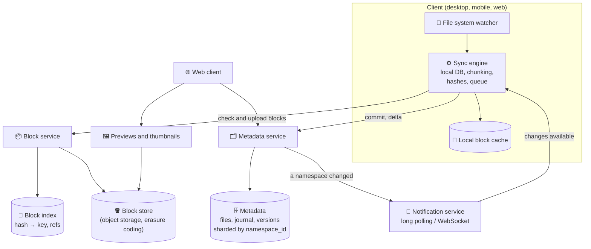
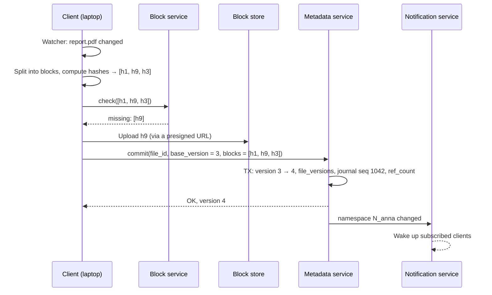
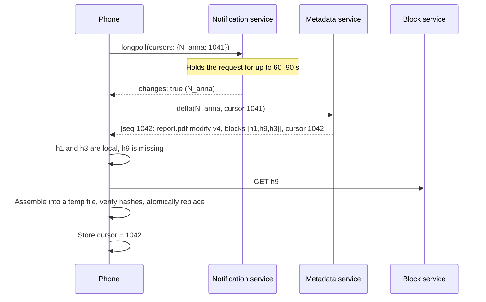
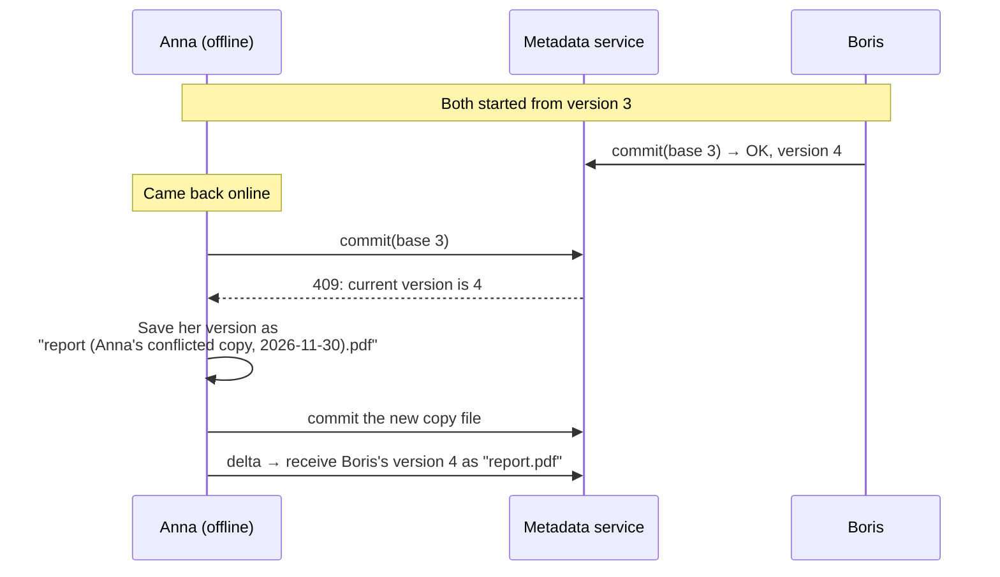
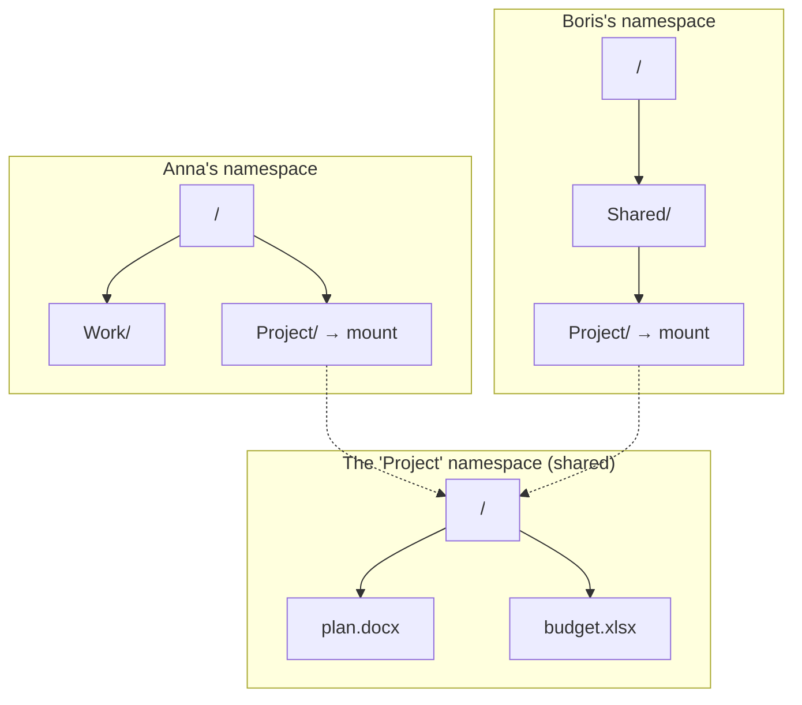

**English** | [Русский](README_RU.md)

# Tier 1 · 10. Dropbox / Google Drive

> **Level:** Hard · **Interview time:** 45–60 min · **Study time:** ~5–6 h
> **Key aspects:** splitting files into blocks (fixed-size and content-defined), dedup, syncing only changed blocks, a metadata service and change journal, client notifications, conflicts from concurrent edits, shared folders and permissions, versions and trash, the client sync engine
> **Builds on:** [14-storage-types](../../14-storage-types/README.md#9-uploading-large-files), [04-databases](../../04-databases/README.md), [06-partitioning](../../06-partitioning/README.md), [12-communication](../../12-communication/README.md#7-server--client-polling-long-polling-sse-websocket), [Tier 1 · 06 Chat](../06-chat-system/README.md#10-deep-dive-4-online-and-offline-delivery-and-sync)

---

## 🗺️ How to Read This Walkthrough

The walkthrough follows an interview, but every step includes explanations: **why** a decision is made, **how** a mechanism works and **what happens** if you do it differently. The "📘 Explanation" blocks are theory right where you need it.

| Icon | Meaning |
|:----:|:--------|
| 🎤 | Interviewer |
| 🗣️ | What I (the candidate) say out loud |
| ✏️ | What I draw on the whiteboard |
| ⏱️ | Time budget for the step |
| 📘 | A detailed explanation of a concept |

Callouts: **TIP** — a good technique, **WARNING** — a trap, **IMPORTANT** — a Senior+ signal.

---

## 📑 Contents

0. [What This Problem Teaches](#0-what-this-problem-teaches)
1. [Problem Statement](#1-problem-statement)
2. [Clarifying Questions and Requirements](#2-clarifying-questions-and-requirements)
3. [Capacity Estimates](#3-capacity-estimates)
4. [API](#4-api)
5. [Data Model](#5-data-model)
6. [High-Level Design](#6-high-level-design)
7. [Deep Dive 1: Splitting Into Blocks](#7-deep-dive-1-splitting-into-blocks)
8. [Deep Dive 2: Dedup and the Block Store](#8-deep-dive-2-dedup-and-the-block-store)
9. [Deep Dive 3: Uploading a Change](#9-deep-dive-3-uploading-a-change)
10. [Deep Dive 4: The Change Journal and Syncing Other Devices](#10-deep-dive-4-the-change-journal-and-syncing-other-devices)
11. [Deep Dive 5: Conflicts](#11-deep-dive-5-conflicts)
12. [Deep Dive 6: Shared Folders and Permissions](#12-deep-dive-6-shared-folders-and-permissions)
13. [Deep Dive 7: Versions, Trash and Garbage Collection](#13-deep-dive-7-versions-trash-and-garbage-collection)
14. [Deep Dive 8: The Client Sync Engine](#14-deep-dive-8-the-client-sync-engine)
15. [Bottlenecks and Failure Scenarios](#15-bottlenecks-and-failure-scenarios)
16. [What Changes at 10x Scale](#16-what-changes-at-10x-scale)
17. [Key Concepts and New Terms](#17-key-concepts-and-new-terms)
18. [Variations and Follow-Up Questions](#18-variations-and-follow-up-questions)
19. [Common Mistakes](#19-common-mistakes)
20. [Cheat Sheet and Self-Check](#20-cheat-sheet-and-self-check)

---

## 0. What This Problem Teaches

A cloud storage service with sync is a problem about **consistent state across many devices**. A file can be edited on an offline laptop, a phone and a browser at the same time — and every device must converge on one result without losing anything.

| What's tested | Where it shows up |
|:--------------|:------------------|
| Efficient data transfer | Splitting into blocks, sending only changed ones |
| Dedup | Content-addressed storage |
| Separating metadata from data | Strongly consistent metadata + an object store for blocks |
| State synchronization | A change journal and device cursors |
| Concurrent changes | Conflicts, optimistic locking, conflicted copies |
| Real-time notifications | Long polling or WebSocket |
| Access control | Shared folders, links |
| Reliability | A user's file must never be lost or corrupted |

> [!TIP]
> The key idea to get across early: **a file = a list of blocks**. Metadata describes which blocks (by hash) make up each version of a file, while the blocks themselves are stored separately and only once. Delta sync, dedup and cheap versions all follow from that idea.

---

## 1. Problem Statement

> 🎤 "Design Dropbox or Google Drive: a user puts files into a folder on their computer, and they appear on all their devices and in the browser. Folders and files can be shared with other people."

**What the user sees:**

```
1. Saves a 200 MB presentation into the Dropbox folder on a laptop
2. A few seconds later it appears on their phone and work computer
3. Fixes one slide → it syncs in a second (not the whole file)
4. A colleague and they edit a shared file at the same time → nobody loses their changes
```

**Time plan:**

| Step | ⏱️ |
|:-----|:--:|
| Requirements | 5 min |
| Estimates | 4 min |
| API and data | 5 min |
| High-level design | 6 min |
| Deep dives | 22–30 min |
| Failures and wrap-up | 3 min |

---

## 2. Clarifying Questions and Requirements

⏱️ 5 min

| My question | Interviewer's answer | What it changes and why |
|:------------|:---------------------|:------------------------|
| Scale? | 500M users, 100M daily active | Exabytes of storage, millions of connected clients |
| File sizes? | From bytes to tens of GB | Blocks, resumable transfers |
| Syncing across devices? | Yes, within seconds | Real-time notifications |
| Working offline? | Yes, changes sync once connected | Local state and conflict resolution |
| Real-time collaborative editing? | No, that's Google Docs — a different problem | Whole files, file-level conflicts |
| Shared folders? | Yes, with view and edit permissions | A namespace and permission model |
| Versions? | 30 days of version history, a trash | Keeping old block lists |
| How important is consistency? | Files and folder structure must not be lost or diverge | Strongly consistent metadata |

### Functional requirements

1. Upload, download, delete, move and rename files and folders.
2. Automatically sync changes to all of a user's devices.
3. Work offline, syncing afterwards.
4. Share folders and files (with permissions) and links.
5. Version history and a trash.

### Non-functional requirements

| Requirement | Target | Why |
|:------------|:-------|:----|
| Reliability | Never lose or corrupt files | The product's core promise |
| Metadata consistency | Every device converges on the same state | Divergence = lost files |
| Sync latency | Seconds for small changes | The feeling of "one folder everywhere" |
| Bandwidth savings | Transfer only what changed | Mobile networks, large files |
| Scale | Exabytes, millions of clients online | Drives the storage architecture |
| Availability | High; offline, the client works locally | The user shouldn't wait |

---

## 3. Capacity Estimates

⏱️ 4 min

```
Storage
  500M users × ~5 GB on average      ≈ 2.5 EB of logical data
  Dedup and compression save a noticeable share (identical files, old versions)
  + 30 days of versions

Changes
  100M active × ~10 file changes per day = 1B changes → ~12,000/s on average
  Average changed data ~1 MB          → ~1 PB of uploads per day

Metadata
  Each change → a file version record + a journal entry
  Billions of files → hundreds of TB of metadata; sharding

Connections
  Tens of millions of clients online, each waiting for change notifications
```

### Conclusions

| Conclusion | Design consequence |
|:-----------|:-------------------|
| Exabytes of blocks | An object store (or an in-house one, like Dropbox's Magic Pocket) with erasure coding |
| Transfer only changes | Blocks + hashes: only blocks missing on the server are sent |
| Metadata is critical and changes often | A separate strongly consistent database, sharded by namespace |
| Millions of waiting clients | A separate notification service on long polling or WebSocket |

---

## 4. API

⏱️ 3 min

```http
# Blocks
POST /v1/blocks/check          { hashes: ["h1", "h2", ...] }      → { missing: ["h2"] }
PUT  /v1/blocks/{hash}         (the block body)                    ← or a presigned URL into storage
GET  /v1/blocks/{hash}

# Files and metadata
POST /v1/files/commit
     { namespace_id, path, file_id?, base_version, blocks: ["h1","h2","h3"], size, mtime }
     → 200 { file_id, version }            ← success
     → 409 { current_version, ... }        ← conflict: the file changed after base_version

POST /v1/files/move            { file_id, new_path, base_version }
POST /v1/files/delete          { file_id, base_version }
GET  /v1/files/{id}/versions
POST /v1/files/{id}/restore    { version }

# Sync
GET  /v1/delta?namespace_id=…&cursor=…    → { entries: [...], cursor: "…", has_more }
GET  /v1/notify/longpoll?cursors=…        → held until a change or a timeout → { changes: true }

# Sharing
POST /v1/shares                { folder_id, members: [{user, role}] }
POST /v1/links                 { file_id, access: "view", expires_at }
```

📘 **`base_version` in commit.** The client states which version of the file its change is based on. If the server already has a different version (someone changed the file in the meantime), the commit is rejected — this is **optimistic locking** (see [04-databases](../../04-databases/README.md#11-concurrency-control-locks-mvcc-optimistic-approach)). The client gets a conflict and handles it (deep dive 5).

---

## 5. Data Model

⏱️ 3 min

```sql
-- A namespace: a user's root or a shared folder
namespaces (namespace_id PK, owner_id, type, created_at)

-- Files and folders within a namespace
files (
  namespace_id  BIGINT,
  file_id       BIGINT,          -- stable across renames and moves
  parent_id     BIGINT,          -- the parent folder
  name          TEXT,
  is_dir        BOOLEAN,
  version       BIGINT,          -- increments with every change
  blocks        BIGINT[] / TEXT[], -- an ordered list of block hashes
  size          BIGINT,
  mtime         TIMESTAMP,
  deleted       BOOLEAN,
  PRIMARY KEY (namespace_id, file_id)
);

-- The namespace's change journal (the source for syncing devices)
journal (
  namespace_id  BIGINT,
  seq           BIGINT,          -- the change's sequence number within the namespace
  file_id       BIGINT,
  op            TEXT,            -- create | modify | move | delete
  version       BIGINT,
  PRIMARY KEY (namespace_id, seq)
);

-- Version history
file_versions ((namespace_id, file_id), version, blocks, size, mtime, author_device)

-- Blocks: hash → where it lives, a reference count
blocks (hash PK, size, storage_key, ref_count, created_at)

-- Mounting shared folders and permissions
mounts  (user_id, namespace_id, mount_path, role)
```

| Data | Store | Why |
|:-----|:------|:----|
| `files`, `journal`, `file_versions`, `mounts` | A sharded relational DB (by `namespace_id`) | Transactions: a file change and its journal entry atomically; strong consistency |
| `blocks` (the index) | KV / a DB sharded by hash | "Does this block exist" — point lookups by key |
| Block bodies | Object storage | Exabytes, durability, cheap |
| Device cursors | On the client | The server keeps no per-device state |

📘 **Why `file_id` rather than the path.** If the key were the path (`/Work/report.pdf`), renaming the "Work" folder with 10,000 files would change 10,000 keys. With `file_id` and `parent_id`, a rename changes **one** row — the folder's — and paths are computed by walking up the parents.

---

## 6. High-Level Design

⏱️ 6 min



🗣️ "Three main server-side components:
- the **block service** — accepts and serves blocks by hash, storing each once in object storage;
- the **metadata service** — a strongly consistent database: the file tree, each version's block list, and a per-namespace change journal;
- the **notification service** — holds connections to clients and tells them 'namespace X has changes'.

And an important client-side component — the **sync engine**: it watches the local folder, splits files into blocks, uploads the missing ones and applies changes from the server."

---

## 7. Deep Dive 1: Splitting Into Blocks

> 🎤 "Why split files into blocks, and how?"

### Why blocks

| Benefit | Explanation |
|:--------|:------------|
| **Delta sync** | Changing one slide in a 200 MB presentation sends only the changed block, not the whole file |
| **Dedup** | Identical blocks (across files, versions and users) are stored once |
| **Resumable transfers** | After a drop, only the current block is retried |
| **Parallelism** | Blocks upload concurrently |
| **Cheap versions** | A new version = a new list of hashes; unchanged blocks are shared with the old version |

### Fixed-size blocks

📘 A file is cut into fixed-size pieces, e.g. 4 MB each (Dropbox described using 4 MB blocks). Simple and fast.

**The problem — inserting at the start of a file:**

```
Before:   [AAAA][BBBB][CCCC][DDDD]
Inserted 1 byte "X" at the start:
After:    [XAAA][ABBB][BCCC][CDDD][D]
          ↑ every boundary shifted → every block is "new" → the whole file is sent
```

For many formats (appending at the end, editing in place) fixed blocks work well. But with insertions in the middle or at the start (text files, some documents), delta sync stops working.

### Content-defined chunking

📘 Block boundaries are determined by **content**, not position. A window (e.g. 48 bytes) slides over the file, and for each position a **rolling hash** is computed (recomputed in O(1) as the window shifts by a byte). If the hash meets a condition (e.g. its lowest N bits are zero), that's a block boundary.

```
Condition: the hash's lowest 22 bits = 0  →  a boundary on average every 2^22 bytes ≈ 4 MB
Plus limits: a minimum (e.g. 1 MB) and a maximum (e.g. 16 MB) block size

Before:   [AAAA|BBBB|CCCC|DDDD]      ← boundaries found by content
Inserted "X" at the start:
After:    [XAAAA|BBBB|CCCC|DDDD]     ← only the first block changed;
                                        after it the window finds the same boundaries
```

| | Fixed size | Content-defined (CDC) |
|:-|:-----------|:----------------------|
| Chunking speed | Maximal | Slower (a rolling hash over every byte) |
| An insertion in the middle | Every subsequent block changes | 1–2 blocks change |
| Dedup between similar files | Worse | Better |
| Where | Simple systems; files changed "in place" | rsync, LBFS, backup systems, modern sync engines |

> [!IMPORTANT]
> **Senior+ signal:** show the boundary-shift problem with fixed blocks using an example, and propose content-defined chunking with a rolling hash, with minimum and maximum block sizes.

### Block size is a trade-off

| Small blocks (KB) | Large blocks (MB) |
|:------------------|:------------------|
| More precise deltas, better dedup | Less metadata (a file's block list is shorter) |
| A huge number of blocks → the index and lists grow | Changing one byte sends the whole block |

For file sync, blocks on the order of megabytes are typical: metadata stays manageable, and deltas are still effective.

---

## 8. Deep Dive 2: Dedup and the Block Store

> 🎤 "How do you store blocks without storing the same thing twice?"

### Content-addressed storage

📘 A block's key is a **cryptographic hash** of its content (SHA-256). Identical blocks produce the same hash and are stored once (see [14-storage-types](../../14-storage-types/README.md#8-the-pattern-blobs-separate-from-metadata)).

```
blocks: hash → { storage_key, size, ref_count }

Block h7 is part of:
  - report.pdf v3 (Anna)
  - report.pdf v4 (Anna) — the block didn't change
  - Boris's copy of the report
  → stored once, ref_count = 3
```

| Property | Consequence |
|:---------|:------------|
| Hash = key | Integrity checking: after a download the hash is recomputed and compared |
| Blocks are immutable | No block-level conflicts; they cache perfectly |
| Reference counting | A block is deleted only when no version of any file references it |

### Dedup scope

| Scope | Pros | Cons |
|:------|:-----|:-----|
| **Within a user** | Safe | Smaller savings |
| **Global** (across all users) | Maximum savings (popular installers, videos, PDFs) | **Information leakage**: if an upload is "instant", someone already has the file; an attacker can test whether a specific file exists |

📘 **The problem with global dedup.** If the client sends only a hash and the server replies "block already exists, no need to upload", then knowing a hash lets you "obtain" someone else's file without access to it, or check whether someone uploaded a particular document. Protections: dedup only within a user or team; proof of ownership (the server asks for random parts of the block); limiting global dedup to public, popular files.

### Encryption

| Approach | Trade-off |
|:---------|:----------|
| Server-side encryption (the service holds the keys) | Dedup works; the service could technically read files |
| End-to-end encryption (only the user holds the keys) | The service can't read anything; but global dedup is impossible, and there are no server-side previews or search |
| Convergent encryption (key = the content's hash) | Dedup with encryption, but the same "does this file exist" leak |

### The block store

- Object storage with erasure coding and cross-zone replication (see [14-storage-types](../../14-storage-types/README.md#7-replication-vs-erasure-coding)).
- At exabyte scale, an in-house store can be cheaper than the cloud: Dropbox described moving to its own system, Magic Pocket.
- Small blocks are packed into larger storage objects to avoid creating billions of tiny objects.

---

## 9. Deep Dive 3: Uploading a Change

> 🎤 "The user changed a file on their laptop. What happens step by step?"



| Step | Why this way |
|:-----|:-------------|
| **Blocks first, then commit** | Metadata never references a block that hasn't been uploaded yet ("data first, then metadata") |
| **Checking for missing blocks** | Only new blocks are sent — delta sync and dedup |
| **Commit with `base_version`** | Detecting a concurrent change (deep dive 5) |
| **One transaction** for the file version, the journal and reference counts | The journal and the file state never diverge |
| **Orphaned blocks** | If the client uploaded blocks but didn't commit (it crashed), unreferenced blocks are removed by the garbage collector after a while |
| **Batches for small files** | Copied 10,000 small files — one commit per batch, not 10,000 requests |

> [!TIP]
> Blocks can be uploaded **directly** to object storage via presigned URLs — heavy traffic doesn't pass through application servers. The block service issues the URL and updates the index after confirmation.

---

## 10. Deep Dive 4: The Change Journal and Syncing Other Devices

> 🎤 "How do other devices learn about a change, and what exactly do they download?"

### The namespace journal

📘 Every change in a namespace gets a sequence number `seq` and is written to the **journal**. Each device stores a **cursor** — the last processed `seq` — for each namespace it has access to. It's the same idea as the update stream in [chat](../06-chat-system/README.md#10-deep-dive-4-online-and-offline-delivery-and-sync).



| Element | Why |
|:--------|:----|
| **A notification without data** | The notification service only says "there are changes" — it's lightweight and independent of metadata |
| **Long polling** | A simple, reliable way to hold millions of waiting clients through proxies and mobile networks (see [12-communication](../../12-communication/README.md#7-server--client-polling-long-polling-sse-websocket)); WebSocket is an option too |
| **Delta by cursor** | The client gets only changes after its cursor, in order |
| **The cursor lives on the client** | The server keeps no per-device state |
| **A local block cache** | Only missing blocks are downloaded |
| **Atomic file replacement** | The file is assembled into a temp file and renamed — the user never sees a "half-written" file |
| **Hash verification** | Protection against corruption in transit |

📘 **Why order within a namespace matters.** The operations "create a folder → move a file into it → rename the folder" must be applied in exactly that order. A journal with `seq` provides **a total order of changes within a namespace** — just as `seq` in chat orders messages.

> [!WARNING]
> If a device hasn't connected for a long time and the journal for that period has already been trimmed, a delta from the old cursor is impossible. The server then replies "cursor expired", and the client does a **full resync**: it gets a snapshot of the namespace's tree and compares it with the local state.

---

## 11. Deep Dive 5: Conflicts

> 🎤 "Anna and Boris edited the same shared file at the same time. Or Anna edited a file offline while Boris changed it. What do you do?"

### Detection

📘 A commit carries `base_version` — the version the change is based on. The server accepts the commit only if the current version equals `base_version`:

```sql
UPDATE files SET version = version + 1, blocks = :new_blocks
WHERE namespace_id = :ns AND file_id = :id AND version = :base_version;
-- 0 rows updated → a conflict
```



### Resolution strategies

| Strategy | How | When |
|:---------|:----|:-----|
| **A conflicted copy** ⭐ | Both versions are kept: the main file is the version the server accepted first; the other sits next to it marked "conflicted copy" | The general case for arbitrary files: the service doesn't understand their format and can't merge them |
| **Last writer wins** | The last write wins | Only where loss is acceptable — **unacceptable** for user files |
| **Merging** | Combine the changes | Only for formats the service understands (Google Docs, CRDT/OT) — a different problem |

🗣️ "For arbitrary files the only safe option is **never losing data**: keep both versions and leave the decision to a human. Version history is an extra safety net."

### Structural conflicts

| Situation | Resolution |
|:----------|:-----------|
| One deleted a file, the other edited it | The edit wins: the file is restored (better an extra file than a lost edit) |
| Both created a file with the same name in the same folder | The second gets the name "report (1).pdf" |
| A move into a folder the other deleted | The folder is restored, or the file moves to the root |
| A cyclic move (A into B and B into A at once) | The server checks the tree on commit and rejects the second move |

---

## 12. Deep Dive 6: Shared Folders and Permissions

> 🎤 "Anna shared the 'Project' folder with Boris. How does that work?"

### Namespaces

📘 Each shared folder is a separate **namespace** with its own files and journal. It's **mounted** into each member's tree:



| Decision | Why |
|:---------|:----|
| A shared folder = a separate namespace | Changes are written once into the shared folder's journal, not copied into every member's namespace |
| Mounting at different places | Each member can keep the folder in their own place under their own name |
| The client syncs several namespaces | Its own root + each mounted shared folder, each with its own cursor |
| Permissions at the namespace level | A role (view, edit) in the `mounts` table; checked on every commit and delta |
| Sharding by namespace | All of a shared folder's files and journal live in one shard, so transactions are local |

### Links

| Type | How |
|:-----|:----|
| A view link | A token with a random part → a `file_id` and permissions; optionally an expiry and a password |
| Access via the link | The web UI serves a preview and a download via signed URLs for the blocks or the assembled file |
| Revocation | Deleting the token; preview caches are invalidated |

> [!NOTE]
> A very large shared folder (the whole company) with frequent changes becomes a **hot** namespace: every change goes through one journal on one shard. Fixes: split it into several shared folders, limit the change rate, give hot namespaces dedicated resources.

---

## 13. Deep Dive 7: Versions, Trash and Garbage Collection

> 🎤 "How do you keep 30 days of version history without going broke?"

### Versions are lists of hashes

```
report.pdf
  v3: [h1, h2, h3]
  v4: [h1, h9, h3]      ← one block changed
  v5: [h1, h9, h3, h10] ← appended at the end

Blocks stored: h1, h2, h3, h9, h10 — five, not 3 + 3 + 4 = 10
```

Each new version adds only **new** blocks. Restoring an old version means committing the old list of hashes as a new version: the blocks already exist, so nothing is uploaded.

### Trash

- A deleted file is marked `deleted` and stays in the metadata, with its version history, for the retention period.
- Restoring means clearing the flag (or committing the last version).

### Garbage collection

📘 A block can be physically deleted only when **no** live version of any file references it.

| Approach | How | Risk |
|:---------|:----|:-----|
| **Reference counting** | `ref_count` increments when a version is committed and decrements when a version is deleted (once its retention expires) | A counter bug = deleting a needed block |
| **Mark-and-sweep** | Periodically walk all live versions, mark the blocks in use, delete unmarked ones | Expensive at exabyte scale |
| **A combination** ⭐ | Counters for day-to-day operation + periodic reconciliation + a delay before physical deletion | Safer |

> [!WARNING]
> A garbage collection bug means **losing users' data** — the worst possible failure for such a service. So a block with a zero count isn't deleted immediately but after a quarantine period, and periodic reconciliation checks the counters. The "block just uploaded, commit not yet done" race is solved by the same quarantine for new unreferenced blocks.

---

## 14. Deep Dive 8: The Client Sync Engine

> 🎤 "What happens on the client side? Why is it hard?"

🗣️ "Half of Dropbox's complexity is on the client. Dropbox described rewriting its sync engine (Nucleus) from scratch precisely because of accumulated bugs around edge cases."

### Three tree states

📘 A reliable sync engine tracks three views:

| Tree | What it is |
|:-----|:-----------|
| **Local** | What's on disk right now |
| **Remote** | What's on the server right now (per the journal) |
| **Synced** | The last state in which local and remote matched |

Comparing each with the synced tree shows **who** changed a file: only locally → upload; only on the server → download; both → a conflict.

### Client specifics

| Task | Solution |
|:-----|:---------|
| **Detecting changes** | File system events (FSEvents on macOS, inotify on Linux, ReadDirectoryChangesW on Windows) + periodic scans in case events were missed |
| **A file still being written** | Wait until the file stops changing before chunking it |
| **A local database** | Tree state, block hashes, cursors — in a local database (e.g. SQLite) |
| **Restarts and crashes** | Operations are idempotent and resumable; state is saved after every step |
| **Case and forbidden characters** | `Report.pdf` and `report.pdf` are different files on Linux but the same on macOS and Windows; characters forbidden on Windows |
| **Saving bandwidth** | Compressing blocks, syncing over the local network between devices (LAN sync), throttling |
| **Files on demand** | On a laptop with a small disk, files appear as placeholders and content downloads when opened |
| **Mobile devices** | No constant sync of everything: on-demand viewing, automatic photo upload |

---

## 15. Bottlenecks and Failure Scenarios

| Scenario | What happens | How we protect |
|:---------|:-------------|:---------------|
| A drop while uploading a large file | Retransmission | Blocks + retrying only missing ones |
| The client crashed after uploading blocks but before commit | Orphaned blocks | Quarantine and garbage collection |
| Concurrent edits | Lost changes | `base_version`, conflicted copies |
| Offline edits | Divergence | Three trees, conflicts on reconnect |
| Corruption in transit | A damaged file | Verifying block hashes |
| A stale cursor after a long time offline | A delta is impossible | A full resync from a tree snapshot |
| A hot shared folder | An overloaded shard and journal | Splitting, rate limiting, dedicated resources |
| The notification service is down | Sync is delayed | The client periodically requests a delta on its own |
| A garbage collection bug | Data loss | Quarantine, reconciliation, delayed deletion |
| A leak through global dedup | A privacy violation | Limited dedup scope or proof of ownership |
| A block store failure in a zone | Blocks temporarily unavailable | Erasure coding and cross-zone replication |

---

## 16. What Changes at 10x Scale

> 🎤 "10× more users and data?"

| Change | Why |
|:-------|:----|
| **An in-house block store** | At tens of exabytes, cloud storage is too expensive (the Magic Pocket approach) |
| **Tiered storage** | Old versions and rarely used files in cold classes |
| **Sharding metadata** by namespace, with hot namespaces relocated | Growth in files and changes |
| **Regional metadata clusters** for enterprise customers | Data residency requirements |
| **More processing on the client** | Dedup, compression, LAN sync — saving server bandwidth |

---

## 17. Key Concepts and New Terms

### What's applied from Fundamentals

| Concept | Where it's covered | How it applies here |
|:--------|:-------------------|:--------------------|
| Blobs + metadata, content addressing, erasure coding | [14-storage-types](../../14-storage-types/README.md) | The block store |
| Optimistic locking | [04-databases](../../04-databases/README.md#11-concurrency-control-locks-mvcc-optimistic-approach) | `base_version` on commit |
| Sharding by entity key | [06-partitioning](../../06-partitioning/README.md) | Metadata by namespace |
| Long polling | [12-communication](../../12-communication/README.md#7-server--client-polling-long-polling-sse-websocket) | Client notifications |
| Journals and cursors | [Tier 1 · 06](../06-chat-system/README.md#10-deep-dive-4-online-and-offline-delivery-and-sync) | Syncing devices |

### New terms in this problem

| Term | In short |
|:-----|:---------|
| **Block (chunk)** | A part of a file; the unit of transfer and dedup |
| **Content-defined chunking** | Block boundaries chosen by content via a rolling hash |
| **Rolling hash** | A window hash recomputed in O(1) as it shifts by a byte |
| **Delta sync** | Transferring only changed blocks |
| **Namespace** | A user's root or a shared folder with its own journal |
| **Journal and cursor** | A namespace's ordered changes and a device's position in them |
| **Conflicted copy** | Keeping both versions after concurrent changes |
| **Proof of ownership** | Checking that the client really has the block's content |
| **The three sync trees** | Local, remote, synced |

---

## 18. Variations and Follow-Up Questions

<details>
<summary><b>How does Google Docs differ from Google Drive?</b></summary>

Drive syncs **whole files** and resolves conflicts with copies. Docs is real-time collaborative editing: changes travel as operations (insert a character at a position), and the server or an algorithm (OT, CRDT) merges them so everyone sees the same document. It's a separate problem (Tier 2) with a different architecture.
</details>

<details>
<summary><b>How do you upload a 50 GB file?</b></summary>

Split it into blocks and upload them in parallel and resumably, only the missing ones (e.g. if it's a new version of a large file). Commit after all blocks are uploaded. On the client — don't hold the whole file in memory; compute hashes in a streaming fashion.
</details>

<details>
<summary><b>Why not just use rsync?</b></summary>

rsync compares two specific files between two machines and efficiently transfers the difference. A cloud storage service needs more: version history, dedup across files and users, syncing many devices, shared folders, conflicts. rsync's rolling hash idea is used, but on top of it sit a content-addressed block store and a metadata journal.
</details>

<details>
<summary><b>How do you guarantee a file isn't corrupted?</b></summary>

Each block's hash is verified after upload to the server and after download to the client; the file is assembled into a temp file and atomically replaces the old one. In storage — checksums and background integrity checks.
</details>

<details>
<summary><b>How do you show a document preview in the browser without downloading it?</b></summary>

A preview service assembles the file from its blocks, generates thumbnails and viewable versions (PDF, page images) asynchronously after commit, and caches them. With end-to-end encryption, server-side previews are impossible — the client generates them.
</details>

---

## 19. Common Mistakes

| ❌ Mistake | Why it's bad | ✅ Do this instead |
|:----------|:-------------|:------------------|
| Sending the whole file on every change | Huge traffic | Blocks and delta sync |
| Fixed blocks only | An insertion at the start changes every block | Content-defined chunking |
| The path as the primary key | Renaming a folder changes thousands of rows | `file_id` + `parent_id` |
| Committing before uploading blocks | Metadata references non-existent data | Blocks first, then commit |
| Last writer wins for files | Lost edits | `base_version` and conflicted copies |
| Metadata in an eventually consistent store without transactions | The journal and the state diverge | A transactional DB, sharded by namespace |
| Pushing data to every device | Extra traffic, complexity | A "changes available" notification + a delta by cursor |
| Copying a shared folder into each member's namespace | Duplication and divergence | A separate namespace with mounts |
| Global dedup without protection | Information leakage | A dedup scope or proof of ownership |
| Deleting zero-count blocks immediately | A risk of data loss | Quarantine and reconciliation |

---

## 20. Cheat Sheet and Self-Check

### 30-second answer

> A file = an ordered list of blocks by hash. The client chunks the file by content (a rolling hash, blocks on the order of MB with a minimum and maximum), asks the block service which hashes are missing, uploads only those directly into object storage, then commits to the metadata service with the hash list and `base_version`. Metadata lives in a transactional DB sharded by namespace: one transaction holds the new file version, a journal entry with a `seq`, and reference counts. A notification service on long polling wakes devices with "this namespace has changes"; they fetch a delta by their cursor, download missing blocks, verify hashes and atomically replace the file. A conflict — a commit with a stale `base_version` is rejected, and the client saves a "conflicted copy". A shared folder is a separate namespace mounted for each member. Versions are old hash lists; garbage collection uses reference counts, quarantine and reconciliation. Dedup is within a user or with proof of ownership.

### Self-check

- [ ] I can explain why files are split into blocks (5 benefits)
- [ ] I can show the problem with fixed blocks and explain content-defined chunking
- [ ] I can describe content-addressed storage and reference counting
- [ ] I can explain the risk of global dedup and the protections
- [ ] I can describe uploading a change step by step
- [ ] I can explain the journal, cursors and long polling
- [ ] I can detect and resolve a conflict via `base_version`
- [ ] I can explain the shared-folders-as-namespaces model
- [ ] I can describe versions and safe garbage collection
- [ ] I can explain the client sync engine's three trees

### Further reading

- Muthitacharoen, Chen, Mazières, *A Low-bandwidth Network File System* (SOSP 2001) — LBFS, content-defined chunking
- Tridgell, Mackerras, *The rsync algorithm* (1996)
- Dropbox Tech Blog: *Inside the Magic Pocket* (2016), *Rewriting the heart of our sync engine* (2020)
- Alex Xu, *System Design Interview*, Vol. 1 — chapter "Design Google Drive"
- Fundamentals topics: [14-storage-types](../../14-storage-types/README.md), [04-databases](../../04-databases/README.md)