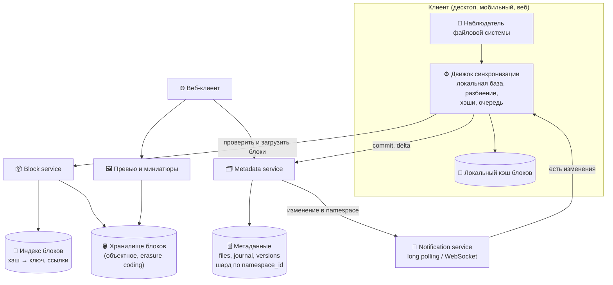
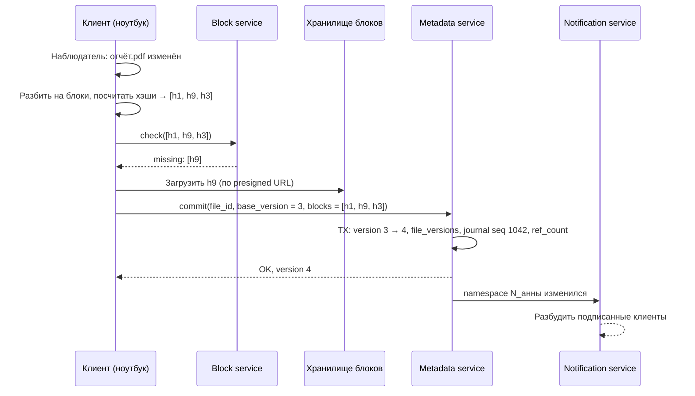
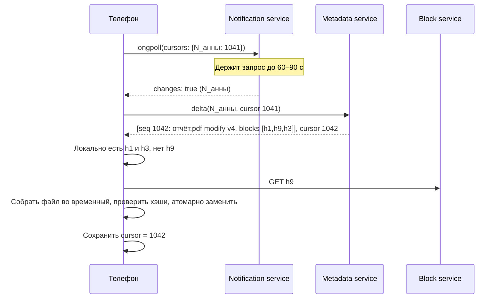
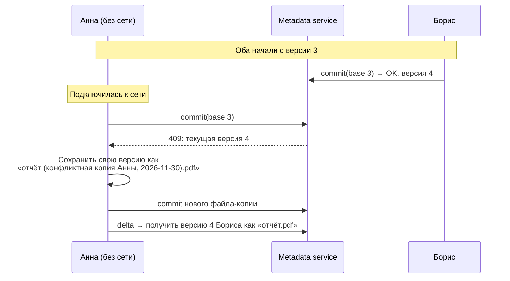
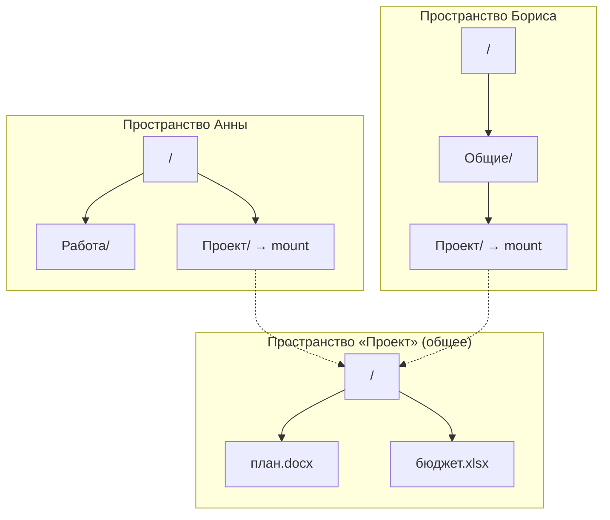

[English](README.md) | **Русский**

# Tier 1 · 10. Dropbox / Google Drive

> **Уровень:** Hard · **Время на интервью:** 45–60 мин · **Время на разбор:** ~5–6 ч
> **Ключевые аспекты:** разбиение файлов на блоки (фиксированное и по содержимому), дедупликация, синхронизация только изменённых блоков, сервис метаданных и журнал изменений, уведомления клиентов, конфликты при одновременных правках, общие папки и права, версии и корзина, клиентский движок синхронизации
> **Опирается на:** [14-storage-types](../../14-storage-types/README_RU.md#9-загрузка-больших-файлов), [04-databases](../../04-databases/README_RU.md), [06-partitioning](../../06-partitioning/README_RU.md), [12-communication](../../12-communication/README_RU.md#7-сервер--клиент-polling-long-polling-sse-websocket), [Tier 1 · 06 Chat](../06-chat-system/README_RU.md#10-deep-dive-4-доставка-онлайн-офлайн-и-синхронизация)

---

## 🗺️ Как читать этот разбор

Разбор построен как интервью, но в каждом шаге есть объяснения: **почему** принимается решение, **как работает** механизм и **что будет**, если сделать иначе. Блоки «📘 Объяснение» — теория прямо по ходу задачи.

| Значок | Что значит |
|:------:|:-----------|
| 🎤 | Реплика интервьюера |
| 🗣️ | Что говорю вслух я (кандидат) |
| ✏️ | Что рисую на доске |
| ⏱️ | Сколько времени тратить на шаг |
| 📘 | Подробное объяснение концепции |

Блоки **TIP** — хороший приём, **WARNING** — ловушка, **IMPORTANT** — сигнал для уровня Senior+.

---

## 📑 Содержание

0. [Чему учит эта задача](#0-чему-учит-эта-задача)
1. [Условие задачи](#1-условие-задачи)
2. [Уточняющие вопросы и требования](#2-уточняющие-вопросы-и-требования)
3. [Оценки нагрузки](#3-оценки-нагрузки)
4. [API](#4-api)
5. [Модель данных](#5-модель-данных)
6. [High-level дизайн](#6-high-level-дизайн)
7. [Deep dive 1: разбиение на блоки](#7-deep-dive-1-разбиение-на-блоки)
8. [Deep dive 2: дедупликация и хранилище блоков](#8-deep-dive-2-дедупликация-и-хранилище-блоков)
9. [Deep dive 3: загрузка изменения](#9-deep-dive-3-загрузка-изменения)
10. [Deep dive 4: журнал изменений и синхронизация других устройств](#10-deep-dive-4-журнал-изменений-и-синхронизация-других-устройств)
11. [Deep dive 5: конфликты](#11-deep-dive-5-конфликты)
12. [Deep dive 6: общие папки и права](#12-deep-dive-6-общие-папки-и-права)
13. [Deep dive 7: версии, корзина и сборка мусора](#13-deep-dive-7-версии-корзина-и-сборка-мусора)
14. [Deep dive 8: клиентский движок синхронизации](#14-deep-dive-8-клиентский-движок-синхронизации)
15. [Узкие места и сценарии сбоев](#15-узкие-места-и-сценарии-сбоев)
16. [Что изменится при росте в 10 раз](#16-что-изменится-при-росте-в-10-раз)
17. [Ключевые концепции и новые понятия](#17-ключевые-концепции-и-новые-понятия)
18. [Варианты задачи и follow-up вопросы](#18-варианты-задачи-и-follow-up-вопросы)
19. [Типичные ошибки](#19-типичные-ошибки)
20. [Шпаргалка и самопроверка](#20-шпаргалка-и-самопроверка)

---

## 0. Чему учит эта задача

Облачное хранилище с синхронизацией — задача про **согласованное состояние на многих устройствах**. Файл можно изменить на ноутбуке без сети, на телефоне и в браузере одновременно — и все устройства должны прийти к одному результату, ничего не потеряв.

| Что проверяют | Где это в задаче |
|:--------------|:-----------------|
| Эффективная передача данных | Разбиение на блоки, передача только изменённых |
| Дедупликация | Хранение по хэшу содержимого |
| Разделение метаданных и данных | Строго консистентные метаданные + объектное хранилище блоков |
| Синхронизация состояния | Журнал изменений и курсоры устройств |
| Конкурентные изменения | Конфликты, оптимистичная блокировка, копии конфликтов |
| Уведомления в реальном времени | Long polling или WebSocket |
| Права доступа | Общие папки, ссылки |
| Надёжность | Нельзя потерять или повредить файл пользователя |

> [!TIP]
> Главная мысль, которую нужно донести рано: **файл = список блоков**. Метаданные описывают, из каких блоков (по хэшу) состоит каждая версия файла, а сами блоки хранятся отдельно и один раз. Из этой идеи вытекают дельта-синхронизация, дедупликация и дешёвые версии.

---

## 1. Условие задачи

> 🎤 «Спроектируй Dropbox или Google Drive: пользователь кладёт файлы в папку на компьютере, и они появляются на всех его устройствах и в браузере. Можно делиться папками и файлами с другими людьми».

**Что видит пользователь:**

```
1. Сохраняет 200-мегабайтную презентацию в папке Dropbox на ноутбуке
2. Через несколько секунд она появляется на телефоне и рабочем компьютере
3. Исправляет один слайд → синхронизируется за секунду (передаётся не весь файл)
4. Коллега и он одновременно правят общий файл → никто не теряет свои изменения
```

**План по времени:**

| Шаг | ⏱️ |
|:----|:--:|
| Требования | 5 мин |
| Оценки | 4 мин |
| API и данные | 5 мин |
| High-level дизайн | 6 мин |
| Deep dives | 22–30 мин |
| Сбои и итоги | 3 мин |

---

## 2. Уточняющие вопросы и требования

⏱️ 5 мин

| Мой вопрос | Ответ интервьюера | Что это меняет и почему |
|:-----------|:------------------|:------------------------|
| Масштаб? | 500M пользователей, 100M активных в день | Эксабайты хранения, миллионы подключённых клиентов |
| Размер файлов? | От байт до десятков ГБ | Блоки, возобновляемая передача |
| Синхронизация между устройствами? | Да, в течение секунд | Уведомления в реальном времени |
| Работа без сети? | Да, изменения синхронизируются при подключении | Локальное состояние и разрешение конфликтов |
| Совместное редактирование в реальном времени? | Нет, это Google Docs — другая задача | Файлы целиком, конфликты на уровне файлов |
| Общие папки? | Да, с правами просмотра и редактирования | Модель пространств имён и прав |
| Версии? | История версий за 30 дней, корзина | Хранение старых списков блоков |
| Насколько важна консистентность? | Файлы и структура папок не должны теряться и расходиться | Строго консистентные метаданные |

### Функциональные требования

1. Загружать, скачивать, удалять, перемещать и переименовывать файлы и папки.
2. Автоматически синхронизировать изменения на всех устройствах пользователя.
3. Работать без сети с последующей синхронизацией.
4. Делиться папками и файлами (с правами) и ссылками.
5. История версий и корзина.

### Нефункциональные требования

| Требование | Цель | Почему |
|:-----------|:-----|:-------|
| Надёжность | Никогда не терять и не повреждать файлы | Это главное обещание продукта |
| Консистентность метаданных | Все устройства приходят к одному состоянию | Расхождение = потерянные файлы |
| Задержка синхронизации | Секунды для небольших изменений | Ощущение «одной папки везде» |
| Экономия трафика | Передавать только изменённое | Мобильные сети, большие файлы |
| Масштаб | Эксабайты, миллионы клиентов онлайн | Определяет архитектуру хранения |
| Доступность | Высокая; без сети клиент работает локально | Пользователь не должен ждать |

---

## 3. Оценки нагрузки

⏱️ 4 мин

```
Хранение
  500M пользователей × ~5 ГБ в среднем   ≈ 2,5 ЭБ логических данных
  Дедупликация и сжатие экономят заметную долю (одинаковые файлы, старые версии)
  + версии за 30 дней

Изменения
  100M активных × ~10 изменений файлов в сутки = 1B изменений → ~12 000/с в среднем
  Средний объём изменённых данных ~1 МБ     → ~1 ПБ загрузок в сутки

Метаданные
  Каждое изменение → запись версии файла + запись в журнал
  Миллиарды файлов → сотни ТБ метаданных; шардирование

Подключения
  Десятки миллионов клиентов онлайн, каждый ждёт уведомлений об изменениях
```

### Выводы

| Вывод | Следствие для дизайна |
|:------|:----------------------|
| Эксабайты блоков | Объектное хранилище (или собственное, как Dropbox Magic Pocket) с erasure coding |
| Передавать только изменения | Блоки + хэши: передаются только отсутствующие на сервере блоки |
| Метаданные критичны и меняются часто | Отдельная строго консистентная база, шардированная по пространству имён |
| Миллионы ждущих клиентов | Отдельный сервис уведомлений на long polling или WebSocket |

---

## 4. API

⏱️ 3 мин

```http
# Блоки
POST /v1/blocks/check          { hashes: ["h1", "h2", ...] }      → { missing: ["h2"] }
PUT  /v1/blocks/{hash}         (тело блока)                        ← или presigned URL в хранилище
GET  /v1/blocks/{hash}

# Файлы и метаданные
POST /v1/files/commit
     { namespace_id, path, file_id?, base_version, blocks: ["h1","h2","h3"], size, mtime }
     → 200 { file_id, version }            ← успех
     → 409 { current_version, ... }        ← конфликт: файл изменён после base_version

POST /v1/files/move            { file_id, new_path, base_version }
POST /v1/files/delete          { file_id, base_version }
GET  /v1/files/{id}/versions
POST /v1/files/{id}/restore    { version }

# Синхронизация
GET  /v1/delta?namespace_id=…&cursor=…    → { entries: [...], cursor: "…", has_more }
GET  /v1/notify/longpoll?cursors=…        → держится до изменения или таймаута → { changes: true }

# Общий доступ
POST /v1/shares                { folder_id, members: [{user, role}] }
POST /v1/links                 { file_id, access: "view", expires_at }
```

📘 **`base_version` в commit.** Клиент сообщает, на основе какой версии файла сделано изменение. Если на сервере уже другая версия (кто-то успел изменить файл), commit отклоняется — это **оптимистичная блокировка** (см. [04-databases](../../04-databases/README_RU.md#11-управление-конкурентным-доступом-блокировки-mvcc-оптимистичный-подход)). Клиент получает конфликт и обрабатывает его (deep dive 5).

---

## 5. Модель данных

⏱️ 3 мин

```sql
-- Пространство имён: корень пользователя или общая папка
namespaces (namespace_id PK, owner_id, type, created_at)

-- Файлы и папки внутри пространства имён
files (
  namespace_id  BIGINT,
  file_id       BIGINT,          -- стабилен при переименовании и перемещении
  parent_id     BIGINT,          -- папка-родитель
  name          TEXT,
  is_dir        BOOLEAN,
  version       BIGINT,          -- растёт с каждым изменением
  blocks        BIGINT[] / TEXT[], -- упорядоченный список хэшей блоков
  size          BIGINT,
  mtime         TIMESTAMP,
  deleted       BOOLEAN,
  PRIMARY KEY (namespace_id, file_id)
);

-- Журнал изменений пространства имён (источник для синхронизации устройств)
journal (
  namespace_id  BIGINT,
  seq           BIGINT,          -- порядковый номер изменения в пространстве имён
  file_id       BIGINT,
  op            TEXT,            -- create | modify | move | delete
  version       BIGINT,
  PRIMARY KEY (namespace_id, seq)
);

-- История версий
file_versions ((namespace_id, file_id), version, blocks, size, mtime, author_device)

-- Блоки: хэш → где лежит, счётчик ссылок
blocks (hash PK, size, storage_key, ref_count, created_at)

-- Монтирование общих папок и права
mounts  (user_id, namespace_id, mount_path, role)
```

| Данные | Хранилище | Почему |
|:-------|:----------|:-------|
| `files`, `journal`, `file_versions`, `mounts` | Шардированная реляционная БД (по `namespace_id`) | Транзакции: изменение файла и запись в журнал атомарно; строгая консистентность |
| `blocks` (индекс) | KV / шардированная БД по хэшу | Проверка «есть ли блок» — точечные запросы по ключу |
| Тела блоков | Объектное хранилище | Эксабайты, долговечность, дёшево |
| Курсоры устройств | На клиенте | Сервер не хранит состояние каждого устройства |

📘 **Почему `file_id`, а не путь.** Если ключ — путь (`/Работа/отчёт.pdf`), то переименование папки «Работа» с 10 000 файлов меняет 10 000 ключей. С `file_id` и `parent_id` переименование — изменение **одной** строки папки, а пути вычисляются обходом родителей.

---

## 6. High-level дизайн

⏱️ 6 мин



🗣️ «Три основных серверных компонента:
- **block service** — принимает и отдаёт блоки по хэшу, хранит их один раз в объектном хранилище;
- **metadata service** — строго консистентная база: дерево файлов, списки блоков каждой версии, журнал изменений по пространствам имён;
- **notification service** — держит соединения с клиентами и сообщает «в пространстве имён X есть изменения».

И важный компонент на клиенте — **движок синхронизации**: следит за локальной папкой, режет файлы на блоки, загружает недостающие, применяет изменения с сервера».

---

## 7. Deep dive 1: разбиение на блоки

> 🎤 «Зачем делить файлы на блоки и как?»

### Зачем блоки

| Выгода | Пояснение |
|:-------|:----------|
| **Дельта-синхронизация** | Изменили один слайд в 200-мегабайтной презентации — передаётся только изменённый блок, а не весь файл |
| **Дедупликация** | Одинаковые блоки (в разных файлах, версиях, у разных пользователей) хранятся один раз |
| **Возобновляемая передача** | Обрыв — повторяется только текущий блок |
| **Параллелизм** | Блоки загружаются одновременно |
| **Дешёвые версии** | Новая версия = новый список хэшей; неизменённые блоки общие со старой версией |

### Фиксированный размер блока

📘 Файл режется на куски фиксированного размера, например по 4 МБ (Dropbox описывал блоки по 4 МБ). Просто и быстро.

**Проблема — вставка в начало файла:**

```
Было:     [AAAA][BBBB][CCCC][DDDD]
Вставили 1 байт «X» в начало:
Стало:    [XAAA][ABBB][BCCC][CDDD][D]
          ↑ все границы сдвинулись → все блоки «новые» → передаётся весь файл
```

Для многих форматов (дописывание в конец, изменение на месте) фиксированные блоки работают хорошо. Но при вставках в середину или начало (текстовые файлы, некоторые документы) дельта-синхронизация перестаёт работать.

### Разбиение по содержимому (content-defined chunking)

📘 Границы блоков определяются **содержимым**, а не позицией. По файлу скользит окно (например, 48 байт), для каждого положения вычисляется **скользящий хэш** (rolling hash — пересчитывается за O(1) при сдвиге окна на байт). Если хэш удовлетворяет условию (например, младшие N бит равны нулю), здесь граница блока.

```
Условие: младшие 22 бита хэша = 0  →  граница в среднем раз в 2^22 байт ≈ 4 МБ
Плюс ограничения: минимальный (например, 1 МБ) и максимальный (например, 16 МБ) размер блока

Было:     [AAAA|BBBB|CCCC|DDDD]      ← границы найдены по содержимому
Вставили «X» в начало:
Стало:    [XAAAA|BBBB|CCCC|DDDD]     ← изменился только первый блок,
                                        дальше окно находит те же границы
```

| | Фиксированный размер | По содержимому (CDC) |
|:-|:---------------------|:---------------------|
| Скорость разбиения | Максимальная | Медленнее (скользящий хэш по каждому байту) |
| Вставка в середину | Меняются все последующие блоки | Меняются 1–2 блока |
| Дедупликация между похожими файлами | Хуже | Лучше |
| Где | Простые системы; файлы, меняющиеся «на месте» | rsync, LBFS, системы резервного копирования, современные движки синхронизации |

> [!IMPORTANT]
> **Сигнал Senior+:** показать проблему сдвига границ при фиксированных блоках на примере и предложить разбиение по содержимому со скользящим хэшем, с ограничениями минимального и максимального размера блока.

### Размер блока — компромисс

| Маленькие блоки (КБ) | Большие блоки (МБ) |
|:---------------------|:-------------------|
| Точнее дельта, лучше дедупликация | Меньше метаданных (список блоков файла короче) |
| Огромное число блоков → индекс и списки растут | Изменение одного байта передаёт весь блок |

Для синхронизации файлов обычно выбирают блоки порядка мегабайт: метаданные остаются управляемыми, а дельта всё ещё эффективна.

---

## 8. Deep dive 2: дедупликация и хранилище блоков

> 🎤 «Как хранить блоки и не хранить одно и то же дважды?»

### Хранение по содержимому

📘 Ключ блока — **криптографический хэш** его содержимого (SHA-256). Одинаковые блоки дают одинаковый хэш и хранятся один раз (см. [14-storage-types](../../14-storage-types/README_RU.md#8-паттерн-blob-отдельно-метаданные-отдельно)).

```
blocks: hash → { storage_key, size, ref_count }

Блок h7 входит в:
  - отчёт.pdf v3 (Анна)
  - отчёт.pdf v4 (Анна) — блок не менялся
  - копия отчёта у Бориса
  → хранится 1 раз, ref_count = 3
```

| Свойство | Следствие |
|:---------|:----------|
| Хэш = ключ | Проверка целостности: после скачивания хэш пересчитывается и сравнивается |
| Блоки неизменяемы | Нет конфликтов на уровне блоков; отлично кэшируются |
| Подсчёт ссылок | Блок удаляется только когда на него не ссылается ни одна версия ни одного файла |

### Область дедупликации

| Область | Плюсы | Минусы |
|:--------|:------|:-------|
| **В пределах пользователя** | Безопасно | Меньше экономия |
| **Глобальная** (между всеми пользователями) | Максимальная экономия (популярные установщики, видео, PDF) | **Утечка информации**: если загрузка «мгновенная», значит, такой файл уже есть у кого-то; злоумышленник может проверить наличие конкретного файла |

📘 **Проблема глобальной дедупликации.** Если клиент отправляет только хэш, а сервер отвечает «блок уже есть, загружать не нужно», то, зная хэш, можно «получить» чужой файл без доступа к нему или проверить, загружал ли кто-то конкретный документ. Защиты: дедупликация только в пределах пользователя или команды; доказательство владения (сервер просит прислать случайные части блока); ограничение глобальной дедупликации публичными популярными файлами.

### Шифрование

| Подход | Компромисс |
|:-------|:-----------|
| Шифрование на стороне сервера (ключи у сервиса) | Дедупликация работает; сервис технически может прочитать файлы |
| Сквозное шифрование (ключи только у пользователя) | Сервис не может прочитать; но глобальная дедупликация невозможна, нет серверных превью и поиска |
| Convergent encryption (ключ = хэш содержимого) | Дедупликация с шифрованием, но та же утечка «есть ли такой файл» |

### Хранилище блоков

- Объектное хранилище с erasure coding и репликацией между зонами (см. [14-storage-types](../../14-storage-types/README_RU.md#7-репликация-vs-erasure-coding)).
- На масштабе эксабайтов собственное хранилище может быть дешевле облачного: Dropbox описывал переход на собственную систему Magic Pocket.
- Мелкие блоки упаковываются в большие объекты хранилища, чтобы не создавать миллиарды мелких объектов.

---

## 9. Deep dive 3: загрузка изменения

> 🎤 «Пользователь изменил файл на ноутбуке. Что происходит шаг за шагом?»



| Шаг | Почему так |
|:----|:-----------|
| **Сначала блоки, потом commit** | Метаданные никогда не ссылаются на ещё не загруженный блок (правило «сначала данные, потом метаданные») |
| **Проверка недостающих** | Передаются только новые блоки — дельта-синхронизация и дедупликация |
| **Commit с `base_version`** | Обнаружение конкурентного изменения (deep dive 5) |
| **Одна транзакция** для версии файла, журнала и счётчиков ссылок | Журнал и состояние файлов не расходятся |
| **Блоки-сироты** | Если клиент загрузил блоки, но не сделал commit (упал), блоки без ссылок удалит сборщик мусора через некоторое время |
| **Пачки для мелких файлов** | Скопировали 10 000 мелких файлов — один commit на пачку, а не 10 000 запросов |

> [!TIP]
> Блоки можно загружать **напрямую** в объектное хранилище по presigned URL — тяжёлый трафик не проходит через серверы приложения. Block service выдаёт URL и обновляет индекс после подтверждения.

---

## 10. Deep dive 4: журнал изменений и синхронизация других устройств

> 🎤 «Как другие устройства узнают об изменении и что именно им скачивать?»

### Журнал пространства имён

📘 Каждое изменение в пространстве имён получает порядковый номер `seq` и записывается в **журнал**. Каждое устройство хранит **курсор** — последний обработанный `seq` для каждого пространства имён, к которому у него есть доступ. Это та же идея, что поток обновлений в [чате](../06-chat-system/README_RU.md#10-deep-dive-4-доставка-онлайн-офлайн-и-синхронизация).



| Элемент | Зачем |
|:--------|:------|
| **Уведомление без данных** | Сервис уведомлений говорит только «есть изменения» — он лёгкий и не зависит от метаданных |
| **Long polling** | Простой и надёжный способ держать миллионы ожидающих клиентов через прокси и мобильные сети (см. [12-communication](../../12-communication/README_RU.md#7-сервер--клиент-polling-long-polling-sse-websocket)); WebSocket — тоже вариант |
| **Delta по курсору** | Клиент получает только изменения после своего курсора, по порядку |
| **Курсор на клиенте** | Сервер не хранит состояние каждого устройства |
| **Локальный кэш блоков** | Скачиваются только недостающие блоки |
| **Атомарная замена файла** | Файл собирается во временный файл и переименовывается — пользователь никогда не увидит «полузаписанный» файл |
| **Проверка хэшей** | Защита от повреждения при передаче |

📘 **Почему порядок внутри пространства имён важен.** Операции «создать папку → переместить в неё файл → переименовать папку» нужно применить именно в этом порядке. Журнал с `seq` даёт **полный порядок изменений в пределах пространства имён** — так же, как `seq` в чате даёт порядок сообщений.

> [!WARNING]
> Если устройство долго не подключалось и журнал за этот период уже обрезан, delta по старому курсору невозможна. Тогда сервер отвечает «курсор устарел», и клиент делает **полную пересинхронизацию**: получает снимок дерева пространства имён и сравнивает с локальным состоянием.

---

## 11. Deep dive 5: конфликты

> 🎤 «Анна и Борис одновременно изменили один общий файл. Или Анна правила файл без сети, а Борис его тем временем изменил. Что делать?»

### Обнаружение

📘 Commit содержит `base_version` — версию, на основе которой сделано изменение. Сервер принимает commit, только если текущая версия равна `base_version`:

```sql
UPDATE files SET version = version + 1, blocks = :new_blocks
WHERE namespace_id = :ns AND file_id = :id AND version = :base_version;
-- 0 строк обновлено → конфликт
```



### Стратегии разрешения

| Стратегия | Как | Когда |
|:----------|:----|:------|
| **Копия конфликта** ⭐ | Обе версии сохраняются: основной файл — версия, принятая сервером первой; вторая — рядом с пометкой «конфликтная копия» | Общий случай для произвольных файлов: сервис не понимает их формат и не может слить |
| **Last writer wins** | Побеждает последняя запись | Только там, где потеря допустима — для файлов пользователя **недопустимо** |
| **Слияние** | Объединить изменения | Только для форматов, которые сервис понимает (Google Docs, CRDT/OT) — это другая задача |

🗣️ «Для произвольных файлов единственный безопасный вариант — **никогда не терять данные**: сохранить обе версии и оставить решение человеку. История версий даёт дополнительную страховку».

### Конфликты структуры

| Ситуация | Разрешение |
|:---------|:-----------|
| Один удалил файл, другой изменил | Изменение побеждает: файл восстанавливается (лучше лишний файл, чем потерянная правка) |
| Оба создали файл с одним именем в одной папке | Второй получает имя «отчёт (1).pdf» |
| Перемещение в папку, которую другой удалил | Папка восстанавливается или файл перемещается в корень |
| Циклическое перемещение (A в B и B в A одновременно) | Сервер проверяет дерево при commit и отклоняет второе перемещение |

---

## 12. Deep dive 6: общие папки и права

> 🎤 «Анна поделилась папкой “Проект” с Борисом. Как это устроено?»

### Пространства имён

📘 Каждая общая папка — отдельное **пространство имён** (namespace) со своими файлами и журналом. Она **монтируется** в дерево каждого участника:



| Решение | Почему |
|:--------|:-------|
| Общая папка = отдельный namespace | Изменения пишутся один раз в журнал общей папки, а не копируются в пространство каждого участника |
| Монтирование в разные места | У каждого участника папка может лежать в своём месте и называться по-своему |
| Клиент синхронизирует несколько namespace | Свой корень + каждую смонтированную общую папку, со своими курсорами |
| Права на уровне namespace | Роль (просмотр, редактирование) в таблице `mounts`; проверяется при каждом commit и delta |
| Шардирование по namespace | Все файлы и журнал общей папки — в одном шарде, транзакции локальные |

### Ссылки

| Тип | Как |
|:----|:----|
| Ссылка для просмотра | Токен со случайной частью → `file_id` и права; опционально срок действия и пароль |
| Доступ по ссылке | Веб-интерфейс отдаёт превью и скачивание через подписанные URL блоков или собранного файла |
| Отзыв | Удаление токена; кэши превью инвалидируются |

> [!NOTE]
> Очень большая общая папка (вся компания) с частыми изменениями становится **горячим** пространством имён: все изменения проходят через один журнал в одном шарде. Решения: разбивать на несколько общих папок, ограничивать частоту изменений, выделять горячим пространствам отдельные ресурсы.

---

## 13. Deep dive 7: версии, корзина и сборка мусора

> 🎤 «Как хранить историю версий за 30 дней и не разориться?»

### Версии — это списки хэшей

```
отчёт.pdf
  v3: [h1, h2, h3]
  v4: [h1, h9, h3]      ← изменился один блок
  v5: [h1, h9, h3, h10] ← дописали в конец

Хранится блоков: h1, h2, h3, h9, h10 — пять, а не 3 + 3 + 4 = 10
```

Каждая новая версия добавляет только **новые** блоки. Восстановление старой версии — это commit старого списка хэшей как новой версии: блоки уже есть, ничего не загружается.

### Корзина

- Удалённый файл помечается `deleted` и остаётся в метаданных с историей версий на время хранения.
- Восстановление — снять пометку (или commit последней версии).

### Сборка мусора

📘 Блок можно физически удалить, только когда на него не ссылается **ни одна** живая версия ни одного файла.

| Подход | Как | Риск |
|:-------|:----|:-----|
| **Подсчёт ссылок** | `ref_count` увеличивается при commit версии, уменьшается при удалении версии (по истечении срока хранения) | Ошибка в счётчике = удаление нужного блока |
| **Mark-and-sweep** | Периодически обходить все живые версии, помечать используемые блоки, удалять непомеченные | Дорого на эксабайтах |
| **Комбинация** ⭐ | Счётчики для оперативной работы + периодическая сверка + задержка перед физическим удалением | Безопаснее |

> [!WARNING]
> Ошибка в сборке мусора — это **потеря данных пользователей**, самая серьёзная ошибка для такого сервиса. Поэтому блок с нулевым счётчиком удаляется не сразу, а через период карантина, и периодическая сверка проверяет счётчики. Гонка «блок только что загружен, но commit ещё не выполнен» решается тем же карантином для новых блоков без ссылок.

---

## 14. Deep dive 8: клиентский движок синхронизации

> 🎤 «Что происходит на стороне клиента? Почему это сложно?»

🗣️ «Половина сложности Dropbox — на клиенте. Dropbox описывал переписывание движка синхронизации (Nucleus) с нуля именно из-за накопившихся ошибок с крайними случаями».

### Три состояния дерева

📘 Надёжный движок синхронизации отслеживает три представления:

| Дерево | Что это |
|:-------|:--------|
| **Локальное** | Что сейчас лежит на диске |
| **Удалённое** | Что сейчас на сервере (по журналу) |
| **Синхронизированное** | Последнее состояние, в котором локальное и удалённое совпадали |

Сравнение каждого с синхронизированным показывает, **кто** изменил файл: только локально → загрузить; только на сервере → скачать; оба → конфликт.

### Особенности клиента

| Задача | Решение |
|:-------|:--------|
| **Обнаружение изменений** | События файловой системы (FSEvents на macOS, inotify на Linux, ReadDirectoryChangesW на Windows) + периодическое сканирование на случай пропущенных событий |
| **Файл ещё пишется** | Подождать, пока файл перестанет меняться, прежде чем разбивать на блоки |
| **Локальная база** | Состояние деревьев, хэши блоков, курсоры — в локальной базе (например, SQLite) |
| **Перезапуск и сбои** | Операции идемпотентны и возобновляемы; состояние сохраняется после каждого шага |
| **Регистр и запрещённые символы** | `Отчёт.pdf` и `отчёт.pdf` — разные файлы на Linux, один файл на macOS и Windows; символы, запрещённые в Windows |
| **Экономия трафика** | Сжатие блоков, синхронизация по локальной сети между устройствами (LAN sync), ограничение скорости |
| **Файлы по требованию** | На ноутбуке с маленьким диском файлы отображаются как плейсхолдеры, содержимое скачивается при открытии |
| **Мобильные устройства** | Без постоянной синхронизации всего: просмотр по требованию, автозагрузка фото |

---

## 15. Узкие места и сценарии сбоев

| Сценарий | Что произойдёт | Как защищаемся |
|:---------|:---------------|:---------------|
| Обрыв при загрузке большого файла | Повторная передача | Блоки + повтор только недостающих |
| Клиент упал после загрузки блоков до commit | Блоки-сироты | Карантин и сборка мусора |
| Одновременные правки | Потеря изменений | `base_version`, копии конфликтов |
| Изменение без сети | Расхождение | Три дерева, конфликты при подключении |
| Повреждение при передаче | Испорченный файл | Проверка хэшей блоков |
| Устаревший курсор после долгого офлайна | Delta невозможна | Полная пересинхронизация по снимку дерева |
| Горячая общая папка | Перегрузка шарда и журнала | Разделение, ограничение частоты, выделенные ресурсы |
| Сервис уведомлений недоступен | Задержка синхронизации | Клиент периодически сам запрашивает delta |
| Ошибка в сборке мусора | Потеря данных | Карантин, сверка, задержка удаления |
| Утечка через глобальную дедупликацию | Нарушение приватности | Дедупликация в пределах пользователя или доказательство владения |
| Сбой хранилища блоков в зоне | Блоки временно недоступны | Erasure coding и репликация между зонами |

---

## 16. Что изменится при росте в 10 раз

> 🎤 «В 10 раз больше пользователей и данных?»

| Изменение | Почему |
|:----------|:-------|
| **Собственное хранилище блоков** | На десятках эксабайтов облачное хранилище слишком дорого (подход Magic Pocket) |
| **Многоуровневое хранение** | Старые версии и редко используемые файлы — в холодные классы |
| **Шардирование метаданных** по namespace с переносом горячих пространств | Рост числа файлов и изменений |
| **Региональные кластеры метаданных** для корпоративных клиентов | Требования к расположению данных |
| **Больше обработки на клиенте** | Дедупликация, сжатие, LAN sync — экономия серверного трафика |

---

## 17. Ключевые концепции и новые понятия

### Что из Fundamentals применяется

| Концепция | Где разобрана | Как применяется здесь |
|:----------|:--------------|:----------------------|
| Blob + метаданные, хранение по хэшу, erasure coding | [14-storage-types](../../14-storage-types/README_RU.md) | Хранилище блоков |
| Оптимистичная блокировка | [04-databases](../../04-databases/README_RU.md#11-управление-конкурентным-доступом-блокировки-mvcc-оптимистичный-подход) | `base_version` при commit |
| Шардирование по ключу сущности | [06-partitioning](../../06-partitioning/README_RU.md) | Метаданные по namespace |
| Long polling | [12-communication](../../12-communication/README_RU.md#7-сервер--клиент-polling-long-polling-sse-websocket) | Уведомления клиентов |
| Журнал и курсоры | [Tier 1 · 06](../06-chat-system/README_RU.md#10-deep-dive-4-доставка-онлайн-офлайн-и-синхронизация) | Синхронизация устройств |

### Новые понятия этой задачи

| Понятие | Кратко |
|:--------|:-------|
| **Блок (chunk)** | Часть файла, единица передачи и дедупликации |
| **Content-defined chunking** | Границы блоков по содержимому через скользящий хэш |
| **Скользящий хэш (rolling hash)** | Хэш окна, пересчитываемый за O(1) при сдвиге на байт |
| **Дельта-синхронизация** | Передача только изменённых блоков |
| **Пространство имён (namespace)** | Корень пользователя или общая папка со своим журналом |
| **Журнал и курсор** | Упорядоченные изменения пространства имён и позиция устройства в них |
| **Копия конфликта** | Сохранение обеих версий при одновременных изменениях |
| **Доказательство владения** | Проверка, что клиент действительно имеет содержимое блока |
| **Три дерева синхронизации** | Локальное, удалённое, синхронизированное |

---

## 18. Варианты задачи и follow-up вопросы

<details>
<summary><b>Чем Google Docs отличается от Google Drive?</b></summary>

Drive синхронизирует **файлы целиком** и разрешает конфликты копиями. Docs — совместное редактирование в реальном времени: изменения передаются как операции (вставить символ в позицию), а сервер или алгоритм (OT, CRDT) сливает их так, что все видят одинаковый документ. Это отдельная задача (Tier 2) с другой архитектурой.
</details>

<details>
<summary><b>Как загрузить файл на 50 ГБ?</b></summary>

Разбить на блоки, загружать параллельно и возобновляемо, только недостающие (например, если это новая версия большого файла). Commit выполнить после загрузки всех блоков. На клиенте — не держать файл целиком в памяти, считать хэши потоково.
</details>

<details>
<summary><b>Почему не использовать rsync напрямую?</b></summary>

rsync сравнивает два конкретных файла между двумя машинами и эффективно передаёт разницу. Облачному хранилищу нужно больше: история версий, дедупликация между файлами и пользователями, синхронизация многих устройств, общие папки, конфликты. Идея скользящего хэша из rsync используется, но поверх неё — хранилище блоков по хэшу и журнал метаданных.
</details>

<details>
<summary><b>Как гарантировать, что файл не повреждён?</b></summary>

Хэш каждого блока проверяется после загрузки на сервер и после скачивания на клиент; файл собирается во временный и заменяет старый атомарно. В хранилище — контрольные суммы и фоновая проверка целостности.
</details>

<details>
<summary><b>Как показать превью документа в браузере, не скачивая его?</b></summary>

Сервис превью собирает файл из блоков, генерирует миниатюры и просмотровые версии (PDF, изображения страниц) асинхронно после commit и кэширует их. При сквозном шифровании серверные превью невозможны — их генерирует клиент.
</details>

---

## 19. Типичные ошибки

| ❌ Ошибка | Почему плохо | ✅ Как правильно |
|:---------|:-------------|:----------------|
| Передавать файл целиком при каждом изменении | Огромный трафик | Блоки и дельта-синхронизация |
| Только фиксированные блоки | Вставка в начало меняет все блоки | Разбиение по содержимому |
| Путь как первичный ключ | Переименование папки меняет тысячи записей | `file_id` + `parent_id` |
| Commit до загрузки блоков | Метаданные ссылаются на несуществующие данные | Сначала блоки, потом commit |
| Last writer wins для файлов | Потеря правок | `base_version` и копии конфликтов |
| Метаданные в eventually consistent хранилище без транзакций | Расхождение журнала и состояния | Транзакционная БД, шард по namespace |
| Push данных всем устройствам | Лишний трафик, сложность | Уведомление «есть изменения» + delta по курсору |
| Копировать общую папку в пространство каждого участника | Дублирование и расхождение | Отдельный namespace с монтированием |
| Глобальная дедупликация без защиты | Утечка информации | Область дедупликации или доказательство владения |
| Немедленное удаление блоков с нулевым счётчиком | Риск потери данных | Карантин и сверка |

---

## 20. Шпаргалка и самопроверка

### Ответ за 30 секунд

> Файл = упорядоченный список блоков по хэшу. Клиент режет файл по содержимому (скользящий хэш, блоки порядка МБ с минимумом и максимумом), спрашивает block service, каких хэшей нет, загружает только их напрямую в объектное хранилище, затем делает commit в metadata service со списком хэшей и `base_version`. Метаданные — транзакционная БД, шардированная по пространству имён: в одной транзакции новая версия файла, запись в журнал с `seq` и счётчики ссылок. Notification service на long polling будит устройства «в namespace есть изменения»; они берут delta по своему курсору, скачивают недостающие блоки, проверяют хэши и атомарно заменяют файл. Конфликт — commit с устаревшей `base_version` отклоняется, клиент сохраняет «конфликтную копию». Общая папка — отдельный namespace, монтируемый каждому участнику. Версии — старые списки хэшей; сборка мусора — счётчики ссылок, карантин и сверка. Дедупликация — в пределах пользователя или с доказательством владения.

### Самопроверка

- [ ] Могу объяснить, зачем делить файлы на блоки (5 выгод)
- [ ] Могу показать проблему фиксированных блоков и объяснить разбиение по содержимому
- [ ] Могу описать хранение по хэшу и подсчёт ссылок
- [ ] Могу объяснить риск глобальной дедупликации и защиты
- [ ] Могу описать загрузку изменения шаг за шагом
- [ ] Могу объяснить журнал, курсоры и long polling
- [ ] Могу обнаружить и разрешить конфликт через `base_version`
- [ ] Могу объяснить модель общих папок как пространств имён
- [ ] Могу описать версии и безопасную сборку мусора
- [ ] Могу объяснить три дерева клиентского движка синхронизации

### Что почитать

- Muthitacharoen, Chen, Mazières, *A Low-bandwidth Network File System* (SOSP 2001) — LBFS, разбиение по содержимому
- Tridgell, Mackerras, *The rsync algorithm* (1996)
- Dropbox Tech Blog: *Inside the Magic Pocket* (2016), *Rewriting the heart of our sync engine* (2020)
- Alex Xu, *System Design Interview*, Vol. 1 — глава «Design Google Drive»
- Темы Fundamentals: [14-storage-types](../../14-storage-types/README_RU.md), [04-databases](../../04-databases/README_RU.md)