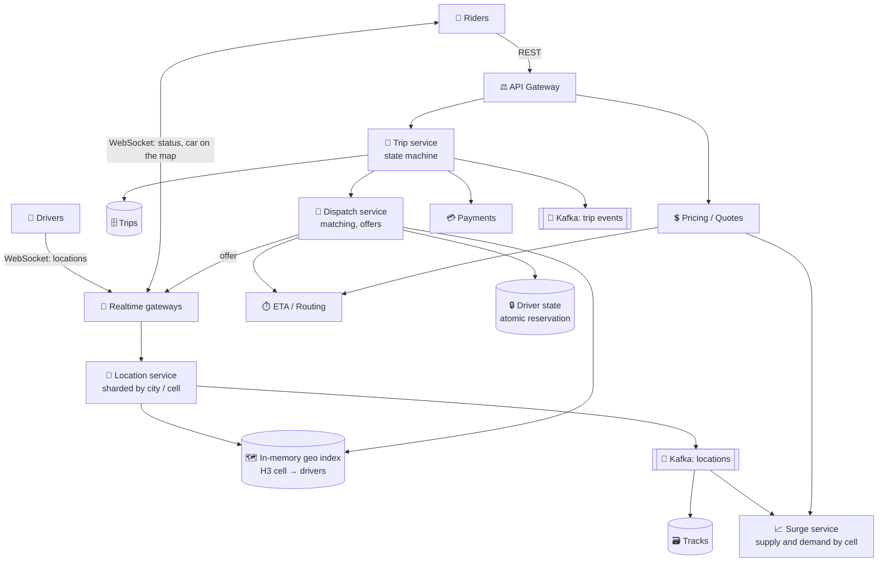
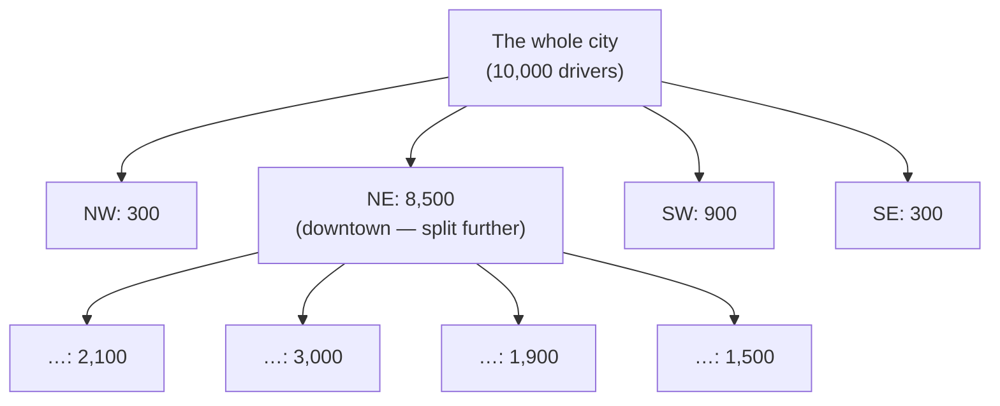
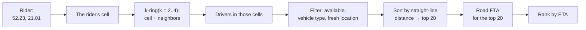
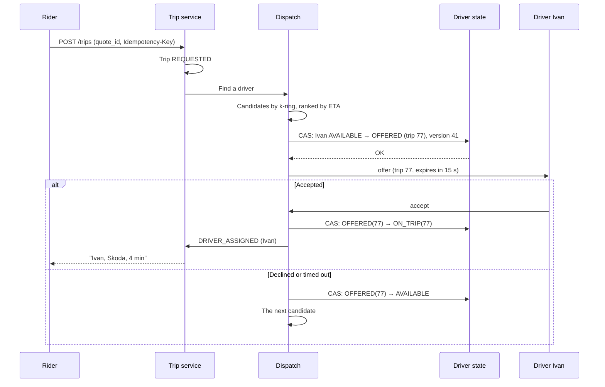
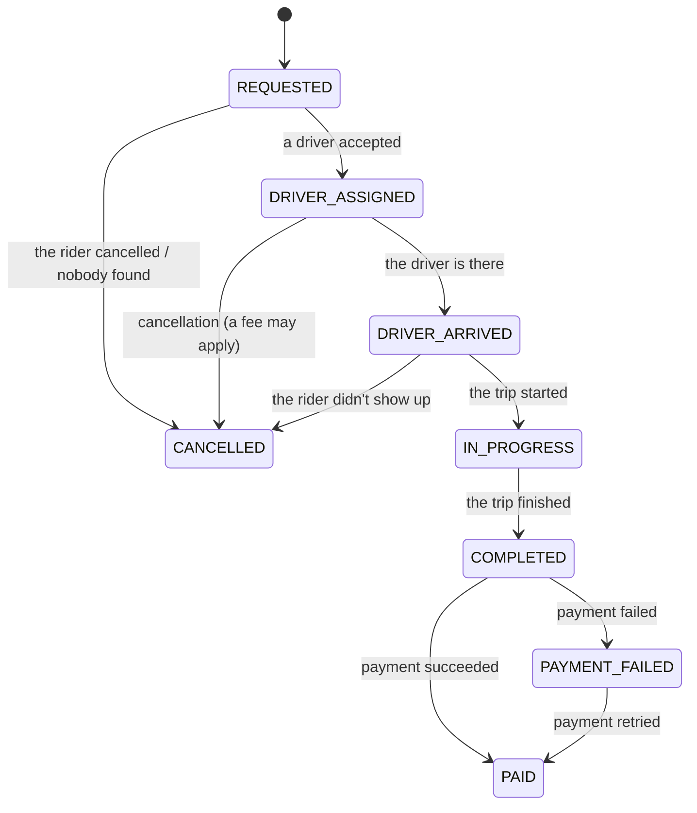
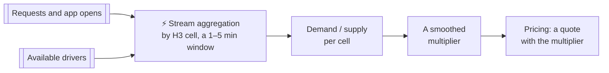

**English** | [Русский](README.ru.md)

# Tier 1 · 11. Uber / Ride-Hailing

> **Level:** Hard · **Interview time:** 45–60 min · **Study time:** ~5–6 h
> **Key aspects:** the driver location stream, geospatial indexes (geohash, quadtree, S2, H3), finding nearby drivers, matching and ride offers, protection against double assignment, the trip state machine, ETA and routing, dynamic pricing, geo-sharding
> **Builds on:** [12-communication: interview walkthrough](../../01_Fundamentals/12_Communication/INTERVIEW.md) (WebSocket and the location stream), [06-partitioning](../../01_Fundamentals/06_Partitioning/README.md), [07-consistency-models](../../01_Fundamentals/07_Consistency%20models/README.md), [08-consensus](../../01_Fundamentals/08_Consensus/README.md#10-split-brain-and-fencing-tokens), [10-idempotency](../../01_Fundamentals/10_Idempotency/README.md)

---

## 🗺️ How to Read This Walkthrough

The walkthrough follows an interview, but every step includes explanations: **why** a decision is made, **how** a mechanism works and **what happens** if you do it differently. The "📘 Explanation" blocks are theory right where you need it.

| Icon | Meaning |
|:----:|:--------|
| 🎤 | Interviewer |
| 🗣️ | What I (the candidate) say out loud |
| ✏️ | What I draw on the whiteboard |
| ⏱️ | Time budget for the step |
| 📘 | A detailed explanation of a concept |

Callouts: **TIP** — a good technique, **WARNING** — a trap, **IMPORTANT** — a Senior+ signal.

---

## 📑 Contents

0. [What This Problem Teaches](#0-what-this-problem-teaches)
1. [Problem Statement](#1-problem-statement)
2. [Clarifying Questions and Requirements](#2-clarifying-questions-and-requirements)
3. [Capacity Estimates](#3-capacity-estimates)
4. [API](#4-api)
5. [Data Model](#5-data-model)
6. [High-Level Design](#6-high-level-design)
7. [Deep Dive 1: The Location Stream](#7-deep-dive-1-the-location-stream)
8. [Deep Dive 2: Geospatial Indexes](#8-deep-dive-2-geospatial-indexes)
9. [Deep Dive 3: Finding Nearby Drivers](#9-deep-dive-3-finding-nearby-drivers)
10. [Deep Dive 4: Matching and Ride Offers](#10-deep-dive-4-matching-and-ride-offers)
11. [Deep Dive 5: The Trip State Machine](#11-deep-dive-5-the-trip-state-machine)
12. [Deep Dive 6: ETA and Routing](#12-deep-dive-6-eta-and-routing)
13. [Deep Dive 7: Dynamic Pricing](#13-deep-dive-7-dynamic-pricing)
14. [Deep Dive 8: Geo-Sharding and Resilience](#14-deep-dive-8-geo-sharding-and-resilience)
15. [Bottlenecks and Failure Scenarios](#15-bottlenecks-and-failure-scenarios)
16. [What Changes at 10x Scale](#16-what-changes-at-10x-scale)
17. [Key Concepts and New Terms](#17-key-concepts-and-new-terms)
18. [Variations and Follow-Up Questions](#18-variations-and-follow-up-questions)
19. [Common Mistakes](#19-common-mistakes)
20. [Cheat Sheet and Self-Check](#20-cheat-sheet-and-self-check)

---

## 0. What This Problem Teaches

Ride-hailing is the main problem about **geospatial data** and **fast-changing state**. A million drivers move every second, and within a fraction of a second you must find the nearest available ones without handing one driver to two riders.

| What's tested | Where it shows up |
|:--------------|:------------------|
| Geospatial data structures | Geohash, quadtree, S2, H3 — how to search "nearby" |
| High-frequency updates | 250,000 location updates per second |
| Concurrency and consistency | One driver — one trip; no double assignments |
| State machines | The trip lifecycle with transitions and cancellations |
| Real-time optimization | Matching by ETA, not straight-line distance |
| Sharding by geography | A city or a cell as the shard key |
| Real-time communication | The car's position on the rider's map |

> [!TIP]
> Interviewers most often go deep on **the geo index** (explain how to find drivers within 2 km without a full scan) and **matching without double assignment**. The transport layer (WebSocket, the location stream) is covered in [12-communication](../../01_Fundamentals/12_Communication/INTERVIEW.md) — refer to it and don't spend much time there.

---

## 1. Problem Statement

> 🎤 "Design Uber: a rider requests a trip, the system finds the nearest suitable driver, the rider sees the car on a map, and payment happens after the trip."

**What the user sees:**

```
1. Opens the app → nearby cars on a map, a price and a pickup time
2. Taps "Request" → a few seconds later "Driver Ivan, Skoda Octavia, 4 minutes"
3. Watches the car drive toward them
4. The trip → automatic payment on completion
```

**Time plan:**

| Step | ⏱️ |
|:-----|:--:|
| Requirements | 5 min |
| Estimates | 4 min |
| API and data | 5 min |
| High-level design | 6 min |
| Deep dives | 22–30 min |
| Failures and wrap-up | 3 min |

---

## 2. Clarifying Questions and Requirements

⏱️ 5 min

| My question | Interviewer's answer | What it changes and why |
|:------------|:---------------------|:------------------------|
| Scale? | ~1M drivers online at peak, ~30M trips per day, hundreds of cities | 250,000 location updates per second |
| How often does a driver send their location? | Every ~4 seconds | A stream of updates, not transactions |
| How fast must a driver be found? | An offer to a driver within seconds of the request | Search over an in-memory index |
| Does "nearest" need to be precise? | Pickup time matters more than straight-line distance | Ranking by ETA via routing |
| Can a driver be assigned to two trips? | Absolutely not | Atomic driver reservation |
| Dynamic pricing? | Yes, at high demand | Aggregating supply and demand by area |
| Payment? | Yes, automatic | Integration with a payment system (#20) |
| Shared rides (pool)? | Out of scope, discuss briefly | Simplifies matching |

### Functional requirements

1. Drivers send their location and status (available, busy, offline).
2. A rider sees nearby cars, a price and a pickup time.
3. A rider requests a trip; the system finds and assigns a driver.
4. Both sides see each other on the map during pickup and the trip.
5. A trip moves through stages from request to payment; cancellations at various stages.
6. Fare calculation and payment.

### Non-functional requirements

| Requirement | Target | Why |
|:------------|:-------|:----|
| Time to assign a driver | Seconds | The rider waits on an open screen |
| Nearby search latency | p99 < 100 ms | The map with cars is the first screen |
| Assignment consistency | Strict: one driver — one trip | Otherwise two riders wait for one car |
| Trip reliability | Trip state is never lost | Money and safety |
| Locations | Eventual; losing individual updates is fine | A new one arrives in 4 seconds |
| Availability | 99.99% | People depend on the service to get places |

> [!NOTE]
> It's important to separate **two kinds of data**: locations are ephemeral and plentiful, and losing some is fine; trips are few but critical, and must be strongly consistent and durable. They get different stores and different guarantees.

---

## 3. Capacity Estimates

⏱️ 4 min

```
Driver locations
  1M online × 1 update per 4 s       = 250,000 updates/s
  ~100 B per update                   = ~25 MB/s inbound

The in-memory driver index
  1M drivers × ~100 B (id, coordinates, status, cell) ≈ 100 MB — small!

Trips
  30M per day → ~350/s on average, at peak (Friday evening, rain) ~3,000/s

"Cars nearby" requests
  Riders with the app open refresh the map → tens of thousands of requests/s

Track history
  at 250,000/s … ~20B points per day ≈ 2 TB/day → for fare calculation and disputes
```

### Conclusions

| Conclusion | Design consequence |
|:-----------|:-------------------|
| The driver index is only ~100 MB | Size isn't the problem — keep it in memory; the problem is **update frequency** and **search speed** |
| 250,000 updates/s | Not into a database: into memory + a Kafka stream for history |
| There aren't many trips (thousands per second) | A transactional database copes; consistency matters, not scale |
| Data is local to cities | Sharding by geography |

---

## 4. API

⏱️ 3 min

```http
# Rider
GET  /v1/nearby?lat=52.23&lng=21.01&product=standard   → nearby cars (for the map)
POST /v1/quotes        { pickup, dropoff, product }    → { quote_id, price, eta, expires_at }
POST /v1/trips         Idempotency-Key
                       { quote_id, pickup, dropoff, payment_method_id }
                       → 201 { trip_id, status: "REQUESTED" }
POST /v1/trips/{id}/cancel
GET  /v1/trips/{id}

# Driver
PUT  /v1/drivers/me/status        { status: "AVAILABLE" | "OFFLINE" }
WS   location updates: { lat, lng, heading, speed, ts }        ← over WebSocket
WS   offer: { trip_id, pickup, eta, expires_in: 15 }
POST /v1/offers/{trip_id}/accept  | /decline
POST /v1/trips/{id}/arrived | /start | /complete
```

📘 **Why `quote_id`.** The rider sees a price before requesting. If the price were recalculated at request time, it might change (a surge multiplier kicked in), and the rider would get something different from what they saw. A quote with an ID and an expiry **locks the price**: the request references the quote, and the server checks it hasn't expired.

---

## 5. Data Model

⏱️ 3 min

| Data | Fields | Store | Why |
|:-----|:-------|:------|:----|
| **Drivers** (profile) | driver_id, name, vehicle, rating, city | A relational DB + cache | Changes rarely |
| **Driver state** | driver_id, status, current_trip_id, lat/lng, cell, updated_at, version | In the location service's memory + Redis | Changes every few seconds |
| **The geo index** | cell → set of driver_ids | In memory, sharded by city | Fast nearby search |
| **Trips** | trip_id, rider_id, driver_id, status, version, pickup, dropoff, quote_id, timestamps, fare | A sharded relational DB | Strong consistency, transactions |
| **Trip events** | trip_id, seq, event, ts | A log (DB + Kafka) | Auditing, recovery, analytics |
| **Tracks** | trip_id or driver_id, ts → points | Wide-column / time-series | A huge stream, read per trip |
| **Quotes** | quote_id → price, multiplier, expiry | Redis with a TTL | Short-lived |

---

## 6. High-Level Design

⏱️ 6 min



🗣️ "Two worlds with different guarantees:
- **the location stream** (hot, ephemeral): WebSocket → location service → an in-memory geo index + Kafka for history;
- **trips** (critical, consistent): a trip service with a state machine in a transactional database; dispatch finds candidates in the geo index, ranks them by ETA and **atomically reserves** a driver.

Pricing computes the price with the demand multiplier from the surge service; payments happen when the trip completes."

---

## 7. Deep Dive 1: The Location Stream

> 🎤 "250,000 location updates per second. Where do they go?"

The transport layer is covered in detail in [12-communication](../../01_Fundamentals/12_Communication/INTERVIEW.md#8-deep-dive-2-the-driver-location-stream). In short:

| Principle | Implementation |
|:----------|:---------------|
| A persistent connection | The driver sends locations over a WebSocket, not a new HTTP request |
| A compact format | Binary, ~60–100 bytes |
| Batching | The gateway collects locations and sends them to the location service in batches |
| Only the latest location in the index | Overwrites, not history |
| History — separately | A Kafka stream → the track store |
| At-most-once | Losing one location doesn't matter |
| Dropping stale updates | A location with an older timestamp is ignored |

### GPS noise

📘 In a city, GPS is off by tens of meters: a car "jumps" through buildings or ends up in a river. That matters both for the map and for fare calculation.

| Solution | How |
|:---------|:----|
| **Filtering** | Drop physically impossible jumps (300 km/h between points) |
| **Smoothing** | A Kalman filter combines GPS, speed and heading |
| **Snapping to roads (map matching)** | Points "stick" to the nearest suitable road, accounting for the direction of travel |

---

## 8. Deep Dive 2: Geospatial Indexes

> 🎤 "How do you find all available drivers within 2 km of a rider?"

### Why not an ordinary index

```sql
SELECT * FROM drivers
WHERE lat BETWEEN 52.21 AND 52.25 AND lng BETWEEN 20.98 AND 21.04 AND status = 'AVAILABLE';
```

📘 A B-tree index is one-dimensional: it narrows the search by `lat` to a band spanning the whole globe at that latitude, and then every point in the band must be scanned to check `lng`. A composite `(lat, lng)` index doesn't help, for the same reason. You need a way to turn **two-dimensional** space into keys that support "nearby" searches.

### Geohash

📘 Coordinates are encoded as a string: latitude and longitude bits are **interleaved** (a longitude bit, then a latitude bit, and so on), then groups of 5 bits are written as base32 characters. Each additional character splits the cell into 32 smaller ones.

```
Warsaw, the center: 52.2297, 21.0122 → geohash "u3qcnh…"

A shared prefix = a shared cell:
  "u3qcn"  — a ~4.9 × 4.9 km cell
  "u3qcnh" — a ~1.2 × 0.6 km cell
```

| Length | Cell size (approximately, at the equator) |
|:------:|:------------------------------------------|
| 4 | ~39 × 20 km |
| 5 | ~4.9 × 4.9 km |
| 6 | ~1.2 × 0.6 km |
| 7 | ~153 × 153 m |

**Nearby search:** compute the rider's geohash and take its cell **plus its 8 neighbors** (because the rider may stand at a cell's edge while a driver is just across it, in a cell with an entirely different prefix).

| ✅ Pros | ❌ Cons |
|:-------|:-------|
| Simple: a string, prefix search in any database (Redis `GEOSEARCH` is built on geohash) | Neighboring points on a cell boundary may have different prefixes — neighbor search is needed |
| A hierarchy: prefix length = cell size | Cells differ in area at different latitudes; they're rectangular |

### Quadtree

📘 A tree in which each node is a rectangle. If a rectangle holds more than K points (e.g. 100), it splits into 4 equal parts, recursively.



| ✅ Pros | ❌ Cons |
|:-------|:-------|
| **Adapts to density**: deep, small nodes downtown; large ones in the suburbs | Moving points constantly trigger restructuring (splits and merges) |
| Good for static objects (restaurants in Yelp) | Harder to distribute across servers |

### S2 (Google)

📘 The Earth's sphere is projected onto the faces of a cube, each face is divided into a hierarchy of cells, and cells are numbered along a **Hilbert curve** — a curve that covers the plane such that nearby points usually get nearby numbers. Each cell is a 64-bit number; a search area is a set of number ranges.

| ✅ Pros | ❌ Cons |
|:-------|:-------|
| Works precisely on the sphere; cells are close in area | Harder to implement and understand |
| Covering an arbitrary area with a set of cells at different levels | |

### H3 (Uber)

📘 A hierarchical grid of **hexagons** (16 resolution levels) created by Uber. Each cell has a 64-bit identifier.

```
Resolution 7:  average cell area ~5 km²
Resolution 8:  ~0.7 km²   (edge ~460 m)
Resolution 9:  ~0.1 km²   (edge ~170 m)

k-ring(cell, k): the cell and every neighbor within ≤ k steps
```

**Why hexagons.** A square has 8 neighbors at **different** distances (edge versus diagonal). A hexagon has 6 neighbors, and **all are equidistant** from its center. That's convenient for "within a radius" searches (k-rings are nearly circular) and for aggregating supply and demand by area without distortion.

| ✅ Pros | ❌ Cons |
|:-------|:-------|
| Equidistant neighbors, nearly circular k-rings | Hexagons don't subdivide perfectly into 7 smaller ones — child cells slightly overhang the parent |
| Convenient for area analytics (surge) | A library, not a built-in database feature |

### Comparison

| | Geohash | Quadtree | S2 | H3 |
|:-|:--------|:---------|:---|:---|
| Cell shape | Rectangle | Rectangle, adaptive | A quadrilateral on the sphere | Hexagon |
| Adapts to density | No | **Yes** | Via levels | Via levels |
| Neighbors | 8, at different distances | Complicated | Via ranges | **6, equidistant** |
| Simplicity | **Highest** | Medium | Lower | Medium (a library) |
| Moving objects | Good | Restructuring | Good | **Good** |
| Where | Redis GEO, Elasticsearch | Static POIs | Google, databases | Uber: dispatch, surge |

🗣️ "For moving drivers I choose **a fixed grid** (H3 at resolution 8–9, or a geohash of length 6): as a driver moves, they just cross from one cell into another, with no tree restructuring. A quadtree is better for static objects with very uneven density — that's the nearby-search problem (#12)."

> [!IMPORTANT]
> **Senior+ signal:** explain **why** an ordinary index fails for two dimensions, show the cell boundary problem (neighbor search), and justify the choice between a fixed grid and an adaptive tree by **the nature of the data**: moving points versus static ones.

---

## 9. Deep Dive 3: Finding Nearby Drivers

> 🎤 "How is the in-memory driver index structured, and how is a query executed?"

### Structure

```
cell_index:   H3 cell (resolution 9) → { driver_id, … }
driver_state: driver_id → { lat, lng, cell, status, vehicle_type, updated_at }
```

### Updating a location

```python
def on_location(driver_id, lat, lng, ts):
    state = driver_state[driver_id]
    if ts <= state.updated_at:            # a stale update — ignore it
        return
    new_cell = h3.latlng_to_cell(lat, lng, 9)
    if new_cell != state.cell:            # moved into another cell
        cell_index[state.cell].discard(driver_id)
        cell_index[new_cell].add(driver_id)
    state.lat, state.lng, state.cell, state.updated_at = lat, lng, new_cell, ts
```

Most updates don't change the cell (a resolution-9 cell has a ~170 m edge, which a car crosses in tens of seconds), so an update is mostly an overwrite of coordinates.

### The "nearby drivers" query



| Step | Why |
|:-----|:----|
| **A k-ring that expands** | Start with a small radius; if there are few candidates (outskirts, night) — increase k |
| **A freshness filter** | A driver who hasn't sent a location in 30 seconds has probably lost connectivity — don't offer them |
| **Rough straight-line sorting first** | Cheaply cuts off distant drivers |
| **Then road ETA** for a small number | Routing is expensive — only for the top; a driver 500 m away across a river may take longer than one 1.5 km away |

> [!TIP]
> The "cars on the map" query (for display) and the **dispatch** query (for assignment) can be served differently: the map is fine with approximate locations and even a few seconds of per-cell caching, while dispatch needs fresh data and a strict status check.

---

## 10. Deep Dive 4: Matching and Ride Offers

> 🎤 "The rider tapped 'Request'. How do you assign a driver without handing them to two riders?"

### The offer flow



### Protecting against double assignment

📘 Two dispatch processes are handling two riders at once, and both chose Ivan as the nearest. Without protection Ivan gets two offers, and on accepting — two trips.

| Solution | How |
|:---------|:----|
| **An atomic compare-and-set** on driver status | `AVAILABLE → OFFERED(trip)` succeeds only if the driver is still `AVAILABLE` (version or status unchanged). The loser takes the next candidate |
| **A single owner per driver** | A city's drivers are served by one dispatch shard — decisions are serialized within the shard |
| **One offer at a time** | While a driver is `OFFERED`, other searches don't see them |
| **An offer timeout** | After 15 seconds with no response — automatically back to `AVAILABLE` |

```lua
-- Redis Lua: reserve the driver if they're available
local status = redis.call('HGET', KEYS[1], 'status')
if status ~= 'AVAILABLE' then return 0 end
redis.call('HSET', KEYS[1], 'status', 'OFFERED', 'trip', ARGV[1], 'offer_expires', ARGV[2])
return 1
```

> [!WARNING]
> Checking "is the driver available" and reserving them must be **one atomic operation**. "Read the status, then write" produces the same race as in the [rate limiter](../02_Design%20a%20Rate%20Limiter%20or%20Abuse%20Protection/README.md#8-deep-dive-2-distributed-limits-and-atomicity).

### Batch matching

📘 The greedy approach "give each rider the nearest available driver" isn't globally optimal:

```
Rider A: nearest is driver 1 (2 min), second is driver 2 (3 min)
Rider B: nearest is driver 1 (3 min), second is driver 2 (10 min)

Greedy (A requested first): A ← 1 (2 min), B ← 2 (10 min) → a total of 12 min
Optimal:                    A ← 2 (3 min), B ← 1 (3 min)  → a total of 6 min
```

So dispatch can accumulate requests over a short window (1–2 seconds) and solve **the assignment problem** (a bipartite matching minimizing total ETA) for all of an area's requests and drivers at once. Uber described such a batched approach. The trade-off: a small delay for a better distribution.

### The offer to the driver

| Question | Solution |
|:---------|:---------|
| How to deliver it | Over the driver's WebSocket; if delivery isn't confirmed — a push notification |
| How long to wait | 10–15 seconds |
| If declined | The next candidate; declines affect the acceptance rating |
| If nobody accepts | Widen the radius and retry; after N attempts — tell the rider |

---

## 11. Deep Dive 5: The Trip State Machine

> 🎤 "What states does a trip have, and how do you guarantee correct transitions?"



### Transition rules

| Principle | Implementation |
|:----------|:---------------|
| **Only certain transitions are allowed** | A table of allowed transitions; `COMPLETED → DRIVER_ASSIGNED` is impossible |
| **Optimistic locking** | `UPDATE trips SET status = :new, version = version + 1 WHERE trip_id = :id AND status = :expected AND version = :v` — the race between "the driver completed" and "the rider cancelled" is decided by whoever got there first |
| **Idempotency** | A repeated "complete" from the driver (after a network drop) doesn't create a second charge |
| **An event per transition** | Written to the trip event log and to Kafka via an outbox (notifications, analytics, payment) — see [09-messaging](../../01_Fundamentals/09_Messaging/README.md#7-the-producer-side-the-dual-write-problem-and-the-outbox) |
| **Linked to driver state** | Completing or cancelling a trip returns the driver to `AVAILABLE` |

📘 **Why a state machine rather than a set of flags.** Flags like `is_started`, `is_cancelled`, `is_paid` allow impossible combinations (cancelled and paid). An explicit state machine with a single `status` field and a transition table makes invalid states **unrepresentable**.

### Payment

| Stage | What happens |
|:------|:-------------|
| At request | A pre-authorization (hold) for the quoted amount |
| After completion | The actual fare is computed from the track (distance after map matching, time) and charged |
| A payment error | `PAYMENT_FAILED`, retries, another payment method |

Idempotent payments in detail — Tier 1 #20.

---

## 12. Deep Dive 6: ETA and Routing

> 🎤 "How do you compute the pickup time?"

📘 The road network is a graph: intersections are vertices, road segments are edges weighted by "travel time". The pickup time is the shortest path by time.

| Problem | Solution |
|:--------|:---------|
| Dijkstra's algorithm over a city or country graph is too slow for thousands of queries per second | **Precomputation**: contraction hierarchies — the graph is augmented in advance with "shortcuts" that bypass minor vertices, and a query runs in milliseconds |
| Traffic changes | Edge weights are updated from live data: drivers' speeds on segments (from the location stream) |
| The graph alone isn't accurate enough | An ML model corrects ETA based on history (time of day, weather, pickup location specifics) |
| Many queries | A short-lived cache of ETAs between cells; for ranking candidates — a "drivers × rider" matrix in one request |

---

## 13. Deep Dive 7: Dynamic Pricing

> 🎤 "How does surge pricing work at high demand?"

📘 If an area has more requests than available drivers, the price rises: some riders will wait, and drivers from neighboring areas will come here.



| Decision | Why |
|:---------|:----|
| Aggregating by **H3 cells** | Same-size hexagons with equidistant neighbors are convenient for spatial smoothing |
| A sliding window of a few minutes | React to changes, but not to second-level noise |
| **Smoothing** over time and across neighboring cells | The multiplier shouldn't jump or differ sharply between adjacent streets |
| The price is locked in a **quote** | The rider pays what they saw, even if the multiplier changes a second later |
| Limits | A maximum multiplier, rules during emergencies |

---

## 14. Deep Dive 8: Geo-Sharding and Resilience

> 🎤 "How do you distribute the system across servers, and what happens on failures?"

### Geo-sharding

📘 Ride-hailing data is **local**: a rider in Warsaw will never be served by a driver in Berlin. So the shard key is geography.

| Approach | How | Problem |
|:---------|:----|:--------|
| By city | Shard = city | Big cities are overloaded; city borders |
| **By cell** (low-resolution H3) with consistent hashing | Cells are distributed across nodes; a big city = many cells on different nodes | A query near a cell boundary touches several nodes — fan-out to neighbors |

Uber described the Ringpop library (consistent hashing + gossip) for distributing this kind of state across nodes.

### What happens on failures

| Failure | Consequence | Solution |
|:--------|:------------|:---------|
| A location service node dies | The shard's geo index is lost | The index **rebuilds itself** within seconds from the next location updates (every 4 s); replicas for fast failover |
| A dispatch node dies mid-offer | A driver is "stuck" in `OFFERED` | The offer timeout returns the driver to `AVAILABLE`; driver state in Redis survives the process crash |
| Two nodes believe they own a shard | Double assignment | An atomic CAS in the shared driver state store + fencing (see [08-consensus](../../01_Fundamentals/08_Consensus/README.md#10-split-brain-and-fencing-tokens)) |
| The driver app loses connectivity during a trip | No updates | The app continues the trip locally, records the track and syncs on reconnect |
| The trip database is down | Trips can't be created | Replicas, failover; trips in progress continue on the clients |
| A region is down | A city isn't served | Failover to a backup region; Uber described keeping part of the trip state on the driver's phone to recover after failover |

> [!TIP]
> A useful point for the interview: **the geo index is derived, ephemeral data**. It doesn't need durable storage: it rebuilds entirely from the location stream within one update interval. Only **trip** state must be durable.

---

## 15. Bottlenecks and Failure Scenarios

| Scenario | What happens | How we protect |
|:---------|:-------------|:---------------|
| 250,000 location updates per second | Overloading a database | Memory + Kafka only; batching at the gateways |
| Two riders, one nearest driver | Double assignment | An atomic CAS on driver status |
| A driver doesn't respond to an offer | The rider waits | A 15 s timeout, the next candidate |
| GPS noise | Jumping cars, wrong fares | Filtering, smoothing, map matching |
| Peak demand (rain, a concert) | A driver shortage | Surge, a wider radius, batch matching |
| A geo index node dies | Temporarily no candidates | Rebuilding from the location stream, replicas |
| Shard boundaries | Missing nearby drivers | Querying neighboring cells and shards |
| A "complete" vs "cancel" race | An inconsistent trip | Optimistic locking in the state machine |
| A repeated "complete" after a drop | A double charge | Idempotent transitions and payments |
| A region failure | A city is unavailable | A backup region, trip recovery |

---

## 16. What Changes at 10x Scale

> 🎤 "10 million drivers online?"

| Change | Why |
|:-------|:----|
| **Finer sharding by cell** | More drivers per unit area in big cities |
| **Adaptive location frequency** | A parked available driver — less often; on a trip — more often |
| **Batch matching with ML** | Predicting demand, repositioning drivers in advance |
| **Regional routing** with precomputation per regional graph | ETA load |
| **Pool (shared rides)** | Matching becomes a multi-stop routing problem |

---

## 17. Key Concepts and New Terms

### What's applied from Fundamentals

| Concept | Where it's covered | How it applies here |
|:--------|:-------------------|:--------------------|
| WebSocket, the location stream | [12-communication: interview](../../01_Fundamentals/12_Communication/INTERVIEW.md) | Transporting locations and updates |
| Sharding, consistent hashing | [06-partitioning](../../01_Fundamentals/06_Partitioning/README.md) | Geo-sharding |
| Fencing, split brain | [08-consensus](../../01_Fundamentals/08_Consensus/README.md#10-split-brain-and-fencing-tokens) | Protecting against two shard owners |
| Outbox and events | [09-messaging](../../01_Fundamentals/09_Messaging/README.md) | Trip events |
| Idempotency | [10-idempotency](../../01_Fundamentals/10_Idempotency/README.md) | Requests, transitions, payments |
| Atomic CAS | [Tier 1 · 02](../02_Design%20a%20Rate%20Limiter%20or%20Abuse%20Protection/README.md#8-deep-dive-2-distributed-limits-and-atomicity) | Reserving a driver |

### New terms in this problem

| Term | In short |
|:-----|:---------|
| **Geohash** | Interleaving latitude and longitude bits into a string; prefix = cell |
| **Quadtree** | Recursive four-way subdivision by point density |
| **S2** | Sphere cells on the faces of a cube, numbered along a Hilbert curve |
| **H3** | A hierarchical hexagonal grid with equidistant neighbors |
| **k-ring** | A cell and every neighbor within k steps |
| **Map matching** | Snapping GPS points to roads |
| **Batch matching** | Assigning drivers to a group of requests, minimizing total ETA |
| **Quote** | A locked price with an ID and an expiry |
| **Contraction hierarchies** | Road graph precomputation for fast shortest paths |
| **Surge** | A price multiplier from the supply-demand ratio in a cell |

---

## 18. Variations and Follow-Up Questions

<details>
<summary><b>Why not use Redis GEOSEARCH for everything?</b></summary>

Redis GEO (built on geohash in a sorted set) is a great option for small and mid-sized systems: adding a location and searching within a radius out of the box. At the scale of a million drivers with 250,000 updates per second and complex filtering (status, vehicle type, freshness), a custom in-memory index inside the service, sharded by cell, with atomic driver state next to it, is more convenient.
</details>

<details>
<summary><b>How do you show the rider the car driving toward them?</b></summary>

After assignment, the driver's locations are forwarded only to that trip's rider over WebSocket (fan-out keeps a "driver → rider of the active trip" mapping). Locations are at-most-once; only the latest matters. Details in [12-communication](../../01_Fundamentals/12_Communication/INTERVIEW.md).
</details>

<details>
<summary><b>How do you calculate the fare?</b></summary>

From the trip's track after filtering and map matching — distance and time, using the city's tariff with the multiplier from the quote. If the track is incomplete (the driver lost connectivity), missing segments are reconstructed along the route between known points.
</details>

<details>
<summary><b>How does Uber differ from food delivery?</b></summary>

Delivery has three parties (customer, restaurant, courier), and syncing with preparation time matters: the courier is assigned so they arrive when the order is ready. Several orders may be batched onto one courier. The geo index and the state machine are similar.
</details>

<details>
<summary><b>How do you find a driver when nobody is nearby?</b></summary>

Expand the k-ring step by step up to a maximum radius; if there are no candidates — tell the rider and offer to wait or choose another vehicle type. Surge in that area raises the price and draws drivers from neighboring areas.
</details>

---

## 19. Common Mistakes

| ❌ Mistake | Why it's bad | ✅ Do this instead |
|:----------|:-------------|:------------------|
| Locations in a relational database | 250,000 writes per second | Memory + Kafka for history |
| `WHERE lat BETWEEN … AND lng BETWEEN …` | A one-dimensional index doesn't help | A geo index: geohash, H3, S2 |
| Searching only your own cell | Missing drivers across the cell boundary | Cell + neighbors (k-ring) |
| A quadtree for moving drivers | Constant restructuring | A fixed grid |
| Ranking by straight-line distance | A driver across a river looks "closer" | Road ETA for the top candidates |
| "Read the status, then assign" | Double assignment | An atomic CAS |
| Flags instead of a state machine | Impossible state combinations | An explicit machine with a transition table |
| Recalculating the price at request time | The rider pays something different from what they saw | A quote with an ID and an expiry |
| Storing the geo index durably | Unnecessary complexity | Rebuild it from the location stream |
| Ignoring GPS noise | Jumping cars and wrong fares | Filtering and map matching |

---

## 20. Cheat Sheet and Self-Check

### 30-second answer

> Two worlds: ephemeral locations and consistent trips. 250,000 locations per second flow over WebSocket into a location service sharded by H3 cell: in memory — `cell → drivers` and `driver → state`, overwriting the latest location and dropping stale ones; a Kafka stream for tracks and surge. The index is ~100 MB and rebuilds from the stream within seconds. Search: a k-ring around the rider's cell, filtering by status and freshness, a rough straight-line sort, then road ETA (contraction hierarchies + live speeds) for the top 20. Assignment: an atomic CAS `AVAILABLE → OFFERED`, an offer over WebSocket with a 15 s timeout, the next candidate on decline; batch matching minimizes total ETA. A trip is a state machine with optimistic locking, idempotent transitions and events via an outbox. The price is locked in a quote; surge is supply/demand per cell with smoothing. Payment — a hold at request, a charge from the track.

### Self-check

- [ ] I can estimate the load and explain why the index fits in memory
- [ ] I can explain why an ordinary index doesn't work for coordinates
- [ ] I can explain geohash, the boundary problem and neighbor search
- [ ] I can compare geohash, quadtree, S2 and H3, and choose one for moving objects
- [ ] I can describe updating the index and the "nearby drivers" query
- [ ] I can explain the protection against double assignment
- [ ] I can explain why batch matching is needed, with an example
- [ ] I can draw the trip state machine and explain optimistic locking
- [ ] I can explain road-graph ETA and surge
- [ ] I can describe geo-sharding and recovering from failures

### Further reading

- Uber Engineering: *H3: Uber's Hexagonal Hierarchical Spatial Index* (2018)
- Uber Engineering: articles on dispatch, Ringpop and trip reliability
- Google S2 Geometry documentation
- Geisberger et al., *Contraction Hierarchies: Faster and Simpler Hierarchical Routing in Road Networks* (2008)
- Alex Xu, Sahn Lam, *System Design Interview*, Vol. 2 — chapters "Proximity Service" and "Nearby Friends"