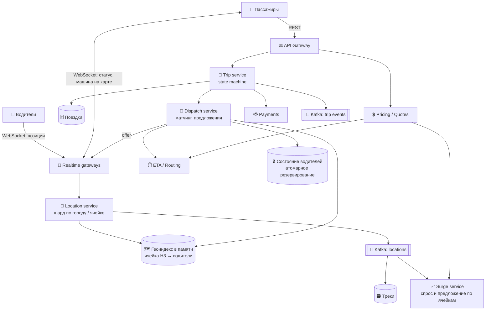
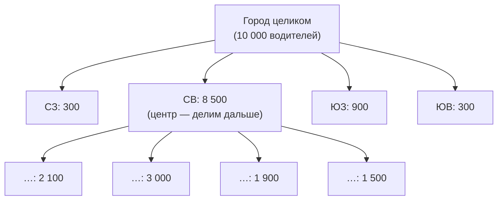
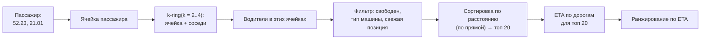
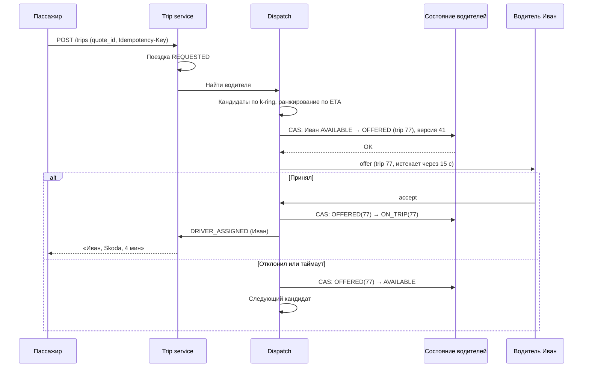
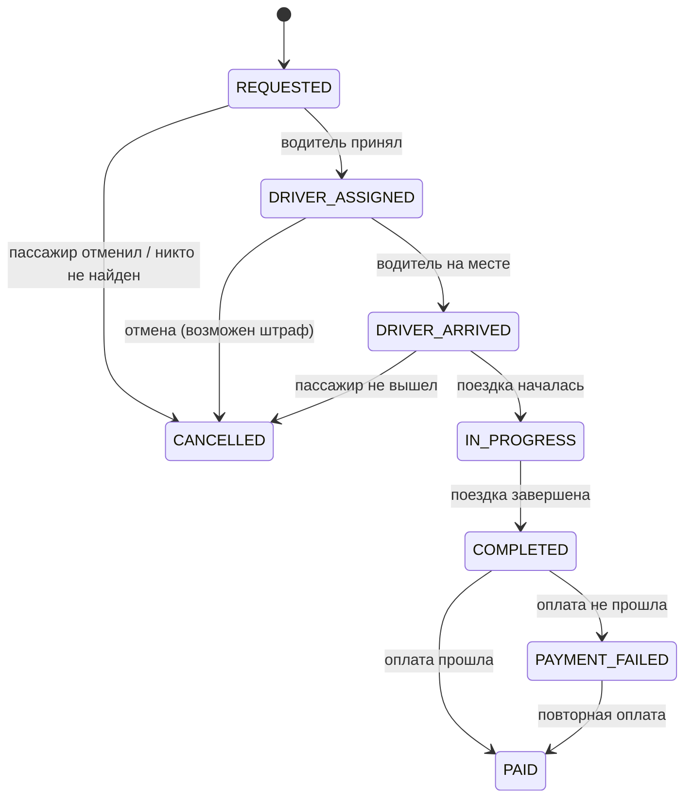

[English](README.md) | **Русский**

# Tier 1 · 11. Uber / сервис такси

> **Уровень:** Hard · **Время на интервью:** 45–60 мин · **Время на разбор:** ~5–6 ч
> **Ключевые аспекты:** поток геопозиций водителей, геопространственные индексы (geohash, quadtree, S2, H3), поиск ближайших водителей, матчинг и предложение заказа, защита от двойного назначения, state machine поездки, ETA и маршрутизация, динамическое ценообразование, гео-шардирование
> **Опирается на:** [12-communication: разбор интервью](../../01_Fundamentals/12_Communication/INTERVIEW.ru.md) (WebSocket и поток геопозиций), [06-partitioning](../../01_Fundamentals/06_Partitioning/README.ru.md), [07-consistency-models](../../01_Fundamentals/07_Consistency%20models/README.ru.md), [08-consensus](../../01_Fundamentals/08_Consensus/README.ru.md#10-split-brain-и-fencing-токены), [10-idempotency](../../01_Fundamentals/10_Idempotency/README.ru.md)

---

## 🗺️ Как читать этот разбор

Разбор построен как интервью, но в каждом шаге есть объяснения: **почему** принимается решение, **как работает** механизм и **что будет**, если сделать иначе. Блоки «📘 Объяснение» — теория прямо по ходу задачи.

| Значок | Что значит |
|:------:|:-----------|
| 🎤 | Реплика интервьюера |
| 🗣️ | Что говорю вслух я (кандидат) |
| ✏️ | Что рисую на доске |
| ⏱️ | Сколько времени тратить на шаг |
| 📘 | Подробное объяснение концепции |

Блоки **TIP** — хороший приём, **WARNING** — ловушка, **IMPORTANT** — сигнал для уровня Senior+.

---

## 📑 Содержание

0. [Чему учит эта задача](#0-чему-учит-эта-задача)
1. [Условие задачи](#1-условие-задачи)
2. [Уточняющие вопросы и требования](#2-уточняющие-вопросы-и-требования)
3. [Оценки нагрузки](#3-оценки-нагрузки)
4. [API](#4-api)
5. [Модель данных](#5-модель-данных)
6. [High-level дизайн](#6-high-level-дизайн)
7. [Deep dive 1: поток геопозиций](#7-deep-dive-1-поток-геопозиций)
8. [Deep dive 2: геопространственные индексы](#8-deep-dive-2-геопространственные-индексы)
9. [Deep dive 3: поиск ближайших водителей](#9-deep-dive-3-поиск-ближайших-водителей)
10. [Deep dive 4: матчинг и предложение заказа](#10-deep-dive-4-матчинг-и-предложение-заказа)
11. [Deep dive 5: state machine поездки](#11-deep-dive-5-state-machine-поездки)
12. [Deep dive 6: ETA и маршрутизация](#12-deep-dive-6-eta-и-маршрутизация)
13. [Deep dive 7: динамическое ценообразование](#13-deep-dive-7-динамическое-ценообразование)
14. [Deep dive 8: гео-шардирование и отказоустойчивость](#14-deep-dive-8-гео-шардирование-и-отказоустойчивость)
15. [Узкие места и сценарии сбоев](#15-узкие-места-и-сценарии-сбоев)
16. [Что изменится при росте в 10 раз](#16-что-изменится-при-росте-в-10-раз)
17. [Ключевые концепции и новые понятия](#17-ключевые-концепции-и-новые-понятия)
18. [Варианты задачи и follow-up вопросы](#18-варианты-задачи-и-follow-up-вопросы)
19. [Типичные ошибки](#19-типичные-ошибки)
20. [Шпаргалка и самопроверка](#20-шпаргалка-и-самопроверка)

---

## 0. Чему учит эта задача

Сервис такси — главная задача про **геопространственные данные** и **состояние, которое быстро меняется**. Миллион водителей двигается каждую секунду, а нужно за доли секунды найти ближайших свободных и не отдать одного водителя двум пассажирам.

| Что проверяют | Где это в задаче |
|:--------------|:-----------------|
| Геопространственные структуры данных | Geohash, quadtree, S2, H3 — как искать «рядом» |
| Высокочастотные обновления | 250 000 обновлений позиции в секунду |
| Конкурентность и консистентность | Один водитель — одна поездка; никаких двойных назначений |
| Конечные автоматы | Жизненный цикл поездки с переходами и отменами |
| Оптимизация в реальном времени | Матчинг по ETA, а не по прямой |
| Шардирование по географии | Город или ячейка как ключ шардирования |
| Real-time коммуникация | Позиция машины на карте пассажира |

> [!TIP]
> Интервьюеры чаще всего углубляются в **геоиндекс** (объясни, как найти водителей в радиусе 2 км без полного перебора) и в **матчинг без двойного назначения**. Транспортный уровень (WebSocket, поток позиций) разобран в [12-communication](../../01_Fundamentals/12_Communication/INTERVIEW.ru.md) — сошлись на него и не трать много времени.

---

## 1. Условие задачи

> 🎤 «Спроектируй Uber: пассажир заказывает поездку, система находит ближайшего подходящего водителя, пассажир видит машину на карте, после поездки происходит оплата».

**Что видит пользователь:**

```
1. Открывает приложение → на карте машины поблизости, цена и время подачи
2. Нажимает «Заказать» → через несколько секунд «Водитель Иван, Skoda Octavia, 4 минуты»
3. Видит, как машина едет к нему
4. Поездка → оплата автоматически по завершении
```

**План по времени:**

| Шаг | ⏱️ |
|:----|:--:|
| Требования | 5 мин |
| Оценки | 4 мин |
| API и данные | 5 мин |
| High-level дизайн | 6 мин |
| Deep dives | 22–30 мин |
| Сбои и итоги | 3 мин |

---

## 2. Уточняющие вопросы и требования

⏱️ 5 мин

| Мой вопрос | Ответ интервьюера | Что это меняет и почему |
|:-----------|:------------------|:------------------------|
| Масштаб? | ~1M водителей онлайн в пике, ~30M поездок в сутки, сотни городов | 250 000 обновлений позиции в секунду |
| Как часто водитель отправляет позицию? | Каждые ~4 секунды | Поток обновлений, а не транзакции |
| Как быстро найти водителя? | Предложение водителю — за секунды после заказа | Поиск по индексу в памяти |
| Важна ли точность «ближайшего»? | Важнее время подачи, а не расстояние по прямой | Ранжирование по ETA через маршрутизацию |
| Можно ли назначить водителя двум поездкам? | Ни в коем случае | Атомарное резервирование водителя |
| Динамическое ценообразование? | Да, при высоком спросе | Агрегация спроса и предложения по районам |
| Оплата? | Да, автоматически | Интеграция с платёжной системой (#20) |
| Общие поездки (пул)? | Вне рамок, обсудить кратко | Упрощает матчинг |

### Функциональные требования

1. Водители отправляют геопозицию и статус (свободен, занят, офлайн).
2. Пассажир видит машины рядом, цену и время подачи.
3. Пассажир заказывает поездку; система находит и назначает водителя.
4. Обе стороны видят друг друга на карте во время подачи и поездки.
5. Поездка проходит этапы от заказа до оплаты; отмены на разных этапах.
6. Расчёт стоимости и оплата.

### Нефункциональные требования

| Требование | Цель | Почему |
|:-----------|:-----|:-------|
| Время до назначения водителя | Секунды | Пассажир ждёт с открытым экраном |
| Задержка поиска рядом | p99 < 100 мс | Карта с машинами — первый экран |
| Консистентность назначения | Строгая: один водитель — одна поездка | Иначе два пассажира ждут одну машину |
| Надёжность поездки | Состояние поездки не теряется | Деньги и безопасность |
| Позиции | Eventual, допустима потеря отдельных обновлений | Через 4 секунды придёт новая |
| Доступность | 99,99% | Люди зависят от сервиса, чтобы добраться |

> [!NOTE]
> Важно разделить **два типа данных**: геопозиции — эфемерные, их много, потеря отдельных допустима; поездки — немногочисленные, но критичные, должны быть строго консистентными и долговечными. Для них — разные хранилища и разные гарантии.

---

## 3. Оценки нагрузки

⏱️ 4 мин

```
Позиции водителей
  1M онлайн × 1 обновление в 4 с     = 250 000 обновлений/с
  ~100 Б на обновление                = ~25 МБ/с входящего трафика

Индекс водителей в памяти
  1M водителей × ~100 Б (id, координаты, статус, ячейка) ≈ 100 МБ — мало!

Поездки
  30M в сутки → ~350/с в среднем, в пике (пятница вечером, дождь) ~3 000/с

Запросы «машины рядом»
  Пассажиры с открытым приложением обновляют карту → десятки тысяч запросов/с

История треков
  1M × 250 000/с … за сутки ~20B точек ≈ 2 ТБ/сутки → для расчёта стоимости и разбора споров
```

### Выводы

| Вывод | Следствие для дизайна |
|:------|:----------------------|
| Индекс водителей — всего ~100 МБ | Объём не проблема — держим в памяти; проблема — **частота обновлений** и **скорость поиска** |
| 250 000 обновлений/с | Не в базу данных: в память + поток в Kafka для истории |
| Поездок немного (тысячи в секунду) | Транзакционная база справляется; важна консистентность, а не масштаб |
| Данные локальны по городам | Шардирование по географии |

---

## 4. API

⏱️ 3 мин

```http
# Пассажир
GET  /v1/nearby?lat=52.23&lng=21.01&product=standard   → машины рядом (для карты)
POST /v1/quotes        { pickup, dropoff, product }    → { quote_id, price, eta, expires_at }
POST /v1/trips         Idempotency-Key
                       { quote_id, pickup, dropoff, payment_method_id }
                       → 201 { trip_id, status: "REQUESTED" }
POST /v1/trips/{id}/cancel
GET  /v1/trips/{id}

# Водитель
PUT  /v1/drivers/me/status        { status: "AVAILABLE" | "OFFLINE" }
WS   location updates: { lat, lng, heading, speed, ts }        ← по WebSocket
WS   offer: { trip_id, pickup, eta, expires_in: 15 }
POST /v1/offers/{trip_id}/accept  | /decline
POST /v1/trips/{id}/arrived | /start | /complete
```

📘 **Зачем `quote_id`.** Пассажир видит цену до заказа. Если при заказе пересчитывать цену, она может измениться (сработал повышающий коэффициент), и пассажир получит не то, что видел. Предварительный расчёт (quote) с идентификатором и сроком действия **фиксирует цену**: заказ ссылается на quote, а сервер проверяет, что он не истёк.

---

## 5. Модель данных

⏱️ 3 мин

| Данные | Поля | Хранилище | Почему |
|:-------|:-----|:----------|:-------|
| **Водители** (профиль) | driver_id, имя, автомобиль, рейтинг, город | Реляционная БД + кэш | Меняется редко |
| **Состояние водителя** | driver_id, status, current_trip_id, lat/lng, cell, updated_at, version | В памяти сервиса геолокации + Redis | Меняется каждые секунды |
| **Геоиндекс** | ячейка → множество driver_id | В памяти, по шардам городов | Быстрый поиск рядом |
| **Поездки** | trip_id, rider_id, driver_id, status, version, pickup, dropoff, quote_id, timestamps, fare | Шардированная реляционная БД | Строгая консистентность, транзакции |
| **События поездки** | trip_id, seq, event, ts | Журнал (БД + Kafka) | Аудит, восстановление, аналитика |
| **Треки** | trip_id или driver_id, ts → точки | Wide-column / time-series | Огромный поток, чтение по поездке |
| **Quotes** | quote_id → цена, коэффициент, срок | Redis с TTL | Короткоживущие |

---

## 6. High-level дизайн

⏱️ 6 мин



🗣️ «Два мира с разными гарантиями:
- **поток позиций** (горячий, эфемерный): WebSocket → location service → геоиндекс в памяти + Kafka для истории;
- **поездки** (критичные, консистентные): trip service с конечным автоматом в транзакционной базе; dispatch находит кандидатов в геоиндексе, ранжирует по ETA и **атомарно резервирует** водителя.

Pricing рассчитывает цену с учётом коэффициента спроса из surge service; payments — по завершении поездки».

---

## 7. Deep dive 1: поток геопозиций

> 🎤 «250 000 обновлений позиции в секунду. Куда они идут?»

Подробно транспортный уровень разобран в [12-communication](../../01_Fundamentals/12_Communication/INTERVIEW.ru.md#8-deep-dive-2-поток-геопозиций-водителей). Кратко:

| Принцип | Реализация |
|:--------|:-----------|
| Постоянное соединение | Водитель шлёт позицию по WebSocket, а не новым HTTP-запросом |
| Компактный формат | Бинарный, ~60–100 байт |
| Батчинг | Шлюз собирает позиции и отправляет в location service пачками |
| Только последняя позиция в индексе | Перезапись, а не история |
| История — отдельно | Поток в Kafka → хранилище треков |
| At-most-once | Потеря одной позиции не важна |
| Отбрасывать устаревшее | Позиция со старым временем игнорируется |

### Шум GPS

📘 GPS в городе ошибается на десятки метров: машина «прыгает» через дома или оказывается в реке. Это важно и для карты, и для расчёта стоимости.

| Решение | Как |
|:--------|:----|
| **Фильтрация** | Отбрасывать физически невозможные скачки (скорость 300 км/ч между точками) |
| **Сглаживание** | Фильтр Калмана объединяет GPS, скорость и направление |
| **Привязка к дорогам (map matching)** | Точки «прилипают» к ближайшей подходящей дороге с учётом направления движения |

---

## 8. Deep dive 2: геопространственные индексы

> 🎤 «Как найти всех свободных водителей в радиусе 2 км от пассажира?»

### Почему не обычный индекс

```sql
SELECT * FROM drivers
WHERE lat BETWEEN 52.21 AND 52.25 AND lng BETWEEN 20.98 AND 21.04 AND status = 'AVAILABLE';
```

📘 B-tree индекс одномерный: он сузит поиск по `lat` до полосы через весь земной шар на этой широте, а потом придётся перебрать все точки полосы и проверить `lng`. Составной индекс `(lat, lng)` не помогает по той же причине. Нужен способ превратить **двумерное** пространство в ключи, по которым можно искать «рядом».

### Geohash

📘 Координаты кодируются строкой: биты широты и долготы **чередуются** (сначала бит долготы, потом бит широты, и так далее), затем группы по 5 бит записываются символами base32. Каждый следующий символ делит ячейку на 32 меньшие.

```
Варшава, центр: 52.2297, 21.0122 → geohash "u3qcnh…"

Общий префикс = общая ячейка:
  "u3qcn"  — ячейка ~4,9 × 4,9 км
  "u3qcnh" — ячейка ~1,2 × 0,6 км
```

| Длина | Размер ячейки (примерно, на экваторе) |
|:-----:|:--------------------------------------|
| 4 | ~39 × 20 км |
| 5 | ~4,9 × 4,9 км |
| 6 | ~1,2 × 0,6 км |
| 7 | ~153 × 153 м |

**Поиск рядом:** вычислить geohash пассажира, взять его ячейку **и 8 соседних** (потому что пассажир может стоять у края ячейки, а водитель — сразу за краем, в ячейке с совсем другим префиксом).

| ✅ Плюсы | ❌ Минусы |
|:--------|:---------|
| Просто: строка, поиск по префиксу в любой базе (Redis `GEOSEARCH` основан на geohash) | Соседние точки на границе ячеек могут иметь разные префиксы — нужен поиск по соседям |
| Иерархия: длина префикса = размер ячейки | Ячейки неравные по площади на разных широтах; прямоугольные |

### Quadtree

📘 Дерево, где каждый узел — прямоугольник. Если в прямоугольнике больше K точек (например, 100), он делится на 4 равные части, и так рекурсивно.



| ✅ Плюсы | ❌ Минусы |
|:--------|:---------|
| **Адаптируется к плотности**: в центре глубокие мелкие узлы, в пригороде — крупные | Движущиеся точки постоянно вызывают перестройку (деления и слияния) |
| Хорош для статичных объектов (рестораны в Yelp) | Сложнее распределять по серверам |

### S2 (Google)

📘 Сфера Земли проецируется на грани куба, каждая грань делится на ячейки по иерархии, а ячейки нумеруются вдоль **кривой Гильберта** — кривой, которая обходит плоскость так, что близкие точки обычно получают близкие номера. Каждая ячейка — 64-битное число; область поиска — набор диапазонов номеров.

| ✅ Плюсы | ❌ Минусы |
|:--------|:---------|
| Точная работа со сферой, ячейки близки по площади | Сложнее в реализации и понимании |
| Покрытие произвольной области набором ячеек разных уровней | |

### H3 (Uber)

📘 Иерархическая сетка из **шестиугольников** (16 уровней разрешения), созданная Uber. Каждая ячейка имеет 64-битный идентификатор.

```
Уровень 7:  средняя площадь ячейки ~5 км²
Уровень 8:  ~0,7 км²   (сторона ~460 м)
Уровень 9:  ~0,1 км²   (сторона ~170 м)

k-ring(ячейка, k): ячейка и все соседи на расстоянии ≤ k шагов
```

**Почему шестиугольники.** У квадрата 8 соседей на **разных** расстояниях (по стороне и по диагонали). У шестиугольника 6 соседей, и **все на одинаковом расстоянии** от центра. Это удобно для поиска «в радиусе» (k-кольца почти круглые) и для агрегации спроса и предложения по районам без искажений.

| ✅ Плюсы | ❌ Минусы |
|:--------|:---------|
| Равноудалённые соседи, почти круглые k-кольца | Шестиугольники не делятся на 7 меньших идеально — дочерние ячейки немного выходят за границы родителя |
| Удобно для аналитики по районам (surge) | Библиотека, а не встроенная функция базы |

### Сравнение

| | Geohash | Quadtree | S2 | H3 |
|:-|:--------|:---------|:---|:---|
| Форма ячейки | Прямоугольник | Прямоугольник, адаптивный | Четырёхугольник на сфере | Шестиугольник |
| Адаптация к плотности | Нет | **Да** | Через уровни | Через уровни |
| Соседи | 8, на разных расстояниях | Сложно | Через диапазоны | **6, равноудалённые** |
| Простота | **Максимальная** | Средняя | Ниже | Средняя (библиотека) |
| Движущиеся объекты | Хорошо | Перестройки | Хорошо | **Хорошо** |
| Где | Redis GEO, Elasticsearch | Статичные POI | Google, базы данных | Uber: dispatch, surge |

🗣️ «Для движущихся водителей выбираю **фиксированную сетку** (H3 уровня 8–9 или geohash длины 6): при движении водитель просто переходит из одной ячейки в другую, без перестройки дерева. Quadtree лучше для статичных объектов с сильно неравномерной плотностью — это задача поиска поблизости (#12)».

> [!IMPORTANT]
> **Сигнал Senior+:** объяснить, **почему** обычный индекс не работает для двух измерений, показать проблему границы ячеек (поиск по соседям) и обосновать выбор между фиксированной сеткой и адаптивным деревом через **характер данных**: движущиеся точки против статичных.

---

## 9. Deep dive 3: поиск ближайших водителей

> 🎤 «Как устроен индекс водителей в памяти и как выполняется запрос?»

### Структура

```
cell_index:   H3-ячейка (уровень 9) → { driver_id, … }
driver_state: driver_id → { lat, lng, cell, status, vehicle_type, updated_at }
```

### Обновление позиции

```python
def on_location(driver_id, lat, lng, ts):
    state = driver_state[driver_id]
    if ts <= state.updated_at:            # устаревшее обновление — игнорировать
        return
    new_cell = h3.latlng_to_cell(lat, lng, 9)
    if new_cell != state.cell:            # переехал в другую ячейку
        cell_index[state.cell].discard(driver_id)
        cell_index[new_cell].add(driver_id)
    state.lat, state.lng, state.cell, state.updated_at = lat, lng, new_cell, ts
```

Большинство обновлений не меняют ячейку (ячейка уровня 9 — сторона ~170 м, машина проезжает её за десятки секунд), поэтому обновление — в основном перезапись координат.

### Запрос «водители рядом»



| Шаг | Почему |
|:----|:-------|
| **k-ring с расширением** | Начать с малого радиуса; если кандидатов мало (окраина, ночь) — увеличить k |
| **Фильтр по свежести** | Водитель, не присылавший позицию 30 секунд, вероятно, потерял связь — не предлагать |
| **Сначала грубо по прямой** | Дёшево отсечь далёких |
| **Затем ETA по дорогам** для небольшого числа | Расчёт маршрута дорогой — только для топа; водитель в 500 м за рекой может ехать дольше, чем водитель в 1,5 км |

> [!TIP]
> Запрос «машины на карте» (для отображения) и запрос **dispatch** (для назначения) можно обслуживать по-разному: для карты достаточно приблизительных позиций и даже кэша на несколько секунд по ячейке, а для dispatch нужны свежие данные и строгая проверка статуса.

---

## 10. Deep dive 4: матчинг и предложение заказа

> 🎤 «Пассажир нажал “Заказать”. Как назначить водителя и не отдать его двум пассажирам?»

### Поток предложения



### Защита от двойного назначения

📘 Два dispatch-процесса одновременно обрабатывают двух пассажиров, и оба выбрали Ивана как ближайшего. Без защиты Иван получит два предложения, а при принятии — две поездки.

| Решение | Как |
|:--------|:----|
| **Атомарный compare-and-set** статуса водителя | Перевод `AVAILABLE → OFFERED(trip)` успешен, только если водитель всё ещё `AVAILABLE` (версия или статус не изменились). Проигравший берёт следующего кандидата |
| **Один владелец водителя** | Водители города обслуживаются одним шардом dispatch — сериализация решений внутри шарда |
| **Предложение — одно за раз** | Пока водитель в `OFFERED`, его не видят другие поиски |
| **Таймаут предложения** | Через 15 секунд без ответа — автоматически обратно в `AVAILABLE` |

```lua
-- Redis Lua: зарезервировать водителя, если он свободен
local status = redis.call('HGET', KEYS[1], 'status')
if status ~= 'AVAILABLE' then return 0 end
redis.call('HSET', KEYS[1], 'status', 'OFFERED', 'trip', ARGV[1], 'offer_expires', ARGV[2])
return 1
```

> [!WARNING]
> Проверка «свободен ли водитель» и его резервирование — должны быть **одной атомарной операцией**. «Прочитать статус, потом записать» даёт ту же гонку, что в [rate limiter](../02_Design%20a%20Rate%20Limiter%20or%20Abuse%20Protection/README.ru.md#8-deep-dive-2-распределённый-лимит-и-атомарность).

### Пакетный матчинг

📘 Жадный подход «каждому пассажиру — ближайший свободный водитель» не оптимален глобально:

```
Пассажир A: ближайший — водитель 1 (2 мин), второй — водитель 2 (3 мин)
Пассажир B: ближайший — водитель 1 (3 мин), второй — водитель 2 (10 мин)

Жадно (A заказал первым): A ← 1 (2 мин), B ← 2 (10 мин) → сумма 12 мин
Оптимально:               A ← 2 (3 мин), B ← 1 (3 мин)  → сумма 6 мин
```

Поэтому dispatch может копить заказы в коротком окне (1–2 секунды) и решать **задачу о назначениях** (двудольное паросочетание с минимальной суммой ETA) для всех заказов и водителей района сразу. Uber описывал такой пакетный подход. Компромисс: небольшая задержка ради лучшего распределения.

### Предложение водителю

| Вопрос | Решение |
|:-------|:--------|
| Как доставить | Через WebSocket водителя; если не подтверждено доставкой — push-уведомление |
| Сколько ждать | 10–15 секунд |
| Если отклонил | Следующий кандидат; отклонения влияют на рейтинг принятия |
| Если никто не принял | Расширить радиус, повторить; через N попыток — сообщить пассажиру |

---

## 11. Deep dive 5: state machine поездки

> 🎤 «Какие состояния у поездки и как гарантировать корректные переходы?»



### Правила переходов

| Принцип | Реализация |
|:--------|:-----------|
| **Допустимы только определённые переходы** | Таблица разрешённых переходов; `COMPLETED → DRIVER_ASSIGNED` невозможен |
| **Оптимистичная блокировка** | `UPDATE trips SET status = :new, version = version + 1 WHERE trip_id = :id AND status = :expected AND version = :v` — гонка «водитель завершил» и «пассажир отменил» решается тем, кто успел первым |
| **Идемпотентность** | Повторный «complete» от водителя (обрыв сети) не создаёт второго списания |
| **Событие на каждый переход** | Запись в журнал событий поездки и в Kafka через outbox (уведомления, аналитика, оплата) — см. [09-messaging](../../01_Fundamentals/09_Messaging/README.ru.md#7-сторона-продюсера-проблема-двойной-записи-и-outbox) |
| **Связь с состоянием водителя** | Завершение или отмена поездки возвращает водителя в `AVAILABLE` |

📘 **Почему state machine, а не набор флагов.** Флаги вроде `is_started`, `is_cancelled`, `is_paid` допускают невозможные комбинации (отменена и оплачена). Явный конечный автомат с одним полем `status` и таблицей переходов делает некорректные состояния **непредставимыми**.

### Оплата

| Этап | Что происходит |
|:-----|:---------------|
| При заказе | Предавторизация (холд) суммы по quote |
| После завершения | Расчёт фактической стоимости по треку (расстояние после map matching, время), списание |
| Ошибка оплаты | `PAYMENT_FAILED`, повторные попытки, другой способ оплаты |

Подробно идемпотентные платежи — Tier 1 #20.

---

## 12. Deep dive 6: ETA и маршрутизация

> 🎤 «Как считать время подачи?»

📘 Дорожная сеть — граф: перекрёстки — вершины, участки дорог — рёбра с весом «время проезда». Время подачи — кратчайший путь по времени.

| Проблема | Решение |
|:---------|:--------|
| Алгоритм Дейкстры на графе города или страны — слишком медленно для тысяч запросов в секунду | **Предвычисления**: contraction hierarchies — граф заранее дополняется «короткими путями» в обход второстепенных вершин, и запрос выполняется за миллисекунды |
| Пробки меняются | Веса рёбер обновляются по живым данным: скорости водителей на участках (из потока позиций) |
| Точности графа мало | ML-модель корректирует ETA по истории (время суток, погода, особенности места подачи) |
| Много запросов | Кэш ETA между ячейками на короткое время; для ранжирования кандидатов — матрица «водители × пассажир» одним запросом |

---

## 13. Deep dive 7: динамическое ценообразование

> 🎤 «Как работает повышенный тариф при высоком спросе?»

📘 Если в районе заказов больше, чем свободных водителей, цена повышается: часть пассажиров подождёт, а водители из соседних районов приедут сюда.


| Решение | Почему |
|:--------|:-------|
| Агрегация по **H3-ячейкам** | Шестиугольники одинаковых размеров с равноудалёнными соседями — удобны для пространственного сглаживания |
| Скользящее окно в несколько минут | Реагировать на изменения, но не на секундный шум |
| **Сглаживание** во времени и между соседними ячейками | Коэффициент не должен прыгать и резко отличаться на соседних улицах |
| Цена фиксируется в **quote** | Пассажир платит то, что видел, даже если коэффициент изменился через секунду |
| Ограничения | Максимальный коэффициент, правила при чрезвычайных ситуациях |

---

## 14. Deep dive 8: гео-шардирование и отказоустойчивость

> 🎤 «Как распределить систему по серверам и что будет при сбоях?»

### Гео-шардирование

📘 Данные такси **локальны**: пассажира в Варшаве никогда не будет обслуживать водитель из Берлина. Поэтому ключ шардирования — география.

| Подход | Как | Проблема |
|:-------|:----|:---------|
| По городу | Шард = город | Крупные города перегружены; граница города |
| **По ячейкам** (H3 низкого уровня) с consistent hashing | Ячейки распределяются по узлам; большой город — много ячеек на разных узлах | Запрос у границы ячеек затрагивает несколько узлов — fan-out к соседним |

Uber описывал библиотеку Ringpop (consistent hashing + gossip) для распределения такого состояния между узлами.

### Что происходит при сбоях

| Сбой | Последствие | Решение |
|:-----|:------------|:--------|
| Узел location service упал | Геоиндекс шарда потерян | Индекс **восстанавливается сам** за несколько секунд из следующих обновлений позиций (каждые 4 с); реплики для быстрого переключения |
| Узел dispatch упал посреди предложения | Водитель «завис» в `OFFERED` | Таймаут предложения возвращает водителя в `AVAILABLE`; состояние водителя в Redis переживает падение процесса |
| Два узла считают себя владельцами шарда | Двойное назначение | Атомарный CAS в общем хранилище состояния водителей + fencing (см. [08-consensus](../../01_Fundamentals/08_Consensus/README.ru.md#10-split-brain-и-fencing-токены)) |
| Приложение водителя потеряло связь во время поездки | Нет обновлений | Приложение продолжает поездку локально, записывает трек и синхронизирует при подключении |
| База поездок недоступна | Нельзя создать поездку | Реплики, переключение; поездки в процессе продолжаются на клиентах |
| Регион недоступен | Город не обслуживается | Переключение на резервный регион; Uber описывал хранение части состояния поездки на телефоне водителя для восстановления после переключения |

> [!TIP]
> Полезное наблюдение для интервью: **геоиндекс — производные эфемерные данные**. Его не нужно сохранять долговечно: он полностью восстанавливается из потока позиций за время одного интервала обновления. Долговечным должно быть только состояние **поездок**.

---

## 15. Узкие места и сценарии сбоев

| Сценарий | Что произойдёт | Как защищаемся |
|:---------|:---------------|:---------------|
| 250 000 обновлений позиции в секунду | Перегрузка базы | Только в память + Kafka; батчинг на шлюзах |
| Два пассажира, один ближайший водитель | Двойное назначение | Атомарный CAS статуса водителя |
| Водитель не отвечает на предложение | Пассажир ждёт | Таймаут 15 с, следующий кандидат |
| Шум GPS | Машина прыгает, неверная цена | Фильтрация, сглаживание, map matching |
| Пиковый спрос (дождь, концерт) | Нехватка водителей | Surge, расширение радиуса, пакетный матчинг |
| Падение узла геоиндекса | Временно нет кандидатов | Восстановление из потока позиций, реплики |
| Граница шардов | Пропуск водителей рядом | Запрос к соседним ячейкам и шардам |
| Гонка «завершить» и «отменить» | Неконсистентная поездка | Оптимистичная блокировка в state machine |
| Повторный «complete» после обрыва | Двойное списание | Идемпотентные переходы и платежи |
| Отказ региона | Город недоступен | Резервный регион, восстановление поездок |

---

## 16. Что изменится при росте в 10 раз

> 🎤 «10 миллионов водителей онлайн?»

| Изменение | Почему |
|:----------|:-------|
| **Мельче шардирование по ячейкам** | Больше водителей на единицу площади в крупных городах |
| **Адаптивная частота позиций** | Свободный водитель на стоянке — реже, в поездке — чаще |
| **Пакетный матчинг с ML** | Предсказание спроса, перемещение водителей заранее |
| **Региональная маршрутизация** с предвычислениями на граф каждого региона | Нагрузка на ETA |
| **Пул (совместные поездки)** | Матчинг становится задачей маршрутизации с несколькими остановками |

---

## 17. Ключевые концепции и новые понятия

### Что из Fundamentals применяется

| Концепция | Где разобрана | Как применяется здесь |
|:----------|:--------------|:----------------------|
| WebSocket, поток позиций | [12-communication: интервью](../../01_Fundamentals/12_Communication/INTERVIEW.ru.md) | Транспорт позиций и обновлений |
| Шардирование, consistent hashing | [06-partitioning](../../01_Fundamentals/06_Partitioning/README.ru.md) | Гео-шардирование |
| Fencing, split brain | [08-consensus](../../01_Fundamentals/08_Consensus/README.ru.md#10-split-brain-и-fencing-токены) | Защита от двух владельцев шарда |
| Outbox и события | [09-messaging](../../01_Fundamentals/09_Messaging/README.ru.md) | События поездки |
| Идемпотентность | [10-idempotency](../../01_Fundamentals/10_Idempotency/README.ru.md) | Заказ, переходы, оплата |
| Атомарный CAS | [Tier 1 · 02](../02_Design%20a%20Rate%20Limiter%20or%20Abuse%20Protection/README.ru.md#8-deep-dive-2-распределённый-лимит-и-атомарность) | Резервирование водителя |

### Новые понятия этой задачи

| Понятие | Кратко |
|:--------|:-------|
| **Geohash** | Чередование бит широты и долготы в строку; префикс = ячейка |
| **Quadtree** | Рекурсивное деление на 4 части по плотности точек |
| **S2** | Ячейки сферы на гранях куба, нумерация по кривой Гильберта |
| **H3** | Иерархическая шестиугольная сетка с равноудалёнными соседями |
| **k-ring** | Ячейка и все соседи в пределах k шагов |
| **Map matching** | Привязка GPS-точек к дорогам |
| **Пакетный матчинг** | Назначение водителей группе заказов с минимизацией суммарного ETA |
| **Quote** | Зафиксированная цена с идентификатором и сроком действия |
| **Contraction hierarchies** | Предвычисления графа дорог для быстрых кратчайших путей |
| **Surge** | Коэффициент цены по соотношению спроса и предложения в ячейке |

---

## 18. Варианты задачи и follow-up вопросы

<details>
<summary><b>Почему не Redis GEOSEARCH для всего?</b></summary>

Redis GEO (на основе geohash в sorted set) — отличный вариант для небольших и средних систем: добавление позиции и поиск в радиусе из коробки. На масштабе миллиона водителей с 250 000 обновлений в секунду и сложной фильтрацией (статус, тип машины, свежесть) удобнее собственный индекс в памяти сервиса, шардированный по ячейкам, с атомарным состоянием водителей рядом.
</details>

<details>
<summary><b>Как показать пассажиру машину, едущую к нему?</b></summary>

После назначения позиции водителя пересылаются только пассажиру этой поездки через WebSocket (fan-out держит соответствие «водитель → пассажир активной поездки»). Позиции — at-most-once, важна только последняя. Подробно — в [12-communication](../../01_Fundamentals/12_Communication/INTERVIEW.ru.md).
</details>

<details>
<summary><b>Как рассчитать стоимость поездки?</b></summary>

По треку поездки после фильтрации и map matching — расстояние и время, по тарифу города с коэффициентом из quote. Если трек неполный (водитель терял связь), недостающие участки восстанавливаются по маршруту между известными точками.
</details>

<details>
<summary><b>Чем Uber отличается от доставки еды?</b></summary>

В доставке три стороны (клиент, ресторан, курьер), и важна синхронизация с временем приготовления: курьера назначают так, чтобы он приехал к готовности заказа. Возможно пакетирование нескольких заказов на одного курьера. Геоиндекс и state machine похожи.
</details>

<details>
<summary><b>Как найти водителя, если рядом никого нет?</b></summary>

Расширять k-ring шаг за шагом до максимального радиуса; если кандидатов нет — сообщить пассажиру и предложить подождать или другой тип машины. Surge в этом районе повысит цену и привлечёт водителей из соседних районов.
</details>

---

## 19. Типичные ошибки

| ❌ Ошибка | Почему плохо | ✅ Как правильно |
|:---------|:-------------|:----------------|
| Позиции в реляционную базу | 250 000 записей в секунду | Память + Kafka для истории |
| `WHERE lat BETWEEN … AND lng BETWEEN …` | Одномерный индекс не помогает | Геоиндекс: geohash, H3, S2 |
| Искать только в своей ячейке | Пропуск водителей за границей ячейки | Ячейка + соседи (k-ring) |
| Quadtree для движущихся водителей | Постоянные перестройки | Фиксированная сетка |
| Ранжирование по прямому расстоянию | Водитель за рекой «ближе» | ETA по дорогам для топа кандидатов |
| «Прочитать статус, затем назначить» | Двойное назначение | Атомарный CAS |
| Флаги вместо state machine | Невозможные комбинации состояний | Явный автомат с таблицей переходов |
| Пересчитывать цену при заказе | Пассажир платит не то, что видел | Quote с идентификатором и сроком |
| Долговечно хранить геоиндекс | Лишняя сложность | Восстанавливать из потока позиций |
| Игнорировать шум GPS | Прыгающие машины и неверная цена | Фильтрация и map matching |

---

## 20. Шпаргалка и самопроверка

### Ответ за 30 секунд

> Два мира: эфемерные позиции и консистентные поездки. 250 000 позиций в секунду идут по WebSocket в location service, шардированный по H3-ячейкам: в памяти — `ячейка → водители` и `водитель → состояние`, перезапись последней позиции, отбрасывание устаревших; поток в Kafka — для треков и surge. Индекс ~100 МБ и восстанавливается из потока за секунды. Поиск: k-ring вокруг ячейки пассажира, фильтр по статусу и свежести, грубая сортировка по прямой, ETA по дорогам (contraction hierarchies + живые скорости) для топ-20. Назначение: атомарный CAS `AVAILABLE → OFFERED`, предложение по WebSocket с таймаутом 15 с, при отказе — следующий; пакетный матчинг минимизирует суммарный ETA. Поездка — state machine с оптимистичной блокировкой, идемпотентными переходами и событиями через outbox. Цена фиксируется quote; surge — спрос/предложение по ячейкам со сглаживанием. Оплата — холд при заказе, списание по треку.

### Самопроверка

- [ ] Могу посчитать нагрузку и объяснить, почему индекс помещается в память
- [ ] Могу объяснить, почему обычный индекс не работает для координат
- [ ] Могу объяснить geohash, проблему границ и поиск по соседям
- [ ] Могу сравнить geohash, quadtree, S2 и H3 и выбрать для движущихся объектов
- [ ] Могу описать обновление индекса и запрос «водители рядом»
- [ ] Могу объяснить защиту от двойного назначения
- [ ] Могу объяснить, зачем пакетный матчинг, на примере
- [ ] Могу нарисовать state machine поездки и объяснить оптимистичную блокировку
- [ ] Могу объяснить ETA по графу дорог и surge
- [ ] Могу описать гео-шардирование и восстановление после сбоев

### Что почитать

- Uber Engineering: *H3: Uber's Hexagonal Hierarchical Spatial Index* (2018)
- Uber Engineering: статьи о dispatch, Ringpop и надёжности поездок
- Документация Google S2 Geometry
- Geisberger et al., *Contraction Hierarchies: Faster and Simpler Hierarchical Routing in Road Networks* (2008)
- Alex Xu, Sahn Lam, *System Design Interview*, Vol. 2 — главы «Proximity Service» и «Nearby Friends»