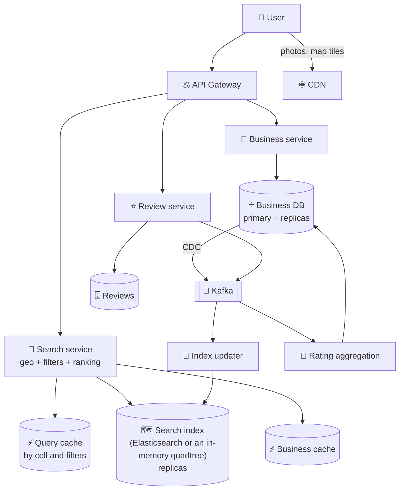
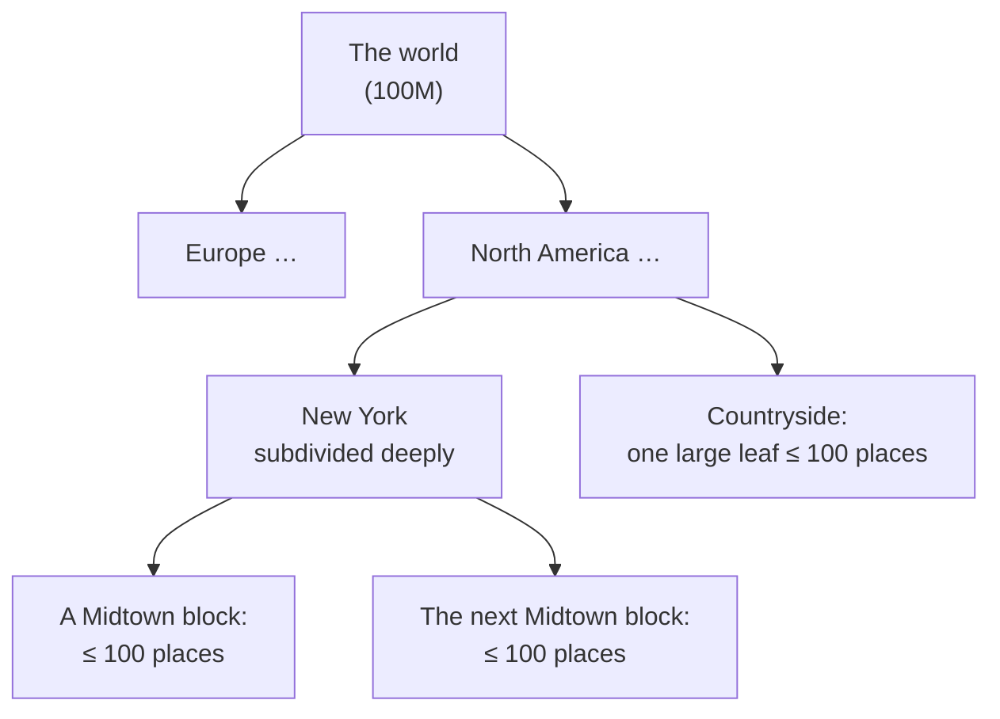
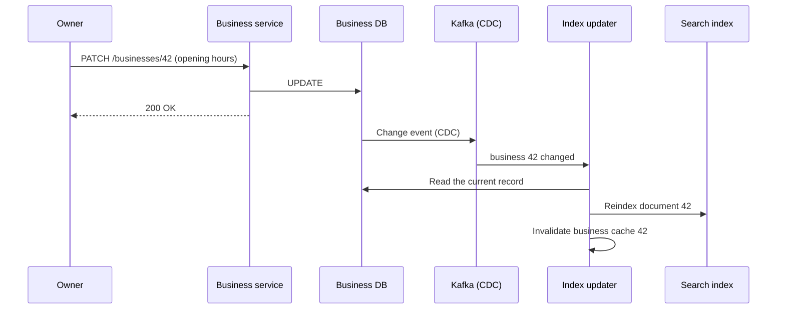

**English** | [Русский](README_RU.md)

# Tier 1 · 12. Yelp / Nearby Search

> **Level:** Medium · **Interview time:** 45 min · **Study time:** ~4 h
> **Key aspects:** geo indexes for static objects (quadtree, geohash, BKD trees in a search engine), k-nearest search, filtering and ranking by distance and rating, the Bayesian average, combining text and geo search, caching under read-heavy load, reviews and rating aggregation, map-viewport queries
> **Builds on:** [Tier 1 · 11 Uber](../11-uber/README.md#8-deep-dive-2-geospatial-indexes) (geo indexes), [15-search-basics](../../15-search-basics/README.md), [02-caching](../../02-caching/README.md), [05-replication](../../05-replication/README.md), [11-distributed-transactions](../../11-distributed-transactions/README.md#12-cdc-change-data-capture)

---

## 🗺️ How to Read This Walkthrough

The walkthrough follows an interview, but every step includes explanations: **why** a decision is made, **how** a mechanism works and **what happens** if you do it differently. The "📘 Explanation" blocks are theory right where you need it.

| Icon | Meaning |
|:----:|:--------|
| 🎤 | Interviewer |
| 🗣️ | What I (the candidate) say out loud |
| ✏️ | What I draw on the whiteboard |
| ⏱️ | Time budget for the step |
| 📘 | A detailed explanation of a concept |

Callouts: **TIP** — a good technique, **WARNING** — a trap, **IMPORTANT** — a Senior+ signal.

---

## 📑 Contents

0. [What This Problem Teaches](#0-what-this-problem-teaches)
1. [Problem Statement](#1-problem-statement)
2. [Clarifying Questions and Requirements](#2-clarifying-questions-and-requirements)
3. [Capacity Estimates](#3-capacity-estimates)
4. [API](#4-api)
5. [Data Model](#5-data-model)
6. [High-Level Design](#6-high-level-design)
7. [Deep Dive 1: A Geo Index for Static Objects](#7-deep-dive-1-a-geo-index-for-static-objects)
8. [Deep Dive 2: Radius Search and K-Nearest](#8-deep-dive-2-radius-search-and-k-nearest)
9. [Deep Dive 3: Filtering and Ranking](#9-deep-dive-3-filtering-and-ranking)
10. [Deep Dive 4: Text Search Together With Geo Search](#10-deep-dive-4-text-search-together-with-geo-search)
11. [Deep Dive 5: Caching](#11-deep-dive-5-caching)
12. [Deep Dive 6: Data Changes and Reviews](#12-deep-dive-6-data-changes-and-reviews)
13. [Deep Dive 7: Map-Viewport Queries and Pagination](#13-deep-dive-7-map-viewport-queries-and-pagination)
14. [Deep Dive 8: Scaling and Multiple Regions](#14-deep-dive-8-scaling-and-multiple-regions)
15. [Bottlenecks and Failure Scenarios](#15-bottlenecks-and-failure-scenarios)
16. [What Changes at 10x Scale](#16-what-changes-at-10x-scale)
17. [Key Concepts and New Terms](#17-key-concepts-and-new-terms)
18. [Variations and Follow-Up Questions](#18-variations-and-follow-up-questions)
19. [Common Mistakes](#19-common-mistakes)
20. [Cheat Sheet and Self-Check](#20-cheat-sheet-and-self-check)

---

## 0. What This Problem Teaches

A nearby-places search service (Yelp, Google Maps) resembles Uber in its geo index, but with **the opposite kind of data**: objects barely move, they're changed rarely, and they're searched very often. That leads to different decisions.

| | Uber | Yelp |
|:-|:-----|:-----|
| Objects | Drivers, moving every few seconds | Businesses, whose coordinates change once in years |
| Load | 250,000 location updates per second | Thousands of searches per second, rare changes |
| The main difficulty | Update frequency and assignment consistency | Search with filters, ranking, caching |
| The best index | A fixed grid (H3, geohash) | An adaptive quadtree or a search engine |

| What's tested | Where it shows up |
|:--------------|:------------------|
| Choosing a geo index for the kind of data | A quadtree for static objects with uneven density |
| K-nearest search | An expanding tree search |
| Ranking with several signals | Distance, rating, review count, relevance |
| Read-heavy optimizations | Caches, replicas, the whole index in memory |
| Combining text and geo search | "Pizza near me" |
| Aggregation | An average rating without recomputing all reviews |

> [!TIP]
> State right away how this differs from Uber: **the data is static and small** (the entire geo index is a few GB), so it can be kept fully in memory on every search server, scaling with replicas.

---

## 1. Problem Statement

> 🎤 "Design Yelp: a user searches for restaurants, cafes and services near them with filters, sees them on a map, reads reviews and leaves their own."

**What the user sees:**

```
"Pizza", nearby, open now, rating 4+ → a list of 20 places and pins on the map
Pans the map → results update for the new area
Opens a business → address, opening hours, photos, reviews
Leaves a review with a rating → the business's rating updates
```

**Time plan:**

| Step | ⏱️ |
|:-----|:--:|
| Requirements | 4 min |
| Estimates | 4 min |
| API and data | 5 min |
| High-level design | 6 min |
| Deep dives | 22 min |
| Failures and wrap-up | 4 min |

---

## 2. Clarifying Questions and Requirements

⏱️ 4 min

| My question | Interviewer's answer | What it changes and why |
|:------------|:---------------------|:------------------------|
| How many businesses? | ~100M worldwide | A few GB of index — fits in memory |
| How many searches? | ~100M daily active users, ~5 searches each | ~6,000 searches/s, peaks at lunch and dinner |
| Search radius? | Configurable: 0.5–20 km; "nearby" by default | An adaptive radius |
| Filters? | Category, "open now", price, rating | Filters together with geo search |
| Sorting? | By relevance (distance + rating), by distance, by rating | Combined ranking |
| A text query? | Yes: "pizza", "dentist" | Text search together with a geo filter |
| How fast must business changes show? | Minutes are fine | Async indexing |
| Reviews? | Yes, with a 1–5 rating | Rating aggregation |

### Functional requirements

1. Search for businesses near a point or within a map area, with text and filters.
2. Sorting by relevance, distance, rating.
3. A business page: details, hours, photos, reviews.
4. Reviews and ratings; an average rating.
5. Owners update their business information.

### Non-functional requirements

| Requirement | Target | Why |
|:------------|:-------|:----|
| Search latency | p99 < 200 ms | The user is choosing where to eat right now |
| Availability | 99.99% for search | Reading is the core function |
| Freshness of changes | Minutes | Hours and addresses change rarely |
| Consistency | Eventual; your own review — immediately (read-your-writes) | Strong consistency isn't needed |
| Scale | Read-heavy: thousands of times more searches than changes | Optimize reads |

---

## 3. Capacity Estimates

⏱️ 4 min

```
Searches:        100M × 5 = 500M per day → ~6,000/s on average, peaks ~20,000/s
Changes:         ~1M business changes per day (~12/s), ~10M reviews per day (~120/s)
                 → hundreds to thousands of times more searches than writes

Business data:   100M × ~1 KB (name, address, hours, categories, rating) ≈ 100 GB
The geo index:   100M × (8 B id + 16 B coordinates) ≈ 2.4 GB — fits in memory
Reviews:         10M × ~1 KB per day ≈ 10 GB/day ≈ 3.6 TB/year
Photos:          object storage + a CDN
```

### Conclusions

| Conclusion | Design consequence |
|:-----------|:-------------------|
| The geo index is 2.4 GB | It can live **entirely in memory** on every search server — no index sharding |
| Thousands of times read-heavy | Replicas, caches; writes reach the index asynchronously |
| Changes are rare | The index can be updated in batches or rebuilt periodically |
| Business data is 100 GB | A sharded or replicated DB + a business cache |

---

## 4. API

⏱️ 3 min

```http
GET /v1/search?lat=52.23&lng=21.01&radius_m=2000&q=pizza
              &category=restaurants&open_now=true&price=1,2&min_rating=4
              &sort=relevance&cursor=…&limit=20
→ 200 { results: [{ id, name, lat, lng, distance_m, rating, review_count, price, is_open, photo_url }],
        next_cursor }

GET /v1/search?bbox=52.20,20.95,52.26,21.07&q=pizza&zoom=14      ← a map area
GET /v1/businesses/{id}
GET /v1/businesses/{id}/reviews?sort=recent&cursor=…
POST /v1/businesses/{id}/reviews      { rating: 4, text: "…" }
PATCH /v1/businesses/{id}             { hours: …, phone: … }        ← the owner
```

---

## 5. Data Model

⏱️ 3 min

| Data | Fields | Store | Why |
|:-----|:-------|:------|:----|
| **Businesses** | id, name, categories, lat, lng, geohash, address, hours (with a time zone), price, rating_sum, review_count, status | A relational DB (primary + replicas) | The source of truth, rare changes, lookups by id |
| **The search index** | id, name, categories, geo_point, price, rating, hours, popularity | Elasticsearch / a custom service with an in-memory quadtree | Geo + filters + text |
| **Reviews** | (business_id, created_at) → review_id, user_id, rating, text | Wide-column or a DB sharded by business_id | Reading a business's reviews page by page |
| **A user's reviews** | (user_id) → review_id | A separate table | "My reviews" |
| **Photos** | business_id → keys in object storage | A DB + object storage + a CDN | Blobs + metadata |

📘 **Why `rating_sum` and `review_count` rather than just `rating`.** The average rating = sum / count. Storing the sum and count lets you update the average for a new review **in O(1)** (add the rating and one), without rereading every review.

---

## 6. High-Level Design

⏱️ 6 min



🗣️ "A split between the read path and the write path:
- **reads**: the search service runs a geo search with filters and ranking over an in-memory index or Elasticsearch, with a cache for popular queries; business pages come from a cache and DB replicas;
- **writes**: business changes and reviews are written to the DB, and via CDC and Kafka they reach the search index and rating aggregates asynchronously. A delay of minutes is fine."

---

## 7. Deep Dive 1: A Geo Index for Static Objects

> 🎤 "Which geo index would you choose, and why not the same one as for Uber?"

The basics of geohash, quadtree, S2 and H3 are covered in [Uber](../11-uber/README.md#8-deep-dive-2-geospatial-indexes). Here — the choice for static data.

### The uneven density problem

📘 In central New York or Tokyo, a 500 × 500 m square holds thousands of businesses, while the same area in the suburbs holds two. With **a fixed grid** (geohash length 6), a downtown cell contains thousands of objects while a suburban one is nearly empty: in the first case you filter a huge list, in the second you scan dozens of empty neighboring cells.

### A quadtree suits static data



| Property | Why it suits Yelp |
|:---------|:------------------|
| **Each leaf holds at most K objects** (e.g. 100) | Dense downtown — small leaves; suburbs — large ones; a search always scans a reasonable number of objects |
| The data barely changes | No constant restructuring, as there would be with moving drivers |
| It fits in memory | ~1M leaves and ~0.3M internal nodes for 100M objects; the whole index is ~2–3 GB |
| It's built offline | Rebuilt from the DB in minutes; new businesses are inserted into a leaf (splitting on overflow) |

### Building it

```python
class Node:
    def __init__(self, bounds):
        self.bounds = bounds       # (min_lat, min_lng, max_lat, max_lng)
        self.points = []           # for a leaf
        self.children = None       # 4 children for an internal node

def insert(node, point, K=100):
    if node.children is None:
        node.points.append(point)
        if len(node.points) > K:
            split(node)                         # split into 4 quadrants
            for p in node.points:               # redistribute the points
                insert(child_for(node, p), p, K)
            node.points = []
        return
    insert(child_for(node, point), point, K)
```

### Implementation options

| Option | When |
|:-------|:-----|
| **A geohash column in the DB** with an index, searching the cell and its 8 neighbors | Small scale; the simplest solution |
| **An in-memory quadtree** in a custom service | When you need full control and minimal latency |
| **A search engine** (Elasticsearch/OpenSearch: `geo_point`, BKD trees) ⭐ | When geo, filters, text and ranking must combine in one query |

📘 **BKD trees.** Elasticsearch stores numeric and geographic fields in a BKD tree (a multidimensional tree similar in spirit to a k-d tree, optimized for disk). `geo_distance` and `geo_bounding_box` queries run fast and combine with filters and full-text search in a single query.

🗣️ "For Yelp I choose **a search engine with a geo field**: a query almost always combines text ('pizza'), filters (open, price) and geography. Without text, an in-memory quadtree would do. The key is understanding that inside the engine is a tree that adapts to the data, like a quadtree."

> [!IMPORTANT]
> **Senior+ signal:** justify the index choice by **the nature of the data**. For Uber — a fixed grid, because objects move. For Yelp — an adaptive tree, because objects are static and density is highly uneven.

---

## 8. Deep Dive 2: Radius Search and K-Nearest

> 🎤 "How do you find the 20 nearest pizzerias?"

### Radius search


| Step | Why |
|:-----|:----|
| The box first | Intersecting rectangles with tree nodes is cheap to compute |
| Then the exact distance | The box is wider than the circle — the corners must be cut off |
| **The haversine formula** | Distance over the sphere's surface; at short distances it can be simplified to a planar approximation |

📘 **Haversine** is a formula for the distance between two points on a sphere from their latitudes and longitudes. For distances of a few kilometers, a planar approximation's error (with a latitude correction: 1° of longitude ≈ 111 km × cos(latitude)) is negligible and faster to compute.

### K-nearest

📘 "The 20 nearest" without a fixed radius is a best-first search with a priority queue:

1. Put the root into a priority queue keyed by **the minimum distance** from the point to the node's rectangle.
2. Pop the nearest node: if it's internal — push its children; if it's a leaf — push its objects (with exact distances).
3. Once 20 objects have been popped, they're the 20 nearest: nothing left in the queue can be closer.

### An adaptive radius

| Situation | Behavior |
|:----------|:---------|
| Downtown: thousands of places within 500 m | A small radius is enough; ranking caps the results |
| Suburbs: three places within 2 km | Expand the radius until a minimum number of results or a maximum radius is reached |
| Nothing found | Say "nothing nearby" and offer to widen the search |

---

## 9. Deep Dive 3: Filtering and Ranking

> 🎤 "How do you sort: the nearest place rated 3.1, or a place 800 m away rated 4.7?"

### Filters

| Filter | How to implement |
|:-------|:-----------------|
| Category, price, rating ≥ | Index fields, a filter in the query |
| **"Open now"** | Hours are stored in **the business's local time** with a time zone; at query time the current time is converted to the business's time zone. Account for hours past midnight ("until 02:00") and special days (holidays) |
| Delivery, reservations | Boolean fields |

> [!WARNING]
> "Open now" can't be precomputed once — the status changes every hour. Options: check against the schedule at query time, or store the schedule in the index in a filter-friendly form (intervals in minutes of the week) and compare with the current minute of the week in the business's time zone.

### The problem with few reviews

📘 A place with one 5.0 review isn't better than a place with 500 reviews averaging 4.6. **The Bayesian average** "pulls" the rating of places with few reviews toward the global average:

```
bayesian_rating = (C × m + sum_of_ratings) / (C + n)

m — the average rating across all businesses (e.g. 3.8)
C — the "weight" of the prior (e.g. 20 reviews)
n — the business's number of reviews

Place A: 5 reviews, all 5.0         → (20 × 3.8 + 25) / 25   = 4.04
Place B: 500 reviews, average 4.6   → (76 + 2,300) / 520     = 4.57
```

Place B rightly ends up higher.

### The combined score

```
score = w1 × f(distance)              ← decreases with distance (e.g. exponentially)
      + w2 × bayesian_rating
      + w3 × log(review count)
      + w4 × text_relevance           ← BM25 over name, categories, reviews
      + w5 × personalization          ← favorite categories, past visits
      + (ads — separate, labeled positions)
```

| Sort | What changes |
|:-----|:-------------|
| By relevance | A weighted sum of every signal |
| By distance | Distance only (after filters) |
| By rating | The Bayesian rating, within a radius limit |

🗣️ "The weights are tuned on metrics (clicks, calls, directions, reservations) through A/B tests; at large scale — a ranking model, as in [15-search-basics](../../15-search-basics/README.md#6-multi-stage-ranking-and-quality-metrics)."

---

## 10. Deep Dive 4: Text Search Together With Geo Search

> 🎤 "A user types 'pizza with delivery'. How do you combine text and a geo filter?"

```json
GET /businesses/_search
{
  "query": {
    "function_score": {
      "query": {
        "bool": {
          "must":   [{ "multi_match": { "query": "pizza", "fields": ["name^3", "categories^2", "menu_items"] } }],
          "filter": [
            { "geo_distance": { "distance": "2km", "location": { "lat": 52.23, "lon": 21.01 } } },
            { "term": { "delivery": true } },
            { "range": { "rating": { "gte": 4 } } }
          ]
        }
      },
      "functions": [
        { "gauss": { "location": { "origin": "52.23,21.01", "scale": "1km" } } },
        { "field_value_factor": { "field": "bayesian_rating", "modifier": "log1p" } }
      ]
    }
  }
}
```

| Query part | What it does |
|:-----------|:-------------|
| `multi_match` | Text relevance (BM25) over weighted fields |
| `filter` | Geo, delivery, rating — they don't affect the score and are cached |
| `gauss` on distance | A smooth decrease of the score with distance |
| `field_value_factor` | Accounting for the rating |

### Sharding the index

| Option | How | Trade-off |
|:-------|:----|:----------|
| **The whole index on every node** | 100M documents (~100 GB with fields) — full replicas | Simple; any node answers any query |
| **By region** | An index per continent or country; a query goes to the user's region's index | Less data per query; searches near region borders touch two indexes |

🗣️ "There isn't much data, so first — **full-index replicas** in each region. If the index grows (menus, reviews inside the index) — split by region with routing by the query's coordinates."

---

## 11. Deep Dive 5: Caching

> 🎤 "Searches repeat heavily: thousands of people look for 'coffee' downtown at lunchtime. How do you exploit that?"

### A query result cache

📘 Users' coordinates are unique (52.23017, 21.01192), and a cache keyed by exact coordinates almost never hits. The fix — **snap the point to a cell**:

```
Cache key = (the geohash6 of the user's cell, normalized text, filters, sort)

Users within one ~1.2 × 0.6 km cell get the same cached candidate set;
the exact distance to each candidate is recomputed for the user's point before responding.
```

| Decision | Why |
|:---------|:----|
| Snapping to a cell | Dramatically raises the cache hit rate |
| Caching a cell's **candidates** (e.g. the top 100), not the final page | Distance and order are recomputed for the user's exact position — cheap |
| A 5–15 minute TTL | "Open now" and ratings change, but slowly |
| Normalizing the query | "Pizza", "pizza ", "PIZZA" — one key |

### Other caches

| Cache | What |
|:------|:-----|
| Business pages | Business data by id — read every time a result is shown |
| First pages of reviews | Popular businesses |
| **CDN** | Business photos, map tiles |
| DB replicas | Reading business pages on cache misses |

---

## 12. Deep Dive 6: Data Changes and Reviews

> 🎤 "An owner changed their opening hours. A user left a review. How does that reach search?"

### Business changes



| Principle | Why |
|:----------|:----|
| **CDC**, not dual writes from the app | The index won't drift from the DB on failures (see [11-distributed-transactions](../../11-distributed-transactions/README.md#12-cdc-change-data-capture)) |
| Moderating significant changes | Changing an address or name could be fraud — review before publishing |
| The owner sees the change immediately | The owner's view of the page comes from the primary, not the cache (read-your-writes) |

### Reviews and ratings

| Step | How |
|:-----|:----|
| Writing a review | Into the review store (partitioned by business_id) |
| Checks | Anti-spam and anti-fraud: rating manipulation, competitor reviews, bot reviews — asynchronously, with the option to hide |
| Updating the rating | An event in Kafka → an aggregator atomically increments `rating_sum` and `review_count` (`UPDATE … SET rating_sum = rating_sum + 4, review_count = review_count + 1`) → reindexing with the new Bayesian rating |
| Your own review is visible immediately | The client shows it optimistically; "my reviews" are read from the primary |
| Editing or deleting a review | The aggregate is adjusted by the difference; periodic reconciliation recomputes sums |

> [!TIP]
> Batched updates: popular businesses don't need reindexing on every review — the rating can update every few minutes. A 0.01-star difference doesn't matter to users.

---

## 13. Deep Dive 7: Map-Viewport Queries and Pagination

> 🎤 "The user is panning the map. How do you show places in the visible area?"

### A bounding box query

```
GET /v1/search?bbox=min_lat,min_lng,max_lat,max_lng&zoom=14&q=cafe
```

| Map zoom | What to show |
|:---------|:-------------|
| Close (a street) | Individual businesses: the top N by relevance within the box |
| Medium (a neighborhood) | Only the most relevant; the rest hidden |
| Far (a city, a country) | **Clusters** with counts: "340" over a neighborhood |

📘 **Clusters at far zoom.** Showing 50,000 pins on a city map is pointless and heavy. Counts per cell (e.g. by geohash prefixes of different lengths for different zoom levels) can be precomputed or obtained via aggregations in the search engine (`geohash_grid`, `geotile_grid`) and shown as circles with numbers.

| Optimization | Why |
|:-------------|:----|
| Debouncing map movement | Don't send a request on every animation frame |
| Cancelling stale requests | A response for an old area won't overwrite the new one |
| Snapping the box to a tile grid | Makes viewport queries cacheable |

### Pagination

- Cursor pagination, as in [search](../../15-search-basics/README.md#9-scaling-search): `search_after` on (score, id), with no deep offsets.
- For stability while scrolling — pin the search point and query time in the cursor: if the user moves slightly, the pages don't get shuffled.

---

## 14. Deep Dive 8: Scaling and Multiple Regions

> 🎤 "How do you scale this worldwide?"

| Decision | Why |
|:---------|:----|
| **Search index replicas** in every region | The data is small; queries are local |
| Only the region's own index (optional) | If the index is large — a user in Europe searches the Europe index |
| The business DB primary in one region + replicas | Few writes; reads come from local replicas |
| Reviews — sharded by business_id | Volume growth |
| Hot areas (tourist centers) | More replicas, aggressive caching |
| A query cache in each region | Local search patterns |

---

## 15. Bottlenecks and Failure Scenarios

| Scenario | What happens | How we protect |
|:---------|:-------------|:---------------|
| The lunch peak | Requests grow several-fold | A per-cell cache, index replicas |
| A dense downtown | Thousands of candidates | An adaptive tree, capped candidates, ranking |
| Suburbs with no results | An empty result list | An adaptive radius |
| Indexing falls behind | Stale hours in search | CDC lag monitoring; the business page from the DB shows current data |
| Review manipulation | An unfair rating | Anti-fraud, the Bayesian average, hiding suspicious reviews |
| A search index node dies | Some queries slow down | Replicas, redistribution |
| A wrong "open now" | The user arrives at a closed door | Time zones, overnight intervals, special days; user reports |
| A fraudulent address change | Users are sent to the wrong place | Moderating significant changes |

---

## 16. What Changes at 10x Scale

> 🎤 "10× more businesses and queries?"

| Change | Why |
|:-------|:----|
| **Sharding the index by region** | The index no longer fits on one node |
| **ML ranking** | Personalization, context (time of day, weather) |
| **Vector search** | "A cozy place for a date" — a semantic query (see [15-search-basics](../../15-search-basics/README.md#11-vector-search)) |
| **Precomputed results for popular cells and queries** | Near-zero latency for frequent searches |

---

## 17. Key Concepts and New Terms

### What's applied from Fundamentals

| Concept | Where it's covered | How it applies here |
|:--------|:-------------------|:--------------------|
| Geo indexes | [Tier 1 · 11 Uber](../11-uber/README.md#8-deep-dive-2-geospatial-indexes) | The basics of geohash, quadtree, S2, H3 |
| Search engines, BM25, filters | [15-search-basics](../../15-search-basics/README.md) | Text + geo + ranking |
| Caching | [02-caching](../../02-caching/README.md) | A per-cell query cache, business pages |
| Read replicas | [05-replication](../../05-replication/README.md) | Read-heavy load |
| CDC | [11-distributed-transactions](../../11-distributed-transactions/README.md#12-cdc-change-data-capture) | Updating the index |

### New terms in this problem

| Term | In short |
|:-----|:---------|
| **An adaptive quadtree for static data** | Leaves hold at most K objects; suits uneven density |
| **K-nearest search (best-first)** | Traversing the tree with a priority queue keyed by minimum distance |
| **Haversine** | The distance between points on a sphere |
| **A BKD tree** | A search engine's multidimensional index for geo and numbers |
| **The Bayesian average** | A rating pulled toward the global mean when there are few reviews |
| **A per-cell cache** | The cache key is a cell, not exact coordinates |
| **Map clustering** | Place counts per cell at far zoom levels |

---

## 18. Variations and Follow-Up Questions

<details>
<summary><b>How does Yelp differ from Uber in terms of the geo index?</b></summary>

Uber's objects move (250,000 updates per second), so it needs a fixed grid with no restructuring and in-memory state with frequent overwrites. Yelp's objects are static, updates are rare, and density is highly uneven — an adaptive tree or a search engine fits, and the main difficulty is filtering, ranking and caching.
</details>

<details>
<summary><b>What if a business moves?</b></summary>

A coordinate change goes through moderation; once confirmed — a DB update, and CDC reindexes the document with the new geo point (in a quadtree — removal from the old leaf and insertion into the new one). Query caches for the old and new cells expire by TTL or are invalidated.
</details>

<details>
<summary><b>How would you implement "friends nearby"?</b></summary>

It's closer to Uber: friends' locations change often, and the query isn't "everyone nearby" but "nearby from my friends list". The solution: users' locations in memory updated every N seconds, pub/sub by cell or by friends list, and strict privacy settings (opt-in only, with limited precision).
</details>

<details>
<summary><b>Why not PostGIS?</b></summary>

PostGIS (a PostgreSQL extension with R-tree/GiST indexes) is an excellent choice for small and mid-sized systems: precise geo queries, transactions, SQL. At thousands of searches per second with text and complex ranking, a search engine is more convenient and scales reads better. Often PostGIS is the source of truth, and the search engine is the index used for search.
</details>

<details>
<summary><b>How do you show a business's "popular times"?</b></summary>

Aggregate anonymized visit data (locations with consent, check-ins) by hour of the week in an offline job and store a ready-made histogram on the business page. It's an analytics problem, not part of the search path.
</details>

---

## 19. Common Mistakes

| ❌ Mistake | Why it's bad | ✅ Do this instead |
|:----------|:-------------|:------------------|
| Designing it like Uber | Needless complexity for static data | An in-memory index with replicas, rare updates |
| A fixed grid with uneven density | Overflowing downtown cells, empty suburban ones | An adaptive tree or a search engine |
| Sorting only by distance | Nearest doesn't mean best | A combined score |
| A simple average rating | A place with one 5.0 review on top | The Bayesian average |
| Recomputing the rating over every review | Expensive | `rating_sum` and `review_count` |
| A cache keyed by exact coordinates | Almost no hits | Snapping to a cell |
| "Open now" without time zones | A wrong status | The business's local time, overnight intervals |
| Dual writes to the DB and the index | Divergence | CDC |
| Thousands of pins at far zoom | Heavy and useless | Clusters |
| A fixed radius | Empty results in the suburbs | An adaptive radius |

---

## 20. Cheat Sheet and Self-Check

### 30-second answer

> Read-heavy: ~6,000 searches per second versus a handful of changes; the geo index for 100M businesses is ~2.4 GB, so it lives entirely in memory on every search node, scaling with replicas. The data is static with uneven density — an adaptive tree (a quadtree with K objects per leaf) or a search engine with `geo_point` (BKD), combining text (BM25), filters and geo in one query. Search: a bounding box → leaves → exact distance; k-nearest — best-first with a priority queue; an adaptive radius. Ranking: distance decay + Bayesian rating + review count + text + personalization; "open now" in the business's time zone. A cache of candidates per geohash6 cell with recomputed distances; a CDN for photos and tiles. Changes — DB → CDC → reindexing within minutes; reviews — `rating_sum`/`review_count` aggregation and anti-fraud. The map — bounding box queries, clusters at far zoom.

### Self-check

- [ ] I can explain how the problem differs from Uber
- [ ] I can estimate the geo index size and explain why it's in memory
- [ ] I can explain why a quadtree suits static data
- [ ] I can describe radius search and k-nearest search
- [ ] I can explain and compute the Bayesian average
- [ ] I can put together a combined ranking score
- [ ] I can implement "open now" with time zones
- [ ] I can write a text + geo + filters query for a search engine
- [ ] I can design a cache that snaps to cells
- [ ] I can describe the change path through CDC and rating aggregation

### Further reading

- Alex Xu, Sahn Lam, *System Design Interview*, Vol. 2 — chapter "Proximity Service"
- Finkel, Bentley, *Quad Trees: A Data Structure for Retrieval on Composite Keys* (1974)
- Elasticsearch documentation: geo queries, geo_point, function_score
- PostGIS documentation
- The [Tier 1 · 11 Uber](../11-uber/README.md) walkthrough — geo indexes for moving objects