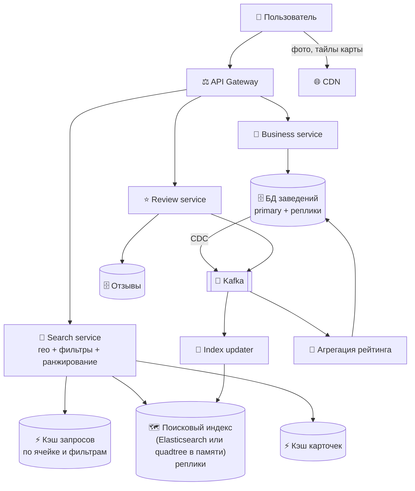
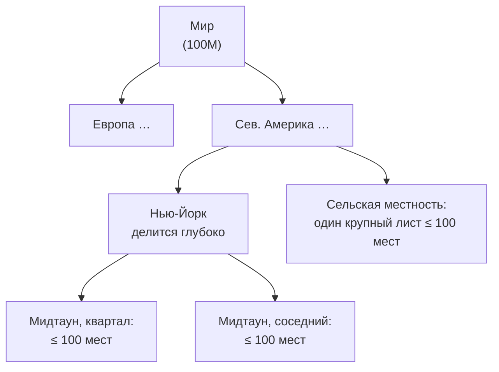
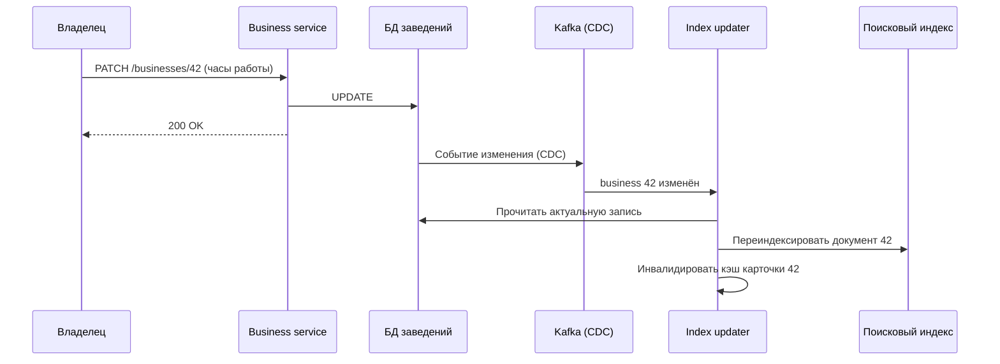

[English](README.md) | **Русский**

# Tier 1 · 12. Yelp / поиск поблизости

> **Уровень:** Medium · **Время на интервью:** 45 мин · **Время на разбор:** ~4 ч
> **Ключевые аспекты:** геоиндексы для статичных объектов (quadtree, geohash, BKD-деревья в поисковом движке), поиск k ближайших, фильтры и ранжирование по расстоянию и рейтингу, байесовское среднее, совмещение текстового и геопоиска, кэширование при read-heavy нагрузке, отзывы и агрегация рейтинга, запросы по области карты
> **Опирается на:** [Tier 1 · 11 Uber](../11_Design%20Uber%20or%20Ride-Sharing/README.ru.md#8-deep-dive-2-геопространственные-индексы) (геоиндексы), [15-search-basics](../../01_Fundamentals/15_Search%20basics/README.ru.md), [02-caching](../../01_Fundamentals/02_Caching/README.ru.md), [05-replication](../../01_Fundamentals/05_Replication/README.ru.md), [11-distributed-transactions](../../01_Fundamentals/11_Distributed%20transactions/README.ru.md#12-cdc-change-data-capture)

---

## 🗺️ Как читать этот разбор

Разбор построен как интервью, но в каждом шаге есть объяснения: **почему** принимается решение, **как работает** механизм и **что будет**, если сделать иначе. Блоки «📘 Объяснение» — теория прямо по ходу задачи.

| Значок | Что значит |
|:------:|:-----------|
| 🎤 | Реплика интервьюера |
| 🗣️ | Что говорю вслух я (кандидат) |
| ✏️ | Что рисую на доске |
| ⏱️ | Сколько времени тратить на шаг |
| 📘 | Подробное объяснение концепции |

Блоки **TIP** — хороший приём, **WARNING** — ловушка, **IMPORTANT** — сигнал для уровня Senior+.

---

## 📑 Содержание

0. [Чему учит эта задача](#0-чему-учит-эта-задача)
1. [Условие задачи](#1-условие-задачи)
2. [Уточняющие вопросы и требования](#2-уточняющие-вопросы-и-требования)
3. [Оценки нагрузки](#3-оценки-нагрузки)
4. [API](#4-api)
5. [Модель данных](#5-модель-данных)
6. [High-level дизайн](#6-high-level-дизайн)
7. [Deep dive 1: геоиндекс для статичных объектов](#7-deep-dive-1-геоиндекс-для-статичных-объектов)
8. [Deep dive 2: поиск в радиусе и k ближайших](#8-deep-dive-2-поиск-в-радиусе-и-k-ближайших)
9. [Deep dive 3: фильтры и ранжирование](#9-deep-dive-3-фильтры-и-ранжирование)
10. [Deep dive 4: текстовый поиск вместе с геопоиском](#10-deep-dive-4-текстовый-поиск-вместе-с-геопоиском)
11. [Deep dive 5: кэширование](#11-deep-dive-5-кэширование)
12. [Deep dive 6: изменения данных и отзывы](#12-deep-dive-6-изменения-данных-и-отзывы)
13. [Deep dive 7: запросы по области карты и пагинация](#13-deep-dive-7-запросы-по-области-карты-и-пагинация)
14. [Deep dive 8: масштабирование и несколько регионов](#14-deep-dive-8-масштабирование-и-несколько-регионов)
15. [Узкие места и сценарии сбоев](#15-узкие-места-и-сценарии-сбоев)
16. [Что изменится при росте в 10 раз](#16-что-изменится-при-росте-в-10-раз)
17. [Ключевые концепции и новые понятия](#17-ключевые-концепции-и-новые-понятия)
18. [Варианты задачи и follow-up вопросы](#18-варианты-задачи-и-follow-up-вопросы)
19. [Типичные ошибки](#19-типичные-ошибки)
20. [Шпаргалка и самопроверка](#20-шпаргалка-и-самопроверка)

---

## 0. Чему учит эта задача

Сервис поиска мест поблизости (Yelp, Google Maps, 2ГИС) похож на Uber геоиндексом, но с **противоположным характером данных**: объекты почти не двигаются, их меняют редко, а ищут очень часто. Отсюда другие решения.

| | Uber | Yelp |
|:-|:-----|:-----|
| Объекты | Водители, двигаются каждые секунды | Заведения, координаты меняются раз в годы |
| Нагрузка | 250 000 обновлений позиции в секунду | Тысячи поисков в секунду, редкие изменения |
| Главная сложность | Частота обновлений и консистентность назначения | Поиск с фильтрами, ранжирование, кэширование |
| Лучший индекс | Фиксированная сетка (H3, geohash) | Адаптивный quadtree или поисковый движок |

| Что проверяют | Где это в задаче |
|:--------------|:-----------------|
| Выбор геоиндекса под характер данных | Quadtree для статичных объектов с неравномерной плотностью |
| Поиск k ближайших | Расширяющийся поиск по дереву |
| Ранжирование с несколькими сигналами | Расстояние, рейтинг, число отзывов, релевантность |
| Read-heavy оптимизации | Кэш, реплики, весь индекс в памяти |
| Совмещение текстового и геопоиска | «Пицца рядом» |
| Агрегация | Средний рейтинг без пересчёта всех отзывов |

> [!TIP]
> Сразу скажи, чем задача отличается от Uber: **данные статичны и их мало** (весь геоиндекс — единицы ГБ), поэтому его можно держать целиком в памяти каждого сервера поиска и масштабироваться репликами.

---

## 1. Условие задачи

> 🎤 «Спроектируй Yelp: пользователь ищет рестораны, кафе, сервисы рядом с собой с фильтрами, видит их на карте, читает отзывы и оставляет свои».

**Что видит пользователь:**

```
«Пицца», рядом, открыто сейчас, рейтинг 4+ → список из 20 мест и точки на карте
Сдвигает карту → результаты обновляются для новой области
Открывает заведение → адрес, часы работы, фото, отзывы
Оставляет отзыв с оценкой → рейтинг заведения обновляется
```

**План по времени:**

| Шаг | ⏱️ |
|:----|:--:|
| Требования | 4 мин |
| Оценки | 4 мин |
| API и данные | 5 мин |
| High-level дизайн | 6 мин |
| Deep dives | 22 мин |
| Сбои и итоги | 4 мин |

---

## 2. Уточняющие вопросы и требования

⏱️ 4 мин

| Мой вопрос | Ответ интервьюера | Что это меняет и почему |
|:-----------|:------------------|:------------------------|
| Сколько заведений? | ~100M по всему миру | Индекс в единицах ГБ — помещается в память |
| Сколько поисков? | ~100M активных пользователей в день, ~5 поисков на пользователя | ~6 000 поисков/с, пики в обед и вечером |
| Радиус поиска? | Настраиваемый: 0,5–20 км; по умолчанию — «рядом» | Адаптивный радиус |
| Фильтры? | Категория, «открыто сейчас», цена, рейтинг | Фильтры вместе с геопоиском |
| Сортировка? | По релевантности (расстояние + рейтинг), по расстоянию, по рейтингу | Комбинированное ранжирование |
| Текстовый запрос? | Да: «пицца», «стоматолог» | Текстовый поиск вместе с геофильтром |
| Как быстро видны изменения заведения? | Минуты допустимы | Асинхронная индексация |
| Отзывы? | Да, с оценкой 1–5 | Агрегация рейтинга |

### Функциональные требования

1. Поиск заведений рядом с точкой или в области карты, с текстом и фильтрами.
2. Сортировка по релевантности, расстоянию, рейтингу.
3. Карточка заведения: данные, часы, фото, отзывы.
4. Отзывы и оценки; средний рейтинг.
5. Владельцы обновляют информацию о заведении.

### Нефункциональные требования

| Требование | Цель | Почему |
|:-----------|:-----|:-------|
| Задержка поиска | p99 < 200 мс | Пользователь выбирает, где поесть, прямо сейчас |
| Доступность | 99,99% для поиска | Чтение — основная функция |
| Свежесть изменений | Минуты | Часы работы и адреса меняются редко |
| Консистентность | Eventual; свой отзыв — сразу (read-your-writes) | Строгая не нужна |
| Масштаб | Read-heavy: поисков в тысячи раз больше, чем изменений | Оптимизация чтения |

---

## 3. Оценки нагрузки

⏱️ 4 мин

```
Поиски:          100M × 5 = 500M в сутки → ~6 000/с в среднем, пики ~20 000/с
Изменения:       ~1M изменений заведений в сутки (~12/с), ~10M отзывов в сутки (~120/с)
                 → поисков в сотни и тысячи раз больше, чем записей

Данные заведений: 100M × ~1 КБ (название, адрес, часы, категории, рейтинг) ≈ 100 ГБ
Геоиндекс:        100M × (8 Б id + 16 Б координаты) ≈ 2,4 ГБ — помещается в память
Отзывы:           10M × ~1 КБ в сутки ≈ 10 ГБ/сутки ≈ 3,6 ТБ/год
Фото:             объектное хранилище + CDN
```

### Выводы

| Вывод | Следствие для дизайна |
|:------|:----------------------|
| Геоиндекс — 2,4 ГБ | Можно держать **целиком в памяти** каждого сервера поиска — без шардирования индекса |
| Read-heavy в тысячи раз | Реплики, кэши; записи — асинхронно в индекс |
| Изменения редки | Индекс можно обновлять пачками или перестраивать периодически |
| Данные заведений — 100 ГБ | Шардированная или реплицированная БД + кэш карточек |

---

## 4. API

⏱️ 3 мин

```http
GET /v1/search?lat=52.23&lng=21.01&radius_m=2000&q=пицца
              &category=restaurants&open_now=true&price=1,2&min_rating=4
              &sort=relevance&cursor=…&limit=20
→ 200 { results: [{ id, name, lat, lng, distance_m, rating, review_count, price, is_open, photo_url }],
        next_cursor }

GET /v1/search?bbox=52.20,20.95,52.26,21.07&q=пицца&zoom=14      ← область карты
GET /v1/businesses/{id}
GET /v1/businesses/{id}/reviews?sort=recent&cursor=…
POST /v1/businesses/{id}/reviews      { rating: 4, text: "…" }
PATCH /v1/businesses/{id}             { hours: …, phone: … }        ← владелец
```

---

## 5. Модель данных

⏱️ 3 мин

| Данные | Поля | Хранилище | Почему |
|:-------|:-----|:----------|:-------|
| **Заведения** | id, name, categories, lat, lng, geohash, address, hours (с часовым поясом), price, rating_sum, review_count, status | Реляционная БД (primary + реплики) | Источник правды, редкие изменения, запросы по id |
| **Поисковый индекс** | id, name, categories, geo_point, price, rating, hours, популярность | Elasticsearch / собственный сервис с quadtree в памяти | Гео + фильтры + текст |
| **Отзывы** | (business_id, created_at) → review_id, user_id, rating, text | Wide-column или шардированная БД по business_id | Чтение отзывов заведения постранично |
| **Отзывы пользователя** | (user_id) → review_id | Отдельная таблица | «Мои отзывы» |
| **Фото** | business_id → ключи в объектном хранилище | БД + объектное хранилище + CDN | Blob + метаданные |

📘 **Почему `rating_sum` и `review_count`, а не просто `rating`.** Средний рейтинг = сумма / количество. Храня сумму и количество, можно обновить средний при новом отзыве **за O(1)** (прибавить оценку и единицу), не перечитывая все отзывы.

---

## 6. High-level дизайн

⏱️ 6 мин



🗣️ «Разделение на путь чтения и путь записи:
- **чтение**: search service выполняет геопоиск с фильтрами и ранжированием по индексу в памяти или в Elasticsearch, с кэшем популярных запросов; карточки — из кэша и реплик БД;
- **запись**: изменения заведений и отзывы пишутся в БД, а через CDC и Kafka асинхронно попадают в поисковый индекс и в агрегаты рейтинга. Задержка в минуты допустима».

---

## 7. Deep dive 1: геоиндекс для статичных объектов

> 🎤 «Какой геоиндекс выбрать и почему не тот же, что в Uber?»

Основы geohash, quadtree, S2 и H3 разобраны в [Uber](../11_Design%20Uber%20or%20Ride-Sharing/README.ru.md#8-deep-dive-2-геопространственные-индексы). Здесь — выбор под статичные данные.

### Проблема неравномерной плотности

📘 В центре Нью-Йорка или Токио в квадрате 500 × 500 м — тысячи заведений, а в пригороде на той же площади — два. С **фиксированной сеткой** (geohash длины 6) ячейка в центре содержит тысячи объектов, а в пригороде почти пустая: в первом случае приходится фильтровать огромный список, во втором — перебирать десятки пустых соседних ячеек.

### Quadtree подходит статичным данным



| Свойство | Почему подходит Yelp |
|:---------|:---------------------|
| **Каждый лист — не больше K объектов** (например, 100) | Плотный центр — мелкие листы, пригород — крупные; поиск всегда просматривает разумное число объектов |
| Данные почти не меняются | Нет постоянных перестроек, как было бы с движущимися водителями |
| Помещается в память | ~1M листьев и ~0,3M внутренних узлов для 100M объектов; весь индекс ~2–3 ГБ |
| Строится офлайн | Перестройка из БД за минуты; новые заведения добавляются вставкой в лист (с делением при переполнении) |

### Построение

```python
class Node:
    def __init__(self, bounds):
        self.bounds = bounds       # (min_lat, min_lng, max_lat, max_lng)
        self.points = []           # для листа
        self.children = None       # 4 потомка для внутреннего узла

def insert(node, point, K=100):
    if node.children is None:
        node.points.append(point)
        if len(node.points) > K:
            split(node)                         # разделить на 4 квадранта
            for p in node.points:               # перераспределить точки
                insert(child_for(node, p), p, K)
            node.points = []
        return
    insert(child_for(node, point), point, K)
```

### Варианты реализации

| Вариант | Когда |
|:--------|:------|
| **Geohash-колонка в БД** с индексом, поиск по ячейке и 8 соседям | Небольшой масштаб; простейшее решение |
| **Quadtree в памяти** собственного сервиса | Когда нужен полный контроль и минимальная задержка |
| **Поисковый движок** (Elasticsearch/OpenSearch: `geo_point`, BKD-деревья) ⭐ | Нужно совмещать гео, фильтры, текст и ранжирование в одном запросе |

📘 **BKD-деревья.** Elasticsearch хранит числовые и географические поля в BKD-дереве (многомерное дерево, близкое по идее к k-d tree, оптимизированное для диска). Запросы `geo_distance` и `geo_bounding_box` выполняются быстро и сочетаются с фильтрами и полнотекстовым поиском в одном запросе.

🗣️ «Для Yelp выбираю **поисковый движок с геополем**: запрос почти всегда объединяет текст («пицца»), фильтры (открыто, цена) и географию. Если бы текста не было, хватило бы quadtree в памяти. Главное — понимать, что внутри движка — дерево, адаптирующееся к данным, как quadtree».

> [!IMPORTANT]
> **Сигнал Senior+:** обосновать выбор индекса **характером данных**. Для Uber — фиксированная сетка, потому что объекты двигаются. Для Yelp — адаптивное дерево, потому что объекты статичны, а плотность сильно неравномерна.

---

## 8. Deep dive 2: поиск в радиусе и k ближайших

> 🎤 «Как найти 20 ближайших пиццерий?»

### Поиск в радиусе


| Шаг | Почему |
|:----|:-------|
| Сначала прямоугольник | Пересечение прямоугольников с узлами дерева вычисляется дёшево |
| Потом точное расстояние | Прямоугольник шире круга — углы нужно отсечь |
| **Формула гаверсинуса** | Расстояние по поверхности сферы; на коротких расстояниях можно упростить до плоской аппроксимации |

📘 **Гаверсинус** — формула расстояния между двумя точками на сфере по их широтам и долготам. Для расстояний в несколько километров ошибка плоской аппроксимации (с поправкой на широту: 1° долготы ≈ 111 км × cos(широта)) пренебрежима и считается быстрее.

### K ближайших

📘 «20 ближайших» без фиксированного радиуса — поиск «лучший сначала» (best-first) с очередью с приоритетом:

1. Положить корень в очередь с приоритетом по **минимальному расстоянию** от точки до прямоугольника узла.
2. Доставать ближайший узел: если внутренний — положить его детей; если лист — положить его объекты (с точным расстоянием).
3. Как только из очереди достаются 20 объектов, они и есть 20 ближайших: всё, что осталось в очереди, не может быть ближе.

### Адаптивный радиус

| Ситуация | Поведение |
|:---------|:----------|
| Центр города: в 500 м тысячи мест | Достаточно малого радиуса; результаты ограничиваются ранжированием |
| Пригород: в 2 км — три места | Расширять радиус, пока не наберётся минимум результатов или не достигнут максимум |
| Ничего не найдено | Сообщить «рядом нет» и предложить расширить поиск |

---

## 9. Deep dive 3: фильтры и ранжирование

> 🎤 «По какому принципу сортировать: ближайшее место с рейтингом 3,1 или место в 800 м с рейтингом 4,7?»

### Фильтры

| Фильтр | Как реализовать |
|:-------|:----------------|
| Категория, цена, рейтинг ≥ | Поля в индексе, фильтр в запросе |
| **«Открыто сейчас»** | Часы работы хранятся в **местном времени заведения** с часовым поясом; при запросе текущее время переводится в часовой пояс заведения. Учитывать работу после полуночи («до 02:00») и особые дни (праздники) |
| Доставка, бронирование | Булевы поля |

> [!WARNING]
> «Открыто сейчас» нельзя предвычислить один раз — статус меняется каждый час. Варианты: проверять при запросе по расписанию, или хранить в индексе расписание в удобном для фильтрации виде (интервалы в минутах недели) и сравнивать с текущей минутой недели в часовом поясе заведения.

### Проблема рейтинга с малым числом отзывов

📘 Место с одним отзывом на 5,0 не лучше места с 500 отзывами и средним 4,6. **Байесовское среднее** «подтягивает» рейтинг мест с малым числом отзывов к общему среднему:

```
байесовский_рейтинг = (C × m + сумма_оценок) / (C + n)

m — средний рейтинг по всем заведениям (например, 3,8)
C — «вес» априорного мнения (например, 20 отзывов)
n — число отзывов заведения

Место A: 5 отзывов, все по 5,0  → (20 × 3,8 + 25) / 25   = 4,04
Место B: 500 отзывов, среднее 4,6 → (76 + 2 300) / 520     = 4,57
```

Место B справедливо оказывается выше.

### Комбинированная оценка

```
score = w1 × f(расстояние)            ← убывает с расстоянием (например, экспоненциально)
      + w2 × байесовский_рейтинг
      + w3 × log(число отзывов)
      + w4 × текстовая_релевантность   ← BM25 по названию, категориям, отзывам
      + w5 × персонализация            ← любимые категории, прошлые визиты
      + (реклама — отдельные помеченные позиции)
```

| Сортировка | Что меняется |
|:-----------|:-------------|
| По релевантности | Взвешенная сумма всех сигналов |
| По расстоянию | Только расстояние (после фильтров) |
| По рейтингу | Байесовский рейтинг, с ограничением радиуса |

🗣️ «Веса подбираются по метрикам (клики, звонки, маршруты, бронирования) через A/B-тесты; на большом масштабе — модель ранжирования, как в [15-search-basics](../../01_Fundamentals/15_Search%20basics/README.ru.md#6-многоэтапное-ранжирование-и-метрики-качества)».

---

## 10. Deep dive 4: текстовый поиск вместе с геопоиском

> 🎤 «Пользователь пишет “пицца с доставкой”. Как совместить текст и геофильтр?»

```json
GET /businesses/_search
{
  "query": {
    "function_score": {
      "query": {
        "bool": {
          "must":   [{ "multi_match": { "query": "пицца", "fields": ["name^3", "categories^2", "menu_items"] } }],
          "filter": [
            { "geo_distance": { "distance": "2km", "location": { "lat": 52.23, "lon": 21.01 } } },
            { "term": { "delivery": true } },
            { "range": { "rating": { "gte": 4 } } }
          ]
        }
      },
      "functions": [
        { "gauss": { "location": { "origin": "52.23,21.01", "scale": "1km" } } },
        { "field_value_factor": { "field": "bayesian_rating", "modifier": "log1p" } }
      ]
    }
  }
}
```

| Часть запроса | Что делает |
|:--------------|:-----------|
| `multi_match` | Текстовая релевантность (BM25) по полям с весами |
| `filter` | Гео, доставка, рейтинг — не влияют на score, кэшируются |
| `gauss` по расстоянию | Плавное снижение оценки с расстоянием |
| `field_value_factor` | Учёт рейтинга |

### Шардирование индекса

| Вариант | Как | Компромисс |
|:--------|:----|:-----------|
| **Весь индекс на каждом узле** | 100M документов (~100 ГБ с полями) — реплики целиком | Просто, любой узел отвечает на любой запрос |
| **По регионам** | Индекс на континент или страну; запрос — в индекс региона пользователя | Меньше данных на запрос; поиск у границ регионов затрагивает два индекса |

🗣️ «Данных немного, поэтому сначала — **реплики полного индекса** в каждом регионе. Если индекс разрастётся (меню, отзывы в индексе), — разделение по регионам с маршрутизацией по координатам запроса».

---

## 11. Deep dive 5: кэширование

> 🎤 «Поиски сильно повторяются: тысячи людей ищут «кофе» в центре города в обед. Как этим воспользоваться?»

### Кэш результатов запроса

📘 Координаты пользователей уникальны (52.23017, 21.01192), и кэш по точным координатам почти не даёт попаданий. Решение — **привязать точку к ячейке**:

```
Ключ кэша = (geohash6 ячейки пользователя, нормализованный текст, фильтры, сортировка)

Пользователи в одной ячейке ~1,2 × 0,6 км получают один кэшированный набор кандидатов;
точное расстояние до каждого пересчитывается под точку пользователя перед ответом.
```

| Решение | Почему |
|:--------|:-------|
| Привязка к ячейке | Резко повышает долю попаданий в кэш |
| Кэшировать **кандидатов** ячейки (например, топ-100), а не итоговую страницу | Расстояние и порядок пересчитываются под точное положение пользователя — дёшево |
| TTL 5–15 минут | «Открыто сейчас» и рейтинги меняются, но медленно |
| Нормализация запроса | «Пицца», «пицца », «ПИЦЦА» — один ключ |

### Другие кэши

| Кэш | Что |
|:----|:----|
| Карточки заведений | Данные заведения по id — читаются при каждом показе результата |
| Первые страницы отзывов | Популярные заведения |
| **CDN** | Фото заведений, тайлы карты |
| Реплики БД | Чтение карточек при промахах кэша |

---

## 12. Deep dive 6: изменения данных и отзывы

> 🎤 «Владелец изменил часы работы. Пользователь оставил отзыв. Как это доходит до поиска?»

### Изменения заведений



| Принцип | Почему |
|:--------|:-------|
| **CDC**, а не двойная запись из приложения | Индекс не разойдётся с БД при сбоях (см. [11-distributed-transactions](../../01_Fundamentals/11_Distributed%20transactions/README.ru.md#12-cdc-change-data-capture)) |
| Модерация важных изменений | Смена адреса или названия может быть мошенничеством — проверка перед публикацией |
| Владелец видит изменение сразу | Карточка для владельца — из primary, а не из кэша (read-your-writes) |

### Отзывы и рейтинг

| Шаг | Как |
|:----|:----|
| Запись отзыва | В хранилище отзывов (партиция по business_id) |
| Проверка | Антиспам и антифрод: накрутки, отзывы конкурентов, отзывы ботов — асинхронно, с возможностью скрыть |
| Обновление рейтинга | Событие в Kafka → агрегатор увеличивает `rating_sum` и `review_count` атомарно (`UPDATE … SET rating_sum = rating_sum + 4, review_count = review_count + 1`) → переиндексация с новым байесовским рейтингом |
| Свой отзыв виден сразу | Клиент показывает оптимистично; «мои отзывы» читаются из primary |
| Изменение или удаление отзыва | Агрегат корректируется на разницу; периодическая сверка пересчитывает суммы |

> [!TIP]
> Пакетное обновление: для популярных заведений не нужно переиндексировать документ на каждый отзыв — рейтинг можно обновлять раз в несколько минут. Разница в 0,01 звезды пользователю не важна.

---

## 13. Deep dive 7: запросы по области карты и пагинация

> 🎤 «Пользователь двигает карту. Как показывать места в видимой области?»

### Запрос по прямоугольнику

```
GET /v1/search?bbox=min_lat,min_lng,max_lat,max_lng&zoom=14&q=кафе
```

| Масштаб карты | Что показывать |
|:--------------|:---------------|
| Крупный (улица) | Отдельные заведения: топ-N по релевантности в прямоугольнике |
| Средний (район) | Только самые релевантные, остальные скрыты |
| Мелкий (город, страна) | **Кластеры** с числом мест: «340» над районом |

📘 **Кластеры на мелком масштабе.** Показывать 50 000 точек на карте города бессмысленно и тяжело. Число мест по ячейкам (например, по префиксам geohash разной длины для разных масштабов) можно предвычислить или получить агрегацией в поисковом движке (`geohash_grid`, `geotile_grid`) и показывать кружками с числами.

| Оптимизация | Зачем |
|:------------|:------|
| Задержка (debounce) при перемещении карты | Не отправлять запрос на каждый кадр анимации |
| Отмена устаревших запросов | Ответ для старой области не перезапишет новый |
| Привязка прямоугольника к сетке тайлов | Кэшируемость запросов по области |

### Пагинация

- Курсорная пагинация, как в [поиске](../../01_Fundamentals/15_Search%20basics/README.ru.md#9-масштабирование-поиска): `search_after` по (score, id), без глубоких offset.
- Для стабильности при прокрутке — фиксировать точку поиска и время запроса в курсоре: если пользователь немного сместился, страницы не перемешиваются.

---

## 14. Deep dive 8: масштабирование и несколько регионов

> 🎤 «Как масштабировать на весь мир?»

| Решение | Почему |
|:--------|:-------|
| **Реплики поискового индекса** в каждом регионе | Данные небольшие; запросы локальны |
| Индекс только своего региона (опционально) | Если индекс большой — пользователь в Европе ищет в индексе Европы |
| Primary БД заведений в одном регионе + реплики | Записей мало; чтения — из локальных реплик |
| Отзывы — шардирование по business_id | Рост объёма |
| Горячие районы (туристические центры) | Больше реплик, агрессивный кэш |
| Кэш запросов в каждом регионе | Локальные паттерны поиска |

---

## 15. Узкие места и сценарии сбоев

| Сценарий | Что произойдёт | Как защищаемся |
|:---------|:---------------|:---------------|
| Обеденный пик | Рост запросов в разы | Кэш по ячейкам, реплики индекса |
| Плотный центр города | Тысячи кандидатов | Адаптивное дерево, ограничение кандидатов, ранжирование |
| Пригород без результатов | Пустая выдача | Адаптивный радиус |
| Индексация отстаёт | Старые часы работы в поиске | Мониторинг лага CDC; карточка из БД показывает актуальные данные |
| Накрутка отзывов | Нечестный рейтинг | Антифрод, байесовское среднее, скрытие подозрительных |
| Узел поискового индекса упал | Часть запросов медленнее | Реплики, перераспределение |
| Неверное «открыто сейчас» | Пользователь приходит к закрытым дверям | Часовые пояса, ночные интервалы, особые дни; жалобы пользователей |
| Мошенническое изменение адреса | Пользователи отправлены не туда | Модерация важных изменений |

---

## 16. Что изменится при росте в 10 раз

> 🎤 «В 10 раз больше заведений и запросов?»

| Изменение | Почему |
|:----------|:-------|
| **Шардирование индекса по регионам** | Индекс перестаёт помещаться на одном узле |
| **ML-ранжирование** | Персонализация, контекст (время суток, погода) |
| **Векторный поиск** | «Уютное место для свидания» — смысловой запрос (см. [15-search-basics](../../01_Fundamentals/15_Search%20basics/README.ru.md#11-векторный-поиск)) |
| **Предвычисленные результаты для популярных ячеек и запросов** | Почти нулевая задержка для частых поисков |

---

## 17. Ключевые концепции и новые понятия

### Что из Fundamentals применяется

| Концепция | Где разобрана | Как применяется здесь |
|:----------|:--------------|:----------------------|
| Геоиндексы | [Tier 1 · 11 Uber](../11_Design%20Uber%20or%20Ride-Sharing/README.ru.md#8-deep-dive-2-геопространственные-индексы) | Основы geohash, quadtree, S2, H3 |
| Поисковые движки, BM25, фильтры | [15-search-basics](../../01_Fundamentals/15_Search%20basics/README.ru.md) | Текст + гео + ранжирование |
| Кэширование | [02-caching](../../01_Fundamentals/02_Caching/README.ru.md) | Кэш запросов по ячейкам, карточки |
| Реплики для чтения | [05-replication](../../01_Fundamentals/05_Replication/README.ru.md) | Read-heavy нагрузка |
| CDC | [11-distributed-transactions](../../01_Fundamentals/11_Distributed%20transactions/README.ru.md#12-cdc-change-data-capture) | Обновление индекса |

### Новые понятия этой задачи

| Понятие | Кратко |
|:--------|:-------|
| **Адаптивный quadtree для статичных данных** | Листья не больше K объектов; подходит при неравномерной плотности |
| **Поиск k ближайших (best-first)** | Обход дерева по очереди с приоритетом минимального расстояния |
| **Гаверсинус** | Расстояние между точками на сфере |
| **BKD-дерево** | Многомерный индекс поискового движка для гео и чисел |
| **Байесовское среднее** | Рейтинг, подтянутый к общему среднему при малом числе отзывов |
| **Кэш по ячейке** | Ключ кэша — ячейка, а не точные координаты |
| **Кластеризация на карте** | Число мест по ячейкам на мелком масштабе |

---

## 18. Варианты задачи и follow-up вопросы

<details>
<summary><b>Чем Yelp отличается от Uber с точки зрения геоиндекса?</b></summary>

У Uber объекты двигаются (250 000 обновлений в секунду), поэтому нужна фиксированная сетка без перестроек и состояние в памяти с частыми перезаписями. У Yelp объекты статичны, обновления редки, а плотность сильно неравномерна — подходит адаптивное дерево или поисковый движок, а основная сложность — фильтры, ранжирование и кэширование.
</details>

<details>
<summary><b>Что если заведение переехало?</b></summary>

Изменение координат — через модерацию; после подтверждения — обновление в БД, CDC переиндексирует документ с новой геоточкой (в quadtree — удаление из старого листа и вставка в новый). Кэши запросов старой и новой ячеек истекут по TTL или инвалидируются.
</details>

<details>
<summary><b>Как реализовать «друзья поблизости»?</b></summary>

Это ближе к Uber: позиции друзей меняются часто, и запрос — не «все рядом», а «рядом из списка друзей». Решение: позиции пользователей в памяти с обновлением раз в N секунд, pub/sub по ячейкам или по списку друзей, и строгие настройки приватности (только по согласию, с ограниченной точностью).
</details>

<details>
<summary><b>Почему не PostGIS?</b></summary>

PostGIS (расширение PostgreSQL с R-tree/GiST индексами) — отличный выбор для небольших и средних систем: точные геозапросы, транзакции, SQL. На масштабе тысяч поисков в секунду с текстом и сложным ранжированием поисковый движок удобнее и лучше масштабирует чтение. Часто PostGIS — источник правды, а поисковый движок — индекс для поиска.
</details>

<details>
<summary><b>Как показать «популярное время» заведения?</b></summary>

Агрегировать анонимизированные данные о посещениях (геопозиции с согласия, чекины) по часам недели в офлайн-задаче и хранить готовую гистограмму в карточке заведения. Это аналитическая задача, а не путь поиска.
</details>

---

## 19. Типичные ошибки

| ❌ Ошибка | Почему плохо | ✅ Как правильно |
|:---------|:-------------|:----------------|
| Проектировать как Uber | Лишняя сложность для статичных данных | Индекс в памяти с репликами, редкие обновления |
| Фиксированная сетка при неравномерной плотности | Переполненные ячейки в центре, пустые в пригороде | Адаптивное дерево или поисковый движок |
| Сортировка только по расстоянию | Ближайшее не значит лучшее | Комбинированная оценка |
| Простой средний рейтинг | Место с одним отзывом 5,0 наверху | Байесовское среднее |
| Пересчёт рейтинга по всем отзывам | Дорого | `rating_sum` и `review_count` |
| Кэш по точным координатам | Почти нет попаданий | Привязка к ячейке |
| «Открыто сейчас» без часовых поясов | Неверный статус | Местное время заведения, ночные интервалы |
| Двойная запись в БД и индекс | Расхождения | CDC |
| Тысячи точек на мелком масштабе карты | Тяжело и бесполезно | Кластеры |
| Фиксированный радиус | Пустые результаты в пригороде | Адаптивный радиус |

---

## 20. Шпаргалка и самопроверка

### Ответ за 30 секунд

> Read-heavy: ~6 000 поисков в секунду против единиц изменений; геоиндекс 100M заведений — ~2,4 ГБ, поэтому целиком в памяти на каждом узле поиска, масштабирование репликами. Данные статичны с неравномерной плотностью — адаптивное дерево (quadtree с K объектов в листе) или поисковый движок с `geo_point` (BKD), совмещающий текст (BM25), фильтры и гео в одном запросе. Поиск: прямоугольник → листья → точное расстояние; k ближайших — best-first по очереди с приоритетом; адаптивный радиус. Ранжирование: убывание по расстоянию + байесовский рейтинг + число отзывов + текст + персонализация; «открыто сейчас» — в часовом поясе заведения. Кэш кандидатов по geohash6-ячейке с пересчётом расстояния; CDN для фото и тайлов. Изменения — БД → CDC → переиндексация за минуты; отзывы — агрегация `rating_sum`/`review_count`, антифрод. Карта — запрос по прямоугольнику, кластеры на мелком масштабе.

### Самопроверка

- [ ] Могу объяснить, чем задача отличается от Uber
- [ ] Могу посчитать размер геоиндекса и объяснить, почему он в памяти
- [ ] Могу объяснить, почему quadtree подходит статичным данным
- [ ] Могу описать поиск в радиусе и k ближайших
- [ ] Могу объяснить и посчитать байесовское среднее
- [ ] Могу составить комбинированную оценку ранжирования
- [ ] Могу реализовать «открыто сейчас» с часовыми поясами
- [ ] Могу написать запрос текст + гео + фильтры для поискового движка
- [ ] Могу спроектировать кэш с привязкой к ячейке
- [ ] Могу описать путь изменений через CDC и агрегацию рейтинга

### Что почитать

- Alex Xu, Sahn Lam, *System Design Interview*, Vol. 2 — глава «Proximity Service»
- Finkel, Bentley, *Quad Trees: A Data Structure for Retrieval on Composite Keys* (1974)
- Документация Elasticsearch: geo queries, geo_point, function_score
- Документация PostGIS
- Разбор [Tier 1 · 11 Uber](../11_Design%20Uber%20or%20Ride-Sharing/README.ru.md) — геоиндексы для движущихся объектов