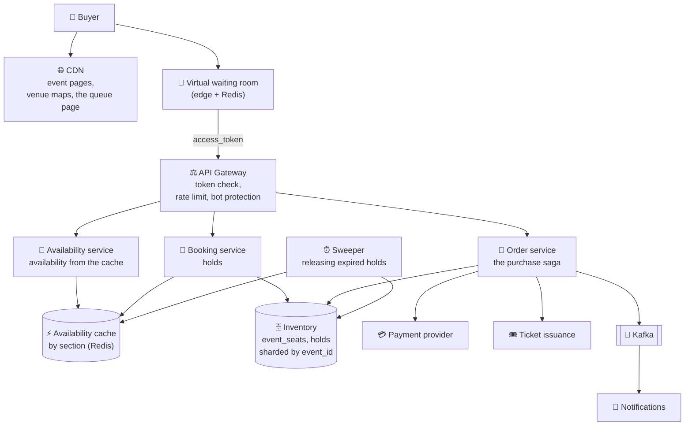
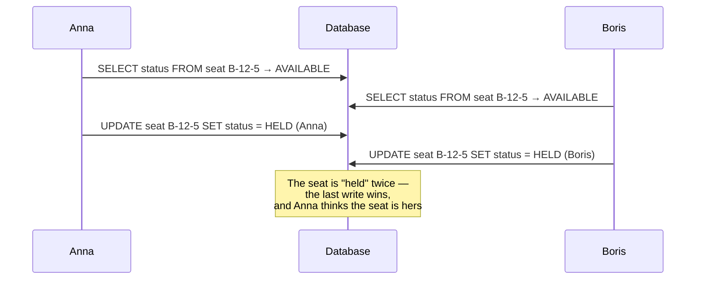
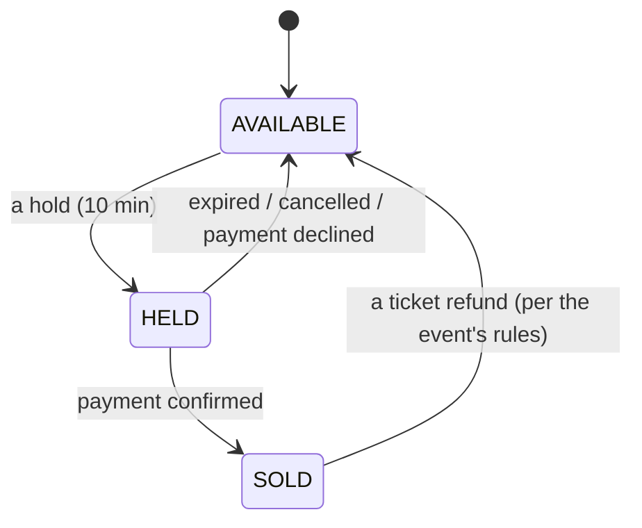
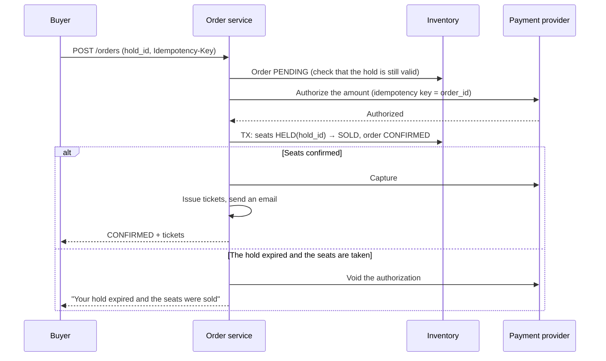
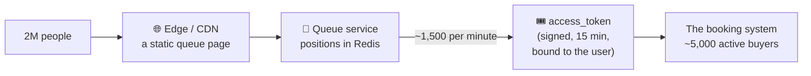

**English** | [Русский](README.ru.md)

# Tier 1 · 13. Ticketmaster / Hotel Booking

> **Level:** Hard · **Interview time:** 45–60 min · **Study time:** ~5 h
> **Key aspects:** preventing double booking (conditional updates, locks, unique constraints), temporary seat holds with a TTL, the purchase as a saga with payment, a virtual waiting room at on-sale time, reading the seat map at scale, hot spots on a single event, bot protection, the hotel variant
> **Builds on:** [04-databases](../../01_Fundamentals/04_Databases/README.md#11-concurrency-control-locks-mvcc-optimistic-approach), [10-idempotency](../../01_Fundamentals/10_Idempotency/README.md), [11-distributed-transactions](../../01_Fundamentals/11_Distributed%20transactions/README.md), [13-reliability-patterns](../../01_Fundamentals/13_Reliability%20patterns/README.md#7-load-shedding-and-prioritization), [Tier 1 · 02 Rate Limiter](../02_Design%20a%20Rate%20Limiter%20or%20Abuse%20Protection/README.md)

---

## 🗺️ How to Read This Walkthrough

The walkthrough follows an interview, but every step includes explanations: **why** a decision is made, **how** a mechanism works and **what happens** if you do it differently. The "📘 Explanation" blocks are theory right where you need it.

| Icon | Meaning |
|:----:|:--------|
| 🎤 | Interviewer |
| 🗣️ | What I (the candidate) say out loud |
| ✏️ | What I draw on the whiteboard |
| ⏱️ | Time budget for the step |
| 📘 | A detailed explanation of a concept |

Callouts: **TIP** — a good technique, **WARNING** — a trap, **IMPORTANT** — a Senior+ signal.

---

## 📑 Contents

0. [What This Problem Teaches](#0-what-this-problem-teaches)
1. [Problem Statement](#1-problem-statement)
2. [Clarifying Questions and Requirements](#2-clarifying-questions-and-requirements)
3. [Capacity Estimates](#3-capacity-estimates)
4. [API](#4-api)
5. [Data Model](#5-data-model)
6. [High-Level Design](#6-high-level-design)
7. [Deep Dive 1: Preventing Double Booking](#7-deep-dive-1-preventing-double-booking)
8. [Deep Dive 2: Temporary Seat Holds](#8-deep-dive-2-temporary-seat-holds)
9. [Deep Dive 3: The Purchase as a Saga](#9-deep-dive-3-the-purchase-as-a-saga)
10. [Deep Dive 4: On-Sale Time and the Virtual Waiting Room](#10-deep-dive-4-on-sale-time-and-the-virtual-waiting-room)
11. [Deep Dive 5: The Seat Map at Scale](#11-deep-dive-5-the-seat-map-at-scale)
12. [Deep Dive 6: Contention on a Single Event](#12-deep-dive-6-contention-on-a-single-event)
13. [Deep Dive 7: Bots and Fairness](#13-deep-dive-7-bots-and-fairness)
14. [Deep Dive 8: A Variant — Hotel Booking](#14-deep-dive-8-a-variant--hotel-booking)
15. [Bottlenecks and Failure Scenarios](#15-bottlenecks-and-failure-scenarios)
16. [What Changes at 10x Scale](#16-what-changes-at-10x-scale)
17. [Key Concepts and New Terms](#17-key-concepts-and-new-terms)
18. [Variations and Follow-Up Questions](#18-variations-and-follow-up-questions)
19. [Common Mistakes](#19-common-mistakes)
20. [Cheat Sheet and Self-Check](#20-cheat-sheet-and-self-check)

---

## 0. What This Problem Teaches

Ticket sales are a problem about **contention for a scarce resource**. Unlike a feed or search, where eventual consistency is fine, here a single error — two people holding a ticket for the same seat — is unacceptable. And at on-sale time for a popular concert, millions of people try to buy tens of thousands of seats at once.

| What's tested | Where it shows up |
|:--------------|:------------------|
| Strong consistency under contention | One seat — one buyer |
| Concurrency control mechanisms | Locks, optimistic conditional updates, unique constraints |
| Temporary states with expiry | Holding a seat for 10 minutes during payment |
| Distributed processes | Hold → payment → confirmation as a saga with compensations |
| Instant load spikes | A virtual waiting room, controlled admission rate |
| Hot spots | Every request targets one event |
| Fairness and abuse | Bots, scalpers |

> [!TIP]
> The key idea to state early: **the traffic splits into two parts with different requirements**. Browsing (events, the seat map) is huge, tolerates slight staleness and is cached. Booking is smaller in volume but needs strong consistency, and a waiting room protects it from overload.

---

## 1. Problem Statement

> 🎤 "Design Ticketmaster: a user picks a concert, sees the venue map, selects seats, the seats are held for them while they pay, and after payment they get tickets. Account for a popular artist's on-sale, when millions of people arrive at once."

**What the user sees:**

```
1. Opens the concert → a stadium map with available seats highlighted
2. Picks two seats in section B → "Your seats are held: 09:59"
3. Enters card details, pays → tickets in the app
4. On on-sale day: "You're in the queue. 48,213 people ahead of you, estimated wait 25 minutes"
```

**Time plan:**

| Step | ⏱️ |
|:-----|:--:|
| Requirements | 5 min |
| Estimates | 3 min |
| API and data | 5 min |
| High-level design | 6 min |
| Deep dives | 22–30 min |
| Failures and wrap-up | 4 min |

---

## 2. Clarifying Questions and Requirements

⏱️ 5 min

| My question | Interviewer's answer | What it changes and why |
|:------------|:---------------------|:------------------------|
| Reserved seats or general admission? | Both: stadiums with seats and a standing floor | Two kinds of inventory: seats and counters |
| How long are seats held for a buyer? | 10 minutes to pay | A hold with a TTL |
| Can a seat be sold twice? | Absolutely not | Strongly consistent booking |
| Peak load? | On-sale: 2M people within minutes for a 50,000-seat stadium | A virtual waiting room and admission control |
| Normal load? | Thousands of events, hundreds of purchases per second | An ordinary transactional system |
| Fairness? | Important: bots and scalpers are a big problem | Bot protection, limits |
| Payment? | Through a payment provider | A saga: hold → payment → confirmation |
| How current must the seat map be? | Seconds of delay are fine; the final check happens at hold time | An availability cache |

### Functional requirements

1. Browse events and the seat map with availability.
2. Select seats (or a quantity for general admission) and hold them for 10 minutes.
3. Pay and receive tickets.
4. Automatically release seats if payment fails or time runs out.
5. A virtual waiting room for popular events.

### Non-functional requirements

| Requirement | Target | Why |
|:------------|:-------|:----|
| Correctness | **Zero** double sales | Two people in one seat is a serious incident |
| Holds | Seats are really reserved for the buyer for 10 minutes | Otherwise they're "stolen" while the card is being typed |
| Availability | The site doesn't go down at on-sale | Going down during a sale is the business's biggest risk |
| Fairness | People who arrived on time have equal chances | Reputation and artists' requirements |
| Latency | Holding a seat — under a second | The user is waiting for the result |
| Scale | Peaks hundreds of times above normal load | You can't keep peak capacity running all the time |

---

## 3. Capacity Estimates

⏱️ 3 min

```
A normal day
  Thousands of events on sale, hundreds of purchases per second — ordinary transactional load

A popular concert's on-sale
  Seats:                  50,000
  Buyers who show up:     2,000,000 in the first minutes
  Without a queue:        millions of requests per second for browsing and holds
  Purchases:              ~3 tickets per order → ~17,000 orders for the whole stadium

Admission from the queue
  If the system serves ~5,000 concurrent buyers,
  and a purchase takes 3–5 minutes → admitting ~1,500 people per minute
  ~17,000 orders / 1,500 per minute → the seats sell out in roughly 10–15 minutes
  The other ~1.98M — an honest "sold out" message
```

### Conclusions

| Conclusion | Design consequence |
|:-----------|:-------------------|
| Demand is 40× supply | Most buyers will leave without tickets — it matters to tell them quickly and honestly |
| Millions of people within minutes | You can't let everyone into the booking system — **a virtual waiting room** with controlled admission |
| Every request targets one event | A hot spot: sharding "by event" doesn't spread the load |
| Orders number in the tens of thousands | The writes themselves are small; the difficulty is contention and overload protection |

---

## 4. API

⏱️ 3 min

```http
# Browsing
GET  /v1/events/{id}                        → description, venue, prices
GET  /v1/events/{id}/seatmap                → the layout (static, from the CDN)
GET  /v1/events/{id}/availability           → availability by section (updated often)

# The queue (for popular events)
POST /v1/events/{id}/queue                  → { queue_token, position }
GET  /v1/queue/{token}                      → { position, eta } | { admitted: true, access_token }

# Holds and purchases (with an access_token, if there's a queue)
POST /v1/holds          { event_id, seat_ids: ["B-12-5","B-12-6"] }   | { event_id, ga_quantity: 2 }
                        → 201 { hold_id, expires_at }
                        → 409 { unavailable: ["B-12-6"] }
DELETE /v1/holds/{id}                       ← the user changed their mind
POST /v1/orders         Idempotency-Key
                        { hold_id, payment_method }       → 202 { order_id, status: "PROCESSING" }
GET  /v1/orders/{id}                        → { status: "CONFIRMED", tickets: [...] }
```

---

## 5. Data Model

⏱️ 3 min

```sql
events  (event_id PK, venue_id, starts_at, on_sale_at, status, queue_enabled)

-- A seat at a specific event: one row per seat
event_seats (
  event_id        BIGINT,
  seat_id         TEXT,          -- "B-12-5": section, row, seat
  section_id      TEXT,
  price_tier      TEXT,
  status          TEXT,          -- AVAILABLE | HELD | SOLD
  hold_id         BIGINT NULL,
  hold_expires_at TIMESTAMP NULL,
  order_id        BIGINT NULL,
  version         BIGINT,
  PRIMARY KEY (event_id, seat_id)
);

-- General admission without seats: a counter
ga_inventory (event_id, zone_id, total, sold, held, PRIMARY KEY (event_id, zone_id))

holds   (hold_id PK, event_id, user_id, seat_ids, quantity, expires_at, status)
orders  (order_id PK, user_id, hold_id, amount, status, payment_ref, created_at)
tickets (ticket_id PK, order_id, event_id, seat_id, barcode)
```

| Decision | Why |
|:---------|:----|
| A relational DB with transactions | Strongly consistent booking is its strength |
| Sharding by `event_id` | All of an event's seats live in one shard: holding several seats is a local transaction |
| One row per seat | Contention for specific seats is resolved at the row level |
| A counter for general admission | No specific seats — "N left" is enough |

---

## 6. High-Level Design

⏱️ 6 min



🗣️ "Key decisions:
- **static content** (event pages, venue maps, the queue page) comes from the CDN, which withstands any flood;
- **the virtual waiting room** lets as many people into the booking system as it can serve;
- **availability** for the seat map comes from a cache, tolerating seconds of delay;
- **a hold** is a strongly consistent transaction in a DB sharded by event;
- **the purchase** is a saga: payment and seat confirmation with compensations;
- **a sweeper** releases expired holds."

---

## 7. Deep Dive 1: Preventing Double Booking

> 🎤 "Two people clicked the same seat at the same moment. How do you guarantee only one gets it?"

### The problem



This is the classic "read — check — write" race (a lost update, see [04-databases](../../01_Fundamentals/04_Databases/README.md#9-concurrency-anomalies)).

### Solutions

| Approach | How | Pros | Cons |
|:---------|:----|:-----|:-----|
| **Pessimistic locking** | `SELECT … FOR UPDATE` locks the seat rows until the transaction ends | Easy to understand | Lock waits under high contention, a deadlock risk with multiple seats |
| **An optimistic conditional update** ⭐ | `UPDATE … WHERE status = 'AVAILABLE'` and check how many rows changed | No long-held locks; the database itself resolves the race atomically | On a conflict — a retry or an error to the user |
| **A unique constraint** | A `seat_holds (event_id, seat_id) UNIQUE` table; a second hold insert fails | A guarantee at the schema level | Expired rows must be deleted |
| **An atomic operation in Redis** | `SET seat:{id} hold NX EX 600` | Very fast | Redis isn't the source of truth; consistency with the DB is needed |

### A conditional update of several seats

```sql
BEGIN;

UPDATE event_seats
SET status = 'HELD', hold_id = :hold_id, hold_expires_at = now() + interval '10 minutes',
    version = version + 1
WHERE event_id = :event_id
  AND seat_id IN ('B-12-5', 'B-12-6')
  AND (status = 'AVAILABLE'
       OR (status = 'HELD' AND hold_expires_at < now()));   -- an expired hold = available

-- If fewer rows changed than seats requested → some seats are taken
-- → ROLLBACK, tell the user which seats are unavailable
-- If all changed → insert into holds and COMMIT
COMMIT;
```

| Detail | Why it matters |
|:-------|:---------------|
| **All or nothing** | The user wants two adjacent seats; one without the other is useless — the whole transaction rolls back |
| The condition in `WHERE` | The database checks and changes the row atomically: of two concurrent `UPDATE`s, the second sees the already-changed status and changes nothing |
| An expired hold counts as available | A seat frees up the moment its hold expires, without waiting for the sweeper |
| All of an event's seats in one shard | The transaction is local, with no distributed transactions |

📘 **Why a conditional update is atomic.** When executing `UPDATE … WHERE`, the database locks the row for the duration of the change and evaluates the condition **after** acquiring the lock. The second concurrent `UPDATE` waits, then sees `status = 'HELD'` and finds no matching row. That makes the check and the write a single operation.

> [!IMPORTANT]
> **Senior+ signal:** show the race on a diagram, name it (a lost update), and propose a solution **the database performs atomically** (a conditional update or a unique constraint), not "we'll check in code and then write". Plus "all or nothing" handling for multiple seats.

### Ordering with pessimistic locks

If pessimistic locks are chosen, seats must be locked **in a consistent order** (e.g. by `seat_id`). Otherwise Anna locks seat 5 and waits for 6 while Boris does the opposite: a deadlock.

---

## 8. Deep Dive 2: Temporary Seat Holds

> 🎤 "Why hold seats, and how do you release them?"

### Why

Without holds, a user picks seats, types card details, and at payment discovers someone faster already bought them. A hold guarantees: **while you're paying, the seats are yours**.

### A seat's lifecycle



### How to release

| Mechanism | How | Why |
|:----------|:----|:----|
| **Lazy release** | The hold condition treats an expired `HELD` as available | A seat is available **immediately** on expiry — even if the background job is behind |
| **A sweeper** | Every few seconds it finds expired holds, sets seats back to `AVAILABLE` and updates the availability cache | The seat map tells the truth; hold records get closed |
| **Explicit cancellation** | The user closed the page or tapped "Cancel" | Seats come back sooner |

### Subtleties

| Situation | Solution |
|:----------|:---------|
| The user paid at the last second, after the hold expired | Seat confirmation is conditional: `WHERE hold_id = :mine AND status = 'HELD'`. If someone else has since held the seat, the order isn't confirmed and the payment is reversed |
| Hold length | A trade-off: short — more failed payments; long — seats sit idle while others wait |
| Extending | Once (e.g. +5 minutes), if the user is active on the payment page |
| Clocks | Expiry is computed by **the database** (`now()`), not by application servers |

> [!WARNING]
> A hold in Redis with a TTL that isn't reflected in the DB is dangerous: Redis may lose data on a failure, and the seat would look "available" while the buyer is already paying. If Redis is used for speed, the DB still must be the source of truth, with the final check at order confirmation.

---

## 9. Deep Dive 3: The Purchase as a Saga

> 🎤 "What happens after 'Pay' is clicked?"

📘 A purchase spans two systems — our inventory and an external payment provider. A distributed transaction between them is impossible, so the process is structured as a **saga** with compensations (see [11-distributed-transactions](../../01_Fundamentals/11_Distributed%20transactions/README.md)).



| Step | Why this way |
|:-----|:-------------|
| **Authorize first, capture later** | The money is blocked but not taken until the seats are confirmed — easy to cancel without a refund |
| **Idempotency key = order_id** | A retried request to the provider (a timeout) won't create a second payment (see [10-idempotency](../../01_Fundamentals/10_Idempotency/README.md)) |
| **Seat confirmation is conditional** | Only if the hold is still ours |
| **Compensation** | Seats lost → void the authorization; payment declined → release the seats |
| **An unknown payment result** (a timeout) | Don't release the seats right away: query the provider for status; if it stays unknown — reconciliation |

> [!TIP]
> The response to the user is asynchronous (`202 PROCESSING`), and the client polls for status or receives it over WebSocket. That lets you survive a slow provider without holding an HTTP request open.

---

## 10. Deep Dive 4: On-Sale Time and the Virtual Waiting Room

> 🎤 "Sales start at 10:00. At 09:59 there are 2 million people on the site. What do you do?"

### Why everything breaks without a queue

```
2M people hit "Refresh" at 10:00:00
→ millions of requests per second to the booking service and the events database
→ the event's shard is overloaded, latency climbs, timeouts
→ users refresh again (a retry storm)
→ the site goes down, nobody buys anything, headlines say "Ticketmaster crashes again"
```

You can't keep capacity for such a peak running all the time (it lasts minutes), and autoscaling won't keep up. You need to **control the rate** at which people enter the booking system.

### The virtual waiting room



| Element | How it works |
|:--------|:-------------|
| **A queue page from the CDN** | A static page withstands millions of users; the client periodically requests its position |
| **A fair order** | Everyone who arrived **before** on-sale gets a **random** position (there's no point sitting there since 6 AM refreshing every millisecond); later arrivals join the back in order |
| **Admission rate** | Tuned to actual capacity: the number of active buyers, hold and payment latency |
| **The access_token** | A signed token (e.g. a JWT) with the user ID and an expiry; the booking service verifies the signature **without calling the queue** |
| **Polling with jitter** | Clients poll their position every 10–30 seconds with a random offset — no synchronized waves |
| **Position and wait time** | Honest information reduces how many people keep refreshing |
| **Sold out** | Once inventory runs out, the whole queue immediately gets "sold out" instead of waiting in vain |

📘 **Why a token rather than a queue check.** The booking service handles thousands of requests per second; asking the queue service "is this user admitted" for each would make the queue a bottleneck. A signed token is verified locally by its cryptographic signature — that's static stability (see [13-reliability-patterns](../../01_Fundamentals/13_Reliability%20patterns/README.md#9-redundancy-and-static-stability)).

> [!IMPORTANT]
> **Senior+ signal:** a waiting room is **load shedding with a human face**: instead of a `503`, the user gets a clear position, and the system runs at a safe load. And mention fairness: a random order for those who arrived before on-sale.

---

## 11. Deep Dive 5: The Seat Map at Scale

> 🎤 "Thousands of people are looking at the venue map at once. How do you show current availability?"

| Data | How it's served | Why |
|:-----|:----------------|:----|
| **The venue layout** (sections, rows, seat coordinates) | A static file via the CDN | Doesn't change during sales |
| **Availability** | A separate lightweight request: a per-section bitmap from Redis | Changes constantly |
| **Updates** | Polling every few seconds or a stream (SSE/WebSocket) of per-section changes | The map doesn't "lie" for long |

📘 **An availability bitmap.** A 500-seat section is 500 bits ≈ 63 bytes: 1 — available, 0 — taken. Availability for a whole 50,000-seat stadium is about 6 KB. Such a structure is easy to keep in Redis, update with one operation (`SETBIT`) on a hold or sale, and send to the client whole.

| Principle | Why |
|:----------|:----|
| The map may lag by seconds | The final check happens at hold time; if a seat is taken, the user gets a `409` and picks another |
| The cache updates after the transaction | The booking service updates the bitmap after COMMIT; the sweeper does so on release |
| **"Best available seats"** | Instead of picking a specific seat on the map, the system picks seats → fewer conflicts over the same popular seats |

> [!TIP]
> During peak sales many systems **disable** manual seat selection on the map and keep only "best available": thousands of people stop clicking on the same front-row seats, and conflicts drop several-fold.

---

## 12. Deep Dive 6: Contention on a Single Event

> 🎤 "Every request goes to one shard — one event. How do you deal with the hot spot?"

📘 Sharding by `event_id` spreads **different** events well, but a popular concert means every request lands in one shard (see [06-partitioning](../../01_Fundamentals/06_Partitioning/README.md#8-hot-partitions-and-skew)).

| Solution | How | Effect |
|:---------|:----|:-------|
| **The virtual waiting room** | Caps the number of concurrent buyers | Load on the shard stays under control |
| **Splitting by section** | A hold touches seats in one section; sections are independent locking units (or even shards) | Contention is divided across dozens of sections |
| **A single-threaded allocator per event** | One process handles all of an event's requests in turn (the actor model), keeping availability in memory and writing results to the DB | No row contention, very high throughput; needs reliable restarts and state recovery |
| **Batching** | The allocator collects requests over 50–100 ms and satisfies them in one transaction | Fewer transactions |
| **General admission — a counter** | `UPDATE ga_inventory SET held = held + 2 WHERE … AND total - sold - held >= 2` | One hot row; for huge zones — split the counter into N parts, each with its own quota |

### General admission: a sharded counter

```
A 20,000-person floor → 10 sub-counters of 2,000 each
A request for 2 tickets → a random sub-counter → a conditional decrement
If the sub-counter is empty → try another
Result: contention on one row is divided by 10
```

---

## 13. Deep Dive 7: Bots and Fairness

> 🎤 "Scalpers use bots to buy half the tickets in seconds. What do you do?"

| Measure | How | Against what |
|:--------|:----|:-------------|
| **Pre-registration** | Buyers register in advance and get verified; access to the sale is by code (Ticketmaster runs a Verified Fan program) | Mass bot accounts |
| **CAPTCHA and behavioral analysis** | On entering the queue and on holds | Automated clients |
| **Purchase limits** | At most N tickets per account, card, address, device | Buying in bulk |
| **The queue token is bound to the user and device** | A position can't be transferred or resold | Bypassing the queue |
| **Rate limiting** | By account, IP, device fingerprint (see [Tier 1 · 02](../02_Design%20a%20Rate%20Limiter%20or%20Abuse%20Protection/README.md)) | Mass requests |
| **Named or dynamic tickets** | The barcode rotates and is bound to the app; resale only through the official platform with a price cap | The secondary market |

---

## 14. Deep Dive 8: A Variant — Hotel Booking

> 🎤 "What if this were hotel room booking?"

### How it differs

| | Tickets | Hotels |
|:-|:--------|:-------|
| Inventory | Specific seats | **A count** of rooms of a type for each night |
| A booking | Seats for one event | **A range of nights**: every night must be available |
| Peaks | On-sale | Seasonality, but no "instant" peak |
| External channels | Rare | The same room sells via Booking.com, Expedia and the hotel's site |
| Overselling | Unacceptable | Sometimes allowed on purpose (overbooking) |

### The model and booking

```sql
room_inventory (hotel_id, room_type, night_date, total, booked,
                PRIMARY KEY (hotel_id, room_type, night_date))

-- A 3-night booking: all or nothing
BEGIN;
UPDATE room_inventory
SET booked = booked + 1
WHERE hotel_id = :h AND room_type = :t
  AND night_date IN ('2027-03-10','2027-03-11','2027-03-12')
  AND booked < total;
-- fewer than 3 rows changed → at least one night is full → ROLLBACK
COMMIT;
```

| Topic | Solution |
|:------|:---------|
| Several nights | A conditional increment for each night in one transaction, all or nothing |
| A hold during payment | The same TTL mechanism; hotels often take bookings without immediate payment |
| **Syncing with external channels** | A channel manager pushes availability to OTAs; sync is asynchronous — the last room may sell twice → a small buffer or allowed overbooking with a relocation procedure |
| Cancellations | Decrementing the counter; cancellation rules and fees |
| Per-night prices | A separate price table by date and room type |

---

## 15. Bottlenecks and Failure Scenarios

| Scenario | What happens | How we protect |
|:---------|:-------------|:---------------|
| Two people pick the same seat at once | Double booking | A conditional update / a unique constraint |
| Several seats, some taken | A partial booking | An "all or nothing" transaction |
| On-sale, millions of people | The site goes down | A virtual waiting room, static content from the CDN, admission tokens |
| A buyer doesn't pay | Seats get "stuck" | A hold TTL, lazy release, a sweeper |
| Payment at the last second after expiry | A seat sold twice | Conditional confirmation by hold_id, voiding the authorization |
| A payment provider timeout | The result is unknown | An idempotency key, a status query, reconciliation |
| The availability cache lags | The user picks a taken seat | A `409` at hold time, "best available" |
| The event's hot shard | Overload | The queue, splitting by section, a single-threaded allocator |
| Bots | Buying up tickets | Registration, CAPTCHA, limits, token binding |
| The queue service dies | New people can't join the queue | Redis replicas; already-admitted buyers keep working with their tokens |

---

## 16. What Changes at 10x Scale

> 🎤 "20 million people for a single sale?"

| Change | Why |
|:-------|:----|
| **The queue entirely at the edge** (edge compute + KV) | Millions of clients never reach our servers |
| **Single-threaded allocators per section** | Maximum hold throughput |
| **A lottery instead of a queue** | When demand is hundreds of times supply, it's fairer to draw the right to buy in advance |
| **Separate infrastructure for peak events** | Peaks don't affect sales of other events |

---

## 17. Key Concepts and New Terms

### What's applied from Fundamentals

| Concept | Where it's covered | How it applies here |
|:--------|:-------------------|:--------------------|
| Lost updates, locks, the optimistic approach | [04-databases](../../01_Fundamentals/04_Databases/README.md#11-concurrency-control-locks-mvcc-optimistic-approach) | Preventing double booking |
| Hot partitions | [06-partitioning](../../01_Fundamentals/06_Partitioning/README.md#8-hot-partitions-and-skew) | One popular event |
| Idempotency | [10-idempotency](../../01_Fundamentals/10_Idempotency/README.md) | Orders, payment |
| Sagas and compensations | [11-distributed-transactions](../../01_Fundamentals/11_Distributed%20transactions/README.md) | Hold → payment → confirmation |
| Load shedding, static stability | [13-reliability-patterns](../../01_Fundamentals/13_Reliability%20patterns/README.md) | The virtual waiting room, tokens |
| Rate limiting | [Tier 1 · 02](../02_Design%20a%20Rate%20Limiter%20or%20Abuse%20Protection/README.md) | Bot protection |

### New terms in this problem

| Term | In short |
|:-----|:---------|
| **A hold** | Temporarily reserving seats for a buyer with a TTL |
| **A conditional update** | `UPDATE … WHERE status = 'AVAILABLE'` — an atomic check and write |
| **All or nothing** | Booking several seats or nights in one transaction |
| **Lazy release** | An expired hold counts as available in the condition itself |
| **A virtual waiting room** | Controlled admission into the booking system during peaks |
| **An admission token** | A signed token verified without calling the queue |
| **An availability bitmap** | One bit per seat — compact section availability |
| **A single-threaded allocator** | One process per event or section, handling requests in turn |
| **Overbooking** | Deliberately selling beyond inventory with a compensation procedure |

---

## 18. Variations and Follow-Up Questions

<details>
<summary><b>Why not keep holds only in Redis?</b></summary>

Redis is faster but may lose data on a failure or failover, and then a seat would look "available" while the buyer is already paying. If Redis is used (e.g. for a fast initial hold or the bitmap), the DB remains the source of truth, and order confirmation checks the state in the DB.
</details>

<details>
<summary><b>Why is pessimistic locking worse than optimistic here?</b></summary>

Under high contention, `SELECT FOR UPDATE` holds locks for the entire transaction, so requests queue up on the same popular seats; with several seats, the deadlock risk grows. A conditional update holds the row lock only for the operation itself, and a conflict immediately yields a clear "seat taken" result.
</details>

<details>
<summary><b>How do you implement "best available seats"?</b></summary>

A section's allocator keeps availability and seat-quality rules (closer to the stage, centered) in memory, and for a request like "2 seats in category A" finds the best free adjacent pair and holds it right away. That turns "everyone clicks the same seat" into orderly processing by one process.
</details>

<details>
<summary><b>What about users who closed the tab during payment?</b></summary>

The hold expires after 10 minutes and is released lazily and by the sweeper. If the payment went through, the saga completes without the client: the tickets appear in the account and an email arrives.
</details>

<details>
<summary><b>How do you handle refunds and resale?</b></summary>

A refund follows the event's rules: the ticket is voided, the seat returns to `AVAILABLE` (or to a separate resale pool), and the money is refunded via the provider. Official resale transfers the ticket to a new owner with a new barcode and a price cap.
</details>

---

## 19. Common Mistakes

| ❌ Mistake | Why it's bad | ✅ Do this instead |
|:----------|:-------------|:------------------|
| "Check it's free, then write" | Double booking | A conditional update or a unique constraint |
| A partial booking of several seats | The user gets seats that aren't together | An "all or nothing" transaction |
| No hold during payment | Seats get taken while the card is typed | A hold with a TTL |
| Releasing seats only with a background job | Seats get "stuck" when it falls behind | Lazy release in the condition |
| Confirming seats without checking hold_id | Selling a seat someone else holds | Conditional confirmation |
| Capturing money before confirming seats | Refunds on failure | Authorize → confirm → capture |
| Letting everyone into the booking system at on-sale | The site goes down | A virtual waiting room |
| Checking admission by calling the queue | The queue becomes a bottleneck | A signed token |
| The seat map straight from the DB | An overloaded shard | Bitmaps in a cache |
| FIFO for those who arrived before on-sale | Bots and refreshers win | A random order for pre-on-sale arrivals |

---

## 20. Cheat Sheet and Self-Check

### 30-second answer

> Two flows: huge browsing (static content from the CDN, availability from Redis bitmaps with seconds of delay) and strongly consistent booking. A hold is a transaction in a DB sharded by event_id: `UPDATE … SET status = 'HELD' WHERE status = 'AVAILABLE' OR the hold has expired`, checking the row count, all or nothing; a 10-minute TTL, lazy release and a sweeper. The purchase is a saga: order PENDING → authorization with idempotency key = order_id → conditional seat confirmation by hold_id → capture → tickets; if the seats are lost — void the authorization. On-sale — a virtual waiting room at the edge: a random order for pre-on-sale arrivals, admission by actual capacity, a signed access_token verified locally, an instant "sold out". The hot spot — sections as locking units, a single-threaded allocator, sharded counters for the floor, "best available". Bots — registration, CAPTCHA, limits, token binding. Hotels — counters per night, a conditional increment of every night in one transaction.

### Self-check

- [ ] I can show the double booking race and name it
- [ ] I can compare 4 ways to prevent it and choose one with justification
- [ ] I can write an "all or nothing" conditional update for several seats
- [ ] I can explain holds with a TTL, lazy release and the sweeper
- [ ] I can describe the purchase saga with authorization, confirmation and compensations
- [ ] I can design a virtual waiting room and explain the fair ordering
- [ ] I can explain why a signed admission token is needed
- [ ] I can design the seat map with bitmaps
- [ ] I can propose solutions for a hot event
- [ ] I can adapt the design for hotel booking

### Further reading

- Alex Xu, Sahn Lam, *System Design Interview*, Vol. 2 — chapter "Hotel Reservation System"
- PostgreSQL documentation: isolation levels, `SELECT … FOR UPDATE`, `SKIP LOCKED`
- Cloudflare, Queue-it — documentation on virtual waiting rooms
- Fundamentals topics: [04-databases](../../01_Fundamentals/04_Databases/README.md), [11-distributed-transactions](../../01_Fundamentals/11_Distributed%20transactions/README.md)