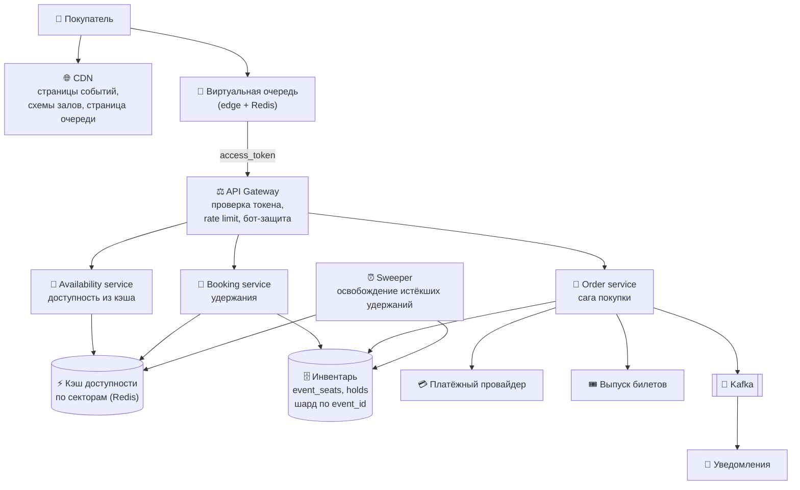
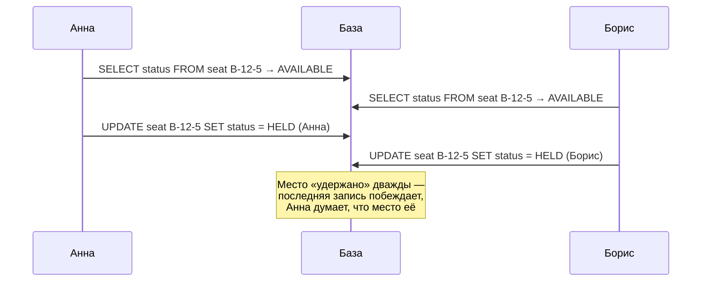
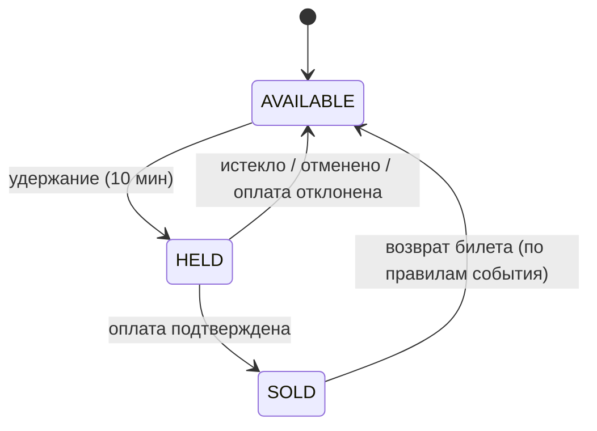
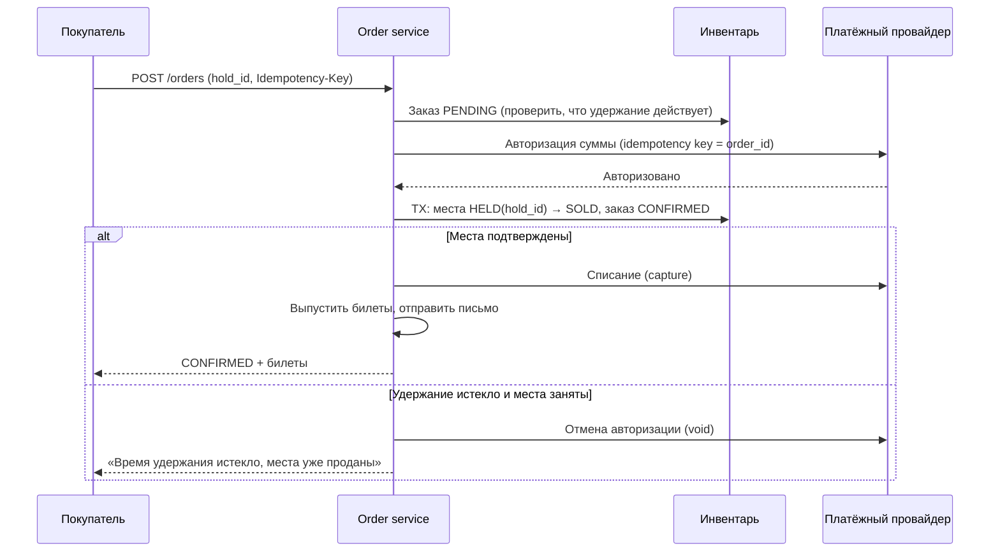
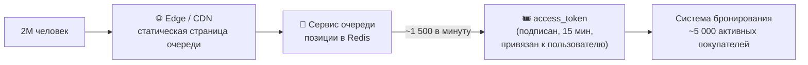

[English](README.md) | **Русский**

# Tier 1 · 13. Ticketmaster / бронирование отелей

> **Уровень:** Hard · **Время на интервью:** 45–60 мин · **Время на разбор:** ~5 ч
> **Ключевые аспекты:** защита от двойного бронирования (условные обновления, блокировки, уникальные ограничения), временное удержание мест с TTL, процесс покупки как сага с оплатой, виртуальная очередь при старте продаж, чтение карты мест на масштабе, горячие точки на одном событии, защита от ботов, вариант для отелей
> **Опирается на:** [04-databases](../../04-databases/README_RU.md#11-управление-конкурентным-доступом-блокировки-mvcc-оптимистичный-подход), [10-idempotency](../../10-idempotency/README_RU.md), [11-distributed-transactions](../../11-distributed-transactions/README_RU.md), [13-reliability-patterns](../../13-reliability-patterns/README_RU.md#7-load-shedding-и-приоритизация), [Tier 1 · 02 Rate Limiter](../02-rate-limiter/README_RU.md)

---

## 🗺️ Как читать этот разбор

Разбор построен как интервью, но в каждом шаге есть объяснения: **почему** принимается решение, **как работает** механизм и **что будет**, если сделать иначе. Блоки «📘 Объяснение» — теория прямо по ходу задачи.

| Значок | Что значит |
|:------:|:-----------|
| 🎤 | Реплика интервьюера |
| 🗣️ | Что говорю вслух я (кандидат) |
| ✏️ | Что рисую на доске |
| ⏱️ | Сколько времени тратить на шаг |
| 📘 | Подробное объяснение концепции |

Блоки **TIP** — хороший приём, **WARNING** — ловушка, **IMPORTANT** — сигнал для уровня Senior+.

---

## 📑 Содержание

0. [Чему учит эта задача](#0-чему-учит-эта-задача)
1. [Условие задачи](#1-условие-задачи)
2. [Уточняющие вопросы и требования](#2-уточняющие-вопросы-и-требования)
3. [Оценки нагрузки](#3-оценки-нагрузки)
4. [API](#4-api)
5. [Модель данных](#5-модель-данных)
6. [High-level дизайн](#6-high-level-дизайн)
7. [Deep dive 1: защита от двойного бронирования](#7-deep-dive-1-защита-от-двойного-бронирования)
8. [Deep dive 2: временное удержание мест](#8-deep-dive-2-временное-удержание-мест)
9. [Deep dive 3: покупка как сага](#9-deep-dive-3-покупка-как-сага)
10. [Deep dive 4: старт продаж и виртуальная очередь](#10-deep-dive-4-старт-продаж-и-виртуальная-очередь)
11. [Deep dive 5: карта мест на масштабе](#11-deep-dive-5-карта-мест-на-масштабе)
12. [Deep dive 6: конкуренция за одно событие](#12-deep-dive-6-конкуренция-за-одно-событие)
13. [Deep dive 7: боты и справедливость](#13-deep-dive-7-боты-и-справедливость)
14. [Deep dive 8: вариант — бронирование отелей](#14-deep-dive-8-вариант--бронирование-отелей)
15. [Узкие места и сценарии сбоев](#15-узкие-места-и-сценарии-сбоев)
16. [Что изменится при росте в 10 раз](#16-что-изменится-при-росте-в-10-раз)
17. [Ключевые концепции и новые понятия](#17-ключевые-концепции-и-новые-понятия)
18. [Варианты задачи и follow-up вопросы](#18-варианты-задачи-и-follow-up-вопросы)
19. [Типичные ошибки](#19-типичные-ошибки)
20. [Шпаргалка и самопроверка](#20-шпаргалка-и-самопроверка)

---

## 0. Чему учит эта задача

Продажа билетов — задача про **конкуренцию за ограниченный ресурс**. В отличие от ленты или поиска, где допустима eventual consistency, здесь одна ошибка — два человека с билетом на одно место — недопустима. При этом в момент старта продаж популярного концерта миллионы людей одновременно пытаются купить десятки тысяч мест.

| Что проверяют | Где это в задаче |
|:--------------|:-----------------|
| Строгая консистентность при конкуренции | Одно место — один покупатель |
| Механизмы конкурентного доступа | Блокировки, оптимистичные условные обновления, уникальные ограничения |
| Временные состояния с истечением | Удержание места на 10 минут на время оплаты |
| Распределённые процессы | Удержание → оплата → подтверждение как сага с компенсациями |
| Мгновенные пики нагрузки | Виртуальная очередь, контроль скорости допуска |
| Горячие точки | Все запросы — к одному событию |
| Справедливость и злоупотребления | Боты, перекупщики |

> [!TIP]
> Главная мысль, которую нужно сказать рано: **поток делится на две части с разными требованиями**. Просмотр (события, карта мест) — огромный, допускает небольшое устаревание и кэшируется. Бронирование — меньше по объёму, но требует строгой консистентности и защищается очередью от перегрузки.

---

## 1. Условие задачи

> 🎤 «Спроектируй Ticketmaster: пользователь выбирает концерт, видит схему зала, выбирает места, они удерживаются за ним на время оплаты, после оплаты он получает билеты. Учти старт продаж популярного артиста, когда миллионы людей приходят одновременно».

**Что видит пользователь:**

```
1. Открывает концерт → схема стадиона, свободные места подсвечены
2. Выбирает два места в секторе B → «Места удерживаются за вами: 09:59»
3. Вводит данные карты, оплачивает → билеты в приложении
4. В день старта продаж: «Вы в очереди. Перед вами 48 213 человек, примерное ожидание 25 минут»
```

**План по времени:**

| Шаг | ⏱️ |
|:----|:--:|
| Требования | 5 мин |
| Оценки | 3 мин |
| API и данные | 5 мин |
| High-level дизайн | 6 мин |
| Deep dives | 22–30 мин |
| Сбои и итоги | 4 мин |

---

## 2. Уточняющие вопросы и требования

⏱️ 5 мин

| Мой вопрос | Ответ интервьюера | Что это меняет и почему |
|:-----------|:------------------|:------------------------|
| Места с номерами или входные билеты без мест? | Оба: стадионы с местами и танцпол без мест | Два типа инвентаря: места и счётчики |
| Сколько держать места за покупателем? | 10 минут на оплату | Удержание с TTL |
| Можно ли продать одно место дважды? | Ни в коем случае | Строгая консистентность бронирования |
| Пиковая нагрузка? | Старт продаж: 2M человек за минуты на стадион на 50 000 мест | Виртуальная очередь и контроль допуска |
| Обычная нагрузка? | Тысячи событий, сотни покупок в секунду | Обычная транзакционная система |
| Справедливость? | Важно: боты и перекупщики — большая проблема | Защита от ботов, лимиты |
| Оплата? | Через платёжного провайдера | Сага: удержание → оплата → подтверждение |
| Насколько актуальной должна быть карта мест? | Секунды задержки допустимы; окончательная проверка — при удержании | Кэш доступности |

### Функциональные требования

1. Просмотр событий и схемы мест с доступностью.
2. Выбор мест (или количества для входных билетов) и их удержание на 10 минут.
3. Оплата и получение билетов.
4. Автоматическое освобождение мест, если оплата не прошла или время истекло.
5. Виртуальная очередь на популярные события.

### Нефункциональные требования

| Требование | Цель | Почему |
|:-----------|:-----|:-------|
| Корректность | **Ноль** двойных продаж | Два человека на одном месте — серьёзный инцидент |
| Удержание | Места реально закреплены за покупателем на 10 минут | Иначе их «уведут» во время ввода карты |
| Доступность | Сайт не падает при старте продаж | Падение в момент продаж — главный риск бизнеса |
| Справедливость | Люди, пришедшие вовремя, имеют равные шансы | Репутация и требования артистов |
| Задержка | Удержание места — до секунды | Пользователь ждёт результата |
| Масштаб | Пики в сотни раз выше обычной нагрузки | Нельзя держать мощности под пик постоянно |

---

## 3. Оценки нагрузки

⏱️ 3 мин

```
Обычный день
  Тысячи событий в продаже, сотни покупок в секунду — обычная транзакционная нагрузка

Старт продаж популярного концерта
  Мест:                   50 000
  Пришедших покупателей:  2 000 000 за первые минуты
  Без очереди:            миллионы запросов в секунду на просмотр и удержание
  Покупок:                ~3 билета на заказ → ~17 000 заказов на весь стадион

Допуск из очереди
  Если система обслуживает ~5 000 одновременных покупателей,
  а покупка занимает 3–5 минут → допуск ~1 500 человек в минуту
  ~17 000 заказов / 1 500 в минуту → места раскупаются примерно за 10–15 минут
  Остальным ~1,98M — честное сообщение «билеты закончились»
```

### Выводы

| Вывод | Следствие для дизайна |
|:------|:----------------------|
| Спрос в 40 раз больше предложения | Большинство покупателей уйдут без билетов — важно быстро и честно сообщить им это |
| Миллионы человек за минуты | Нельзя пускать всех в систему бронирования — **виртуальная очередь** с контролируемым допуском |
| Все запросы — к одному событию | Горячая точка: шардирование «по событию» не распределяет нагрузку |
| Заказов — десятки тысяч | Сама запись невелика; сложность — конкуренция и защита от перегрузки |

---

## 4. API

⏱️ 3 мин

```http
# Просмотр
GET  /v1/events/{id}                        → описание, площадка, цены
GET  /v1/events/{id}/seatmap                → схема (статика, из CDN)
GET  /v1/events/{id}/availability           → доступность по секторам (часто обновляется)

# Очередь (для популярных событий)
POST /v1/events/{id}/queue                  → { queue_token, position }
GET  /v1/queue/{token}                      → { position, eta } | { admitted: true, access_token }

# Удержание и покупка (с access_token, если есть очередь)
POST /v1/holds          { event_id, seat_ids: ["B-12-5","B-12-6"] }   | { event_id, ga_quantity: 2 }
                        → 201 { hold_id, expires_at }
                        → 409 { unavailable: ["B-12-6"] }
DELETE /v1/holds/{id}                       ← пользователь передумал
POST /v1/orders         Idempotency-Key
                        { hold_id, payment_method }       → 202 { order_id, status: "PROCESSING" }
GET  /v1/orders/{id}                        → { status: "CONFIRMED", tickets: [...] }
```

---

## 5. Модель данных

⏱️ 3 мин

```sql
events  (event_id PK, venue_id, starts_at, on_sale_at, status, queue_enabled)

-- Место на конкретном событии: строка на каждое место
event_seats (
  event_id        BIGINT,
  seat_id         TEXT,          -- "B-12-5": сектор, ряд, место
  section_id      TEXT,
  price_tier      TEXT,
  status          TEXT,          -- AVAILABLE | HELD | SOLD
  hold_id         BIGINT NULL,
  hold_expires_at TIMESTAMP NULL,
  order_id        BIGINT NULL,
  version         BIGINT,
  PRIMARY KEY (event_id, seat_id)
);

-- Входные билеты без мест: счётчик
ga_inventory (event_id, zone_id, total, sold, held, PRIMARY KEY (event_id, zone_id))

holds   (hold_id PK, event_id, user_id, seat_ids, quantity, expires_at, status)
orders  (order_id PK, user_id, hold_id, amount, status, payment_ref, created_at)
tickets (ticket_id PK, order_id, event_id, seat_id, barcode)
```

| Решение | Почему |
|:--------|:-------|
| Реляционная БД с транзакциями | Строгая консистентность бронирования — её сильная сторона |
| Шардирование по `event_id` | Все места события — в одном шарде: удержание нескольких мест — локальная транзакция |
| Строка на каждое место | Конкуренция за конкретные места решается на уровне строк |
| Счётчик для входных билетов | Нет конкретных мест — достаточно «осталось N» |

---

## 6. High-level дизайн

⏱️ 6 мин



🗣️ «Ключевые решения:
- **статика** (страницы событий, схемы залов, страница очереди) — из CDN, она выдерживает любой поток;
- **виртуальная очередь** пускает в систему бронирования столько людей, сколько она может обслужить;
- **доступность** для карты мест — из кэша, допускает задержку в секунды;
- **удержание** — строго консистентная транзакция в БД, шардированной по событию;
- **покупка** — сага: оплата и подтверждение мест с компенсациями;
- **sweeper** освобождает истёкшие удержания».

---

## 7. Deep dive 1: защита от двойного бронирования

> 🎤 «Два человека одновременно нажали на одно и то же место. Как гарантировать, что получит только один?»

### Проблема



Это классическая гонка «прочитать — проверить — записать» (lost update, см. [04-databases](../../04-databases/README_RU.md#9-аномалии-конкурентного-доступа)).

### Решения

| Подход | Как | Плюсы | Минусы |
|:-------|:----|:------|:-------|
| **Пессимистичная блокировка** | `SELECT … FOR UPDATE` блокирует строки мест до конца транзакции | Просто понять | Блокировки при высокой конкуренции, риск взаимоблокировок при нескольких местах |
| **Оптимистичное условное обновление** ⭐ | `UPDATE … WHERE status = 'AVAILABLE'` и проверка числа изменённых строк | Нет долгих блокировок; гонку решает сама база атомарно | При конфликте — повтор или ошибка пользователю |
| **Уникальное ограничение** | Таблица `seat_holds (event_id, seat_id) UNIQUE`; вставка второго удержания падает | Гарантия на уровне схемы | Нужно удалять истёкшие записи |
| **Атомарная операция в Redis** | `SET seat:{id} hold NX EX 600` | Очень быстро | Redis — не источник правды; нужна согласованность с БД |

### Условное обновление нескольких мест

```sql
BEGIN;

UPDATE event_seats
SET status = 'HELD', hold_id = :hold_id, hold_expires_at = now() + interval '10 minutes',
    version = version + 1
WHERE event_id = :event_id
  AND seat_id IN ('B-12-5', 'B-12-6')
  AND (status = 'AVAILABLE'
       OR (status = 'HELD' AND hold_expires_at < now()));   -- истёкшее удержание = свободно

-- Если изменено строк меньше, чем мест в запросе → часть мест занята
-- → ROLLBACK, вернуть пользователю, какие места недоступны
-- Если изменены все → вставить запись в holds и COMMIT
COMMIT;
```

| Деталь | Почему важна |
|:-------|:-------------|
| **Всё или ничего** | Пользователь хочет два места рядом; одно без другого ему не нужно — транзакция откатывается целиком |
| Условие в `WHERE` | База атомарно проверяет и меняет строку: из двух одновременных `UPDATE` второй увидит уже изменённый статус и не изменит ничего |
| Истёкшее удержание считается свободным | Место освобождается сразу по истечении, не дожидаясь sweeper |
| Все места события в одном шарде | Транзакция локальная, без распределённых транзакций |

📘 **Почему условное обновление атомарно.** База данных при выполнении `UPDATE … WHERE` блокирует строку на время изменения и проверяет условие уже **после** получения блокировки. Второй конкурентный `UPDATE` ждёт, затем видит `status = 'HELD'` и не находит подходящей строки. Так проверка и запись становятся одной операцией.

> [!IMPORTANT]
> **Сигнал Senior+:** показать гонку на диаграмме, назвать её (lost update) и предложить решение, которое **база делает атомарно** (условное обновление или уникальное ограничение), а не «проверим в коде и потом запишем». Плюс обработка нескольких мест «всё или ничего».

### Порядок при пессимистичных блокировках

Если выбраны пессимистичные блокировки, места нужно блокировать **в одном порядке** (например, по `seat_id`). Иначе Анна заблокирует место 5 и будет ждать 6, а Борис — наоборот: взаимоблокировка.

---

## 8. Deep dive 2: временное удержание мест

> 🎤 «Зачем удерживать места и как их освобождать?»

### Зачем

Без удержания пользователь выбрал места, ввёл данные карты, а при оплате оказалось, что места уже купил кто-то быстрее. Удержание гарантирует: **пока ты платишь, места твои**.

### Жизненный цикл места



### Как освобождать

| Механизм | Как | Зачем |
|:---------|:----|:------|
| **Ленивое освобождение** | В условии удержания истёкший `HELD` считается свободным | Место доступно **сразу** по истечении — даже если фоновая задача отстаёт |
| **Sweeper** | Раз в несколько секунд находит истёкшие удержания, переводит места в `AVAILABLE`, обновляет кэш доступности | Карта мест показывает правду; записи удержаний закрываются |
| **Явная отмена** | Пользователь закрыл страницу или нажал «Отменить» | Места возвращаются раньше |

### Тонкости

| Ситуация | Решение |
|:---------|:--------|
| Пользователь оплатил в последнюю секунду, а удержание истекло | Подтверждение мест — условное: `WHERE hold_id = :mine AND status = 'HELD'`. Если место уже удержал другой — заказ не подтверждается, оплата возвращается |
| Длина удержания | Компромисс: короткое — больше неудачных оплат; длинное — места «простаивают», пока другие ждут |
| Продление | Один раз (например, +5 минут), если пользователь активен на странице оплаты |
| Часы | Время истечения считает **база** (`now()`), а не серверы приложения |

> [!WARNING]
> Удержание в Redis с TTL без отражения в БД опасно: Redis может потерять данные при сбое, и место окажется «свободным», хотя покупатель уже платит. Если Redis используется для скорости, источником правды всё равно должна быть БД, а финальная проверка — при подтверждении заказа.

---

## 9. Deep dive 3: покупка как сага

> 🎤 «Что происходит после нажатия “Оплатить”?»

📘 Покупка затрагивает две системы — наш инвентарь и внешнего платёжного провайдера. Распределённую транзакцию между ними сделать нельзя, поэтому процесс оформляется как **сага** с компенсациями (см. [11-distributed-transactions](../../11-distributed-transactions/README_RU.md)).



| Шаг | Почему так |
|:----|:-----------|
| **Сначала авторизация, потом списание** | Деньги блокируются, но не списываются, пока места не подтверждены — легко отменить без возврата |
| **Idempotency key = order_id** | Повтор запроса к провайдеру (таймаут) не создаст второй платёж (см. [10-idempotency](../../10-idempotency/README_RU.md)) |
| **Подтверждение мест — условное** | Только если удержание всё ещё наше |
| **Компенсация** | Места потеряны → отмена авторизации; оплата отклонена → освобождение мест |
| **Неизвестный результат оплаты** (таймаут) | Не освобождать места сразу: запросить статус у провайдера; если неизвестно долго — сверка |

> [!TIP]
> Ответ пользователю асинхронный (`202 PROCESSING`), а клиент опрашивает статус или получает его по WebSocket. Это позволяет пережить медленного провайдера, не держа HTTP-запрос открытым.

---

## 10. Deep dive 4: старт продаж и виртуальная очередь

> 🎤 «В 10:00 стартуют продажи. В 09:59 на сайте 2 миллиона человек. Что делать?»

### Почему без очереди всё ломается

```
2M человек нажимают «Обновить» в 10:00:00
→ миллионы запросов в секунду к сервису бронирования и базе событий
→ база шарда события перегружена, задержки растут, таймауты
→ пользователи обновляют страницу ещё раз (retry storm)
→ сайт падает, никто ничего не купил, новости «Ticketmaster снова упал»
```

Мощности под такой пик держать постоянно нельзя (он длится минуты), а автоскейлинг не успеет. Нужно **контролировать скорость**, с которой люди попадают в систему бронирования.

### Виртуальная очередь



| Элемент | Как работает |
|:--------|:-------------|
| **Страница очереди со CDN** | Статическая страница выдерживает миллионы пользователей; клиент периодически запрашивает свою позицию |
| **Справедливый порядок** | Все, кто пришёл **до** старта продаж, получают **случайные** позиции (нет смысла сидеть с 6 утра и обновлять страницу каждую миллисекунду); пришедшие после — в конец по порядку |
| **Скорость допуска** | Регулируется по фактической ёмкости: число активных покупателей, задержка удержаний и оплат |
| **access_token** | Подписанный токен (например, JWT) с идентификатором пользователя и сроком действия; сервис бронирования проверяет подпись **без обращения к очереди** |
| **Опрос с разбросом** | Клиенты опрашивают позицию раз в 10–30 секунд со случайным смещением — без синхронных волн |
| **Позиция и время ожидания** | Честная информация снижает число людей, обновляющих страницу |
| **Распродано** | Как только инвентарь закончился, вся очередь сразу получает «билеты закончились», а не ждёт впустую |

📘 **Почему токен, а не проверка в очереди.** Сервис бронирования получает тысячи запросов в секунду; если для каждого спрашивать сервис очереди «допущен ли пользователь», очередь станет узким местом. Подписанный токен проверяется локально по криптографической подписи — это статическая стабильность (см. [13-reliability-patterns](../../13-reliability-patterns/README_RU.md#9-избыточность-и-статическая-стабильность)).

> [!IMPORTANT]
> **Сигнал Senior+:** очередь — это **load shedding с человеческим лицом**: вместо отказа `503` пользователь получает понятную позицию, а система работает на безопасной нагрузке. И сказать о справедливости: случайный порядок для пришедших до старта.

---

## 11. Deep dive 5: карта мест на масштабе

> 🎤 «Тысячи людей одновременно смотрят схему зала. Как показывать актуальную доступность?»

| Данные | Как отдаются | Почему |
|:-------|:-------------|:-------|
| **Схема зала** (сектора, ряды, координаты мест) | Статический файл через CDN | Не меняется во время продаж |
| **Доступность** | Отдельный лёгкий запрос: битовая карта по секторам из Redis | Меняется постоянно |
| **Обновления** | Опрос раз в несколько секунд или поток (SSE/WebSocket) с изменениями по секторам | Карта не «врёт» долго |

📘 **Битовая карта доступности.** Сектор на 500 мест — 500 бит ≈ 63 байта: 1 — свободно, 0 — занято. Доступность всего стадиона на 50 000 мест — около 6 КБ. Такую структуру легко держать в Redis, обновлять одной операцией (`SETBIT`) при удержании или продаже и отдавать клиенту целиком.

| Принцип | Почему |
|:--------|:-------|
| Карта может отставать на секунды | Окончательная проверка — при удержании; если место уже занято, пользователь получает `409` и выбирает другое |
| Кэш обновляется после транзакции | Booking service после COMMIT обновляет битовую карту; sweeper — при освобождении |
| **«Лучшие доступные места»** | Вместо выбора конкретного места на схеме система сама подбирает места → меньше конфликтов за одни и те же популярные места |

> [!TIP]
> Во время пиковых продаж многие системы **отключают** ручной выбор мест на схеме и оставляют только «лучшие доступные»: тысячи людей больше не кликают по одним и тем же лучшим местам в первом ряду, и конфликтов становится в разы меньше.

---

## 12. Deep dive 6: конкуренция за одно событие

> 🎤 «Все запросы идут в один шард — к одному событию. Как быть с горячей точкой?»

📘 Шардирование по `event_id` хорошо распределяет **разные** события, но популярный концерт — это все запросы в один шард (см. [06-partitioning](../../06-partitioning/README_RU.md#8-горячие-партиции-и-перекос)).

| Решение | Как | Эффект |
|:--------|:----|:-------|
| **Виртуальная очередь** | Ограничивает число одновременных покупателей | Нагрузка на шард — под контролем |
| **Разделение по секторам** | Удержание затрагивает места одного сектора; сектора — независимые единицы блокировки (или даже шарды) | Конкуренция делится на десятки секторов |
| **Однопоточный распределитель на событие** | Все запросы события обрабатывает один процесс по очереди (модель актора), держит доступность в памяти и записывает результат в БД | Нет конкуренции за строки, очень высокая пропускная способность; нужен надёжный перезапуск и восстановление состояния |
| **Пакетная обработка** | Распределитель собирает запросы за 50–100 мс и удовлетворяет их одной транзакцией | Меньше транзакций |
| **Входные билеты — счётчик** | `UPDATE ga_inventory SET held = held + 2 WHERE … AND total - sold - held >= 2` | Одна строка — горячая; для огромных зон — разбить счётчик на N частей, каждая со своей квотой |

### Входные билеты: шардированный счётчик

```
Танцпол на 20 000 мест → 10 под-счётчиков по 2 000
Запрос на 2 билета → случайный под-счётчик → условный декремент
Если под-счётчик пуст → попробовать другой
Итог: конкуренция за одну строку делится на 10
```

---

## 13. Deep dive 7: боты и справедливость

> 🎤 «Перекупщики ботами скупают половину билетов за секунды. Что делать?»

| Мера | Как | Против чего |
|:-----|:----|:------------|
| **Предварительная регистрация** | Покупатели регистрируются заранее, проходят проверку; доступ к продаже — по коду (Ticketmaster использует программу Verified Fan) | Массовые аккаунты ботов |
| **CAPTCHA и поведенческий анализ** | При входе в очередь и при удержании | Автоматизированные клиенты |
| **Лимиты на покупку** | Не больше N билетов на аккаунт, карту, адрес, устройство | Скупка партиями |
| **Токен очереди привязан к пользователю и устройству** | Нельзя передать или перепродать позицию | Обход очереди |
| **Rate limiting** | По аккаунту, IP, отпечатку устройства (см. [Tier 1 · 02](../02-rate-limiter/README_RU.md)) | Массовые запросы |
| **Именные или динамические билеты** | Штрихкод меняется, привязан к приложению; перепродажа — только через официальную платформу с ограничением цены | Вторичный рынок |

---

## 14. Deep dive 8: вариант — бронирование отелей

> 🎤 «А если это бронирование номеров в отелях?»

### Чем отличается

| | Билеты | Отели |
|:-|:-------|:------|
| Инвентарь | Конкретные места | **Количество** номеров типа на каждую ночь |
| Бронь | Места на одно событие | **Диапазон ночей**: нужно, чтобы все ночи были доступны |
| Пики | Старт продаж | Сезонность, но без «мгновенного» пика |
| Внешние каналы | Редко | Тот же номер продаётся через Booking.com, Expedia и сайт отеля |
| Переполнение | Недопустимо | Иногда допускается намеренно (overbooking) |

### Модель и бронирование

```sql
room_inventory (hotel_id, room_type, night_date, total, booked,
                PRIMARY KEY (hotel_id, room_type, night_date))

-- Бронь на 3 ночи: все или ничего
BEGIN;
UPDATE room_inventory
SET booked = booked + 1
WHERE hotel_id = :h AND room_type = :t
  AND night_date IN ('2027-03-10','2027-03-11','2027-03-12')
  AND booked < total;
-- изменено строк < 3 → хотя бы одна ночь занята → ROLLBACK
COMMIT;
```

| Тема | Решение |
|:-----|:--------|
| Несколько ночей | Условное увеличение счётчика на каждую ночь в одной транзакции, всё или ничего |
| Удержание на время оплаты | Тот же механизм с TTL; для отелей часто бронь без немедленной оплаты |
| **Синхронизация с внешними каналами** | Channel manager рассылает остатки в OTA; синхронизация асинхронная — возможна продажа последнего номера дважды → небольшой запас или разрешённый overbooking с процедурой переселения |
| Отмены | Уменьшение счётчика; правила отмены и штрафы |
| Цены по ночам | Отдельная таблица цен по датам и типам номеров |

---

## 15. Узкие места и сценарии сбоев

| Сценарий | Что произойдёт | Как защищаемся |
|:---------|:---------------|:---------------|
| Одновременный выбор одного места | Двойное бронирование | Условное обновление / уникальное ограничение |
| Несколько мест, часть занята | Частичная бронь | Транзакция «всё или ничего» |
| Старт продаж, миллионы человек | Падение сайта | Виртуальная очередь, статика из CDN, токены допуска |
| Покупатель не оплатил | Места «застряли» | TTL удержания, ленивое освобождение, sweeper |
| Оплата в последнюю секунду после истечения | Место продано дважды | Условное подтверждение по hold_id, отмена авторизации |
| Таймаут платёжного провайдера | Неизвестен результат | Idempotency key, запрос статуса, сверка |
| Кэш доступности отстаёт | Пользователь выбирает занятое место | `409` при удержании, «лучшие доступные» |
| Горячий шард события | Перегрузка | Очередь, разделение по секторам, однопоточный распределитель |
| Боты | Скупка билетов | Регистрация, CAPTCHA, лимиты, привязка токенов |
| Сервис очереди упал | Новые люди не попадают в очередь | Реплики Redis; уже допущенные работают по токенам |

---

## 16. Что изменится при росте в 10 раз

> 🎤 «20 миллионов человек на одни продажи?»

| Изменение | Почему |
|:----------|:-------|
| **Очередь полностью на edge** (edge compute + KV) | Миллионы клиентов не доходят до наших серверов |
| **Однопоточные распределители по секторам** | Максимальная пропускная способность удержаний |
| **Лотерея вместо очереди** | При спросе в сотни раз выше предложения честнее заранее разыграть право покупки |
| **Отдельная инфраструктура для пиковых событий** | Пики не влияют на продажу остальных событий |

---

## 17. Ключевые концепции и новые понятия

### Что из Fundamentals применяется

| Концепция | Где разобрана | Как применяется здесь |
|:----------|:--------------|:----------------------|
| Lost update, блокировки, оптимистичный подход | [04-databases](../../04-databases/README_RU.md#11-управление-конкурентным-доступом-блокировки-mvcc-оптимистичный-подход) | Защита от двойного бронирования |
| Горячие партиции | [06-partitioning](../../06-partitioning/README_RU.md#8-горячие-партиции-и-перекос) | Одно популярное событие |
| Идемпотентность | [10-idempotency](../../10-idempotency/README_RU.md) | Заказ, оплата |
| Саги и компенсации | [11-distributed-transactions](../../11-distributed-transactions/README_RU.md) | Удержание → оплата → подтверждение |
| Load shedding, статическая стабильность | [13-reliability-patterns](../../13-reliability-patterns/README_RU.md) | Виртуальная очередь, токены |
| Rate limiting | [Tier 1 · 02](../02-rate-limiter/README_RU.md) | Защита от ботов |

### Новые понятия этой задачи

| Понятие | Кратко |
|:--------|:-------|
| **Удержание (hold)** | Временное закрепление мест за покупателем с TTL |
| **Условное обновление** | `UPDATE … WHERE status = 'AVAILABLE'` — атомарная проверка и запись |
| **Всё или ничего** | Бронь нескольких мест или ночей одной транзакцией |
| **Ленивое освобождение** | Истёкшее удержание считается свободным в самом условии |
| **Виртуальная очередь** | Контролируемый допуск в систему бронирования при пиках |
| **Токен допуска** | Подписанный токен, проверяемый без обращения к очереди |
| **Битовая карта доступности** | Бит на место — компактная доступность сектора |
| **Однопоточный распределитель** | Один процесс на событие или сектор, обрабатывающий запросы по очереди |
| **Overbooking** | Намеренная продажа сверх инвентаря с процедурой компенсации |

---

## 18. Варианты задачи и follow-up вопросы

<details>
<summary><b>Почему не держать удержания только в Redis?</b></summary>

Redis быстрее, но может потерять данные при сбое или failover, и тогда место окажется «свободным», хотя покупатель уже платит. Если Redis используется (например, для быстрого первичного удержания или битовой карты), источником правды остаётся БД, а подтверждение заказа проверяет состояние в БД.
</details>

<details>
<summary><b>Чем пессимистичная блокировка хуже оптимистичной здесь?</b></summary>

При высокой конкуренции `SELECT FOR UPDATE` держит блокировки на время всей транзакции, и запросы выстраиваются в очередь на одних и тех же популярных местах; при нескольких местах растёт риск взаимоблокировок. Условное обновление держит блокировку строки только на время самой операции, а конфликт сразу даёт понятный результат «место занято».
</details>

<details>
<summary><b>Как сделать «лучшие доступные места»?</b></summary>

Распределитель сектора держит в памяти доступность и правила качества мест (ближе к сцене, по центру) и для запроса «2 места в категории A» находит лучшую свободную пару рядом, сразу удерживая её. Так конкуренция переносится из «все кликают на одно место» в упорядоченную обработку одним процессом.
</details>

<details>
<summary><b>Что делать с пользователями, которые закрыли вкладку во время оплаты?</b></summary>

Удержание истечёт через 10 минут и освободится лениво и sweeper'ом. Если оплата успела пройти, сага завершится и без клиента: билеты появятся в аккаунте, придёт письмо.
</details>

<details>
<summary><b>Как обрабатывать возвраты и перепродажу?</b></summary>

Возврат — по правилам события: билет аннулируется, место возвращается в `AVAILABLE` (или в отдельный пул перепродажи), деньги возвращаются через провайдера. Официальная перепродажа — передача билета новому владельцу с выпуском нового штрихкода и ограничением цены.
</details>

---

## 19. Типичные ошибки

| ❌ Ошибка | Почему плохо | ✅ Как правильно |
|:---------|:-------------|:----------------|
| «Проверить свободно, потом записать» | Двойное бронирование | Условное обновление или уникальное ограничение |
| Частичная бронь нескольких мест | Пользователь получает места не рядом | Транзакция «всё или ничего» |
| Без удержания на время оплаты | Места уводят во время ввода карты | Удержание с TTL |
| Освобождать места только фоновой задачей | Места «застревают» при её отставании | Ленивое освобождение в условии |
| Подтверждать места без проверки hold_id | Продажа места, удержанного другим | Условное подтверждение |
| Списывать деньги до подтверждения мест | Возвраты при неудаче | Авторизация → подтверждение → списание |
| Пускать всех в систему бронирования при старте продаж | Падение сайта | Виртуальная очередь |
| Проверять допуск запросом к очереди | Очередь — узкое место | Подписанный токен |
| Карта мест напрямую из БД | Перегрузка шарда | Битовые карты в кэше |
| FIFO для пришедших до старта | Выигрывают боты и те, кто обновляет страницу | Случайный порядок для пришедших до старта |

---

## 20. Шпаргалка и самопроверка

### Ответ за 30 секунд

> Два потока: огромный просмотр (статика из CDN, доступность из битовых карт в Redis с задержкой в секунды) и строго консистентное бронирование. Удержание — транзакция в БД, шардированной по event_id: `UPDATE … SET status = 'HELD' WHERE status = 'AVAILABLE' OR истёкшее удержание`, проверка числа строк, всё или ничего; TTL 10 минут, ленивое освобождение и sweeper. Покупка — сага: заказ PENDING → авторизация с idempotency key = order_id → условное подтверждение мест по hold_id → списание → билеты; при потере мест — отмена авторизации. Старт продаж — виртуальная очередь на edge: случайный порядок для пришедших до старта, допуск по фактической ёмкости, подписанный access_token, проверяемый локально, мгновенное «распродано». Горячая точка — сектора как единицы блокировки, однопоточный распределитель, шардированные счётчики для танцпола, «лучшие доступные». Боты — регистрация, CAPTCHA, лимиты, привязка токенов. Отели — счётчики на каждую ночь, условное увеличение всех ночей в одной транзакции.

### Самопроверка

- [ ] Могу показать гонку двойного бронирования и назвать её
- [ ] Могу сравнить 4 способа защиты и выбрать с обоснованием
- [ ] Могу написать условное обновление нескольких мест «всё или ничего»
- [ ] Могу объяснить удержание с TTL, ленивое освобождение и sweeper
- [ ] Могу описать сагу покупки с авторизацией, подтверждением и компенсациями
- [ ] Могу спроектировать виртуальную очередь и объяснить справедливый порядок
- [ ] Могу объяснить, зачем подписанный токен допуска
- [ ] Могу спроектировать карту мест с битовыми картами
- [ ] Могу предложить решения для горячего события
- [ ] Могу адаптировать дизайн для бронирования отелей

### Что почитать

- Alex Xu, Sahn Lam, *System Design Interview*, Vol. 2 — глава «Hotel Reservation System»
- Документация PostgreSQL: уровни изоляции, `SELECT … FOR UPDATE`, `SKIP LOCKED`
- Cloudflare, Queue-it — документация о виртуальных комнатах ожидания
- Темы Fundamentals: [04-databases](../../04-databases/README_RU.md), [11-distributed-transactions](../../11-distributed-transactions/README_RU.md)