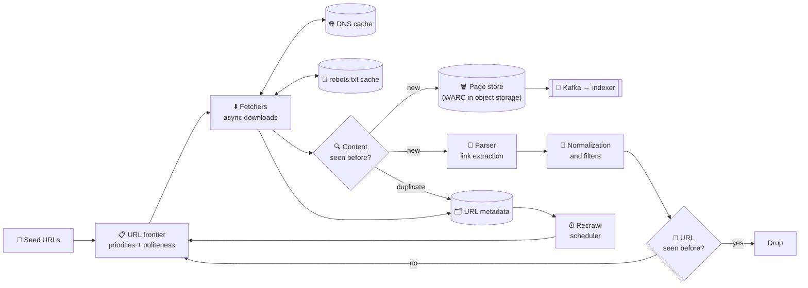
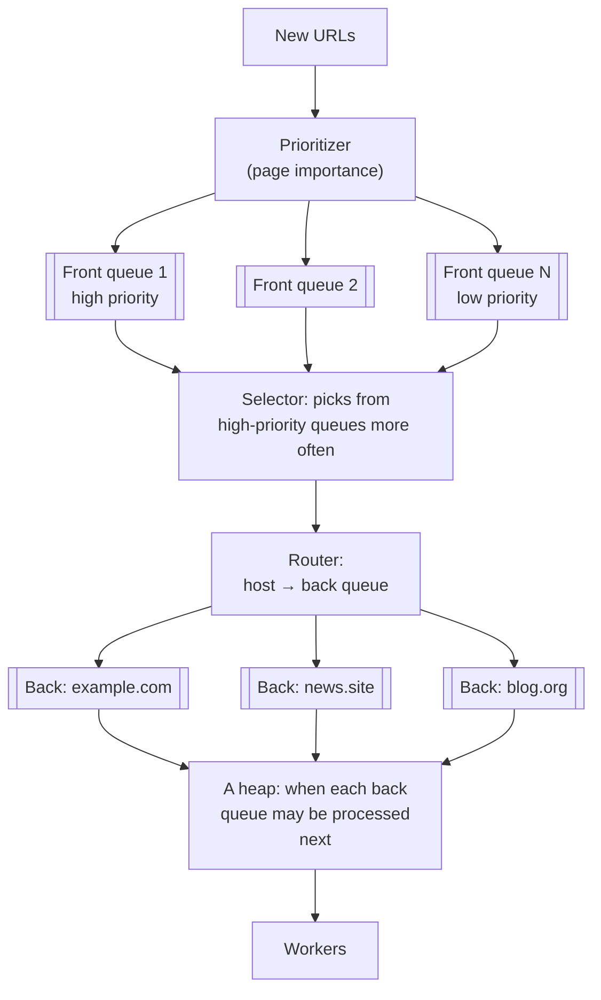
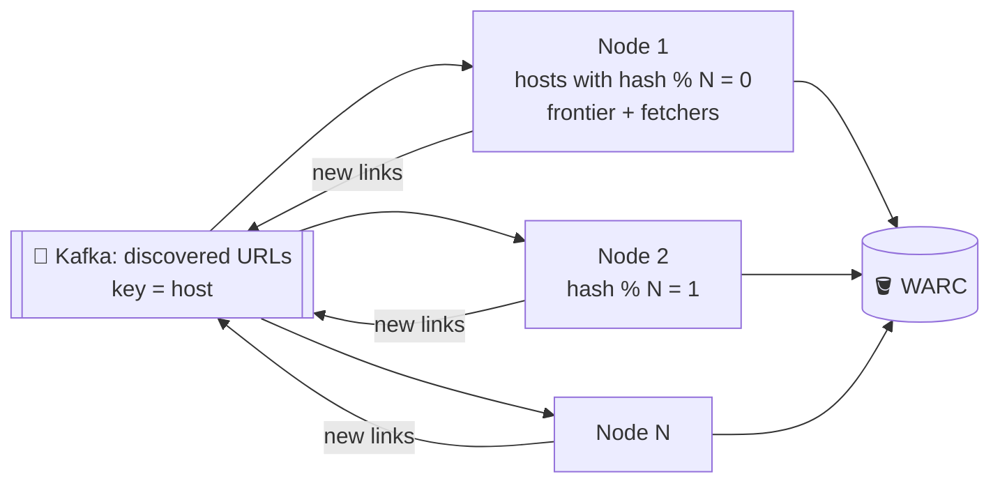

**English** | [Русский](README_RU.md)

# Tier 1 · 14. Web Crawler

> **Level:** Medium–Hard · **Interview time:** 45 min · **Study time:** ~4–5 h
> **Key aspects:** the URL frontier (priorities and politeness), robots.txt, DNS and page fetching, URL normalization and dedup (Bloom filter), content dedup (checksums, SimHash), crawler traps, recrawling and freshness, page storage, distribution across nodes and fault tolerance
> **Builds on:** [Tier 1 · 01 URL Shortener](../01-url-shortener/README.md#8-deep-dive-2-fast-redirects-and-caching) (Bloom filter), [09-messaging](../../09-messaging/README.md), [06-partitioning](../../06-partitioning/README.md), [14-storage-types](../../14-storage-types/README.md), [15-search-basics](../../15-search-basics/README.md)

---

## 🗺️ How to Read This Walkthrough

The walkthrough follows an interview, but every step includes explanations: **why** a decision is made, **how** a mechanism works and **what happens** if you do it differently. The "📘 Explanation" blocks are theory right where you need it.

| Icon | Meaning |
|:----:|:--------|
| 🎤 | Interviewer |
| 🗣️ | What I (the candidate) say out loud |
| ✏️ | What I draw on the whiteboard |
| ⏱️ | Time budget for the step |
| 📘 | A detailed explanation of a concept |

Callouts: **TIP** — a good technique, **WARNING** — a trap, **IMPORTANT** — a Senior+ signal.

---

## 📑 Contents

0. [What This Problem Teaches](#0-what-this-problem-teaches)
1. [Problem Statement](#1-problem-statement)
2. [Clarifying Questions and Requirements](#2-clarifying-questions-and-requirements)
3. [Capacity Estimates](#3-capacity-estimates)
4. [Components and Data](#4-components-and-data)
5. [High-Level Design](#5-high-level-design)
6. [Deep Dive 1: The URL Frontier](#6-deep-dive-1-the-url-frontier)
7. [Deep Dive 2: Politeness and robots.txt](#7-deep-dive-2-politeness-and-robotstxt)
8. [Deep Dive 3: DNS and Fetching Pages](#8-deep-dive-3-dns-and-fetching-pages)
9. [Deep Dive 4: URL Normalization and Dedup](#9-deep-dive-4-url-normalization-and-dedup)
10. [Deep Dive 5: Content Dedup](#10-deep-dive-5-content-dedup)
11. [Deep Dive 6: Traps and Quality](#11-deep-dive-6-traps-and-quality)
12. [Deep Dive 7: Recrawling and Freshness](#12-deep-dive-7-recrawling-and-freshness)
13. [Deep Dive 8: Storage, Distribution and Fault Tolerance](#13-deep-dive-8-storage-distribution-and-fault-tolerance)
14. [Bottlenecks and Failure Scenarios](#14-bottlenecks-and-failure-scenarios)
15. [What Changes at 10x Scale](#15-what-changes-at-10x-scale)
16. [Key Concepts and New Terms](#16-key-concepts-and-new-terms)
17. [Variations and Follow-Up Questions](#17-variations-and-follow-up-questions)
18. [Common Mistakes](#18-common-mistakes)
19. [Cheat Sheet and Self-Check](#19-cheat-sheet-and-self-check)

---

## 0. What This Problem Teaches

A web crawler traverses the internet: it downloads a page, finds the links in it, downloads the pages those links point to — billions of times over. Algorithmically it's a breadth-first graph traversal, but at internet scale problems appear that no textbook covers.

| What's tested | Where it shows up |
|:--------------|:------------------|
| Distributed processing of a huge graph | Billions of pages, tens of billions of links |
| Designing queues with constraints | The URL frontier: priorities + not overloading sites |
| Respect for external systems | Politeness, robots.txt, per-site rate limits |
| Dedup at scale | A Bloom filter for URLs, SimHash for near-identical pages |
| Operating in a hostile environment | Crawler traps, spam, infinite links |
| Fault tolerance for long-running processes | A crawl runs for weeks; failures must not lose progress |

> [!TIP]
> What sets a good answer apart: **politeness**. A naive crawler with thousands of threads would take down a small site in seconds. The interviewer expects a queue designed so that a single site gets no more than one request every few seconds — while the overall crawl rate stays high.

---

## 1. Problem Statement

> 🎤 "Design a web crawler for a search engine: it must crawl a billion pages a month, store them for indexing and periodically refresh them."

**What the crawler does:**

```
1. Takes seed URLs: popular sites, directories
2. Downloads a page → stores it → extracts links
3. Adds new links to the crawl queue
4. Repeats until it has covered the required volume
5. Periodically returns to already-crawled pages for updates
```

**Time plan:**

| Step | ⏱️ |
|:-----|:--:|
| Requirements | 4 min |
| Estimates | 4 min |
| Components and high-level | 8 min |
| Deep dives | 24 min |
| Failures and wrap-up | 5 min |

---

## 2. Clarifying Questions and Requirements

⏱️ 4 min

| My question | Interviewer's answer | What it changes and why |
|:------------|:---------------------|:------------------------|
| What's the crawler for? | Indexing for a search engine | We need high-quality, fresh pages, not everything |
| How many pages? | 1 billion per month | ~400 pages per second on average |
| What content? | HTML; maybe PDFs and images later | An extensible architecture of handlers |
| Store pages? | Yes, raw HTML for the indexer and reprocessing | Object storage, tens of TB per month |
| How often to refresh? | News sites — often; the rest — less often | Priorities and an adaptive recrawl schedule |
| Politeness? | Mandatory: respect robots.txt, don't overload sites | A rate limit per site |
| JavaScript? | Static HTML only for now | Rendering is a separate, expensive path (discuss briefly) |

### Functional requirements

1. Crawl the web starting from seed URLs, following links.
2. Store downloaded pages and pass them to the indexer.
3. Respect robots.txt and rate limits for each site.
4. Don't download the same thing twice without need (duplicate URLs and content).
5. Periodically refresh pages based on their importance and change frequency.

### Non-functional requirements

| Requirement | Target | Why |
|:------------|:-------|:----|
| Throughput | ~1B pages per month, growing to 10B | Index size |
| Politeness | At most ~1 request per second per site (or per Crawl-delay) | Don't harm sites; otherwise we get blocked |
| Robustness | A node failure doesn't lose crawl progress | The crawl runs continuously for weeks |
| Extensibility | New content types and handlers | PDFs, images, video |
| Quality | Priority for important pages, protection from traps and spam | Resources are finite, the internet is infinite |

---

## 3. Capacity Estimates

⏱️ 4 min

```
Pages:          1B per month ÷ 2.6M seconds ≈ 400 pages/s on average, peak ~1,000/s
Traffic:        400 × ~100 KB ≈ 40 MB/s ≈ 300 Mbit/s

Storage:        1B × 100 KB = 100 TB per month of raw HTML
                compressed (HTML compresses ~4–5×) ≈ 20–25 TB per month

Links:          ~50 links per page → 50B discovered links per month
Unique URLs:    ~10B over all time
The "seen" set:
                exact: 10B × 8 B (a hash) ≈ 80 GB
                a Bloom filter with 1% false positives ≈ 12 GB

Sites (hosts):  hundreds of millions → as many entries in the DNS and robots.txt caches
```

### Conclusions

| Conclusion | Design consequence |
|:-----------|:-------------------|
| 400 pages/s with a 1 request/s limit per site | You must crawl hundreds to thousands of different sites **concurrently** |
| 50B links per month | The "already seen" check runs on every link; it must be very fast |
| The queue holds billions of URLs | It doesn't fit in memory — a disk-backed queue with in-memory buffers |
| 20–25 TB per month | Object storage and archive files, not a database |

---

## 4. Components and Data

⏱️ 3 min

| Component | What it does |
|:----------|:-------------|
| **URL frontier** | The queue of URLs to crawl, with priorities and politeness |
| **Fetcher** | Downloads pages asynchronously, thousands of connections |
| **A caching DNS resolver** | Turns hostnames into IP addresses |
| **The robots.txt cache** | Access rules for each host |
| **Content dedup** | Checks whether this content was seen before |
| **Parser / link extractor** | Extracts links and data from HTML |
| **URL filter and normalizer** | Brings URLs to a canonical form, drops unwanted ones |
| **URL seen** | Checks whether a URL was already added to the queue |
| **Page store** | Storage for downloaded pages |
| **Metadata store** | For each URL: when it was fetched, status, hash, ETag, when to crawl again |

---

## 5. High-Level Design

⏱️ 5 min



🗣️ "The crawl loop:
1. **the frontier** hands out the next URL, respecting priority and politeness;
2. **the fetcher** checks robots.txt, resolves DNS via the cache and downloads the page;
3. **the content check**: if this page already exists (a mirror, a copy) — just record metadata;
4. a new page is stored and sent to the indexer;
5. **the parser** extracts links → **normalization and filters** → **the URL seen check** → new URLs go back to the frontier;
6. **the scheduler** puts pages that are due for a refresh back into the frontier."

---

## 6. Deep Dive 1: The URL Frontier

> 🎤 "How is the URL queue structured? Why not a plain FIFO?"

### Why FIFO doesn't work

| Problem | Example |
|:--------|:--------|
| **No politeness** | A site's page contains 1,000 links to the same site → 1,000 URLs from one host in a row → thousands of threads hammer one server |
| **No priorities** | A major news site's front page waits in the same queue as a page from an abandoned blog |

### The Mercator scheme: front and back queues

📘 The classic scheme from the Mercator crawler: **front queues** decide "what matters more", **back queues** decide "when the host can be contacted".



| Part | How it works |
|:-----|:-------------|
| **The prioritizer** | Scores a URL's importance: site authority (link rank), depth, page type, need for freshness |
| **Front queues** | One per priority level; the selector picks from higher-priority queues more often (weighted), without starving lower ones |
| **Back queues** | **Each holds URLs of only one host**; a "host → back queue" table |
| **The heap (min-heap)** | For each back queue — the time its host may be contacted again |
| **A worker** | Takes the queue with the smallest time from the heap (if it has arrived), downloads one URL, and gives the queue a new time = now + the host's delay |

🗣️ "That solves both problems at once: important pages are crawled sooner, and a single host never gets more than one request per politeness interval. Overall throughput is high because thousands of different hosts are in progress simultaneously."

### Size and distribution

| Question | Solution |
|:---------|:---------|
| Billions of URLs don't fit in memory | Disk-backed queues: only the heads and tails (buffers) live in memory, the bulk in on-disk segments (as in Kafka) or an embedded store (RocksDB) |
| How to distribute across nodes | **By hash of the host**: all of a host's URLs live on one crawler node. Then politeness is enforced locally, with no coordination between nodes |
| A new URL is discovered on another node | It's sent to the host's owning node (via Kafka with key = host) |

> [!IMPORTANT]
> **Senior+ signal:** distribute the frontier **by host**, not by URL. If one site's URLs are scattered across 100 nodes, each will be polite "on its own", and the site will get 100× more requests.

---

## 7. Deep Dive 2: Politeness and robots.txt

> 🎤 "How do you avoid harming sites?"

### robots.txt

📘 The file `https://site.com/robots.txt` tells crawlers what they may and may not crawl:

```
User-agent: *
Disallow: /admin/
Disallow: /search
Allow: /search/help

User-agent: OurCrawler
Crawl-delay: 5

Sitemap: https://site.com/sitemap.xml
```

| Element | What it means | What we do |
|:--------|:--------------|:-----------|
| `Disallow` / `Allow` | Forbidden and allowed paths | Check every URL before fetching |
| `Crawl-delay` | A pause between requests (a non-standard directive) | Factor it into the host's delay |
| `Sitemap` | A list of the site's pages with modification dates | A source of URLs and a hint for recrawling |
| Rules for a specific User-agent | More specific rules win | Look for a block for our crawler, otherwise `*` |

| Practice | Why |
|:---------|:----|
| **Caching robots.txt** for ~24 hours | Don't fetch the file before every page |
| If robots.txt is unavailable (5xx) | Be cautious: temporarily don't crawl the site; a 404 means no restrictions |
| robots.txt rules were standardized in RFC 9309 (2022) | Uniform parsing |

### Per-host rate limiting

| Rule | How |
|:-----|:----|
| A base delay | ~1 request every few seconds per host (or `Crawl-delay`) |
| **An adaptive delay** | If the server responds slowly — increase the pause (e.g. 10× the response time) |
| 429 and 503 errors | Honor `Retry-After`, increase the pause exponentially |
| Large sites | Can go faster if the server responds quickly, but within reason |
| One IP — many hosts | Limit by IP too: thousands of small sites can live on one hosting server |

### Other

- **Identification**: a clear User-Agent with a link to a page describing the crawler, with contact details.
- **Meta tags**: `<meta name="robots" content="noindex, nofollow">` — don't index the page, don't follow its links.

---

## 8. Deep Dive 3: DNS and Fetching Pages

> 🎤 "Where are the bottlenecks in fetching?"

### DNS

📘 Resolving a name via external DNS takes 10–200 ms and runs synchronously in many libraries. At 1,000 downloads per second, DNS becomes a bottleneck.

| Solution | Why |
|:---------|:----|
| **A local caching resolver** on each node | Repeat lookups for a host skip external DNS |
| Async resolution | Don't block the fetching thread |
| Pre-resolution | While a URL waits in its back queue, its host is already being resolved |
| Honoring record TTLs | But with a minimum cache time, to avoid querying too often |

### Fetching

| Solution | Why |
|:---------|:----|
| **Async I/O** | One process holds thousands of concurrent connections to different hosts — fetching is bound by the network, not the CPU |
| Timeouts | On the connection and the whole download — slow sites mustn't tie up resources |
| **A maximum size** | Cap it (e.g. 10 MB for HTML) — protection against endless streams |
| A redirect limit | At most 5, checking for cycles |
| Compression (`Accept-Encoding: gzip, br`) | Less traffic |
| **Conditional requests** when recrawling | `If-None-Match` (ETag) and `If-Modified-Since` → `304 Not Modified` with no body |
| Classifying errors | 404/410 — remove from the crawl; 5xx — retry later; a timeout — slow down for the host |

---

## 9. Deep Dive 4: URL Normalization and Dedup

> 🎤 "One page can have dozens of different URLs. How do you avoid downloading it many times?"

### Normalization

📘 All of these URLs lead to the same page:

```
HTTP://Example.COM:80/a/./b/../c?utm_source=tw&id=5#section
http://example.com/a/c?id=5
http://example.com/a/c?id=5&utm_campaign=x
```

| Rule | Example |
|:-----|:--------|
| Lowercase the scheme and host | `HTTP://Example.COM` → `http://example.com` |
| Remove the default port | `:80` for http, `:443` for https |
| Resolve `.` and `..` in the path | `/a/./b/../c` → `/a/c` |
| Remove the fragment | `#section` isn't sent to the server |
| Remove tracking parameters | `utm_*`, `fbclid`, session IDs |
| Sort query parameters | `?b=2&a=1` → `?a=1&b=2` |
| Relative links → absolute | `../img.html` relative to the page URL |
| Honor `<link rel="canonical">` | The site itself declares the canonical URL |

### "Have we seen this URL?"

For each of the 50B links per month, we must quickly answer whether the URL was seen before.

| Approach | Pros | Cons |
|:---------|:-----|:-----|
| An exact set of hashes in memory | Exact | 80 GB for 10B URLs — a lot for one node |
| An exact set on disk (RocksDB, Cassandra) | Exact, scales | A disk read per link — slow |
| **A Bloom filter** | 12 GB at 1% false positives, microseconds | False positives: a new URL is treated as "seen" and skipped |
| **A Bloom filter + an exact store** ⭐ | Fast and exact | More complex |

📘 **How the combination works.** A Bloom filter answers "definitely not" or "maybe" (details in the [URL shortener](../01-url-shortener/README.md#8-deep-dive-2-fast-redirects-and-caching)):
- "definitely not" (most new URLs) → the URL is new; add it to the frontier and the filter — no disk access;
- "maybe" → check the exact on-disk store; its answer is final.

That way the disk is read only for URLs that really were seen (or for the 1% of false positives). The set is split across nodes by URL hash.

> [!NOTE]
> For a search crawler, a **Bloom filter alone** without the exact check is sometimes accepted: losing 1% of new URLs is fine, since they're often rediscovered via other links. It's a trade-off between simplicity and completeness — worth naming explicitly.

---

## 10. Deep Dive 5: Content Dedup

> 🎤 "Different URLs, but identical content — mirrors, copies of articles, printer-friendly versions. How do you avoid storing and indexing them many times?"

### Exact duplicates

A hash (e.g. SHA-256) of the normalized content → a lookup in a set of hashes. A match means the page already exists; store only the link "this URL = that document".

### Near-identical pages

📘 Two copies of an article differ by a date in the header, a banner or a view counter — the exact hashes differ, yet the content is essentially the same. An ordinary hash changes completely when one character changes. You need **a hash that changes little under small changes** — **SimHash** (Charikar). Google described using SimHash to detect near-duplicates while crawling (Manku et al., 2007).

### How SimHash is computed (an 8-bit example)

```
The page's tokens with weights (e.g. frequency): "weather" (2), "in" (1), "moscow" (3)
Token hashes (8 bits):
  "weather"  10110010
  "in"       01100110
  "moscow"   11010001

For each bit position: +weight if the bit = 1; −weight if the bit = 0

Position 1: "weather" 1 → +2, "in" 0 → −1, "moscow" 1 → +3  → +4 → bit 1
Position 2: 0 → −2, 1 → +1, 1 → +3                            → +2 → bit 1
Position 3: 1 → +2, 1 → +1, 0 → −3                            →  0 → bit 0
Position 4: 1 → +2, 0 → −1, 1 → +3                            → +4 → bit 1
Position 5: 0, 0, 0 → −6                                      → bit 0
Position 6: 0 → −2, 1 → +1, 0 → −3                            → −4 → bit 0
Position 7: 1 → +2, 1 → +1, 0 → −3                            →  0 → bit 0
Position 8: 0 → −2, 0 → −1, 1 → +3                            →  0 → bit 0

SimHash = 11010000
```

**The key property:** if a few tokens on the page change, the sums at most positions keep their sign, so the SimHash changes in only a few bits. Two pages are near-duplicates if the **Hamming distance** (the number of differing bits) between their 64-bit SimHashes is at most ~3.

### Quickly finding a similar SimHash among billions

📘 You need every fingerprint that differs in at most 3 bits. The trick: split the 64 bits into 4 blocks of 16 bits. If two fingerprints differ in at most 3 bits, at least one block **matches exactly** (3 differences can't land in all 4 blocks). Tables are built indexed by each block; candidates with a matching block are checked for their exact Hamming distance.

| Decision | Why |
|:---------|:----|
| The exact hash — first | Cheaply cuts off full copies |
| SimHash — next | Near-duplicates |
| A Hamming threshold of ~3 out of 64 bits | A trade-off between misses and false matches |
| What to do with a duplicate | Don't index it again; choose the canonical version (the more authoritative site) |

---

## 11. Deep Dive 6: Traps and Quality

> 🎤 "Which pages can 'trap' a crawler?"

### Crawler traps

| Trap | What it looks like | Protection |
|:-----|:-------------------|:-----------|
| **An infinite calendar** | `/calendar?month=2026-12` → "next month" → … forever | A depth limit and a page limit per host |
| **Session IDs in URLs** | Every visit generates new URLs with `?sid=…` | Removing known session parameters during normalization |
| **Generated links** | `/a/b/a/b/a/b/…` | A URL length limit, detecting repeating path segments |
| **Faceted navigation** | Millions of filter combinations in an online store | A parameter limit, a per-host budget |
| **Deliberate traps** | Anti-crawler sites | A per-host crawl budget based on importance |

📘 **A crawl budget.** Each host gets a page limit per period, proportional to its importance and quality. A trap on a small site exhausts that site's budget, not the whole crawler's resources.

### Quality

| Problem | Solution |
|:--------|:---------|
| Spam and link farms | Host quality scoring, lowering priority |
| Empty and junk pages | A threshold for useful content |
| Malicious sites | Don't follow, flag for search |

---

## 12. Deep Dive 7: Recrawling and Freshness

> 🎤 "Pages change. How often do you re-download them?"

📘 Re-downloading everything daily is impossible, and doing it rarely makes the index stale. It makes sense to re-download **often** what **changes often and matters**.

| Signal | How it's used |
|:-------|:--------------|
| **Change history** | If the page changed daily at recent crawls — crawl it often; if it hasn't changed in months — rarely |
| Importance | Major sites' front pages — more often |
| `lastmod` in the sitemap | A hint that the page changed |
| RSS and update subscriptions (WebSub) | The site itself announces new content |
| Conditional requests | `304 Not Modified` — a cheap check without downloading |

### An adaptive schedule

```
Estimate the change rate: λ (changes per day) from the crawl history
The recrawl interval ≈ inversely proportional to λ, within bounds (from hours to months)

Recrawl priority = importance × "staleness" (how long ago, and how likely it changed)
```

| Page type | A typical interval |
|:----------|:-------------------|
| A major news site's front page | Minutes to hours |
| An article a week after publication | Days to weeks |
| Documentation, archives | Weeks to months |

The scheduler periodically selects URLs whose recrawl time has come and sends them to the frontier with the right priority.

---

## 13. Deep Dive 8: Storage, Distribution and Fault Tolerance

> 🎤 "Where are pages stored, and what happens if a node dies?"

### Storing pages

| Decision | Why |
|:---------|:----|
| **WARC files** in object storage | The standard web archive format: many records (request, response, headers) in one large compressed file — not billions of tiny objects (see [14-storage-types](../../14-storage-types/README.md#10-the-small-files-problem)) |
| Compression | HTML compresses several-fold |
| URL metadata — in a sharded DB (by URL hash) | The last crawl, status, content hash, ETag, the next crawl |
| To the indexer — a Kafka event pointing at the WARC record | The indexer reads asynchronously, independently of the crawler |
| Storage classes | Old page versions in cold storage |

### Distributing across nodes



| Decision | Why |
|:---------|:----|
| A node owns hosts (by host hash) | Politeness, DNS and robots.txt caches are local |
| Exchanging links via Kafka with key = host | A link reaches its owning node |
| Consistent hashing | Adding a node moves only some hosts |
| Nodes closer to sites | Crawling from several regions lowers fetch latency |

### Fault tolerance

| Failure | Solution |
|:--------|:---------|
| A node dies | The frontier lives on disk and in Kafka — another node takes over its hosts and continues from the saved state |
| A download is interrupted | The URL goes back to the queue; re-downloading is safe, and dedup filters out the repeat |
| At-least-once processing | Reprocessing a page is fine: storage is content-addressed, and metadata updates are idempotent |
| Regular state snapshots | The frontier and the "seen" set are restored after a disaster |

---

## 14. Bottlenecks and Failure Scenarios

| Scenario | What happens | How we protect |
|:---------|:-------------|:---------------|
| Many URLs from one host in the queue | The site is overloaded | Per-host back queues, delays, a host-partitioned frontier |
| Slow DNS | Fetchers sit idle | A local cache, async and pre-resolution |
| A slow site | Tied-up connections | Timeouts, an adaptive delay |
| An infinite calendar | The crawler gets stuck | A per-host budget, depth and URL length limits |
| Mirrors and copies | Storing and indexing repeatedly | A content hash, SimHash |
| The "seen" set doesn't fit in memory | Slow checks | A Bloom filter + an exact store, sharding |
| A node dies | Lost progress | A disk-backed frontier, Kafka, snapshots |
| A site returns 429/503 | We get blocked | `Retry-After`, an exponential pause |
| robots.txt is unavailable | Breaking the rules | Don't crawl on 5xx, cache the rules |
| The indexer falls behind | A backlog | A Kafka buffer; the crawler doesn't depend on the indexer |

---

## 15. What Changes at 10x Scale

> 🎤 "10 billion pages a month?"

| Change | Why |
|:-------|:----|
| **More nodes**, sharding the frontier and the "seen" set | ~4,000 pages/s |
| **Rendering JavaScript** for important sites | A separate queue with headless browsers — orders of magnitude more expensive than a plain fetch |
| **Crawling from many regions** | Latency and cross-continent traffic |
| **More aggressive prioritization** | The internet grows faster than crawler resources |
| **Exchanging changes with sites** (sitemaps, IndexNow, WebSub) | Sites announce changes themselves — fewer wasted crawls |

---

## 16. Key Concepts and New Terms

### What's applied from Fundamentals

| Concept | Where it's covered | How it applies here |
|:--------|:-------------------|:--------------------|
| Bloom filters | [Tier 1 · 01](../01-url-shortener/README.md#8-deep-dive-2-fast-redirects-and-caching) | URL seen |
| Queues, Kafka, at-least-once | [09-messaging](../../09-messaging/README.md) | Exchanging links, handing off to the indexer |
| Sharding, consistent hashing | [06-partitioning](../../06-partitioning/README.md) | Distributing hosts across nodes |
| The small files problem | [14-storage-types](../../14-storage-types/README.md#10-the-small-files-problem) | WARC archives |
| Indexing, search | [15-search-basics](../../15-search-basics/README.md) | The consumer of downloaded pages |
| Rate limiting | [Tier 1 · 02](../02-rate-limiter/README.md) | Politeness toward hosts |

### New terms in this problem

| Term | In short |
|:-----|:---------|
| **URL frontier** | The queue of URLs to crawl, with priorities and politeness |
| **Front and back queues** (Mercator) | Priority at the front, one host per back queue |
| **Politeness** | At most one request to a host per interval |
| **robots.txt** | Access rules for crawlers (RFC 9309) |
| **URL normalization** | Bringing a URL to a canonical form |
| **SimHash** | A fingerprint that changes little under small content changes |
| **Hamming distance** | The number of differing bits |
| **A crawler trap** | Endlessly generated URLs |
| **A crawl budget** | A per-host page limit based on importance |
| **WARC** | A web archive format: many records in one file |

---

## 17. Variations and Follow-Up Questions

<details>
<summary><b>How do you crawl sites built with JavaScript?</b></summary>

A separate rendering queue: the page is opened in a headless browser (e.g. Chromium), the JavaScript runs, the resulting DOM is saved and links are extracted. It's tens to hundreds of times more expensive than a plain fetch, so only important sites — or pages with no content without JavaScript — are rendered. Google described two-phase indexing: HTML first, then rendering when resources allow.
</details>

<details>
<summary><b>How do you build a topical crawler (medicine only)?</b></summary>

A focused crawler: a classifier scores a downloaded page's relevance and the likelihood that its links lead to relevant pages (from the link text and context). Frontier priority follows that score; irrelevant branches aren't explored further.
</details>

<details>
<summary><b>Why BFS rather than DFS?</b></summary>

DFS dives deep into one site (and easily gets stuck in traps), while important pages are usually close to sites' front pages. Prioritized BFS crawls the most important pages, closest to the seeds, first. In practice it's not pure BFS but priority-ordered traversal.
</details>

<details>
<summary><b>How do you handle redirects and 404s?</b></summary>

A redirect: record the link between the old URL and the new one; the new URL goes through normalization and the "seen" check; cap the number of hops. A permanent redirect (301) — replace the URL in the metadata. 404/410 — flag it, reduce the check frequency, remove it from the crawl after a few confirmations, and notify the indexer.
</details>

<details>
<summary><b>How do you stay within the law and ethics?</b></summary>

Respect robots.txt and sites' terms, don't bypass authentication or paywalls, don't collect personal data beyond what's needed, rate-limit, put contact details in the User-Agent and respond quickly to site owners' complaints.
</details>

---

## 18. Common Mistakes

| ❌ Mistake | Why it's bad | ✅ Do this instead |
|:----------|:-------------|:------------------|
| One FIFO queue | Overloaded sites, no priorities | Front queues by priority, back queues by host |
| Distributing the frontier by URL | Each node is "polite on its own", and the site gets N× more | Distributing by host |
| Ignoring robots.txt | Breaking the rules, getting blocked | A robots.txt cache, checking every URL |
| Synchronous DNS without a cache | A bottleneck | A local async caching resolver |
| Comparing URLs as strings | One page downloaded many times | Normalization |
| An exact URL set in one node's memory | Doesn't fit | A Bloom filter + an exact store, sharding |
| Only an exact content hash | Near-duplicates slip through | SimHash |
| No per-host limits | Getting stuck in traps | A crawl budget, depth and length limits |
| One recrawl frequency for everything | Stale important pages, wasted traffic | An adaptive schedule by change rate |
| Each page as a separate object | Billions of tiny files | WARC archives |
| An in-memory-only frontier | Lost progress on failure | Disk, Kafka, snapshots |

---

## 19. Cheat Sheet and Self-Check

### 30-second answer

> 1B pages per month — ~400 per second, 20–25 TB of compressed HTML. The frontier follows the Mercator scheme: front queues by priority (importance, freshness), back queues one per host, and a min-heap of each host's next allowed contact time; a worker takes the host whose time has come. The frontier is distributed across nodes by host hash — politeness stays local; links are forwarded via Kafka with key = host; queues live on disk. Before fetching — robots.txt from the cache (RFC 9309), an adaptive delay, `Retry-After`. A local async DNS cache, async fetching over thousands of connections, timeouts, size and redirect limits, conditional requests. Links are normalized (case, port, fragment, utm, sorted parameters, canonical); "seen" — a Bloom filter + an exact store. Content — an exact hash, then SimHash with a Hamming threshold of ~3. Traps — a per-host budget, depth and length limits. Recrawling — by estimated change rate and importance. Pages go into WARC files in object storage, and to the indexer via Kafka.

### Self-check

- [ ] I can estimate the load, the traffic and the size of the "seen" set
- [ ] I can explain why FIFO doesn't work
- [ ] I can draw the frontier with front and back queues and the heap
- [ ] I can explain why the frontier is distributed by host
- [ ] I can describe politeness and robots.txt rules
- [ ] I can name the fetching bottlenecks (DNS) and the fixes
- [ ] I can normalize a URL using 8 rules
- [ ] I can explain the Bloom filter + exact store combination
- [ ] I can compute a SimHash for an example and explain the block-based lookup
- [ ] I can describe trap protection and adaptive recrawling

### Further reading

- Heydon, Najork, *Mercator: A Scalable, Extensible Web Crawler* (1999)
- Manku, Jain, Das Sarma, *Detecting Near-Duplicates for Web Crawling* (WWW 2007)
- Charikar, *Similarity Estimation Techniques from Rounding Algorithms* (STOC 2002) — SimHash
- RFC 9309, *Robots Exclusion Protocol* (2022)
- Alex Xu, *System Design Interview*, Vol. 1 — chapter "Design a Web Crawler"
- Manning, Raghavan, Schütze, *Introduction to Information Retrieval* — the chapter on web crawling