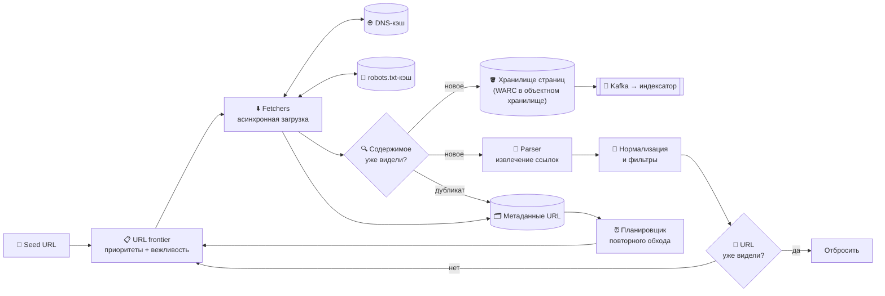
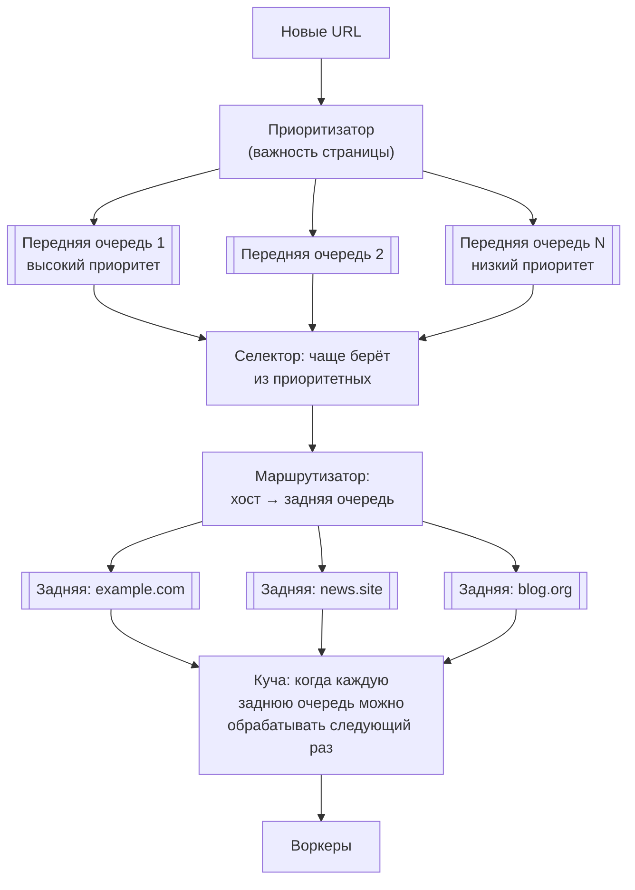
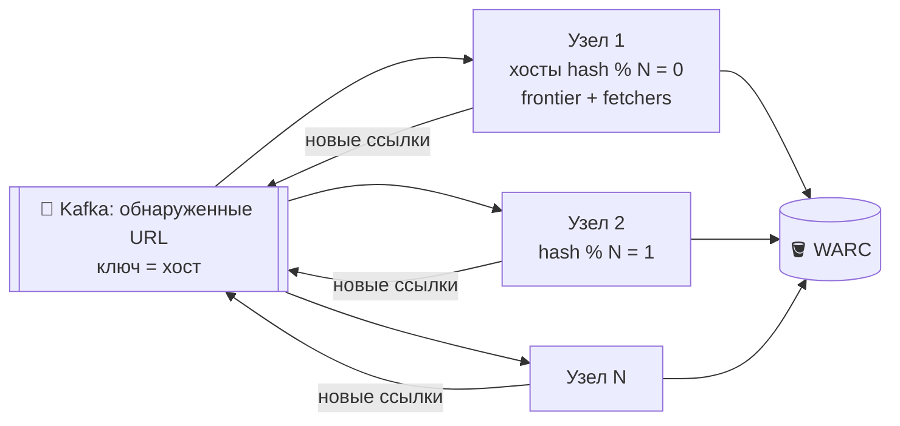

[English](README.md) | **Русский**

# Tier 1 · 14. Веб-краулер

> **Уровень:** Medium–Hard · **Время на интервью:** 45 мин · **Время на разбор:** ~4–5 ч
> **Ключевые аспекты:** URL frontier (приоритеты и вежливость), robots.txt, DNS и загрузка страниц, нормализация и дедупликация URL (Bloom filter), дедупликация содержимого (контрольные суммы, SimHash), ловушки для краулеров, повторный обход и свежесть, хранение страниц, распределение по узлам и отказоустойчивость
> **Опирается на:** [Tier 1 · 01 URL Shortener](../01-url-shortener/README_RU.md#8-deep-dive-2-быстрый-редирект-и-кэширование) (Bloom filter), [09-messaging](../../09-messaging/README_RU.md), [06-partitioning](../../06-partitioning/README_RU.md), [14-storage-types](../../14-storage-types/README_RU.md), [15-search-basics](../../15-search-basics/README_RU.md)

---

## 🗺️ Как читать этот разбор

Разбор построен как интервью, но в каждом шаге есть объяснения: **почему** принимается решение, **как работает** механизм и **что будет**, если сделать иначе. Блоки «📘 Объяснение» — теория прямо по ходу задачи.

| Значок | Что значит |
|:------:|:-----------|
| 🎤 | Реплика интервьюера |
| 🗣️ | Что говорю вслух я (кандидат) |
| ✏️ | Что рисую на доске |
| ⏱️ | Сколько времени тратить на шаг |
| 📘 | Подробное объяснение концепции |

Блоки **TIP** — хороший приём, **WARNING** — ловушка, **IMPORTANT** — сигнал для уровня Senior+.

---

## 📑 Содержание

0. [Чему учит эта задача](#0-чему-учит-эта-задача)
1. [Условие задачи](#1-условие-задачи)
2. [Уточняющие вопросы и требования](#2-уточняющие-вопросы-и-требования)
3. [Оценки нагрузки](#3-оценки-нагрузки)
4. [Компоненты и данные](#4-компоненты-и-данные)
5. [High-level дизайн](#5-high-level-дизайн)
6. [Deep dive 1: URL frontier](#6-deep-dive-1-url-frontier)
7. [Deep dive 2: вежливость и robots.txt](#7-deep-dive-2-вежливость-и-robotstxt)
8. [Deep dive 3: DNS и загрузка страниц](#8-deep-dive-3-dns-и-загрузка-страниц)
9. [Deep dive 4: нормализация и дедупликация URL](#9-deep-dive-4-нормализация-и-дедупликация-url)
10. [Deep dive 5: дедупликация содержимого](#10-deep-dive-5-дедупликация-содержимого)
11. [Deep dive 6: ловушки и качество](#11-deep-dive-6-ловушки-и-качество)
12. [Deep dive 7: повторный обход и свежесть](#12-deep-dive-7-повторный-обход-и-свежесть)
13. [Deep dive 8: хранение, распределение и отказоустойчивость](#13-deep-dive-8-хранение-распределение-и-отказоустойчивость)
14. [Узкие места и сценарии сбоев](#14-узкие-места-и-сценарии-сбоев)
15. [Что изменится при росте в 10 раз](#15-что-изменится-при-росте-в-10-раз)
16. [Ключевые концепции и новые понятия](#16-ключевые-концепции-и-новые-понятия)
17. [Варианты задачи и follow-up вопросы](#17-варианты-задачи-и-follow-up-вопросы)
18. [Типичные ошибки](#18-типичные-ошибки)
19. [Шпаргалка и самопроверка](#19-шпаргалка-и-самопроверка)

---

## 0. Чему учит эта задача

Веб-краулер обходит интернет: скачивает страницу, находит в ней ссылки, скачивает страницы по этим ссылкам — и так миллиарды раз. Алгоритмически это обход графа в ширину, но на масштабе интернета появляются проблемы, которых нет в учебнике.

| Что проверяют | Где это в задаче |
|:--------------|:-----------------|
| Распределённая обработка огромного графа | Миллиарды страниц, десятки миллиардов ссылок |
| Проектирование очередей с ограничениями | URL frontier: приоритеты + не перегружать сайты |
| Уважение к внешним системам | Вежливость, robots.txt, ограничение скорости на сайт |
| Дедупликация на масштабе | Bloom filter для URL, SimHash для почти одинаковых страниц |
| Работа с враждебной средой | Ловушки для краулеров, спам, бесконечные ссылки |
| Отказоустойчивость долгих процессов | Обход длится неделями; сбои не должны терять прогресс |

> [!TIP]
> Главное, что отличает хороший ответ: **вежливость**. Наивный краулер с тысячами потоков положит небольшой сайт за секунды. Интервьюер ждёт, что ты спроектируешь очередь так, чтобы к одному сайту шёл не больше одного запроса в несколько секунд — при этом общая скорость обхода оставалась высокой.

---

## 1. Условие задачи

> 🎤 «Спроектируй веб-краулер для поисковой системы: он должен обходить миллиард страниц в месяц, сохранять их для индексации и периодически обновлять».

**Что делает краулер:**

```
1. Берёт стартовые URL (seed): популярные сайты, каталоги
2. Скачивает страницу → сохраняет её → извлекает ссылки
3. Новые ссылки добавляет в очередь на обход
4. Повторяет, пока не обойдёт нужный объём
5. Периодически возвращается к уже обойдённым страницам за обновлениями
```

**План по времени:**

| Шаг | ⏱️ |
|:----|:--:|
| Требования | 4 мин |
| Оценки | 4 мин |
| Компоненты и high-level | 8 мин |
| Deep dives | 24 мин |
| Сбои и итоги | 5 мин |

---

## 2. Уточняющие вопросы и требования

⏱️ 4 мин

| Мой вопрос | Ответ интервьюера | Что это меняет и почему |
|:-----------|:------------------|:------------------------|
| Для чего краулер? | Для индексации поисковой системой | Нужны качественные и свежие страницы, не всё подряд |
| Сколько страниц? | 1 миллиард в месяц | ~400 страниц в секунду в среднем |
| Какое содержимое? | HTML; позже, возможно, PDF и изображения | Расширяемая архитектура обработчиков |
| Хранить страницы? | Да, сырой HTML для индексатора и повторной обработки | Объектное хранилище, десятки ТБ в месяц |
| Как часто обновлять? | Новостные сайты — часто, остальное — реже | Приоритеты и адаптивное расписание обхода |
| Вежливость? | Обязательно: соблюдать robots.txt, не перегружать сайты | Ограничение скорости на каждый сайт |
| JavaScript? | Пока только статический HTML | Рендеринг — отдельный дорогой путь (обсудить кратко) |

### Функциональные требования

1. Обходить веб, начиная с seed URL, следуя по ссылкам.
2. Сохранять скачанные страницы и передавать их индексатору.
3. Соблюдать robots.txt и ограничения скорости для каждого сайта.
4. Не скачивать одно и то же дважды без необходимости (дубликаты URL и содержимого).
5. Периодически обновлять страницы в зависимости от их важности и частоты изменений.

### Нефункциональные требования

| Требование | Цель | Почему |
|:-----------|:-----|:-------|
| Пропускная способность | ~1B страниц в месяц, с ростом до 10B | Объём индекса |
| Вежливость | Не больше ~1 запроса в секунду на сайт (или по Crawl-delay) | Не навредить сайтам; иначе нас заблокируют |
| Устойчивость | Сбой узла не теряет прогресс обхода | Обход идёт непрерывно неделями |
| Расширяемость | Новые типы содержимого и обработчики | PDF, изображения, видео |
| Качество | Приоритет важным страницам, защита от ловушек и спама | Ресурсы ограничены, интернет бесконечен |

---

## 3. Оценки нагрузки

⏱️ 4 мин

```
Страницы:       1B в месяц ÷ 2,6M секунд ≈ 400 страниц/с в среднем, пик ~1 000/с
Трафик:         400 × ~100 КБ ≈ 40 МБ/с ≈ 300 Мбит/с

Хранение:       1B × 100 КБ = 100 ТБ в месяц сырого HTML
                со сжатием (HTML сжимается в ~4–5 раз) ≈ 20–25 ТБ в месяц

Ссылки:         ~50 ссылок на странице → 50B обнаруженных ссылок в месяц
Уникальных URL: ~10B за всё время
Множество «уже видели»:
                точное: 10B × 8 Б (хэш) ≈ 80 ГБ
                Bloom filter с 1% ложных срабатываний ≈ 12 ГБ

Сайтов (хостов): сотни миллионов → столько же записей в кэше DNS и robots.txt
```

### Выводы

| Вывод | Следствие для дизайна |
|:------|:----------------------|
| 400 страниц/с при лимите 1 запрос/с на сайт | Нужно **одновременно** обходить сотни и тысячи разных сайтов |
| 50B ссылок в месяц | Проверка «уже видели» — на каждой ссылке; должна быть очень быстрой |
| Очередь — миллиарды URL | Не помещается в память — очередь на диске с буферами в памяти |
| 20–25 ТБ в месяц | Объектное хранилище, файлы-архивы, а не база данных |

---

## 4. Компоненты и данные

⏱️ 3 мин

| Компонент | Что делает |
|:----------|:-----------|
| **URL frontier** | Очередь URL на обход с приоритетами и вежливостью |
| **Fetcher** (загрузчик) | Скачивает страницы, асинхронно, тысячи соединений |
| **DNS-резолвер с кэшем** | Превращает имена хостов в IP-адреса |
| **robots.txt-кэш** | Правила доступа для каждого хоста |
| **Content dedup** | Проверка, не видели ли такое содержимое |
| **Parser / link extractor** | Извлекает ссылки и данные из HTML |
| **URL filter и normalizer** | Приводит URL к каноническому виду, отбрасывает ненужные |
| **URL seen** | Проверка, был ли URL уже добавлен в очередь |
| **Page store** | Хранилище скачанных страниц |
| **Metadata store** | Для каждого URL: когда скачан, статус, хэш, ETag, когда обходить снова |

---

## 5. High-level дизайн

⏱️ 5 мин



🗣️ «Цикл обхода:
1. **frontier** выдаёт следующий URL с учётом приоритета и вежливости;
2. **fetcher** проверяет robots.txt, разрешает DNS через кэш, скачивает страницу;
3. **проверка содержимого**: если такая страница уже есть (зеркало, копия) — только записать метаданные;
4. новая страница сохраняется в хранилище и уходит индексатору;
5. **parser** извлекает ссылки → **нормализация и фильтры** → **проверка URL seen** → новые URL возвращаются в frontier;
6. **планировщик** возвращает в frontier страницы, которые пора обновить».

---

## 6. Deep dive 1: URL frontier

> 🎤 «Как устроена очередь URL? Почему не обычная FIFO?»

### Почему FIFO не подходит

| Проблема | Пример |
|:---------|:-------|
| **Нет вежливости** | Страница сайта содержит 1 000 ссылок на тот же сайт → в очереди 1 000 URL одного хоста подряд → тысячи потоков бьют по одному серверу |
| **Нет приоритетов** | Главная страница крупного новостного сайта ждёт в одной очереди со страницей заброшенного блога |

### Схема Mercator: передние и задние очереди

📘 Классическая схема из краулера Mercator: **передние очереди** решают «что важнее», **задние** — «когда можно обратиться к хосту».



| Часть | Как работает |
|:------|:-------------|
| **Приоритизатор** | Оценивает важность URL: авторитетность сайта (ссылочный ранг), глубина, тип страницы, потребность в свежести |
| **Передние очереди** | По одной на уровень приоритета; селектор берёт из приоритетных чаще (взвешенно), но не голодит низкие |
| **Задние очереди** | **Каждая содержит URL только одного хоста**; таблица «хост → задняя очередь» |
| **Куча (min-heap)** | Для каждой задней очереди — время, когда к её хосту можно обратиться снова |
| **Воркер** | Берёт из кучи очередь с наименьшим временем (если оно наступило), скачивает один URL, ставит очереди новое время = сейчас + задержка хоста |

🗣️ «Так одновременно решаются обе задачи: важные страницы обходятся раньше, а к одному хосту никогда не идёт больше одного запроса за интервал вежливости. Общая скорость высокая, потому что в работе одновременно тысячи разных хостов».

### Размер и распределение

| Вопрос | Решение |
|:-------|:--------|
| Миллиарды URL не помещаются в память | Очереди на диске: в памяти только головы и хвосты (буферы), основная часть — в сегментах на диске (как в Kafka) или во встраиваемом хранилище (RocksDB) |
| Как распределить по узлам | **По хэшу хоста**: все URL одного хоста — на одном узле краулера. Тогда вежливость обеспечивается локально, без координации между узлами |
| Новый URL обнаружен на другом узле | Отправляется на узел-владелец хоста (через Kafka с ключом = хост) |

> [!IMPORTANT]
> **Сигнал Senior+:** распределять frontier **по хосту**, а не по URL. Если URL одного сайта разбросаны по 100 узлам, каждый из них будет вежлив «сам по себе», а сайт получит в 100 раз больше запросов.

---

## 7. Deep dive 2: вежливость и robots.txt

> 🎤 «Как не навредить сайтам?»

### robots.txt

📘 Файл `https://site.com/robots.txt` сообщает краулерам, что можно и нельзя обходить:

```
User-agent: *
Disallow: /admin/
Disallow: /search
Allow: /search/help

User-agent: OurCrawler
Crawl-delay: 5

Sitemap: https://site.com/sitemap.xml
```

| Элемент | Что значит | Что делаем |
|:--------|:-----------|:-----------|
| `Disallow` / `Allow` | Запрещённые и разрешённые пути | Проверяем каждый URL перед загрузкой |
| `Crawl-delay` | Пауза между запросами (нестандартная директива) | Учитываем в задержке хоста |
| `Sitemap` | Список страниц сайта с датами изменений | Источник URL и подсказка для повторного обхода |
| Правила для конкретного User-agent | Более специфичные правила побеждают | Ищем блок для нашего краулера, иначе `*` |

| Практика | Почему |
|:---------|:-------|
| **Кэш robots.txt** на ~24 часа | Не запрашивать файл перед каждой страницей |
| Если robots.txt недоступен (5xx) | Осторожно: временно не обходить сайт; 404 — значит ограничений нет |
| Правила robots.txt стандартизированы в RFC 9309 (2022) | Единый разбор |

### Ограничение скорости на хост

| Правило | Как |
|:--------|:----|
| Базовая задержка | ~1 запрос в несколько секунд на хост (или `Crawl-delay`) |
| **Адаптивная задержка** | Если сервер отвечает медленно — увеличить паузу (например, в 10 раз от времени ответа) |
| Ошибки 429 и 503 | Уважать `Retry-After`, экспоненциально увеличивать паузу |
| Крупные сайты | Можно чаще, если сервер быстро отвечает, но в пределах разумного |
| Один IP — много хостов | Ограничивать и по IP: на одном сервере хостинга могут жить тысячи маленьких сайтов |

### Прочее

- **Идентификация**: понятный User-Agent со ссылкой на страницу с описанием краулера и контактами.
- **Мета-теги**: `<meta name="robots" content="noindex, nofollow">` — не индексировать страницу, не переходить по ссылкам.

---

## 8. Deep dive 3: DNS и загрузка страниц

> 🎤 «Где узкие места при загрузке?»

### DNS

📘 Разрешение имени через внешний DNS занимает 10–200 мс и выполняется синхронно во многих библиотеках. При 1 000 загрузках в секунду DNS становится узким местом.

| Решение | Почему |
|:--------|:-------|
| **Локальный кэширующий резолвер** на каждом узле | Повторные запросы к хосту — без внешнего DNS |
| Асинхронное разрешение | Не блокировать поток загрузки |
| Предварительное разрешение | Пока URL ждёт в задней очереди, его хост уже разрешается |
| Учитывать TTL записей | Но с минимальным временем кэширования, чтобы не делать запросы слишком часто |

### Загрузка

| Решение | Почему |
|:--------|:-------|
| **Асинхронный ввод-вывод** | Один процесс держит тысячи одновременных соединений к разным хостам — загрузка ограничена сетью, а не CPU |
| Таймауты | На соединение и на всю загрузку — медленные сайты не должны занимать ресурсы |
| **Максимальный размер** | Ограничить (например, 10 МБ для HTML) — защита от бесконечных потоков |
| Лимит редиректов | Не больше 5, проверка циклов |
| Сжатие (`Accept-Encoding: gzip, br`) | Меньше трафика |
| **Условные запросы** при повторном обходе | `If-None-Match` (ETag) и `If-Modified-Since` → `304 Not Modified` без тела |
| Классификация ошибок | 404/410 — удалить из обхода; 5xx — повторить позже; таймаут — снизить скорость для хоста |

---

## 9. Deep dive 4: нормализация и дедупликация URL

> 🎤 «Одна страница может иметь десятки разных URL. Как не скачивать её много раз?»

### Нормализация

📘 Все эти URL ведут на одну страницу:

```
HTTP://Example.COM:80/a/./b/../c?utm_source=tw&id=5#section
http://example.com/a/c?id=5
http://example.com/a/c?id=5&utm_campaign=x
```

| Правило | Пример |
|:--------|:-------|
| Схема и хост — в нижний регистр | `HTTP://Example.COM` → `http://example.com` |
| Убрать порт по умолчанию | `:80` для http, `:443` для https |
| Разрешить `.` и `..` в пути | `/a/./b/../c` → `/a/c` |
| Убрать фрагмент | `#section` не отправляется на сервер |
| Убрать параметры отслеживания | `utm_*`, `fbclid`, идентификаторы сессий |
| Отсортировать параметры запроса | `?b=2&a=1` → `?a=1&b=2` |
| Относительные ссылки → абсолютные | `../img.html` относительно URL страницы |
| Учитывать `<link rel="canonical">` | Сайт сам указывает канонический URL |

### «Уже видели этот URL?»

На каждой из 50B ссылок в месяц нужно быстро ответить, встречался ли URL раньше.

| Подход | Плюсы | Минусы |
|:-------|:------|:-------|
| Точное множество хэшей в памяти | Точно | 80 ГБ на 10B URL — много для одного узла |
| Точное множество на диске (RocksDB, Cassandra) | Точно, масштабируется | Чтение с диска на каждую ссылку — медленно |
| **Bloom filter** | 12 ГБ при 1% ложных срабатываний, микросекунды | Ложные срабатывания: новый URL считается «уже видели» и пропускается |
| **Bloom + точное хранилище** ⭐ | Быстро и точно | Сложнее |

📘 **Как работает связка.** Bloom filter отвечает «точно нет» или «возможно, да» (подробно — в [URL shortener](../01-url-shortener/README_RU.md#8-deep-dive-2-быстрый-редирект-и-кэширование)):
- «точно нет» (большинство новых URL) → URL новый, добавить в frontier и в фильтр — без похода на диск;
- «возможно, да» → проверить точное хранилище на диске; там ответ окончательный.

Так диск читается только для URL, которые действительно встречались (или для 1% ложных срабатываний). Множество делится по хэшу URL между узлами.

> [!NOTE]
> Для поискового краулера иногда допускают **только Bloom filter** без точной проверки: потерять 1% новых URL приемлемо, их часто находят снова по другим ссылкам. Это компромисс простоты и полноты — его стоит назвать явно.

---

## 10. Deep dive 5: дедупликация содержимого

> 🎤 «Разные URL, но одинаковое содержимое — зеркала, копии статей, версии для печати. Как не хранить и не индексировать их много раз?»

### Точные дубликаты

Хэш (например, SHA-256) нормализованного содержимого → поиск в множестве хэшей. Совпало — страница уже есть; сохраняем только связь «этот URL = тот документ».

### Почти одинаковые страницы

📘 Две копии статьи отличаются датой в шапке, баннером или счётчиком просмотров — точные хэши разные, а содержимое по сути одно. Обычный хэш при изменении одного символа меняется полностью. Нужен **хэш, который мало меняется при малых изменениях** — **SimHash** (Charikar). Google описывал использование SimHash для обнаружения почти-дубликатов при краулинге (Manku et al., 2007).

### Как вычисляется SimHash (на примере 8 бит)

```
Токены страницы с весами (например, частота): «погода» (2), «в» (1), «Москве» (3)
Хэши токенов (8 бит):
  «погода»  10110010
  «в»       01100110
  «Москве»  11010001

Для каждой позиции бита: +вес, если бит = 1; −вес, если бит = 0

Позиция 1: «погода» 1 → +2, «в» 0 → −1, «Москве» 1 → +3  → +4 → бит 1
Позиция 2: 0 → −2, 1 → +1, 1 → +3                         → +2 → бит 1
Позиция 3: 1 → +2, 1 → +1, 0 → −3                         →  0 → бит 0
Позиция 4: 1 → +2, 0 → −1, 1 → +3                         → +4 → бит 1
Позиция 5: 0, 0, 0 → −6                                   → бит 0
Позиция 6: 0 → −2, 1 → +1, 0 → −3                         → −4 → бит 0
Позиция 7: 1 → +2, 1 → +1, 0 → −3                         →  0 → бит 0
Позиция 8: 0 → −2, 0 → −1, 1 → +3                         →  0 → бит 0

SimHash = 11010000
```

**Ключевое свойство:** если в странице поменялось немного токенов, суммы в большинстве позиций сохраняют знак, и SimHash меняется лишь в нескольких битах. Две страницы — почти дубликаты, если **расстояние Хэмминга** (число различающихся бит) между их 64-битными SimHash не больше ~3.

### Как быстро найти похожий SimHash среди миллиардов

📘 Нужно найти все отпечатки, отличающиеся не больше чем в 3 битах. Приём: разбить 64 бита на 4 блока по 16 бит. Если два отпечатка различаются не больше чем в 3 битах, то хотя бы один блок у них **совпадает полностью** (3 различия не могут попасть во все 4 блока). Строятся таблицы, индексированные по каждому блоку; кандидаты с совпадающим блоком проверяются на точное расстояние Хэмминга.

| Решение | Почему |
|:--------|:-------|
| Точный хэш — сначала | Дёшево отсечь полные копии |
| SimHash — затем | Почти-дубликаты |
| Порог Хэмминга ~3 из 64 бит | Компромисс между пропусками и ложными совпадениями |
| Что делать с дубликатом | Не индексировать повторно; выбрать каноническую версию (более авторитетный сайт) |

---

## 11. Deep dive 6: ловушки и качество

> 🎤 «Какие страницы могут “поймать” краулер?»

### Ловушки для краулеров

| Ловушка | Как выглядит | Защита |
|:--------|:-------------|:-------|
| **Бесконечный календарь** | `/calendar?month=2026-12` → «следующий месяц» → … до бесконечности | Лимит глубины и числа страниц на хост |
| **Идентификаторы сессий в URL** | Каждое посещение генерирует новые URL с `?sid=…` | Удаление известных параметров сессий при нормализации |
| **Генерируемые ссылки** | `/a/b/a/b/a/b/…` | Лимит длины URL, обнаружение повторяющихся сегментов пути |
| **Фасетная навигация** | Миллионы комбинаций фильтров интернет-магазина | Лимит параметров, бюджет на хост |
| **Намеренные ловушки** | Сайты против краулеров | Бюджет обхода на хост по его важности |

📘 **Бюджет обхода (crawl budget).** Каждому хосту выделяется лимит страниц за период, пропорциональный его важности и качеству. Ловушка на маленьком сайте израсходует бюджет этого сайта, но не ресурсы всего краулера.

### Качество

| Проблема | Решение |
|:---------|:--------|
| Спам и фермы ссылок | Оценка качества хоста, понижение приоритета |
| Пустые и мусорные страницы | Порог полезного содержимого |
| Вредоносные сайты | Не переходить, помечать для поиска |

---

## 12. Deep dive 7: повторный обход и свежесть

> 🎤 «Страницы меняются. Как часто их перекачивать?»

📘 Перекачивать всё ежедневно невозможно, а перекачивать редко — индекс устареет. Разумно перекачивать **часто** то, что **часто меняется и важно**.

| Сигнал | Как используется |
|:-------|:-----------------|
| **История изменений** | Если при последних обходах страница менялась каждый день — обходить часто; если не менялась месяцами — редко |
| Важность | Главные страницы крупных сайтов — чаще |
| `lastmod` в sitemap | Подсказка, что страница изменилась |
| RSS и подписки на обновления (WebSub) | Сайт сам сообщает о новом содержимом |
| Условные запросы | `304 Not Modified` — дешёвая проверка без скачивания |

### Адаптивное расписание

```
Оценка частоты изменений: λ (изменений в день) по истории обходов
Интервал повторного обхода ≈ обратно пропорционален λ, с ограничениями (от часов до месяцев)

Приоритет повторного обхода = важность × «устаревание» (как давно и как вероятно изменилась)
```

| Тип страницы | Типичный интервал |
|:-------------|:------------------|
| Главная крупного новостного сайта | Минуты–часы |
| Статья через неделю после публикации | Дни–недели |
| Документация, архивы | Недели–месяцы |

Планировщик периодически выбирает URL, у которых наступило время повторного обхода, и отправляет их во frontier с нужным приоритетом.

---

## 13. Deep dive 8: хранение, распределение и отказоустойчивость

> 🎤 «Где хранить страницы и что будет, если узел упадёт?»

### Хранение страниц

| Решение | Почему |
|:--------|:-------|
| **WARC-файлы** в объектном хранилище | Стандартный формат веб-архивов: много записей (запрос, ответ, заголовки) в одном большом сжатом файле — не миллиарды мелких объектов (см. [14-storage-types](../../14-storage-types/README_RU.md#10-проблема-мелких-файлов)) |
| Сжатие | HTML сжимается в несколько раз |
| Метаданные URL — в шардированной БД (по хэшу URL) | Последний обход, статус, хэш содержимого, ETag, следующий обход |
| Индексатору — событие в Kafka со ссылкой на запись в WARC | Индексатор читает асинхронно, независимо от краулера |
| Классы хранения | Старые версии страниц — в холодное хранилище |

### Распределение по узлам



| Решение | Почему |
|:--------|:-------|
| Узел владеет хостами (по хэшу хоста) | Вежливость, кэши DNS и robots.txt — локальны |
| Обмен ссылками через Kafka с ключом = хост | Ссылка доходит до узла-владельца |
| Consistent hashing | Добавление узла переносит только часть хостов |
| Узлы ближе к сайтам | Краулинг из нескольких регионов снижает задержку загрузки |

### Отказоустойчивость

| Сбой | Решение |
|:-----|:--------|
| Узел упал | Frontier на диске и в Kafka — другой узел принимает его хосты и продолжает с сохранённого состояния |
| Загрузка прервалась | URL возвращается в очередь; повторная загрузка безопасна, дедупликация отсеет повтор |
| Обработка at-least-once | Повторная обработка страницы допустима: хранение по хэшу содержимого, метаданные обновляются идемпотентно |
| Регулярные снимки состояния | Frontier и множество «уже видели» восстанавливаются после аварии |

---

## 14. Узкие места и сценарии сбоев

| Сценарий | Что произойдёт | Как защищаемся |
|:---------|:---------------|:---------------|
| Много URL одного хоста в очереди | Перегрузка сайта | Задние очереди по хосту, задержка, frontier по хосту |
| DNS медленный | Загрузчики простаивают | Локальный кэш, асинхронное и предварительное разрешение |
| Медленный сайт | Занятые соединения | Таймауты, адаптивная задержка |
| Бесконечный календарь | Краулер застревает | Бюджет на хост, лимит глубины и длины URL |
| Зеркала и копии | Повторное хранение и индексация | Хэш содержимого, SimHash |
| Множество «уже видели» не помещается в память | Медленная проверка | Bloom filter + точное хранилище, шардирование |
| Узел упал | Потеря прогресса | Frontier на диске, Kafka, снимки |
| Сайт возвращает 429/503 | Нас блокируют | `Retry-After`, экспоненциальная пауза |
| robots.txt недоступен | Нарушение правил | Не обходить при 5xx, кэш правил |
| Индексатор отстаёт | Накопление | Kafka-буфер; краулер не зависит от индексатора |

---

## 15. Что изменится при росте в 10 раз

> 🎤 «10 миллиардов страниц в месяц?»

| Изменение | Почему |
|:----------|:-------|
| **Больше узлов**, шардирование frontier и «уже видели» | ~4 000 страниц/с |
| **Рендеринг JavaScript** для важных сайтов | Отдельная очередь с headless-браузерами — на порядки дороже обычной загрузки |
| **Краулинг из многих регионов** | Задержка и трафик между континентами |
| **Более агрессивная приоритизация** | Интернет растёт быстрее, чем ресурсы краулера |
| **Обмен изменениями с сайтами** (sitemaps, IndexNow, WebSub) | Сайты сами сообщают об изменениях — меньше лишних обходов |

---

## 16. Ключевые концепции и новые понятия

### Что из Fundamentals применяется

| Концепция | Где разобрана | Как применяется здесь |
|:----------|:--------------|:----------------------|
| Bloom filter | [Tier 1 · 01](../01-url-shortener/README_RU.md#8-deep-dive-2-быстрый-редирект-и-кэширование) | URL seen |
| Очереди, Kafka, at-least-once | [09-messaging](../../09-messaging/README_RU.md) | Обмен ссылками, передача индексатору |
| Шардирование, consistent hashing | [06-partitioning](../../06-partitioning/README_RU.md) | Распределение хостов по узлам |
| Проблема мелких файлов | [14-storage-types](../../14-storage-types/README_RU.md#10-проблема-мелких-файлов) | WARC-архивы |
| Индексация, поиск | [15-search-basics](../../15-search-basics/README_RU.md) | Потребитель скачанных страниц |
| Rate limiting | [Tier 1 · 02](../02-rate-limiter/README_RU.md) | Вежливость к хостам |

### Новые понятия этой задачи

| Понятие | Кратко |
|:--------|:-------|
| **URL frontier** | Очередь URL на обход с приоритетами и вежливостью |
| **Передние и задние очереди** (Mercator) | Приоритет — спереди, по одному хосту на заднюю очередь |
| **Вежливость** | Не больше одного запроса к хосту за интервал |
| **robots.txt** | Правила доступа для краулеров (RFC 9309) |
| **Нормализация URL** | Приведение к каноническому виду |
| **SimHash** | Отпечаток, мало меняющийся при малых изменениях содержимого |
| **Расстояние Хэмминга** | Число различающихся бит |
| **Ловушка для краулера** | Бесконечно генерируемые URL |
| **Бюджет обхода** | Лимит страниц на хост по его важности |
| **WARC** | Формат веб-архива: много записей в одном файле |

---

## 17. Варианты задачи и follow-up вопросы

<details>
<summary><b>Как обходить сайты, построенные на JavaScript?</b></summary>

Отдельная очередь рендеринга: страница открывается в headless-браузере (например, Chromium), выполняется JavaScript, сохраняется итоговый DOM и извлекаются ссылки. Это в десятки–сотни раз дороже обычной загрузки, поэтому рендерят только важные сайты или страницы, где без JavaScript нет содержимого. Google описывал двухэтапную индексацию: сначала HTML, затем рендеринг, когда есть ресурсы.
</details>

<details>
<summary><b>Как сделать тематический краулер (только о медицине)?</b></summary>

Focused crawler: классификатор оценивает релевантность скачанной страницы и вероятность, что ссылки с неё ведут к релевантным страницам (по тексту ссылки и контексту). Приоритет в frontier — по этой оценке; нерелевантные ветви не углубляются.
</details>

<details>
<summary><b>Почему BFS, а не DFS?</b></summary>

DFS уходит в глубину одного сайта (и легко застревает в ловушках), а важные страницы обычно близко к главным страницам сайтов. BFS с приоритетами обходит сначала самые важные и близкие к seed страницы. На практике это не чистый BFS, а обход по приоритетам.
</details>

<details>
<summary><b>Как обрабатывать редиректы и 404?</b></summary>

Редирект: записать связь старого URL с новым, новый URL — через нормализацию и проверку «уже видели», ограничить число шагов. Постоянный редирект (301) — заменить URL в метаданных. 404/410 — пометить, снизить частоту проверки, через несколько подтверждений удалить из обхода и сообщить индексатору.
</details>

<details>
<summary><b>Как не нарушать законы и этику?</b></summary>

Соблюдать robots.txt и условия сайтов, не обходить авторизацию и платный доступ, не собирать персональные данные сверх нужного, ограничивать скорость, указывать контакты в User-Agent и быстро реагировать на жалобы владельцев сайтов.
</details>

---

## 18. Типичные ошибки

| ❌ Ошибка | Почему плохо | ✅ Как правильно |
|:---------|:-------------|:----------------|
| Одна FIFO-очередь | Перегрузка сайтов, нет приоритетов | Передние очереди по приоритету, задние — по хосту |
| Распределение frontier по URL | Каждый узел «вежлив сам», сайт получает в N раз больше | Распределение по хосту |
| Игнорировать robots.txt | Нарушение правил, блокировки | Кэш robots.txt, проверка каждого URL |
| Синхронный DNS без кэша | Узкое место | Локальный кэширующий асинхронный резолвер |
| Сравнение URL как строк | Одна страница скачивается много раз | Нормализация |
| Точное множество URL в памяти одного узла | Не помещается | Bloom filter + точное хранилище, шардирование |
| Только точный хэш содержимого | Почти-дубликаты проходят | SimHash |
| Нет лимитов на хост | Застревание в ловушках | Бюджет обхода, лимиты глубины и длины |
| Одинаковая частота повторного обхода | Устаревание важного, лишний трафик | Адаптивное расписание по частоте изменений |
| Каждая страница — отдельный объект | Миллиарды мелких файлов | WARC-архивы |
| Frontier только в памяти | Потеря прогресса при сбое | Диск, Kafka, снимки |

---

## 19. Шпаргалка и самопроверка

### Ответ за 30 секунд

> 1B страниц в месяц — ~400 в секунду, 20–25 ТБ сжатого HTML. Frontier по схеме Mercator: передние очереди по приоритету (важность, свежесть), задние — по одной на хост, min-heap времени следующего допустимого обращения; воркер берёт хост, у которого наступило время. Frontier распределён по хэшу хоста между узлами — вежливость локальна; ссылки пересылаются через Kafka с ключом = хост; очереди на диске. Перед загрузкой — robots.txt из кэша (RFC 9309), адаптивная задержка, `Retry-After`. Локальный асинхронный DNS-кэш, асинхронная загрузка тысяч соединений, таймауты, лимиты размера и редиректов, условные запросы. Ссылки нормализуются (регистр, порт, фрагмент, utm, сортировка параметров, canonical); «уже видели» — Bloom filter + точное хранилище. Содержимое — точный хэш, затем SimHash с порогом Хэмминга ~3. Ловушки — бюджет на хост, лимиты глубины и длины. Повторный обход — по оценке частоты изменений и важности. Страницы — в WARC в объектном хранилище, индексатору — через Kafka.

### Самопроверка

- [ ] Могу посчитать нагрузку, трафик и размер множества «уже видели»
- [ ] Могу объяснить, почему FIFO не подходит
- [ ] Могу нарисовать frontier с передними и задними очередями и кучей
- [ ] Могу объяснить, почему frontier распределяется по хосту
- [ ] Могу описать вежливость и правила robots.txt
- [ ] Могу назвать узкие места загрузки (DNS) и решения
- [ ] Могу нормализовать URL по 8 правилам
- [ ] Могу объяснить связку Bloom filter + точное хранилище
- [ ] Могу вычислить SimHash на примере и объяснить поиск по блокам
- [ ] Могу описать защиту от ловушек и адаптивный повторный обход

### Что почитать

- Heydon, Najork, *Mercator: A Scalable, Extensible Web Crawler* (1999)
- Manku, Jain, Das Sarma, *Detecting Near-Duplicates for Web Crawling* (WWW 2007)
- Charikar, *Similarity Estimation Techniques from Rounding Algorithms* (STOC 2002) — SimHash
- RFC 9309, *Robots Exclusion Protocol* (2022)
- Alex Xu, *System Design Interview*, Vol. 1 — глава «Design a Web Crawler»
- Manning, Raghavan, Schütze, *Introduction to Information Retrieval* — глава о веб-краулинге