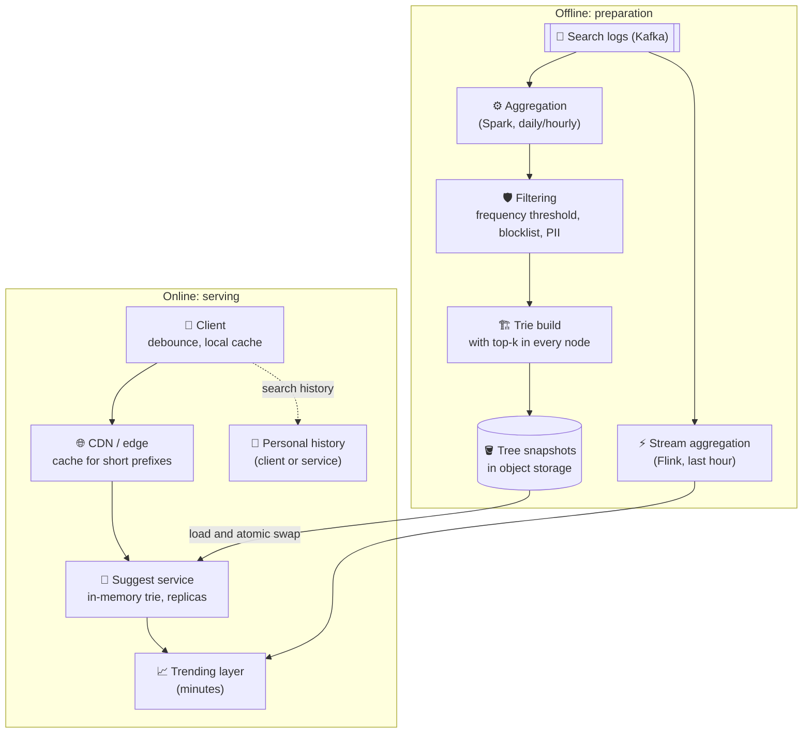
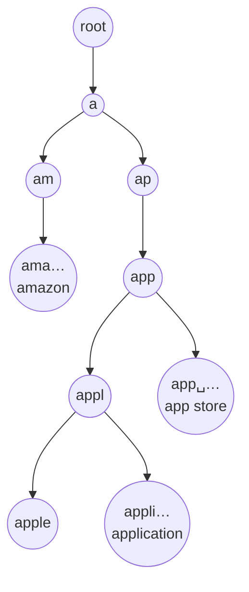
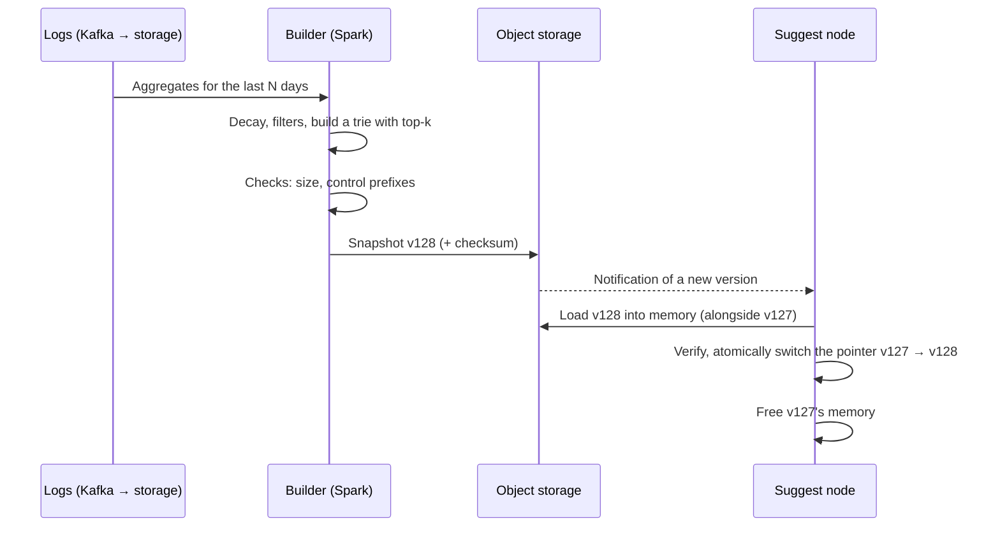
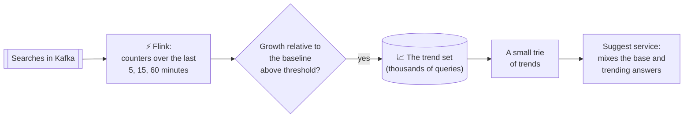

**English** | [Русский](README.ru.md)

# Tier 1 · 08. Search Autocomplete / Typeahead

> **Level:** Medium · **Interview time:** 45 min · **Study time:** ~4 h
> **Key aspects:** a prefix tree (trie) with precomputed top-k, ranking by popularity with time decay, an offline build pipeline and online serving, atomic snapshot swaps, a real-time trending layer, sharding and caching, client-side optimizations, personalization and filtering
> **Builds on:** [15-search-basics](../../01_Fundamentals/15_Search%20basics/README.md#10-autocomplete), [02-caching](../../01_Fundamentals/02_Caching/README.md), [03-cdn](../../01_Fundamentals/03_CDN/README.md), [06-partitioning](../../01_Fundamentals/06_Partitioning/README.md), [09-messaging](../../01_Fundamentals/09_Messaging/README.md)

---

## 🗺️ How to Read This Walkthrough

The walkthrough follows an interview, but every step includes explanations: **why** a decision is made, **how** a mechanism works and **what happens** if you do it differently. The "📘 Explanation" blocks are theory right where you need it.

| Icon | Meaning |
|:----:|:--------|
| 🎤 | Interviewer |
| 🗣️ | What I (the candidate) say out loud |
| ✏️ | What I draw on the whiteboard |
| ⏱️ | Time budget for the step |
| 📘 | A detailed explanation of a concept |

Callouts: **TIP** — a good technique, **WARNING** — a trap, **IMPORTANT** — a Senior+ signal.

---

## 📑 Contents

0. [What This Problem Teaches](#0-what-this-problem-teaches)
1. [Problem Statement](#1-problem-statement)
2. [Clarifying Questions and Requirements](#2-clarifying-questions-and-requirements)
3. [Capacity Estimates](#3-capacity-estimates)
4. [API](#4-api)
5. [High-Level Design](#5-high-level-design)
6. [Deep Dive 1: A Trie With Precomputed Top-K](#6-deep-dive-1-a-trie-with-precomputed-top-k)
7. [Deep Dive 2: Ranking Suggestions](#7-deep-dive-2-ranking-suggestions)
8. [Deep Dive 3: The Data Pipeline and Updating the Tree](#8-deep-dive-3-the-data-pipeline-and-updating-the-tree)
9. [Deep Dive 4: Real-Time Trends](#9-deep-dive-4-real-time-trends)
10. [Deep Dive 5: Scaling the Serving Layer](#10-deep-dive-5-scaling-the-serving-layer)
11. [Deep Dive 6: Client-Side Optimizations](#11-deep-dive-6-client-side-optimizations)
12. [Deep Dive 7: Personalization, Filtering and Anti-Manipulation](#12-deep-dive-7-personalization-filtering-and-anti-manipulation)
13. [Deep Dive 8: Languages, Keyboard Layouts and Typos](#13-deep-dive-8-languages-keyboard-layouts-and-typos)
14. [Bottlenecks and Failure Scenarios](#14-bottlenecks-and-failure-scenarios)
15. [What Changes at 10x Scale](#15-what-changes-at-10x-scale)
16. [Key Concepts and New Terms](#16-key-concepts-and-new-terms)
17. [Variations and Follow-Up Questions](#17-variations-and-follow-up-questions)
18. [Common Mistakes](#18-common-mistakes)
19. [Cheat Sheet and Self-Check](#19-cheat-sheet-and-self-check)

---

## 0. What This Problem Teaches

Autocomplete is the suggestions that appear while a user types a query: type "how to ma" and see "how to make pancakes", "how to make money online". The problem tests your ability to design a system with **very strict latency requirements** and **a split between offline preparation and online serving**.

| What's tested | Where it shows up |
|:--------------|:------------------|
| Data structures shaped by the query | A trie with precomputed top-k |
| The memory vs speed trade-off | Storing ready answers for every prefix |
| An offline pipeline + an online service | Logs → aggregation → build → snapshot distribution |
| Data freshness | A daily build plus a trending layer |
| Caching at every level | Browser, CDN, service |
| Product thinking | Filtering offensive content, personalization, anti-manipulation |

> [!TIP]
> The key idea the interviewer is waiting for: **answers are prepared in advance**. For a "prefix → 10 suggestions" request the service computes nothing — it just finds the node in the tree and returns a ready-made list.

---

## 1. Problem Statement

> 🎤 "Design autocomplete for a search box: while the user types, show the 10 most popular queries starting with the typed text."

**What the user sees:**

```
Typed "r"     → recipes, restaurants near me, real estate, …
Typed "re"    → recipes, restaurants near me, resume template, …
Typed "reci"  → recipes, recipe for pancakes, recipe for chili, …
Each suggestion must appear before the user presses the next key.
```

**Time plan:**

| Step | ⏱️ |
|:-----|:--:|
| Requirements | 4 min |
| Estimates | 4 min |
| API and high-level | 7 min |
| Deep dives | 25 min |
| Failures and wrap-up | 5 min |

---

## 2. Clarifying Questions and Requirements

⏱️ 4 min

| My question | Interviewer's answer | What it changes and why |
|:------------|:---------------------|:------------------------|
| How many suggestions? | 10 | Top-k with k = 10 |
| Ranked by what? | Query popularity, with recent queries mattering more | Frequency with time decay |
| Scale? | ~5B searches per day | Hundreds of thousands of suggestion requests per second |
| What latency? | Suggestions appear "instantly" — under ~100 ms from keypress to display | The server must answer in single-digit milliseconds; work done ahead of time |
| How fresh must suggestions be? | The base set — daily; major news — within minutes | A daily build + a trending layer |
| Only the start of a query, or the middle too? | Only the prefix | A trie over prefixes; mid-query matching is a separate problem |
| Personalization? | The user's recent searches — nice to have | A separate layer mixed with global suggestions |
| Languages? | Several; typo tolerance — if possible | Separate trees per language; typos via a separate mechanism |
| Filtering? | No offensive or illegal content, no personal data | Filters at build time and at serve time |

### Functional requirements

1. Given a prefix, return up to 10 suggestions sorted by relevance.
2. Account for query popularity, prioritizing recent activity.
3. Quickly surface queries that are suddenly gaining popularity.
4. Add the user's recent searches.
5. Never show unacceptable suggestions; remove a suggestion quickly on demand.

### Non-functional requirements

| Requirement | Target | Why |
|:------------|:-------|:----|
| Server latency | p99 < 10 ms | Most of the 100 ms budget goes to the network and rendering |
| Throughput | ~700,000 requests/s at peak | A suggestion request on almost every keystroke |
| Availability | High, but a failure isn't critical | Search works without suggestions, just less conveniently |
| Freshness | A day for the base set, minutes for trends | News must show up quickly |
| Consistency | Not strictly needed | Different users may see slightly different suggestions |

> [!NOTE]
> An important asymmetry: suggestions are an **enhancement**, not the core function. If the suggestion service is down, search still works. That lets you choose speed and simplicity over strict consistency.

---

## 3. Capacity Estimates

⏱️ 4 min

```
Searches:            5B per day
Suggestion requests per search: ~4 (not every letter — the client waits for a pause in typing)
Suggestion requests: 5B × 4 = 20B per day → ~230,000/s on average, peak ~700,000/s

Unique queries:      billions per month, but most appear only 1–2 times
Keep only popular ones (e.g. seen ≥ N times): ~100M queries
Average query length: ~20 characters

Tree size (an upper-bound estimate):
  100M queries × 20 characters = 2B characters, but prefixes overlap heavily
  → on the order of several hundred million nodes
  per node: child links + top-10 (10 references to queries at 4–8 B each) ≈ ~100 B
  → tens of GB — fits in one big server's memory, or can be split into shards
```

### Conclusions

| Conclusion | Design consequence |
|:-----------|:-------------------|
| Hundreds of thousands of requests per second, single-digit ms | Answers from memory only, no database calls |
| The tree is tens of GB | Fits in RAM; can be fully replicated or sharded |
| Short prefixes are the most common | Their answers cache extremely well (browser, CDN) |
| The tail of rare queries is enormous | Cut off by minimum frequency — saving memory and protecting privacy |

---

## 4. API

⏱️ 2 min

```http
GET /v1/suggest?q=reci&lang=en&limit=10
Cache-Control (response): public, max-age=300

→ 200 {
    "prefix": "reci",
    "suggestions": [
      { "text": "recipes",                "source": "popular" },
      { "text": "recipe for pancakes",    "source": "popular" },
      { "text": "recipe for chili",       "source": "trending" },
      { "text": "recipe my grandma cake", "source": "history" }   ← from the user's history
    ]
  }
```

| Decision | Why |
|:---------|:----|
| A `GET` with the prefix in the URL | The browser and CDN can cache the response |
| `Cache-Control: public, max-age=…` for global suggestions | Popular prefixes almost never reach the server |
| The personal part — separately or on the client | So global responses stay cacheable |
| `source` in the response | The client can show a history icon and so on |

---

## 5. High-Level Design

⏱️ 5 min



🗣️ "The system splits into two independent halves:
- **offline**: search logs are aggregated and filtered, and a tree with ready-made top-10 lists for every prefix is built from them; the tree snapshot is published to object storage;
- **online**: the suggestion service keeps the tree in memory, loads new snapshots and atomically swaps out the old ones; answering a request means finding a node and returning its ready list.

'Within minutes' freshness comes from a separate **trending layer** on stream processing, and **caches** on the client and in the CDN absorb most of the load."

---

## 6. Deep Dive 1: A Trie With Precomputed Top-K

> 🎤 "What data structure, and how does it answer in milliseconds?"

### 📘 What a trie is

A **trie** (prefix tree) is a tree in which every path from the root is a prefix, and each node corresponds to one character. All words sharing a beginning pass through shared nodes.

**An example set of queries with frequencies:**

| Query | Frequency |
|:------|:---------:|
| amazon | 120 |
| apple | 100 |
| amazon prime | 90 |
| app store | 80 |
| apple music | 50 |
| application | 30 |



### The naive lookup is too slow

1. Walk the prefix's characters down to a node (`O(prefix length)`).
2. Traverse **the entire subtree** of the node and collect every query.
3. Sort by frequency and take 10.

For the prefix "a", the subtree contains millions of queries — traversing and sorting on every request is unacceptable at 700,000 requests per second.

### The fix: store a ready-made top-k in every node

📘 Each node stores, in advance, a list of **the 10 best queries** in its whole subtree. Answering a request means walking to the node and returning its list. No traversals, no sorting.

```
Node "a":    amazon (120), apple (100), amazon prime (90)       ← top-3 for the example
Node "ap":   apple (100), app store (80), apple music (50)
Node "app":  apple (100), app store (80), apple music (50)
Node "appl": apple (100), apple music (50), application (30)
Node "am":   amazon (120), amazon prime (90)
```

| | A naive trie | A trie with top-k in nodes |
|:-|:-------------|:---------------------------|
| Lookup | O(prefix length + subtree size × log) | **O(prefix length)** |
| Memory | Less | More: k references in every node |
| Updating a frequency | Simple | Requires updating every ancestor's top-k — expensive |

🗣️ "We spend memory so that reads are instant. It's the right trade-off for a system with hundreds of thousands of reads per second and data that changes once a day."

### How to build top-k in the nodes

📘 Bottom-up: a node's top-k = the best k of (the query ending at this node) and (the top-k of every child node). That's a merge of several short sorted lists — cheap.

```python
def build_topk(node, k=10):
    candidates = []
    if node.terminal_query:                       # a query ends at this node
        candidates.append((node.score, node.query_id))
    for child in node.children.values():
        build_topk(child, k)
        candidates.extend(child.topk)             # each child already has at most k
    node.topk = heapq.nlargest(k, candidates)     # the best k
```

Building the whole tree is one traversal: `O(number of nodes × k × number of children)`. It runs **offline**, not on requests.

### Saving memory

| Technique | Effect |
|:----------|:-------|
| **A compressed tree (radix tree)** | Chains of single-child nodes merge into one edge labeled with a string ("amazon" instead of a→m→a→z→o→n) — several times fewer nodes |
| **References to queries, not strings** | Top-k stores 4-byte IDs; the strings live once in a shared table |
| **No top-k in deep nodes** | For long prefixes (8+ characters) the subtree is small — it can be traversed on the fly |
| **A hash table for short prefixes** | Prefixes of 1–3 characters are the most common; a direct "prefix → ready answer" table is faster than the tree |
| **An FST** (a finite-state transducer, as in Lucene's completion suggester) | A very compact representation of a weighted dictionary |

> [!IMPORTANT]
> **Senior+ signal:** explain right away why top-k can't be computed on the fly (traversing the "a" subtree means millions of nodes), and show the "memory for speed" trade-off together with its price — expensive updates. That's what drives the architecture with offline snapshot builds.

---

## 7. Deep Dive 2: Ranking Suggestions

> 🎤 "What number do you sort suggestions by?"

### What to count

| Signal | Why |
|:-------|:----|
| **Submitted searches**, not keystrokes | "reci", "recip" aren't queries; only the final submitted query counts |
| **Clicks on results** (optional) | A query after which users find what they need is more useful |
| **The number of unique users**, not raw repeats | Anti-manipulation: a bot submitting a query a million times is one user |

### Time decay

📘 A query that was popular a year ago shouldn't stay in suggestions forever. Each day's weight decreases exponentially:

```
score(query) = Σ count(day) × 0.5 ^ (age_in_days / half_life)

With a 7-day half-life:
  yesterday's searches    × 0.91
  a week ago              × 0.5
  two weeks ago           × 0.25
```

A short half-life makes suggestions react quickly to change but "noisy"; a long one is more stable but slower to reflect what's new. Usually it's set to several days or weeks, with the trending layer covering fast changes.

### Normalizing queries

Before counting, different variants are reduced to one:
- lowercase, extra whitespace removed;
- diacritics removed where appropriate (é → e);
- merging obvious variants ("iphone 15" and "iphone15").

### The final score

```
final_score = decayed_popularity
            × quality_factor (clicks, no complaints)
            + trend_bonus (if the query is rising sharply)
            + personal_bonus (if it's in the user's history)
```

---

## 8. Deep Dive 3: The Data Pipeline and Updating the Tree

> 🎤 "How do you update the tree if recomputing top-k is so expensive?"

### Why not update in place

📘 Changing one query's frequency affects the top-k of **all its prefixes**: for "recipe for chili" that's the nodes "r", "re", "rec", … — up to 16 nodes, and each list must be rechecked. With millions of changes per hour and concurrent reads, that's complex and risky (locks, inconsistent lists).

### The fix: immutable snapshots and an atomic swap



| Principle | Why |
|:----------|:----|
| **An immutable snapshot** | Readers never see a "half-updated" tree; no locks on reads |
| **Double buffering** | The new version loads alongside the old, then the pointer switches; needs memory for two copies |
| **Checks before publishing** | The size hasn't changed drastically, control prefixes give expected suggestions — protection against a broken build |
| **A gradual rollout** | Some nodes first, comparing metrics (suggestion CTR), then all |
| **Rollback** | The previous version is kept — switch back in seconds |
| **Build frequency** | Daily (or hourly) — the base set's freshness |

### The aggregation pipeline

| Stage | What it does |
|:------|:-------------|
| Collection | Every submitted search → an event in Kafka (query, time, language, region, user hash) |
| Hourly aggregation | Counts by (normalized query, hour, language, region), unique users |
| Storage | Hourly aggregates in the data warehouse (Parquet in object storage) |
| Daily build | Aggregates for 30–90 days → decay → filters → the tree |

---

## 9. Deep Dive 4: Real-Time Trends

> 🎤 "Something big just happened — 10 minutes later everyone is searching for it. How do you show it in suggestions now, not tomorrow?"

### The trending layer

📘 A separate small component that every few minutes finds queries that are **rising sharply** relative to their usual level and mixes them into the base suggestions.



| Element | How |
|:--------|:----|
| **Stream counting** | Sliding windows (5, 15, 60 minutes) over normalized queries |
| **Only the frequent ones** | Heavy-hitter algorithms (Space-Saving) or a count-min sketch — so you don't keep a counter for each of billions of unique queries |
| **Detecting a trend** | The ratio of current to baseline frequency (from the base set) exceeds a threshold, and the absolute frequency is high enough |
| **A small volume** | Trends number in the thousands; their trie builds in seconds and refreshes every few minutes |
| **Mixing** | On a request: the top-10 from the base tree + trending queries with this prefix, re-ranked with a trend bonus |
| **Moderating trends** | Trends are a frequent target of manipulation and a source of unacceptable suggestions; stricter filters |

📘 A **count-min sketch** is a compact structure for approximate frequency counting: several arrays of counters and hash functions; an element's frequency is estimated as the minimum of its counters. The error is only an overestimate and is bounded. **Space-Saving** keeps a bounded number of counters (e.g. 10,000) and, for a new element, evicts the smallest — so the most frequent elements of the stream stay in memory.

---

## 10. Deep Dive 5: Scaling the Serving Layer

> 🎤 "700 thousand requests per second. How many servers, and how do you lay out the tree?"

### Caches first

| Level | What's cached | Effect |
|:------|:--------------|:-------|
| **The client** | Answers for prefixes already typed in this session | Delete a letter and retype it — no request |
| **The browser** (HTTP cache) | `Cache-Control: max-age=300` on global answers | Repeated prefixes within minutes |
| **CDN / edge** | Answers for short prefixes (1–3 characters) — the most common and the same for everyone | A large share of requests never reaches the service |
| **The service** | A local cache of hot prefixes | Not even a tree traversal |

📘 **Why short prefixes are the best cache candidates.** There are dozens of one-character prefixes and thousands of two-character ones, yet they receive a huge share of traffic (every search starts with them). Their answers are nearly identical for every user of a region and language, so a CDN cache with a TTL of a few minutes serves them almost for free.

### Replicate or shard

| | A full copy of the tree on every server | Sharding by prefix |
|:-|:----------------------------------------|:-------------------|
| When | The tree fits in memory (tens of GB) | The tree exceeds one machine's memory |
| Scaling | Add replicas for load | Add shards and replicas |
| Pros | Simple; any server answers any prefix | Less memory per server |
| Cons | Memory × number of replicas | Skew: "s" and "p" get far more requests than "x" |

🗣️ "The tree is tens of GB, so **a full copy on every server**, with replication. If a server handles ~50,000 requests per second and caches absorb half the traffic, we need ~7–10 servers per region plus headroom.

If the tree stops fitting — shard by **prefix ranges** balanced by request volume (e.g. 'a–al', 'am–az', …), not by first letter: otherwise the 's' shard gets overloaded."

> [!WARNING]
> Sharding by first letter is a common mistake: the distribution of first letters is highly uneven. Shard boundaries must be chosen from the prefixes' **real traffic**.

---

## 11. Deep Dive 6: Client-Side Optimizations

> 🎤 "The user types fast. Do you send a request on every letter?"

| Optimization | How | Effect |
|:-------------|:----|:-------|
| **Debounce** | Send a request only after ~50–150 ms without keypresses | Several times fewer requests during fast typing |
| **Cancelling stale requests** | When a new letter is typed, cancel the request for the previous prefix | The answer for "re" won't overwrite a newer answer for "reci" |
| **Response ordering** | Display only the answer for the **current** prefix | Responses may arrive out of order |
| **A local cache** | Keep the session's answers | Instant on delete and retype |
| **Local filtering** | While waiting for "reci", filter the already-received list for "rec" on the client | Suggestions don't "flash" empty |
| **A persistent connection** | HTTP/2 keep-alive | No handshakes per request |
| **Minimal data** | Only the suggestion texts, no extra fields | Lower latency on mobile networks |

> [!NOTE]
> Local filtering is only a stopgap: the top-10 for "reci" isn't necessarily contained in the top-10 for "rec" (it may include queries that didn't make the shorter prefix's top). So the server request is still needed.

---

## 12. Deep Dive 7: Personalization, Filtering and Anti-Manipulation

### Personalization

| Source | How | Where it's stored |
|:-------|:----|:------------------|
| **The user's recent searches** | Show them first if they match the prefix | On the client (private, instant) or in a history service |
| **Location** | Region and city affect ranking ("weather" → "weather Warsaw") | Separate trees per region, or a bonus when mixing |
| **Interests** | A bonus for queries from topics the user often searches | A personalization service; mind the latency |

🗣️ "The personalized part is mixed in **after** the global answer is fetched — that way the global answer stays cacheable in the CDN and browser, and the personal layer is added on the client or in a lightweight service."

### Filtering

| What | How |
|:-----|:----|
| Offensive content, hate, adult content | Blocklists and classifiers at build time |
| Illegal content and on-demand removals (e.g. under "right to be forgotten" law) | A blocklist applied **at both build and serve time** — so removal takes effect immediately, without waiting for the next build |
| Personal data | Don't suggest queries resembling emails, phone numbers, document numbers; a minimum unique-user threshold |
| Dangerous suggestions | Special rules for sensitive topics (health, self-harm) |

📘 **A unique-user threshold also protects privacy.** If a query was typed by one person (e.g. their name with their address), it mustn't appear in suggestions for others. Requiring "the query was seen from ≥ N distinct users" filters out such cases.

### Anti-manipulation

| Attack | Protection |
|:-------|:-----------|
| Bots mass-submit a query to push it into suggestions | Count **unique users**, not repeats; filter bot traffic; cap one user's contribution |
| A coordinated campaign | Growth anomalies, manual moderation of trends |

---

## 13. Deep Dive 8: Languages, Keyboard Layouts and Typos

| Task | Solution |
|:-----|:---------|
| **Multiple languages** | A separate tree (or partition) per language; language from settings and from the input itself |
| **Normalization** | Case, diacritics (é → e) per the language's rules |
| **Wrong keyboard layout** | A user typed "htwtgns" on an English layout while meaning the Russian word "рецепты" — map characters through the layout table and search both variants |
| **Transliteration** | "retsepty" → "рецепты" for users typing in Latin script |
| **Typos** | Fuzzy prefix matching (Levenshtein distance) is expensive on every request — so a separate mechanism is used: correcting typos from a dictionary of common misspellings, or an n-gram index invoked when exact suggestions are scarce |

📘 **Why typos are hard for autocomplete.** The prefix is incomplete: is "recie" a typo, or is the user still typing? Fuzzy matching on every keystroke produces many false variants and is expensive. So exact prefix matching comes first, and correction kicks in only when there are too few suggestions.

---

## 14. Bottlenecks and Failure Scenarios

| Scenario | What happens | How we protect |
|:---------|:-------------|:---------------|
| A broken tree build | Strange or empty suggestions | Checks before publishing, gradual rollout, rollback to the previous version |
| The aggregation pipeline fails | No new tree is built | The service keeps running on the last snapshot; an alert |
| The trending layer fails | No fresh events in suggestions | Base suggestions work; trends are optional |
| The suggestion service is down | No suggestions | Search works without them; the client quietly hides suggestions |
| An unacceptable suggestion is served | Reputational damage | A serve-time blocklist — removal in seconds |
| A query is manipulated | Junk in suggestions | Unique users, bot filtering, trend moderation |
| Running out of memory during a snapshot swap | The server crashes | Memory headroom for two versions; throttled loading |
| Shard skew | One shard is overloaded | Boundaries by traffic, caches for short prefixes |
| Stale CDN answers after a removal | A removed suggestion is visible until the TTL expires | A short TTL, a CDN purge for urgent removals |

---

## 15. What Changes at 10x Scale

> 🎤 "10× more requests and languages?"

| Change | Why |
|:-------|:----|
| **More edge caching** and serving short prefixes directly from the CDN | Most traffic is short prefixes |
| **Sharding trees** by language, region and prefix range | The trees grow |
| **ML ranking** of suggestions | Account for session context and click probability, not just frequency |
| **Generating suggestions for new queries** | For rare prefixes — models that predict the continuation |
| **Incremental updates** for frequent changes | Builds every few minutes for part of the tree instead of once a day |

---

## 16. Key Concepts and New Terms

### What's applied from Fundamentals

| Concept | Where it's covered | How it applies here |
|:--------|:-------------------|:--------------------|
| Autocomplete in search engines | [15-search-basics](../../01_Fundamentals/15_Search%20basics/README.md#10-autocomplete) | Edge n-grams, the completion suggester, FSTs |
| Caching | [02-caching](../../01_Fundamentals/02_Caching/README.md) | The service's local cache |
| CDN, `Cache-Control` | [03-cdn](../../01_Fundamentals/03_CDN/README.md) | Caching short prefixes at the edge |
| Range partitioning, skew | [06-partitioning](../../01_Fundamentals/06_Partitioning/README.md) | Sharding the tree |
| Stream processing | [09-messaging](../../01_Fundamentals/09_Messaging/README.md) | Search logs, the trending layer |

### New terms in this problem

| Term | In short |
|:-----|:---------|
| **Trie** | A prefix tree: shared word beginnings share nodes |
| **Top-k in a node** | A precomputed list of the subtree's best queries |
| **Radix tree** | A compressed tree: single-child chains merged into one edge |
| **Time decay** | The weight of old data decreases exponentially |
| **An immutable snapshot + atomic swap** | Updating without read locks |
| **Count-min sketch** | Approximate frequency counting in little memory |
| **Space-Saving** | Finding a stream's most frequent elements with a bounded number of counters |
| **Debounce** | Sending a request only after a pause in typing |

---

## 17. Variations and Follow-Up Questions

<details>
<summary><b>Why not use a database with LIKE 'prefix%'?</b></summary>

A B-tree index can search by prefix, but the query still returns every match, which then has to be sorted by popularity — millions of rows for "a". And no database can handle 700,000 such queries per second at millisecond latency. Precomputed top-k lists in memory answer in microseconds.
</details>

<details>
<summary><b>How do you suggest from the middle of a query ("chili" → "recipe for chili")?</b></summary>

That's no longer prefix search. Options: index each query by every word (word-level suffixes) — so "chili" leads to "recipe for chili"; or use a full-text search engine with edge n-grams per word (see [15-search-basics](../../01_Fundamentals/15_Search%20basics/README.md#10-autocomplete)). It increases the index size.
</details>

<details>
<summary><b>How do you remove a suggestion immediately (e.g. by court order)?</b></summary>

Add it to a blocklist checked **at serve time** on every server (a small set updated within seconds), and purge the CDN caches for the affected prefixes. In the next build, the suggestion is excluded from the tree too.
</details>

<details>
<summary><b>What about prefixes with no suggestions?</b></summary>

Return an empty list — that's fine. You can try typo or layout correction, and for very long, rare prefixes show nothing: it doesn't make search worse.
</details>

<details>
<summary><b>How is autocomplete different from search?</b></summary>

Search finds **documents** for a query and ranks them by relevance; autocomplete predicts **the query itself** from its beginning and ranks the options by popularity. Hence the different structures: an inverted index for search and a trie with top-k for suggestions.
</details>

---

## 18. Common Mistakes

| ❌ Mistake | Why it's bad | ✅ Do this instead |
|:----------|:-------------|:------------------|
| Computing top-k on the fly by traversing the subtree | Millions of nodes for short prefixes | Precomputed top-k in nodes |
| Updating the tree in place on every search | Locks, inconsistency, expensive | Immutable snapshots and an atomic swap |
| Counting keystrokes as queries | Junk like "recip", "reci" in suggestions | Submitted searches only |
| Counting repeats rather than unique users | Bot manipulation | Unique users |
| Ignoring time | Stale suggestions forever | Exponential decay |
| Freshness only via the daily build | News appears a day late | A trending layer on stream processing |
| Personalization inside the global answer | Breaks CDN and browser caching | A separate personal layer |
| A request on every letter without debounce | Extra load, "flashing" | Debounce, cancelling stale requests |
| Sharding by first letter | Heavy skew | Ranges by real traffic |
| A blocklist only at build time | Removal waits a day | A blocklist at serve time too |

---

## 19. Cheat Sheet and Self-Check

### 30-second answer

> 20B suggestion requests per day (~700K/s at peak) and single-digit-ms answers — so answers are prepared in advance. Offline: logs of submitted searches → hourly aggregates by normalized query and unique users → popularity with exponential decay → filters (threshold, blocklist, PII) → a compressed trie in which every node holds a ready top-10 (built bottom-up) → an immutable snapshot in object storage. Online: each server keeps the tree in memory (tens of GB), loads a new snapshot alongside and atomically switches the pointer; an answer means finding the node and returning its list. Minute-level freshness comes from a trending layer on Flink (windows, Space-Saving/count-min sketch, growth vs baseline). Caches on the client, in the browser and in the CDN (short prefixes) absorb most traffic. The client debounces and cancels stale requests. Personalization is a separate layer so caching isn't broken; the blocklist applies at both build and serve time.

### Self-check

- [ ] I can estimate the load and the size of the tree
- [ ] I can explain why a naive subtree traversal doesn't work
- [ ] I can build top-k in nodes for an example and explain the bottom-up build
- [ ] I can name 4 ways to save the tree's memory
- [ ] I can explain ranking with decay and compute the weights
- [ ] I can explain why the tree is updated via snapshots and describe the atomic swap
- [ ] I can design the trending layer and explain a count-min sketch
- [ ] I can choose between replication and sharding and explain skew
- [ ] I can list client-side optimizations
- [ ] I can describe personalization, filtering and anti-manipulation

### Further reading

- Alex Xu, *System Design Interview*, Vol. 1 — chapter "Design a Search Autocomplete System"
- Elasticsearch documentation: the completion suggester; Lucene FSTs
- Cormode, Muthukrishnan, *An Improved Data Stream Summary: The Count-Min Sketch and its Applications* (2005)
- Metwally, Agrawal, El Abbadi, *Efficient Computation of Frequent and Top-k Elements in Data Streams* (2005) — Space-Saving
- Fundamentals topic: [15-search-basics](../../01_Fundamentals/15_Search%20basics/README.md)