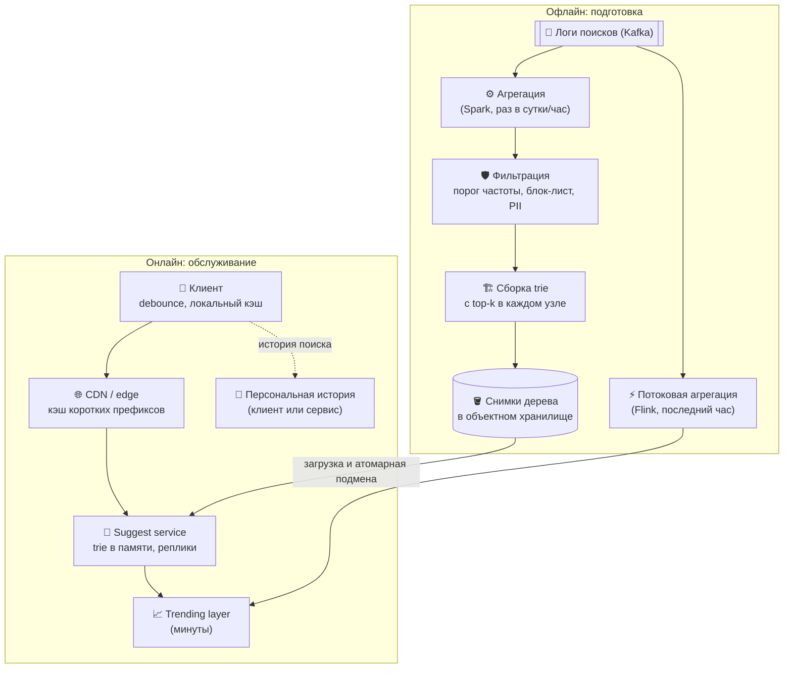
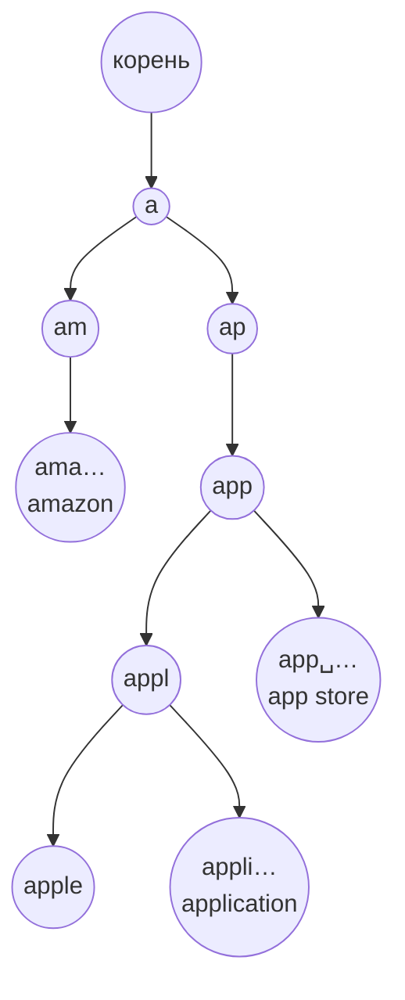
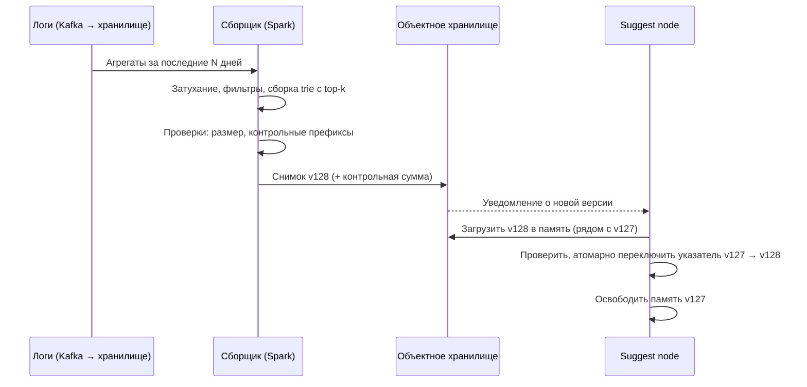
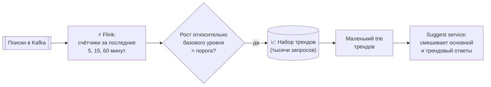

[English](README.md) | **Русский**

# Tier 1 · 08. Search Autocomplete / Typeahead

> **Уровень:** Medium · **Время на интервью:** 45 мин · **Время на разбор:** ~4 ч
> **Ключевые аспекты:** префиксное дерево (trie) с заранее вычисленными top-k, ранжирование по популярности с затуханием во времени, офлайн-конвейер сборки и онлайн-обслуживание, атомарная подмена снимков, слой трендов в реальном времени, шардирование и кэширование, оптимизации клиента, персонализация и фильтрация
> **Опирается на:** [15-search-basics](../../01_Fundamentals/15_Search%20basics/README.ru.md#10-автодополнение), [02-caching](../../01_Fundamentals/02_Caching/README.ru.md), [03-cdn](../../01_Fundamentals/03_CDN/README.ru.md), [06-partitioning](../../01_Fundamentals/06_Partitioning/README.ru.md), [09-messaging](../../01_Fundamentals/09_Messaging/README.ru.md)

---

## 🗺️ Как читать этот разбор

Разбор построен как интервью, но в каждом шаге есть объяснения: **почему** принимается решение, **как работает** механизм и **что будет**, если сделать иначе. Блоки «📘 Объяснение» — теория прямо по ходу задачи.

| Значок | Что значит |
|:------:|:-----------|
| 🎤 | Реплика интервьюера |
| 🗣️ | Что говорю вслух я (кандидат) |
| ✏️ | Что рисую на доске |
| ⏱️ | Сколько времени тратить на шаг |
| 📘 | Подробное объяснение концепции |

Блоки **TIP** — хороший приём, **WARNING** — ловушка, **IMPORTANT** — сигнал для уровня Senior+.

---

## 📑 Содержание

0. [Чему учит эта задача](#0-чему-учит-эта-задача)
1. [Условие задачи](#1-условие-задачи)
2. [Уточняющие вопросы и требования](#2-уточняющие-вопросы-и-требования)
3. [Оценки нагрузки](#3-оценки-нагрузки)
4. [API](#4-api)
5. [High-level дизайн](#5-high-level-дизайн)
6. [Deep dive 1: trie с заранее вычисленными top-k](#6-deep-dive-1-trie-с-заранее-вычисленными-top-k)
7. [Deep dive 2: ранжирование подсказок](#7-deep-dive-2-ранжирование-подсказок)
8. [Deep dive 3: конвейер данных и обновление дерева](#8-deep-dive-3-конвейер-данных-и-обновление-дерева)
9. [Deep dive 4: тренды в реальном времени](#9-deep-dive-4-тренды-в-реальном-времени)
10. [Deep dive 5: масштабирование обслуживания](#10-deep-dive-5-масштабирование-обслуживания)
11. [Deep dive 6: оптимизации на клиенте](#11-deep-dive-6-оптимизации-на-клиенте)
12. [Deep dive 7: персонализация, фильтрация и защита от накруток](#12-deep-dive-7-персонализация-фильтрация-и-защита-от-накруток)
13. [Deep dive 8: языки, раскладка и опечатки](#13-deep-dive-8-языки-раскладка-и-опечатки)
14. [Узкие места и сценарии сбоев](#14-узкие-места-и-сценарии-сбоев)
15. [Что изменится при росте в 10 раз](#15-что-изменится-при-росте-в-10-раз)
16. [Ключевые концепции и новые понятия](#16-ключевые-концепции-и-новые-понятия)
17. [Варианты задачи и follow-up вопросы](#17-варианты-задачи-и-follow-up-вопросы)
18. [Типичные ошибки](#18-типичные-ошибки)
19. [Шпаргалка и самопроверка](#19-шпаргалка-и-самопроверка)

---

## 0. Чему учит эта задача

Автодополнение — это подсказки, которые появляются, пока пользователь набирает запрос: вводишь «как при» — видишь «как приготовить плов», «как привязать карту». Задача проверяет умение спроектировать систему с **очень жёсткими требованиями к задержке** и **разделением на офлайн-подготовку и онлайн-обслуживание**.

| Что проверяют | Где это в задаче |
|:--------------|:-----------------|
| Структуры данных под конкретный запрос | Trie с заранее вычисленными top-k |
| Компромисс память — скорость | Хранить готовые ответы для каждого префикса |
| Офлайн-конвейер + онлайн-сервис | Логи → агрегация → сборка → раздача снимков |
| Свежесть данных | Ежедневная сборка плюс слой трендов |
| Кэширование на всех уровнях | Браузер, CDN, сервис |
| Продуктовое мышление | Фильтрация оскорбительного, персонализация, защита от накруток |

> [!TIP]
> Главная идея, которую ждёт интервьюер: **ответы готовятся заранее**. На запрос «префикс → 10 подсказок» сервис не считает ничего — он просто находит узел в дереве и отдаёт уже готовый список.

---

## 1. Условие задачи

> 🎤 «Спроектируй автодополнение для поисковой строки: пока пользователь печатает, показываем 10 самых популярных запросов, начинающихся с введённого текста».

**Что видит пользователь:**

```
Ввёл «р»     → рецепты, расписание поездов, распродажа, …
Ввёл «ре»    → рецепты, ремонт квартиры, реферат, …
Ввёл «реце»  → рецепты, рецепт блинов, рецепт плова, …
Каждая подсказка должна появиться быстрее, чем пользователь нажмёт следующую клавишу.
```

**План по времени:**

| Шаг | ⏱️ |
|:----|:--:|
| Требования | 4 мин |
| Оценки | 4 мин |
| API и high-level | 7 мин |
| Deep dives | 25 мин |
| Сбои и итоги | 5 мин |

---

## 2. Уточняющие вопросы и требования

⏱️ 4 мин

| Мой вопрос | Ответ интервьюера | Что это меняет и почему |
|:-----------|:------------------|:------------------------|
| Сколько подсказок? | 10 | Top-k с k = 10 |
| По какому признаку ранжировать? | По популярности запросов, свежие важнее старых | Частота с затуханием во времени |
| Масштаб? | ~5B поисков в сутки | Сотни тысяч запросов подсказок в секунду |
| Какая задержка? | Подсказки появляются «мгновенно» — до ~100 мс от нажатия до отображения | Сервер должен отвечать за единицы миллисекунд; работа заранее |
| Насколько свежими должны быть подсказки? | Базово — раз в сутки; громкие новости — в течение минут | Ежедневная сборка + слой трендов |
| Только начало запроса или и середина? | Только префикс | Trie по префиксам; поиск по середине — отдельная задача |
| Персонализация? | Недавние поиски пользователя — желательно | Отдельный слой, смешиваемый с общими подсказками |
| Языки? | Несколько; поддержка опечаток — по возможности | Отдельные деревья по языкам; опечатки — отдельный механизм |
| Фильтрация? | Без оскорбительного и незаконного контента, без персональных данных | Фильтры при сборке и при выдаче |

### Функциональные требования

1. По префиксу вернуть до 10 подсказок, отсортированных по релевантности.
2. Учитывать популярность запросов с приоритетом свежих.
3. Быстро показывать резко набирающие популярность запросы.
4. Добавлять недавние поиски пользователя.
5. Не показывать недопустимые подсказки; быстро удалять подсказку по требованию.

### Нефункциональные требования

| Требование | Цель | Почему |
|:-----------|:-----|:-------|
| Задержка сервера | p99 < 10 мс | Из 100 мс бюджета большую часть съедают сеть и отрисовка |
| Пропускная способность | ~700 000 запросов/с в пике | Запрос подсказок — почти на каждое нажатие клавиши |
| Доступность | Высокая, но отказ не критичен | Без подсказок поиск работает, просто хуже |
| Свежесть | Сутки для основного набора, минуты для трендов | Новости должны появляться быстро |
| Консистентность | Не нужна строгая | Разные пользователи могут видеть немного разные подсказки |

> [!NOTE]
> Важная асимметрия: подсказки — это **улучшение**, а не основная функция. Если сервис подсказок недоступен, поиск всё равно работает. Это позволяет выбирать решения в пользу скорости и простоты, а не строгой консистентности.

---

## 3. Оценки нагрузки

⏱️ 4 мин

```
Поисков:          5B в сутки
Запросов подсказок на поиск: ~4 (не на каждую букву — клиент ждёт паузу в наборе)
Запросов подсказок: 5B × 4 = 20B в сутки → ~230 000/с в среднем, пик ~700 000/с

Уникальных запросов: миллиарды в месяц, но большинство встречается 1–2 раза
Оставляем только популярные (например, встречались ≥ N раз): ~100M запросов
Средняя длина запроса: ~20 символов

Размер дерева (оценка сверху):
  100M запросов × 20 символов = 2B символов, но префиксы сильно пересекаются
  → порядка нескольких сотен миллионов узлов
  на узел: дочерние ссылки + top-10 (10 ссылок на запросы по 4–8 Б) ≈ ~100 Б
  → десятки ГБ — помещается в память одного большого сервера или делится на шарды
```

### Выводы

| Вывод | Следствие для дизайна |
|:------|:----------------------|
| Сотни тысяч запросов в секунду, единицы мс | Ответы только из памяти, без обращений к базам |
| Дерево — десятки ГБ | Помещается в RAM; можно реплицировать целиком или шардировать |
| Короткие префиксы встречаются чаще всего | Их ответы отлично кэшируются (браузер, CDN) |
| Хвост редких запросов огромен | Отсекаем по минимальной частоте — это и экономия памяти, и защита приватности |

---

## 4. API

⏱️ 2 мин

```http
GET /v1/suggest?q=реце&lang=ru&limit=10
Cache-Control (ответ): public, max-age=300

→ 200 {
    "prefix": "реце",
    "suggestions": [
      { "text": "рецепты",         "source": "popular" },
      { "text": "рецепт блинов",   "source": "popular" },
      { "text": "рецепт плова",    "source": "trending" },
      { "text": "рецепт торта мой", "source": "history" }   ← из истории пользователя
    ]
  }
```

| Решение | Почему |
|:--------|:-------|
| `GET` с префиксом в URL | Ответ можно кэшировать браузеру и CDN |
| `Cache-Control: public, max-age=…` для общих подсказок | Популярные префиксы почти не доходят до сервера |
| Персональная часть — отдельно или на клиенте | Чтобы не ломать кэширование общих ответов |
| `source` в ответе | Клиент может показать иконку истории и т. п. |

---

## 5. High-level дизайн

⏱️ 5 мин



🗣️ «Система делится на две независимые половины:
- **офлайн**: логи поисков агрегируются, фильтруются, из них собирается дерево с готовыми top-10 для каждого префикса; снимок дерева выкладывается в объектное хранилище;
- **онлайн**: сервис подсказок держит дерево в памяти, загружает новые снимки и атомарно подменяет старые; ответ на запрос — поиск узла и выдача готового списка.

Свежесть «в течение минут» даёт отдельный **слой трендов** на потоковой обработке, а **кэши** на клиенте и в CDN снимают большую часть нагрузки».

---

## 6. Deep dive 1: trie с заранее вычисленными top-k

> 🎤 «Какая структура данных и как она отвечает за миллисекунды?»

### 📘 Что такое trie

**Trie** (префиксное дерево) — дерево, где каждый путь от корня — это префикс, а каждый узел соответствует одному символу. Все слова с общим началом проходят через общие узлы.

**Пример набора запросов с частотами:**

| Запрос | Частота |
|:-------|:-------:|
| amazon | 120 |
| apple | 100 |
| amazon prime | 90 |
| app store | 80 |
| apple music | 50 |
| application | 30 |



### Наивный поиск — слишком медленный

1. Дойти по символам префикса до узла (`O(длина префикса)`).
2. Обойти **всё поддерево** узла и собрать все запросы.
3. Отсортировать по частоте и взять 10.

Для префикса «a» поддерево содержит миллионы запросов — обход и сортировка на каждый запрос недопустимы при 700 000 запросов в секунду.

### Решение: хранить готовый top-k в каждом узле

📘 В каждом узле заранее сохраняется список **10 лучших запросов** всего его поддерева. Ответ на запрос — дойти до узла и вернуть его список. Никаких обходов и сортировок.

```
Узел «a»:    amazon (120), apple (100), amazon prime (90)       ← top-3 для примера
Узел «ap»:   apple (100), app store (80), apple music (50)
Узел «app»:  apple (100), app store (80), apple music (50)
Узел «appl»: apple (100), apple music (50), application (30)
Узел «am»:   amazon (120), amazon prime (90)
```

| | Наивный trie | Trie с top-k в узлах |
|:-|:-------------|:---------------------|
| Поиск | O(длина префикса + размер поддерева × log) | **O(длина префикса)** |
| Память | Меньше | Больше: k ссылок в каждом узле |
| Обновление частоты | Просто | Нужно обновить top-k всех предков — дорого |

🗣️ «Мы тратим память, чтобы чтение было мгновенным. Это правильный компромисс для системы, где чтений сотни тысяч в секунду, а данные меняются раз в сутки».

### Как собрать top-k в узлах

📘 Снизу вверх: top-k узла = лучшие k из (запроса, заканчивающегося в этом узле) и (top-k всех дочерних узлов). Это слияние нескольких коротких отсортированных списков — дёшево.

```python
def build_topk(node, k=10):
    candidates = []
    if node.terminal_query:                       # запрос заканчивается в этом узле
        candidates.append((node.score, node.query_id))
    for child in node.children.values():
        build_topk(child, k)
        candidates.extend(child.topk)             # в каждом ребёнке уже не больше k
    node.topk = heapq.nlargest(k, candidates)     # лучшие k
```

Сборка всего дерева — один обход: `O(число узлов × k × число детей)`. Она выполняется **офлайн**, а не на запросах.

### Экономия памяти

| Приём | Эффект |
|:------|:-------|
| **Сжатое дерево (radix tree)** | Цепочки узлов с одним ребёнком сливаются в одно ребро со строкой («amazon» вместо a→m→a→z→o→n) — в разы меньше узлов |
| **Ссылки на запросы, а не строки** | Top-k хранит 4-байтные ID; строки — в общей таблице один раз |
| **Не хранить top-k в глубоких узлах** | Для длинных префиксов (8+ символов) поддерево маленькое — можно обойти его на лету |
| **Хэш-таблица для коротких префиксов** | Префиксы 1–3 символа — самые частые; прямая таблица «префикс → готовый ответ» быстрее дерева |
| **FST** (конечный автомат, как completion suggester в Lucene) | Очень компактное представление словаря с весами |

> [!IMPORTANT]
> **Сигнал Senior+:** сразу объяснить, почему нельзя считать top-k на лету (обход поддерева «a» — миллионы узлов), и показать компромисс «память ради скорости» вместе с ценой — дорогим обновлением. Это и определяет архитектуру с офлайн-сборкой снимков.

---

## 7. Deep dive 2: ранжирование подсказок

> 🎤 «По какому числу сортировать подсказки?»

### Что считать

| Сигнал | Почему |
|:-------|:-------|
| **Отправленные поиски**, а не нажатия клавиш | «реце», «рецеп» — это не запросы; считаем только итоговый отправленный запрос |
| **Клики по результатам** (опционально) | Запрос, после которого пользователи находят нужное, полезнее |
| **Число уникальных пользователей**, а не просто повторов | Защита от накруток: бот, отправивший запрос миллион раз, — это один пользователь |

### Затухание во времени

📘 Запрос, популярный год назад, не должен вечно оставаться в подсказках. Вес каждого дня уменьшается экспоненциально:

```
score(запрос) = Σ count(день) × 0,5 ^ (возраст_в_днях / период_полураспада)

Период полураспада 7 дней:
  вчерашние поиски        × 0,91
  поиски недельной давности × 0,5
  двухнедельной давности  × 0,25
```

Короткий период полураспада — подсказки быстро реагируют на изменения, но «шумят»; длинный — стабильнее, но медленнее отражают новое. Обычно выбирают несколько дней–недель, а быстрые изменения закрывает слой трендов.

### Нормализация запросов

Перед подсчётом разные варианты приводятся к одному:
- нижний регистр, лишние пробелы;
- «ё» → «е» (для русского), удаление диакритики там, где это уместно;
- склейка очевидных вариантов («iphone 15» и «iphone15»).

### Итоговая оценка

```
итоговый_score = популярность_с_затуханием
               × коэффициент_качества (клики, отсутствие жалоб)
               + бонус_тренда (если запрос резко растёт)
               + персональный_бонус (если в истории пользователя)
```

---

## 8. Deep dive 3: конвейер данных и обновление дерева

> 🎤 «Как обновлять дерево, если top-k так дорого пересчитывать?»

### Почему не обновлять на месте

📘 Изменение частоты одного запроса влияет на top-k **всех его префиксов**: для «рецепт плова» это узлы «р», «ре», «рец», … — до 12 узлов, и в каждом нужно перепроверить список. При миллионах изменений в час и параллельных чтениях это сложно и рискованно (блокировки, неконсистентные списки).

### Решение: неизменяемые снимки и атомарная подмена



| Принцип | Почему |
|:--------|:-------|
| **Неизменяемый снимок** | Читатели никогда не видят «полуобновлённое» дерево; нет блокировок на чтении |
| **Двойная буферизация** | Новая версия загружается рядом со старой, затем — переключение указателя; нужна память на две копии |
| **Проверки перед публикацией** | Размер не изменился резко, контрольные префиксы дают ожидаемые подсказки — защита от сломанной сборки |
| **Постепенный раскат** | Сначала часть узлов, сравнение метрик (CTR подсказок), затем все |
| **Откат** | Предыдущая версия хранится — переключиться обратно за секунды |
| **Частота сборки** | Раз в сутки (или в час) — свежесть основного набора |

### Конвейер агрегации

| Этап | Что делает |
|:-----|:-----------|
| Сбор | Каждый отправленный поиск → событие в Kafka (запрос, время, язык, регион, хэш пользователя) |
| Ежечасная агрегация | Подсчёт по (нормализованный запрос, час, язык, регион), уникальные пользователи |
| Хранение | Почасовые агрегаты в хранилище данных (Parquet в объектном хранилище) |
| Ежедневная сборка | Агрегаты за 30–90 дней → затухание → фильтры → дерево |

---

## 9. Deep dive 4: тренды в реальном времени

> 🎤 «Произошло важное событие — через 10 минут все ищут его. Как показать в подсказках сейчас, а не завтра?»

### Слой трендов

📘 Отдельный небольшой компонент, который каждые несколько минут находит запросы, **резко растущие** по сравнению с обычным уровнем, и подмешивает их к основным подсказкам.



| Элемент | Как |
|:--------|:----|
| **Подсчёт в потоке** | Скользящие окна (5, 15, 60 минут) по нормализованным запросам |
| **Только частые** | Алгоритмы поиска «тяжёлых элементов» (Space-Saving) или count-min sketch — чтобы не держать счётчик для каждого из миллиардов уникальных запросов |
| **Определение тренда** | Отношение текущей частоты к базовой (из основного набора) больше порога, и абсолютная частота достаточна |
| **Небольшой объём** | Трендов — тысячи; их trie собирается за секунды и обновляется каждые несколько минут |
| **Смешивание** | При запросе: top-10 из основного дерева + трендовые запросы с этим префиксом, переранжированные с бонусом тренда |
| **Модерация трендов** | Тренды — частая цель накруток и источник неприемлемых подсказок; более строгие фильтры |

📘 **Count-min sketch** — компактная структура для приблизительного подсчёта частот: несколько массивов счётчиков и хэш-функций; частота элемента оценивается минимальным из его счётчиков. Ошибка только в сторону завышения и ограничена. **Space-Saving** держит ограниченное число счётчиков (например, 10 000) и при новом элементе вытесняет наименьший — так в памяти остаются самые частые элементы потока.

---

## 10. Deep dive 5: масштабирование обслуживания

> 🎤 «700 тысяч запросов в секунду. Сколько серверов и как раскладывать дерево?»

### Сначала кэши

| Уровень | Что кэшируется | Эффект |
|:--------|:---------------|:-------|
| **Клиент** | Ответы на уже введённые префиксы в этой сессии | Стёр букву и ввёл снова — без запроса |
| **Браузер** (HTTP-кэш) | `Cache-Control: max-age=300` на общие ответы | Повторные префиксы в течение минут |
| **CDN / edge** | Ответы на короткие префиксы (1–3 символа) — самые частые и одинаковые для всех | Большая доля запросов не доходит до сервиса |
| **Сервис** | Локальный кэш горячих префиксов | Даже обход дерева не нужен |

📘 **Почему короткие префиксы — лучшие кандидаты для кэша.** Префиксов из одного символа — десятки, из двух — тысячи, а запросов к ним — огромная доля трафика (каждый поиск начинается с них). Их ответы почти одинаковы для всех пользователей региона и языка, поэтому кэш CDN с TTL в несколько минут обслуживает их почти бесплатно.

### Реплицировать или шардировать

| | Полная копия дерева на каждом сервере | Шардирование по префиксам |
|:-|:--------------------------------------|:--------------------------|
| Когда | Дерево помещается в память (десятки ГБ) | Дерево больше памяти одной машины |
| Масштабирование | Добавлять реплики под нагрузку | Добавлять шарды и реплики |
| Плюсы | Просто, любой сервер отвечает на любой префикс | Меньше памяти на сервер |
| Минусы | Память × число реплик | Перекос: на «с» и «п» запросов намного больше, чем на «ъ» |

🗣️ «Дерево — десятки ГБ, поэтому **полная копия на каждом сервере** с репликацией. Если сервер выдерживает ~50 000 запросов в секунду, а кэши снимают половину трафика, нужно ~7–10 серверов на регион плюс запас.

Если дерево перестанет помещаться — шардирование по **диапазонам префиксов**, сбалансированным по объёму запросов (например, «а–ал», «ам–ая», …), а не по первой букве: иначе шард с «с» будет перегружен».

> [!WARNING]
> Шардирование по первой букве — частая ошибка: распределение первых букв сильно неравномерно. Границы шардов нужно выбирать по **реальному трафику** префиксов.

---

## 11. Deep dive 6: оптимизации на клиенте

> 🎤 «Пользователь печатает быстро. Нужно ли отправлять запрос на каждую букву?»

| Оптимизация | Как | Эффект |
|:------------|:----|:-------|
| **Debounce** | Отправлять запрос, только если пользователь не нажимал клавиши ~50–150 мс | В разы меньше запросов при быстром наборе |
| **Отмена устаревших запросов** | При вводе новой буквы отменить запрос для предыдущего префикса | Ответ на «ре» не перезапишет более новый ответ на «реце» |
| **Порядок ответов** | Отображать только ответ на **текущий** префикс | Ответы могут прийти не по порядку |
| **Локальный кэш** | Хранить ответы сессии | Мгновенно при стирании и повторном вводе |
| **Локальная фильтрация** | Пока ждём ответ на «реце», отфильтровать на клиенте уже полученный список для «рец» | Подсказки не «мигают» пустотой |
| **Постоянное соединение** | HTTP/2 keep-alive | Нет рукопожатий на каждый запрос |
| **Минимум данных** | Только тексты подсказок, без лишних полей | Меньше задержка на мобильных сетях |

> [!NOTE]
> Локальная фильтрация — только временная мера: top-10 для «реце» не обязательно содержится в top-10 для «рец» (там могут быть запросы, которые не попали в топ более короткого префикса). Поэтому запрос к серверу всё равно нужен.

---

## 12. Deep dive 7: персонализация, фильтрация и защита от накруток

### Персонализация

| Источник | Как | Где хранить |
|:---------|:----|:------------|
| **Недавние поиски пользователя** | Показывать первыми, если подходят под префикс | На клиенте (приватно, мгновенно) или в сервисе истории |
| **Местоположение** | Регион и город влияют на ранжирование («погода» → «погода Варшава») | Отдельные деревья по регионам или бонус при смешивании |
| **Интересы** | Бонус к запросам из тем, которые пользователь часто ищет | Сервис персонализации; осторожно с задержкой |

🗣️ «Персонализированная часть смешивается с общей **после** получения общего ответа — так общий ответ остаётся кэшируемым в CDN и браузере, а персональный слой добавляется на клиенте или в лёгком сервисе».

### Фильтрация

| Что | Как |
|:----|:----|
| Оскорбительное, ненависть, взрослый контент | Блок-листы и классификаторы при сборке |
| Незаконное и удалённое по требованию (например, по закону о «праве на забвение») | Блок-лист, применяемый **и при сборке, и при выдаче** — чтобы удаление работало сразу, не дожидаясь следующей сборки |
| Персональные данные | Не подсказывать запросы, похожие на email, телефоны, номера документов; порог минимального числа уникальных пользователей |
| Опасные подсказки | Особые правила для чувствительных тем (здоровье, самоповреждение) |

📘 **Порог по уникальным пользователям — это и защита приватности.** Если запрос ввёл один человек (например, своё имя с адресом), он не должен появиться в подсказках у других. Требование «запрос встречался у ≥ N разных пользователей» отсекает такие случаи.

### Защита от накруток

| Атака | Защита |
|:------|:-------|
| Боты массово отправляют запрос, чтобы он попал в подсказки | Считать **уникальных пользователей**, а не повторы; отсеивать трафик ботов; ограничивать вклад одного пользователя |
| Скоординированная кампания | Аномалии роста, ручная модерация трендов |

---

## 13. Deep dive 8: языки, раскладка и опечатки

| Задача | Решение |
|:-------|:--------|
| **Несколько языков** | Отдельное дерево (или раздел) на язык; язык — по настройкам и по самому вводу |
| **Нормализация** | Регистр, «ё»/«е», диакритика (é → e) по правилам языка |
| **Неправильная раскладка** | Пользователь набрал «htwtgns» на английской раскладке вместо «рецепты» — преобразовать символы по таблице раскладки и искать оба варианта |
| **Транслитерация** | «retsepty» → «рецепты» для пользователей, печатающих латиницей |
| **Опечатки** | Нечёткий поиск по префиксу (расстояние Левенштейна) дорог на каждый запрос — используют отдельный механизм: исправление опечаток по словарю частых ошибок или n-граммный индекс, вызываемый, когда точных подсказок мало |

📘 **Почему опечатки сложны для автодополнения.** Префикс неполный: «рецеп» — это опечатка или пользователь ещё не дописал? Нечёткое совпадение на каждом нажатии клавиши даёт много ложных вариантов и стоит дорого. Поэтому сначала ищут точное совпадение префикса, а исправление включают, только если подсказок слишком мало.

---

## 14. Узкие места и сценарии сбоев

| Сценарий | Что произойдёт | Как защищаемся |
|:---------|:---------------|:---------------|
| Сломанная сборка дерева | Странные или пустые подсказки | Проверки перед публикацией, постепенный раскат, откат на прошлую версию |
| Сбой конвейера агрегации | Новое дерево не собирается | Сервис продолжает работать на последнем снимке; алерт |
| Сбой слоя трендов | Нет свежих событий в подсказках | Основные подсказки работают; тренды необязательны |
| Сервис подсказок недоступен | Нет подсказок | Поиск работает без них; клиент молча скрывает подсказки |
| Недопустимая подсказка в выдаче | Репутационный ущерб | Блок-лист при выдаче — удаление за секунды |
| Накрутка запроса | Мусор в подсказках | Уникальные пользователи, фильтрация ботов, модерация трендов |
| Нехватка памяти при подмене снимка | Сервер падает | Запас памяти на две версии; загрузка с ограничением |
| Перекос шардов | Один шард перегружен | Границы по трафику, кэши для коротких префиксов |
| Устаревшие ответы в CDN после удаления | Удалённая подсказка видна до истечения TTL | Короткий TTL, purge CDN при срочном удалении |

---

## 15. Что изменится при росте в 10 раз

> 🎤 «В 10 раз больше запросов и языков?»

| Изменение | Почему |
|:----------|:-------|
| **Больше кэширования на edge** и обслуживание коротких префиксов прямо в CDN | Основной трафик — короткие префиксы |
| **Шардирование деревьев** по языку, региону и диапазонам префиксов | Деревья растут |
| **ML-ранжирование** подсказок | Учитывать контекст сессии, вероятность клика, а не только частоту |
| **Генерация подсказок для новых запросов** | Для редких префиксов — модели, предсказывающие продолжение |
| **Инкрементальные обновления** частых изменений | Сборка каждые минуты для части дерева вместо раза в сутки |

---

## 16. Ключевые концепции и новые понятия

### Что из Fundamentals применяется

| Концепция | Где разобрана | Как применяется здесь |
|:----------|:--------------|:----------------------|
| Автодополнение в поисковых движках | [15-search-basics](../../01_Fundamentals/15_Search%20basics/README.ru.md#10-автодополнение) | Edge n-граммы, completion suggester, FST |
| Кэширование | [02-caching](../../01_Fundamentals/02_Caching/README.ru.md) | Локальный кэш сервиса |
| CDN, `Cache-Control` | [03-cdn](../../01_Fundamentals/03_CDN/README.ru.md) | Кэширование коротких префиксов на edge |
| Партиционирование по диапазонам, перекос | [06-partitioning](../../01_Fundamentals/06_Partitioning/README.ru.md) | Шардирование дерева |
| Потоковая обработка | [09-messaging](../../01_Fundamentals/09_Messaging/README.ru.md) | Логи поисков, слой трендов |

### Новые понятия этой задачи

| Понятие | Кратко |
|:--------|:-------|
| **Trie** | Дерево префиксов: общие начала слов — общие узлы |
| **Top-k в узле** | Заранее вычисленный список лучших запросов поддерева |
| **Radix tree** | Сжатое дерево: цепочки с одним ребёнком в одно ребро |
| **Затухание во времени** | Вес старых данных уменьшается экспоненциально |
| **Неизменяемый снимок + атомарная подмена** | Обновление без блокировок чтения |
| **Count-min sketch** | Приблизительный подсчёт частот в малой памяти |
| **Space-Saving** | Поиск самых частых элементов потока с ограниченным числом счётчиков |
| **Debounce** | Отправка запроса только после паузы в наборе |

---

## 17. Варианты задачи и follow-up вопросы

<details>
<summary><b>Почему не использовать базу данных с LIKE 'prefix%'?</b></summary>

Индекс B-tree умеет искать по префиксу, но запрос всё равно вернёт все совпадения, которые нужно отсортировать по популярности, — для «а» это миллионы строк. И 700 000 таких запросов в секунду с задержкой в миллисекунды база не выдержит. Готовые top-k в памяти отвечают за микросекунды.
</details>

<details>
<summary><b>Как подсказывать по середине запроса («плова» → «рецепт плова»)?</b></summary>

Это уже не префиксный поиск. Варианты: индексировать запрос по каждому слову (суффиксам по словам) — тогда «плова» ведёт к «рецепт плова»; или использовать полнотекстовый поисковый движок с edge n-граммами по каждому слову (см. [15-search-basics](../../01_Fundamentals/15_Search%20basics/README.ru.md#10-автодополнение)). Это увеличивает размер индекса.
</details>

<details>
<summary><b>Как удалить подсказку немедленно (например, по решению суда)?</b></summary>

Добавить её в блок-лист, который проверяется **при выдаче** на каждом сервере (небольшой набор, обновляемый за секунды), и сделать purge кэшей CDN для затронутых префиксов. В следующей сборке подсказка будет исключена и из дерева.
</details>

<details>
<summary><b>Что делать с префиксами, для которых нет подсказок?</b></summary>

Вернуть пустой список — это нормально. Можно попробовать исправление опечаток или раскладки, а для очень длинных и редких префиксов не показывать ничего: это не ухудшает поиск.
</details>

<details>
<summary><b>Чем автодополнение отличается от поиска?</b></summary>

Поиск ищет **документы** по запросу и ранжирует их по релевантности; автодополнение предсказывает **сам запрос** по его началу и ранжирует варианты по популярности. Отсюда разные структуры: инвертированный индекс для поиска и trie с top-k для подсказок.
</details>

---

## 18. Типичные ошибки

| ❌ Ошибка | Почему плохо | ✅ Как правильно |
|:---------|:-------------|:----------------|
| Считать top-k на лету обходом поддерева | Миллионы узлов для коротких префиксов | Заранее вычисленные top-k в узлах |
| Обновлять дерево на месте при каждом поиске | Блокировки, неконсистентность, дорого | Неизменяемые снимки и атомарная подмена |
| Считать нажатия клавиш как запросы | Мусорные «рецеп», «реце» в подсказках | Только отправленные поиски |
| Считать повторы, а не уникальных пользователей | Накрутки ботами | Уникальные пользователи |
| Не учитывать время | Устаревшие подсказки навсегда | Экспоненциальное затухание |
| Свежесть только через ежедневную сборку | Новости появляются через сутки | Слой трендов на потоковой обработке |
| Персонализация в общем ответе | Ломает кэширование в CDN и браузере | Персональный слой отдельно |
| Запрос на каждую букву без debounce | Лишняя нагрузка, «мигание» | Debounce, отмена устаревших запросов |
| Шардирование по первой букве | Сильный перекос | Диапазоны по реальному трафику |
| Блок-лист только при сборке | Удаление ждёт сутки | Блок-лист и при выдаче |

---

## 19. Шпаргалка и самопроверка

### Ответ за 30 секунд

> 20B запросов подсказок в сутки (~700K/с в пике), ответ за единицы мс — значит, ответы готовятся заранее. Офлайн: логи отправленных поисков → почасовые агрегаты по нормализованным запросам и уникальным пользователям → популярность с экспоненциальным затуханием → фильтры (порог, блок-лист, PII) → сжатый trie, в каждом узле которого готовый top-10 (сборка снизу вверх) → неизменяемый снимок в объектном хранилище. Онлайн: каждый сервер держит дерево в памяти (десятки ГБ), загружает новый снимок рядом и атомарно переключает указатель; ответ — найти узел и отдать список. Свежесть за минуты — слой трендов на Flink (окна, Space-Saving/count-min sketch, рост к базовому уровню). Кэши на клиенте, в браузере и CDN (короткие префиксы) снимают большую часть трафика. Клиент — debounce и отмена устаревших запросов. Персонализация — отдельным слоем, чтобы не ломать кэш; блок-лист — и при сборке, и при выдаче.

### Самопроверка

- [ ] Могу посчитать нагрузку и оценить размер дерева
- [ ] Могу объяснить, почему наивный обход поддерева не подходит
- [ ] Могу построить top-k в узлах на примере и объяснить сборку снизу вверх
- [ ] Могу назвать 4 способа сэкономить память дерева
- [ ] Могу объяснить ранжирование с затуханием и посчитать веса
- [ ] Могу объяснить, почему дерево обновляется снимками, и описать атомарную подмену
- [ ] Могу спроектировать слой трендов и объяснить count-min sketch
- [ ] Могу выбрать между репликацией и шардированием и объяснить перекос
- [ ] Могу перечислить оптимизации клиента
- [ ] Могу описать персонализацию, фильтрацию и защиту от накруток

### Что почитать

- Alex Xu, *System Design Interview*, Vol. 1 — глава «Design a Search Autocomplete System»
- Документация Elasticsearch: completion suggester; Lucene FST
- Cormode, Muthukrishnan, *An Improved Data Stream Summary: The Count-Min Sketch and its Applications* (2005)
- Metwally, Agrawal, El Abbadi, *Efficient Computation of Frequent and Top-k Elements in Data Streams* (2005) — Space-Saving
- Тема Fundamentals: [15-search-basics](../../01_Fundamentals/15_Search%20basics/README.ru.md)