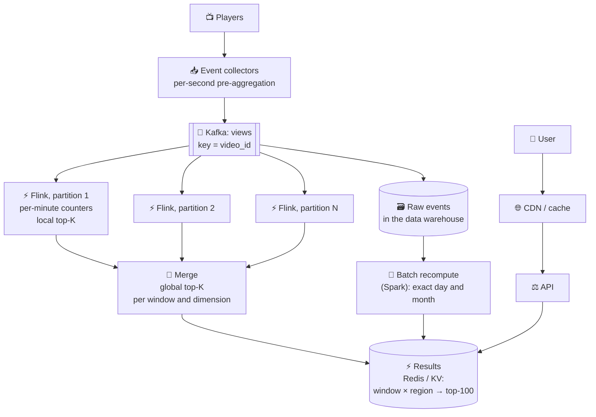
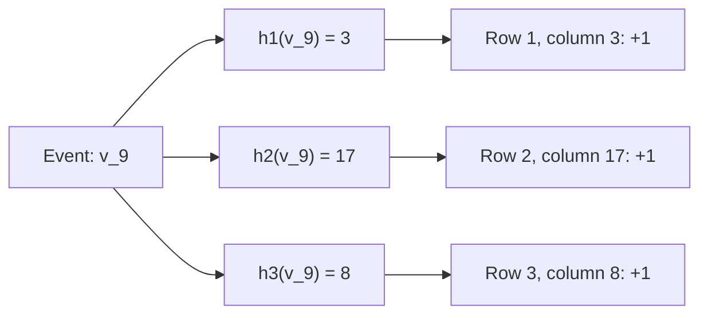

**English** | [Русский](README.ru.md)

# Tier 1 · 16. Top-K / Leaderboard / Trends

> **Level:** Medium · **Interview time:** 45 min · **Study time:** ~4 h
> **Key aspects:** exact vs approximate counting, partitioning by key and merging top-K, sliding windows and decay, count-min sketch, Space-Saving, hot keys, trending vs popular, the lambda architecture, a leaderboard on Redis sorted sets, a user's rank at scale
> **Builds on:** [09-messaging](../../01_Fundamentals/09_Messaging/README.md), [06-partitioning](../../01_Fundamentals/06_Partitioning/README.md#8-hot-partitions-and-skew), [02-caching](../../01_Fundamentals/02_Caching/README.md), [Tier 1 · 15 Autocomplete](../15_Design%20Typeahead%20or%20Search%20Autocomplete/README.md#9-deep-dive-4-real-time-trends) (trends, count-min sketch)

---

## 🗺️ How to Read This Walkthrough

The walkthrough follows an interview, but every step includes explanations: **why** a decision is made, **how** a mechanism works and **what happens** if you do it differently. The "📘 Explanation" blocks are theory right where you need it.

| Icon | Meaning |
|:----:|:--------|
| 🎤 | Interviewer |
| 🗣️ | What I (the candidate) say out loud |
| ✏️ | What I draw on the whiteboard |
| ⏱️ | Time budget for the step |
| 📘 | A detailed explanation of a concept |

Callouts: **TIP** — a good technique, **WARNING** — a trap, **IMPORTANT** — a Senior+ signal.

---

## 📑 Contents

0. [What This Problem Teaches](#0-what-this-problem-teaches)
1. [Problem Statement](#1-problem-statement)
2. [Clarifying Questions and Requirements](#2-clarifying-questions-and-requirements)
3. [Capacity Estimates](#3-capacity-estimates)
4. [API](#4-api)
5. [High-Level Design](#5-high-level-design)
6. [Deep Dive 1: Exact Top-K via Partitioning](#6-deep-dive-1-exact-top-k-via-partitioning)
7. [Deep Dive 2: Sliding Windows and Decay](#7-deep-dive-2-sliding-windows-and-decay)
8. [Deep Dive 3: Approximate Algorithms](#8-deep-dive-3-approximate-algorithms)
9. [Deep Dive 4: Hot Keys](#9-deep-dive-4-hot-keys)
10. [Deep Dive 5: Trends, Dimensions and Quality](#10-deep-dive-5-trends-dimensions-and-quality)
11. [Deep Dive 6: Stream and Batch Processing](#11-deep-dive-6-stream-and-batch-processing)
12. [Deep Dive 7: A Game Leaderboard on Redis](#12-deep-dive-7-a-game-leaderboard-on-redis)
13. [Deep Dive 8: A Leaderboard for Hundreds of Millions of Players](#13-deep-dive-8-a-leaderboard-for-hundreds-of-millions-of-players)
14. [Bottlenecks and Failure Scenarios](#14-bottlenecks-and-failure-scenarios)
15. [What Changes at 10x Scale](#15-what-changes-at-10x-scale)
16. [Key Concepts and New Terms](#16-key-concepts-and-new-terms)
17. [Variations and Follow-Up Questions](#17-variations-and-follow-up-questions)
18. [Common Mistakes](#18-common-mistakes)
19. [Cheat Sheet and Self-Check](#19-cheat-sheet-and-self-check)

---

## 0. What This Problem Teaches

"Find the K most popular items" is easy while data is small: count and sort. At a million events per second and a billion distinct items, questions arise: where to keep the counters, how to count "over the last hour", and whether you can afford to be wrong — and by how much.

The problem has two popular flavors, and both are worth knowing:

| Flavor | Example | The main requirement |
|:-------|:--------|:---------------------|
| **Trends / top-K over a stream** | The most-viewed videos in an hour, popular hashtags, top products | A huge stream, sliding windows; a small error is acceptable |
| **A leaderboard** | Player rankings in a game, "your rank — 48,213" | Every user's exact rank, instant updates |

| What's tested | Where it shows up |
|:--------------|:------------------|
| Stream aggregation | Windowed counters over a million events per second |
| Correctness of distributed counting | When merging partial top-Ks gives an exact result and when it doesn't |
| The accuracy — memory trade-off | Count-min sketch, Space-Saving |
| Handling skew | A viral video is a hot key |
| Data structures | Sorted sets (skip lists) for ranks |
| Product thinking | "Trending" isn't the same as "most popular" |

> [!TIP]
> Start with the question **"do we need exactness, or is an approximation enough?"**. The answer shapes the whole design: exact counting means keeping a counter per item, while approximate counting takes a few megabytes for the entire stream.

---

## 1. Problem Statement

> 🎤 "Design a service that shows the top 100 most-viewed videos over the last hour, day and month — worldwide and per country. Separately: how would you build a game leaderboard where each player sees their rank?"

**What the user sees:**

```
The "Trending" tab: 100 videos, refreshed every minute, a separate one for Poland
The game: "Top 10 players this week" and "Your rank: 48,213 of 12,000,000"
```

**Time plan:**

| Step | ⏱️ |
|:-----|:--:|
| Requirements | 4 min |
| Estimates | 4 min |
| API and high-level | 7 min |
| Deep dives (top-K) | 15 min |
| Deep dives (leaderboard) | 10 min |
| Wrap-up | 5 min |

---

## 2. Clarifying Questions and Requirements

⏱️ 4 min

| My question | Interviewer's answer | What it changes and why |
|:------------|:---------------------|:------------------------|
| How many events? | ~100,000 views per second, up to 1M at peak | Stream processing, partitioning |
| How many distinct videos? | ~1 billion | A counter per video is a lot of memory |
| K? | 100 | A small result |
| Windows? | The last hour, day, 30 days | Sliding windows of different lengths |
| How fresh must the top be? | Refreshed once a minute | Per-minute aggregation |
| Accuracy? | A small error is fine for "trending", but the order of the top spots must be right | Approximate algorithms with a controlled error are allowed |
| Dimensions? | By country and category | Many separate top-K lists |
| Leaderboard: how many players? | Tens of millions, scores updating constantly | Exact ranks, sorted sets |

### Functional requirements

1. Top-K items over windows: an hour, a day, 30 days; globally and per country.
2. Results refreshed once a minute.
3. A leaderboard: the top N players, a specific player's rank, the players around them.
4. Periodic leaderboards (daily, weekly) that reset.

### Non-functional requirements

| Requirement | Target | Why |
|:------------|:-------|:----|
| Query latency | p99 < 50 ms | The result is ready in advance — just read it |
| Freshness | ~1 minute for trends, seconds for the leaderboard | The feeling of a "live" ranking |
| Trend accuracy | Counter error within fractions of a percent | Users won't notice, and memory drops thousands of times |
| Leaderboard accuracy | An exact rank | Players compare ranks |
| Scale | 1M events per second | Partitioning and pre-aggregation |

---

## 3. Capacity Estimates

⏱️ 4 min

```
Events:           100,000/s on average, up to 1,000,000/s at peak
Videos:           1 billion

Exact all-time counters:
  1B × (8 B id + 8 B counter) ≈ 16 GB — tolerable on a cluster

Exact counters over a sliding hour with per-minute precision:
  60 per-minute buckets × the number of videos viewed in a minute
  Videos active in an hour — tens of millions → hundreds of millions of counters → tens of GB
  Plus a day (in hourly buckets), a month, countries and categories…

A count-min sketch with error ≤ 0.001% of all events at 99.3% probability:
  width ≈ e / 0.00001 ≈ 272,000, depth 5 → 1.36M counters × 4 B ≈ 5.4 MB per window
```

### Conclusions

| Conclusion | Design consequence |
|:-----------|:-------------------|
| 1M events per second on one counter is impossible | Partitioning by item + pre-aggregation |
| Exact counters per window and dimension — tens to hundreds of GB | Keep counters only for "candidates", use approximate structures |
| A count-min sketch is megabytes | Approximate counting is thousands of times cheaper |
| The result is 100 items per window and dimension | Precompute and store it ready; a query is a read |

---

## 4. API

⏱️ 2 min

```http
# Trends
GET /v1/trending?window=1h&region=PL&category=music&k=100
→ 200 { "window": "1h", "computed_at": "2026-11-30T14:05:00Z",
        "items": [{ "video_id": "v_9", "count": 1834921, "rank": 1 }, ...] }

# Leaderboard
POST /v1/leaderboards/{board}/scores        { "player_id": "p_42", "delta": 150 }
GET  /v1/leaderboards/{board}/top?n=10
GET  /v1/leaderboards/{board}/players/{id}  → { "rank": 48213, "score": 98120, "total": 12000000 }
GET  /v1/leaderboards/{board}/players/{id}/around?n=5   → 5 players above and below
```

---

## 5. High-Level Design

⏱️ 5 min



🗣️ "The flow:
1. **collectors** fold one video's views within a second into one counter — Kafka receives many times fewer messages;
2. **Kafka keyed by video_id**: all of one video's events land in one partition;
3. **stream processors** keep per-minute counters for their videos and once a minute emit **a local top-K** for each window and dimension;
4. **the merge** combines the local top-Ks into a global one and writes ready lists to a KV store;
5. **batch processing** recomputes long windows exactly and corrects the stream;
6. **the API** just reads the ready list — with a cache."

---

## 6. Deep Dive 1: Exact Top-K via Partitioning

> 🎤 "If each partition computes its own top 100 and we then merge them — is the result correct?"

🗣️ "It depends on **how** events are distributed across partitions."

### Partitioning by item — the merge is exact

📘 If all of one video's events land in **one** partition (key = video_id), each video's full count lives in exactly one partition. A video in the global top-K must be in its partition's top-K (otherwise its partition has K videos with larger counts — and they're larger in the global ranking too). So merging the local top-Ks is **exact**.

### Partitioning not by item — the merge can be wrong

📘 If events are distributed, say, by user, one video's count is smeared across partitions. Then the local top-Ks can miss the true leader:

```
K = 1, two partitions (distributed by user)

Partition 1:  A = 10,  B = 9,  C = 0     → local top-1: A (10)
Partition 2:  C = 10,  B = 9,  A = 0     → local top-1: C (10)

Merging the local top-1s: A = 10, C = 10
The truth:                A = 10, B = 18, C = 10   → B leads, yet it's in neither local list!
```

| Distribution | Merging top-K | Cost |
|:-------------|:--------------|:-----|
| **By item** ⭐ | Exact | Skew: a viral video overloads one partition (deep dive 4) |
| Random or by user | Approximate; local top-Ks must be taken with a margin (e.g. top 1,000), and errors are still possible | Even load |

> [!IMPORTANT]
> **Senior+ signal:** explain with an example **why** merging local top-Ks is exact only when partitioning by the item key, and handle hot keys separately rather than sacrificing correctness for evenness.

---

## 7. Deep Dive 2: Sliding Windows and Decay

> 🎤 "How do you count 'over the last hour' when the hour keeps moving?"

### Kinds of windows

| Window | How it works | Example |
|:-------|:-------------|:--------|
| **Tumbling** | Non-overlapping intervals: 14:00–15:00, 15:00–16:00 | "Yesterday's top" |
| **Sliding** | "The last 60 minutes" at any moment | "The top over the last hour" |
| **Hopping** | A window of length L that advances in steps of S: the last hour, recomputed every minute | The practical implementation of a sliding window |

### A ring of per-minute buckets

📘 A sliding hour is implemented as **60 per-minute buckets** per video:

```
Buckets for video v_9 (views per minute):
  [13:06] 820, [13:07] 910, … , [14:05] 1,250

The hourly count = the sum of 60 buckets
Every minute: add the new bucket, subtract the one that dropped out (13:05) → O(1)
```

| Problem | Solution |
|:--------|:---------|
| 60 buckets × tens of millions of videos — a lot of memory | Keep buckets only for videos with noticeable views; the rest via a count-min sketch |
| A day and a month | A hierarchy: per-minute buckets → hourly → daily; a month = 30 daily buckets |
| Late events | Event time (not processing time) and a **watermark**: a window closes with a delay, e.g. 1–2 minutes; events arriving later are accounted for by batch processing |

### Exponential decay — an alternative to windows

📘 Instead of buckets, each item stores **one number** that shrinks over time:

```
score(t) = score(t_prev) × e^(−λ × (t − t_prev)) + 1     ← on each event

λ sets the "half-life": with a 1-hour half-life, events from an hour ago
count for half, from two hours ago for a quarter
```

| | A ring of buckets | Decay |
|:-|:------------------|:------|
| Memory per item | 60+ counters | 1 number + a time |
| Meaning | "Exactly the last hour" | "Weighted recent popularity" |
| Best for | Reports, exact windows | Trends, "hot right now" |

📘 Decay can be computed lazily: store `score` and the last update time, and multiply by `e^(−λ × Δt)` on read. To compare items, it's enough to store the score normalized to a common point in time — the order is preserved.

---

## 8. Deep Dive 3: Approximate Algorithms

> 🎤 "What if keeping an exact counter for every video is too expensive?"

### Count-min sketch

📘 A compact structure for **approximate frequency counting**: a table of **d** rows of **w** counters and d hash functions.



| Operation | How |
|:----------|:----|
| **Add** an item | In each of the d rows, increment the counter at column `h_i(item)` |
| **Estimate** a frequency | Take the **minimum** of the item's d counters |

📘 **Why the minimum.** Each counter also receives other items with the same hash, so counters can only **overestimate**. The minimum across rows is the counter with the least "noise". The error is bounded: with probability `1 − e^(−d)`, the estimate overshoots by at most `(e / w) × N`, where N is the total number of events.

```
w = 272,000, d = 5:
  error ≤ 0.001% of N with probability ≈ 99.3%
  memory ≈ 5.4 MB — for the whole stream, regardless of the number of distinct videos
```

**Top-K with a count-min sketch:** on each event, estimate the item's frequency and update **a min-heap of size K**: if the estimate exceeds the heap's minimum — replace the minimum. The sketch holds everyone's frequencies; the heap holds only the top candidates.

### Space-Saving

📘 An algorithm for finding the most frequent items with **a fixed number of counters** m (e.g. 10,000):

```
On an event for item x:
  if x is already tracked → its counter + 1
  else if a free counter exists → x gets counter = 1
  else → find the item with the minimum counter min,
         replace it with x at counter min + 1 (and record error = min)
```

| Property | Value |
|:---------|:------|
| Memory | m counters |
| Guarantee | Any item with frequency greater than N / m is guaranteed to be tracked |
| Error | A counter overshoots by at most its recorded error |

### When to use what

| You need | Solution |
|:---------|:---------|
| An exact top-K, few keys | A hash table of counters + a heap |
| An exact top-K, billions of keys | Partitioning by key, counters per partition |
| Approximate frequencies of any item | A count-min sketch |
| An approximate top-K in fixed memory | Space-Saving, or a count-min sketch + a heap |
| The number of unique items | HyperLogLog (see the [URL shortener](../01_Design%20a%20URL%20Shortener%20%28TinyURL%29/README.md#9-deep-dive-3-click-analytics)) |

---

## 9. Deep Dive 4: Hot Keys

> 🎤 "A viral video — 300,000 views per second. All into one partition. What do you do?"

| Solution | How | Effect |
|:---------|:----|:-------|
| **Pre-aggregation at the collectors** | A collector folds one video's events within a second: Kafka gets "v_9: +4,213", not 4,213 messages | The partition's stream shrinks thousands of times |
| **Local aggregation in the processor** | The processor accumulates changes in memory and flushes them to state once a second | Fewer state accesses |
| **Key salting** | The hot key `v_9` → `v_9#0` … `v_9#9` across 10 partitions; the merge stage sums the counters | The hot key's load is divided by 10; the merge must know about salted keys |
| **Detecting hot keys** | A count-min sketch at the collectors shows which keys to salt | Salt only what's needed |

> [!TIP]
> Usually **pre-aggregation at the collectors** is enough: even the most popular video yields one message per second per collector. Salting is needed when there are very many collectors.

---

## 10. Deep Dive 5: Trends, Dimensions and Quality

> 🎤 "How does 'trending' differ from 'most popular'?"

### Popular versus trending

📘 "The most viewed in an hour" is almost always the same huge channels and evergreen hits. "Trending" is what's **growing faster than usual**:

```
trending_score = current_rate / (usual_rate + smoothing)

Video A: 100,000 per hour now, usually 95,000 per hour   → 1.05  (popular, but not trending)
Video B: 20,000 per hour now,  usually 500 per hour      → ~40   (a sharp rise — a trend)
```

An alternative is a z-score: how many standard deviations the current rate is above the item's mean.

### Dimensions

| Problem | Solution |
|:--------|:---------|
| Windows × countries × categories = thousands of separate top-Ks | Compute only the combinations in demand; rare ones on request from batch data |
| Small countries | Less data → more noise; a lower threshold or a longer window |

### Quality

| Problem | Solution |
|:--------|:---------|
| Bot manipulation | Filtering events before counting (as in YouTube view counting) |
| Repeat views by one user | Dedup, or counting unique viewers (HyperLogLog) |
| Unacceptable content in trends | Moderation and serving rules |
| Trends "jumping" every minute | Smoothing, a minimum time in the list |

---

## 11. Deep Dive 6: Stream and Batch Processing

> 🎤 "How do you combine freshness and accuracy?"

📘 **The lambda architecture**: two paths in parallel.

| Path | What it does | Properties |
|:-----|:-------------|:-----------|
| **Streaming** (Flink, Kafka Streams) | Per-minute updates, approximate structures, watermarks | Fresh, but inaccuracies are possible (late events, failures) |
| **Batch** (Spark over raw events) | An exact recompute of the day and month, including late events and anti-fraud | Exact, but hours behind |

Results are written to one store with a version and a computation time; the API serves the freshest, and the batch result overwrites the streaming one for closed windows.

**The kappa architecture** is the alternative: streaming only, and recomputation by re-reading history from Kafka. Simpler to maintain (one codebase), but it requires long event retention in Kafka.

| Where to store results | Why |
|:-----------------------|:----|
| Redis or a KV store: key `trending:{window}:{region}:{category}` → a list | Reads in milliseconds |
| A CDN or API cache with a ~1 min TTL | The result is the same for every user in the dimension |

---

## 12. Deep Dive 7: A Game Leaderboard on Redis

> 🎤 "Now the leaderboard: 10 million players, scores updating constantly, everyone wants to see their rank."

### Sorted sets

📘 A **sorted set** in Redis is a set of members ordered by a numeric score. Internally it's a **skip list** (a multi-level linked list giving search, insertion and rank computation in O(log N)) plus a hash table.

```
ZINCRBY lb:weekly:2026-48 150 player:42        ← +150 points for a player   O(log N)
ZREVRANGE lb:weekly:2026-48 0 9 WITHSCORES      ← the top 10                 O(log N + 10)
ZREVRANK lb:weekly:2026-48 player:42            ← the player's rank (0-based) O(log N)
ZSCORE lb:weekly:2026-48 player:42              ← the score
ZREVRANGE lb:weekly:2026-48 (r-5) (r+5)         ← players around them
ZCARD lb:weekly:2026-48                         ← the total number of players
```

📘 **Why a skip list gives a rank in O(log N).** Each upper-level "pointer" stores how many elements it skips over. Walking from the top down to an element, we sum those spans — and that's its position. There's no need to scan every element before it.

### Details

| Question | Solution |
|:---------|:---------|
| **Tied scores** | Whoever reached it first ranks higher. Encode it into the score: `score × 10^10 + (MAX_TS − ts)`; keep in mind Redis scores are doubles with ~2^53 precision |
| **Periodic leaderboards** | A separate key per period (`lb:weekly:2026-48`) with a TTL; a new week — a new key |
| **The source of truth** | Scores and history live in the DB; Redis is a derived view that can be rebuilt |
| **Anti-cheat** | Server-side score validation, limits on gains, suspicious jumps flagged for review |
| **Size** | 10M players × ~100 B ≈ 1 GB — one Redis instance with a replica |

---

## 13. Deep Dive 8: A Leaderboard for Hundreds of Millions of Players

> 🎤 "What if there are 500 million players and one Redis can't cope?"

### Sharding options

| Approach | Top N | A player's rank | Downside |
|:---------|:------|:----------------|:---------|
| **By player hash** | Merging every shard's top N — exact (each player lives in one shard) | You must sum "how many are above" across **every** shard — N requests | Ranks are expensive |
| **By score range** ⭐ | The top comes from the highest shard | `rank = players in higher shards + rank within your shard` | Rebalancing when the score distribution shifts; a player moves between shards as their score grows |
| **An approximate rank** | An exact top separately | A histogram of the score distribution: "you're in the top 3.8%" or "around rank 48,000" | Imprecise for the middle of the list |

📘 **Sharding by score range.** Shard 1 holds scores ≥ 100,000, shard 2 holds 50,000–99,999, and so on. Each shard's player count is known (`ZCARD`). The rank of a player with 72,000 points = (all players in shard 1) + (their rank within shard 2). Two requests instead of a hundred.

🗣️ "In practice they're combined: an **exact** leaderboard for the top (the first 10,000 ranks in one sorted set) and an **approximate** rank for everyone else via a score histogram. A player at rank 48,213 out of 500 million is happy seeing 'top 0.01%', while exact positions matter at the top."

---

## 14. Bottlenecks and Failure Scenarios

| Scenario | What happens | How we protect |
|:---------|:-------------|:---------------|
| A viral video | A hot partition | Pre-aggregation, key salting |
| Late events | Inaccurate windows | Event time, watermarks, a batch recompute |
| A stream processor fails | Lost state | Flink state checkpoints, re-reading from Kafka |
| Merging partial top-Ks with the wrong partitioning | Missed leaders | Partitioning by the item key |
| Not enough memory for exact counters | OOM | A count-min sketch, Space-Saving, counters only for candidates |
| Manipulation | Junk in trends | Bot filtering, unique viewers |
| The leaderboard Redis dies | No ranking | A replica, a rebuild from the DB |
| Tied scores | An unstable order | A secondary key by time in the score |
| A huge leaderboard | One node can't cope | Sharding by score range, an approximate rank |

---

## 15. What Changes at 10x Scale

> 🎤 "10 million events per second?"

| Change | Why |
|:-------|:----|
| **Hierarchical aggregation**: collectors → regional aggregators → a global merge | Less data between tiers |
| **Approximate structures by default** for all but the shortest windows | Memory |
| **Precomputing only popular dimensions** | The combinatorial explosion of dimensions |
| **Approximate ranks** for most players | Exact ranks over hundreds of millions are expensive |

---

## 16. Key Concepts and New Terms

### What's applied from Fundamentals

| Concept | Where it's covered | How it applies here |
|:--------|:-------------------|:--------------------|
| Kafka, partitioning by key | [09-messaging](../../01_Fundamentals/09_Messaging/README.md) | All of an item's events in one partition |
| Hot keys and skew | [06-partitioning](../../01_Fundamentals/06_Partitioning/README.md#8-hot-partitions-and-skew) | Viral items |
| Redis, caching | [02-caching](../../01_Fundamentals/02_Caching/README.md) | Sorted sets, ready results |
| Count-min sketch, trends | [Tier 1 · 15](../15_Design%20Typeahead%20or%20Search%20Autocomplete/README.md#9-deep-dive-4-real-time-trends) | Approximate counting |
| HyperLogLog | [Tier 1 · 01](../01_Design%20a%20URL%20Shortener%20%28TinyURL%29/README.md#9-deep-dive-3-click-analytics) | Unique viewers |

### New terms in this problem

| Term | In short |
|:-----|:---------|
| **An exact top-K merge** | Correct only when partitioning by the item key |
| **Tumbling / sliding / hopping windows** | Fixed, sliding, sliding in steps |
| **A ring of buckets** | A sliding window as a sum of per-minute counters |
| **Exponential decay** | One number per item; old events' contribution shrinks |
| **Watermark** | The point after which a window is considered closed, allowing for lateness |
| **Count-min sketch** | Approximate frequencies: d × w counters, the minimum across rows |
| **Space-Saving** | Top-K in fixed memory by replacing the minimum |
| **Lambda / Kappa** | Stream + batch / stream only, with replay |
| **Sorted set, skip list** | An ordered set with ranks in O(log N) |
| **Sharding by score range** | Rank = players in higher shards + rank within your shard |

---

## 17. Variations and Follow-Up Questions

<details>
<summary><b>How do you find the top 10 most frequent words in a 1 TB file on one machine?</b></summary>

Split the file into parts by hash of the word (each word lands entirely in one part, like partitioning by key), count frequencies in each part with an in-memory hash table, take each part's top 10 with a heap, then merge. The merge is exact because each word lives in one part.
</details>

<details>
<summary><b>Why not compute top-K with a database query?</b></summary>

`SELECT video_id, COUNT(*) … GROUP BY … ORDER BY … LIMIT 100` over an hour of events scans hundreds of millions of rows every minute. It's fine in an analytics warehouse once a day (the batch path), but not for per-minute updates. A stream with incremental counters does the same work continuously and cheaply.
</details>

<details>
<summary><b>How do you show "friends on the leaderboard"?</b></summary>

A separate small leaderboard of friends: fetch the friends list, read their scores (`ZMSCORE` or from the DB) and sort — friends number in the hundreds, so it's cheap. It can be cached briefly.
</details>

<details>
<summary><b>How do you reset a weekly leaderboard?</b></summary>

Don't delete or zero the existing key — start a new one (`lb:weekly:2026-49`) at the week boundary; keep the old one for history and rewards, then delete it by TTL. That way there's no window in which the leaderboard is empty or half-reset.
</details>

<details>
<summary><b>Can a count-min sketch be used for a leaderboard?</b></summary>

No: a leaderboard needs exact scores and exact ranks, while a count-min sketch only overestimates frequencies and gives no ranks. Approximate structures suit trends and statistics, where an error of fractions of a percent doesn't matter.
</details>

---

## 18. Common Mistakes

| ❌ Mistake | Why it's bad | ✅ Do this instead |
|:----------|:-------------|:------------------|
| One global counter for all events | A bottleneck | Partitioning by item |
| Merging top-Ks when partitioned by user | Missing the true leaders | Partitioning by the item key |
| Exact counters for every item over every window | Tens to hundreds of GB | Approximate structures, counters for candidates |
| Processing time instead of event time | Wrong windows under delays | Event time and watermarks |
| A SQL GROUP BY every minute | Scanning hundreds of millions of rows | Incremental stream counters |
| "Trending" = "most popular" | Always the same items | Growth relative to the usual level |
| No hot key handling | An overloaded partition | Pre-aggregation, salting |
| A count-min sketch for an exact ranking | Overestimates, no ranks | A sorted set for the leaderboard |
| Computing a rank by scanning every player | O(N) | A skip list, sharding by range |
| Resetting the leaderboard in place | A window with an empty ranking | A new key per period |

---

## 19. Cheat Sheet and Self-Check

### 30-second answer

> Trends: collectors pre-aggregate events per second → Kafka keyed by item → stream processors keep per-minute buckets (or exponential decay) for their items and once a minute emit a local top-K per window and dimension → the merge produces an **exact** global top-K because each item lives entirely in one partition → ready lists go into Redis/KV, and the API only reads. To save memory — a count-min sketch (~5 MB per window) with a heap, or Space-Saving. Hot keys — pre-aggregation and salting. Event time and watermarks; late events via a batch recompute (lambda). "Trending" — growth relative to the usual level. The leaderboard: a sorted set (skip list) — ZINCRBY, ZREVRANGE, ZREVRANK in O(log N), ties via a secondary key, a key per period, the DB as the source of truth; at hundreds of millions — sharding by score range and approximate ranks for the middle.

### Self-check

- [ ] I can explain when merging local top-Ks is exact and show a counterexample
- [ ] I can compare tumbling, sliding and hopping windows
- [ ] I can implement a sliding window with a ring of buckets
- [ ] I can explain exponential decay and its advantage
- [ ] I can explain a count-min sketch: adding, estimating, why the minimum, its size
- [ ] I can explain Space-Saving and its guarantee
- [ ] I can solve the hot key problem
- [ ] I can tell trends apart from popularity
- [ ] I can design a leaderboard on a sorted set and explain the O(log N) rank
- [ ] I can scale a leaderboard to hundreds of millions of players

### Further reading

- Cormode, Muthukrishnan, *An Improved Data Stream Summary: The Count-Min Sketch and its Applications* (2005)
- Metwally, Agrawal, El Abbadi, *Efficient Computation of Frequent and Top-k Elements in Data Streams* (2005)
- Pugh, *Skip Lists: A Probabilistic Alternative to Balanced Trees* (1990)
- Apache Flink documentation: windows, watermarks, state
- Redis documentation: sorted sets
- Alex Xu, Sahn Lam, *System Design Interview*, Vol. 2 — chapter "Real-time Gaming Leaderboard"