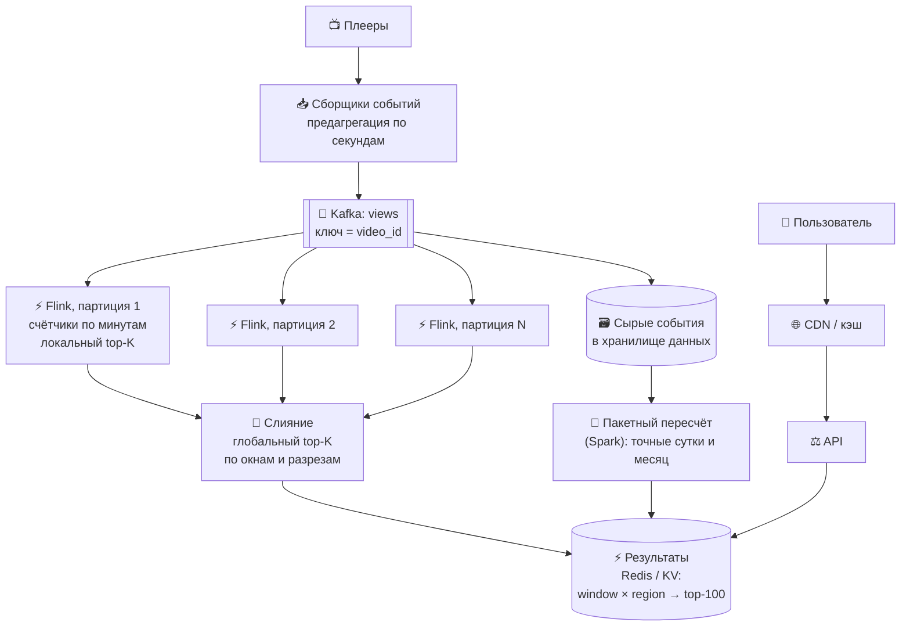
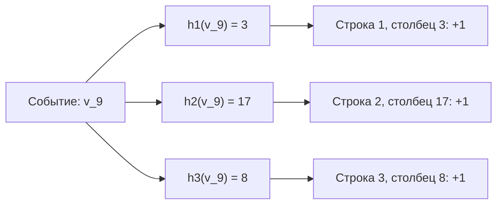

[English](README.md) | **Русский**

# Tier 1 · 16. Top-K / лидерборд / тренды

> **Уровень:** Medium · **Время на интервью:** 45 мин · **Время на разбор:** ~4 ч
> **Ключевые аспекты:** точный и приближённый подсчёт, партиционирование по ключу и слияние top-K, скользящие окна и затухание, count-min sketch, Space-Saving, горячие ключи, тренды против популярности, lambda-архитектура, лидерборд на sorted sets в Redis, ранг пользователя на масштабе
> **Опирается на:** [09-messaging](../../01_Fundamentals/09_Messaging/README.ru.md), [06-partitioning](../../01_Fundamentals/06_Partitioning/README.ru.md#8-горячие-партиции-и-перекос), [02-caching](../../01_Fundamentals/02_Caching/README.ru.md), [Tier 1 · 15 Autocomplete](../15_Design%20Typeahead%20or%20Search%20Autocomplete/README.ru.md#9-deep-dive-4-тренды-в-реальном-времени) (тренды, count-min sketch)

---

## 🗺️ Как читать этот разбор

Разбор построен как интервью, но в каждом шаге есть объяснения: **почему** принимается решение, **как работает** механизм и **что будет**, если сделать иначе. Блоки «📘 Объяснение» — теория прямо по ходу задачи.

| Значок | Что значит |
|:------:|:-----------|
| 🎤 | Реплика интервьюера |
| 🗣️ | Что говорю вслух я (кандидат) |
| ✏️ | Что рисую на доске |
| ⏱️ | Сколько времени тратить на шаг |
| 📘 | Подробное объяснение концепции |

Блоки **TIP** — хороший приём, **WARNING** — ловушка, **IMPORTANT** — сигнал для уровня Senior+.

---

## 📑 Содержание

0. [Чему учит эта задача](#0-чему-учит-эта-задача)
1. [Условие задачи](#1-условие-задачи)
2. [Уточняющие вопросы и требования](#2-уточняющие-вопросы-и-требования)
3. [Оценки нагрузки](#3-оценки-нагрузки)
4. [API](#4-api)
5. [High-level дизайн](#5-high-level-дизайн)
6. [Deep dive 1: точный top-K через партиционирование](#6-deep-dive-1-точный-top-k-через-партиционирование)
7. [Deep dive 2: скользящие окна и затухание](#7-deep-dive-2-скользящие-окна-и-затухание)
8. [Deep dive 3: приближённые алгоритмы](#8-deep-dive-3-приближённые-алгоритмы)
9. [Deep dive 4: горячие ключи](#9-deep-dive-4-горячие-ключи)
10. [Deep dive 5: тренды, измерения и качество](#10-deep-dive-5-тренды-измерения-и-качество)
11. [Deep dive 6: поток и пакетная обработка](#11-deep-dive-6-поток-и-пакетная-обработка)
12. [Deep dive 7: игровой лидерборд на Redis](#12-deep-dive-7-игровой-лидерборд-на-redis)
13. [Deep dive 8: лидерборд на сотни миллионов игроков](#13-deep-dive-8-лидерборд-на-сотни-миллионов-игроков)
14. [Узкие места и сценарии сбоев](#14-узкие-места-и-сценарии-сбоев)
15. [Что изменится при росте в 10 раз](#15-что-изменится-при-росте-в-10-раз)
16. [Ключевые концепции и новые понятия](#16-ключевые-концепции-и-новые-понятия)
17. [Варианты задачи и follow-up вопросы](#17-варианты-задачи-и-follow-up-вопросы)
18. [Типичные ошибки](#18-типичные-ошибки)
19. [Шпаргалка и самопроверка](#19-шпаргалка-и-самопроверка)

---

## 0. Чему учит эта задача

«Найти K самых популярных элементов» — простая задача, пока данных мало: посчитать и отсортировать. На масштабе миллиона событий в секунду и миллиарда разных элементов появляются вопросы: где хранить счётчики, как считать «за последний час», можно ли ошибиться и на сколько.

У задачи два популярных варианта, и оба стоит знать:

| Вариант | Пример | Главное требование |
|:--------|:-------|:-------------------|
| **Тренды / top-K по потоку** | Самые просматриваемые видео за час, популярные хэштеги, топ товаров | Огромный поток, скользящие окна; небольшая ошибка допустима |
| **Лидерборд** | Рейтинг игроков в игре, «твоё место — 48 213» | Точный ранг каждого пользователя, мгновенные обновления |

| Что проверяют | Где это в задаче |
|:--------------|:-----------------|
| Потоковая агрегация | Счётчики по окнам на миллионе событий в секунду |
| Корректность распределённого подсчёта | Когда слияние частичных top-K даёт точный результат, а когда нет |
| Компромисс точность — память | Count-min sketch, Space-Saving |
| Работа с перекосом | Вирусное видео — горячий ключ |
| Структуры данных | Sorted sets (skip list) для рангов |
| Продуктовое мышление | «Тренды» — это не то же самое, что «самое популярное» |

> [!TIP]
> Начни с вопроса **«нужна точность или достаточно приближения?»**. Ответ определяет весь дизайн: точный подсчёт требует хранить счётчик каждого элемента, приближённый — несколько мегабайт памяти на весь поток.

---

## 1. Условие задачи

> 🎤 «Спроектируй сервис, который показывает топ-100 самых просматриваемых видео за последний час, сутки и месяц — по всему миру и по странам. Отдельно: как сделать игровой лидерборд, где каждый игрок видит своё место».

**Что видит пользователь:**

```
Вкладка «В тренде»: 100 видео, обновляется каждую минуту, отдельно для Польши
Игра: «Топ-10 игроков недели» и «Ваше место: 48 213 из 12 000 000»
```

**План по времени:**

| Шаг | ⏱️ |
|:----|:--:|
| Требования | 4 мин |
| Оценки | 4 мин |
| API и high-level | 7 мин |
| Deep dives (top-K) | 15 мин |
| Deep dives (лидерборд) | 10 мин |
| Итоги | 5 мин |

---

## 2. Уточняющие вопросы и требования

⏱️ 4 мин

| Мой вопрос | Ответ интервьюера | Что это меняет и почему |
|:-----------|:------------------|:------------------------|
| Сколько событий? | ~100 000 просмотров в секунду, в пике до 1M | Потоковая обработка, партиционирование |
| Сколько разных видео? | ~1 миллиард | Счётчик на каждое — много памяти |
| K? | 100 | Небольшой результат |
| Окна? | Последний час, сутки, 30 дней | Скользящие окна разной длины |
| Насколько свежим должен быть топ? | Обновление раз в минуту | Минутная агрегация |
| Точность? | Небольшая ошибка допустима для «трендов», но порядок первых мест должен быть верным | Можно использовать приближённые алгоритмы с контролем ошибки |
| Разрезы? | По странам и категориям | Много отдельных top-K списков |
| Лидерборд: сколько игроков? | Десятки миллионов, обновления очков постоянно | Точный ранг, sorted sets |

### Функциональные требования

1. Top-K элементов за окна: час, сутки, 30 дней; глобально и по странам.
2. Обновление результатов раз в минуту.
3. Лидерборд: топ-N игроков, место конкретного игрока, игроки рядом с ним.
4. Периодические лидерборды (за день, за неделю) с обнулением.

### Нефункциональные требования

| Требование | Цель | Почему |
|:-----------|:-----|:-------|
| Задержка запроса | p99 < 50 мс | Результат готов заранее — просто прочитать |
| Свежесть | ~1 минута для трендов, секунды для лидерборда | Ощущение «живого» рейтинга |
| Точность трендов | Ошибка счётчиков в пределах долей процента | Пользователь не заметит, а память экономится в тысячи раз |
| Точность лидерборда | Точный ранг | Игроки сравнивают места |
| Масштаб | 1M событий в секунду | Партиционирование и предагрегация |

---

## 3. Оценки нагрузки

⏱️ 4 мин

```
События:          100 000/с в среднем, до 1 000 000/с в пике
Видео:            1 миллиард

Точные счётчики «за всё время»:
  1B × (8 Б id + 8 Б счётчик) ≈ 16 ГБ — терпимо на кластере

Точные счётчики за скользящий час с минутной точностью:
  60 минутных корзин × число видео, просмотренных за минуту
  Активных видео за час — десятки миллионов → сотни миллионов счётчиков → десятки ГБ
  А ещё сутки (по часовым корзинам), месяц, страны и категории…

Count-min sketch с ошибкой ≤ 0,001% от общего числа событий и вероятностью 99,3%:
  ширина ≈ e / 0,00001 ≈ 272 000, глубина 5 → 1,36M счётчиков × 4 Б ≈ 5,4 МБ на окно
```

### Выводы

| Вывод | Следствие для дизайна |
|:------|:----------------------|
| 1M событий в секунду на один счётчик невозможно | Партиционирование по элементу + предагрегация |
| Точные счётчики по окнам и разрезам — десятки и сотни ГБ | Хранить счётчики только «кандидатов», использовать приближённые структуры |
| Count-min sketch — мегабайты | Приближённый подсчёт в тысячи раз дешевле |
| Результат — 100 элементов на окно и разрез | Предвычислять и хранить готовым; запрос — чтение |

---

## 4. API

⏱️ 2 мин

```http
# Тренды
GET /v1/trending?window=1h&region=PL&category=music&k=100
→ 200 { "window": "1h", "computed_at": "2026-11-30T14:05:00Z",
        "items": [{ "video_id": "v_9", "count": 1834921, "rank": 1 }, ...] }

# Лидерборд
POST /v1/leaderboards/{board}/scores        { "player_id": "p_42", "delta": 150 }
GET  /v1/leaderboards/{board}/top?n=10
GET  /v1/leaderboards/{board}/players/{id}  → { "rank": 48213, "score": 98120, "total": 12000000 }
GET  /v1/leaderboards/{board}/players/{id}/around?n=5   → по 5 игроков выше и ниже
```

---

## 5. High-level дизайн

⏱️ 5 мин



🗣️ «Поток:
1. **сборщики** складывают просмотры одного видео за секунду в один счётчик — в Kafka уходит в разы меньше сообщений;
2. **Kafka с ключом video_id**: все события одного видео попадают в одну партицию;
3. **потоковые обработчики** держат счётчики по минутам для своих видео и раз в минуту выдают **локальный top-K** для каждого окна и разреза;
4. **слияние** объединяет локальные top-K в глобальный и записывает готовые списки в KV-хранилище;
5. **пакетная обработка** пересчитывает длинные окна точно и исправляет поток;
6. **API** просто читает готовый список — с кэшем».

---

## 6. Deep dive 1: точный top-K через партиционирование

> 🎤 «Если каждая партиция считает свой top-100, а потом мы их объединяем, — результат будет правильным?»

🗣️ «Зависит от того, **как** распределены события по партициям».

### Партиционирование по элементу — слияние точное

📘 Если все события одного видео попадают в **одну** партицию (ключ = video_id), то полный счётчик каждого видео находится ровно в одной партиции. Видео, входящее в глобальный top-K, обязательно входит в top-K своей партиции (иначе в его партиции есть K видео с большими счётчиками — и они все больше и в глобальном рейтинге). Значит, слияние локальных top-K **точное**.

### Партиционирование не по элементу — слияние может ошибиться

📘 Если события распределены, например, по пользователю, счётчик одного видео размазан по партициям. Тогда локальные top-K могут пропустить настоящего лидера:

```
K = 1, две партиции (распределение по пользователям)

Партиция 1:  A = 10,  B = 9,  C = 0     → локальный top-1: A (10)
Партиция 2:  C = 10,  B = 9,  A = 0     → локальный top-1: C (10)

Слияние локальных top-1: A = 10, C = 10
Истина:                  A = 10, B = 18, C = 10   → лидер B, а его нет ни в одном локальном списке!
```

| Распределение | Слияние top-K | Цена |
|:--------------|:--------------|:-----|
| **По элементу** ⭐ | Точное | Перекос: вирусное видео перегружает одну партицию (deep dive 4) |
| Случайное или по пользователю | Приближённое; нужно брать локальные top-K с запасом (например, top-1000) и всё равно возможны ошибки | Равномерная нагрузка |

> [!IMPORTANT]
> **Сигнал Senior+:** объяснить на примере, **почему** слияние локальных top-K точно только при партиционировании по ключу элемента, и предложить решение для горячих ключей отдельно, а не жертвовать корректностью ради равномерности.

---

## 7. Deep dive 2: скользящие окна и затухание

> 🎤 «Как считать “за последний час”, если час постоянно сдвигается?»

### Виды окон

| Окно | Как работает | Пример |
|:-----|:-------------|:-------|
| **Фиксированное (tumbling)** | Неперекрывающиеся интервалы: 14:00–15:00, 15:00–16:00 | «Топ за вчера» |
| **Скользящее (sliding)** | «Последние 60 минут» в любой момент | «Топ за последний час» |
| **Прыгающее (hopping)** | Окно длины L, сдвигающееся с шагом S: последний час, пересчитываемый каждую минуту | Практическая реализация скользящего |

### Кольцо минутных корзин

📘 Скользящий час реализуется как **60 минутных корзин** для каждого видео:

```
Корзины видео v_9 (просмотры за минуту):
  [13:06] 820, [13:07] 910, … , [14:05] 1 250

Счётчик за час = сумма 60 корзин
Каждую минуту: прибавить новую корзину, вычесть выпавшую (13:05) → O(1)
```

| Проблема | Решение |
|:---------|:--------|
| 60 корзин × десятки миллионов видео — много памяти | Держать корзины только для видео с заметным числом просмотров; остальные — через count-min sketch |
| Сутки и месяц | Иерархия: минутные корзины → часовые → суточные; месяц = 30 суточных корзин |
| Опоздавшие события | Время события (а не время обработки) и **watermark**: окно закрывается с задержкой, например, в 1–2 минуты; позже пришедшие события учитываются пакетной обработкой |

### Экспоненциальное затухание — альтернатива окнам

📘 Вместо корзин каждый элемент хранит **одно число**, которое со временем уменьшается:

```
score(t) = score(t_prev) × e^(−λ × (t − t_prev)) + 1     ← при каждом событии

λ определяет «период полураспада»: при периоде 1 час вклад событий
часовой давности — половина, двухчасовой — четверть
```

| | Кольцо корзин | Затухание |
|:-|:--------------|:----------|
| Память на элемент | 60+ счётчиков | 1 число + время |
| Смысл | «Ровно за последний час» | «Взвешенная недавняя популярность» |
| Где лучше | Отчёты, точные окна | Тренды, «горячее сейчас» |

📘 Затухание можно считать лениво: хранить `score` и время последнего обновления, а при чтении умножать на `e^(−λ × Δt)`. Для сравнения элементов достаточно хранить score, приведённый к общему моменту времени, — порядок сохраняется.

---

## 8. Deep dive 3: приближённые алгоритмы

> 🎤 «Что если хранить точный счётчик каждого видео слишком дорого?»

### Count-min sketch

📘 Компактная структура для **приближённого подсчёта частот**: таблица из **d** строк по **w** счётчиков и d хэш-функций.



| Операция | Как |
|:---------|:----|
| **Добавить** элемент | В каждой из d строк увеличить счётчик в столбце `h_i(элемент)` |
| **Оценить** частоту | Взять **минимум** из d счётчиков элемента |

📘 **Почему минимум.** В каждый счётчик, кроме нашего элемента, попадают и другие элементы с тем же хэшем — счётчики могут только **завышать**. Минимум по строкам — счётчик с наименьшим «мусором». Ошибка ограничена: с вероятностью `1 − e^(−d)` оценка завышена не больше чем на `(e / w) × N`, где N — общее число событий.

```
w = 272 000, d = 5:
  ошибка ≤ 0,001% от N с вероятностью ≈ 99,3%
  память ≈ 5,4 МБ — на весь поток, независимо от числа разных видео
```

**Top-K с count-min sketch:** при каждом событии оценить частоту элемента и обновить **min-heap размера K**: если оценка больше минимума кучи — заменить минимум. Count-min sketch хранит частоты всех, куча — только кандидатов в топ.

### Space-Saving

📘 Алгоритм поиска самых частых элементов с **фиксированным числом счётчиков** m (например, 10 000):

```
При событии элемента x:
  если x уже отслеживается → его счётчик + 1
  иначе если есть свободный счётчик → x получает счётчик = 1
  иначе → найти элемент с минимальным счётчиком min,
          заменить его на x со счётчиком min + 1 (и запомнить ошибку = min)
```

| Свойство | Значение |
|:---------|:---------|
| Память | m счётчиков |
| Гарантия | Любой элемент с частотой больше N / m гарантированно отслеживается |
| Ошибка | Счётчик завышен не больше чем на сохранённую ошибку |

### Когда что использовать

| Нужно | Решение |
|:------|:--------|
| Точный top-K, ключей немного | Хэш-таблица счётчиков + куча |
| Точный top-K, ключей миллиарды | Партиционирование по ключу, счётчики на партиции |
| Приближённые частоты любых элементов | Count-min sketch |
| Приближённый top-K в фиксированной памяти | Space-Saving или count-min sketch + куча |
| Число уникальных элементов | HyperLogLog (см. [URL shortener](../01_Design%20a%20URL%20Shortener%20%28TinyURL%29/README.ru.md#9-deep-dive-3-аналитика-кликов)) |

---

## 9. Deep dive 4: горячие ключи

> 🎤 «Вирусное видео — 300 000 просмотров в секунду. Все в одну партицию. Что делать?»

| Решение | Как | Эффект |
|:--------|:----|:-------|
| **Предагрегация на сборщиках** | Сборщик складывает события одного видео за секунду: в Kafka уходит «v_9: +4 213», а не 4 213 сообщений | Поток в партицию уменьшается в тысячи раз |
| **Локальная агрегация в обработчике** | Обработчик копит изменения в памяти и сбрасывает в состояние раз в секунду | Меньше обращений к состоянию |
| **Соление ключа** | Горячий ключ `v_9` → `v_9#0` … `v_9#9` по 10 партициям; на этапе слияния счётчики суммируются | Нагрузка горячего ключа делится на 10; слияние должно знать о солёных ключах |
| **Обнаружение горячих ключей** | Count-min sketch на сборщиках показывает, какие ключи солить | Солить только то, что нужно |

> [!TIP]
> Чаще всего достаточно **предагрегации на сборщиках**: даже самое популярное видео даёт одно сообщение в секунду от каждого сборщика. Соление нужно, когда сборщиков очень много.

---

## 10. Deep dive 5: тренды, измерения и качество

> 🎤 «Чем “в тренде” отличается от “самое популярное”?»

### Популярное против трендового

📘 «Самое просматриваемое за час» — почти всегда одни и те же огромные каналы и вечные хиты. «В тренде» — то, что **растёт быстрее обычного**:

```
trending_score = текущая_частота / (обычная_частота + сглаживание)

Видео A: сейчас 100 000 в час, обычно 95 000 в час   → 1,05  (популярное, но не трендовое)
Видео B: сейчас 20 000 в час,  обычно 500 в час      → ~40   (резкий рост — тренд)
```

Альтернатива — z-оценка: на сколько стандартных отклонений текущая частота выше средней для этого элемента.

### Разрезы

| Проблема | Решение |
|:---------|:--------|
| Окна × страны × категории = тысячи отдельных top-K | Считать только востребованные комбинации; редкие — по запросу из пакетных данных |
| Маленькие страны | Меньше данных → больше шума; ниже порог или более длинное окно |

### Качество

| Проблема | Решение |
|:---------|:--------|
| Накрутки ботами | Фильтрация событий до подсчёта (как в подсчёте просмотров YouTube) |
| Повторные просмотры одним пользователем | Дедупликация или учёт уникальных зрителей (HyperLogLog) |
| Неприемлемый контент в трендах | Модерация и правила для выдачи |
| Тренды «прыгают» каждую минуту | Сглаживание, минимальное время в списке |

---

## 11. Deep dive 6: поток и пакетная обработка

> 🎤 «Как совместить свежесть и точность?»

📘 **Lambda-архитектура**: два пути параллельно.

| Путь | Что делает | Свойства |
|:-----|:-----------|:---------|
| **Потоковый** (Flink, Kafka Streams) | Минутные обновления, приближённые структуры, водяные знаки | Свежо, но возможны неточности (опоздавшие события, сбои) |
| **Пакетный** (Spark по сырым событиям) | Точный пересчёт суток и месяца, с учётом опоздавших событий и антифрода | Точно, но с задержкой в часы |

Результаты пишутся в одно хранилище с версией и временем расчёта; API отдаёт самый свежий, а пакетный результат перезаписывает потоковый для закрытых окон.

**Kappa-архитектура** — альтернатива: только поток, а для пересчёта — повторное чтение истории из Kafka. Проще в поддержке (одна кодовая база), но требует долгого хранения событий в Kafka.

| Где хранить результаты | Почему |
|:-----------------------|:-------|
| Redis или KV-хранилище: ключ `trending:{window}:{region}:{category}` → список | Чтение за миллисекунды |
| Кэш на CDN или в API с TTL ~1 мин | Результат один для всех пользователей разреза |

---

## 12. Deep dive 7: игровой лидерборд на Redis

> 🎤 «Теперь лидерборд: 10 миллионов игроков, очки обновляются постоянно, каждый хочет видеть своё место».

### Sorted set

📘 **Sorted set** в Redis — множество элементов, упорядоченных по числовой оценке. Внутри — **skip list** (многоуровневый связный список, дающий поиск, вставку и вычисление ранга за O(log N)) и хэш-таблица.

```
ZINCRBY lb:weekly:2026-48 150 player:42        ← +150 очков игроку     O(log N)
ZREVRANGE lb:weekly:2026-48 0 9 WITHSCORES      ← топ-10                O(log N + 10)
ZREVRANK lb:weekly:2026-48 player:42            ← место игрока (с 0)    O(log N)
ZSCORE lb:weekly:2026-48 player:42              ← очки
ZREVRANGE lb:weekly:2026-48 (r-5) (r+5)         ← игроки рядом
ZCARD lb:weekly:2026-48                         ← всего игроков
```

📘 **Почему skip list даёт ранг за O(log N).** Каждый «указатель» верхних уровней хранит, сколько элементов он перепрыгивает. Идя сверху вниз к элементу, мы суммируем эти длины — это и есть его позиция. Не нужно перебирать все элементы перед ним.

### Детали

| Вопрос | Решение |
|:-------|:--------|
| **Одинаковые очки** | Кто набрал раньше — выше. Закодировать в оценку: `score × 10^10 + (MAX_TS − ts)`; учитывать, что оценка в Redis — double с точностью ~2^53 |
| **Периодические лидерборды** | Отдельный ключ на период (`lb:weekly:2026-48`) с TTL; новая неделя — новый ключ |
| **Источник правды** | Очки и история — в БД; Redis — производное представление, которое можно перестроить |
| **Античит** | Проверка очков на сервере, лимиты прироста, подозрительные скачки — на проверку |
| **Объём** | 10M игроков × ~100 Б ≈ 1 ГБ — один экземпляр Redis с репликой |

---

## 13. Deep dive 8: лидерборд на сотни миллионов игроков

> 🎤 «А если игроков 500 миллионов, и один Redis не справляется?»

### Варианты шардирования

| Подход | Топ-N | Ранг игрока | Минус |
|:-------|:------|:------------|:------|
| **По хэшу игрока** | Слияние top-N всех шардов — точное (каждый игрок в одном шарде) | Нужно сложить «сколько выше» во **всех** шардах — N запросов | Ранг дорогой |
| **По диапазонам очков** ⭐ | Топ — из самого высокого шарда | `ранг = число игроков в шардах выше + ранг внутри своего шарда` | Перебалансировка при сдвиге распределения очков; при росте очков игрок переезжает между шардами |
| **Приближённый ранг** | Точный топ отдельно | Гистограмма распределения очков: «вы в топ-3,8%» или «примерно 48 000-е место» | Неточность для середины списка |

📘 **Шардирование по диапазонам очков.** Шард 1 — очки ≥ 100 000, шард 2 — 50 000–99 999, и так далее. Количество игроков в каждом шарде известно (`ZCARD`). Ранг игрока с 72 000 очков = (все игроки шарда 1) + (его ранг внутри шарда 2). Два запроса вместо сотни.

🗣️ «На практике сочетают: **точный** лидерборд для верхушки (первые 10 000 мест — в одном sorted set) и **приближённый** ранг для остальных через гистограмму распределения очков. Игроку на 48 213 месте из 500 миллионов достаточно увидеть «топ-0,01%», а точные позиции важны в верхней части».

---

## 14. Узкие места и сценарии сбоев

| Сценарий | Что произойдёт | Как защищаемся |
|:---------|:---------------|:---------------|
| Вирусное видео | Горячая партиция | Предагрегация, соление ключа |
| Опоздавшие события | Неточные окна | Время события, watermark, пакетный пересчёт |
| Сбой потокового обработчика | Потеря состояния | Чекпоинты состояния Flink, перечитывание из Kafka |
| Слияние частичных top-K при неправильном партиционировании | Пропуск лидеров | Партиционирование по ключу элемента |
| Нехватка памяти на точные счётчики | OOM | Count-min sketch, Space-Saving, счётчики только для кандидатов |
| Накрутки | Мусор в трендах | Фильтрация ботов, уникальные зрители |
| Redis лидерборда упал | Нет рейтинга | Реплика, перестроение из БД |
| Одинаковые очки | Нестабильный порядок | Вторичный ключ по времени в оценке |
| Огромный лидерборд | Один узел не справляется | Шардирование по диапазонам очков, приближённый ранг |

---

## 15. Что изменится при росте в 10 раз

> 🎤 «10 миллионов событий в секунду?»

| Изменение | Почему |
|:----------|:-------|
| **Иерархическая агрегация**: сборщики → региональные агрегаторы → глобальное слияние | Меньше данных между уровнями |
| **Приближённые структуры по умолчанию** для всех окон кроме самых коротких | Память |
| **Предвычисление только популярных разрезов** | Комбинаторный взрыв разрезов |
| **Приближённый ранг** для большинства игроков | Точный ранг на сотнях миллионов дорог |

---

## 16. Ключевые концепции и новые понятия

### Что из Fundamentals применяется

| Концепция | Где разобрана | Как применяется здесь |
|:----------|:--------------|:----------------------|
| Kafka, партиционирование по ключу | [09-messaging](../../01_Fundamentals/09_Messaging/README.ru.md) | Все события элемента — в одной партиции |
| Горячие ключи и перекос | [06-partitioning](../../01_Fundamentals/06_Partitioning/README.ru.md#8-горячие-партиции-и-перекос) | Вирусные элементы |
| Redis, кэширование | [02-caching](../../01_Fundamentals/02_Caching/README.ru.md) | Sorted sets, готовые результаты |
| Count-min sketch, тренды | [Tier 1 · 15](../15_Design%20Typeahead%20or%20Search%20Autocomplete/README.ru.md#9-deep-dive-4-тренды-в-реальном-времени) | Приближённый подсчёт |
| HyperLogLog | [Tier 1 · 01](../01_Design%20a%20URL%20Shortener%20%28TinyURL%29/README.ru.md#9-deep-dive-3-аналитика-кликов) | Уникальные зрители |

### Новые понятия этой задачи

| Понятие | Кратко |
|:--------|:-------|
| **Точное слияние top-K** | Верно только при партиционировании по ключу элемента |
| **Tumbling / sliding / hopping окна** | Фиксированные, скользящие, скользящие с шагом |
| **Кольцо корзин** | Скользящее окно как сумма минутных счётчиков |
| **Экспоненциальное затухание** | Одно число на элемент, вклад старых событий уменьшается |
| **Watermark** | Момент, после которого окно считается закрытым с учётом опозданий |
| **Count-min sketch** | Приближённые частоты: d × w счётчиков, минимум по строкам |
| **Space-Saving** | Top-K в фиксированной памяти с заменой минимального |
| **Lambda / Kappa** | Поток + пакет / только поток с переигрыванием |
| **Sorted set, skip list** | Упорядоченное множество с рангом за O(log N) |
| **Шардирование по диапазонам очков** | Ранг = игроки в шардах выше + ранг в своём шарде |

---

## 17. Варианты задачи и follow-up вопросы

<details>
<summary><b>Как найти топ-10 часто встречающихся слов в файле на 1 ТБ на одной машине?</b></summary>

Разбить файл на части по хэшу слова (каждое слово целиком попадает в одну часть, как партиционирование по ключу), посчитать частоты в каждой части хэш-таблицей в памяти, взять из каждой топ-10 кучей, затем слить. Слияние точное, потому что каждое слово в одной части.
</details>

<details>
<summary><b>Почему не считать top-K запросом в базу?</b></summary>

`SELECT video_id, COUNT(*) … GROUP BY … ORDER BY … LIMIT 100` по событиям за час — сканирование сотен миллионов строк каждую минуту. Это допустимо в аналитическом хранилище раз в сутки (пакетный путь), но не для минутных обновлений. Поток с инкрементальными счётчиками делает ту же работу непрерывно и дёшево.
</details>

<details>
<summary><b>Как показать «друзья в лидерборде»?</b></summary>

Отдельный маленький лидерборд из друзей: получить список друзей, прочитать их очки (`ZMSCORE` или из БД) и отсортировать — друзей сотни, это дёшево. Можно кэшировать на короткое время.
</details>

<details>
<summary><b>Как сбросить недельный лидерборд?</b></summary>

Не удалять и не обнулять существующий ключ, а начать новый (`lb:weekly:2026-49`) в момент смены недели; старый сохранить для истории и наград, затем удалить по TTL. Так нет окна, в котором лидерборд пустой или наполовину обнулён.
</details>

<details>
<summary><b>Можно ли использовать count-min sketch для лидерборда?</b></summary>

Нет: лидерборд требует точного счёта и точного ранга, а count-min sketch только завышает частоты и не даёт рангов. Приближённые структуры подходят для трендов и статистики, где ошибка в доли процента не важна.
</details>

---

## 18. Типичные ошибки

| ❌ Ошибка | Почему плохо | ✅ Как правильно |
|:---------|:-------------|:----------------|
| Один глобальный счётчик для всех событий | Узкое место | Партиционирование по элементу |
| Слияние top-K при партиционировании по пользователю | Пропуск настоящих лидеров | Партиционирование по ключу элемента |
| Точные счётчики всех элементов за все окна | Десятки и сотни ГБ | Приближённые структуры, счётчики для кандидатов |
| Время обработки вместо времени события | Неверные окна при задержках | Время события и watermark |
| SQL GROUP BY каждую минуту | Сканирование сотен миллионов строк | Инкрементальные потоковые счётчики |
| «Тренды» = «самое популярное» | Всегда одно и то же | Рост относительно обычного уровня |
| Нет обработки горячих ключей | Перегруженная партиция | Предагрегация, соление |
| Count-min sketch для точного рейтинга | Завышение, нет рангов | Sorted set для лидерборда |
| Ранг через перебор всех игроков | O(N) | Skip list, шардирование по диапазонам |
| Обнуление лидерборда на месте | Окно с пустым рейтингом | Новый ключ на период |

---

## 19. Шпаргалка и самопроверка

### Ответ за 30 секунд

> Тренды: сборщики предагрегируют события по секундам → Kafka с ключом = элемент → потоковые обработчики держат минутные корзины (или экспоненциальное затухание) для своих элементов и раз в минуту выдают локальный top-K по окнам и разрезам → слияние даёт **точный** глобальный top-K, потому что каждый элемент целиком в одной партиции → готовые списки в Redis/KV, API только читает. Для экономии памяти — count-min sketch (~5 МБ на окно) с кучей или Space-Saving. Горячие ключи — предагрегация и соление. Время события и watermark, опоздавшие — пакетным пересчётом (lambda). «В тренде» — рост относительно обычного уровня. Лидерборд: sorted set (skip list) — ZINCRBY, ZREVRANGE, ZREVRANK за O(log N), ничьи через вторичный ключ, ключ на период, БД — источник правды; на сотнях миллионов — шардирование по диапазонам очков и приближённый ранг для середины.

### Самопроверка

- [ ] Могу объяснить, когда слияние локальных top-K точно, и показать контрпример
- [ ] Могу сравнить фиксированные, скользящие и прыгающие окна
- [ ] Могу реализовать скользящее окно кольцом корзин
- [ ] Могу объяснить экспоненциальное затухание и его преимущество
- [ ] Могу объяснить count-min sketch: добавление, оценка, почему минимум, размер
- [ ] Могу объяснить Space-Saving и его гарантию
- [ ] Могу решить проблему горячих ключей
- [ ] Могу отличить тренды от популярности
- [ ] Могу спроектировать лидерборд на sorted set и объяснить O(log N) ранг
- [ ] Могу масштабировать лидерборд на сотни миллионов игроков

### Что почитать

- Cormode, Muthukrishnan, *An Improved Data Stream Summary: The Count-Min Sketch and its Applications* (2005)
- Metwally, Agrawal, El Abbadi, *Efficient Computation of Frequent and Top-k Elements in Data Streams* (2005)
- Pugh, *Skip Lists: A Probabilistic Alternative to Balanced Trees* (1990)
- Документация Apache Flink: windows, watermarks, state
- Документация Redis: sorted sets
- Alex Xu, Sahn Lam, *System Design Interview*, Vol. 2 — глава «Real-time Gaming Leaderboard»