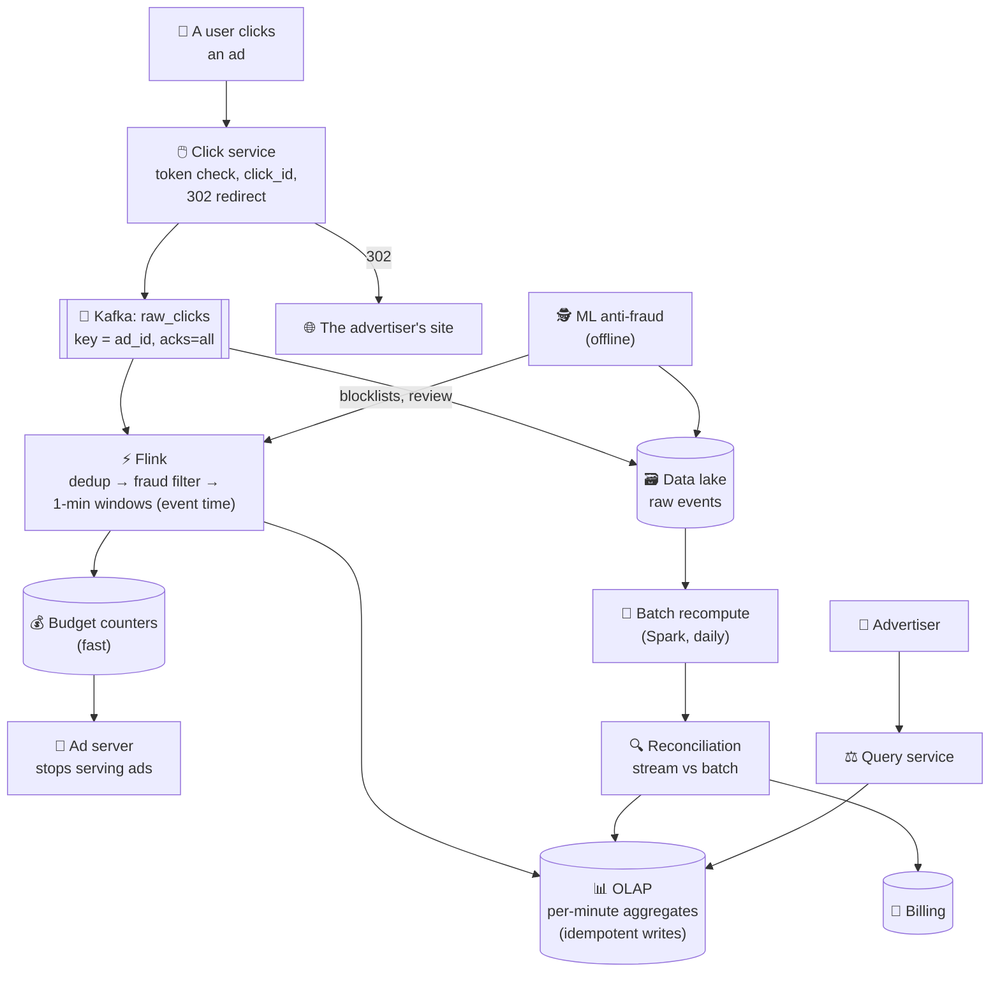
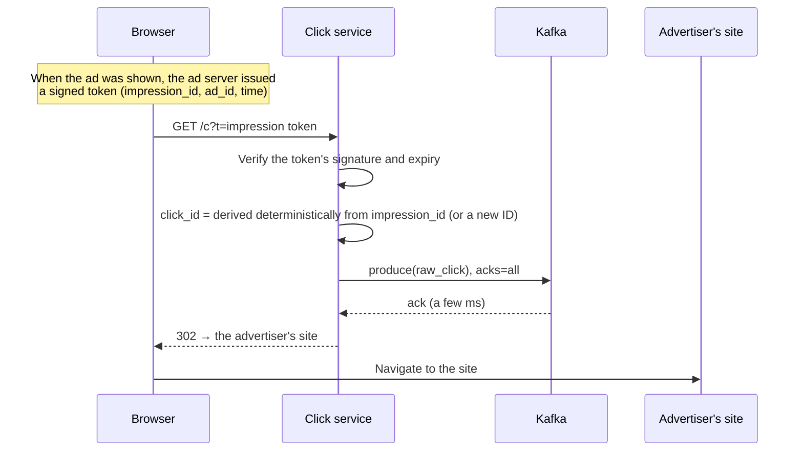
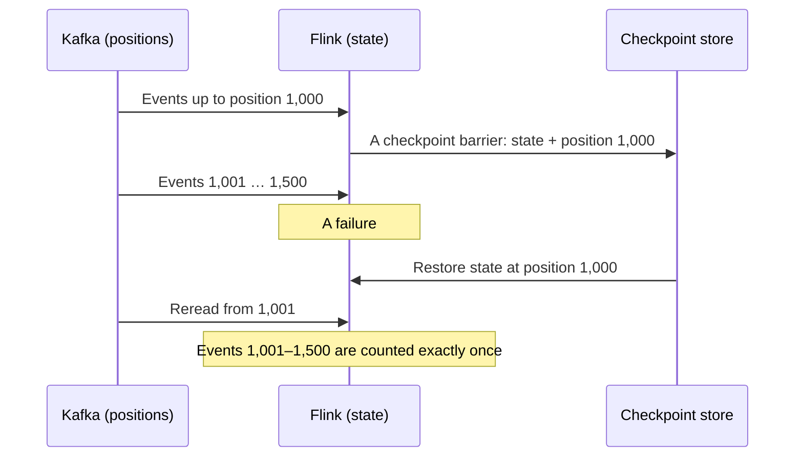
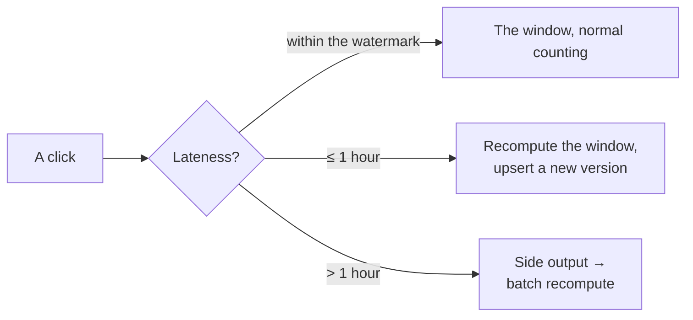
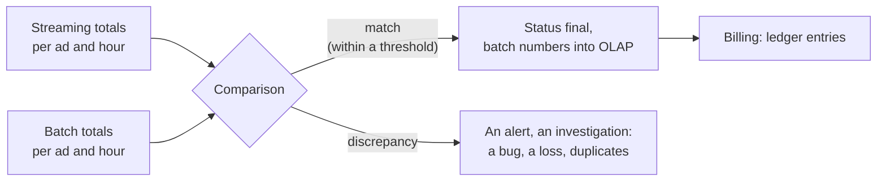

**English** | [Русский](README_RU.md)

# Tier 1 · 17. Ad Click Aggregator

> **Level:** Hard · **Interview time:** 45–60 min · **Study time:** ~5 h
> **Key aspects:** capturing clicks without loss, end-to-end exactly-once counting, dedup, event-time windows and late events, filtering fraudulent clicks, an OLAP store for aggregates, reconciling the stream with batch processing, billing and budget control
> **Builds on:** [09-messaging](../../09-messaging/README.md), [10-idempotency](../../10-idempotency/README.md), [11-distributed-transactions](../../11-distributed-transactions/README.md), [Tier 1 · 16 Top-K](../16-top-k-leaderboard/README.md#7-deep-dive-2-sliding-windows-and-decay) (windows, watermarks), [Tier 1 · 09 YouTube](../09-youtube-netflix/README.md#11-deep-dive-5-counting-views) (counting views)

---

## 🗺️ How to Read This Walkthrough

The walkthrough follows an interview, but every step includes explanations: **why** a decision is made, **how** a mechanism works and **what happens** if you do it differently. The "📘 Explanation" blocks are theory right where you need it.

| Icon | Meaning |
|:----:|:--------|
| 🎤 | Interviewer |
| 🗣️ | What I (the candidate) say out loud |
| ✏️ | What I draw on the whiteboard |
| ⏱️ | Time budget for the step |
| 📘 | A detailed explanation of a concept |

Callouts: **TIP** — a good technique, **WARNING** — a trap, **IMPORTANT** — a Senior+ signal.

---

## 📑 Contents

0. [What This Problem Teaches](#0-what-this-problem-teaches)
1. [Problem Statement](#1-problem-statement)
2. [Clarifying Questions and Requirements](#2-clarifying-questions-and-requirements)
3. [Capacity Estimates](#3-capacity-estimates)
4. [API](#4-api)
5. [Data Model](#5-data-model)
6. [High-Level Design](#6-high-level-design)
7. [Deep Dive 1: Capturing a Click](#7-deep-dive-1-capturing-a-click)
8. [Deep Dive 2: End-to-End Exactly-Once](#8-deep-dive-2-end-to-end-exactly-once)
9. [Deep Dive 3: Event Time, Windows and Lateness](#9-deep-dive-3-event-time-windows-and-lateness)
10. [Deep Dive 4: Fraudulent Clicks](#10-deep-dive-4-fraudulent-clicks)
11. [Deep Dive 5: The Aggregate Store and Queries](#11-deep-dive-5-the-aggregate-store-and-queries)
12. [Deep Dive 6: Reconciliation and Billing](#12-deep-dive-6-reconciliation-and-billing)
13. [Deep Dive 7: Scaling and Hot Ads](#13-deep-dive-7-scaling-and-hot-ads)
14. [Deep Dive 8: Failures, Reprocessing and Regions](#14-deep-dive-8-failures-reprocessing-and-regions)
15. [Bottlenecks and Failure Scenarios](#15-bottlenecks-and-failure-scenarios)
16. [What Changes at 10x Scale](#16-what-changes-at-10x-scale)
17. [Key Concepts and New Terms](#17-key-concepts-and-new-terms)
18. [Variations and Follow-Up Questions](#18-variations-and-follow-up-questions)
19. [Common Mistakes](#19-common-mistakes)
20. [Cheat Sheet and Self-Check](#20-cheat-sheet-and-self-check)

---

## 0. What This Problem Teaches

On the surface the problem resembles [Top-K](../16-top-k-leaderboard/README.md): a stream of events, windows, aggregates. The key difference — **the advertiser pays money for every click**. So approximations are unacceptable: you can't lose a click (lost revenue), and you can't count one twice (the advertiser overpays, which means lawsuits and lost trust).

| What's tested | Where it shows up |
|:--------------|:------------------|
| Reliable event capture | Not a single click is lost between the browser and storage |
| Exactly-once along the whole path | Duplicates from retries at every stage |
| Event time versus processing time | A click at 14:59:58 must land in the 14:59 window even if it arrives at 15:03 |
| Late data | Mobile devices send clicks hours later |
| Fighting fraud | Bots, click farms, competitors |
| Two truths: fast and exact | The stream for dashboards, batch processing for invoices |
| Analytical queries | Slices by ad, country, device, time |

> [!TIP]
> Name **two modes** right away: **approximate and fast** — for dashboards and budget control; **exact and delayed** — for invoicing. That resolves the tension between "we need it in a minute" and "we need it to be exactly right".

---

## 1. Problem Statement

> 🎤 "Design an ad click aggregation system: advertisers need to see clicks on their ads at per-minute granularity with a few minutes of delay. Invoices are based on the same data, so counting must be exact. Account for fraudulent clicks."

**What the advertiser sees:**

```
The "Winter Sale" campaign dashboard:
  14:00–14:01  1,842 clicks   (PL: 1,120, DE: 722; mobile: 1,403)
  14:01–14:02  1,913 clicks
  …
  Daily total: 2,614,330 clicks, of which invalid: 41,207
November invoice: 74,812,405 billable clicks
```

**Time plan:**

| Step | ⏱️ |
|:-----|:--:|
| Requirements | 5 min |
| Estimates | 3 min |
| API and data | 5 min |
| High-level design | 7 min |
| Deep dives | 22–30 min |
| Wrap-up | 3 min |

---

## 2. Clarifying Questions and Requirements

⏱️ 5 min

| My question | Interviewer's answer | What it changes and why |
|:------------|:---------------------|:------------------------|
| Volume? | ~1B clicks per day, ~2M active ads | ~12,000 clicks/s, peaks up to 50,000/s |
| Dashboard latency? | A few minutes | Stream aggregation |
| Accuracy for invoices? | Absolute: no losses and no duplicates | Exactly-once, reconciliation with batch processing |
| Granularity? | Per minute; dimensions — country, device, campaign | An OLAP store with dimensions |
| Lateness? | Mobile clicks may arrive hours later | Event-time windows, allowed lateness, batch reconciliation |
| Fraud? | Invalid clicks aren't billed | Filtering in the stream + retroactive review |
| How long to retain? | Raw events — 90 days, aggregates — years | Tiered storage |
| Budget control? | Ads stop serving when the budget runs out | Fast (approximate) counters for pacing |

### Functional requirements

1. Capture clicks (and redirect the user to the advertiser's site).
2. Aggregate clicks per ad at per-minute granularity with dimensions.
3. Queries: clicks over a period with grouping; top ads.
4. Separate invalid clicks from valid ones.
5. Invoice from exact data.

### Non-functional requirements

| Requirement | Target | Why |
|:------------|:-------|:----|
| No losses | Every accepted click is counted | A loss is lost money |
| No duplicates | One click — one unit on the invoice | An advertiser overpaying is a legal risk |
| Dashboard latency | Minutes | Advertisers manage campaigns in real time |
| Redirect latency | Tens of milliseconds | The user is waiting to reach the site |
| Capture availability | Very high | Unavailable capture = lost clicks |
| Auditability | Every number on an invoice can be explained by raw events | Disputes with advertisers |

---

## 3. Capacity Estimates

⏱️ 3 min

```
Clicks:            1B per day → ~12,000/s on average, peak ~50,000/s
A raw event:       ~200 B → 200 GB per day → ~18 TB over 90 days

Aggregates:        ads with clicks in a given minute — hundreds of thousands
                   × dimensions (country, device) → hundreds of millions of rows per day
                   → orders of magnitude fewer after rolling up into hours and days

Dedup state:
                   click IDs for the last hour: 50,000/s × 3,600 s = 180M IDs
                   × ~16 B ≈ 3 GB — spread across stream processing nodes
```

### Conclusions

| Conclusion | Design consequence |
|:-----------|:-------------------|
| 50,000 clicks/s at peak | A partitioned stream (Kafka + Flink) |
| Raw events are immutable and needed for disputes | Keep the raw log separate from the aggregates (a data lake) |
| Hundreds of millions of aggregate rows per day | A columnar OLAP store with rollups |
| An hour of dedup state is gigabytes | State in the stream processor with a TTL |

---

## 4. API

⏱️ 3 min

```http
# A click (the user tapped an ad)
GET /c?t=<a signed impression token>
→ 302 Location: https://advertiser.example/landing?utm_…

# Advertiser queries
GET /v1/ads/{ad_id}/clicks?from=2026-11-30T14:00Z&to=2026-11-30T15:00Z
                            &granularity=minute&group_by=country,device&valid=true
→ 200 { "rows": [{ "minute": "14:00", "country": "PL", "device": "mobile", "clicks": 812 }, ...],
        "status": "provisional" | "final" }

GET /v1/campaigns/{id}/top-ads?window=1h&k=10
GET /v1/invoices/{advertiser_id}/2026-11
```

📘 **The `status` field.** Data for the last minutes and hours is **provisional** (from the stream); data for closed, reconciled periods is **final** (after batch reconciliation). The advertiser sees which numbers may still be refined.

---

## 5. Data Model

⏱️ 3 min

```
A raw click event (immutable):
  click_id        — a unique click ID
  impression_id   — the ID of the impression the click belongs to
  ad_id, campaign_id, advertiser_id
  user_key        — a hash of the user / device
  ip, user_agent, country, device
  event_time      — the click time (per the capture server)
  received_time   — when it entered the system
  signature_ok    — whether the impression token's signature checked out

An aggregate (OLAP):
  (ad_id, minute, country, device) → valid_clicks, invalid_clicks, unique_users, version

Billing (a ledger):
  (advertiser_id, campaign_id, day) → billable_clicks, amount, status (provisional | final)
  adjustments — as separate entries, without changing old ones
```

| Data | Store | Why |
|:-----|:------|:----|
| Raw events | Kafka (days) → a data lake (Parquet in object storage, 90 days) | An immutable log for reprocessing and disputes |
| Aggregates | OLAP: Druid / Pinot / ClickHouse | Fast sliced queries and rollups |
| Billing | A relational DB, append-only | Transactions, auditing, adjustments |
| Dedup state | Flink state (RocksDB) with a TTL | Local to processing |

---

## 6. High-Level Design

⏱️ 7 min



🗣️ "Key decisions:
- the **click service** verifies the signed impression token, assigns a `click_id`, writes the event to Kafka with replica acknowledgment, and only then redirects;
- **Kafka** is an immutable log, keyed by `ad_id`;
- **stream processing**: dedup, a fraud filter, per-minute event-time windows → aggregates written to OLAP **idempotently**; fast budget counters for the ad server;
- **raw events** go to a data lake; a daily **batch recompute** and **reconciliation** produce the final numbers for invoices;
- **offline anti-fraud** reviews clicks retroactively."

---

## 7. Deep Dive 1: Capturing a Click

> 🎤 "A user clicked an ad. What happens, and how do you avoid losing the click?"

### The click path



| Decision | Why |
|:---------|:----|
| **Redirecting through our server** | The click is recorded on our side regardless of JavaScript or blockers; the alternative — sending from the browser (a beacon) — is easier to lose or forge |
| **A signed impression token** | The click belongs to a real impression; a click can't be forged without an impression; at most one click can be counted per impression via `impression_id` |
| **Responding after Kafka acknowledges** | If you respond first and write later, a server crash loses the click. `acks=all` adds milliseconds |
| **A local on-disk buffer** in case Kafka is unavailable | Don't fail the user and don't lose the click: write to an on-disk log and forward later |
| **Event time — from the capture server** | Device clocks can't be trusted; the capture server's time is more reliable |

> [!WARNING]
> The redirect must wait on nothing but the Kafka write: not anti-fraud, not aggregation. Every extra 100 ms of delay reduces how many users reach the advertiser's site.

---

## 8. Deep Dive 2: End-to-End Exactly-Once

> 🎤 "Where can duplicates appear, and how do you guarantee each click is counted exactly once?"

### Sources of duplicates

| Stage | How a duplicate appears |
|:------|:------------------------|
| The browser | The user clicked twice, the browser retried the request, someone replayed the link |
| Click service → Kafka | A Kafka response timeout → resending the same event |
| Kafka → Flink | After a failure, the processor rereads events from the last checkpoint |
| Flink → OLAP | Rewriting a window's result after a restart |

### Fixes by stage

| Stage | Mechanism |
|:------|:----------|
| **User clicks** | `click_id` is derived from `impression_id`: repeated clicks on the same impression yield the same `click_id` → one billable click |
| **The producer** | An idempotent Kafka producer: a resend doesn't create a duplicate in the partition |
| **Processing** | Dedup by `click_id` in Flink state with a TTL (e.g. a day per impression) |
| **Checkpoints** | Flink saves a consistent snapshot of state and Kafka read positions; after a failure it resumes from the snapshot, with no loss and no double counting in state |
| **Writing the result** | An idempotent write (below), or a transactional write with two-phase commit |

### 📘 Why "add" isn't idempotent but "write the total" is

```
Not idempotent:
  UPDATE agg SET clicks = clicks + 812 WHERE ad = 7 AND minute = '14:00'
  → after a restart the window is recomputed and the write repeats → 1,624 ❌

Idempotent:
  UPSERT agg (ad = 7, minute = '14:00', country, device) SET clicks = 812, version = 5
  → a retry writes the same value → 812 ✅
  → a late event: the window is recomputed to 813, version = 6 → the total is overwritten
```

🗣️ "The processor emits **the window's full total**, and the store upserts on the key `(ad, minute, dimensions)` with a version. A retry or a recomputation simply overwrites the row. That's simpler and more reliable than distributed transactions."

### Flink checkpoints



> [!IMPORTANT]
> **Senior+ signal:** explain that "exactly-once" isn't one setting but **a chain**: a deterministic event ID + an idempotent producer + dedup + consistent checkpoints + an idempotent (or transactional) result write. A single non-idempotent link is enough for duplicates to appear.

---

## 9. Deep Dive 3: Event Time, Windows and Lateness

> 🎤 "A click happened at 14:00:58 but reached processing at 14:03. Which minute does it count toward?"

### Event time versus processing time

| | Event time | Processing time |
|:-|:-----------|:----------------|
| What it is | When the click happened | When the event reached the processor |
| Result | Correct: a click in minute 14:00 | Depends on network delays, queues, failures |
| For invoices | ✅ | ❌ |

### Windows and watermarks

📘 One-minute tumbling windows by event time. But when can window 14:00 be considered closed, if events can arrive late? A **watermark** is the estimate "all events up to time T have arrived":

```
watermark = the maximum event time seen − the allowed delay (e.g. 1 minute)

When the watermark passes 14:01:00 → window 14:00–14:01 emits a provisional result
```

### Late events

| Lateness | What happens |
|:---------|:-------------|
| Within the watermark | Counted in the window as usual |
| After the watermark, but within **allowed lateness** (e.g. 1 hour) | The window is recomputed and an updated total is emitted → an upsert with a new version |
| Beyond allowed lateness | The event goes to a side output and the data lake; it's counted by the **batch recompute** |



📘 **Why not wait for every late event.** Keeping a window open for hours would make the dashboard hours behind and let state balloon. So — a fast provisional result, updates within the hour, and final accuracy from batch processing.

---

## 10. Deep Dive 4: Fraudulent Clicks

> 🎤 "A competitor launched a bot that clicks on ads. How do you avoid invoicing for it?"

### Levels of protection

| Level | What it checks | When |
|:------|:---------------|:-----|
| **Capture** | The impression token's signature and expiry; a click without an impression or with someone else's token is invalid | Immediately |
| **Stream rules** | Click rate per IP / device / user per ad; known bots and data center IPs; a click 50 ms after the impression (a human can't be that fast); repeated clicks on one impression | Seconds |
| **Offline ML models** | Behavioral features, links between accounts, click farms, per-campaign anomalies | Hours to days |
| **Retroactive review** | Clicks later deemed invalid are excluded from the final numbers | Before the billing period closes |

| Principle | Why |
|:----------|:----|
| Keep **both valid and invalid** counters | The advertiser sees how much was filtered; auditing |
| Don't delete raw events | Decisions can be revisited |
| Invoice from final (reconciled) data | Offline anti-fraud has time to run |
| Blocklists from offline models feed the stream rules | The same bot's next clicks are cut off immediately |

> [!TIP]
> Ad platforms publish the concept of **invalid traffic** and refund money if it's detected after charging. So the system must support **adjustments** to amounts already invoiced — as separate entries in the billing ledger.

---

## 11. Deep Dive 5: The Aggregate Store and Queries

> 🎤 "Where do you store aggregates so an advertiser gets clicks by country for a month in a fraction of a second?"

### An OLAP store

📘 Queries like "an ad's clicks per day for a month, broken down by country" read many rows but few columns, and always aggregate. Columnar OLAP stores fit this: **Apache Druid**, **Apache Pinot**, **ClickHouse**.

| Capability | Why |
|:-----------|:----|
| Columnar storage and compression | Only the needed columns are read |
| **Rollups** at ingestion | Per-minute rows are rolled up into hourly and daily ones |
| Indexes on dimensions | Fast filtering by ad, country |
| Streaming ingestion from Kafka | Data is visible within seconds |
| Upserts / segment replacement | Idempotent writes and replacing data after reconciliation |

### Granularity tiers

| Granularity | Retention | For |
|:------------|:----------|:----|
| Minute | 30 days | Operational dashboards |
| Hour | 1 year | Campaign analysis |
| Day | Years | Reports, billing |
| Raw events | 90 days in the data lake | Disputes, reprocessing, ML |

### Queries

| Query | How it's served |
|:------|:----------------|
| An ad's clicks for an hour by minute | The per-minute table, filtered by ad_id |
| A campaign for a month by country | The daily rollup |
| A campaign's top 10 ads for an hour | Aggregation in OLAP or a precomputed top-K (see [Tier 1 · 16](../16-top-k-leaderboard/README.md)) |
| Popular dashboards | A one-minute result cache |

---

## 12. Deep Dive 6: Reconciliation and Billing

> 🎤 "The stream can be wrong. How do you guarantee accurate invoices?"

### Two truths

| | Streaming | Batch |
|:-|:----------|:------|
| Source | Kafka in real time | Raw events in the data lake |
| Latency | Minutes | Hours (once a day) |
| Accounts for | Lateness within an hour, stream rules | All late events, offline anti-fraud, bug fixes |
| Purpose | Dashboards, budget control | **Invoices**, final reports |

### Reconciliation



| Principle | Why |
|:----------|:----|
| The batch result is **final** for closed periods | It accounts for everything |
| Systematic discrepancies signal a bug | The stream and batch should match almost exactly; a discrepancy above the threshold means a loss or duplicates somewhere in the pipeline |
| **An append-only billing ledger** | Adjustments (refunds for invalid clicks) are new entries; the change history is preserved for auditing (the double-entry idea — in Tier 1 #20) |
| Every number on an invoice is explainable | The list of click_ids that make it up can be reconstructed |

### Budget control

📘 A campaign's budget is €10,000 a day. The ad server must stop serving ads when the budget runs out — **in real time**, not after batch reconciliation.

| Decision | Why |
|:---------|:----|
| Fast spend counters from the stream | Seconds of delay |
| Stopping slightly **before** the budget runs out | Clicks on ads already shown will still arrive |
| A small overspend is absorbed by the platform | The advertiser never pays more than the budget; it's a business rule |

---

## 13. Deep Dive 7: Scaling and Hot Ads

> 🎤 "An ad during the championship final — a million clicks in a minute on one ad. What breaks?"

| Problem | Solution |
|:--------|:---------|
| A hot Kafka partition (key = ad_id) | Pre-aggregation doesn't fit raw events (every click_id is needed), so — **key salting**: `ad_id#0 … ad_id#N` for hot ads, with totals summed at the merge stage |
| Dedup state grows | A TTL by impression time; for very large volumes — a Bloom filter with an exact check on "maybe" |
| Peak load on capture | The click service scales horizontally (stateless); Kafka gets more partitions |
| Queries on a hot campaign's dashboards | A result cache |

📘 **Why not pre-aggregate clicks in the click service, like views in Top-K.** For trends a counter is enough, but billing requires being able to explain every click and to filter fraudulent ones individually. So raw events are kept one by one; pre-aggregation is acceptable only for the fast budget counters.

---

## 14. Deep Dive 8: Failures, Reprocessing and Regions

> 🎤 "A bug in the filtering logic counted extra clicks for a week. What do you do?"

### Reprocessing

| Step | How |
|:-----|:----|
| 1 | Fix the logic |
| 2 | Rerun processing over the raw events (from the data lake, or from Kafka if retention allows) into a **new version** of the output |
| 3 | Reconcile the new version with the old one and assess the difference |
| 4 | Atomically switch queries to the new version of the aggregates |
| 5 | Issue adjustments in the billing ledger for affected advertisers |

📘 This is possible only because **raw events are immutable and retained** — they can be replayed with the new logic. That's the main argument for the "immutable log + derived aggregates" architecture.

### Failures

| Failure | Solution |
|:--------|:---------|
| The click service dies | Stateless, behind a load balancer; events are already in Kafka or the local buffer |
| Kafka is unavailable | A local buffer on the click service, forwarded later |
| Flink dies | Recovery from a checkpoint; Kafka retains events for 7 days |
| OLAP is unavailable | The stream buffers in Kafka; writes resume idempotently |
| A batch job fails | A restart; the result is deterministic |

### Multiple regions

- Clicks are captured in the nearest region (low redirect latency), and events go to a regional Kafka.
- Option 1: replicate raw events to a central region and aggregate there.
- Option 2: aggregate in each region, with global totals as the sum of regional ones (idempotently, by version). Dedup by `click_id` must account for the fact that one impression can't yield a click in two regions (the impression token is tied to a single click).

---

## 15. Bottlenecks and Failure Scenarios

| Scenario | What happens | How we protect |
|:---------|:-------------|:---------------|
| The click service dies before writing | A lost click | Responding only after the Kafka ack, a local buffer |
| A repeated click on the same impression | Double counting | `click_id` from `impression_id`, dedup |
| A producer retry | A duplicate in Kafka | An idempotent producer |
| A Flink restart | Reprocessing | Checkpoints, an idempotent upsert of totals |
| Late clicks | The wrong minute | Event time, watermarks, allowed lateness, a batch recompute |
| Bot clicks | Invoicing for fraud | Stream rules, offline ML, review, adjustments |
| A logic bug | Wrong numbers for a period | Reprocessing raw events into a new version, adjustments |
| A hot ad | A hot partition | Key salting |
| A stream–batch discrepancy | Inaccurate invoices | Reconciliation, alerts, batch is final |
| The budget runs out | An overspend | Fast counters, stopping ahead of time |

---

## 16. What Changes at 10x Scale

> 🎤 "10 billion clicks a day?"

| Change | Why |
|:-------|:----|
| **More partitions** and Flink parallelism | ~120,000–500,000 clicks/s |
| **Regional aggregation** with a global merge | Cross-region traffic |
| **Kappa instead of lambda** | One codebase for streaming and recomputation; replaying history from long-term storage |
| **More sophisticated stream anti-fraud** | Real-time models, not just rules |

---

## 17. Key Concepts and New Terms

### What's applied from Fundamentals

| Concept | Where it's covered | How it applies here |
|:--------|:-------------------|:--------------------|
| Kafka, the idempotent producer | [09-messaging](../../09-messaging/README.md) | The click log |
| Idempotency, dedup | [10-idempotency](../../10-idempotency/README.md) | click_id, upserting totals |
| Transactional writes, the outbox | [11-distributed-transactions](../../11-distributed-transactions/README.md) | An alternative to an idempotent upsert |
| Windows, watermarks, lambda/kappa | [Tier 1 · 16](../16-top-k-leaderboard/README.md) | Per-minute event-time windows |
| Counting views and anti-fraud | [Tier 1 · 09](../09-youtube-netflix/README.md#11-deep-dive-5-counting-views) | A similar pipeline with looser accuracy requirements |

### New terms in this problem

| Term | In short |
|:-----|:---------|
| **A signed impression token** | Proof that a click belongs to a real impression |
| **End-to-end exactly-once** | A chain of a deterministic ID, an idempotent producer, dedup, checkpoints and an idempotent write |
| **A Flink checkpoint** | A consistent snapshot of state and read positions |
| **Upserting a window total** | Writing the window's full value instead of adding — idempotent |
| **Allowed lateness** | The period during which a window is recomputed for late events |
| **A side output** | A channel for events that are too late |
| **Invalid traffic** | Clicks that aren't billed |
| **Provisional and final data** | The stream for speed, batch for invoices |
| **Reconciliation** | Comparing streaming and batch totals |
| **Reprocessing** | Rerunning raw events through fixed logic into a new version |

---

## 18. Variations and Follow-Up Questions

<details>
<summary><b>Why not write each click straight to a database and count with SQL queries?</b></summary>

50,000 inserts per second, plus dashboard queries scanning hundreds of millions of rows, would overwhelm a transactional database. An immutable log in Kafka and a data lake + incremental aggregation + OLAP separate the workloads: capture, aggregation and queries scale independently, and raw events can be reprocessed.
</details>

<details>
<summary><b>Can you do without batch processing?</b></summary>

Yes, in the kappa architecture: stream processing with long event retention, and reprocessing by rereading history into a new version. But billing still needs reconciliation against an independent computation and review after offline anti-fraud, so many companies keep a batch path as a control.
</details>

<details>
<summary><b>How do you count the unique users who clicked an ad?</b></summary>

HyperLogLog over `user_key` in each window: a few kilobytes per ad per minute, and the structures merge when rolling up into hours and days. Billing usually doesn't need unique users — it's analytics.
</details>

<details>
<summary><b>What if an advertiser disputes an invoice?</b></summary>

From the immutable raw events and ledger entries you can reconstruct which clicks make up the amount, which were deemed invalid and why. That's possible only thanks to retaining raw events and an append-only ledger.
</details>

<details>
<summary><b>How does this differ from counting YouTube views?</b></summary>

The pipeline is similar, but the accuracy requirements differ: views can be shown approximately ("1.2M"), while clicks underpin financial settlement. Hence the strict exactly-once chain, signed tokens, reconciliation with batch processing and an adjustment ledger.
</details>

---

## 19. Common Mistakes

| ❌ Mistake | Why it's bad | ✅ Do this instead |
|:----------|:-------------|:------------------|
| Responding to the user before recording the click | A lost click on failure | Respond after the Kafka ack |
| A click not tied to an impression | Forged clicks | A signed impression token |
| Processing time for windows | The wrong minute for late events | Event time and watermarks |
| `clicks = clicks + N` on write | Duplicates after a restart | Upsert the window's full total |
| "Exactly-once is one setting" | Duplicates at other links | A chain of mechanisms at every stage |
| Waiting for every late event before a result | A dashboard an hour behind | A provisional result + updates + batch |
| Deleting fraudulent clicks | Auditing becomes impossible | Keep both valid and invalid |
| Invoicing from streaming numbers | Inaccuracies and fraud on the invoice | Invoice from reconciled batch data |
| Changing invoiced amounts | No audit trail | Adjustments as separate entries |
| Not retaining raw events | A bug can't be fixed retroactively | An immutable log and reprocessing |

---

## 20. Cheat Sheet and Self-Check

### 30-second answer

> The click service verifies a signed impression token, derives `click_id` from `impression_id`, writes the event to Kafka (`acks=all`, an idempotent producer, a local buffer for failures) and only then issues the 302 redirect. Flink: dedup by `click_id` in state with a TTL → anti-fraud rules → one-minute tumbling event-time windows with a watermark and ~1 hour of allowed lateness → an upsert of the window's full total with a version into OLAP (Druid/Pinot/ClickHouse) — idempotent; checkpoints give exactly-once in state. Events that are too late go to a side output. Raw events stay in a data lake for 90 days; a daily batch recompute with offline anti-fraud is reconciled with the stream and produces the final numbers; invoices go into an append-only ledger with adjustments. Dashboards show provisional and final data; the budget runs on fast stream counters with an early stop. Hot ads — key salting. Bugs are fixed by reprocessing raw events into a new version.

### Self-check

- [ ] I can explain how this differs from trends (money)
- [ ] I can describe the click path and why the response comes after the Kafka write
- [ ] I can explain the role of the signed impression token
- [ ] I can list every source of duplicates and the mechanism for each
- [ ] I can explain why upserting a total is idempotent while incrementing isn't
- [ ] I can explain Flink checkpoints
- [ ] I can explain event time, watermarks and allowed lateness
- [ ] I can describe the levels of anti-fraud and retroactive review
- [ ] I can describe stream–batch reconciliation and the billing ledger
- [ ] I can explain how to fix a bug through reprocessing

### Further reading

- Akidau et al., *The Dataflow Model* (VLDB 2015) — event time, windows, watermarks
- Tyler Akidau, *Streaming 101* and *Streaming 102* (O'Reilly)
- Carbone et al., *Lightweight Asynchronous Snapshots for Distributed Dataflows* (2015) — Flink checkpoints
- Apache Flink documentation: event time, watermarks, exactly-once
- Apache Druid / Apache Pinot / ClickHouse documentation
- Alex Xu, Sahn Lam, *System Design Interview*, Vol. 2 — chapter "Ad Click Event Aggregation"