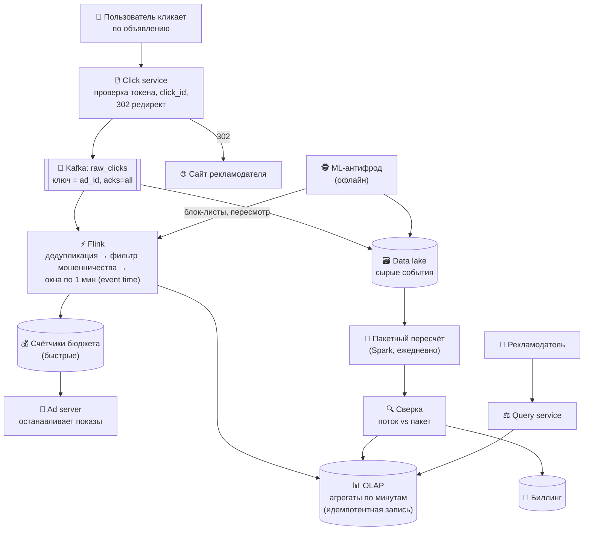
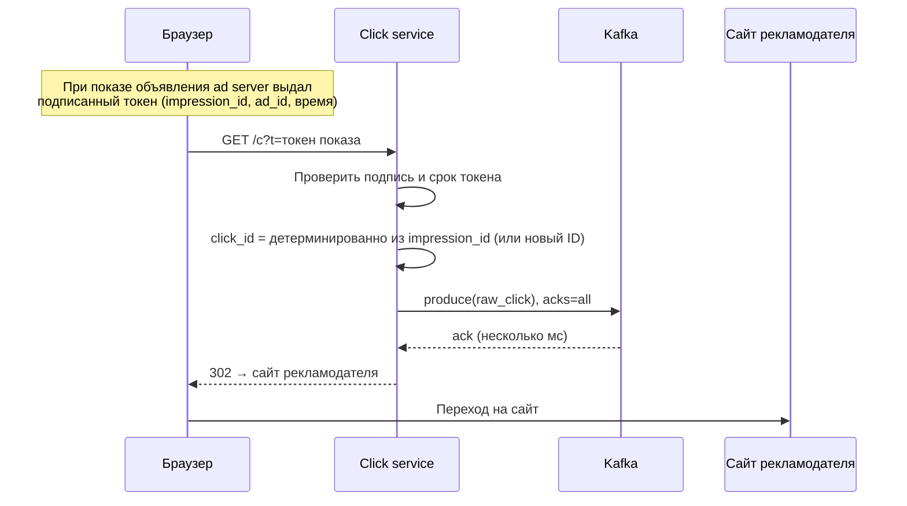
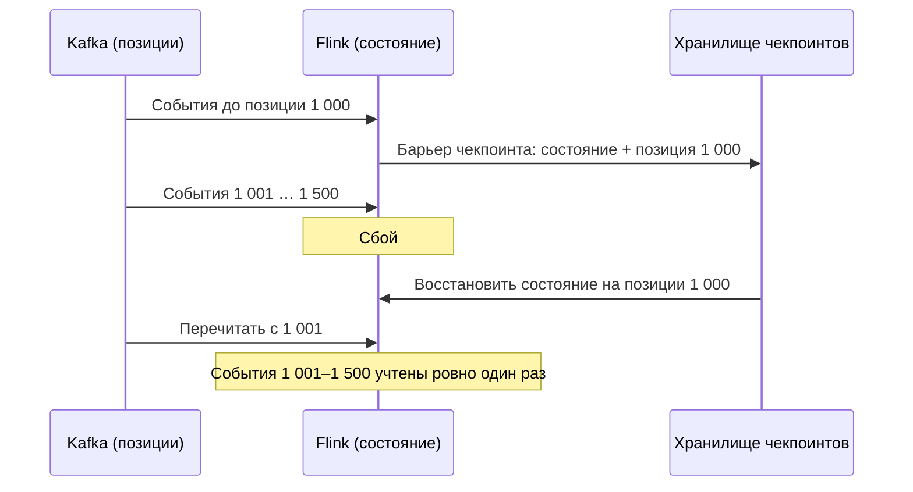
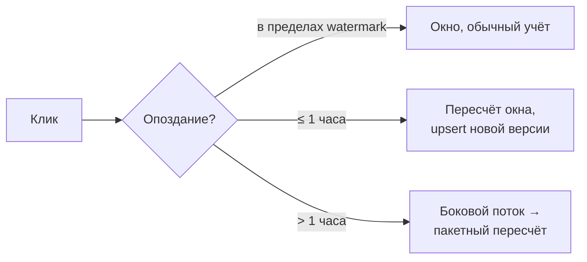
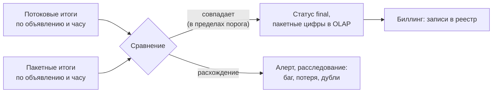

[English](README.md) | **Русский**

# Tier 1 · 17. Агрегатор кликов по рекламе

> **Уровень:** Hard · **Время на интервью:** 45–60 мин · **Время на разбор:** ~5 ч
> **Ключевые аспекты:** приём кликов без потерь, подсчёт exactly-once от начала до конца, дедупликация, окна по времени события и запаздывающие события, фильтрация мошеннических кликов, OLAP-хранилище агрегатов, сверка потока с пакетной обработкой, биллинг и контроль бюджета
> **Опирается на:** [09-messaging](../../09-messaging/README_RU.md), [10-idempotency](../../10-idempotency/README_RU.md), [11-distributed-transactions](../../11-distributed-transactions/README_RU.md), [Tier 1 · 16 Top-K](../16-top-k-leaderboard/README_RU.md#7-deep-dive-2-скользящие-окна-и-затухание) (окна, watermark), [Tier 1 · 09 YouTube](../09-youtube-netflix/README_RU.md#11-deep-dive-5-подсчёт-просмотров) (подсчёт просмотров)

---

## 🗺️ Как читать этот разбор

Разбор построен как интервью, но в каждом шаге есть объяснения: **почему** принимается решение, **как работает** механизм и **что будет**, если сделать иначе. Блоки «📘 Объяснение» — теория прямо по ходу задачи.

| Значок | Что значит |
|:------:|:-----------|
| 🎤 | Реплика интервьюера |
| 🗣️ | Что говорю вслух я (кандидат) |
| ✏️ | Что рисую на доске |
| ⏱️ | Сколько времени тратить на шаг |
| 📘 | Подробное объяснение концепции |

Блоки **TIP** — хороший приём, **WARNING** — ловушка, **IMPORTANT** — сигнал для уровня Senior+.

---

## 📑 Содержание

0. [Чему учит эта задача](#0-чему-учит-эта-задача)
1. [Условие задачи](#1-условие-задачи)
2. [Уточняющие вопросы и требования](#2-уточняющие-вопросы-и-требования)
3. [Оценки нагрузки](#3-оценки-нагрузки)
4. [API](#4-api)
5. [Модель данных](#5-модель-данных)
6. [High-level дизайн](#6-high-level-дизайн)
7. [Deep dive 1: приём клика](#7-deep-dive-1-приём-клика)
8. [Deep dive 2: exactly-once от начала до конца](#8-deep-dive-2-exactly-once-от-начала-до-конца)
9. [Deep dive 3: время события, окна и опоздания](#9-deep-dive-3-время-события-окна-и-опоздания)
10. [Deep dive 4: мошеннические клики](#10-deep-dive-4-мошеннические-клики)
11. [Deep dive 5: хранилище агрегатов и запросы](#11-deep-dive-5-хранилище-агрегатов-и-запросы)
12. [Deep dive 6: сверка и биллинг](#12-deep-dive-6-сверка-и-биллинг)
13. [Deep dive 7: масштабирование и горячие объявления](#13-deep-dive-7-масштабирование-и-горячие-объявления)
14. [Deep dive 8: сбои, переобработка и регионы](#14-deep-dive-8-сбои-переобработка-и-регионы)
15. [Узкие места и сценарии сбоев](#15-узкие-места-и-сценарии-сбоев)
16. [Что изменится при росте в 10 раз](#16-что-изменится-при-росте-в-10-раз)
17. [Ключевые концепции и новые понятия](#17-ключевые-концепции-и-новые-понятия)
18. [Варианты задачи и follow-up вопросы](#18-варианты-задачи-и-follow-up-вопросы)
19. [Типичные ошибки](#19-типичные-ошибки)
20. [Шпаргалка и самопроверка](#20-шпаргалка-и-самопроверка)

---

## 0. Чему учит эта задача

Внешне задача похожа на [Top-K](../16-top-k-leaderboard/README_RU.md): поток событий, окна, агрегаты. Ключевое отличие — **за каждый клик рекламодатель платит деньги**. Поэтому приближения недопустимы: нельзя потерять клик (недополученная выручка) и нельзя посчитать дважды (рекламодатель переплатит, а это судебные иски и потеря доверия).

| Что проверяют | Где это в задаче |
|:--------------|:-----------------|
| Надёжный приём событий | Ни один клик не теряется между браузером и хранилищем |
| Exactly-once на всём пути | Дубликаты от повторов на каждом этапе |
| Время события против времени обработки | Клик в 14:59:58 должен попасть в окно 14:59, даже если пришёл в 15:03 |
| Запаздывающие данные | Мобильные устройства присылают клики через часы |
| Борьба с мошенничеством | Боты, клик-фермы, конкуренты |
| Две истины: быстрая и точная | Поток для дашбордов, пакетная обработка для счетов |
| Аналитические запросы | Срезы по объявлению, стране, устройству, времени |

> [!TIP]
> Сразу назови **два режима**: **приблизительно и быстро** — для дашбордов и контроля бюджета; **точно и с задержкой** — для выставления счетов. Это снимает противоречие между «нужно через минуту» и «нужно абсолютно точно».

---

## 1. Условие задачи

> 🎤 «Спроектируй систему агрегации кликов по рекламе: рекламодатели должны видеть число кликов по своим объявлениям с минутной детализацией и задержкой в несколько минут. По этим же данным выставляются счета, поэтому подсчёт должен быть точным. Учти мошеннические клики».

**Что видит рекламодатель:**

```
Дашборд кампании «Зимняя распродажа»:
  14:00–14:01  1 842 клика   (PL: 1 120, DE: 722; мобильные: 1 403)
  14:01–14:02  1 913 кликов
  …
  Итог за день: 2 614 330 кликов, из них недействительных: 41 207
Счёт за ноябрь: 74 812 405 оплачиваемых кликов
```

**План по времени:**

| Шаг | ⏱️ |
|:----|:--:|
| Требования | 5 мин |
| Оценки | 3 мин |
| API и данные | 5 мин |
| High-level дизайн | 7 мин |
| Deep dives | 22–30 мин |
| Итоги | 3 мин |

---

## 2. Уточняющие вопросы и требования

⏱️ 5 мин

| Мой вопрос | Ответ интервьюера | Что это меняет и почему |
|:-----------|:------------------|:------------------------|
| Объём? | ~1B кликов в сутки, ~2M активных объявлений | ~12 000 кликов/с, пики до 50 000/с |
| Задержка дашборда? | Несколько минут | Потоковая агрегация |
| Точность для счетов? | Абсолютная: без потерь и дублей | Exactly-once, сверка с пакетной обработкой |
| Детализация? | По минутам; разрезы — страна, устройство, кампания | OLAP-хранилище с измерениями |
| Опоздания? | Мобильные клики могут прийти через часы | Окна по времени события, допуск опозданий, пакетная сверка |
| Мошенничество? | Недействительные клики не оплачиваются | Фильтрация в потоке + пересмотр задним числом |
| Сколько хранить? | Сырые события — 90 дней, агрегаты — годы | Многоуровневое хранение |
| Контроль бюджета? | Показы прекращаются при исчерпании бюджета | Быстрые (приблизительные) счётчики для пейсинга |

### Функциональные требования

1. Принимать клики (и перенаправлять пользователя на сайт рекламодателя).
2. Агрегировать клики по объявлению с минутной детализацией и разрезами.
3. Запросы: клики за период с группировкой; топ объявлений.
4. Отделять недействительные клики от действительных.
5. Выставлять счета по точным данным.

### Нефункциональные требования

| Требование | Цель | Почему |
|:-----------|:-----|:-------|
| Без потерь | Каждый принятый клик учтён | Потеря — недополученные деньги |
| Без дублей | Один клик — одна единица в счёте | Переплата рекламодателя — юридический риск |
| Задержка дашборда | Минуты | Рекламодатели управляют кампаниями в реальном времени |
| Задержка редиректа | Десятки миллисекунд | Пользователь ждёт перехода на сайт |
| Доступность приёма | Очень высокая | Недоступный приём = потерянные клики |
| Аудируемость | Каждую цифру в счёте можно объяснить сырыми событиями | Споры с рекламодателями |

---

## 3. Оценки нагрузки

⏱️ 3 мин

```
Клики:            1B в сутки → ~12 000/с в среднем, пик ~50 000/с
Сырое событие:    ~200 Б → 200 ГБ в сутки → ~18 ТБ за 90 дней

Агрегаты:         объявлений с кликами за минуту — сотни тысяч
                  × измерения (страна, устройство) → сотни миллионов строк в сутки
                  → после свёртки в часы и дни — на порядки меньше

Состояние дедупликации:
                  ID кликов за последний час: 50 000/с × 3 600 с = 180M ID
                  × ~16 Б ≈ 3 ГБ — распределено по узлам потоковой обработки
```

### Выводы

| Вывод | Следствие для дизайна |
|:------|:----------------------|
| 50 000 кликов/с в пике | Партиционированный поток (Kafka + Flink) |
| Сырые события неизменяемы и нужны для споров | Хранить сырой журнал отдельно от агрегатов (data lake) |
| Сотни миллионов агрегатных строк в сутки | Колоночное OLAP-хранилище со свёртками |
| Дедупликация за час — гигабайты | Состояние в потоковом обработчике с TTL |

---

## 4. API

⏱️ 3 мин

```http
# Клик (пользователь нажал на объявление)
GET /c?t=<подписанный токен показа>
→ 302 Location: https://advertiser.example/landing?utm_…

# Запросы рекламодателя
GET /v1/ads/{ad_id}/clicks?from=2026-11-30T14:00Z&to=2026-11-30T15:00Z
                            &granularity=minute&group_by=country,device&valid=true
→ 200 { "rows": [{ "minute": "14:00", "country": "PL", "device": "mobile", "clicks": 812 }, ...],
        "status": "provisional" | "final" }

GET /v1/campaigns/{id}/top-ads?window=1h&k=10
GET /v1/invoices/{advertiser_id}/2026-11
```

📘 **Поле `status`.** Данные за последние минуты и часы — **предварительные** (из потока), за закрытые и сверенные периоды — **окончательные** (после пакетной сверки). Рекламодатель видит, какие цифры ещё могут уточниться.

---

## 5. Модель данных

⏱️ 3 мин

```
Сырое событие клика (неизменяемое):
  click_id        — уникальный ID клика
  impression_id   — ID показа, к которому относится клик
  ad_id, campaign_id, advertiser_id
  user_key        — хэш пользователя / устройства
  ip, user_agent, country, device
  event_time      — время клика (по серверу приёма)
  received_time   — время поступления в систему
  signature_ok    — проверка подписи токена показа

Агрегат (OLAP):
  (ad_id, minute, country, device) → valid_clicks, invalid_clicks, unique_users, version

Биллинг (реестр):
  (advertiser_id, campaign_id, day) → billable_clicks, amount, status (provisional | final)
  корректировки — отдельными записями, без изменения старых
```

| Данные | Хранилище | Почему |
|:-------|:----------|:-------|
| Сырые события | Kafka (дни) → data lake (Parquet в объектном хранилище, 90 дней) | Неизменяемый журнал для переобработки и споров |
| Агрегаты | OLAP: Druid / Pinot / ClickHouse | Быстрые запросы со срезами и свёртками |
| Биллинг | Реляционная БД, только добавление записей | Транзакции, аудит, корректировки |
| Состояние дедупликации | Состояние Flink (RocksDB) с TTL | Локально к обработке |

---

## 6. High-level дизайн

⏱️ 7 мин



🗣️ «Ключевые решения:
- **click service** проверяет подписанный токен показа, присваивает `click_id`, пишет событие в Kafka с подтверждением репликами и только потом делает редирект;
- **Kafka** — неизменяемый журнал, ключ = `ad_id`;
- **потоковая обработка**: дедупликация, фильтр мошенничества, минутные окна по времени события → агрегаты в OLAP **идемпотентно**; быстрые счётчики бюджета для ad server;
- **сырые события** — в data lake; ежедневный **пакетный пересчёт** и **сверка** дают окончательные цифры для счетов;
- **офлайн-антифрод** пересматривает клики задним числом».

---

## 7. Deep dive 1: приём клика

> 🎤 «Пользователь кликнул по объявлению. Что происходит, и как не потерять клик?»

### Путь клика



| Решение | Почему |
|:--------|:-------|
| **Редирект через наш сервер** | Клик фиксируется на нашей стороне независимо от JavaScript и блокировщиков; альтернатива — отправка из браузера (beacon), но её легче потерять или подделать |
| **Подписанный токен показа** | Клик относится к реальному показу; подделать клик без показа нельзя; по `impression_id` можно засчитать не больше одного клика на показ |
| **Ответ после подтверждения Kafka** | Если сначала ответить, а потом записать, — при падении сервера клик потерян. `acks=all` добавляет миллисекунды |
| **Локальный буфер на диске** на случай недоступности Kafka | Не отказывать пользователю и не терять клик: записать в журнал на диске и дослать позже |
| **Время события — по серверу приёма** | Часам устройств нельзя доверять; время сервера приёма надёжнее |

> [!WARNING]
> Редирект не должен ждать ничего, кроме записи в Kafka: ни антифрода, ни агрегации. Каждые лишние 100 мс задержки снижают число переходов на сайт рекламодателя.

---

## 8. Deep dive 2: exactly-once от начала до конца

> 🎤 «Где могут появиться дубли и как гарантировать, что каждый клик посчитан ровно один раз?»

### Источники дублей

| Этап | Как появляется дубль |
|:-----|:---------------------|
| Браузер | Пользователь дважды нажал, браузер повторил запрос, кто-то переиграл ссылку |
| Click service → Kafka | Таймаут ответа Kafka → повторная отправка того же события |
| Kafka → Flink | После сбоя обработчик перечитывает события с последнего чекпоинта |
| Flink → OLAP | Повторная запись результата окна после перезапуска |

### Решения по этапам

| Этап | Механизм |
|:-----|:---------|
| **Клики пользователя** | `click_id` детерминирован из `impression_id`: повторные клики по тому же показу дают тот же `click_id` → один оплачиваемый клик |
| **Продюсер** | Идемпотентный продюсер Kafka: повтор отправки не создаёт дубля в партиции |
| **Обработка** | Дедупликация по `click_id` в состоянии Flink с TTL (например, сутки для одного показа) |
| **Чекпоинты** | Flink сохраняет согласованный снимок состояния и позиций чтения Kafka; после сбоя продолжает из снимка, без потерь и двойного учёта в состоянии |
| **Запись результата** | Идемпотентная запись (ниже) или транзакционная запись с двухфазной фиксацией |

### 📘 Почему «прибавить» не идемпотентно, а «записать итог» — да

```
Неидемпотентно:
  UPDATE agg SET clicks = clicks + 812 WHERE ad = 7 AND minute = '14:00'
  → после перезапуска окно пересчитывается и запись повторяется → 1 624 ❌

Идемпотентно:
  UPSERT agg (ad = 7, minute = '14:00', country, device) SET clicks = 812, version = 5
  → повтор записывает то же значение → 812 ✅
  → опоздавшее событие: окно пересчитано до 813, version = 6 → перезапись итога
```

🗣️ «Обработчик выдаёт **полный итог окна**, а хранилище делает upsert по ключу `(ad, minute, измерения)` с версией. Повтор или пересчёт просто перезаписывает строку. Это проще и надёжнее распределённых транзакций».

### Чекпоинты Flink



> [!IMPORTANT]
> **Сигнал Senior+:** объяснить, что «exactly-once» — это не одна настройка, а **цепочка**: детерминированный ID события + идемпотентный продюсер + дедупликация + согласованные чекпоинты + идемпотентная (или транзакционная) запись результата. Достаточно одного неидемпотентного звена, чтобы появились дубли.

---

## 9. Deep dive 3: время события, окна и опоздания

> 🎤 «Клик произошёл в 14:00:58, а дошёл до обработки в 14:03. В какую минуту его считать?»

### Время события против времени обработки

| | Время события (event time) | Время обработки (processing time) |
|:-|:---------------------------|:----------------------------------|
| Что это | Когда клик произошёл | Когда событие дошло до обработчика |
| Результат | Правильный: клик в минуте 14:00 | Зависит от задержек сети, очередей, сбоев |
| Для счетов | ✅ | ❌ |

### Окна и watermark

📘 Окна по 1 минуте (tumbling) по времени события. Но когда можно считать окно 14:00 закрытым, если события могут опаздывать? **Watermark** — оценка «все события до времени T уже пришли»:

```
watermark = максимальное увиденное время события − допустимая задержка (например, 1 минута)

Когда watermark проходит 14:01:00 → окно 14:00–14:01 выдаёт предварительный результат
```

### Опоздавшие события

| Опоздание | Что происходит |
|:----------|:---------------|
| До watermark | Учитывается в окне обычным образом |
| После watermark, но в пределах **allowed lateness** (например, 1 час) | Окно пересчитывается, выдаётся обновлённый итог → upsert с новой версией |
| Позже allowed lateness | Событие уходит в боковой поток и в data lake; учитывается **пакетным пересчётом** |



📘 **Почему не ждать всех опозданий.** Если держать окно открытым часами, дашборд будет показывать цифры с задержкой в часы, а состояние разрастётся. Поэтому — быстрый предварительный результат, обновления в течение часа и окончательная точность от пакетной обработки.

---

## 10. Deep dive 4: мошеннические клики

> 🎤 «Конкурент запустил бота, который кликает по объявлениям. Как не выставить за это счёт?»

### Уровни защиты

| Уровень | Что проверяет | Когда |
|:--------|:--------------|:------|
| **Приём** | Подпись и срок токена показа; клик без показа или с чужим токеном — недействителен | Сразу |
| **Правила в потоке** | Частота кликов с одного IP / устройства / пользователя по объявлению; известные боты и IP дата-центров; клик через 50 мс после показа (человек так не успевает); повторные клики по одному показу | Секунды |
| **ML-модели офлайн** | Поведенческие признаки, связи между аккаунтами, клик-фермы, аномалии по кампании | Часы–дни |
| **Пересмотр задним числом** | Клики, признанные недействительными позже, исключаются из окончательных цифр | До закрытия расчётного периода |

| Принцип | Почему |
|:--------|:-------|
| Хранить **и действительные, и недействительные** счётчики | Рекламодатель видит, сколько отфильтровано; аудит |
| Не удалять сырые события | Решение можно пересмотреть |
| Счёт — по окончательным (сверенным) данным | Офлайн-антифрод успевает отработать |
| Блок-листы из офлайн-моделей — в потоковые правила | Следующие клики того же бота отсекаются сразу |

> [!TIP]
> Рекламные платформы публикуют понятие **недействительного трафика (invalid traffic)** и возвращают деньги, если он обнаружен после списания. Поэтому система должна поддерживать **корректировки** уже выставленных сумм — отдельными записями в реестре биллинга.

---

## 11. Deep dive 5: хранилище агрегатов и запросы

> 🎤 «Где хранить агрегаты, чтобы рекламодатель за доли секунды получал клики по стране за месяц?»

### OLAP-хранилище

📘 Запросы вида «клики по объявлению по дням за месяц, разбивка по странам» читают много строк, но мало колонок и всегда агрегируют. Для этого подходят колоночные OLAP-хранилища: **Apache Druid**, **Apache Pinot**, **ClickHouse**.

| Возможность | Зачем |
|:------------|:------|
| Колоночное хранение и сжатие | Читаются только нужные колонки |
| **Свёртки (rollup)** при загрузке | Минутные строки сворачиваются в часовые и суточные |
| Индексы по измерениям | Быстрый фильтр по объявлению, стране |
| Потоковая загрузка из Kafka | Данные видны через секунды |
| Upsert / замена сегментов | Идемпотентная запись и замена данных после сверки |

### Уровни детализации

| Детализация | Хранение | Для чего |
|:------------|:---------|:---------|
| Минута | 30 дней | Оперативные дашборды |
| Час | 1 год | Анализ кампаний |
| День | Годы | Отчёты, биллинг |
| Сырые события | 90 дней в data lake | Споры, переобработка, ML |

### Запросы

| Запрос | Как обслуживается |
|:-------|:------------------|
| Клики объявления за час по минутам | Минутная таблица, фильтр по ad_id |
| Кампания за месяц по странам | Суточная свёртка |
| Топ-10 объявлений кампании за час | Агрегация в OLAP или предвычисленный top-K (см. [Tier 1 · 16](../16-top-k-leaderboard/README_RU.md)) |
| Популярные дашборды | Кэш результатов на минуту |

---

## 12. Deep dive 6: сверка и биллинг

> 🎤 «Поток может ошибиться. Как гарантировать точность счетов?»

### Две истины

| | Потоковая | Пакетная |
|:-|:----------|:---------|
| Источник | Kafka в реальном времени | Сырые события в data lake |
| Задержка | Минуты | Часы (раз в сутки) |
| Учитывает | Опоздания в пределах часа, правила в потоке | Все опоздания, офлайн-антифрод, исправленные ошибки |
| Назначение | Дашборды, контроль бюджета | **Счета**, окончательные отчёты |

### Сверка



| Принцип | Почему |
|:--------|:-------|
| Пакетный результат — **окончательный** для закрытых периодов | Он учитывает всё |
| Систематические расхождения — сигнал бага | Поток и пакет должны совпадать почти полностью; расхождение больше порога означает потерю или дубли где-то в конвейере |
| **Реестр биллинга только на добавление** | Корректировки (возврат за недействительные клики) — новыми записями; история изменений сохраняется для аудита (идея двойной записи — в Tier 1 #20) |
| Каждая цифра в счёте объяснима | Можно восстановить список click_id, из которых она сложилась |

### Контроль бюджета

📘 Бюджет кампании — 10 000 € в день. Ad server должен прекратить показы, когда бюджет исчерпан, — **в реальном времени**, а не после пакетной сверки.

| Решение | Почему |
|:--------|:-------|
| Быстрые счётчики расходов из потока | Секунды задержки |
| Остановка показов немного **до** исчерпания | Клики по уже показанным объявлениям ещё придут |
| Небольшой перерасход — за счёт платформы | Рекламодатель не платит больше бюджета; это бизнес-правило |

---

## 13. Deep dive 7: масштабирование и горячие объявления

> 🎤 «Реклама во время финала чемпионата — миллион кликов за минуту по одному объявлению. Что сломается?»

| Проблема | Решение |
|:---------|:--------|
| Горячая партиция Kafka (ключ = ad_id) | Предагрегация не подходит для сырых событий (нужен каждый click_id), поэтому — **соление ключа**: `ad_id#0 … ad_id#N` для горячих объявлений, итог суммируется на этапе слияния |
| Состояние дедупликации растёт | TTL по времени показа; для очень больших объёмов — Bloom filter с точной проверкой при «возможно» |
| Пиковая нагрузка на приём | Click service масштабируется горизонтально (stateless); Kafka — больше партиций |
| Запросы к дашбордам горячей кампании | Кэш результатов |

📘 **Почему не предагрегировать клики на click service, как просмотры в Top-K.** Для трендов достаточно счётчика, а для биллинга нужна возможность объяснить каждый клик и отфильтровать мошеннические по отдельности. Поэтому сырые события сохраняются по одному; предагрегация допустима только для быстрых счётчиков бюджета.

---

## 14. Deep dive 8: сбои, переобработка и регионы

> 🎤 «В логике фильтрации нашли баг, который неделю засчитывал лишние клики. Что делать?»

### Переобработка

| Шаг | Как |
|:----|:----|
| 1 | Исправить логику |
| 2 | Запустить обработку заново по сырым событиям (из data lake или из Kafka, если хранение позволяет) в **новую версию** выходных данных |
| 3 | Сверить новую версию со старой, оценить разницу |
| 4 | Атомарно переключить запросы на новую версию агрегатов |
| 5 | Выпустить корректировки в реестре биллинга для затронутых рекламодателей |

📘 Это возможно только потому, что **сырые события неизменяемы и хранятся** — их можно переиграть с новой логикой. Это главный аргумент за архитектуру «неизменяемый журнал + производные агрегаты».

### Сбои

| Сбой | Решение |
|:-----|:--------|
| Click service упал | Stateless, за балансировщиком; события уже в Kafka или в локальном буфере |
| Kafka недоступна | Локальный буфер на click service, досылка |
| Flink упал | Восстановление из чекпоинта; Kafka хранит события 7 дней |
| OLAP недоступен | Поток буферизуется в Kafka; запись возобновится идемпотентно |
| Пакетная задача упала | Перезапуск; результат детерминирован |

### Несколько регионов

- Клики принимаются в ближайшем регионе (низкая задержка редиректа), события пишутся в региональную Kafka.
- Вариант 1: реплицировать сырые события в центральный регион и агрегировать там.
- Вариант 2: агрегировать в каждом регионе, а глобальные итоги — суммой региональных (идемпотентно, по версиям). Дедупликация по `click_id` должна учитывать, что один показ не даст клик в двух регионах (токен показа привязан к одному клику).

---

## 15. Узкие места и сценарии сбоев

| Сценарий | Что произойдёт | Как защищаемся |
|:---------|:---------------|:---------------|
| Click service упал до записи | Потеря клика | Ответ только после ack Kafka, локальный буфер |
| Повторный клик по тому же показу | Двойной счёт | `click_id` из `impression_id`, дедупликация |
| Повтор продюсера | Дубль в Kafka | Идемпотентный продюсер |
| Перезапуск Flink | Повторная обработка | Чекпоинты, идемпотентный upsert итогов |
| Опоздавшие клики | Неверная минута | Время события, watermark, allowed lateness, пакетный пересчёт |
| Ботовые клики | Счёт за мошенничество | Правила в потоке, офлайн-ML, пересмотр, корректировки |
| Баг в логике | Неверные цифры за период | Переобработка сырых событий, новая версия, корректировки |
| Горячее объявление | Горячая партиция | Соление ключа |
| Расхождение потока и пакета | Неточные счета | Сверка, алерты, пакет — окончательный |
| Бюджет исчерпан | Перерасход | Быстрые счётчики, остановка показов заранее |

---

## 16. Что изменится при росте в 10 раз

> 🎤 «10 миллиардов кликов в сутки?»

| Изменение | Почему |
|:----------|:-------|
| **Больше партиций** и параллелизма Flink | ~120 000–500 000 кликов/с |
| **Региональная агрегация** с глобальным слиянием | Трафик между регионами |
| **Kappa вместо lambda** | Одна кодовая база для потока и пересчёта; переигрывание истории из долгого хранения |
| **Более сложный антифрод в потоке** | Модели в реальном времени, а не только правила |

---

## 17. Ключевые концепции и новые понятия

### Что из Fundamentals применяется

| Концепция | Где разобрана | Как применяется здесь |
|:----------|:--------------|:----------------------|
| Kafka, идемпотентный продюсер | [09-messaging](../../09-messaging/README_RU.md) | Журнал кликов |
| Идемпотентность, дедупликация | [10-idempotency](../../10-idempotency/README_RU.md) | click_id, upsert итогов |
| Транзакционная запись, outbox | [11-distributed-transactions](../../11-distributed-transactions/README_RU.md) | Альтернатива идемпотентному upsert |
| Окна, watermark, lambda/kappa | [Tier 1 · 16](../16-top-k-leaderboard/README_RU.md) | Минутные окна по времени события |
| Подсчёт просмотров и антифрод | [Tier 1 · 09](../09-youtube-netflix/README_RU.md#11-deep-dive-5-подсчёт-просмотров) | Похожий конвейер с меньшими требованиями к точности |

### Новые понятия этой задачи

| Понятие | Кратко |
|:--------|:-------|
| **Подписанный токен показа** | Доказательство, что клик относится к реальному показу |
| **Exactly-once от начала до конца** | Цепочка из детерминированного ID, идемпотентного продюсера, дедупликации, чекпоинтов и идемпотентной записи |
| **Чекпоинт Flink** | Согласованный снимок состояния и позиций чтения |
| **Upsert итога окна** | Запись полного значения окна вместо прибавления — идемпотентно |
| **Allowed lateness** | Период, в течение которого окно пересчитывается для опоздавших событий |
| **Боковой поток** | Канал для слишком поздних событий |
| **Недействительный трафик** | Клики, которые не оплачиваются |
| **Предварительные и окончательные данные** | Поток для оперативности, пакет — для счетов |
| **Сверка** | Сравнение потоковых и пакетных итогов |
| **Переобработка** | Повторная обработка сырых событий исправленной логикой в новую версию |

---

## 18. Варианты задачи и follow-up вопросы

<details>
<summary><b>Почему бы не писать каждый клик сразу в базу и считать SQL-запросами?</b></summary>

50 000 вставок в секунду и запросы, сканирующие сотни миллионов строк для дашбордов, перегрузят транзакционную базу. Неизменяемый журнал в Kafka и data lake + инкрементальная агрегация + OLAP разделяют нагрузки: приём, агрегация и запросы масштабируются независимо, а сырые события можно переобработать.
</details>

<details>
<summary><b>Можно ли обойтись без пакетной обработки?</b></summary>

Да, в архитектуре kappa: потоковая обработка с долгим хранением событий, а переобработка — повторным чтением истории в новую версию. Но для биллинга всё равно нужна сверка с независимым расчётом и пересмотр после офлайн-антифрода, поэтому многие компании оставляют пакетный путь как контрольный.
</details>

<details>
<summary><b>Как считать уникальных пользователей, кликнувших по объявлению?</b></summary>

HyperLogLog по `user_key` в каждом окне: несколько килобайт на объявление и минуту, структуры объединяются при свёртке в часы и дни. Для биллинга уникальные пользователи обычно не нужны — это аналитика.
</details>

<details>
<summary><b>Что если рекламодатель оспаривает счёт?</b></summary>

По неизменяемым сырым событиям и записям реестра можно восстановить, из каких кликов сложилась сумма, какие признаны недействительными и почему. Это возможно только благодаря хранению сырых событий и реестру только на добавление.
</details>

<details>
<summary><b>Чем это отличается от подсчёта просмотров YouTube?</b></summary>

Конвейер похож, но требования к точности разные: просмотры можно показывать приблизительно («1,2 млн»), а клики — основа денежных расчётов. Отсюда строгая exactly-once-цепочка, подписанные токены, сверка с пакетной обработкой и реестр корректировок.
</details>

---

## 19. Типичные ошибки

| ❌ Ошибка | Почему плохо | ✅ Как правильно |
|:---------|:-------------|:----------------|
| Ответить пользователю до записи клика | Потеря клика при сбое | Ответ после ack Kafka |
| Клик без привязки к показу | Подделка кликов | Подписанный токен показа |
| Время обработки для окон | Неверная минута у опоздавших событий | Время события и watermark |
| `clicks = clicks + N` при записи | Дубли после перезапуска | Upsert полного итога окна |
| «Exactly-once включается одной настройкой» | Дубли на других звеньях | Цепочка механизмов на каждом этапе |
| Ждать все опоздания перед результатом | Дашборд с часовой задержкой | Предварительный результат + обновления + пакет |
| Удалять мошеннические клики | Невозможен аудит | Хранить и действительные, и недействительные |
| Счёт по потоковым цифрам | Неточности и мошенничество в счёте | Счёт по сверенным пакетным данным |
| Изменять выставленные суммы | Нет аудита | Корректировки отдельными записями |
| Не хранить сырые события | Невозможно исправить баг задним числом | Неизменяемый журнал и переобработка |

---

## 20. Шпаргалка и самопроверка

### Ответ за 30 секунд

> Click service проверяет подписанный токен показа, формирует `click_id` из `impression_id`, пишет событие в Kafka (`acks=all`, идемпотентный продюсер, локальный буфер на случай сбоя) и только потом делает 302-редирект. Flink: дедупликация по `click_id` в состоянии с TTL → правила антифрода → минутные tumbling-окна по времени события с watermark и allowed lateness ~1 час → upsert полного итога окна с версией в OLAP (Druid/Pinot/ClickHouse) — идемпотентно; чекпоинты дают exactly-once в состоянии. Слишком поздние события — в боковой поток. Сырые события — в data lake на 90 дней; ежедневный пакетный пересчёт с офлайн-антифродом сверяется с потоком и даёт окончательные цифры; счета — в реестр только на добавление с корректировками. Дашборды показывают предварительные и окончательные данные; бюджет — по быстрым потоковым счётчикам с остановкой заранее. Горячие объявления — соление ключа. Баги исправляются переобработкой сырых событий в новую версию.

### Самопроверка

- [ ] Могу объяснить, чем задача отличается от трендов (деньги)
- [ ] Могу описать путь клика и почему ответ — после записи в Kafka
- [ ] Могу объяснить роль подписанного токена показа
- [ ] Могу перечислить все источники дублей и механизм для каждого
- [ ] Могу объяснить, почему upsert итога идемпотентен, а инкремент — нет
- [ ] Могу объяснить чекпоинты Flink
- [ ] Могу объяснить время события, watermark и allowed lateness
- [ ] Могу описать уровни антифрода и пересмотр задним числом
- [ ] Могу описать сверку потока и пакета и реестр биллинга
- [ ] Могу объяснить, как исправить баг через переобработку

### Что почитать

- Akidau et al., *The Dataflow Model* (VLDB 2015) — время события, окна, watermark
- Tyler Akidau, *Streaming 101* и *Streaming 102* (O'Reilly)
- Carbone et al., *Lightweight Asynchronous Snapshots for Distributed Dataflows* (2015) — чекпоинты Flink
- Документация Apache Flink: event time, watermarks, exactly-once
- Документация Apache Druid / Apache Pinot / ClickHouse
- Alex Xu, Sahn Lam, *System Design Interview*, Vol. 2 — глава «Ad Click Event Aggregation»