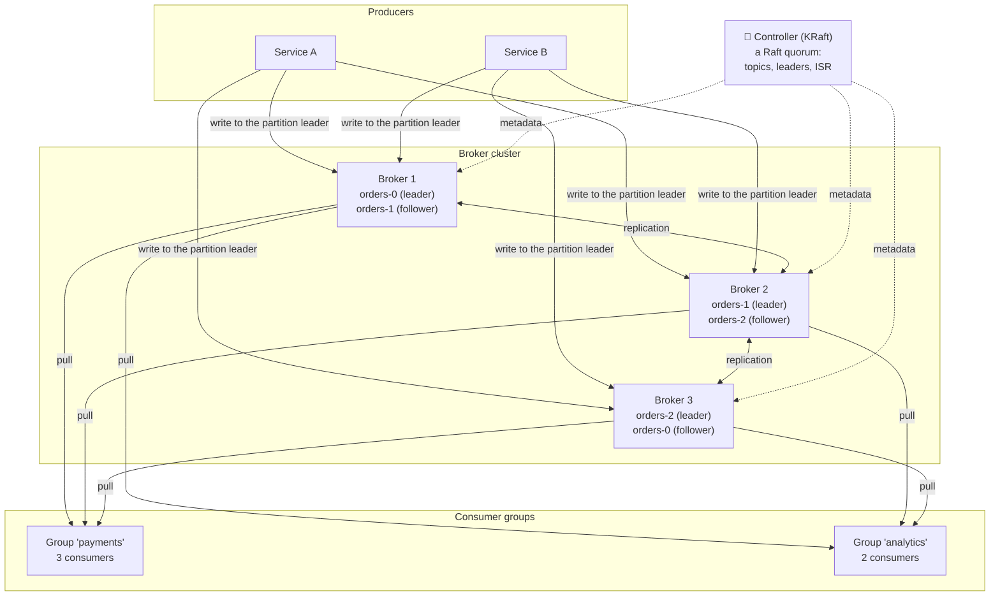
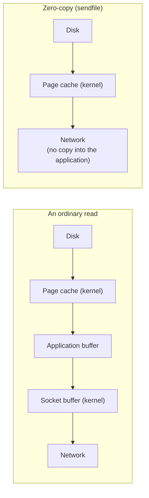
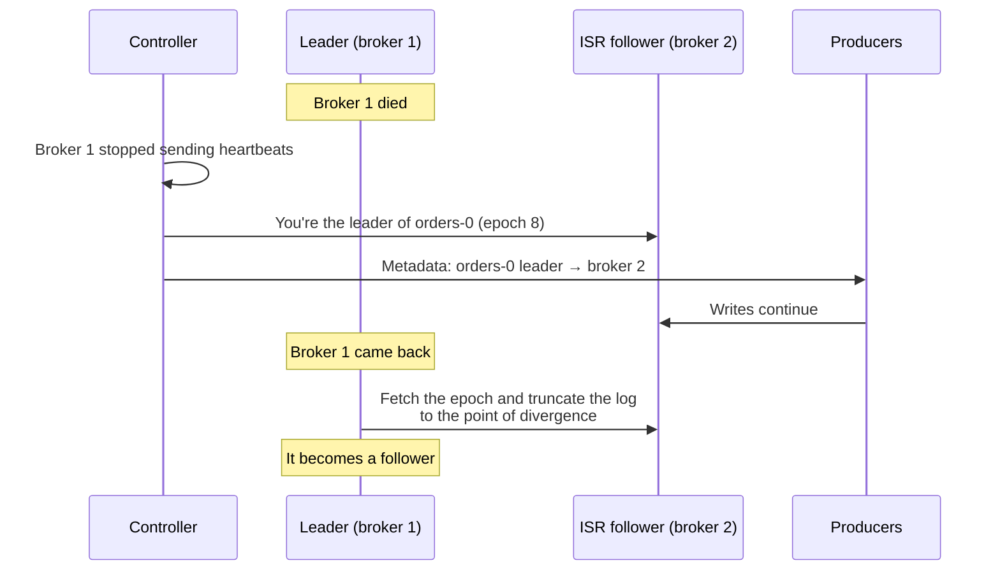
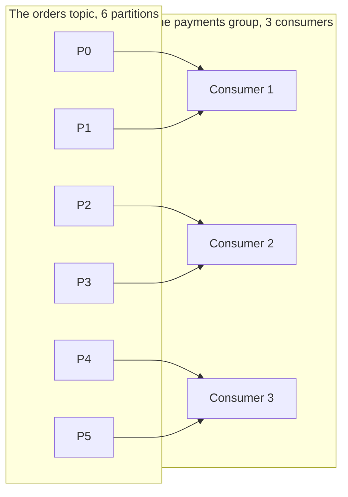
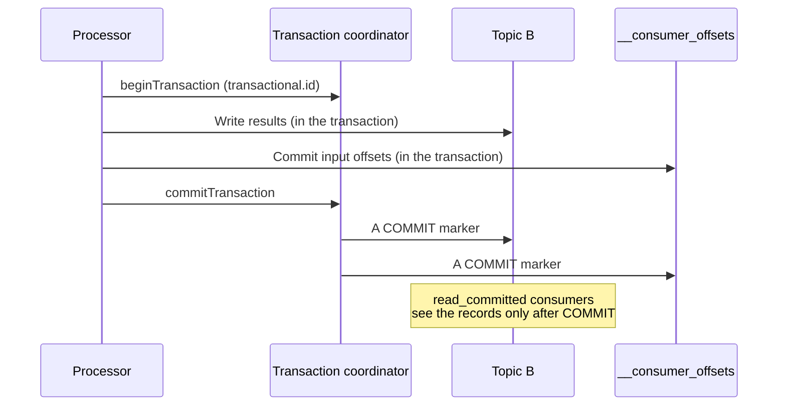

**English** | [Русский](README.ru.md)

# Tier 1 · 18. Distributed Message Queue (like Kafka)

> **Level:** Hard · **Interview time:** 45–60 min · **Study time:** ~5–6 h
> **Key aspects:** an append-only partitioned log, segments and indexes, why it's fast (sequential I/O, page cache, zero-copy, batching), replication (ISR, high watermark, acks), the controller and metadata (KRaft), consumer groups and rebalancing, offsets and delivery semantics, exactly-once (idempotent producer, transactions), retention, compaction, tiered storage
> **Builds on:** [09-messaging](../../01_Fundamentals/09_Messaging/README.md) (how to **use** a broker), [05-replication](../../01_Fundamentals/05_Replication/README.md), [08-consensus](../../01_Fundamentals/08_Consensus/README.md), [06-partitioning](../../01_Fundamentals/06_Partitioning/README.md), [10-idempotency](../../01_Fundamentals/10_Idempotency/README.md)

---

## 🗺️ How to Read This Walkthrough

The walkthrough follows an interview, but every step includes explanations: **why** a decision is made, **how** a mechanism works and **what happens** if you do it differently. The "📘 Explanation" blocks are theory right where you need it.

| Icon | Meaning |
|:----:|:--------|
| 🎤 | Interviewer |
| 🗣️ | What I (the candidate) say out loud |
| ✏️ | What I draw on the whiteboard |
| ⏱️ | Time budget for the step |
| 📘 | A detailed explanation of a concept |

Callouts: **TIP** — a good technique, **WARNING** — a trap, **IMPORTANT** — a Senior+ signal.

---

## 📑 Contents

0. [What This Problem Teaches](#0-what-this-problem-teaches)
1. [Problem Statement](#1-problem-statement)
2. [Clarifying Questions and Requirements](#2-clarifying-questions-and-requirements)
3. [Capacity Estimates](#3-capacity-estimates)
4. [API](#4-api)
5. [On-Disk Storage](#5-on-disk-storage)
6. [High-Level Design](#6-high-level-design)
7. [Deep Dive 1: The Partitioned Log](#7-deep-dive-1-the-partitioned-log)
8. [Deep Dive 2: Why It's Fast](#8-deep-dive-2-why-its-fast)
9. [Deep Dive 3: Replication](#9-deep-dive-3-replication)
10. [Deep Dive 4: The Controller and Metadata](#10-deep-dive-4-the-controller-and-metadata)
11. [Deep Dive 5: Consumers and Consumer Groups](#11-deep-dive-5-consumers-and-consumer-groups)
12. [Deep Dive 6: Exactly-Once](#12-deep-dive-6-exactly-once)
13. [Deep Dive 7: Retention, Compaction and Tiered Storage](#13-deep-dive-7-retention-compaction-and-tiered-storage)
14. [Deep Dive 8: Scaling and Operations](#14-deep-dive-8-scaling-and-operations)
15. [Bottlenecks and Failure Scenarios](#15-bottlenecks-and-failure-scenarios)
16. [What Changes at 10x Scale](#16-what-changes-at-10x-scale)
17. [Key Concepts and New Terms](#17-key-concepts-and-new-terms)
18. [Variations and Follow-Up Questions](#18-variations-and-follow-up-questions)
19. [Common Mistakes](#19-common-mistakes)
20. [Cheat Sheet and Self-Check](#20-cheat-sheet-and-self-check)

---

## 0. What This Problem Teaches

In [09-messaging](../../01_Fundamentals/09_Messaging/README.md) we **used** a message broker. Here you have to **build one**: a system that accepts millions of messages per second, retains them for days without loss and serves them to many independent consumers.

| What's tested | Where it shows up |
|:--------------|:------------------|
| Storage shaped by the workload | An append-only log, segments, sparse indexes |
| Understanding the hardware | Sequential I/O, page cache, zero-copy |
| Replication and consistency | A leader and followers, ISR, high watermark, acks |
| Consensus | A Raft-based metadata controller (KRaft) |
| Coordinating clients | Consumer groups, rebalancing, offsets |
| Delivery semantics | At-most-once, at-least-once, exactly-once |
| Durability vs availability trade-offs | `min.insync.replicas`, unclean leader election |

> [!TIP]
> The key idea to open with: **it's not a queue, it's a log**. Messages aren't deleted after being read; each consumer remembers how far it has read (an offset). Almost everything else follows from that: rereading, many independent consumers, simple and fast storage.

---

## 1. Problem Statement

> 🎤 "Design a distributed messaging system like Kafka: producers publish messages to topics, and consumers read them. It needs high throughput, durability, ordering, horizontal scaling and the ability to reread data."

**How it's used:**

```
The order service  → publish("orders", key = order_id, value = {...})
The payment service ← reads "orders" with its consumer group
Analytics           ← reads the same "orders" independently, with its own group
After a bug         ← analytics rereads "orders" for the last 3 days
```

**Time plan:**

| Step | ⏱️ |
|:-----|:--:|
| Requirements | 4 min |
| Estimates | 4 min |
| API and storage | 6 min |
| High-level design | 5 min |
| Deep dives | 25–30 min |
| Wrap-up | 3 min |

---

## 2. Clarifying Questions and Requirements

⏱️ 4 min

| My question | Interviewer's answer | What it changes and why |
|:------------|:---------------------|:------------------------|
| Throughput? | 1M messages/s for writes, ~3M/s for reads (several consumer groups) | Partitioning, a broker cluster |
| Message size? | ~1 KB on average, up to 1 MB | ~1 GB/s of inbound traffic |
| How long to retain? | 7 days; some topics forever (the latest value per key) | Retention and compaction |
| Ordering? | Strict within a key | Key → partition |
| Durability? | An acknowledged message isn't lost if one broker fails | Replication, `acks=all` |
| Latency? | p99 < 10–50 ms from publish to read | Batches mustn't wait long |
| Semantics? | At-least-once by default, exactly-once for some pipelines | An idempotent producer, transactions |
| Rereading? | Yes | A log with offsets, not delete-on-read |

### Functional requirements

1. Topics split into partitions; publishing with a key.
2. Reading via consumer groups: each message goes to one consumer in a group; different groups read independently.
3. Retention by time or size; compaction by key.
4. Reading from any offset (reprocessing).
5. Creating topics, changing partition counts, adding brokers.

### Non-functional requirements

| Requirement | Target | Why |
|:------------|:-------|:----|
| Throughput | 1 GB/s of writes, 3 GB/s of reads, scaling linearly | The company's central data bus |
| Durability | No loss of acknowledged messages if a broker fails | Messages are the source of truth for many systems |
| Availability | Keeps working through broker and zone failures | Stopping the bus stops the whole company |
| Ordering | Within a partition | Correct processing of one entity's events |
| Latency | Milliseconds to tens of milliseconds | Real-time pipelines |

---

## 3. Capacity Estimates

⏱️ 4 min

```
Writes:             1M messages/s × 1 KB = 1 GB/s
With replication ×3: 3 GB/s of writes to the cluster's disks
Reads:              3 consumer groups × 1 GB/s = 3 GB/s
                    + 2 GB/s of replication traffic (followers read from the leader)

Storage:            1 GB/s × 86,400 × 7 days ≈ 600 TB
                    × 3 replicas ≈ 1.8 PB

A broker:           disks — hundreds of MB/s to ~1 GB/s of sequential writes,
                    a 25 Gbit/s network ≈ 3 GB/s
                    → ~40–50 brokers, ~36 TB of data per broker
Partitions:         thousands (e.g. 3,000)
```

### Conclusions

| Conclusion | Design consequence |
|:-----------|:-------------------|
| Gigabytes per second | Only sequential disk writes, batching, zero-copy |
| Petabytes over 7 days | Storage on cheap disks, or tiered storage in object storage |
| Reads are 3+× writes | Consumers read from the page cache, with no copies in the application |
| Thousands of partitions | Metadata must be stored and propagated efficiently |

---

## 4. API

⏱️ 2 min

```
Producer
  send(topic, key, value, headers) → (partition, offset)
  settings: acks = 0 | 1 | all, linger.ms, batch.size, compression, enable.idempotence

Consumer
  subscribe(topics, group_id)
  poll(timeout) → [records]          ← pull: the consumer requests data itself
  commit(offsets)                    ← "the group has read the partition up to offset N"
  seek(partition, offset)            ← reread from a chosen position

Admin
  create_topic(name, partitions, replication_factor, retention, cleanup_policy)
  add_partitions(topic, n)
  reassign_partitions(plan)
```

---

## 5. On-Disk Storage

⏱️ 4 min

📘 A **partition** is an ordered log stored as a directory of **segments**:

```
orders-7/                              ← partition 7 of the orders topic
  00000000000000000000.log             ← a segment: offsets 0 … 1,048,575 (closed)
  00000000000000000000.index           ← a sparse index: offset → position in the file
  00000000000000000000.timeindex       ← time → offset
  00000000000001048576.log             ← the active segment: writes go here
  00000000000001048576.index
  00000000000001048576.timeindex
```

| Element | What it is | Why |
|:--------|:-----------|:----|
| **A segment** | A file of records; its name is the first offset in it | Deleting old data means deleting a whole file |
| **The active segment** | The last one; only it receives writes | All others are immutable |
| **A sparse index** | An "offset → byte position" entry every ~4 KB of data | Small; fits in memory |
| **A time index** | "Time → offset" | Reread "from 14:00 yesterday" |
| **A record batch** | Several messages under a shared header (base offset, CRC, producer id, sequence) | Compression and writing in batches |

### Finding a message by offset

```
Find offset 1,050,000:
  1. Binary search over segment names → segment 00000000000001048576
  2. Binary search in its sparse index → the nearest offset ≤ 1,050,000 and its file position
  3. Read sequentially from that position to the target offset (a few KB)
```

---

## 6. High-Level Design

⏱️ 5 min



🗣️ "Components:
- **brokers** store partitions; each partition has one **leader** (it takes writes and reads) and several **followers** on other brokers;
- **the controller** — a small Raft quorum holding the metadata: which topics and partitions exist, who leads each, who's in the ISR;
- **producers** learn from metadata where the leader of the target partition is and write directly to it;
- **consumers** in groups pull data themselves and store their offsets."

---

## 7. Deep Dive 1: The Partitioned Log

> 🎤 "Why a log rather than an ordinary queue where messages are deleted after being read?"

### A log versus a queue

| | A classic queue (RabbitMQ, SQS) | A log (Kafka) |
|:-|:--------------------------------|:--------------|
| After reading | The message is deleted (after acknowledgment) | It stays until retention expires |
| Multiple consumers | Each needs its own copy of the queue | Each group reads the same log with its own offset |
| Rereading | Impossible | Move the offset back |
| State on the broker | Each message's status (delivered, acknowledged) | Only the group's offset — one number per partition |
| Disk writes | Random operations (deletions, markings) | Appends only |

📘 **Why a log is simpler and faster.** The broker doesn't need to remember which message was delivered and acknowledged by whom — that's millions of mutable states. It just keeps an immutable log and **one number per group per partition**. Writes always go to the end of a file; deletion happens a whole segment at a time.

### Partitions

| Why | How |
|:----|:----|
| **Parallelism** | A topic is split into partitions on different brokers; writes and reads proceed in parallel |
| **Ordering by key** | Partition = `hash(key) % number_of_partitions`: all of an order's messages go to one partition, in order |
| **Scaling consumers** | Within a group, one partition goes to one consumer; the partition count caps a group's parallelism |

📘 **Ordering is guaranteed only within a partition.** Messages with different keys in different partitions may be processed in any order relative to each other. If you need per-order ordering — key = `order_id`. A global order across the whole topic requires a single partition and kills parallelism.

### Messages without a key

They used to be spread round-robin (each message to the next partition), which produced small batches. The modern approach is **sticky partitioning**: the producer fills a batch for one partition and then moves to the next — larger batches and fewer requests.

---

## 8. Deep Dive 2: Why It's Fast

> 🎤 "How do ordinary disks sustain a gigabyte per second?"

| Technique | How it works | Effect |
|:----------|:-------------|:-------|
| **Sequential I/O** | Writes only go to the end of a file | Sequential writes even on HDDs reach hundreds of MB/s; random writes are hundreds of times slower |
| **The OS page cache** | The broker writes to files and relies on the OS cache rather than holding data in process memory | Fresh data is read from memory; no double caching; a process restart doesn't flush the cache |
| **Zero-copy (`sendfile`)** | The kernel sends data from the page cache straight to the socket, without copying into application memory | Fewer copies and context switches — reads are almost free for the CPU |
| **Batching** | The producer gathers messages into a batch (`linger.ms`, `batch.size`); the broker writes and serves whole batches | Fewer requests, better compression |
| **End-to-end compression** | The producer compresses the batch; the broker stores it compressed as is; the consumer decompresses | Less disk and network; the broker spends no CPU recompressing |
| **Long polling on reads** | The consumer waits until a minimum amount of data accumulates (`fetch.min.bytes`) or a timeout passes | Fewer empty requests |

### The read path



> [!NOTE]
> The batching trade-off: the longer the producer waits to fill a batch (`linger.ms`), the higher the throughput and the higher the latency. For 10 ms of latency, a `linger.ms` of a few milliseconds is enough.

> [!WARNING]
> Zero-copy doesn't work if the broker must transform the data (e.g. TLS encryption done in user space in some implementations, or recompressing for a different format version). That's why it matters that the storage format matches the wire format.

---

## 9. Deep Dive 3: Replication

> 🎤 "The broker holding a partition's leader died. How do you avoid losing acknowledged messages?"

### A leader and followers

📘 Each partition has a replication factor (usually 3): one **leader** and two **followers** on different brokers (and in different availability zones). Producers write only to the leader; followers **pull** new records from the leader, just like consumers.

### ISR and the high watermark

| Concept | Meaning |
|:--------|:--------|
| **ISR (in-sync replicas)** | Replicas that haven't lagged behind the leader for longer than a set time (`replica.lag.time.max.ms`). The leader is always in the ISR |
| **High watermark (HW)** | The highest offset present on **every ISR replica**. Consumers see messages only up to the HW |
| **Log end offset (LEO)** | The last offset in a particular replica's log |

```
Leader:          offsets 0 … 1,000   (LEO = 1,000)
Follower A:      0 … 1,000           (in the ISR)
Follower B:      0 … 998             (in the ISR, slightly behind)

High watermark = 998 → consumers read up to 998
Messages 999–1,000 become visible once B has them
```

📘 **Why the HW.** If consumers read up to the leader's LEO and the leader died before replicating, the new leader wouldn't have messages 999–1,000 — consumers would have seen messages that later "vanished". The HW guarantees that whatever a consumer read exists on every ISR replica.

### Producer acks

| `acks` | When the producer gets an acknowledgment | Risk of loss |
|:-------|:-----------------------------------------|:-------------|
| `0` | Immediately after sending | High: we don't even know whether it arrived |
| `1` | The leader wrote it locally | The leader dies before replicating → the message is lost |
| `all` | Every ISR replica wrote it | None, as long as at least one live replica remains in the ISR |

### min.insync.replicas

```
replication.factor = 3, min.insync.replicas = 2, acks = all

All 3 alive:       a write is acknowledged once 2+ replicas have it
One down:          ISR = 2 → writes continue, with no loss
Two down:          ISR = 1 < 2 → writes are rejected (NotEnoughReplicas)
                   → the system chooses durability over write availability
```

### Electing a new leader



| Mechanism | Why |
|:----------|:----|
| A new leader comes **only from the ISR** | It has every acknowledged message |
| **The leader epoch** | A returning old leader learns that its last unacknowledged writes must be discarded, and truncates its log to the common point |
| **Unclean leader election** (off by default) | If the ISR is empty, a lagging replica can be made leader — the partition becomes available again, but some acknowledged messages are lost. The availability vs durability trade-off |

> [!IMPORTANT]
> **Senior+ signal:** explain the combination `acks=all` + `min.insync.replicas=2` + `replication.factor=3` + cross-zone replication: that's what delivers "no loss if one broker or zone fails", and rejecting writes after losing two replicas is a deliberate choice of durability (see CAP in [07-consistency-models](../../01_Fundamentals/07_Consistency%20models/README.md)).

---

## 10. Deep Dive 4: The Controller and Metadata

> 🎤 "Who decides which broker is the leader, and how do clients find out?"

### What the controller stores

| Metadata | Example |
|:---------|:--------|
| Topics and configuration | `orders`: 64 partitions, RF = 3, 7-day retention |
| Partition placement | orders-0 → brokers [1, 3, 5] |
| Leaders and epochs | orders-0: leader 1, epoch 7 |
| ISR | orders-0: [1, 3] |
| Live brokers | By heartbeat |

### ZooKeeper and KRaft

| | ZooKeeper (historically) | KRaft |
|:-|:-------------------------|:------|
| Where metadata lives | An external ZooKeeper cluster | An internal quorum of controllers running **Raft** (see [08-consensus](../../01_Fundamentals/08_Consensus/README.md)) |
| Operations | Two different systems | One system |
| Scale | Controller recovery with many partitions was slow | Metadata is a replicated event log; brokers read it like a regular topic |
| Status | Removed in Kafka 4.0 | The default |

📘 **Metadata as a log.** In KRaft, metadata changes ("orders-0 leader → broker 2") are records in a special log replicated by the Raft quorum. Brokers apply the records in order and always have a consistent picture; a new active controller doesn't reload everything but continues the log.

### How clients find the leader

1. The client connects to any broker and requests the topic's metadata.
2. It receives a "partition → leader" table and caches it.
3. It writes and reads directly with the leaders.
4. On a "not the leader anymore" error — it refreshes the metadata and retries.

---

## 11. Deep Dive 5: Consumers and Consumer Groups

> 🎤 "How do several consumers share the work without processing the same thing twice?"

### Why pull, not push

| Pull (Kafka) | Push |
|:-------------|:-----|
| The consumer sets the pace — natural backpressure | The broker can overwhelm a slow consumer |
| The consumer fetches large batches | It's hard for the broker to pick a batch size for each consumer |
| Rereading is just requesting a different offset | The broker must remember each consumer's state |
| Downside: empty requests when there's no data | Solved by long polling |

### A consumer group



| Rule | Consequence |
|:-----|:------------|
| Within a group each partition goes to **exactly one** consumer | Order within a partition is preserved; a message isn't processed twice within the group |
| More consumers than partitions | The extras sit idle |
| Different groups | Read one topic independently, each with its own offsets |

### Rebalancing

📘 When a consumer joins or leaves (or dies — no heartbeat), **the group coordinator** reassigns partitions.

| Approach | How | Problem |
|:---------|:----|:--------|
| **Eager** (old) | Every consumer gives up every partition, then receives a new assignment | "Stop the world": the whole group stalls |
| **Cooperative incremental** | Only the partitions that need reassignment move | The rest keep working |
| **Static membership** | A consumer with a persistent ID; a restart within a timeout doesn't trigger a rebalance | Deploy restarts don't shake the group |

### Offsets and delivery semantics

📘 A group stores its positions in the internal compacted topic `__consumer_offsets`: "group payments, partition 3, offset 18,204".

| Order of actions | Semantics | On failure |
|:-----------------|:----------|:-----------|
| Commit the offset → process | **At-most-once** | Crashed after committing, before processing — the message is lost |
| Process → commit the offset | **At-least-once** | Crashed after processing, before committing — the message is processed again |
| Processing and the offset in one transaction | **Exactly-once** | Deep dive 6 |

> [!TIP]
> The standard choice is **at-least-once + idempotent processing** on the consumer side (see [10-idempotency](../../01_Fundamentals/10_Idempotency/README.md)). It's simpler and more robust than exactly-once, and it works with any external system.

### Lag

`lag = the partition's latest offset − the group's offset`. The key health metric for consumers: growing lag means the group is falling behind (see [09-messaging](../../01_Fundamentals/09_Messaging/README.md#10-backpressure-and-flow-control)).

---

## 12. Deep Dive 6: Exactly-Once

> 🎤 "The producer resent a message after a timeout. How do you avoid a duplicate? And how do you make 'read — process — write' exactly-once?"

### The idempotent producer

📘 The producer receives a **producer id** from the broker and assigns each batch in each partition a **sequence number**:

```
Producer 42, partition orders-3:
  batch seq = 7  → the broker wrote it, the response was lost
  retry seq = 7  → the broker sees: producer 42 already has seq 7 in this partition → doesn't write again, acknowledges
  batch seq = 9  (8 was expected) → a sequence error: a gap
```

The broker remembers the last few sequence numbers per producer and partition. Retries after timeouts no longer create duplicates. In modern versions idempotence is on by default.

### Transactions

📘 For a "read from topic A → process → write to topic B" pipeline, **the write to B and the offset commit on A** must happen atomically: both or neither.



| Element | Why |
|:--------|:----|
| `transactional.id` | The processor's persistent identifier; after a restart, old unfinished transactions are aborted (fencing "zombie" instances) |
| The transaction coordinator | Stores transaction state in an internal topic |
| COMMIT / ABORT markers | Written into the partitions; consumers skip aborted records |
| `isolation.level = read_committed` | The consumer sees only committed transactions |

> [!WARNING]
> Kafka's exactly-once works **within Kafka** (topic to topic). If the result is written to an external database or sent over HTTP, idempotence is needed on the receiving side — a Kafka transaction won't roll back a write in someone else's system.

---

## 13. Deep Dive 7: Retention, Compaction and Tiered Storage

> 🎤 "How do you delete old data, and how do you keep 'the latest value per key' forever?"

### Retention

| Policy | How it works |
|:-------|:-------------|
| By time (`retention.ms`) | A segment is deleted once its newest message is older than the threshold |
| By size (`retention.bytes`) | The oldest segments are deleted when the partition exceeds its size |

**Whole closed segments** are deleted — a simple file deletion, with no data rewriting.

### Log compaction

📘 "Table-like" topics (user profiles, configuration, state) need not the history but **the latest value for each key**. Compaction rewrites old segments in the background, keeping only the last record per key:

```
Before compaction:   (u1, A) (u2, X) (u1, B) (u3, M) (u2, Y) (u1, C)
After:               (u3, M) (u2, Y) (u1, C)

Deleting a key: a (u2, null) record — a "tombstone"; after a while the key disappears entirely
```

| Where it's used | Example |
|:----------------|:--------|
| Group offsets | `__consumer_offsets` |
| CDC streams | The latest version of a table row |
| Stream application state | Kafka Streams changelog topics |

### Tiered storage

📘 Keeping 7 days (or months) on brokers' local disks is expensive, and moving partitions between brokers when scaling is slow — terabytes must be copied. **Tiered storage** offloads closed segments to object storage; only fresh data stays on the broker.

| Benefit | Why |
|:--------|:----|
| Cheap long retention | Object storage is several times cheaper than broker disks |
| Fast scaling | A new broker doesn't have to copy a partition's whole history |
| Reading old data | The broker fetches segments from object storage (slower than the page cache) |

---

## 14. Deep Dive 8: Scaling and Operations

> 🎤 "How do you add brokers, how many partitions should you create, and how do you run across zones?"

### Choosing the partition count

| Factor | How it matters |
|:-------|:---------------|
| Required throughput | A partition sustains a limited stream (single to tens of MB/s) → partitions ≥ stream / per-partition throughput |
| Consumer parallelism | Partitions ≥ the maximum number of consumers in a group |
| Too many partitions | More files and metadata, slower leader elections on failures, more client memory |

> [!WARNING]
> Increasing the partition count **changes the key → partition mapping** (`hash(key) % N`). A key's messages start landing in a different partition, and ordering between that key's old and new messages breaks. So the partition count for keyed topics is chosen with headroom up front.

### Adding brokers

- A new broker is empty; partitions are moved onto it with a reassignment plan.
- A move copies data → **throttle it** so it doesn't interfere with production traffic.
- Tiered storage reduces how much has to be copied.

### Zones and regions

| Task | Solution |
|:-----|:---------|
| Replicas in different zones | **Rack awareness**: a partition's replicas are placed in different zones |
| Expensive cross-zone consumer traffic | Reading from a follower in your own zone (fetch from follower) |
| Several regions | Separate clusters with async replication between them (MirrorMaker 2, cluster linking); offsets differ between clusters, so they must be translated on failover |

### A log or a queue

| You need | A better fit |
|:---------|:-------------|
| High throughput, rereading, many independent consumers, per-key ordering | Kafka (a log) |
| Per-message acknowledgment, delayed delivery, complex routing, priorities | RabbitMQ, SQS (a queue) |

> [!NOTE]
> Kafka is also developing queue semantics — **share groups** (KIP-932): several consumers can process messages from one partition with per-message acknowledgment. But the classic model is a log with offsets.

---

## 15. Bottlenecks and Failure Scenarios

| Scenario | What happens | How we protect |
|:---------|:-------------|:---------------|
| A leader broker dies | Partitions are briefly leaderless | A new leader from the ISR within seconds; clients refresh metadata |
| The leader dies before replicating with `acks=1` | Lost messages | `acks=all`, `min.insync.replicas=2` |
| Two of three replicas fail | No writes possible with `acks=all` | A deliberate choice of durability; replicas in different zones make it less likely |
| A slow follower | While it's in the ISR, the high watermark advances more slowly | Removing it from the ISR by lag time, alerts |
| A producer retry | A duplicate | An idempotent producer |
| A consumer dies after processing | Reprocessing | Idempotent processing or transactions |
| Frequent rebalances | The group stalls | Cooperative rebalancing, static membership |
| A hot partition | One broker is overloaded | A better key, more partitions, key salting |
| Disks fill up | The broker dies | Retention, tiered storage, monitoring |
| The controller is unavailable | Metadata can't change and leaders can't be elected | A quorum of 3–5 Raft controllers |

---

## 16. What Changes at 10x Scale

> 🎤 "10 GB/s of writes?"

| Change | Why |
|:-------|:----|
| **Hundreds of brokers** and tens of thousands of partitions | Throughput |
| **Tiered storage by default** | Storing on broker disks becomes too expensive |
| **Several clusters** by domain or team | Isolating failures and load |
| **Reading from followers in your own zone** | Cross-zone traffic |
| **Client quotas** | One producer mustn't take over the whole cluster |

---

## 17. Key Concepts and New Terms

### What's applied from Fundamentals

| Concept | Where it's covered | How it applies here |
|:--------|:-------------------|:--------------------|
| Using a broker, delivery semantics, the outbox | [09-messaging](../../01_Fundamentals/09_Messaging/README.md) | The client's point of view |
| Leaders and followers, quorums | [05-replication](../../01_Fundamentals/05_Replication/README.md) | Partition replication |
| Raft | [08-consensus](../../01_Fundamentals/08_Consensus/README.md) | The KRaft controller |
| Partitioning by key | [06-partitioning](../../01_Fundamentals/06_Partitioning/README.md) | Key → partition |
| Idempotency | [10-idempotency](../../01_Fundamentals/10_Idempotency/README.md) | At-least-once processing |
| CAP: durability vs availability | [07-consistency-models](../../01_Fundamentals/07_Consistency%20models/README.md) | `min.insync.replicas`, unclean election |

### New terms in this problem

| Term | In short |
|:-----|:---------|
| **An append-only log** | Messages aren't deleted after reading; deletion happens a segment at a time |
| **A segment and a sparse index** | A partition's files and fast offset lookup |
| **Page cache and zero-copy** | Reading from the OS cache straight to the socket |
| **ISR** | Replicas that aren't lagging behind the leader |
| **High watermark** | The offset up to which data exists on every ISR replica |
| **acks, min.insync.replicas** | Write durability settings |
| **The leader epoch** | A leader "generation" number used to truncate divergent logs |
| **KRaft** | A Raft-based metadata controller replacing ZooKeeper |
| **A consumer group, rebalancing** | Distributing partitions among a group's consumers |
| **The idempotent producer** | A producer id + a sequence number against duplicates |
| **Kafka transactions** | Atomic writes to several partitions together with offsets |
| **Log compaction** | Keeping the latest value per key |
| **Tiered storage** | Old segments in object storage |

---

## 18. Variations and Follow-Up Questions

<details>
<summary><b>Why does Kafka rely on the page cache rather than an in-process cache?</b></summary>

A JVM cache would duplicate data the OS already keeps in the page cache and would pressure the garbage collector. The page cache survives a broker process restart and enables zero-copy: data flows from the cache straight to the socket.
</details>

<details>
<summary><b>How do you implement delayed delivery ("process in 10 minutes")?</b></summary>

A log has no convenient delayed delivery. Options: separate topics per delay interval (delay-5m, delay-1h), where a consumer waits until each message's time arrives; or an external scheduler. For complex delay scenarios, a queue like SQS or RabbitMQ is more convenient.
</details>

<details>
<summary><b>What if a consumer processes messages very slowly?</b></summary>

Lag grows. Fixes: more consumers (up to the partition count), more partitions (carefully, for keyed topics), batch processing, async processing inside the consumer while preserving per-key ordering. Retention must cover the maximum expected lag, otherwise data is deleted before it's read.
</details>

<details>
<summary><b>How do you guarantee the order of all of one user's events?</b></summary>

Key = `user_id`: all of the user's events go to one partition, in order. The producer must preserve order across retries — the idempotent producer ensures this even with several concurrent requests to the broker.
</details>

<details>
<summary><b>How does Kafka differ from Amazon Kinesis or Pulsar?</b></summary>

Kinesis is a managed service with the same partitioned log model (shards), but different limits and pricing. Pulsar separates serving (stateless brokers) from storage (BookKeeper), which simplifies scaling and built-in tiered storage. The "log + offsets + groups" model is similar across all of them.
</details>

---

## 19. Common Mistakes

| ❌ Mistake | Why it's bad | ✅ Do this instead |
|:----------|:-------------|:------------------|
| Designing it as a delete-on-read queue | Complex state, no rereading | A log and offsets |
| Storing messages in a database | Random I/O, slow | Append-only segments |
| An in-process message cache | Double caching, the garbage collector | The page cache and zero-copy |
| Pushing to consumers | Overloading slow ones | Pull with long polling |
| `acks=1` for important data | Loss when the leader dies | `acks=all` + `min.insync.replicas=2` |
| Showing consumers data before it's replicated | "Vanishing" messages | The high watermark |
| A new leader from any replica | Losing acknowledged messages | Only from the ISR (unclean election off) |
| Expecting a global order | There is none across partitions | A key for the order you need |
| Adding partitions to a keyed topic carelessly | Broken per-key ordering | A partition count with headroom up front |
| Treating Kafka's exactly-once as end-to-end | External systems don't roll back | Idempotence on the receiving side |

---

## 20. Cheat Sheet and Self-Check

### 30-second answer

> A topic is split into partitions; a partition is an append-only log of segments with sparse offset and time indexes; key → partition gives per-key ordering. It's fast thanks to sequential writes, the OS page cache, zero-copy `sendfile`, batching and end-to-end compression. Each partition is replicated ×3 across zones: the leader takes writes and followers pull data; with the ISR and the high watermark, consumers see only replicated data; `acks=all` + `min.insync.replicas=2` means no loss when a broker fails; a new leader comes only from the ISR, and leader epochs truncate divergent logs. Metadata lives in a Raft quorum of controllers (KRaft). Consumers pull data (long polling), groups share partitions, rebalancing is cooperative, offsets live in a compacted topic; the default is at-least-once + idempotent processing. The idempotent producer (producer id + sequence) removes retry duplicates; transactions give exactly-once from topic to topic. Retention deletes whole segments, compaction keeps the latest value per key, and tiered storage offloads old data to object storage.

### Self-check

- [ ] I can explain how a log differs from a queue and why it's simpler
- [ ] I can describe segments, indexes and offset lookup
- [ ] I can name 6 reasons for the high performance
- [ ] I can explain ISR, the high watermark and LEO with an example
- [ ] I can compare acks = 0 / 1 / all and explain min.insync.replicas
- [ ] I can describe electing a new leader and the role of the epoch
- [ ] I can explain KRaft and why it replaced ZooKeeper
- [ ] I can explain consumer groups, rebalancing and semantics by commit order
- [ ] I can explain the idempotent producer and transactions
- [ ] I can explain retention, compaction and tiered storage
- [ ] I can choose a partition count and explain the risk of increasing it

### Further reading

- Kreps, Narkhede, Rao, *Kafka: a Distributed Messaging System for Log Processing* (NetDB 2011)
- Jay Kreps, *The Log: What every software engineer should know about real-time data's unifying abstraction* (2013)
- Apache Kafka documentation: design, replication, KRaft, transactions
- KIP-500 (replacing ZooKeeper), KIP-405 (tiered storage), KIP-932 (share groups)
- Gwen Shapira et al., *Kafka: The Definitive Guide* (O'Reilly)
- Alex Xu, Sahn Lam, *System Design Interview*, Vol. 2 — chapter "Distributed Message Queue"