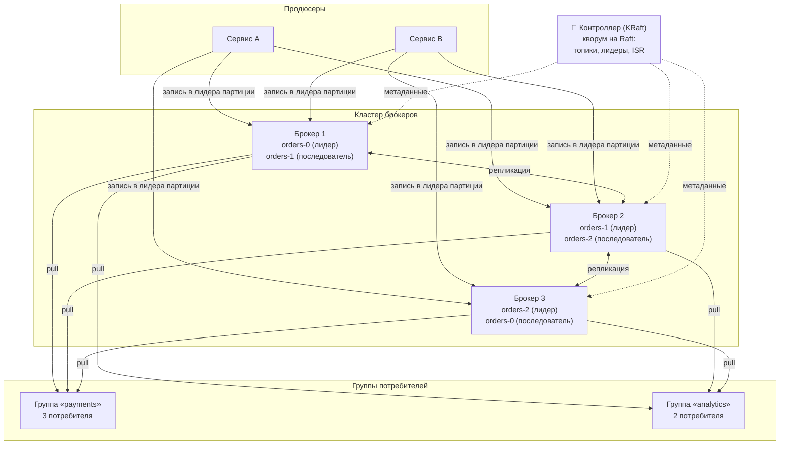
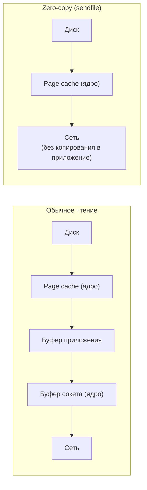
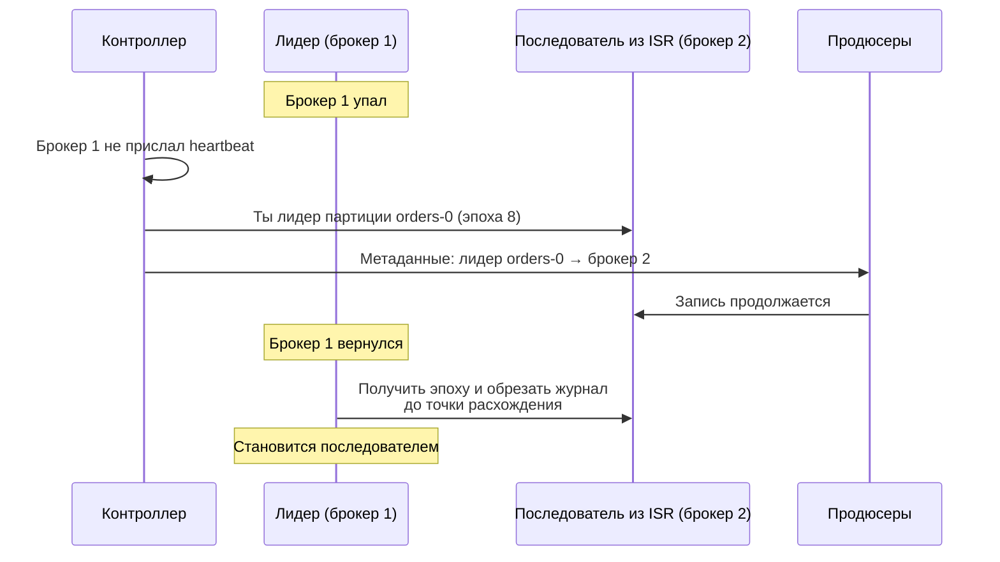
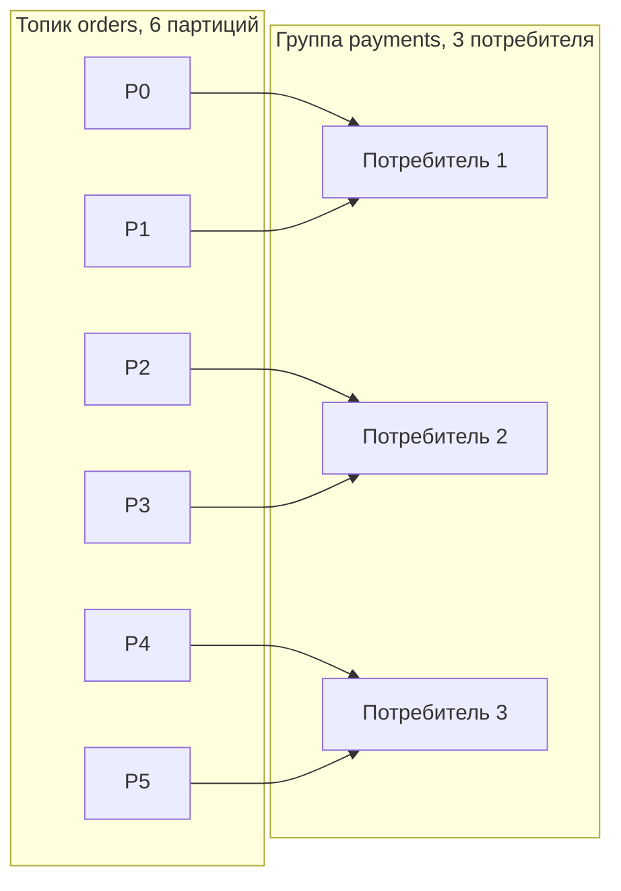
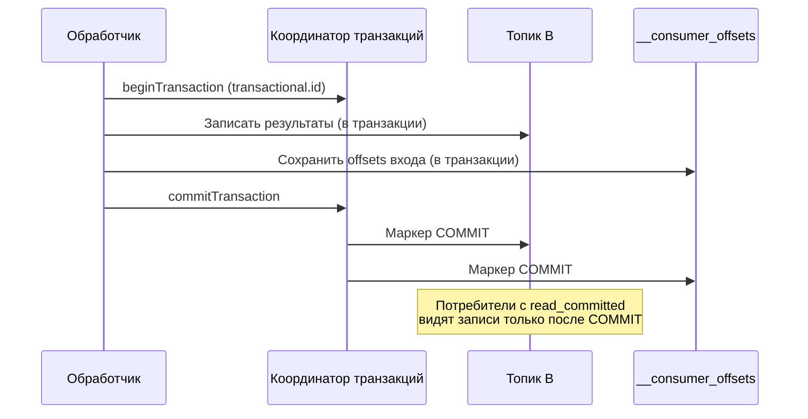

[English](README.md) | **Русский**

# Tier 1 · 18. Распределённая очередь сообщений (как Kafka)

> **Уровень:** Hard · **Время на интервью:** 45–60 мин · **Время на разбор:** ~5–6 ч
> **Ключевые аспекты:** партиционированный журнал только на добавление, сегменты и индексы, почему это быстро (последовательный ввод-вывод, page cache, zero-copy, пакеты), репликация (ISR, high watermark, acks), контроллер и метаданные (KRaft), consumer groups и ребалансировка, offsets и семантика доставки, exactly-once (идемпотентный продюсер, транзакции), retention, compaction, tiered storage
> **Опирается на:** [09-messaging](../../09-messaging/README_RU.md) (как **пользоваться** брокером), [05-replication](../../05-replication/README_RU.md), [08-consensus](../../08-consensus/README_RU.md), [06-partitioning](../../06-partitioning/README_RU.md), [10-idempotency](../../10-idempotency/README_RU.md)

---

## 🗺️ Как читать этот разбор

Разбор построен как интервью, но в каждом шаге есть объяснения: **почему** принимается решение, **как работает** механизм и **что будет**, если сделать иначе. Блоки «📘 Объяснение» — теория прямо по ходу задачи.

| Значок | Что значит |
|:------:|:-----------|
| 🎤 | Реплика интервьюера |
| 🗣️ | Что говорю вслух я (кандидат) |
| ✏️ | Что рисую на доске |
| ⏱️ | Сколько времени тратить на шаг |
| 📘 | Подробное объяснение концепции |

Блоки **TIP** — хороший приём, **WARNING** — ловушка, **IMPORTANT** — сигнал для уровня Senior+.

---

## 📑 Содержание

0. [Чему учит эта задача](#0-чему-учит-эта-задача)
1. [Условие задачи](#1-условие-задачи)
2. [Уточняющие вопросы и требования](#2-уточняющие-вопросы-и-требования)
3. [Оценки нагрузки](#3-оценки-нагрузки)
4. [API](#4-api)
5. [Хранение на диске](#5-хранение-на-диске)
6. [High-level дизайн](#6-high-level-дизайн)
7. [Deep dive 1: партиционированный журнал](#7-deep-dive-1-партиционированный-журнал)
8. [Deep dive 2: почему это быстро](#8-deep-dive-2-почему-это-быстро)
9. [Deep dive 3: репликация](#9-deep-dive-3-репликация)
10. [Deep dive 4: контроллер и метаданные](#10-deep-dive-4-контроллер-и-метаданные)
11. [Deep dive 5: потребители и consumer groups](#11-deep-dive-5-потребители-и-consumer-groups)
12. [Deep dive 6: exactly-once](#12-deep-dive-6-exactly-once)
13. [Deep dive 7: retention, compaction и tiered storage](#13-deep-dive-7-retention-compaction-и-tiered-storage)
14. [Deep dive 8: масштабирование и эксплуатация](#14-deep-dive-8-масштабирование-и-эксплуатация)
15. [Узкие места и сценарии сбоев](#15-узкие-места-и-сценарии-сбоев)
16. [Что изменится при росте в 10 раз](#16-что-изменится-при-росте-в-10-раз)
17. [Ключевые концепции и новые понятия](#17-ключевые-концепции-и-новые-понятия)
18. [Варианты задачи и follow-up вопросы](#18-варианты-задачи-и-follow-up-вопросы)
19. [Типичные ошибки](#19-типичные-ошибки)
20. [Шпаргалка и самопроверка](#20-шпаргалка-и-самопроверка)

---

## 0. Чему учит эта задача

В теме [09-messaging](../../09-messaging/README_RU.md) мы **пользовались** брокером сообщений. Здесь нужно **построить его**: систему, которая принимает миллионы сообщений в секунду, хранит их днями без потерь и раздаёт многим независимым потребителям.

| Что проверяют | Где это в задаче |
|:--------------|:-----------------|
| Хранение под конкретную нагрузку | Журнал только на добавление, сегменты, разреженные индексы |
| Понимание железа | Последовательный ввод-вывод, page cache, zero-copy |
| Репликация и консистентность | Лидер и последователи, ISR, high watermark, acks |
| Консенсус | Контроллер метаданных на Raft (KRaft) |
| Координация клиентов | Consumer groups, ребалансировка, offsets |
| Семантика доставки | At-most-once, at-least-once, exactly-once |
| Компромиссы долговечности и доступности | `min.insync.replicas`, unclean leader election |

> [!TIP]
> Ключевая мысль, с которой стоит начать: **это не очередь, а журнал**. Сообщения не удаляются после прочтения; каждый потребитель сам помнит, докуда прочитал (offset). Из этой идеи следует почти всё остальное: повторное чтение, много независимых потребителей, простое и быстрое хранение.

---

## 1. Условие задачи

> 🎤 «Спроектируй распределённую систему обмена сообщениями вроде Kafka: продюсеры публикуют сообщения в топики, потребители их читают. Нужны высокая пропускная способность, долговечность, порядок, горизонтальное масштабирование и возможность перечитать данные».

**Как ей пользуются:**

```
Сервис заказов   → publish("orders", key = order_id, value = {...})
Сервис оплаты    ← читает "orders" своей группой потребителей
Аналитика        ← читает те же "orders" независимо, своей группой
После бага       ← аналитика перечитывает "orders" за последние 3 дня
```

**План по времени:**

| Шаг | ⏱️ |
|:----|:--:|
| Требования | 4 мин |
| Оценки | 4 мин |
| API и хранение | 6 мин |
| High-level дизайн | 5 мин |
| Deep dives | 25–30 мин |
| Итоги | 3 мин |

---

## 2. Уточняющие вопросы и требования

⏱️ 4 мин

| Мой вопрос | Ответ интервьюера | Что это меняет и почему |
|:-----------|:------------------|:------------------------|
| Пропускная способность? | 1M сообщений/с на запись, ~3M/с на чтение (несколько групп потребителей) | Партиционирование, кластер брокеров |
| Размер сообщения? | ~1 КБ в среднем, до 1 МБ | ~1 ГБ/с входящего потока |
| Сколько хранить? | 7 дней, некоторые топики — бессрочно (последнее значение по ключу) | Retention и compaction |
| Порядок? | Внутри ключа — строгий | Ключ → партиция |
| Долговечность? | Подтверждённое сообщение не теряется при отказе одного брокера | Репликация, `acks=all` |
| Задержка? | p99 < 10–50 мс от публикации до чтения | Пакеты не должны ждать долго |
| Семантика? | At-least-once по умолчанию, exactly-once для некоторых конвейеров | Идемпотентный продюсер, транзакции |
| Повторное чтение? | Да | Журнал с offsets, а не удаление после чтения |

### Функциональные требования

1. Топики, разделённые на партиции; публикация с ключом.
2. Чтение группами потребителей: каждое сообщение — одному потребителю в группе; разные группы читают независимо.
3. Хранение по времени или размеру; compaction по ключу.
4. Чтение с произвольного offset (повторная обработка).
5. Создание топиков, изменение числа партиций, добавление брокеров.

### Нефункциональные требования

| Требование | Цель | Почему |
|:-----------|:-----|:-------|
| Пропускная способность | 1 ГБ/с записи, 3 ГБ/с чтения, линейный рост | Центральная шина данных компании |
| Долговечность | Без потерь подтверждённых сообщений при отказе брокера | Сообщения — источник правды для многих систем |
| Доступность | Работа при отказе брокеров и зоны | Остановка шины останавливает всю компанию |
| Порядок | В пределах партиции | Корректность обработки событий одной сущности |
| Задержка | Миллисекунды–десятки миллисекунд | Real-time конвейеры |

---

## 3. Оценки нагрузки

⏱️ 4 мин

```
Запись:            1M сообщений/с × 1 КБ = 1 ГБ/с
С репликацией ×3:  3 ГБ/с записи на диски кластера
Чтение:            3 группы потребителей × 1 ГБ/с = 3 ГБ/с
                   + 2 ГБ/с репликационного трафика (последователи читают у лидера)

Хранение:          1 ГБ/с × 86 400 × 7 дней ≈ 600 ТБ
                   × 3 реплики ≈ 1,8 ПБ

Брокер:            диски — сотни МБ/с – ~1 ГБ/с последовательной записи,
                   сеть 25 Гбит/с ≈ 3 ГБ/с
                   → ~40–50 брокеров, ~36 ТБ данных на брокер
Партиций:          тысячи (например, 3 000)
```

### Выводы

| Вывод | Следствие для дизайна |
|:------|:----------------------|
| Гигабайты в секунду | Только последовательная запись на диск, пакеты, zero-copy |
| Петабайты за 7 дней | Хранение на дешёвых дисках или tiered storage в объектном хранилище |
| Чтение в 3+ раза больше записи | Потребители читают из page cache, без копирований в приложении |
| Тысячи партиций | Метаданные нужно хранить и распространять эффективно |

---

## 4. API

⏱️ 2 мин

```
Продюсер
  send(topic, key, value, headers) → (partition, offset)
  настройки: acks = 0 | 1 | all, linger.ms, batch.size, compression, enable.idempotence

Потребитель
  subscribe(topics, group_id)
  poll(timeout) → [records]          ← pull: потребитель сам запрашивает данные
  commit(offsets)                    ← «группа дочитала партицию до offset N»
  seek(partition, offset)            ← перечитать с нужного места

Администрирование
  create_topic(name, partitions, replication_factor, retention, cleanup_policy)
  add_partitions(topic, n)
  reassign_partitions(plan)
```

---

## 5. Хранение на диске

⏱️ 4 мин

📘 **Партиция** — это упорядоченный журнал, который хранится как директория **сегментов**:

```
orders-7/                              ← партиция 7 топика orders
  00000000000000000000.log             ← сегмент: offsets 0 … 1 048 575 (закрыт)
  00000000000000000000.index           ← разреженный индекс: offset → позиция в файле
  00000000000000000000.timeindex       ← время → offset
  00000000000001048576.log             ← активный сегмент: запись идёт сюда
  00000000000001048576.index
  00000000000001048576.timeindex
```

| Элемент | Что это | Зачем |
|:--------|:--------|:------|
| **Сегмент** | Файл с записями; имя — первый offset в нём | Удаление старых данных — удаление целого файла |
| **Активный сегмент** | Последний, только в него идёт запись | Остальные неизменяемы |
| **Разреженный индекс** | Запись «offset → байтовая позиция» каждые ~4 КБ данных | Маленький, помещается в память |
| **Индекс времени** | «Время → offset» | Перечитать «с 14:00 вчера» |
| **Пакет записей** | Несколько сообщений с общим заголовком (базовый offset, CRC, producer id, sequence) | Сжатие и запись пачками |

### Поиск сообщения по offset

```
Найти offset 1 050 000:
  1. Двоичный поиск по именам сегментов → сегмент 00000000000001048576
  2. Двоичный поиск в его разреженном индексе → ближайший offset ≤ 1 050 000 и позиция в файле
  3. Последовательно прочитать от этой позиции до нужного offset (несколько КБ)
```

---

## 6. High-level дизайн

⏱️ 5 мин



🗣️ «Компоненты:
- **брокеры** хранят партиции; у каждой партиции один **лидер** (принимает запись и чтение) и несколько **последователей** на других брокерах;
- **контроллер** — небольшой кворум на Raft, хранит метаданные: какие топики и партиции есть, кто лидер, кто в ISR;
- **продюсеры** узнают из метаданных, где лидер нужной партиции, и пишут напрямую ему;
- **потребители** в группах сами забирают данные (pull) и сохраняют свои offsets».

---

## 7. Deep dive 1: партиционированный журнал

> 🎤 «Почему журнал, а не обычная очередь, в которой сообщения удаляются после прочтения?»

### Журнал против очереди

| | Классическая очередь (RabbitMQ, SQS) | Журнал (Kafka) |
|:-|:-------------------------------------|:---------------|
| После прочтения | Сообщение удаляется (после подтверждения) | Остаётся до истечения retention |
| Несколько потребителей | Нужна копия очереди на каждого | Каждая группа читает тот же журнал со своим offset |
| Повторное чтение | Невозможно | Сдвинуть offset назад |
| Состояние на брокере | Статус каждого сообщения (доставлено, подтверждено) | Только offset группы — одно число на партицию |
| Запись на диск | Случайные операции (удаление, пометки) | Только дозапись в конец |

📘 **Почему журнал проще и быстрее.** Брокеру не нужно помнить, какое сообщение кому доставлено и подтверждено, — это миллионы изменяемых состояний. Достаточно хранить неизменяемый журнал и **одно число на группу и партицию**. Запись — всегда в конец файла, удаление — целыми сегментами.

### Партиции

| Зачем | Как |
|:------|:----|
| **Параллелизм** | Топик делится на партиции на разных брокерах; запись и чтение идут параллельно |
| **Порядок по ключу** | Партиция = `hash(key) % число_партиций`: все сообщения одного заказа — в одной партиции, по порядку |
| **Масштабирование потребителей** | В группе одна партиция — одному потребителю; число партиций — потолок параллелизма группы |

📘 **Порядок гарантирован только внутри партиции.** Сообщения разных ключей в разных партициях могут обрабатываться в любом порядке относительно друг друга. Если нужен порядок по заказу — ключ = `order_id`. Глобальный порядок по всему топику требует одной партиции и убивает параллелизм.

### Сообщения без ключа

Раньше распределялись по кругу (каждое сообщение — в следующую партицию), что давало мелкие пакеты. Современный подход — **«липкое» партиционирование**: продюсер заполняет пакет для одной партиции, затем переключается на следующую — крупные пакеты и меньше запросов.

---

## 8. Deep dive 2: почему это быстро

> 🎤 «Как обычные диски выдерживают гигабайт в секунду?»

| Приём | Как работает | Эффект |
|:------|:-------------|:-------|
| **Последовательный ввод-вывод** | Запись только в конец файла | Последовательная запись даже на HDD — сотни МБ/с; случайная — в сотни раз медленнее |
| **Page cache ОС** | Брокер пишет в файлы и полагается на кэш ОС, а не держит данные в памяти процесса | Свежие данные читаются из памяти; нет двойного кэширования; перезапуск процесса не сбрасывает кэш |
| **Zero-copy (`sendfile`)** | Данные передаются из page cache прямо в сокет ядром, без копирования в память приложения | Меньше копий и переключений контекста — чтение почти бесплатно для CPU |
| **Пакеты** | Продюсер собирает сообщения в пакет (`linger.ms`, `batch.size`), брокер пишет и отдаёт пакеты целиком | Меньше запросов, лучше сжатие |
| **Сквозное сжатие** | Продюсер сжимает пакет; брокер хранит его сжатым как есть; потребитель распаковывает | Меньше диска и сети; брокер не тратит CPU на пересжатие |
| **Long poll на чтении** | Потребитель ждёт, пока накопится минимум данных (`fetch.min.bytes`) или истечёт время | Меньше пустых запросов |

### Путь данных при чтении



> [!NOTE]
> Компромисс пакетов: чем дольше продюсер ждёт заполнения пакета (`linger.ms`), тем выше пропускная способность и тем больше задержка. Для задержки 10 мс достаточно `linger.ms` в единицы миллисекунд.

> [!WARNING]
> Zero-copy не работает, если данные нужно преобразовать на брокере (например, шифрование TLS выполняется в пространстве пользователя в части реализаций или нужно пересжатие под другую версию формата). Поэтому важно, чтобы формат хранения совпадал с форматом передачи.

---

## 9. Deep dive 3: репликация

> 🎤 «Брокер с лидером партиции умер. Как не потерять подтверждённые сообщения?»

### Лидер и последователи

📘 У каждой партиции фактор репликации (обычно 3): один **лидер** и два **последователя** на разных брокерах (и в разных зонах доступности). Продюсеры пишут только лидеру; последователи **сами забирают** новые записи у лидера, как потребители.

### ISR и high watermark

| Понятие | Что значит |
|:--------|:-----------|
| **ISR (in-sync replicas)** | Реплики, которые не отстают от лидера дольше заданного времени (`replica.lag.time.max.ms`). Лидер всегда в ISR |
| **High watermark (HW)** | Наибольший offset, который есть **у всех реплик ISR**. Потребители видят только сообщения до HW |
| **Log end offset (LEO)** | Последний offset в журнале конкретной реплики |

```
Лидер:          offsets 0 … 1 000   (LEO = 1 000)
Последователь A: 0 … 1 000           (в ISR)
Последователь B: 0 … 998             (в ISR, чуть отстаёт)

High watermark = 998 → потребители читают до 998
Сообщения 999–1 000 станут видны, когда B их получит
```

📘 **Зачем HW.** Если бы потребители читали до LEO лидера, а лидер упал до репликации, новый лидер не имел бы сообщений 999–1 000 — потребители видели бы сообщения, которые потом «исчезли». HW гарантирует: прочитанное потребителем есть на всех репликах ISR.

### acks у продюсера

| `acks` | Когда продюсер получает подтверждение | Риск потери |
|:-------|:--------------------------------------|:------------|
| `0` | Сразу после отправки | Высокий: даже не знаем, дошло ли |
| `1` | Лидер записал у себя | Лидер упал до репликации → сообщение потеряно |
| `all` | Все реплики ISR записали | Нет, пока в ISR хотя бы одна живая реплика |

### min.insync.replicas

```
replication.factor = 3, min.insync.replicas = 2, acks = all

Все 3 живы:        запись подтверждается, когда 2+ реплики записали
Одна упала:        ISR = 2 → записи продолжаются, без потерь
Две упали:         ISR = 1 < 2 → записи отклоняются (NotEnoughReplicas)
                   → система выбирает долговечность, а не доступность записи
```

### Выбор нового лидера



| Механизм | Зачем |
|:---------|:------|
| Новый лидер — **только из ISR** | У него есть все подтверждённые сообщения |
| **Эпоха лидера** | Вернувшийся старый лидер узнаёт, что его последние неподтверждённые записи нужно отбросить, и обрезает журнал до общей точки |
| **Unclean leader election** (выключено по умолчанию) | Если ISR пуст, можно сделать лидером отстающую реплику — партиция снова доступна, но часть подтверждённых сообщений теряется. Компромисс доступность против долговечности |

> [!IMPORTANT]
> **Сигнал Senior+:** объяснить связку `acks=all` + `min.insync.replicas=2` + `replication.factor=3` + репликация между зонами: это и даёт «без потерь при отказе одного брокера или зоны», а отказ в записи при потере двух реплик — сознательный выбор долговечности (см. CAP в [07-consistency-models](../../07-consistency-models/README_RU.md)).

---

## 10. Deep dive 4: контроллер и метаданные

> 🎤 «Кто решает, какой брокер лидер, и как клиенты об этом узнают?»

### Что хранит контроллер

| Метаданные | Пример |
|:-----------|:-------|
| Топики и конфигурация | `orders`: 64 партиции, RF = 3, retention 7 дней |
| Размещение партиций | orders-0 → брокеры [1, 3, 5] |
| Лидеры и эпохи | orders-0: лидер 1, эпоха 7 |
| ISR | orders-0: [1, 3] |
| Живые брокеры | По heartbeat |

### ZooKeeper и KRaft

| | ZooKeeper (исторически) | KRaft |
|:-|:------------------------|:------|
| Где метаданные | Внешний кластер ZooKeeper | Внутренний кворум контроллеров на **Raft** (см. [08-consensus](../../08-consensus/README_RU.md)) |
| Эксплуатация | Две разные системы | Одна система |
| Масштаб | Восстановление контроллера при большом числе партиций — медленное | Метаданные — реплицируемый журнал событий; брокеры читают его как обычный топик |
| Статус | Удалён в Kafka 4.0 | Используется по умолчанию |

📘 **Метаданные как журнал.** В KRaft изменения метаданных («лидер orders-0 → брокер 2») — это записи в специальном журнале, реплицируемом Raft-кворумом. Брокеры применяют записи по порядку и всегда имеют согласованную картину; новый активный контроллер не загружает всё заново, а продолжает журнал.

### Как клиенты находят лидера

1. Клиент подключается к любому брокеру и запрашивает метаданные топика.
2. Получает таблицу «партиция → лидер» и кэширует её.
3. Пишет и читает напрямую у лидеров.
4. При ошибке «я больше не лидер» — обновляет метаданные и повторяет.

---

## 11. Deep dive 5: потребители и consumer groups

> 🎤 «Как несколько потребителей делят работу и не обрабатывают одно и то же?»

### Почему pull, а не push

| Pull (Kafka) | Push |
|:-------------|:-----|
| Потребитель сам задаёт скорость — естественная обратная связь | Брокер может перегрузить медленного потребителя |
| Потребитель забирает большие пакеты | Брокеру сложно выбрать размер пакета для каждого |
| Повторное чтение — просто запросить другой offset | Брокер должен помнить состояние каждого |
| Минус: пустые запросы, если данных нет | Решается long poll |

### Consumer group



| Правило | Следствие |
|:--------|:----------|
| В группе каждая партиция — **ровно одному** потребителю | Порядок внутри партиции сохраняется; сообщение не обрабатывается дважды внутри группы |
| Потребителей больше, чем партиций | Лишние простаивают |
| Разные группы | Читают один топик независимо, каждая со своими offsets |

### Ребалансировка

📘 При добавлении или уходе потребителя (или падении — нет heartbeat) **координатор группы** перераспределяет партиции.

| Подход | Как | Проблема |
|:-------|:----|:---------|
| **Eager** (старый) | Все потребители отдают все партиции, затем получают новое назначение | «Остановка мира»: вся группа стоит |
| **Cooperative incremental** | Переезжают только партиции, которые нужно переназначить | Остальные продолжают работать |
| **Static membership** | Потребитель с постоянным ID, перезапуск в пределах таймаута не вызывает ребалансировку | Перезапуски при деплое не трясут группу |

### Offsets и семантика доставки

📘 Группа сохраняет позиции во внутреннем compacted-топике `__consumer_offsets`: «группа payments, партиция 3, offset 18 204».

| Порядок действий | Семантика | Что при сбое |
|:-----------------|:----------|:-------------|
| Сохранить offset → обработать | **At-most-once** | Упал после сохранения, до обработки — сообщение потеряно |
| Обработать → сохранить offset | **At-least-once** | Упал после обработки, до сохранения — сообщение обработается снова |
| Обработка и offset в одной транзакции | **Exactly-once** | Deep dive 6 |

> [!TIP]
> Стандартный выбор — **at-least-once + идемпотентная обработка** на стороне потребителя (см. [10-idempotency](../../10-idempotency/README_RU.md)). Это проще и надёжнее, чем exactly-once, и работает с любыми внешними системами.

### Отставание (lag)

`lag = последний offset партиции − offset группы`. Главная метрика здоровья потребителей: растущий lag означает, что группа не успевает (см. [09-messaging](../../09-messaging/README_RU.md#10-backpressure-и-управление-потоком)).

---

## 12. Deep dive 6: exactly-once

> 🎤 «Продюсер повторил отправку после таймаута. Как не получить дубль? И как сделать exactly-once для “прочитал — обработал — записал”?»

### Идемпотентный продюсер

📘 Продюсер получает от брокера **producer id**, а каждому пакету в каждой партиции присваивает **последовательный номер**:

```
Продюсер 42, партиция orders-3:
  пакет seq = 7  → брокер записал, ответ потерян
  повтор seq = 7 → брокер видит: для продюсера 42 в этой партиции seq 7 уже есть → не пишет повторно, подтверждает
  пакет seq = 9  (а ожидался 8) → ошибка последовательности: пропуск
```

Брокер помнит последние несколько номеров для каждого продюсера и партиции. Повторы после таймаутов больше не создают дублей. В современных версиях идемпотентность включена по умолчанию.

### Транзакции

📘 Для конвейера «прочитать из топика A → обработать → записать в топик B» нужно, чтобы **запись в B и сохранение offset в A** произошли атомарно: либо оба, либо ничего.



| Элемент | Зачем |
|:--------|:------|
| `transactional.id` | Постоянный идентификатор обработчика; после перезапуска старые незавершённые транзакции отменяются (fencing «зомби»-экземпляров) |
| Координатор транзакций | Хранит состояние транзакций во внутреннем топике |
| Маркеры COMMIT / ABORT | Записываются в партиции; потребители пропускают отменённые записи |
| `isolation.level = read_committed` | Потребитель видит только подтверждённые транзакции |

> [!WARNING]
> Exactly-once Kafka работает **внутри Kafka** (из топика в топик). Если результат пишется во внешнюю базу или отправляется по HTTP, нужна идемпотентность на стороне получателя — транзакция Kafka не откатит запись в чужой системе.

---

## 13. Deep dive 7: retention, compaction и tiered storage

> 🎤 «Как удалять старые данные и как хранить “последнее значение по ключу” бессрочно?»

### Retention

| Политика | Как работает |
|:---------|:-------------|
| По времени (`retention.ms`) | Сегмент удаляется, когда его последнее сообщение старше порога |
| По размеру (`retention.bytes`) | Самые старые сегменты удаляются при превышении размера партиции |

Удаляются **целые закрытые сегменты** — простое удаление файла, без перезаписи данных.

### Log compaction

📘 Для топиков-«таблиц» (профиль пользователя, конфигурация, состояние) нужна не история, а **последнее значение по каждому ключу**. Compaction в фоне перезаписывает старые сегменты, оставляя только последнюю запись для каждого ключа:

```
До compaction:   (u1, A) (u2, X) (u1, B) (u3, M) (u2, Y) (u1, C)
После:           (u3, M) (u2, Y) (u1, C)

Удаление ключа: запись (u2, null) — «надгробие»; через некоторое время ключ исчезает совсем
```

| Где используется | Пример |
|:-----------------|:-------|
| Offsets групп | `__consumer_offsets` |
| CDC-потоки | Последняя версия строки таблицы |
| Состояние потоковых приложений | Changelog-топики Kafka Streams |

### Tiered storage

📘 Хранить 7 дней (или месяцы) на локальных дисках брокеров дорого, а перенос партиций между брокерами при масштабировании медленный — нужно копировать терабайты. **Tiered storage** выгружает закрытые сегменты в объектное хранилище; на брокере остаются только свежие данные.

| Плюс | Почему |
|:-----|:-------|
| Дешёвое долгое хранение | Объектное хранилище в разы дешевле дисков брокеров |
| Быстрое масштабирование | Новому брокеру не нужно копировать всю историю партиции |
| Чтение старых данных | Брокер подтягивает сегменты из объектного хранилища (медленнее, чем из page cache) |

---

## 14. Deep dive 8: масштабирование и эксплуатация

> 🎤 «Как добавить брокеры, сколько делать партиций и как работать в нескольких зонах?»

### Выбор числа партиций

| Фактор | Как влияет |
|:-------|:-----------|
| Нужная пропускная способность | Партиция выдерживает ограниченный поток (единицы–десятки МБ/с) → партиций ≥ поток / пропускная способность партиции |
| Параллелизм потребителей | Партиций ≥ максимальное число потребителей в группе |
| Слишком много партиций | Больше файлов, метаданных, дольше выбор лидеров при сбоях, больше памяти у клиентов |

> [!WARNING]
> Увеличение числа партиций **меняет отображение ключ → партиция** (`hash(key) % N`). Сообщения ключа начнут попадать в другую партицию, и порядок между старыми и новыми сообщениями этого ключа нарушится. Поэтому число партиций для топиков с ключами выбирают с запасом заранее.

### Добавление брокеров

- Новый брокер пуст; партиции переносятся на него планом переназначения.
- Перенос копирует данные → **ограничение скорости**, чтобы не мешать рабочему трафику.
- Tiered storage сокращает объём копирования.

### Зоны и регионы

| Задача | Решение |
|:-------|:--------|
| Реплики в разных зонах | **Rack awareness**: реплики партиции размещаются в разных зонах |
| Дорогой межзонный трафик потребителей | Чтение с последователя в своей зоне (fetch from follower) |
| Несколько регионов | Отдельные кластеры и асинхронная репликация между ними (MirrorMaker 2, cluster linking); offsets в разных кластерах разные — нужна трансляция при переключении |

### Журнал или очередь

| Нужно | Лучше подходит |
|:------|:---------------|
| Высокий поток, повторное чтение, много независимых потребителей, порядок по ключу | Kafka (журнал) |
| Подтверждение каждого сообщения, отложенная доставка, сложная маршрутизация, приоритеты | RabbitMQ, SQS (очередь) |

> [!NOTE]
> В Kafka развиваются и семантики очереди — **share groups** (KIP-932): несколько потребителей могут обрабатывать сообщения одной партиции с подтверждением каждого сообщения. Но классическая модель — журнал с offsets.

---

## 15. Узкие места и сценарии сбоев

| Сценарий | Что произойдёт | Как защищаемся |
|:---------|:---------------|:---------------|
| Брокер-лидер упал | Партиции временно без лидера | Новый лидер из ISR за секунды, клиенты обновляют метаданные |
| Лидер упал до репликации при `acks=1` | Потеря сообщений | `acks=all`, `min.insync.replicas=2` |
| Отказ двух реплик из трёх | Нельзя писать с `acks=all` | Сознательный выбор долговечности; реплики в разных зонах снижают вероятность |
| Медленный последователь | Пока он в ISR, high watermark растёт медленнее | Исключение из ISR по времени отставания, алерты |
| Повтор продюсера | Дубль | Идемпотентный продюсер |
| Потребитель упал после обработки | Повторная обработка | Идемпотентная обработка или транзакции |
| Частые ребалансировки | Группа стоит | Cooperative rebalancing, static membership |
| Горячая партиция | Перегрузка одного брокера | Лучший ключ, больше партиций, соление ключа |
| Заполнение дисков | Брокер падает | Retention, tiered storage, мониторинг |
| Контроллер недоступен | Нельзя менять метаданные и выбирать лидеров | Кворум из 3–5 контроллеров на Raft |

---

## 16. Что изменится при росте в 10 раз

> 🎤 «10 ГБ/с записи?»

| Изменение | Почему |
|:----------|:-------|
| **Сотни брокеров** и десятки тысяч партиций | Пропускная способность |
| **Tiered storage по умолчанию** | Хранение на дисках брокеров становится слишком дорогим |
| **Несколько кластеров** по доменам или командам | Изоляция сбоев и нагрузки |
| **Чтение с последователей в своей зоне** | Межзонный трафик |
| **Квоты на клиентов** | Один продюсер не должен занять весь кластер |

---

## 17. Ключевые концепции и новые понятия

### Что из Fundamentals применяется

| Концепция | Где разобрана | Как применяется здесь |
|:----------|:--------------|:----------------------|
| Использование брокера, семантика доставки, outbox | [09-messaging](../../09-messaging/README_RU.md) | Взгляд со стороны клиента |
| Лидер и последователи, кворумы | [05-replication](../../05-replication/README_RU.md) | Репликация партиций |
| Raft | [08-consensus](../../08-consensus/README_RU.md) | Контроллер KRaft |
| Партиционирование по ключу | [06-partitioning](../../06-partitioning/README_RU.md) | Ключ → партиция |
| Идемпотентность | [10-idempotency](../../10-idempotency/README_RU.md) | Обработка at-least-once |
| CAP: долговечность против доступности | [07-consistency-models](../../07-consistency-models/README_RU.md) | `min.insync.replicas`, unclean election |

### Новые понятия этой задачи

| Понятие | Кратко |
|:--------|:-------|
| **Журнал только на добавление** | Сообщения не удаляются после чтения; удаление — целыми сегментами |
| **Сегмент и разреженный индекс** | Файлы партиции и быстрый поиск offset |
| **Page cache и zero-copy** | Чтение из кэша ОС прямо в сокет |
| **ISR** | Реплики, не отстающие от лидера |
| **High watermark** | Offset, до которого данные есть на всех репликах ISR |
| **acks, min.insync.replicas** | Настройки долговечности записи |
| **Эпоха лидера** | Номер «поколения» лидера для обрезки расходящихся журналов |
| **KRaft** | Контроллер метаданных на Raft вместо ZooKeeper |
| **Consumer group, ребалансировка** | Распределение партиций между потребителями группы |
| **Идемпотентный продюсер** | Producer id + номер последовательности против дублей |
| **Транзакции Kafka** | Атомарная запись в несколько партиций вместе с offsets |
| **Log compaction** | Хранение последнего значения по ключу |
| **Tiered storage** | Старые сегменты в объектном хранилище |

---

## 18. Варианты задачи и follow-up вопросы

<details>
<summary><b>Почему Kafka полагается на page cache, а не на кэш в памяти процесса?</b></summary>

Кэш в JVM дублировал бы данные, которые ОС и так держит в page cache, и создавал бы нагрузку на сборщик мусора. Page cache переживает перезапуск процесса брокера и позволяет использовать zero-copy: данные идут из кэша прямо в сокет.
</details>

<details>
<summary><b>Как реализовать отложенную доставку («обработать через 10 минут»)?</b></summary>

В журнале нет удобной отложенной доставки. Варианты: отдельные топики по интервалам задержки (delay-5m, delay-1h), где потребитель ждёт, пока не наступит время сообщения; или внешний планировщик. Для сложных сценариев с задержками удобнее очередь вроде SQS или RabbitMQ.
</details>

<details>
<summary><b>Что если потребитель обрабатывает сообщения очень медленно?</b></summary>

Lag растёт. Решения: больше потребителей (до числа партиций), больше партиций (с осторожностью для топиков с ключами), пакетная обработка, асинхронная обработка внутри потребителя с сохранением порядка по ключу. Retention должен покрывать максимальное ожидаемое отставание, иначе данные удалятся до прочтения.
</details>

<details>
<summary><b>Как гарантировать порядок всех событий одного пользователя?</b></summary>

Ключ = `user_id`: все события пользователя в одной партиции, по порядку. Продюсер должен сохранять порядок при повторах — идемпотентный продюсер это обеспечивает даже при нескольких одновременных запросах к брокеру.
</details>

<details>
<summary><b>Чем Kafka отличается от Amazon Kinesis или Pulsar?</b></summary>

Kinesis — управляемый сервис с той же моделью партиционированного журнала (shards), но с другими лимитами и ценообразованием. Pulsar разделяет обслуживание (брокеры без состояния) и хранение (BookKeeper), что упрощает масштабирование и встроенную многоуровневость хранения. Модель «журнал + offsets + группы» у всех похожа.
</details>

---

## 19. Типичные ошибки

| ❌ Ошибка | Почему плохо | ✅ Как правильно |
|:---------|:-------------|:----------------|
| Проектировать как очередь с удалением после прочтения | Сложное состояние, нет повторного чтения | Журнал и offsets |
| Хранить сообщения в базе данных | Случайный ввод-вывод, медленно | Сегменты с дозаписью |
| Кэш сообщений в памяти процесса | Двойное кэширование, сборщик мусора | Page cache и zero-copy |
| Push к потребителям | Перегрузка медленных | Pull с long poll |
| `acks=1` для важных данных | Потеря при падении лидера | `acks=all` + `min.insync.replicas=2` |
| Показывать потребителям данные до репликации | «Исчезающие» сообщения | High watermark |
| Новый лидер из любой реплики | Потеря подтверждённых сообщений | Только из ISR (unclean election выключен) |
| Ожидать глобальный порядок | Его нет между партициями | Ключ для нужного порядка |
| Увеличивать партиции топика с ключами без учёта | Нарушение порядка по ключу | Число партиций с запасом заранее |
| Считать exactly-once Kafka сквозным | Внешние системы не откатываются | Идемпотентность на стороне получателя |

---

## 20. Шпаргалка и самопроверка

### Ответ за 30 секунд

> Топик делится на партиции; партиция — журнал только на добавление из сегментов с разреженными индексами offset и времени; ключ → партиция даёт порядок по ключу. Быстро за счёт последовательной записи, page cache ОС, zero-copy `sendfile`, пакетов и сквозного сжатия. Каждая партиция реплицируется ×3 по разным зонам: лидер принимает запись, последователи забирают данные; ISR и high watermark — потребители видят только реплицированное; `acks=all` + `min.insync.replicas=2` — без потерь при отказе брокера, новый лидер только из ISR, эпохи лидера обрезают расходящиеся журналы. Метаданные — кворум контроллеров на Raft (KRaft). Потребители тянут данные (pull, long poll), группы делят партиции, cooperative-ребалансировка, offsets — в compacted-топике; по умолчанию at-least-once + идемпотентная обработка. Идемпотентный продюсер (producer id + sequence) убирает дубли повторов; транзакции дают exactly-once из топика в топик. Retention удаляет целые сегменты, compaction хранит последнее значение по ключу, tiered storage выгружает старое в объектное хранилище.

### Самопроверка

- [ ] Могу объяснить, чем журнал отличается от очереди и почему это проще
- [ ] Могу описать сегменты, индексы и поиск по offset
- [ ] Могу назвать 6 причин высокой производительности
- [ ] Могу объяснить ISR, high watermark и LEO на примере
- [ ] Могу сравнить acks = 0 / 1 / all и объяснить min.insync.replicas
- [ ] Могу описать выбор нового лидера и роль эпохи
- [ ] Могу объяснить KRaft и зачем он заменил ZooKeeper
- [ ] Могу объяснить consumer groups, ребалансировку и семантику по порядку commit
- [ ] Могу объяснить идемпотентный продюсер и транзакции
- [ ] Могу объяснить retention, compaction и tiered storage
- [ ] Могу выбрать число партиций и объяснить риск их увеличения

### Что почитать

- Kreps, Narkhede, Rao, *Kafka: a Distributed Messaging System for Log Processing* (NetDB 2011)
- Jay Kreps, *The Log: What every software engineer should know about real-time data's unifying abstraction* (2013)
- Документация Apache Kafka: design, replication, KRaft, transactions
- KIP-500 (замена ZooKeeper), KIP-405 (tiered storage), KIP-932 (share groups)
- Gwen Shapira et al., *Kafka: The Definitive Guide* (O'Reilly)
- Alex Xu, Sahn Lam, *System Design Interview*, Vol. 2 — глава «Distributed Message Queue»